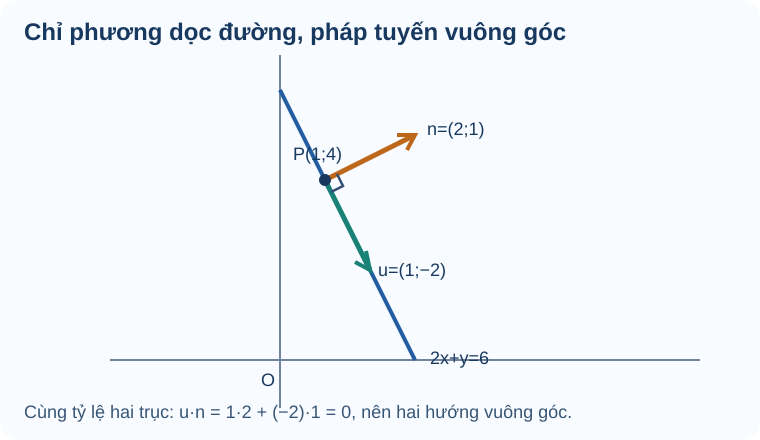

# Bài 19. Phương trình đường thẳng

TOÁN 10 · CHƯƠNG VII · KIẾN THỨC SGK KNTT

Nhận biết vectơ pháp tuyến, vectơ chỉ phương và viết phương trình đường thẳng từ dữ kiện hình học.

=== "Khám phá kiến thức"

    ### Cùng tìm hiểu

    Hãy tưởng tượng một con đường thẳng trên bản đồ. Em có thể mô tả nó bằng **một điểm mà đường đi qua** và **một hướng để đi dọc đường**. Đó là ý nghĩa của **vectơ chỉ phương**. Nhưng nếu muốn đo khoảng cách vuông góc từ một ngôi nhà đến con đường, ta cần một hướng **vuông góc với đường** — chính là **vectơ pháp tuyến**.

    Hai vectơ ấy không giống nhau. Chẳng hạn, đường \(2x+y=6\) có pháp tuyến \(\vec n=(2,1)\). Một vectơ chỉ phương của đường là \(\vec u=(1,-2)\), vì \(\vec u\cdot\vec n=2-2=0\). Từ một hình học đơn giản, em có thể suy ra các hệ số trong phương trình mà không cần nhớ máy móc.

    Bài học đi từ hai cách mô tả đường thẳng đến các dạng phương trình: tổng quát dùng pháp tuyến, tham số dùng điểm và chỉ phương. Khi đổi dạng, phải giữ **cùng tập điểm**, không chỉ thay ký hiệu.

    ### Ví dụ trực quan

    

    Khi nhìn một tuyến đường trên bản đồ, chỉ biết một điểm mà đường đi qua thì chưa đủ; ta còn phải biết đường đi theo hướng nào. Vectơ chỉ phương nằm dọc tuyến đường, còn vectơ pháp tuyến hướng vuông góc với tuyến đường. Hai hướng này có thể được nhận ra bằng tích vô hướng: với hai vectơ khác vectơ không, tích vô hướng bằng 0 chính là dấu hiệu chúng vuông góc. Một đường thẳng có thể nhận nhiều vectơ chỉ phương hoặc pháp tuyến, miễn là chúng cùng hướng tương ứng và không bằng vectơ không.

    Hãy hình dung một mũi tên chạy theo đường và một mũi tên dựng vuông góc với nó. Nếu pháp tuyến là (n=(a,b)≠(0,0)), ta có thể chọn chỉ phương (u=(-b,a)): tích vô hướng (n· u=a(-b)+ba=0). Như vậy, cách đổi vectơ xuất phát từ quan hệ vuông góc, không phải từ một quy tắc đổi dấu học thuộc.

    **Em vận dụng.** Cho n=(2,3) là pháp tuyến của d. Vectơ u=(-3,2) có phải một chỉ phương của d không? Nêu phép kiểm.

    ??? question "Đối chiếu"

        **Đáp án:** Có, vì n·u=2(-3)+3(2)=0 và u≠(0,0).

        **Lý do:** Tích vô hướng bằng 0 chứng minh u vuông góc với pháp tuyến n, tức song song với đường thẳng d; u không phải vectơ không.

        **Nếu chưa đúng:** Mở hướng dẫn tự sửa ngay bên dưới, xem lại bước còn vướng rồi thử một câu cùng kiến thức.

    <a href="../luyen-tap/?item=THPT-G10-B19-C01">Mở câu luyện tập tương ứng để tự luyện</a>

    

    Từ hướng vuông góc ấy, ta có thể viết một điều kiện xác định toàn bộ các điểm trên đường thẳng. Giả sử đường đi qua (A(x_0,y_0)) và có pháp tuyến (n=(a,b)≠(0,0)). Với một điểm bất kỳ (M(x,y)), vectơ dịch chuyển (AM=(x-x_0,y-y_0)) phải vuông góc với (n) nếu (M) nằm trên đường. Vì thế (n· AM=0), hay (a(x-x_0)+b(y-y_0)=0).

    Trong hình dung hình học, (M) trượt dọc đường qua (A), còn (n) luôn vuông góc với hướng trượt; hình chiếu của (AM) lên (n) bằng 0. Khai triển đẳng thức trên cho phương trình tổng quát, rồi thử lại tọa độ (A) để kiểm tra. Đừng chọn (n=(0,0)), vì khi ấy phương trình không xác định một đường thẳng.

    **Em vận dụng.** Đường thẳng qua A(1,3), pháp tuyến n=(2,-1) có phương trình tổng quát nào?

    ??? question "Đối chiếu"

        **Đáp án:** 2(x-1)-(y-3)=0 hay 2x-y+1=0.

        **Lý do:** AM=(x-1,y-3), n·AM=2(x-1)-(y-3); thế A được 0. Không tự đảo vai trò n với vectơ chỉ phương.

        **Nếu chưa đúng:** Mở hướng dẫn tự sửa ngay bên dưới, xem lại bước còn vướng rồi thử một câu cùng kiến thức.

    <a href="../luyen-tap/?item=THPT-G10-B19-C02">Mở câu luyện tập tương ứng để tự luyện</a>

    

    Một cách khác để mô tả đường thẳng là xuất phát từ (A), rồi đi những đoạn dài ngắn tùy ý theo một vectơ chỉ phương (u≠(0,0)). Nhân vectơ với số thực (t) tạo độ dời (t u), nên vị trí mới có dạng (M=A+t u). Khi (t=0), ta ở (A); khi (t=1), ta đi thêm một vectơ (u); với (t<0), ta đi ngược hướng.

    Đó là ý nghĩa của phương trình tham số (x=x_A+t u_x, y=y_A+t u_y) với (t∈ℝ). Chữ (t) chỉ là một tham số quét các vị trí trên đường, không nhất thiết là thời gian và cũng không phải một tọa độ. Khi lập phương trình, thử hai giá trị (t=0,1) là cách kiểm nhanh điểm xuất phát và hướng đi.

    **Em vận dụng.** Viết phương trình tham số đường thẳng qua A(1,-1), chỉ phương u=(-2,3).

    ??? question "Đối chiếu"

        **Đáp án:** x=1-2t, y=-1+3t (t∈ℝ).

        **Lý do:** Khi t=0 thu A; khi t=1 thu A+u=(-1,2). Mọi điểm thuộc đường có độ dời t·u.

        **Nếu chưa đúng:** Mở hướng dẫn tự sửa ngay bên dưới, xem lại bước còn vướng rồi thử một câu cùng kiến thức.

    <a href="../luyen-tap/?item=THPT-G10-B19-P01">Mở câu luyện tập tương ứng để tự luyện</a>

    

    Nếu bản đồ cho hai điểm (A) và (B) phân biệt, ta chưa cần đo góc hay đo độ dài để tìm hướng: vectơ (AB=(x_B-x_A,y_B-y_A)) đã nằm dọc đường cần dựng. Do (A≠ B), vectơ này khác 0 và có thể dùng làm chỉ phương. Chọn một vectơ pháp tuyến vuông góc với (AB), rồi dùng điều kiện (n· AM=0) để xác định đường qua (A).

    Có thể hình dung mũi tên (AB) nối hai mốc và pháp tuyến dựng vuông góc với mũi tên ấy. Sau khi viết phương trình, hãy thế tọa độ cả (A) lẫn (B) để kiểm tra. Nếu hai điểm trùng nhau, không có hướng (AB) khác 0; một điểm duy nhất không xác định được một đường thẳng duy nhất.

    **Em vận dụng.** Cho A(-1,2), B(2,5). Viết một phương trình tổng quát của đường AB.

    ??? question "Đối chiếu"

        **Đáp án:** x-y+3=0.

        **Lý do:** AB=(3,3)≠0, chọn n=(1,-1). Qua A: (x+1)-(y-2)=0 ⇒ x-y+3=0; thế B: 2-5+3=0.

        **Nếu chưa đúng:** Mở hướng dẫn tự sửa ngay bên dưới, xem lại bước còn vướng rồi thử một câu cùng kiến thức.

    <a href="../luyen-tap/?item=THPT-G10-B19-P02">Mở câu luyện tập tương ứng để tự luyện</a>

    

    Khi đã có phương trình (ax+by+c=0), ta không cần nhìn hình để đoán xem một địa điểm có nằm trên đường hay không. Phương trình chính là điều kiện mà tọa độ mọi điểm thuộc đường phải thỏa. Với (M(x_M,y_M)), chỉ cần tính (ax_M+by_M+c): kết quả bằng 0 thì (M) thuộc đường, còn khác 0 thì không.

    Trên một hình phác, một điểm nằm sát nét vẽ vẫn có thể không thuộc đường; phép thế mới cho kết luận chính xác. Hãy giữ nguyên dấu của từng hạng tử khi thay tọa độ, và thử riêng từng điểm thay vì suy từ cảm giác gần hay xa.

    **Em vận dụng.** Với d: 2x-3y+1=0, M(1,1) và N(2,1) điểm nào thuộc d?

    ??? question "Đối chiếu"

        **Đáp án:** M thuộc d vì 2-3+1=0; N không thuộc vì 4-3+1=2.

        **Lý do:** Điểm thuộc là nghiệm của phương trình theo cặp tọa độ. Đây là phép thử hai lần độc lập.

        **Nếu chưa đúng:** Mở hướng dẫn tự sửa ngay bên dưới, xem lại bước còn vướng rồi thử một câu cùng kiến thức.

    <a href="../luyen-tap/?item=THPT-G10-B19-P03">Mở câu luyện tập tương ứng để tự luyện</a>

    

    Khi hai tuyến đường gặp nhau, ta cần trả lời hai câu hỏi khác nhau: chúng gặp ở đâu và chúng có vuông góc không? Tọa độ giao điểm phải thỏa đồng thời hai phương trình, vì vậy ta dùng phương pháp giải hệ và thế nghiệm tìm được trở lại cả hai đường. Một điểm chỉ thuộc một trong hai đường thì chưa phải giao điểm.

    Còn quan hệ vuông góc là chuyện hướng, không phụ thuộc vào vị trí giao. Mỗi đường có một vectơ pháp tuyến; nếu tích vô hướng hai pháp tuyến bằng 0 thì hai đường vuông góc. Trên hình, hãy phân biệt dấu chấm tại giao điểm với dấu góc vuông: một phép tính tìm vị trí, phép tính còn lại kiểm hướng.

    **Em vận dụng.** Hai đường d1: x+y=4, d2: x-y=2 gặp nhau ở đâu và có vuông góc không?

    ??? question "Đối chiếu"

        **Đáp án:** Giao I(3,1); hai đường vuông góc.

        **Lý do:** Cộng hai phương trình được 2x=6 ⇒ x=3, y=1. Pháp tuyến (1,1) và (1,-1) có tích vô hướng 1-1=0.

        **Nếu chưa đúng:** Mở hướng dẫn tự sửa ngay bên dưới, xem lại bước còn vướng rồi thử một câu cùng kiến thức.

    <a href="../luyen-tap/?item=THPT-G10-B19-P06">Mở câu luyện tập tương ứng để tự luyện</a>

    

    Hai cặp số liệu cũng có thể xác định một mô hình đường thẳng, chẳng hạn giá trị (V) thay đổi theo thời gian (t). Nhớ rằng hệ số góc mô tả mức tăng của đại lượng đứng khi đại lượng ngang tăng một đơn vị. Qua hai điểm \((x_1,y_1)\), \((x_2,y_2)\) với \(x_1\ne x_2\), ta tìm \(m=(y_2-y_1)/(x_2-x_1)\), rồi dùng một điểm để xác định \(b\) trong \(y=mx+b\).

    Trên biểu đồ, (m) tương ứng với độ tăng theo trục đứng chia cho độ tăng theo trục ngang; mỗi trục cần ghi đúng đơn vị. Giá trị (b) là mức dự đoán khi (x=0). Mô hình đường thẳng chỉ là một giả thiết phù hợp trong miền xét, nên sau khi kiểm lại hai điểm dữ liệu, cần nói rõ giới hạn của việc dự đoán xa hơn.

    **Em vận dụng.** Giá trị V theo thời gian t (t≥0) đi qua (0,5) và (2,9), giả sử tuyến tính. Lập V(t) và tính V(3).

    ??? question "Đối chiếu"

        **Đáp án:** V(t)=2t+5, V(3)=11.

        **Lý do:** Hệ số góc (9-5)/(2-0)=2, giá trị tại t=0 là 5. Đây là phép ngoại suy t=3, chỉ hợp lý nếu giả thiết tăng đều vẫn đúng.

        **Nếu chưa đúng:** Mở hướng dẫn tự sửa ngay bên dưới, xem lại bước còn vướng rồi thử một câu cùng kiến thức.

    <a href="../luyen-tap/?item=THPT-G10-B19-P04">Mở câu luyện tập tương ứng để tự luyện</a>

    ### Thuật ngữ, kiến thức và kỹ năng

    **Thuật ngữ:** Vectơ chỉ phương, vectơ pháp tuyến, phương trình tổng quát, phương trình tham số, tham số (t), điểm thuộc đường thẳng.

    **Sau bài học, em cần làm được:** Dựng đường từ điểm và vectơ; đổi giữa dạng tổng quát và tham số; tìm đường qua hai điểm phân biệt; kiểm điểm thuộc và tính giao khi đủ điều kiện.

=== "Kiến thức SGK"

    ### 2.1. Phương trình tổng quát của đường thẳng

    #### Vectơ pháp tuyến và vectơ chỉ phương

    <figure class="thpt-r4-plot thpt-r4-concept-figure"><figcaption>Đường thẳng \(d:2x+y=6\) có một vectơ chỉ phương \((1,-2)\) và một pháp tuyến \((2,1)\). Hai vectơ vuông góc vì tích vô hướng bằng 0.</figcaption></figure>

    **Cách đọc hình.** Quan sát vectơ chỉ phương \(\vec u=(1,-2)\) đi dọc đường \(2x+y=6\), còn \(\vec n=(2,1)\) vuông góc với đường. Điểm \(P(1,4)\) nằm trên đường vì \(2\cdot1+4=6\).
    Đường thẳng \(\Delta\) nhận **vectơ pháp tuyến** \(\vec n=(a;b)\ne(0;0)\) khi \(\vec n\) vuông góc với đường thẳng. Đường thẳng nhận **vectơ chỉ phương** \(\vec u=(u_1;u_2)\ne(0;0)\) khi \(\vec u\) song song với đường thẳng.

    Nếu \(\vec n=(a;b)\) thì có thể chọn \(\vec u=(-b;a)\). Cần phân biệt rõ vai trò hai vectơ, không lấy nhầm vectơ nối hai điểm làm pháp tuyến.

    Qua điểm \(M_0(x_0;y_0)\) và pháp tuyến \(\vec n=(a;b)\):

    \[
    a(x-x_0)+b(y-y_0)=0,\quad a^2+b^2>0.
    \]

    Đây là phương trình tổng quát \(ax+by+c=0\).

    ### 2.2. Phương trình tham số của đường thẳng

    Với vectơ chỉ phương \(\vec u=(u_1;u_2)\), phương trình tham số là:

    \[
    \begin{cases}x=x_0+u_1t,\\y=y_0+u_2t,\end{cases}\qquad t\in\mathbb R.
    \]

    Nếu đường thẳng đi qua \(A\) và \(B\), **phải có \(A\ne B\)** mới dùng được \(\overrightarrow{AB}\) làm vectơ chỉ phương.

=== "Ví dụ"

    Trước khi xem lời giải, hãy xác định dữ kiện, điều phải tìm và lý do chọn cách giải. Sau đó kiểm tra lại điều kiện áp dụng và kết quả, thay vì chỉ nhìn phép tính cuối cùng.

    ### Ví dụ — Từ điểm và pháp tuyến đến phương trình

    **Đề bài.** Lập phương trình đường thẳng qua \(P(1,4)\) có vectơ pháp tuyến \(\vec n=(2,1)\). Tìm một vectơ chỉ phương.

    **Vì sao chọn cách này?** Dữ kiện cho **pháp tuyến**, vì vậy phương trình tổng quát qua điểm là con đường trực tiếp nhất.

    **Lời giải.** \(2(x-1)+(y-4)=0\), hay \(2x+y-6=0\). Vectơ \(\vec u=(1,-2)\) có \(\vec u\cdot\vec n=2-2=0\), nên là một vectơ chỉ phương. 

    **Kiểm lại:** \(P(1,4)\) thỏa \(2+4-6=0\).

    ### Ví dụ 2 — Viết hai dạng phương trình của đường thẳng qua hai điểm

    **Đề bài.** Cho \(A(1;2)\), \(B(4;3)\). Hãy viết phương trình tổng quát và phương trình tham số của đường thẳng \(AB\).

    **Vì sao chọn cách này?** Hai điểm phân biệt cho một vectơ chỉ phương; từ đó chọn một vectơ pháp tuyến để lập phương trình tổng quát.

    **Lời giải.** Ta có \(\overrightarrow{AB}=(3;1)\), nên một pháp tuyến là \((1;-3)\).

    - Dạng tổng quát: \((x-1)-3(y-2)=0\), hay \(\boxed{x-3y+5=0}\).
    - Dạng tham số: \(x=1+3t,\ y=2+t,\ t\in\mathbb R\).
    - Kiểm tra: thế tọa độ \(A,B\) vào phương trình tổng quát đều cho \(0\).

    **Vì sao:** điểm \(M\) thuộc đường thẳng khi \(\overrightarrow{AM}\perp\vec n\); biểu thức tham số quét mọi bội số của vectơ chỉ phương.

    !!! tip "Tự nhớ"
        Trong \(ax+by+c=0\), không được để đồng thời \(a=b=0\). Hai phương trình khác hệ số vẫn có thể xác định **cùng một đường thẳng** nếu toàn bộ hệ số tỉ lệ.

=== "Lỗi thường gặp"

    

    ??? tip "Tự khắc phục theo năm bước"

        1. **Nhận diện lỗi:** Nếu dùng n làm chỉ phương, em đang nhầm hai vai trò vuông góc.

        2. **Quay lại bản chất:** Vectơ chỉ phương nằm dọc đường; pháp tuyến vuông góc đường. Cùng một đường thẳng có vô số vectơ cùng phương hoặc pháp tuyến khác nhau bởi bội khác 0.

        3. **Tự sửa:** Vẽ hai mũi tên dọc/vuông góc; tính lại 2(-3)+3(2) trước khi áp dụng.

        4. **Tự đối chiếu:** xem lại lời giải trên sau khi em tự làm; kiểm các điều kiện và dữ kiện của bài vừa Tự thử.

        5. **Luyện tiếp:** Dùng liên kết bên dưới để luyện câu cùng kiến thức. Nếu đã xem lời giải, hãy chọn thêm câu khác và tự làm mà không dựa vào gợi ý.

    

    ??? tip "Tự khắc phục theo năm bước"

        1. **Nhận diện lỗi:** Nếu phương trình không đi qua A, em đã mất dấu khi trừ tọa độ gốc.

        2. **Quay lại bản chất:** M thuộc đường qua A có pháp tuyến n khi độ dịch chuyển AM không có thành phần theo n: n·AM=0. Đây là nguồn gốc phương trình, không phải một công thức học thuộc.

        3. **Tự sửa:** Thay ngay A(1,3) vào phương trình: phải được 0 trước khi luyện tiếp.

        4. **Tự đối chiếu:** xem lại lời giải trên sau khi em tự làm; kiểm các điều kiện và dữ kiện của bài vừa Tự thử.

        5. **Luyện tiếp:** Dùng liên kết bên dưới để luyện câu cùng kiến thức. Nếu đã xem lời giải, hãy chọn thêm câu khác và tự làm mà không dựa vào gợi ý.

    

    ??? tip "Tự khắc phục theo năm bước"

        1. **Nhận diện lỗi:** Nếu đảo u thành pháp tuyến hoặc thiếu tham số chung t, hai phương trình không mô tả đúng một đường.

        2. **Quay lại bản chất:** Điểm trên đường thẳng có dạng M=A+t·u với t thực. Tham số t không nhất thiết là thời gian; nó chỉ là hệ số quét các vị trí.

        3. **Tự sửa:** Thử lại t=0, t=1 và vẽ đường nối hai điểm thu được.

        4. **Tự đối chiếu:** xem lại lời giải trên sau khi em tự làm; kiểm các điều kiện và dữ kiện của bài vừa Tự thử.

        5. **Luyện tiếp:** Dùng liên kết bên dưới để luyện câu cùng kiến thức. Nếu đã xem lời giải, hãy chọn thêm câu khác và tự làm mà không dựa vào gợi ý.

    

    ??? tip "Tự khắc phục theo năm bước"

        1. **Nhận diện lỗi:** Nếu lấy AB làm pháp tuyến, đường mới thường vuông góc với AB thay vì đi qua cả A,B.

        2. **Quay lại bản chất:** Hai điểm phân biệt xác định một hướng AB không bằng 0; từ đó chọn được pháp tuyến và viết được phương trình.

        3. **Tự sửa:** Vẽ đoạn AB, kiểm n·AB=0 và thế từng điểm vào phương trình.

        4. **Tự đối chiếu:** xem lại lời giải trên sau khi em tự làm; kiểm các điều kiện và dữ kiện của bài vừa Tự thử.

        5. **Luyện tiếp:** Dùng liên kết bên dưới để luyện câu cùng kiến thức. Nếu đã xem lời giải, hãy chọn thêm câu khác và tự làm mà không dựa vào gợi ý.

    

    ??? tip "Tự khắc phục theo năm bước"

        1. **Nhận diện lỗi:** Nếu chỉ nhìn số hạng đầu hoặc bỏ dấu âm của 3y, phép thử có thể sai.

        2. **Quay lại bản chất:** Phương trình đường thẳng là điều kiện ràng buộc tọa độ; 'thuộc' không dựa vào nhìn gần đúng mà là thỏa chính xác điều kiện.

        3. **Tự sửa:** Lập hai dòng thay tọa độ từng điểm, so với 0 trước khi kết luận.

        4. **Tự đối chiếu:** xem lại lời giải trên sau khi em tự làm; kiểm các điều kiện và dữ kiện của bài vừa Tự thử.

        5. **Luyện tiếp:** Dùng liên kết bên dưới để luyện câu cùng kiến thức. Nếu đã xem lời giải, hãy chọn thêm câu khác và tự làm mà không dựa vào gợi ý.

    

    ??? tip "Tự khắc phục theo năm bước"

        1. **Nhận diện lỗi:** Nếu chỉ giải được giao điểm mà suy ra vuông góc, em đã đánh đồng vị trí với góc.

        2. **Quay lại bản chất:** Giao điểm phải thỏa đồng thời hai phương trình; vuông góc là quan hệ hướng, không phụ thuộc vị trí giao.

        3. **Tự sửa:** Tách làm hai cột: 'I thỏa hai phương trình' và 'n1·n2=0' rồi kiểm riêng.

        4. **Tự đối chiếu:** xem lại lời giải trên sau khi em tự làm; kiểm các điều kiện và dữ kiện của bài vừa Tự thử.

        5. **Luyện tiếp:** Dùng liên kết bên dưới để luyện câu cùng kiến thức. Nếu đã xem lời giải, hãy chọn thêm câu khác và tự làm mà không dựa vào gợi ý.

    

    ??? tip "Tự khắc phục theo năm bước"

        1. **Nhận diện lỗi:** Nếu viết V=5t+2, em đã nhầm hệ số góc với giá trị ban đầu.

        2. **Quay lại bản chất:** Một quan hệ y=mx+b mô tả mỗi khi x tăng một đơn vị, y tăng m đơn vị; b là giá trị tại x=0. Mô hình chỉ đáng tin trong miền dữ liệu phù hợp.

        3. **Tự sửa:** Kiểm cả V(0)=5 và V(2)=9 trước khi tính V(3).

        4. **Tự đối chiếu:** xem lại lời giải trên sau khi em tự làm; kiểm các điều kiện và dữ kiện của bài vừa Tự thử.

        5. **Luyện tiếp:** Dùng liên kết bên dưới để luyện câu cùng kiến thức. Nếu đã xem lời giải, hãy chọn thêm câu khác và tự làm mà không dựa vào gợi ý.

    

    ??? tip "Nhầm vectơ pháp tuyến/chỉ phương"

        
<strong>Dấu hiệu:</strong> Từ ax+by+c=0 dùng (a;b) làm chỉ phương, hoặc chấp nhận vectơ không.

        
<strong>Bản chất toán:</strong> Với (a;b)≠(0;0), n=(a;b) là pháp tuyến, u=(-b;a) có thể làm chỉ phương vì n·u=0 và u≠0.

        
<strong>Tự sửa:</strong> Ôn B19 mục 1: đánh dấu n và u, tự kiểm n·u=0 rồi mới viết phương trình.

        
<strong>Kiến thức cần ôn:</strong> Vectơ tọa độ, tích vô hướng; B19 mục 1.

        
<strong>Luyện lại bài đã có:</strong> <a data-thpt-formative-id="THPT-G10-B19-C01" href="../luyen-tap/?item=THPT-G10-B19-C01">Luyện lại câu 19-C01</a> · <a data-thpt-formative-id="THPT-G10-B19-P05" href="../luyen-tap/?item=THPT-G10-B19-P05">Luyện lại câu 19-P05</a>

    

    ??? tip "Viết đường thẳng qua hai điểm chưa kiểm điều kiện"

        
<strong>Dấu hiệu:</strong> Nhầm AB là pháp tuyến, quên A≠B hoặc không thử nghiệm kết quả.

        
<strong>Bản chất toán:</strong> Chỉ khi A≠B, AB khác 0 và là một vectơ chỉ phương; chọn n vuông góc AB, rồi thế cả A và B để kiểm phương trình.

        
<strong>Tự sửa:</strong> Ôn B19 mục 2–3: tìm vectơ \(\overrightarrow{AB}\) với \(A\ne B\), chọn \(\vec n=(a;b)\) vuông góc \(\overrightarrow{AB}\); viết \(a(x-x_A)+b(y-y_A)=0\) (tương đương \(\vec n\cdot\overrightarrow{AM}=0\)); thử lại cả A và B.

        
<strong>Kiến thức cần ôn:</strong> Hiệu tọa độ hai điểm, vectơ khác 0; B19 mục 2–3.

        
<strong>Luyện lại bài đã có:</strong> <a data-thpt-formative-id="THPT-G10-B19-P02" href="../luyen-tap/?item=THPT-G10-B19-P02">Luyện lại câu 19-P02</a> · <a data-thpt-formative-id="THPT-G10-B19-P06" href="../luyen-tap/?item=THPT-G10-B19-P06">Luyện lại câu 19-P06</a> · <a data-thpt-formative-id="THPT-G10-CHVII-W19-01" href="../../../thu-vien/tu-luan-chuong-vii/#thpt-g10-chvii-w19-01">Bài tự luận liên quan</a>

    **Học tiếp:** [Core và Luyện tập](luyen-tap.md) · [Tự kiểm tra cuối chương](tu-kiem-tra-chuong.md).

    
Nguồn toán học: SGK Toán 10 Kết nối tri thức với cuộc sống và học liệu SLM hiện hành. Lời giảng được biên tập nhằm hỗ trợ tự học độc lập.

<small>Nguồn đối chiếu: SGK KNTT Toán 10 tập 2, trang in 30–35; SBT trang 28–31. </small>
