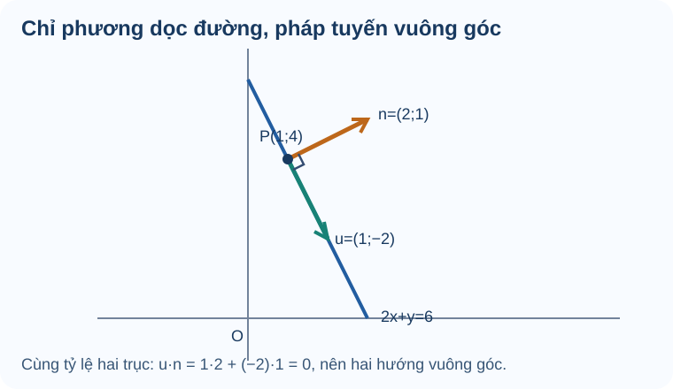

# Bài 19. Phương trình đường thẳng

TOÁN 10 · CHƯƠNG VII · KIẾN THỨC SGK KNTT

Nhận biết vectơ pháp tuyến, vectơ chỉ phương và viết phương trình đường thẳng từ dữ kiện hình học.

=== "Khám phá kiến thức"

    ### Cùng tìm hiểu

    Trong hình học, ta biết một đường thẳng có thể đi qua hai điểm. Nhưng nếu muốn tìm tất cả các điểm nằm trên đường ấy bằng phép tính, ta cần diễn tả đường thẳng bằng một **phương trình**. Khi đó, việc kiểm điểm thuộc đường hay xác định giao điểm trở thành một bài toán tọa độ.

    Hãy hình dung một đường trên bản đồ. Chỉ một điểm trên đường chưa nói được đường chạy theo hướng nào. Ta cần thêm một mũi tên chỉ hướng **dọc đường** (vectơ chỉ phương), hoặc một mũi tên chỉ hướng **vuông góc với đường** (vectơ pháp tuyến). Hai cách mô tả ấy dẫn đến hai dạng phương trình khác nhau nhưng biểu diễn **cùng một tập hợp điểm**.

    Trước khi dùng công thức, em chỉ cần nhớ tọa độ một vectơ, phép cộng vectơ, tích vô hướng của hai vectơ và cách kiểm hai vectơ vuông góc. Ta sẽ bắt đầu từ hình vẽ, lập điều kiện cho tọa độ rồi mới rút ra quy tắc.

    ### Ví dụ trực quan

    #### 1.2.1. Hai vectơ cho biết hướng của đường thẳng

    Khi nhìn một đường thẳng, em có thể chọn một mũi tên nằm **dọc theo đường** để chỉ hướng đi. Đó là vectơ chỉ phương. Một mũi tên **vuông góc** với đường được gọi là vectơ pháp tuyến. Cả hai đều phải khác vectơ không, vì một mũi tên không có độ dài thì không xác định được hướng.

        <figure class="thpt-r4-plot thpt-r4-concept-figure"><figcaption>Đường thẳng \(d:2x+y=6\) có một vectơ chỉ phương \((1,-2)\) và một pháp tuyến \((2,1)\). Hai vectơ vuông góc vì tích vô hướng bằng 0.</figcaption></figure>

    **Cách đọc hình:** Điểm P(1;4) nằm trên đường \(2x+y=6\). Từ P, mũi tên \(\vec u=(1,-2)\) đi sang phải một đơn vị và xuống hai đơn vị nên nằm dọc đường; mũi tên \(\vec n=(2,1)\) vuông góc với nó. Thật vậy, \(\vec u\cdot\vec n=2-2=0\). Em hãy nhìn dấu góc vuông và chiều của hai mũi tên, không chỉ đọc tên của chúng.

    Nếu đã biết pháp tuyến \(\vec n=(a;b)\), ta có thể chọn chỉ phương \(\vec u=(-b;a)\): tích vô hướng bằng \(a(-b)+ba=0\). Ta chỉ đổi **vai trò hướng**, chứ không đổi đường thẳng. Với \(a,b\) không đồng thời bằng 0, hai vectơ vừa chọn đều khác vectơ không.

        

    **Vận dụng.** Cho \(\vec n=(2;3)\) là một vectơ pháp tuyến của đường thẳng d. Vectơ \(\vec u=(-3;2)\) có phải là vectơ chỉ phương của d không? Hãy tính tích vô hướng và kiểm \(\vec u\ne\vec0\).

    ??? question "Đối chiếu"

        **Đáp án:** Có, vì n·u=2(-3)+3(2)=0 và u≠(0,0).

        **Lý do:** Tích vô hướng bằng 0 chứng minh u vuông góc với pháp tuyến n, tức song song với đường thẳng d; u không phải vectơ không.

        **Nếu chưa đúng:** Mở hướng dẫn tự sửa ngay bên dưới, xem lại bước còn vướng rồi thử một câu cùng kiến thức.

    #### 1.2.2. Từ một điểm và pháp tuyến đến phương trình tổng quát

    Chỉ biết một điểm A chưa đủ để xác định đường thẳng, vì có vô số đường đi qua A. Khi biết thêm pháp tuyến \(\vec n=(a;b)\ne\vec0\), ta nhận ra mọi điểm M trên đường đều có độ dời \(\overrightarrow{AM}\) **vuông góc** với \(\vec n\).

    Nếu \(A(x_0;y_0)\), \(M(x;y)\), thì \(\overrightarrow{AM}=(x-x_0;y-y_0)\). Điều kiện tích vô hướng bằng 0 chính là \(a(x-x_0)+b(y-y_0)=0\). Khai triển sẽ cho dạng \(ax+by+c=0\). Cách viết này giúp em hiểu các hệ số bắt nguồn từ đâu, thay vì thuộc một công thức rời rạc.

    Khi làm bài, hãy thay tọa độ A vào phương trình cuối cùng. Nếu kết quả khác 0, chắc chắn đã có lỗi chuyển dấu hoặc thay số.

        

    **Vận dụng.** Lập phương trình tổng quát của đường thẳng đi qua \(A(1;3)\) và có pháp tuyến \(\vec n=(2;-1)\). Em hãy viết từ tích vô hướng rồi kiểm lại tọa độ A.

    ??? question "Đối chiếu"

        **Đáp án:** 2(x-1)-(y-3)=0 hay 2x-y+1=0.

        **Lý do:** AM=(x-1,y-3), n·AM=2(x-1)-(y-3); thế A được 0. Không tự đảo vai trò n với vectơ chỉ phương.

        **Nếu chưa đúng:** Mở hướng dẫn tự sửa ngay bên dưới, xem lại bước còn vướng rồi thử một câu cùng kiến thức.

    #### 1.2.3. Vì sao phương trình tham số cần một vectơ chỉ phương?

    Có lúc ta muốn biết một điểm có thể nằm ở đâu khi đi dọc theo đường thẳng từ A. Nếu \(\vec u\) chỉ hướng đi thì mọi vị trí trên **đường thẳng kéo dài hai phía** có thể viết \(M=A+t\vec u\), với \(t\) là một số thực.

    Khi \(t=0\), ta đang ở A; \(t=1\) đưa ta đến \(A+\vec u\); \(t=-1\) đi ngược hướng mũi tên một lần. Tham số t **không bắt buộc là thời gian**: nó chỉ cho biết số lần nhân vectơ chỉ phương. Hai tọa độ x, y phải dùng **cùng một t** vì chúng mô tả cùng một điểm M.

    Đây là lý do để có dạng tham số: từ một điểm và một hướng, ta tạo ra được cả đường thẳng; còn dạng tổng quát nhận biết điểm thuộc đường qua một điều kiện.

        

    **Vận dụng.** Viết phương trình tham số của đường thẳng qua \(A(1;-1)\), nhận \(\vec u=(-2;3)\) làm vectơ chỉ phương. Em hãy thử \(t=0\) và \(t=1\) để kiểm lại.

    ??? question "Đối chiếu"

        **Đáp án:** x=1-2t, y=-1+3t (t∈ℝ).

        **Lý do:** Khi t=0 thu A; khi t=1 thu A+u=(-1,2). Mọi điểm thuộc đường có độ dời t·u.

        **Nếu chưa đúng:** Mở hướng dẫn tự sửa ngay bên dưới, xem lại bước còn vướng rồi thử một câu cùng kiến thức.

    #### 1.2.4. Khi chỉ biết hai điểm trên đường

    Nếu có hai điểm **phân biệt** A, B, đoạn nối chúng cho ta ngay một hướng: \(\overrightarrow{AB}\). Vectơ này khác 0 vì \(A\ne B\). Vì thế đường AB có thể được viết ở dạng tham số từ A và \(\overrightarrow{AB}\), hoặc ở dạng tổng quát sau khi chọn một pháp tuyến vuông góc với \(\overrightarrow{AB}\).

    Chẳng hạn, nếu \(\overrightarrow{AB}=(p;q)\), ta có thể lấy pháp tuyến \(\vec n=(q;-p)\). Để tự kiểm, đừng chỉ thế A: **cả A và B đều phải thỏa phương trình tìm được**. Nếu A trùng B, một điểm không đủ xác định duy nhất một đường thẳng nên không được dùng công thức như thể đã biết hướng.

        

    **Vận dụng.** Cho \(A(-1;2)\), \(B(2;5)\). Hãy lập một phương trình tổng quát của đường AB bằng vectơ \(\overrightarrow{AB}\) và thử lại cả hai điểm.

    ??? question "Đối chiếu"

        **Đáp án:** x-y+3=0.

        **Lý do:** AB=(3,3)≠0, chọn n=(1,-1). Qua A: (x+1)-(y-2)=0 ⇒ x-y+3=0; thế B: 2-5+3=0.

        **Nếu chưa đúng:** Mở hướng dẫn tự sửa ngay bên dưới, xem lại bước còn vướng rồi thử một câu cùng kiến thức.

    #### 1.2.5. Làm thế nào kiểm một điểm có thuộc đường?

    Một phương trình đường thẳng mô tả **toàn bộ những cặp tọa độ** nằm trên đường đó. Do vậy, để kiểm một điểm \(M(x_M;y_M)\), ta thay đúng hai tọa độ vào vế trái của \(ax+by+c=0\). Kết quả bằng 0 thì M nằm trên đường, khác 0 thì M không thuộc đường. Không thể dựa vào cảm giác điểm đó “gần đường” trên hình.

    Chú ý dấu âm của hệ số khi thay. Với hai điểm, em thực hiện hai phép thử độc lập, tránh dùng kết quả của điểm này để kết luận cho điểm kia.

        

    **Vận dụng.** Cho \(d:2x-3y+1=0\), \(M(1;1)\) và \(N(2;1)\). Điểm nào thuộc d? Hãy thế từng cặp tọa độ vào phương trình.

    ??? question "Đối chiếu"

        **Đáp án:** M thuộc d vì 2-3+1=0; N không thuộc vì 4-3+1=2.

        **Lý do:** Điểm thuộc là nghiệm của phương trình theo cặp tọa độ. Đây là phép thử hai lần độc lập.

        **Nếu chưa đúng:** Mở hướng dẫn tự sửa ngay bên dưới, xem lại bước còn vướng rồi thử một câu cùng kiến thức.

    #### 1.2.6. Mở rộng: giao điểm khác với quan hệ vuông góc

    Nếu hai đường thẳng có chung một điểm I thì tọa độ I phải thỏa **đồng thời hai phương trình**. Ta tìm I bằng cách giải hệ rồi thế lại cả hai phương trình. Còn muốn biết hai đường có vuông góc hay không, phải xét **hướng của chúng**; chẳng hạn, tích vô hướng của hai pháp tuyến bằng 0 thì hai đường vuông góc.

    Đừng suy từ việc “hai đường gặp nhau” sang “hai đường vuông góc”. Đó là hai câu hỏi khác nhau. Bài 20 sẽ tiếp tục hệ thống hóa vị trí tương đối và góc giữa các đường thẳng.

        

    **Vận dụng.** Hai đường \(d_1:x+y=4\) và \(d_2:x-y=2\) gặp nhau ở đâu? Chúng có vuông góc không? Hãy giải hệ trước, sau đó kiểm hướng bằng hai pháp tuyến.

    ??? question "Đối chiếu"

        **Đáp án:** Giao I(3,1); hai đường vuông góc.

        **Lý do:** Cộng hai phương trình được 2x=6 ⇒ x=3, y=1. Pháp tuyến (1,1) và (1,-1) có tích vô hướng 1-1=0.

        **Nếu chưa đúng:** Mở hướng dẫn tự sửa ngay bên dưới, xem lại bước còn vướng rồi thử một câu cùng kiến thức.

    #### 1.2.7. Dùng phương trình đường thẳng trong tình huống thực tế

    Hai cặp số liệu có thể xác định một quan hệ tuyến tính **khi ta có cơ sở giả sử mức thay đổi là đều**. Trên đồ thị, hệ số góc cho biết khi biến x tăng một đơn vị thì y thay đổi bao nhiêu; tung độ tại x bằng 0 cho biết giá trị ban đầu.

    Chẳng hạn, SGK dùng hai mốc nhiệt độ \(0^\circ C\leftrightarrow32^\circ F\) và \(100^\circ C\leftrightarrow212^\circ F\) để lập đường thẳng mô tả phép đổi đơn vị. Muốn dùng hai mốc ấy, trước hết phải xác định đại lượng ở mỗi trục; từ hai điểm có hoành độ khác nhau, ta tính hệ số góc rồi thay một điểm để tìm hệ số còn lại.

    Nếu tiếp tục dự đoán ngoài khoảng dữ liệu đã có, kết quả chỉ đáng tin khi **giả thiết tuyến tính vẫn phù hợp**. Đây cũng là cách suy nghĩ khi mô tả quãng đường, nhiệt độ hoặc chi phí theo một đại lượng.

        

    **Vận dụng.** Giá trị V theo thời gian t (\(t\ge0\)) nhận \(V(0)=5\) và \(V(2)=9\). Giả sử V thay đổi tuyến tính theo t. Hãy lập \(V(t)\), tính \(V(3)\) và nêu giả thiết cần có khi dự đoán ở \(t=3\).

    ??? question "Đối chiếu"

        **Đáp án:** V(t)=2t+5, V(3)=11.

        **Lý do:** Hệ số góc (9-5)/(2-0)=2, giá trị tại t=0 là 5. Đây là phép ngoại suy t=3, chỉ hợp lý nếu giả thiết tăng đều vẫn đúng.

        **Nếu chưa đúng:** Mở hướng dẫn tự sửa ngay bên dưới, xem lại bước còn vướng rồi thử một câu cùng kiến thức.

    ### Thuật ngữ, kiến thức và kỹ năng

    **Thuật ngữ:** Vectơ pháp tuyến, vectơ chỉ phương, phương trình tổng quát, phương trình tham số, tham số t, điểm thuộc đường thẳng.

    **Sau bài học, em cần:** Phân biệt và đổi hai loại vectơ khác 0; lập hai dạng phương trình qua điểm/vectơ hoặc hai điểm phân biệt; kiểm điểm thuộc; giải hệ để tìm giao; giải thích vì sao đồ thị hàm bậc nhất là đường thẳng và ứng dụng trong một mô hình tuyến tính khi có điều kiện thích hợp.

=== "Kiến thức SGK"

    ### 2.1. Phương trình tổng quát của đường thẳng

    #### Vectơ pháp tuyến và điều kiện xác định đường thẳng

    
<strong>Định nghĩa — Vectơ pháp tuyến:</strong> Một vectơ khác \(\vec0\) được gọi là pháp tuyến của đường thẳng \(\Delta\) khi giá của nó vuông góc với đường thẳng. Nếu \(\vec n=(a;b)\ne(0;0)\) là pháp tuyến thì mọi bội \(k\vec n\), với \(k\ne0\), cũng là pháp tuyến. Biết một điểm và một pháp tuyến sẽ xác định được duy nhất đường thẳng.

    **Đọc lại hình ở Khám phá.** Vectơ chỉ phương \(\vec u=(1,-2)\) nằm dọc đường \(2x+y=6\), còn \(\vec n=(2,1)\) dựng vuông góc. Điểm \(P(1,4)\) nằm trên đường vì \(2\cdot1+4=6\). Hai hướng có tích vô hướng bằng 0, nên không thể gọi cùng một vectơ là chỉ phương *và* pháp tuyến của đường đó.

    Một đường qua điểm \(M_0(x_0;y_0)\), có pháp tuyến \(\vec n=(a;b)\), gồm đúng các điểm M sao cho \(\overrightarrow{M_0M}\perp\vec n\). Viết tích vô hướng bằng 0, ta được:

    \[
    a(x-x_0)+b(y-y_0)=0,\quad a^2+b^2>0.
    \]

    
<strong>Kết luận — Phương trình tổng quát:</strong> Mọi đường thẳng trong mặt phẳng tọa độ đều có thể viết \(ax+by+c=0\), trong đó a, b <strong>không đồng thời bằng 0</strong>. Ngược lại, một phương trình như vậy biểu diễn một đường thẳng có pháp tuyến \((a;b)\). Một điểm thuộc đường thẳng khi và chỉ khi tọa độ của nó thỏa phương trình.

    Nếu \(\vec n=(a;b)\), ta có thể chọn \(\vec u=(-b;a)\) làm chỉ phương vì hai vectơ vuông góc; \(\vec n\) không phải chỉ phương. Chú ý điều kiện khác vectơ không: nếu a và b cùng bằng 0 thì biểu thức không xác định một đường thẳng duy nhất.

    **Liên hệ với đồ thị hàm số.** Với \(b\ne0\), phương trình tổng quát biến đổi thành \(y=-\frac ab x-\frac cb\); vì thế đường thẳng không đứng là đồ thị của một hàm số dạng \(y=mx+p\). Nếu \(b=0\), ta có \(x=-\frac ca\) (\(a\ne0\)): đường đứng này **không** là đồ thị của hàm số y theo x. Với hàm bậc nhất \(y=mx+p\) (\(m\ne0\)), ta có pháp tuyến \((m;-1)\). Đây là mối liên hệ giữa kiến thức hàm số đã học và phương trình đường thẳng.

    ### 2.2. Phương trình tham số của đường thẳng

    
<strong>Định nghĩa — Vectơ chỉ phương:</strong> Một vectơ khác \(\vec0\) được gọi là chỉ phương của đường thẳng nếu giá của nó song song hoặc trùng với đường đó. Đường thẳng nhận **vectơ chỉ phương** \(\vec u=(u_1;u_2)\ne(0;0)\) khi \(\vec u\) song song với đường thẳng; mọi bội khác 0 của vectơ chỉ phương vẫn là một vectơ chỉ phương.

    Cho đường thẳng đi qua một điểm \(M_0(x_0;y_0)\) và có \(\vec u=(u_1;u_2)\) làm chỉ phương. Điểm M nằm trên đường khi và chỉ khi \(\overrightarrow{M_0M}=t\vec u\) với một số thực t. So sánh từng tọa độ cho ta:

    \[
    \begin{cases}x=x_0+u_1t,\\y=y_0+u_2t,\end{cases}\qquad t\in\mathbb R.
    \]

    
<strong>Kết luận — Phương trình tham số:</strong> Từ một điểm và một vectơ chỉ phương khác 0, ta viết hai phương trình tọa độ dùng <strong>cùng một tham số t</strong>. Khi t chạy qua tất cả các số thực, điểm M chạy qua toàn bộ đường thẳng; t không nhất thiết là thời gian. Với chuyển động thực tế, miền t có thể được giới hạn thêm bởi bối cảnh.

    Nếu đường thẳng đi qua hai điểm \(A\) và \(B\), **phải có \(A\ne B\)** mới dùng được \(\overrightarrow{AB}\) làm vectơ chỉ phương. Khi đã có hai điểm phân biệt, em chọn một điểm gốc và lấy hiệu tọa độ để viết dạng tham số; muốn đổi sang tổng quát, chọn pháp tuyến vuông góc với hướng ấy.

=== "Ví dụ"

    Trước khi xem lời giải, hãy xác định dữ kiện, điều phải tìm và lý do chọn cách giải. Sau đó kiểm tra lại điều kiện áp dụng và kết quả, thay vì chỉ nhìn phép tính cuối cùng.

    ### Ví dụ — Từ điểm và pháp tuyến đến phương trình

    **Đề bài.** Lập phương trình đường thẳng qua \(P(1,4)\) có vectơ pháp tuyến \(\vec n=(2,1)\). Tìm một vectơ chỉ phương.

    **Vì sao chọn cách này?** Dữ kiện cho **pháp tuyến**, vì vậy phương trình tổng quát qua điểm là con đường trực tiếp nhất.

    **Lời giải.** \(2(x-1)+(y-4)=0\), hay \(2x+y-6=0\). Vectơ \(\vec u=(1,-2)\) có \(\vec u\cdot\vec n=2-2=0\), nên là một vectơ chỉ phương. 

    **Kiểm lại:** \(P(1,4)\) thỏa \(2+4-6=0\).

    ### Ví dụ 2 — Viết hai dạng phương trình của đường thẳng qua hai điểm

    **Đề bài.** Cho \(A(1;2)\), \(B(4;3)\). Hãy viết phương trình tổng quát và phương trình tham số của đường thẳng \(AB\).

    **Vì sao chọn cách này?** Hai điểm phân biệt cho một vectơ chỉ phương; từ đó chọn một vectơ pháp tuyến để lập phương trình tổng quát.

    **Lời giải.** Ta có \(\overrightarrow{AB}=(3;1)\), nên một pháp tuyến là \((1;-3)\).

    - Dạng tổng quát: \((x-1)-3(y-2)=0\), hay \(\boxed{x-3y+5=0}\).
    - Dạng tham số: \(x=1+3t,\ y=2+t,\ t\in\mathbb R\).
    - Kiểm tra: thế tọa độ \(A,B\) vào phương trình tổng quát đều cho \(0\).

    **Vì sao:** điểm \(M\) thuộc đường thẳng khi \(\overrightarrow{AM}\perp\vec n\); biểu thức tham số quét mọi bội số của vectơ chỉ phương.

    !!! tip "Tự nhớ"
        Trong \(ax+by+c=0\), không được để đồng thời \(a=b=0\). Hai phương trình khác hệ số vẫn có thể xác định **cùng một đường thẳng** nếu toàn bộ hệ số tỉ lệ.

=== "Lỗi thường gặp"

    

    ??? tip "Tự khắc phục theo năm bước"

        1. **Nhận diện lỗi:** Nếu dùng n làm chỉ phương, em đang nhầm hai vai trò vuông góc.

        2. **Quay lại bản chất:** Vectơ chỉ phương nằm dọc đường; pháp tuyến vuông góc đường. Cùng một đường thẳng có vô số vectơ cùng phương hoặc pháp tuyến khác nhau bởi bội khác 0.

        3. **Tự sửa:** Vẽ hai mũi tên dọc/vuông góc; tính lại 2(-3)+3(2) trước khi áp dụng.

        4. **Tự đối chiếu:** xem lại lời giải trên sau khi em tự làm; kiểm các điều kiện và dữ kiện của bài vừa Tự thử.

        5. **Luyện tiếp:** Dùng liên kết bên dưới để luyện câu cùng kiến thức. Nếu đã xem lời giải, hãy chọn thêm câu khác và tự làm mà không dựa vào gợi ý.

    

    ??? tip "Tự khắc phục theo năm bước"

        1. **Nhận diện lỗi:** Nếu phương trình không đi qua A, em đã mất dấu khi trừ tọa độ gốc.

        2. **Quay lại bản chất:** M thuộc đường qua A có pháp tuyến n khi độ dịch chuyển AM không có thành phần theo n: n·AM=0. Đây là nguồn gốc phương trình, không phải một công thức học thuộc.

        3. **Tự sửa:** Thay ngay A(1,3) vào phương trình: phải được 0 trước khi luyện tiếp.

        4. **Tự đối chiếu:** xem lại lời giải trên sau khi em tự làm; kiểm các điều kiện và dữ kiện của bài vừa Tự thử.

        5. **Luyện tiếp:** Dùng liên kết bên dưới để luyện câu cùng kiến thức. Nếu đã xem lời giải, hãy chọn thêm câu khác và tự làm mà không dựa vào gợi ý.

    

    ??? tip "Tự khắc phục theo năm bước"

        1. **Nhận diện lỗi:** Nếu đảo u thành pháp tuyến hoặc thiếu tham số chung t, hai phương trình không mô tả đúng một đường.

        2. **Quay lại bản chất:** Điểm trên đường thẳng có dạng M=A+t·u với t thực. Tham số t không nhất thiết là thời gian; nó chỉ là hệ số quét các vị trí.

        3. **Tự sửa:** Thử lại t=0, t=1 và vẽ đường nối hai điểm thu được.

        4. **Tự đối chiếu:** xem lại lời giải trên sau khi em tự làm; kiểm các điều kiện và dữ kiện của bài vừa Tự thử.

        5. **Luyện tiếp:** Dùng liên kết bên dưới để luyện câu cùng kiến thức. Nếu đã xem lời giải, hãy chọn thêm câu khác và tự làm mà không dựa vào gợi ý.

    

    ??? tip "Tự khắc phục theo năm bước"

        1. **Nhận diện lỗi:** Nếu lấy AB làm pháp tuyến, đường mới thường vuông góc với AB thay vì đi qua cả A,B.

        2. **Quay lại bản chất:** Hai điểm phân biệt xác định một hướng AB không bằng 0; từ đó chọn được pháp tuyến và viết được phương trình.

        3. **Tự sửa:** Vẽ đoạn AB, kiểm n·AB=0 và thế từng điểm vào phương trình.

        4. **Tự đối chiếu:** xem lại lời giải trên sau khi em tự làm; kiểm các điều kiện và dữ kiện của bài vừa Tự thử.

        5. **Luyện tiếp:** Dùng liên kết bên dưới để luyện câu cùng kiến thức. Nếu đã xem lời giải, hãy chọn thêm câu khác và tự làm mà không dựa vào gợi ý.

    

    ??? tip "Tự khắc phục theo năm bước"

        1. **Nhận diện lỗi:** Nếu chỉ nhìn số hạng đầu hoặc bỏ dấu âm của 3y, phép thử có thể sai.

        2. **Quay lại bản chất:** Phương trình đường thẳng là điều kiện ràng buộc tọa độ; 'thuộc' không dựa vào nhìn gần đúng mà là thỏa chính xác điều kiện.

        3. **Tự sửa:** Lập hai dòng thay tọa độ từng điểm, so với 0 trước khi kết luận.

        4. **Tự đối chiếu:** xem lại lời giải trên sau khi em tự làm; kiểm các điều kiện và dữ kiện của bài vừa Tự thử.

        5. **Luyện tiếp:** Dùng liên kết bên dưới để luyện câu cùng kiến thức. Nếu đã xem lời giải, hãy chọn thêm câu khác và tự làm mà không dựa vào gợi ý.

    

    ??? tip "Tự khắc phục theo năm bước"

        1. **Nhận diện lỗi:** Nếu chỉ giải được giao điểm mà suy ra vuông góc, em đã đánh đồng vị trí với góc.

        2. **Quay lại bản chất:** Giao điểm phải thỏa đồng thời hai phương trình; vuông góc là quan hệ hướng, không phụ thuộc vị trí giao.

        3. **Tự sửa:** Tách làm hai cột: 'I thỏa hai phương trình' và 'n1·n2=0' rồi kiểm riêng.

        4. **Tự đối chiếu:** xem lại lời giải trên sau khi em tự làm; kiểm các điều kiện và dữ kiện của bài vừa Tự thử.

        5. **Luyện tiếp:** Dùng liên kết bên dưới để luyện câu cùng kiến thức. Nếu đã xem lời giải, hãy chọn thêm câu khác và tự làm mà không dựa vào gợi ý.

    

    ??? tip "Tự khắc phục theo năm bước"

        1. **Nhận diện lỗi:** Nếu viết V=5t+2, em đã nhầm hệ số góc với giá trị ban đầu.

        2. **Quay lại bản chất:** Một quan hệ y=mx+b mô tả mỗi khi x tăng một đơn vị, y tăng m đơn vị; b là giá trị tại x=0. Mô hình chỉ đáng tin trong miền dữ liệu phù hợp.

        3. **Tự sửa:** Kiểm cả V(0)=5 và V(2)=9 trước khi tính V(3).

        4. **Tự đối chiếu:** xem lại lời giải trên sau khi em tự làm; kiểm các điều kiện và dữ kiện của bài vừa Tự thử.

        5. **Luyện tiếp:** Dùng liên kết bên dưới để luyện câu cùng kiến thức. Nếu đã xem lời giải, hãy chọn thêm câu khác và tự làm mà không dựa vào gợi ý.

    

    ??? tip "Nhầm vectơ pháp tuyến/chỉ phương"

        
<strong>Dấu hiệu:</strong> Từ ax+by+c=0 dùng (a;b) làm chỉ phương, hoặc chấp nhận vectơ không.

        
<strong>Bản chất toán:</strong> Với (a;b)≠(0;0), n=(a;b) là pháp tuyến, u=(-b;a) có thể làm chỉ phương vì n·u=0 và u≠0.

        
<strong>Tự sửa:</strong> Ôn B19 mục 1: đánh dấu n và u, tự kiểm n·u=0 rồi mới viết phương trình.

        
<strong>Kiến thức cần ôn:</strong> Vectơ tọa độ, tích vô hướng; B19 mục 1.

        
<strong>Luyện lại bài đã có:</strong> <a data-thpt-formative-id="THPT-G10-B19-C01" href="../luyen-tap/?item=THPT-G10-B19-C01">Luyện lại câu 19-C01</a> · <a data-thpt-formative-id="THPT-G10-B19-P05" href="../luyen-tap/?item=THPT-G10-B19-P05">Luyện lại câu 19-P05</a>

    

    ??? tip "Viết đường thẳng qua hai điểm chưa kiểm điều kiện"

        
<strong>Dấu hiệu:</strong> Nhầm AB là pháp tuyến, quên A≠B hoặc không thử nghiệm kết quả.

        
<strong>Bản chất toán:</strong> Chỉ khi A≠B, AB khác 0 và là một vectơ chỉ phương; chọn n vuông góc AB, rồi thế cả A và B để kiểm phương trình.

        
<strong>Tự sửa:</strong> Ôn B19 mục 2–3: tìm vectơ \(\overrightarrow{AB}\) với \(A\ne B\), chọn \(\vec n=(a;b)\) vuông góc \(\overrightarrow{AB}\); viết \(a(x-x_A)+b(y-y_A)=0\) (tương đương \(\vec n\cdot\overrightarrow{AM}=0\)); thử lại cả A và B.

        
<strong>Kiến thức cần ôn:</strong> Hiệu tọa độ hai điểm, vectơ khác 0; B19 mục 2–3.

        
<strong>Luyện lại bài đã có:</strong> <a data-thpt-formative-id="THPT-G10-B19-P02" href="../luyen-tap/?item=THPT-G10-B19-P02">Luyện lại câu 19-P02</a> · <a data-thpt-formative-id="THPT-G10-B19-P06" href="../luyen-tap/?item=THPT-G10-B19-P06">Luyện lại câu 19-P06</a> · <a data-thpt-formative-id="THPT-G10-CHVII-W19-01" href="../../../thu-vien/tu-luan-chuong-vii/#thpt-g10-chvii-w19-01">Bài tự luận liên quan</a>

    **Học tiếp:** [Core và Luyện tập](luyen-tap.md) · [Tự kiểm tra cuối chương](tu-kiem-tra-chuong.md).

    
Nguồn toán học: SGK Toán 10 Kết nối tri thức với cuộc sống và học liệu SLM hiện hành. Lời giảng được biên tập nhằm hỗ trợ tự học độc lập.

<small>Nguồn đối chiếu: SGK KNTT Toán 10 tập 2, trang in 30–35; SBT trang 28–31. </small>
