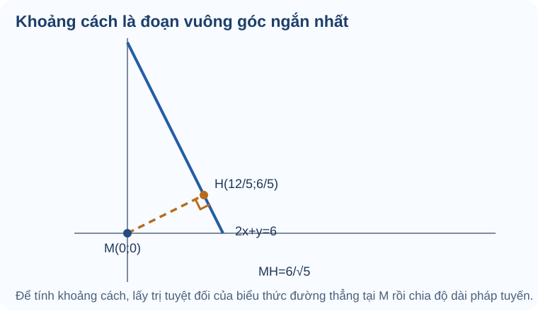

# Bài 20. Vị trí tương đối, góc và khoảng cách

TOÁN 10 · CHƯƠNG VII · KIẾN THỨC SGK KNTT

Xác định vị trí tương đối, góc và khoảng cách trong mặt phẳng tọa độ.

=== "Khám phá kiến thức"

    ### Cùng tìm hiểu

    Trong Bài 19, em đã dùng phương trình để xác định một đường thẳng. Nhưng trên bản đồ, chúng ta còn muốn biết **hai con đường có gặp nhau không**, chúng tạo với nhau một góc bao nhiêu và **từ một vị trí đến con đường gần nhất là bao xa**. Chỉ nhìn hình phác thảo sẽ khó có kết quả chính xác; tọa độ giúp trả lời cả ba câu hỏi.

    Ba ý tưởng sẽ đi cùng em trong bài này: **giao điểm** phải thuộc cả hai đường; **góc** phụ thuộc hướng của hai đường, không phụ thuộc chiều mũi tên; còn **khoảng cách** từ điểm đến đường là độ dài đoạn vuông góc, chứ không phải một đoạn nối tùy ý. Ta sẽ giải thích vì sao trước khi dùng công thức.

    Nếu quên kiến thức Bài 19, em chỉ cần nhắc lại cách tìm pháp tuyến từ phương trình tổng quát \(ax+by+c=0\), cách tính tích vô hướng và cách giải hệ hai phương trình bậc nhất. Với các công thức có căn, mẫu số là độ dài pháp tuyến nên không được bằng 0.

    ### Ví dụ trực quan

    #### 1.2.1. Hai đường cùng hướng có thể trùng nhau hoặc cách nhau

    Hai con đường chạy cùng hướng chưa chắc nằm đè lên nhau. Trong mặt phẳng tọa độ, mỗi đường được mô tả bằng một phương trình: để tìm điểm chung, ta phải tìm cặp tọa độ thỏa **đồng thời cả hai phương trình**.

    Nếu hai pháp tuyến không cùng phương, hai đường có hướng khác nhau và cắt nhau tại đúng một điểm. Nếu các pháp tuyến cùng phương, hai đường không thể cắt nhau ở đúng một điểm: lúc đó còn phải hỏi **hai phương trình có thực sự cùng mô tả một tập hợp điểm không?** Để trả lời, so sánh cả hệ số tự do, không chỉ hai hệ số của \(x,y\).

    Cách chắc chắn là xét hệ phương trình: hệ có một nghiệm thì hai đường cắt nhau; vô nghiệm thì song song phân biệt; vô số nghiệm thì trùng nhau. Không chia tỉ số hệ số khi có nguy cơ chia cho 0.

    

    **Vận dụng.** Cho \(d_1:2x-y+1=0\), \(d_2:4x-2y+3=0\). Hai đường này song song phân biệt hay trùng nhau? Hãy kiểm cả ba hệ số, không kết luận chỉ từ pháp tuyến.

    ??? question "Đối chiếu"

        **Đáp án:** Song song phân biệt.

        **Lý do:** Hai pháp tuyến (2,-1) và (4,-2) tỉ lệ 2 lần, nhưng nhân toàn phương trình d1 với 2 cho hằng số 2, không phải 3 của d2.

        **Nếu chưa đúng:** Mở hướng dẫn tự sửa ngay bên dưới, xem lại bước còn vướng rồi thử một câu cùng kiến thức.

    

    ??? tip "Kiểm lỗi"

        <ol>
        <li><strong>Nhận diện lỗi:</strong> Hai pháp tuyến tỉ lệ nên kết luận hai đường trùng ngay, chưa kiểm hệ số tự do.</li>
        <li><strong>Tự chẩn đoán:</strong> Với d₁: 2x−y+1=0 và d₂: 4x−2y+3=0, nhân toàn phương trình d₁ với 2 được hằng số bao nhiêu? Hằng số đó có đúng bằng 3 không?</li>
        <li><strong>Kiến thức gốc:</strong> Hai pháp tuyến cùng phương chỉ bảo đảm đường cùng hướng; muốn trùng nhau thì cả ba hệ số phải tỉ lệ bởi một số khác 0.</li>
        <li><strong>Tự sửa:</strong> Nhân phương trình thứ nhất với 2 được 4x−2y+2=0, khác d₂ ở hệ số tự do; kết luận song song phân biệt.</li>
        <li><strong>Luyện lại:</strong> <a href="../luyen-tap/?item=THPT-G10-B20-C01">Luyện Core 20-C01</a></li>
        </ol>
    #### 1.2.2. Dựng một đường vuông góc đi qua điểm đã cho

    Nếu cần làm con đường mới vuông góc với đường cũ, ta biết **hướng** của đường mới, nhưng chưa biết nó đi qua đâu. Điều kiện đi qua điểm P chính là mảnh thông tin thứ hai để xác định đường mới.

    Với phương trình tổng quát, pháp tuyến của đường cũ vuông góc với **pháp tuyến của đường mới** khi hai đường vuông góc. Vì thế ta chọn một pháp tuyến mới có tích vô hướng bằng 0 với pháp tuyến cũ, rồi dùng tọa độ P lập phương trình qua điểm. Sau khi biến đổi, luôn thế lại P để kiểm.

    

    **Vận dụng.** Viết phương trình đường thẳng đi qua \(P(1;-2)\) và vuông góc với \(d:x+2y-5=0\). Em hãy xác định pháp tuyến mới trước rồi mới lập phương trình qua P.

    ??? question "Đối chiếu"

        **Đáp án:** 2x-y-4=0.

        **Lý do:** n=(1,2) của d, chọn n'=(2,-1) có tích vô hướng 0. Qua P: 2(x-1)-(y+2)=0 ⇒ 2x-y-4=0.

        **Nếu chưa đúng:** Mở hướng dẫn tự sửa ngay bên dưới, xem lại bước còn vướng rồi thử một câu cùng kiến thức.

    

    ??? tip "Kiểm lỗi"

        <ol>
        <li><strong>Nhận diện lỗi:</strong> Lập đường qua P với đúng pháp tuyến của đường cũ; kết quả lại song song.</li>
        <li><strong>Tự chẩn đoán:</strong> Với P(1;−2) và d: x+2y−5=0, pháp tuyến cũ (1;2) vuông góc với vectơ nào? Đường mới của em có thực sự đi qua P không?</li>
        <li><strong>Kiến thức gốc:</strong> Hai đường vuông góc thì hai pháp tuyến khác 0 cũng vuông góc; thêm điều kiện đi qua P để xác định vị trí.</li>
        <li><strong>Tự sửa:</strong> Chọn pháp tuyến mới (2;−1), kiểm 1×2+2×(−1)=0, sau đó viết 2(x−1)−(y+2)=0.</li>
        <li><strong>Luyện lại:</strong> <a href="../luyen-tap/?item=THPT-G10-B20-C02">Luyện Core 20-C02</a></li>
        </ol>
    #### 1.2.3. Giao điểm là nghiệm chung của hai phương trình

    Hai đường cắt nhau tại I có nghĩa là **tọa độ I thỏa cả hai phương trình**. Vì vậy, tìm giao điểm thực chất là giải một hệ hai phương trình bậc nhất theo \(x,y\), rồi kiểm kết quả ở cả hai phương trình.

    Nếu chỉ giải một phương trình, ta mới biết điểm nằm trên một đường, chưa thể khẳng định nó ở giao điểm. Nếu hệ vô nghiệm, hai đường song song phân biệt; nếu vô số nghiệm, hai đường trùng nhau và không có giao điểm duy nhất.

    

    **Vận dụng.** Tìm giao điểm của hai đường \(x+2y=8\) và \(2x-y=1\). Sau khi giải hệ, thế cặp tọa độ vào cả hai phương trình để tự kiểm.

    ??? question "Đối chiếu"

        **Đáp án:** I(2,3).

        **Lý do:** Từ 2x-y=1 ⇒ y=2x-1. Thế vào x+2(2x-1)=8 ⇒ x=2, y=3; kiểm 2+6=8, 4-3=1.

        **Nếu chưa đúng:** Mở hướng dẫn tự sửa ngay bên dưới, xem lại bước còn vướng rồi thử một câu cùng kiến thức.

    

    ??? tip "Kiểm lỗi"

        <ol>
        <li><strong>Nhận diện lỗi:</strong> Một cặp tọa độ thỏa phương trình đường thứ nhất nhưng chưa chắc thuộc đường còn lại.</li>
        <li><strong>Tự chẩn đoán:</strong> Với x+2y=8 và 2x−y=1, hãy thay I(2;3) lần lượt vào hai phương trình. Hai vế có bằng nhau trong cả hai lần thế không?</li>
        <li><strong>Kiến thức gốc:</strong> Giao điểm của hai đường là nghiệm của **hệ** hai phương trình; phương trình riêng lẻ có vô số điểm của một đường.</li>
        <li><strong>Tự sửa:</strong> Giải lại bằng phép thế hoặc khử, rồi viết hai dòng kiểm: 2+2×3=8 và 2×2−3=1.</li>
        <li><strong>Luyện lại:</strong> <a href="../luyen-tap/?item=THPT-G10-B20-P01">Luyện Practice 20-P01</a></li>
        </ol>
    #### 1.2.4. Khoảng cách ngắn nhất phải theo đường vuông góc

    Giả sử em đứng ở điểm M và muốn đi đến một con đường thẳng d. Có thể nối M tới vô số điểm trên d, nhưng đoạn **ngắn nhất** chính là đoạn vuông góc từ M tới d. Đó là khoảng cách từ điểm đến đường thẳng.

    <figure class="thpt-r4-plot thpt-r4-concept-figure"><figcaption>Với đường \(2x+y-6=0\) và \(M(0,0)\), khoảng cách \(d(M,\Delta)=\dfrac{|{-6}|}{\sqrt{2^2+1^2}}=\dfrac6{\sqrt5}\). Đo theo đoạn vuông góc, không theo đường xiên bất kỳ.</figcaption></figure>

    **Cách đọc hình:** Điểm \(M(0;0)\) ở ngoài đường \(2x+y-6=0\). Hãy tìm đoạn \(MH\) có dấu góc vuông tại H và so sánh với một đoạn xiên nối M tới điểm khác của đường. Tử số trước khi lấy trị tuyệt đối là giá trị biểu thức vế trái tại điểm đang xét. Chia cho độ dài vectơ pháp tuyến cho độ lệch có dấu (dấu phụ thuộc chiều pháp tuyến); lấy trị tuyệt đối để được độ dài thực và không âm.

    Một cách tự kiểm trước khi tính là hỏi: nếu M nằm ngay trên d, khoảng cách phải bằng bao nhiêu? Đáp án là 0. Còn nếu đổi tất cả hệ số phương trình bằng cùng một bội khác 0, đường không đổi nên khoảng cách cũng không được đổi.

    

    **Vận dụng.** Tính khoảng cách từ \(M(1;2)\) đến \(d:3x+4y-1=0\). Hãy xác định tử số có trị tuyệt đối và mẫu số là độ dài pháp tuyến rồi mới tính.

    ??? question "Đối chiếu"

        **Đáp án:** d(M,d)=2.

        **Lý do:** Tử |3·1+4·2−1|=10, mẫu √(3²+4²)=5, nên khoảng cách bằng 10/5=2.

        **Nếu chưa đúng:** Mở hướng dẫn tự sửa ngay bên dưới, xem lại bước còn vướng rồi thử một câu cùng kiến thức.

    

    ??? tip "Kiểm lỗi"

        <ol>
        <li><strong>Nhận diện lỗi:</strong> Lấy giá trị 10 ở tử làm kết quả cuối, hoặc giữ số âm làm khoảng cách.</li>
        <li><strong>Tự chẩn đoán:</strong> Trong câu M(1;2), d: 3x+4y−1=0, tử số là bao nhiêu, độ dài pháp tuyến (3;4) là bao nhiêu? Nếu chưa chia cho 5, kết quả đã là độ dài chưa?</li>
        <li><strong>Kiến thức gốc:</strong> Khoảng cách là độ dài đoạn vuông góc: phải lấy trị tuyệt đối ở tử rồi **chia độ dài pháp tuyến khác 0** ở mẫu.</li>
        <li><strong>Tự sửa:</strong> Tính |3×1+4×2−1|=10, độ dài n=5 và suy ra khoảng cách bằng 2, không phải 10 hay −2.</li>
        <li><strong>Luyện lại:</strong> <a href="../luyen-tap/?item=THPT-G10-B20-P02">Luyện Practice 20-P02</a></li>
        </ol>
    #### 1.2.5. Góc giữa hai đường không phụ thuộc chiều mũi tên

    Trên hai đường thẳng cắt nhau, có thể vẽ các mũi tên theo hai chiều ngược nhau. Đổi chiều mũi tên sẽ thay góc giữa hai vectơ thành góc bù, nhưng **hai đường thẳng vẫn giữ nguyên**. Vì vậy, khi nói góc nhỏ giữa hai đường, ta chọn giá trị từ \(0^\circ\) đến \(90^\circ\), không lấy góc tù chỉ vì đã đổi chiều một mũi tên.

    Ta có thể dùng pháp tuyến của hai đường: tính tích vô hướng, lấy **giá trị tuyệt đối** để kết quả không phụ thuộc chiều vectơ, rồi chia cho tích độ dài hai pháp tuyến. Nếu hai pháp tuyến vuông góc, hai đường cũng vuông góc; nếu cùng phương, góc nhỏ bằng 0.

    

    **Vận dụng.** Tính góc nhỏ giữa \(d_1:x=0\) và \(d_2:x-y=0\). Hãy tìm hai pháp tuyến khác 0 rồi dùng công thức cosin.

    ??? question "Đối chiếu"

        **Đáp án:** 45°.

        **Lý do:** Pháp tuyến n1=(1,0), n2=(1,-1). cosφ=|1|/(1·√2)=1/√2 nên φ=45°.

        **Nếu chưa đúng:** Mở hướng dẫn tự sửa ngay bên dưới, xem lại bước còn vướng rồi thử một câu cùng kiến thức.

    

    ??? tip "Kiểm lỗi"

        <ol>
        <li><strong>Nhận diện lỗi:</strong> Chọn 135° vì hướng mũi tên đổi chiều, dù đề hỏi góc nhỏ.</li>
        <li><strong>Tự chẩn đoán:</strong> Với d₁: x=0 và d₂: x−y=0, nếu đảo chiều một pháp tuyến, góc giữa hai đường có đổi không? Góc 135° có phải góc nhỏ không?</li>
        <li><strong>Kiến thức gốc:</strong> Góc nhỏ của hai đường thuộc [0°;90°], không phụ thuộc hướng của vectơ. Trị tuyệt đối tích vô hướng loại phụ thuộc chiều mũi tên.</li>
        <li><strong>Tự sửa:</strong> Dùng n₁=(1;0), n₂=(1;−1); thương cosin bằng 1/√2 nên góc nhỏ 45°.</li>
        <li><strong>Luyện lại:</strong> <a href="../luyen-tap/?item=THPT-G10-B20-P03">Luyện Practice 20-P03</a></li>
        </ol>
    ### Thuật ngữ, kiến thức và kỹ năng

    **Thuật ngữ:** Hai đường cắt nhau, song song phân biệt, trùng nhau; giao điểm, pháp tuyến, góc giữa hai đường và khoảng cách từ điểm đến đường thẳng.

    **Sau bài học, em cần:** Dùng phương trình để nhận biết vị trí tương đối; dựng đường vuông góc qua điểm; giải hệ tìm giao; xác định góc nhỏ không phụ thuộc chiều vectơ; tính độ dài đoạn vuông góc từ điểm đến đường, giải thích được điều kiện áp dụng.

=== "Kiến thức SGK"

    ### 2.1. Vị trí tương đối giữa hai đường thẳng

    
<strong>Khái niệm — Vị trí tương đối:</strong> Hai đường thẳng cắt nhau khi có đúng <strong>một</strong> điểm chung, song song phân biệt khi không có điểm chung, và trùng nhau khi có <strong>vô số</strong> điểm chung. Ta nhận biết ba tình huống ấy bằng nghiệm chung của hai phương trình.

    Với \(d_1:a_1x+b_1y+c_1=0\) và \(d_2:a_2x+b_2y+c_2=0\), mỗi cặp \((a_i;b_i)\ne(0;0)\):

    - Nếu \(a_1b_2-a_2b_1\ne0\): hai đường **cắt nhau tại một điểm**.
    - Nếu \(a_1b_2-a_2b_1=0\): cần so sánh **cả ba hệ số** để phân biệt hai đường trùng nhau hay song song phân biệt.

    
<strong>Quy tắc — Xét hai đường:</strong> Pháp tuyến không cùng phương thì hai đường cắt nhau. Nếu pháp tuyến cùng phương, phải so sánh thêm hệ số tự do: toàn bộ ba hệ số tỉ lệ cùng một số khác 0 thì trùng; nếu không, chúng song song phân biệt. Không chia cho một hệ số có thể bằng 0.

    Hai đường **vuông góc** nếu \(a_1a_2+b_1b_2=0\). Điều này kiểm bằng tích vô hướng của hai pháp tuyến <strong>khác vectơ không</strong>, không suy ra chỉ vì hai đường cắt nhau.

    ### 2.2. Góc giữa hai đường thẳng

    
<strong>Khái niệm — Góc giữa hai đường:</strong> Góc giữa hai đường thẳng là <strong>góc nhỏ</strong> mà chúng tạo thành, từ 0° tới 90°. Hai đường song song hoặc trùng nhau có góc 0°; hai đường vuông góc có góc 90°. Đổi chiều mũi tên chỉ hướng không làm đổi góc giữa hai đường.

    Góc nhỏ \(\varphi\) giữa hai đường thẳng thỏa \(0^\circ\le\varphi\le90^\circ\):

    \[
    \cos\varphi=\frac{|a_1a_2+b_1b_2|}
    {\sqrt{a_1^2+b_1^2}\sqrt{a_2^2+b_2^2}}.
    \]

    
<strong>Quy tắc — Tính góc nhỏ:</strong> Chọn hai pháp tuyến khác 0; lấy <strong>trị tuyệt đối của tích vô hướng</strong>, chia cho tích hai độ dài pháp tuyến rồi suy ra góc. Thương cosin phải nằm từ 0 đến 1. Không giữ góc tù giữa hai mũi tên làm góc giữa hai đường.

    ### 2.3. Khoảng cách từ một điểm đến một đường thẳng

    
<strong>Khái niệm — Khoảng cách từ điểm đến đường:</strong> Đây là độ dài <strong>đoạn vuông góc</strong> kẻ từ điểm đến đường, luôn không âm. Nếu điểm thuộc đường, khoảng cách bằng 0; một đoạn xiên bất kỳ không phải khoảng cách ngắn nhất.

    **Cách đọc hình.** Xuất phát từ \(M(0;0)\), hãy theo đoạn \(MH\) vuông góc với đường thẳng \(2x+y=6\). Chân đường vuông góc là \(H\left(\frac{12}{5};\frac65\right)\), vì thế khoảng cách ngắn nhất là \(MH=\frac6{\sqrt5}\). Không đo theo đoạn xiên tùy ý.

    Khoảng cách từ điểm \(M(x_M;y_M)\) đến \(d:ax+by+c=0\):

    \[
    d(M,d)=\frac{|ax_M+by_M+c|}{\sqrt{a^2+b^2}}.
    \]

    
<strong>Quy tắc — Khoảng cách:</strong> Với pháp tuyến (a;b) khác 0, thế tọa độ điểm vào vế trái phương trình tổng quát, lấy <strong>trị tuyệt đối</strong> rồi chia cho độ dài dương của pháp tuyến. Kết quả là độ dài thật, không phụ thuộc cách nhân bội phương trình đường thẳng.

    Dấu giá trị tuyệt đối giúp khoảng cách không âm và góc nhỏ không phụ thuộc chiều chọn vectơ pháp tuyến.

=== "Ví dụ"

    ### 3.1. Ví dụ — Khoảng cách ngắn nhất từ điểm đến đường

    **Đề bài.** Tìm khoảng cách từ \(M(0,0)\) đến \(\Delta:2x+y-6=0\).

    **Phân tích:** Đề đã cho phương trình tổng quát với pháp tuyến (2;1) khác 0. Khoảng cách là độ dài đoạn vuông góc từ M đến đường, không phải khoảng cách tới một điểm tùy chọn. Vì thế ta dùng trực tiếp công thức khoảng cách, thay tọa độ M rồi kiểm cả trị tuyệt đối và độ dài pháp tuyến.

    

    
<strong>Lời giải.</strong> Thế tọa độ M vào công thức: \(d=\frac{|2\cdot0+0-6|}{\sqrt{2^2+1^2}}=\frac6{\sqrt5}\). Mẫu \(\sqrt5>0\) là độ dài pháp tuyến; trị tuyệt đối làm kết quả không âm.

    

    **Kiểm lại:** Tọa độ M không thỏa phương trình đường nên khoảng cách dương; đoạn vuông góc trong hình ở tab Khám phá chính là đoạn cần đo.

    ### 3.2. Ví dụ — Giao điểm, góc vuông và khoảng cách

    **Đề bài.** Xét \(d_1:x-y-1=0\) và \(d_2:x+y-5=0\). Hãy xác định vị trí tương đối, giao điểm, quan hệ vuông góc và khoảng cách từ \(O(0;0)\) tới \(d_1\).

    **Phân tích:** Bài có bốn yêu cầu độc lập: định thức hai pháp tuyến cho biết có giao điểm duy nhất không; hệ phương trình tìm tọa độ giao; tích vô hướng kiểm góc vuông; công thức khoảng cách đo đoạn vuông góc từ O đến đường thứ nhất. Không suy ra vuông góc chỉ từ việc hai đường cắt nhau.

    

    
<strong>Lời giải.</strong>

    <ol>
    <li><strong>Vị trí:</strong> Định thức hệ số bằng \(1\cdot1-1\cdot(-1)=2\ne0\), vậy hai đường cắt nhau tại một điểm.</li>
    <li><strong>Giao điểm:</strong> Giải hệ \(x-y=1,\ x+y=5\) được \(I(3;2)\).</li>
    <li><strong>Góc:</strong> Pháp tuyến \((1;-1)\) và \((1;1)\) có tích vô hướng \(0\), vậy hai đường vuông góc.</li>
    <li><strong>Khoảng cách:</strong> Từ \(O(0;0)\) đến \(d_1\) bằng \(1/\sqrt2\), do mẫu là độ dài pháp tuyến \(\sqrt2\) và tử bằng 1.</li>
    </ol>
    

    **Kiểm lại:** Thay \(I(3;2)\) vào hai phương trình đều cho 0, đúng là giao điểm. Tích vô hướng hai pháp tuyến bằng 0 nên góc nhỏ là 90°; khoảng cách đã tính dương và không phụ thuộc vị trí chọn điểm trên đường.

=== "Lỗi thường gặp"

    Hai lỗi dưới đây có thể lặp lại trong nhiều bài. Nếu vướng ở một câu **Vận dụng** cụ thể, hãy mở khung **Kiểm lỗi** ngay dưới câu đó trong tab **Khám phá kiến thức**.

    

    ??? tip "4.1. Chia tỉ số hệ số khi mẫu bằng 0"

        <ol>
        <li><strong>Nhận diện lỗi:</strong> Cố tính a₁/a₂ hoặc b₁/b₂ ngay cả khi một hệ số bằng 0, rồi phân loại sai.</li>
        <li><strong>Tự chẩn đoán:</strong> Thử hai đường x=2 và 2x=5. Chúng song song hay trùng? Nếu so tỉ số các hệ số của y, phép chia 0/0 có nghĩa không?</li>
        <li><strong>Kiến thức gốc:</strong> Hệ phương trình và định thức áp dụng cả với đường đứng; khi pháp tuyến cùng phương, so bộ ba hệ số bằng một phép nhân bội khác 0, không chia cho 0.</li>
        <li><strong>Tự sửa:</strong> Đưa về x−2=0 và 2x−5=0, so phương trình thứ nhất nhân 2 với phương trình thứ hai để thấy hằng số khác nhau.</li>
        <li><strong>Luyện lại:</strong> <a data-thpt-formative-id="THPT-G10-B20-C01" href="../luyen-tap/?item=THPT-G10-B20-C01">Luyện lại câu 20-C01</a> · <a data-thpt-formative-id="THPT-G10-B20-P05" href="../luyen-tap/?item=THPT-G10-B20-P05">Luyện lại câu 20-P05</a></li>
        </ol>

    

    ??? tip "4.2. Nhầm tính chất bất biến của góc và khoảng cách"

        <ol>
        <li><strong>Nhận diện lỗi:</strong> Đổi đồng thời hệ số của một phương trình đường thẳng mà lại cho rằng góc/khoảng cách thay đổi theo bội đó.</li>
        <li><strong>Tự chẩn đoán:</strong> Nếu thay d: 3x+4y−1=0 bằng 6x+8y−2=0, khoảng cách từ M(1;2) tới đường có tăng gấp đôi không? Với góc nhỏ, đảo chiều pháp tuyến có đổi góc không?</li>
        <li><strong>Kiến thức gốc:</strong> Nhân tất cả hệ số của cùng một đường với số khác 0 không đổi đường. Cả cosin góc nhỏ và khoảng cách đều lấy trị tuyệt đối, chia cho độ dài pháp tuyến nên các bội triệt tiêu.</li>
        <li><strong>Tự sửa:</strong> Thử lại phép nhân bội trên cả tử và mẫu; kiểm \(\cos\varphi\in[0;1]\) cho góc nhỏ và \(d\ge0\) cho khoảng cách; giữ kết luận hình học không đổi.</li>
        <li><strong>Luyện lại:</strong> <a data-thpt-formative-id="THPT-G10-B20-P02" href="../luyen-tap/?item=THPT-G10-B20-P02">Luyện lại câu 20-P02</a> · <a data-thpt-formative-id="THPT-G10-B20-P03" href="../luyen-tap/?item=THPT-G10-B20-P03">Luyện lại câu 20-P03</a> · <a data-thpt-formative-id="THPT-G10-B20-P06" href="../luyen-tap/?item=THPT-G10-B20-P06">Luyện lại câu 20-P06</a> · <a data-thpt-formative-id="THPT-G10-CHVII-W20-01" href="../../../thu-vien/tu-luan-chuong-vii/#thpt-g10-chvii-w20-01">Bài tự luận liên quan</a></li>
        </ol>

    **Học tiếp:** [Core và Luyện tập](luyen-tap.md) · [Tự kiểm tra cuối chương](tu-kiem-tra-chuong.md).

    
Nguồn đối chiếu: SGK Toán 10 KNTT tập 2, trang in 36–42; SBT trang 32–38.

