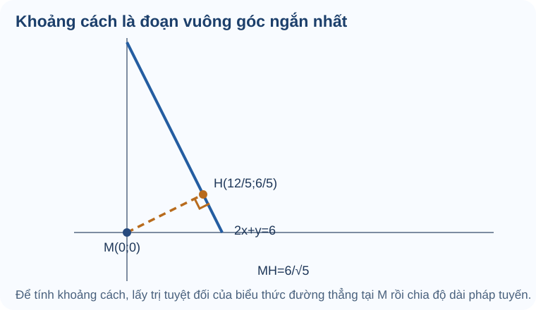

# Bài 20. Vị trí tương đối, góc và khoảng cách

TOÁN 10 · CHƯƠNG VII · KIẾN THỨC SGK KNTT

Xác định vị trí tương đối, góc và khoảng cách trong mặt phẳng tọa độ.

=== "Khám phá kiến thức"

    ### Cùng tìm hiểu

    Hai con đường trên bản đồ có thể cắt nhau, song song hoặc trùng nhau. Thay vì chỉ đoán bằng mắt, ta có thể hỏi: **Có điểm nào cùng nằm trên cả hai đường không?** Khi cần biết một điểm ở cách đường bao xa, ta lại phải tìm đoạn nối **ngắn nhất**. Từ hai câu hỏi hình học này, em sẽ khám phá cách xác định vị trí tương đối và khoảng cách bằng tọa độ.

    ### Ví dụ trực quan

    

    Khi nhìn hai đường thẳng trên giấy, em có thể đoán chúng cắt nhau hay song song. Nhưng nếu hai nét vẽ gần sát nhau thì mắt thường không đủ chắc chắn. Hãy đổi câu hỏi “hai đường ở vị trí nào?” thành câu hỏi “có điểm nào **cùng thuộc cả hai** không?”. Với \(d_1:x+y=2\) và \(d_2:x-y=0\), một điểm chung phải thỏa cả hai điều kiện. Cộng hai phương trình được \(2x=2\), nên \(x=1,\ y=1\): hai đường **cắt tại \((1,1)\)**.

    Nếu thay đường thứ hai bằng \(x+y=4\), sẽ không có cặp tọa độ nào cùng làm tổng \(x+y\) vừa bằng 2 vừa bằng 4: hai đường **song song phân biệt**. Còn \(2x+2y=4\) thực ra mô tả đúng cùng một tập điểm với \(x+y=2\): hai đường **trùng nhau**. Vậy số nghiệm chung giúp phân biệt ba tình huống trước khi ta học cách kiểm nhanh bằng vectơ pháp tuyến. Khi dùng hệ số để kiểm, cần xét đủ cả hệ số tự do và tránh chia cho hệ số có thể bằng 0.

    <figure class="thpt-r4-plot thpt-r4-concept-figure" data-chvii-r02-diagram="TRY08"><picture><source media="(max-width: 600px)" srcset="../../../../assets/images/thpt/G10_CHVII_R02_B20_TRY08_LINES_MOBILE.svg"></picture><figcaption>Số nghiệm chung của hệ cho biết số giao điểm của hai đường thẳng.</figcaption></figure>

    **Em vận dụng.** d1: 2x-y+1=0, d2: 4x-2y+3=0 là song song phân biệt hay trùng nhau?

    ??? question "Đối chiếu"

        **Đáp án:** Song song phân biệt.

        **Lý do:** Hai pháp tuyến (2,-1) và (4,-2) tỉ lệ 2 lần, nhưng nhân toàn phương trình d1 với 2 cho hằng số 2, không phải 3 của d2.

    <a href="../luyen-tap/?item=THPT-G10-B20-C01">Luyện tập thêm</a>

    

    Giả sử ta cần dựng một con đường mới vuông góc với đường cũ và đi qua điểm P. Hai điều kiện này đảm nhận hai việc khác nhau: hướng vuông góc quyết định phương của đường mới, còn P cố định vị trí của nó. Ta đã biết hai đường vuông góc thì hai vectơ pháp tuyến tương ứng cũng vuông góc, bởi cả hai đều được quay một góc vuông so với hướng đường.

    Vì vậy, nếu pháp tuyến của đường cũ là \(n\), hãy chọn pháp tuyến \(n'\ne0\) sao cho \(n\cdot n'=0\). Đường mới qua P được xác định bởi điều kiện \(n'\cdot\overrightarrow{PM}=0\). Có thể tưởng tượng tịnh tiến một đường vuông góc song song với chính nó: góc vuông vẫn giữ nguyên, nhưng chỉ một vị trí đi qua P. Thế tọa độ P và kiểm lại tích vô hướng để chắc chắn thỏa cả hai yêu cầu.

    **Em vận dụng.** Qua P(1,-2) viết đường vuông góc với d: x+2y-5=0.

    ??? question "Đối chiếu"

        **Đáp án:** 2x-y-4=0.

        **Lý do:** n=(1,2) của d, chọn n'=(2,-1) có tích vô hướng 0. Qua P: 2(x-1)-(y+2)=0 ⇒ 2x-y-4=0.

    <a href="../luyen-tap/?item=THPT-G10-B20-C02">Luyện tập thêm</a>

    

    Khi hai con đường cắt nhau, chỗ gặp nhau không phải là nghiệm riêng của từng phương trình mà là một cặp tọa độ thỏa đồng thời cả hai. Đây chính là ý nghĩa hình học của việc giải hệ hai phương trình bậc nhất. Ta có thể dùng phép thế hoặc khử để tìm nghiệm, rồi thay tọa độ vừa tìm được trở lại cả hai phương trình.

    Trên một hình vẽ, một điểm nằm ở đường thứ nhất vẫn chưa chắc thuộc đường thứ hai; chỉ điểm cùng thuộc cả hai mới là giao điểm. Nếu hệ vô nghiệm, hai đường không có giao điểm. Cách kiểm bằng thế giúp phát hiện lỗi dấu hoặc phép biến đổi ngay cả khi đáp số trông có vẻ hợp lý.

    **Em vận dụng.** Tìm giao điểm của x+2y=8 và 2x-y=1.

    ??? question "Đối chiếu"

        **Đáp án:** I(2,3).

        **Lý do:** Từ 2x-y=1 ⇒ y=2x-1. Thế vào x+2(2x-1)=8 ⇒ x=2, y=3; kiểm 2+6=8, 4-3=1.

    <a href="../luyen-tap/?item=THPT-G10-B20-P01">Luyện tập thêm</a>

    

    Từ một điểm \(M_0\) đến đường thẳng \(d\), có thể vẽ rất nhiều đoạn nối. Đoạn ngắn nhất luôn là đoạn \(M_0H\) **vuông góc** với đường, trong đó \(H\) là chân đường vuông góc. Nếu \(d:ax+by+c=0\), vectơ pháp tuyến \(\vec n=(a,b)\ne\vec 0\) chỉ đúng hướng của đoạn \(HM_0\).

    Vì \(H\) thuộc đường nên \(ax_H+by_H+c=0\). Lấy tích vô hướng \(\vec n\cdot\overrightarrow{HM_0}\), ta được \(a(x_0-x_H)+b(y_0-y_H)=ax_0+by_0+c\). Do \(\overrightarrow{HM_0}\) song song với pháp tuyến, độ lớn tích vô hướng cũng bằng \(\|\vec n\|\cdot M_0H\). Bởi thế

    \[
    d(M_0,d)=M_0H=\frac{|ax_0+by_0+c|}{\sqrt{a^2+b^2}}.
    \]

    Dấu giá trị tuyệt đối làm khoảng cách không âm; căn ở mẫu chia cho **độ dài pháp tuyến**, nên kết quả là độ dài thật, không phụ thuộc việc ta nhân cả phương trình đường thẳng với cùng một số khác 0. Ví dụ, với \(d:3x+4y-5=0\) và \(O(0,0)\), khoảng cách là \(5/\sqrt{3^2+4^2}=1\). Chân vuông góc \(H=(3/5,4/5)\) nằm trên đường và đúng cách \(O\) một đơn vị.

    <figure class="thpt-r4-plot thpt-r4-concept-figure" data-chvii-r02-diagram="TRY11"><figcaption>Đoạn ngắn nhất từ điểm tới đường là đoạn vuông góc; chân H nằm trên đường.</figcaption></figure>

    **Em vận dụng.** Tính khoảng cách từ M(1,2) đến d: 3x+4y-1=0.

    ??? question "Đối chiếu"

        **Đáp án:** d(M,d)=2.

        **Lý do:** Tử |3·1+4·2−1|=10, mẫu √(3²+4²)=5, nên khoảng cách bằng 10/5=2.

    <a href="../luyen-tap/?item=THPT-G10-B20-P02">Luyện tập thêm</a>

    

    Giữa hai đường thẳng, ta lấy góc nhỏ trong khoảng từ \(0^\circ\) đến \(90^\circ\), không phụ thuộc việc chọn chiều nào cho mỗi đường. Nhớ rằng tích vô hướng giữa hai vectơ khác 0 liên hệ với cosin của góc tạo bởi chúng. Nếu đảo chiều một pháp tuyến, góc giữa các mũi tên có thể chuyển từ nhọn sang tù, nhưng góc nhỏ giữa hai đường không đổi.

    Do đó, với hai pháp tuyến khác vectơ không \(n_1,n_2\), ta tính \(\cos\varphi=\frac{|n_1\cdot n_2|}{\|n_1\|\cdot\|n_2\|}\). Giá trị tuyệt đối loại bỏ ảnh hưởng của chiều mũi tên; kết quả phải nằm từ \(0\) đến \(1\). Khi nhìn hình, hãy phân biệt góc tù giữa các vectơ có hướng với góc nhỏ giữa hai đường không có chiều.

    **Em vận dụng.** Góc nhỏ giữa d1: x=0 và d2: x-y=0 bằng bao nhiêu?

    ??? question "Đối chiếu"

        **Đáp án:** 45°.

        **Lý do:** Pháp tuyến n1=(1,0), n2=(1,-1). cosφ=|1|/(1·√2)=1/√2 nên φ=45°.

    <a href="../luyen-tap/?item=THPT-G10-B20-P03">Luyện tập thêm</a>

    ### Thuật ngữ, kiến thức và kỹ năng

    **Thuật ngữ:** Vị trí tương đối của hai đường thẳng, song song/trùng/cắt, góc giữa hai đường, khoảng cách điểm đến đường.

    **Sau bài học, em cần làm được:** Xét quan hệ của hai phương trình; giải giao điểm; nhận biết pháp tuyến; tính góc nhỏ và khoảng cách với mẫu dương, kiểm đơn vị.

=== "Kiến thức SGK"

    ### 2.1. Vị trí tương đối giữa hai đường thẳng

    Với \(d_1:a_1x+b_1y+c_1=0\) và \(d_2:a_2x+b_2y+c_2=0\), mỗi cặp \((a_i;b_i)\ne(0;0)\):

    - Nếu \(a_1b_2-a_2b_1\ne0\): hai đường **cắt nhau tại một điểm**.
    - Nếu \(a_1b_2-a_2b_1=0\): cần so sánh **cả ba hệ số** để phân biệt hai đường trùng nhau hay song song phân biệt.

    Hai đường **vuông góc** nếu \(a_1a_2+b_1b_2=0\).

    ### 2.2. Góc giữa hai đường thẳng

    Góc nhỏ \(\varphi\) giữa hai đường thẳng thỏa \(0^\circ\le\varphi\le90^\circ\):

    \[
    \cos\varphi=\frac{|a_1a_2+b_1b_2|}
    {\sqrt{a_1^2+b_1^2}\sqrt{a_2^2+b_2^2}}.
    \]

    ### 2.3. Khoảng cách từ một điểm đến một đường thẳng

    <figure class="thpt-r4-plot thpt-r4-concept-figure"><figcaption>Với đường \(2x+y-6=0\) và \(M(0,0)\), khoảng cách \(d(M,\Delta)=\dfrac{|{-6}|}{\sqrt{2^2+1^2}}=\dfrac6{\sqrt5}\). Đo theo đoạn vuông góc, không theo đường xiên bất kỳ.</figcaption></figure>

    **Cách đọc hình.** Xuất phát từ \(M(0;0)\), hãy theo đoạn \(MH\) vuông góc với đường thẳng \(2x+y=6\). Chân đường vuông góc là \(H\left(\frac{12}{5};\frac65\right)\), vì thế khoảng cách ngắn nhất là \(MH=\frac6{\sqrt5}\). Không đo theo đoạn xiên tùy ý.

    Khoảng cách từ điểm \(M(x_M;y_M)\) đến \(d:ax+by+c=0\):

    \[
    d(M,d)=\frac{|ax_M+by_M+c|}{\sqrt{a^2+b^2}}.
    \]

    Dấu giá trị tuyệt đối giúp khoảng cách không âm và góc nhỏ không phụ thuộc chiều chọn vectơ pháp tuyến.

=== "Ví dụ"

    ### Ví dụ — Khoảng cách không phải độ dài một đoạn nối tùy ý

    **Đề bài.** Tìm khoảng cách từ \(M(0,0)\) đến \(\Delta:2x+y-6=0\).

    **Vì sao chọn cách này?** Đường đã ở dạng tổng quát, nên có thể dùng trực tiếp công thức khoảng cách thay vì tự đo trên hình.

    **Lời giải.** \(d=\frac{|2\cdot0+0-6|}{\sqrt{2^2+1^2}}=\frac6{\sqrt5}\). Mẫu \(\sqrt5>0\) là độ dài pháp tuyến. Độ dài này là đoạn vuông góc ngắn nhất từ M đến đường. 

    **Kiểm lại:** khoảng cách không âm và có đơn vị độ dài.

    ### Ví dụ 2 — Giao điểm, vuông góc và khoảng cách của hai đường thẳng

    **Đề bài.** Xét \(d_1:x-y-1=0\) và \(d_2:x+y-5=0\). Hãy xác định vị trí tương đối, giao điểm, quan hệ vuông góc và khoảng cách từ \(O(0;0)\) tới \(d_1\).

    **Vì sao chọn cách này?** Dùng định thức của hai vectơ pháp tuyến để nhận biết hai đường cắt nhau, giải hệ tìm giao điểm và dùng tích vô hướng kiểm tra vuông góc.

    **Lời giải.**

    1. Định thức hệ số bằng \(1\cdot1-1\cdot(-1)=2\ne0\), vậy hai đường cắt nhau.
    2. Giải hệ \(x-y=1,\ x+y=5\) được \(I(3;2)\).
    3. Pháp tuyến \((1;-1)\) và \((1;1)\) có tích vô hướng \(0\), vậy hai đường vuông góc.
    4. Khoảng cách từ \(O(0;0)\) đến \(d_1\) bằng \(1/\sqrt2\).

    !!! tip "Lỗi dễ mắc"
        Hai **pháp tuyến tỉ lệ** chỉ cho biết hai đường song song **hoặc trùng nhau**; không tự kết luận trùng. Khi dùng phương trình chứa tham số, kiểm tra các hệ số có thể đồng thời bằng 0.

=== "Lỗi thường gặp"

    

    ??? tip "Song song và trùng: quên hệ số tự do"

        1. **Nhận diện lỗi:** Nếu kết luận trùng ngay khi pháp tuyến tỉ lệ, em đã bỏ quên hệ số tự do.

        2. **Quay lại bản chất:** Định thức a1b2-a2b1 khác 0 thì hai đường cắt nhau. Bằng 0 chỉ nói cùng hướng: xét thêm c để phân biệt song song khác nhau và trùng nhau.

        3. **Tự sửa:** Nhân hẳn d1 với hệ số 2 rồi đối chiếu cả ba hệ số của d2.

        4. **Tự đối chiếu:** xem lại lời giải trên sau khi em tự làm; kiểm các điều kiện và dữ kiện của bài vừa Tự thử.

        5. **Luyện tiếp:** Dùng liên kết bên dưới để luyện câu cùng kiến thức. Nếu đã xem lời giải, hãy chọn thêm câu khác và tự làm mà không dựa vào gợi ý.

    

    ??? tip "Đường vuông góc: chọn sai pháp tuyến"

        1. **Nhận diện lỗi:** Nếu chỉ lấy lại n=(1,2), em sẽ viết đường song song với d chứ không vuông góc.

        2. **Quay lại bản chất:** Nếu hai đường vuông góc thì hai pháp tuyến của chúng cũng vuông góc (đều bị quay cùng 90 độ so với đường). Điểm quyết định tịnh tiến đường mới.

        3. **Tự sửa:** Thử n·n'=0 và thay P vào phương trình vừa viết.

        4. **Tự đối chiếu:** xem lại lời giải trên sau khi em tự làm; kiểm các điều kiện và dữ kiện của bài vừa Tự thử.

        5. **Luyện tiếp:** Dùng liên kết bên dưới để luyện câu cùng kiến thức. Nếu đã xem lời giải, hãy chọn thêm câu khác và tự làm mà không dựa vào gợi ý.

    

    ??? tip "Giao điểm: chưa kiểm cả hai đường"

        1. **Nhận diện lỗi:** Nếu ra một điểm chỉ thỏa một đường, em đã dừng trước bước thử.

        2. **Quay lại bản chất:** Một giao điểm là nghiệm chung của hai phương trình; giải từng phương trình riêng không đủ.

        3. **Tự sửa:** Ghi thành hai dòng kiểm thế tọa độ vào từng phương trình.

        4. **Tự đối chiếu:** xem lại lời giải trên sau khi em tự làm; kiểm các điều kiện và dữ kiện của bài vừa Tự thử.

        5. **Luyện tiếp:** Dùng liên kết bên dưới để luyện câu cùng kiến thức. Nếu đã xem lời giải, hãy chọn thêm câu khác và tự làm mà không dựa vào gợi ý.

    

    ??? tip "Khoảng cách: thiếu trị tuyệt đối hoặc mẫu"

        1. **Nhận diện lỗi:** Nếu cho kết quả 10 hoặc -2, em đã quên chuẩn hóa pháp tuyến hoặc trị tuyệt đối.

        2. **Quay lại bản chất:** Biểu thức axM+byM+c đo độ lệch có dấu theo pháp tuyến chưa chuẩn hóa; chia √(a²+b²) đổi thành độ dài thật và lấy trị tuyệt đối.

        3. **Tự sửa:** Tách tính tử và mẫu, kiểm mẫu khác 0, kết luận độ dài không âm.

        4. **Tự đối chiếu:** xem lại lời giải trên sau khi em tự làm; kiểm các điều kiện và dữ kiện của bài vừa Tự thử.

        5. **Luyện tiếp:** Dùng liên kết bên dưới để luyện câu cùng kiến thức. Nếu đã xem lời giải, hãy chọn thêm câu khác và tự làm mà không dựa vào gợi ý.

    

    ??? tip "Góc hai đường: nhầm góc tù"

        1. **Nhận diện lỗi:** Nếu kết luận 135°, em đã lấy góc tù theo hướng pháp tuyến thay vì góc nhỏ giữa hai đường.

        2. **Quay lại bản chất:** Góc nhỏ giữa hai đường nằm từ 0 đến 90 độ; đổi hướng một pháp tuyến không làm đổi góc nhỏ nên lấy trị tuyệt đối tích vô hướng.

        3. **Tự sửa:** Lấy trị tuyệt đối tích vô hướng, kiểm φ không vượt 90°.

        4. **Tự đối chiếu:** xem lại lời giải trên sau khi em tự làm; kiểm các điều kiện và dữ kiện của bài vừa Tự thử.

        5. **Luyện tiếp:** Dùng liên kết bên dưới để luyện câu cùng kiến thức. Nếu đã xem lời giải, hãy chọn thêm câu khác và tự làm mà không dựa vào gợi ý.

    

    ??? tip "Nhầm song song với trùng nhau"

        
<strong>Dấu hiệu:</strong> Thấy a1b2−a2b1=0 thì kết luận hai đường trùng.

        
<strong>Bản chất toán:</strong> Điều kiện này chỉ nói hai pháp tuyến cùng phương. Hai phương trình trùng nhau nếu toàn bộ bộ ba (a,b,c) tỉ lệ theo cùng một λ≠0; nếu không chúng song song phân biệt.

        
<strong>Tự sửa:</strong> Ôn B19 mục 2 và B20 mục 1: kiểm định thức, rồi so sánh cả hằng số; tránh chia cho một hệ số bằng 0.

        
<strong>Kiến thức cần ôn:</strong> Phương trình tổng quát B19; tỉ lệ các hệ số; B20 mục 1.

        
<strong>Luyện lại bài đã có:</strong> <a data-thpt-formative-id="THPT-G10-B20-C01" href="../luyen-tap/?item=THPT-G10-B20-C01">Luyện lại câu 20-C01</a> · <a data-thpt-formative-id="THPT-G10-B20-P05" href="../luyen-tap/?item=THPT-G10-B20-P05">Luyện lại câu 20-P05</a>

    

    ??? tip "Góc hoặc khoảng cách ra giá trị âm"

        
<strong>Dấu hiệu:</strong> Bỏ giá trị tuyệt đối hoặc thiếu độ dài vectơ pháp tuyến ở mẫu.

        
<strong>Bản chất toán:</strong> Khoảng cách là |axM+byM+c|/√(a²+b²)≥0. Với góc nhỏ 0°≤φ≤90°, cosφ=|n1·n2|/(||n1||||n2||)∈[0,1].

        
<strong>Tự sửa:</strong> Ôn B20 mục 2 (góc) và mục 3 (khoảng cách): xác nhận pháp tuyến khác vectơ không, đặt trị tuyệt đối ở tử và chia đúng độ dài pháp tuyến; kiểm \(\cos\varphi\in[0;1]\) cho góc nhỏ, \(d\ge0\) cho khoảng cách.

        
<strong>Kiến thức cần ôn:</strong> Chuẩn vectơ, tích vô hướng; B20 mục 2.

        
<strong>Luyện lại bài đã có:</strong> <a data-thpt-formative-id="THPT-G10-B20-P02" href="../luyen-tap/?item=THPT-G10-B20-P02">Luyện lại câu 20-P02</a> · <a data-thpt-formative-id="THPT-G10-B20-P03" href="../luyen-tap/?item=THPT-G10-B20-P03">Luyện lại câu 20-P03</a> · <a data-thpt-formative-id="THPT-G10-B20-P06" href="../luyen-tap/?item=THPT-G10-B20-P06">Luyện lại câu 20-P06</a> · <a data-thpt-formative-id="THPT-G10-CHVII-W20-01" href="../../../thu-vien/tu-luan-chuong-vii/#thpt-g10-chvii-w20-01">Bài tự luận liên quan</a>

    **Học tiếp:** [Core và Luyện tập](luyen-tap.md) · [Tự kiểm tra cuối chương](tu-kiem-tra-chuong.md).

    
Nguồn toán học: SGK Toán 10 Kết nối tri thức với cuộc sống và học liệu SLM hiện hành. Lời giảng được biên tập nhằm hỗ trợ tự học độc lập.

<small>Nguồn đối chiếu: SGK Toán 10 KNTT tập 2, trang in 36–42; SBT trang 32–38. </small>
