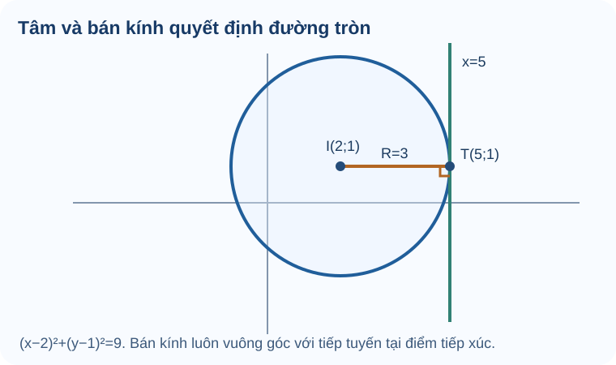

# Bài 21. Đường tròn trong mặt phẳng tọa độ

TOÁN 10 · CHƯƠNG VII · KIẾN THỨC SGK KNTT

Viết phương trình đường tròn, xác định tâm, bán kính và lập tiếp tuyến tại một điểm.

=== "Khám phá kiến thức"

    ### Cùng tìm hiểu

    Một trạm phát sóng có vùng phủ được mô tả bằng mọi điểm cách trạm **đúng 3 km**. Trên bản đồ tọa độ, tập các điểm cách tâm \(I(2,1)\) đúng 3 đơn vị chính là một **đường tròn**.

    Nếu em đã biết khoảng cách giữa hai điểm, công thức đường tròn gần như tự xuất hiện: \(\sqrt{(x-2)^2+(y-1)^2}=3\). Bình phương hai vế (đều không âm) cho \((x-2)^2+(y-1)^2=9\). Thay vì học thuộc bốn chữ số, hãy đọc công thức như câu nói: “khoảng cách từ điểm \((x,y)\) đến tâm I bằng bán kính 3”.

    Một đường thẳng có thể không chạm, cắt tại hai điểm hoặc **tiếp xúc** đường tròn. Tại điểm tiếp xúc, **tiếp tuyến vuông góc bán kính**: đây là cách dựng phương trình tiếp tuyến từ hình học.

    ### Thuật ngữ, kiến thức và kỹ năng

    **Thuật ngữ:** Tâm, bán kính, phương trình đường tròn, dạng tổng quát, tiếp tuyến, tiếp điểm và vị trí tương đối.

    **Sau bài học, em cần làm được:** Tìm tâm/bán kính bằng hoàn thành bình phương; lập phương trình khi biết tâm/bán kính; kiểm điểm trên đường tròn; dùng bán kính làm pháp tuyến tiếp tuyến.

=== "Kiến thức SGK"

    Đọc vì sao cần học, tự làm Tự thử trước khi mở đáp án và chỉ quay lại Core sau khi đã đối chiếu. Các câu này là luyện tập không ghi điểm thành thạo.

    

    ### Đường tròn là tập hợp điểm cách tâm một khoảng cố định

    Bản đồ một trạm phát sóng có tầm phủ bán kính cố định: đường biên vùng phủ gồm mọi vị trí cách trạm đúng một khoảng.

    **Kiến thức tiền đề:** Nhắc lại công thức khoảng cách hai điểm: IM²=(x-a)²+(y-b)². Bán kính R phải dương để thực sự có đường tròn.

    **Bản chất trước công thức:** Phương trình đường tròn chỉ là phát biểu IM=R viết bằng tọa độ. Bình phương hai vế thu điều kiện khoảng cách, không phải công thức xuất hiện từ đâu đó.

    **Tự phác hình minh họa:** Trên hình đánh dấu tâm I, bán kính IM tới một điểm bất kỳ M trên vành; đổi M quanh vành thì IM luôn giữ nguyên.

    Biết tâm I(a,b), R>0, viết (x-a)²+(y-b)²=R². Kiểm tâm khi thế vào vế trái cho 0 và điều kiện R>0; không nhầm R với R².

    **Em vận dụng.** Đường tròn có tâm I(-2,1) và bán kính 3 có phương trình nào?

    ??? question "Tự mở đáp án sau khi đã tự làm"

        **Đáp án:** (x+2)²+(y-1)²=9.

        **Lý do:** IM²=(x+2)²+(y-1)², và R²=3²=9. Cần R=3>0.

        **Nếu chưa đúng:** Mở hướng dẫn tự sửa ngay bên dưới, xem lại bước còn vướng rồi thử một câu cùng kiến thức.

    

    ??? tip "Tự khắc phục theo năm bước"

        1. **Nhận diện lỗi:** Nếu viết vế phải 3 hoặc (x-2)², em nhầm bán kính với bình phương bán kính hoặc nhầm dấu tọa độ tâm.

        2. **Quay lại bản chất:** Phương trình đường tròn chỉ là phát biểu IM=R viết bằng tọa độ. Bình phương hai vế thu điều kiện khoảng cách, không phải công thức xuất hiện từ đâu đó.

        3. **Tự sửa:** Đặt M=I, vế trái phải bằng 0; chọn M=I+(3,0) thì vế trái bằng 9.

        4. **Tự đối chiếu:** xem lại lời giải trên sau khi em tự làm; kiểm các điều kiện và dữ kiện của bài vừa Tự thử.

        5. **Luyện tiếp:** Dùng liên kết bên dưới để luyện câu cùng kiến thức. Nếu đã xem lời giải, hãy chọn thêm câu khác và tự làm mà không dựa vào gợi ý.

    <a href="../luyen-tap/?item=THPT-G10-B21-C01">Mở câu luyện tập tương ứng để tự luyện</a>

    

    ### Từ phương trình tổng quát suy tâm, bán kính

    Một bài toán thường cho phương trình dưới dạng đã khai triển; muốn biết vị trí và kích thước đường tròn phải 'mở ngược' các bình phương.

    **Kiến thức tiền đề:** Nhớ hằng đẳng thức (x-a)²=x²-2ax+a²; một tổng hai bình phương không thể âm.

    **Bản chất trước công thức:** Hoàn thành bình phương chuyển điều kiện đại số thành khoảng cách tới một tâm. Nếu kết quả R²≤0 thì không tạo được đường tròn bán kính dương.

    **Tự phác hình minh họa:** Đặt tâm I lên trục tọa độ sau khi hoàn thành bình phương; so sánh hai tình huống R²>0 (vành tròn) và R²=0 (một điểm).

    Nhóm x²+Dx và y²+Ey, thêm bớt bình phương nửa hệ số rồi kiểm R²>0 trước khi lấy căn. Với R²<0 phương trình vô nghiệm thực.

    **Em vận dụng.** Phương trình x²+y²−6x+4y+8=0 biểu diễn đường tròn nào?

    ??? question "Tự mở đáp án sau khi đã tự làm"

        **Đáp án:** (x−3)²+(y+2)²=5, tâm I(3,−2), bán kính √5.

        **Lý do:** x²−6x=(x−3)²−9, y²+4y=(y+2)²−4. Suy ra tổng hai bình phương bằng −8+9+4=5>0.

        **Nếu chưa đúng:** Mở hướng dẫn tự sửa ngay bên dưới, xem lại bước còn vướng rồi thử một câu cùng kiến thức.

    

    ??? tip "Tự khắc phục theo năm bước"

        1. **Nhận diện lỗi:** Nếu kết luận bán kính 5 hoặc tâm (−3,2), em chưa đọc đúng dấu trong bình phương.

        2. **Quay lại bản chất:** Hoàn thành bình phương chuyển điều kiện đại số thành khoảng cách tới một tâm. Nếu kết quả R²≤0 thì không tạo được đường tròn bán kính dương.

        3. **Tự sửa:** Khai triển lại hai bình phương và kiểm phương trình thu được trùng đúng phương trình gốc.

        4. **Tự đối chiếu:** xem lại lời giải trên sau khi em tự làm; kiểm các điều kiện và dữ kiện của bài vừa Tự thử.

        5. **Luyện tiếp:** Dùng liên kết bên dưới để luyện câu cùng kiến thức. Nếu đã xem lời giải, hãy chọn thêm câu khác và tự làm mà không dựa vào gợi ý.

    <a href="../luyen-tap/?item=THPT-G10-B21-C02">Mở câu luyện tập tương ứng để tự luyện</a>

    

    ### Tiếp tuyến tại một điểm thuộc đường tròn

    Một tuyến đi men theo vành tròn ngay tại một điểm chỉ chạm vào vành tại đó; hướng tuyến phải vuông góc với bán kính.

    **Kiến thức tiền đề:** Ôn bán kính IM và điều kiện điểm M thuộc đường tròn; pháp tuyến của đường thẳng là vectơ vuông góc đường.

    **Bản chất trước công thức:** Tại M trên đường tròn, bán kính IM vuông góc tiếp tuyến; vì vậy chính IM là một pháp tuyến của tiếp tuyến. Điều kiện 'M nằm trên đường tròn' là bắt buộc.

    <figure class="thpt-r4-plot thpt-r4-concept-figure"><figcaption>Đường tròn \((x-2)^2+(y-1)^2=9\) có tâm \(I(2,1)\), bán kính 3. Điểm \(T(5,1)\) nằm trên đường tròn và tiếp tuyến tại \(T\) là \(x=5\).</figcaption></figure>

    **Tự phác hình minh họa:** Trên hình vẽ tròn tâm I, bán kính IM và đường thẳng chạm tại M; góc IM với tiếp tuyến là 90°.

    Bước 1 thử IM²=R²; bước 2 lấy n=IM khác 0; bước 3 viết n·MX=0 rồi kiểm khoảng cách từ I đến đường bằng R.

    **Em vận dụng.** Đường tròn tâm I(1,−1), bán kính 5; M(4,3). Viết tiếp tuyến tại M.

    ??? question "Tự mở đáp án sau khi đã tự làm"

        **Đáp án:** 3x+4y−24=0.

        **Lý do:** IM=(3,4), IM²=9+16=25=R² nên M thuộc đường. Tiếp tuyến: 3(x−4)+4(y−3)=0 ⇒ 3x+4y−24=0.

        **Nếu chưa đúng:** Mở hướng dẫn tự sửa ngay bên dưới, xem lại bước còn vướng rồi thử một câu cùng kiến thức.

    

    ??? tip "Tự khắc phục theo năm bước"

        1. **Nhận diện lỗi:** Nếu điểm chưa thuộc đường tròn hoặc dùng IM làm chỉ phương, cách dựng tiếp tuyến đã sai điều kiện.

        2. **Quay lại bản chất:** Tại M trên đường tròn, bán kính IM vuông góc tiếp tuyến; vì vậy chính IM là một pháp tuyến của tiếp tuyến. Điều kiện 'M nằm trên đường tròn' là bắt buộc.

        3. **Tự sửa:** Thử 3²+4²=5² và thế M vào 3x+4y−24=0; kiểm pháp tuyến (3,4).

        4. **Tự đối chiếu:** xem lại lời giải trên sau khi em tự làm; kiểm các điều kiện và dữ kiện của bài vừa Tự thử.

        5. **Luyện tiếp:** Dùng liên kết bên dưới để luyện câu cùng kiến thức. Nếu đã xem lời giải, hãy chọn thêm câu khác và tự làm mà không dựa vào gợi ý.

    <a href="../luyen-tap/?item=THPT-G10-B21-P02">Mở câu luyện tập tương ứng để tự luyện</a>

    

    ### Đường tròn đi qua ba điểm không thẳng hàng

    Ba mốc phân biệt không cùng đường thẳng có thể xác định một đường tròn duy nhất qua cả ba; chỉ hai mốc thì còn vô số cách đặt tâm.

    **Kiến thức tiền đề:** Ôn đường trung trực đoạn thẳng: mọi điểm trên đường trung trực cách hai đầu mút bằng nhau.

    **Bản chất trước công thức:** Tâm đường tròn cách đều các điểm đã cho. Giao hai đường trung trực cho tâm nếu ba điểm không thẳng hàng; khi ba điểm thẳng hàng thì không có đường tròn đi qua cả ba.

    **Tự phác hình minh họa:** Vẽ tam giác ABC và hai đường trung trực AB, AC; điểm giao của hai đường là tâm I có IA=IB=IC.

    Kiểm ba điểm không thẳng hàng; tìm giao hai đường trung trực rồi tính R từ một điểm. Không chọn tùy ý một tâm chỉ dựa hai điểm.

    **Em vận dụng.** Đường tròn qua A(0,0), B(2,0), C(0,2) có tâm, bán kính và phương trình gì?

    ??? question "Tự mở đáp án sau khi đã tự làm"

        **Đáp án:** Tâm I(1,1), bán kính √2, phương trình (x−1)²+(y−1)²=2.

        **Lý do:** Trung trực AB là x=1; trung trực AC là y=1. IA²=1²+1²=2; thử B và C đều cho tổng bình phương bằng 2.

        **Nếu chưa đúng:** Mở hướng dẫn tự sửa ngay bên dưới, xem lại bước còn vướng rồi thử một câu cùng kiến thức.

    

    ??? tip "Tự khắc phục theo năm bước"

        1. **Nhận diện lỗi:** Nếu lấy trung điểm AB làm tâm, em mới dùng hai điểm và chưa bảo đảm cách đều C.

        2. **Quay lại bản chất:** Tâm đường tròn cách đều các điểm đã cho. Giao hai đường trung trực cho tâm nếu ba điểm không thẳng hàng; khi ba điểm thẳng hàng thì không có đường tròn đi qua cả ba.

        3. **Tự sửa:** Tìm cả hai trung trực rồi thử độ dài IA, IB, IC bằng nhau.

        4. **Tự đối chiếu:** xem lại lời giải trên sau khi em tự làm; kiểm các điều kiện và dữ kiện của bài vừa Tự thử.

        5. **Luyện tiếp:** Dùng liên kết bên dưới để luyện câu cùng kiến thức. Nếu đã xem lời giải, hãy chọn thêm câu khác và tự làm mà không dựa vào gợi ý.

    <a href="../luyen-tap/?item=THPT-G10-B21-P04">Mở câu luyện tập tương ứng để tự luyện</a>

    

    ### Đường thẳng cắt, tiếp xúc hoặc không gặp đường tròn

    Để biết một lối đi thẳng có đi qua vùng tròn, chỉ cần so sánh khoảng cách gần nhất từ tâm đến lối đi với bán kính.

    **Kiến thức tiền đề:** Nhắc khoảng cách từ điểm I đến đường d và bán kính R>0; đoạn vuông góc là ngắn nhất.

    **Bản chất trước công thức:** Nếu h=d(I,d)>R thì lối đi ở ngoài vùng; h=R thì chạm một điểm; h<R thì cắt đường tròn tại hai điểm. Không cần giải hệ khi chỉ hỏi số giao điểm.

    **Tự phác hình minh họa:** Vẽ ba đường ở khoảng cách tâm lớn hơn, bằng, nhỏ hơn bán kính; đếm số giao điểm lần lượt 0,1,2.

    Tính h=|axI+byI+c|/√(a²+b²), so với R. Phải biết đường có n khác 0 và đường tròn R>0.

    **Em vận dụng.** Đường tròn tâm I(1,2), R=3 và đường d: y=−1 có quan hệ nào?

    ??? question "Tự mở đáp án sau khi đã tự làm"

        **Đáp án:** Tiếp xúc; tiếp điểm T(1,−1).

        **Lý do:** Khoảng cách từ I(1,2) đến y=−1 là |2−(−1)|=3=R. Chân đường vuông góc từ I xuống d là T(1,−1).

        **Nếu chưa đúng:** Mở hướng dẫn tự sửa ngay bên dưới, xem lại bước còn vướng rồi thử một câu cùng kiến thức.

    

    ??? tip "Tự khắc phục theo năm bước"

        1. **Nhận diện lỗi:** Nếu h=R mà nói 'cắt hai điểm', em nhầm trường hợp tiếp xúc với cát tuyến.

        2. **Quay lại bản chất:** Nếu h=d(I,d)>R thì lối đi ở ngoài vùng; h=R thì chạm một điểm; h<R thì cắt đường tròn tại hai điểm. Không cần giải hệ khi chỉ hỏi số giao điểm.

        3. **Tự sửa:** Vẽ đoạn IT vuông góc d dài 3; các điểm khác T trên d sẽ cách I xa hơn 3.

        4. **Tự đối chiếu:** xem lại lời giải trên sau khi em tự làm; kiểm các điều kiện và dữ kiện của bài vừa Tự thử.

        5. **Luyện tiếp:** Dùng liên kết bên dưới để luyện câu cùng kiến thức. Nếu đã xem lời giải, hãy chọn thêm câu khác và tự làm mà không dựa vào gợi ý.

    <a href="../luyen-tap/?item=THPT-G10-B21-P03">Mở câu luyện tập tương ứng để tự luyện</a>

    ### Phương trình đường tròn

    Đường tròn tâm \(I(a;b)\), bán kính \(R>0\) có phương trình:

    \[
    (x-a)^2+(y-b)^2=R^2.
    \]

    Phương trình tổng quát \(x^2+y^2+Dx+Ey+F=0\) biểu diễn **đường tròn thực có bán kính dương** khi

    \[
    I\left(-\frac D2;-\frac E2\right),\qquad R^2=\frac{D^2+E^2}{4}-F>0.
    \]

    Nếu \(R^2=0\), tập điểm chỉ có một điểm; nếu \(R^2<0\), không có điểm thực. Không gọi hai trường hợp này là đường tròn có bán kính dương.

    ### Tiếp tuyến và vị trí với đường thẳng

    **Cách đọc hình.** Chỉ I(2,1), đoạn IT dài 3 nằm ngang và tiếp tuyến tại T(5,1) thẳng đứng; bán kính vuông góc tiếp tuyến. Hình có cùng phương trình đường tròn được ghi ở chú thích.

    Tại điểm \(M(x_M;y_M)\) **thuộc đường tròn**, tiếp tuyến vuông góc với bán kính \(IM\):

    \[
    (x_M-a)(x-x_M)+(y_M-b)(y-y_M)=0.
    \]

    Với đường thẳng \(d\), đặt \(h=d(I,d)\):

    - \(h<R\): hai giao điểm;
    - \(h=R\): tiếp xúc;
    - \(h>R\): không giao nhau.

=== "Ví dụ"

    Trước khi xem lời giải, hãy xác định dữ kiện, điều phải tìm và lý do chọn cách giải. Sau đó kiểm tra lại điều kiện áp dụng và kết quả, thay vì chỉ nhìn phép tính cuối cùng.

    ### Ví dụ — Từ tâm và tiếp điểm tìm tiếp tuyến

    **Đề bài.** Cho đường tròn \((x-2)^2+(y-1)^2=9\) và điểm \(T(5,1)\). Viết tiếp tuyến tại T.

    **Vì sao chọn cách này?** Bán kính tới tiếp điểm luôn **vuông góc** tiếp tuyến; vì vậy vectơ \(\overrightarrow{IT}=(3,0)\) là một pháp tuyến.

    **Giải.** \(I=(2,1)\), \(R=3\). \(IT=3\), nên T thuộc đường tròn. Tiếp tuyến qua T nhận pháp tuyến \((3,0)\): \(3(x-5)=0\), tức \(x=5\). **Kiểm lại:** đường thẳng đứng vuông góc đoạn bán kính nằm ngang.

    Với \(x^2+y^2-4x+6y-12=0\), hoàn thành bình phương:

    \[
    (x-2)^2+(y+3)^2=25.
    \]

    Vậy \(I(2;-3)\) và \(R=5\). Điểm \(M(5;1)\) thuộc đường tròn vì \(IM^2=3^2+4^2=25\). Vectơ \(IM=(3;4)\) là pháp tuyến của tiếp tuyến tại \(M\), nên:

    \[
    3(x-5)+4(y-1)=0\iff \boxed{3x+4y-19=0}.
    \]

    !!! tip "Nhớ kiểm tra"
        Để viết tiếp tuyến **tại một điểm**, phải xác nhận điểm đó thuộc đường tròn. Đừng nhầm bán kính \(R\) với \(R^2\).

=== "Lỗi thường gặp"

    

    ??? tip "Nhầm R² với bán kính"

        
<strong>Dấu hiệu:</strong> Hoàn thành bình phương ra R²≤0 nhưng vẫn coi là đường tròn có bán kính dương.

        
<strong>Bản chất toán:</strong> Chỉ R²&gt;0 mới cho đường tròn thực bán kính R&gt;0. R²=0 cho một điểm; R²&lt;0 không có điểm thực.

        
<strong>Tự sửa:</strong> Ôn B21 mục 1: chuyển về (x−a)²+(y−b)²=R² rồi kiểm R² trước khi lấy căn.

        
<strong>Kiến thức cần ôn:</strong> Hằng đẳng thức bình phương và bình phương không âm; B21 mục 1.

        
<strong>Luyện lại bài đã có:</strong> <a data-thpt-formative-id="THPT-G10-B21-C02" href="../luyen-tap/?item=THPT-G10-B21-C02">Luyện lại câu 21-C02</a> · <a data-thpt-formative-id="THPT-G10-B21-P05" href="../luyen-tap/?item=THPT-G10-B21-P05">Luyện lại câu 21-P05</a>

    

    ??? tip "Viết tiếp tuyến khi M chưa thuộc đường tròn"

        
<strong>Dấu hiệu:</strong> Dùng IM làm pháp tuyến nhưng chưa chứng minh IM²=R²; nhầm cắt nhau với tiếp xúc.

        
<strong>Bản chất toán:</strong> Công thức tiếp tuyến tại M áp dụng khi M thuộc đường tròn. Đường d bất kỳ tiếp xúc khi d(I,d)=R&gt;0.

        
<strong>Tự sửa:</strong> Ôn B21 mục 2 và B20 mục 3 (khoảng cách): xác minh \(M\in(C)\), tính \(\overrightarrow{IM}\), lập tiếp tuyến qua M vuông góc với \(\overrightarrow{IM}\), rồi kiểm lại \(d(I,d)=R\).

        
<strong>Kiến thức cần ôn:</strong> B19 pháp tuyến, B20 khoảng cách; B21 mục 2.

        
<strong>Luyện lại bài đã có:</strong> <a data-thpt-formative-id="THPT-G10-B21-P02" href="../luyen-tap/?item=THPT-G10-B21-P02">Luyện lại câu 21-P02</a> · <a data-thpt-formative-id="THPT-G10-B21-P03" href="../luyen-tap/?item=THPT-G10-B21-P03">Luyện lại câu 21-P03</a> · <a data-thpt-formative-id="THPT-G10-CHVII-W21-ANCHOR-01" href="../../../thu-vien/tu-luan-chuong-vii/#thpt-g10-chvii-w21-anchor-01">Bài tự luận liên quan</a>

    **Học tiếp:** [Core và Luyện tập](luyen-tap.md) · [Tự kiểm tra cuối chương](tu-kiem-tra-chuong.md).

    
Nguồn toán học: SGK Toán 10 Kết nối tri thức với cuộc sống và học liệu SLM hiện hành. Lời giảng được biên tập nhằm hỗ trợ tự học độc lập.

<small>Nguồn đối chiếu: SGK KNTT tập 2, trang in 43–47; SBT trang 39–41. Ví dụ do dự án biên soạn.</small>
