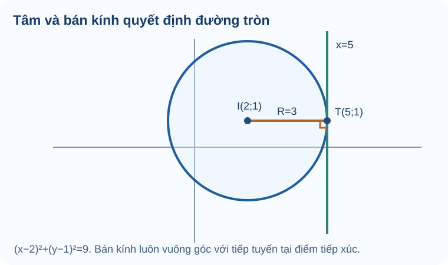

# Bài 21. Đường tròn trong mặt phẳng tọa độ

TOÁN 10 · CHƯƠNG VII · KIẾN THỨC SGK KNTT

Viết phương trình đường tròn, xác định tâm, bán kính và lập tiếp tuyến tại một điểm.

=== "Khám phá kiến thức"

    ### Cùng tìm hiểu

    Một trạm phát sóng đặt tại \(I(2,1)\) phủ sóng đến khoảng cách 3 km. Vùng được phủ gồm cả những vị trí **bên trong**, còn **đường biên** gồm các điểm cách trạm **đúng 3 đơn vị**: đó là một **đường tròn**. Ta phân biệt đường tròn với cả hình tròn để hiểu vì sao phương trình của đường biên dùng dấu bằng.

    Nếu em đã biết khoảng cách giữa hai điểm, công thức đường tròn gần như tự xuất hiện: \(\sqrt{(x-2)^2+(y-1)^2}=3\). Bình phương hai vế (đều không âm) cho \((x-2)^2+(y-1)^2=9\). Thay vì nhớ riêng từng kí hiệu, em có thể đọc phương trình như câu nói: “khoảng cách từ điểm \((x,y)\) đến tâm I bằng bán kính 3”.

    Một đường thẳng có thể không chạm, cắt tại hai điểm hoặc **tiếp xúc** đường tròn. Tại điểm tiếp xúc, **tiếp tuyến vuông góc bán kính**: đây là cách dựng phương trình tiếp tuyến từ hình học.

    ### Ví dụ trực quan

    Năm tình huống sau sẽ giúp em hiểu bản chất trước rồi mới đến câu **Vận dụng** và phần **Đối chiếu** tự mở. Hãy theo từng lời dẫn để biết điều kiện nào làm cho phép tính có ý nghĩa.

    

    #### 1.2.1. Từ khoảng cách không đổi đến phương trình đường tròn

    Hãy tưởng tượng một chiếc compa có đầu nhọn cố định ở tâm I và mở đúng một độ dài R. Khi quay, đầu bút M có thể đi tới nhiều vị trí nhưng **IM vẫn luôn bằng R**. Vì thế đường tròn không phải một công thức tự nhiên xuất hiện, mà chính là tập hợp tất cả điểm thỏa điều kiện khoảng cách ấy.

    Biết tâm \(I(a;b)\) và \(R>0\), ta tính bình phương khoảng cách từ \(M(x;y)\) tới I bằng tổng hai bình phương của độ lệch tọa độ. Điều kiện \(IM=R\) trở thành tổng đó bằng \(R^2\). Với tâm có hoành độ âm, dấu trong ngoặc x sẽ là dấu cộng; với bán kính 3, vế phải phải bằng 9 chứ không phải 3.

    **Vận dụng.** Lập phương trình đường tròn có tâm \(I(-2;1)\) và bán kính 3. Hãy tự kiểm dấu của tọa độ tâm, rồi chọn một điểm cách tâm 3 đơn vị để thử phương trình.

    ??? question "Đối chiếu"

        **Đáp án:** (x+2)²+(y-1)²=9.

        **Lý do:** IM²=(x+2)²+(y-1)², và R²=3²=9. Cần R=3>0.

        **Nếu chưa đúng:** Mở hướng dẫn tự sửa ngay bên dưới, xem lại bước còn vướng rồi thử một câu cùng kiến thức.

    

    #### 1.2.2. Hoàn thành bình phương để tìm ngược tâm và bán kính

    Đôi khi đề bài cho phương trình đã khai triển, chưa thể nhìn ngay ra tâm. Ta chuyển về dạng tổng hai bình phương bằng cách **hoàn thành bình phương** của nhóm theo x và nhóm theo y. Sau bước này, mỗi ngoặc chỉ độ lệch tọa độ so với tâm; vế phải biểu thị **bình phương bán kính**, không phải bán kính.

    Phải kiểm giá trị \(R^2\) trước khi lấy căn: dương thì có đường tròn bán kính \(R>0\); bằng 0 thì tập điểm chỉ có một điểm; âm thì không có điểm thực. Đây là phép kiểm cần thiết, không phải một bước hình thức có thể bỏ qua.

    **Vận dụng.** Xét \(x^2+y^2-6x+4y+8=0\). Hãy hoàn thành bình phương, tìm tâm, tính bán kính và xác nhận đây thực sự là một đường tròn.

    ??? question "Đối chiếu"

        **Đáp án:** (x−3)²+(y+2)²=5, tâm I(3,−2), bán kính √5.

        **Lý do:** x²−6x=(x−3)²−9, y²+4y=(y+2)²−4. Suy ra tổng hai bình phương bằng −8+9+4=5>0.

        **Nếu chưa đúng:** Mở hướng dẫn tự sửa ngay bên dưới, xem lại bước còn vướng rồi thử một câu cùng kiến thức.

    

    #### 1.2.3. Dựng tiếp tuyến từ bán kính tại tiếp điểm

    Một đường thẳng tiếp xúc đường tròn tại T có đúng **một điểm chung** với đường tròn. Đoạn ngắn nhất từ tâm I đến đường thẳng phải đi qua T và vuông góc với đường; đó chính là bán kính IT. Vì vậy, bán kính là **vectơ pháp tuyến** của tiếp tuyến, không phải vectơ chỉ phương.

    Đọc hình sau để thấy quan hệ giữa đường tròn, bán kính và tiếp tuyến trước khi học công thức.

    <figure class="thpt-r4-plot thpt-r4-concept-figure"><figcaption>Đường tròn \((x-2)^2+(y-1)^2=9\) có tâm \(I(2,1)\), bán kính 3. Điểm \(T(5,1)\) nằm trên đường tròn và tiếp tuyến tại \(T\) là \(x=5\).</figcaption></figure>

    **Cách đọc hình:** Tâm \(I(2;1)\) và điểm \(T(5;1)\) cùng tung độ, nên bán kính IT nằm ngang và dài 3. Tiếp tuyến \(x=5\) qua T thẳng đứng, tạo góc vuông với IT. Hãy nhìn đúng điểm tiếp xúc và kí hiệu góc vuông; với một điểm M bất kì, **chỉ được viết tiếp tuyến tại M sau khi chứng minh M thuộc đường tròn**.

    **Vận dụng.** Đường tròn tâm \(I(1;-1)\), bán kính 5 có điểm \(M(4;3)\). Hãy kiểm điều kiện M nằm trên đường, xác định pháp tuyến IM rồi lập phương trình tiếp tuyến tại M.

    ??? question "Đối chiếu"

        **Đáp án:** 3x+4y−24=0.

        **Lý do:** IM=(3,4), IM²=9+16=25=R² nên M thuộc đường. Tiếp tuyến: 3(x−4)+4(y−3)=0 ⇒ 3x+4y−24=0.

        **Nếu chưa đúng:** Mở hướng dẫn tự sửa ngay bên dưới, xem lại bước còn vướng rồi thử một câu cùng kiến thức.

    

    #### 1.2.4. Tại sao cần ba điểm không thẳng hàng?

    Nếu chỉ biết hai điểm A và B cùng thuộc đường tròn, ta chưa xác định được tâm: mọi điểm trên **đường trung trực của AB** đều cách đều A và B. Khi có thêm điểm C không thẳng hàng với A, B, tâm còn phải nằm trên đường trung trực AC. Giao hai đường trung trực cho đúng một điểm cách đều cả A, B và C: đó là tâm đường tròn phải tìm.

    Hãy tự phác tam giác ABC và hai đường trung trực của AB, AC để nhìn vị trí tâm. Đây là **hình em tự vẽ**, không phải hình có sẵn trên trang. Với ba điểm thẳng hàng, hai đường trung trực không có giao điểm xác định đường tròn qua cả ba; phải kiểm điều kiện này trước khi tính bán kính.

    **Vận dụng.** Tìm tâm, bán kính và phương trình đường tròn qua \(A(0;0)\), \(B(2;0)\), \(C(0;2)\). Hãy kiểm lại ba khoảng cách từ tâm bằng nhau.

    ??? question "Đối chiếu"

        **Đáp án:** Tâm I(1,1), bán kính √2, phương trình (x−1)²+(y−1)²=2.

        **Lý do:** Trung trực AB là x=1; trung trực AC là y=1. IA²=1²+1²=2; thử B và C đều cho tổng bình phương bằng 2.

        **Nếu chưa đúng:** Mở hướng dẫn tự sửa ngay bên dưới, xem lại bước còn vướng rồi thử một câu cùng kiến thức.

    

    #### 1.2.5. Khi nào đường thẳng cắt, tiếp xúc hoặc ở ngoài đường tròn?

    Để biết một đường thẳng có bao nhiêu điểm chung với đường tròn, trước tiên tìm **khoảng cách ngắn nhất** từ tâm I tới đường thẳng d, gọi là h. So sánh h với bán kính R dương: nếu h lớn hơn R, đường ở ngoài; nếu h bằng R, đường tiếp xúc tại chân vuông góc; nếu h nhỏ hơn R, đường cắt tại hai điểm.

    Em có thể vẽ thêm ba đường song song đặt gần, đúng và xa tâm so với bán kính để tự thấy trường hợp 2, 1 và 0 giao điểm. Cách so sánh này trả lời nhanh **số điểm chung**; nếu đề còn hỏi **tọa độ**, ta phải tìm điểm thỏa cả phương trình đường thẳng và đường tròn, không chỉ dừng ở so sánh khoảng cách.

    **Vận dụng.** Đường tròn tâm \(I(1;2)\), bán kính \(R=3\) và đường thẳng \(d:y=-1\) có bao nhiêu điểm chung? Nếu tiếp xúc, hãy tìm tiếp điểm bằng chân vuông góc.

    ??? question "Đối chiếu"

        **Đáp án:** Tiếp xúc; tiếp điểm T(1,−1).

        **Lý do:** Khoảng cách từ I(1,2) đến y=−1 là |2−(−1)|=3=R. Chân đường vuông góc từ I xuống d là T(1,−1).

        **Nếu chưa đúng:** Mở hướng dẫn tự sửa ngay bên dưới, xem lại bước còn vướng rồi thử một câu cùng kiến thức.

    ### Thuật ngữ, kiến thức và kỹ năng

    **Thuật ngữ:** Tâm, bán kính, phương trình đường tròn, dạng tổng quát, tiếp tuyến, tiếp điểm và vị trí tương đối.

    **Sau bài học, em cần:** Lập phương trình đường tròn từ tâm/bán kính hoặc ba điểm không thẳng hàng; nhận diện điều kiện bán kính dương khi hoàn thành bình phương; kiểm một điểm thuộc đường tròn rồi viết tiếp tuyến; dùng khoảng cách tâm–đường thẳng để xét vị trí tương đối.

=== "Kiến thức SGK"

    ### 2.1. Phương trình đường tròn

    
<strong>Định nghĩa — Đường tròn:</strong> Đường tròn tâm I và bán kính <strong>R dương</strong> là tập hợp tất cả các điểm M có khoảng cách IM = R. Đây là <strong>đường biên</strong>; các điểm ở bên trong hình tròn có khoảng cách tới tâm nhỏ hơn R.

    Đường tròn tâm \(I(a;b)\), bán kính \(R>0\) có phương trình:

    \[
    (x-a)^2+(y-b)^2=R^2.
    \]

    
<strong>Quy tắc — Viết phương trình từ tâm và bán kính:</strong> Lấy hiệu từng tọa độ điểm M với tâm I, bình phương hai hiệu rồi cộng lại; vế phải là <strong>bình phương bán kính</strong>. Bán kính R phải dương. Ngược lại, tổng hai bình phương bằng một số dương xác định tâm và bán kính của đường tròn.

    Phương trình tổng quát \(x^2+y^2+Dx+Ey+F=0\) biểu diễn **đường tròn thực có bán kính dương** khi

    \[
    I\left(-\frac D2;-\frac E2\right),\qquad R^2=\frac{D^2+E^2}{4}-F>0.
    \]

    
<strong>Quy tắc — Đọc dạng khai triển:</strong> Nhóm các hạng tử theo x và y, hoàn thành bình phương để đưa về dạng tâm–bán kính. Chỉ khi <strong>R² dương</strong> mới được gọi là đường tròn có bán kính dương; R² bằng 0 chỉ một điểm, âm thì vô nghiệm thực. Không nhầm R với R² hoặc đổi dấu sai khi tìm tâm.

    Nếu \(R^2=0\), tập điểm chỉ có một điểm; nếu \(R^2<0\), không có điểm thực. Không gọi hai trường hợp này là đường tròn có bán kính dương.

    ### 2.2. Phương trình tiếp tuyến của đường tròn

    
<strong>Định nghĩa — Tiếp tuyến tại một điểm:</strong> Tiếp tuyến tại M là đường thẳng chỉ có một điểm chung với đường tròn ở M. <strong>M phải thuộc đường tròn</strong>; bán kính IM vuông góc với tiếp tuyến, do đó là một pháp tuyến khác vectơ không của đường tiếp tuyến.

    Xem lại hình ở tab Khám phá: đoạn IT nằm ngang và đường x=5 qua T thẳng đứng. Cách đọc hình đã gắn trực tiếp với SVG, không cần tìm một hình khác ở đây.

    Tại điểm \(M(x_M;y_M)\) **thuộc đường tròn**, tiếp tuyến vuông góc với bán kính \(IM\):

    \[
    (x_M-a)(x-x_M)+(y_M-b)(y-y_M)=0.
    \]

    
<strong>Quy tắc — Lập tiếp tuyến tại M:</strong> Trước hết thay M vào phương trình đường tròn để kiểm điểm nằm trên đường. Tính vectơ IM rồi dùng nó làm <strong>pháp tuyến</strong> của đường qua M. Nếu M không thuộc đường tròn thì không được áp dụng công thức tiếp tuyến <em>tại M</em>.

    Với đường thẳng \(d\), đặt \(h=d(I,d)\):

    
<strong>Quy tắc — Số giao điểm với đường tròn:</strong> Khi bán kính R dương và d là đường thẳng thực sự, so khoảng cách h từ tâm đến d với R:
    <ul><li>\(h<R\): hai giao điểm;</li><li>\(h=R\): tiếp xúc tại một điểm;</li><li>\(h>R\): không giao nhau.</li></ul>Chỉ hỏi <strong>số giao điểm</strong> thì so sánh h với R là đủ; muốn tọa độ giao điểm còn phải giải hệ.

=== "Ví dụ"

    ### 3.1. Ví dụ — Từ tâm và tiếp điểm tìm tiếp tuyến

    **Đề bài.** Cho đường tròn \((x-2)^2+(y-1)^2=9\) và điểm \(T(5,1)\). Viết tiếp tuyến tại T.

    **Phân tích:** Phương pháp này áp dụng cho tiếp tuyến **tại T**, nên trước hết phải kiểm T thuộc đường tròn. Khi đó bán kính IT vuông góc tiếp tuyến, vì vậy \(\overrightarrow{IT}=(3,0)\) là một **pháp tuyến** của đường thẳng cần tìm. Viết phương trình qua T sẽ nhanh hơn giải hệ giao điểm khi tiếp điểm đã cho.

    

    
<strong>Lời giải.</strong> \(I=(2,1)\), \(R=3\). \(IT=3\), nên T thuộc đường tròn. Tiếp tuyến qua T nhận pháp tuyến \((3,0)\): \(3(x-5)=0\), tức \(x=5\).

    

    **Kiểm lại:** Điểm T thuộc đường tròn, đường x=5 qua đúng T và vuông góc bán kính IT nằm ngang; hình ở tab Khám phá biểu diễn đúng điểm tiếp xúc.

    ### 3.2. Ví dụ — Từ phương trình tổng quát tới tiếp tuyến

    **Đề bài.** Với \(x^2+y^2-4x+6y-12=0\), xác định tâm, bán kính của đường tròn và tiếp tuyến tại \(M(5;1)\).

    **Phân tích:** Trước hết phải **hoàn thành bình phương** để biết đúng tâm và bán kính, đồng thời kiểm bán kính dương. Tiếp theo, kiểm M có thực sự thuộc đường tròn; chỉ khi đó vectơ IM mới là pháp tuyến của tiếp tuyến tại M. Việc kiểm điều kiện này quan trọng hơn học thuộc một công thức tiếp tuyến rời rạc.

    

    
<strong>Lời giải.</strong> Hoàn thành bình phương:

    

    \[
    (x-2)^2+(y+3)^2=25.
    \]
    

    
Vậy \(I(2;-3)\) và \(R=5\). Điểm \(M(5;1)\) thuộc đường tròn vì \(IM^2=3^2+4^2=25\). Vectơ \(IM=(3;4)\) là pháp tuyến của tiếp tuyến tại \(M\), nên:

    

    \[
    3(x-5)+4(y-1)=0\iff \boxed{3x+4y-19=0}.
    \]
    

    

    **Kiểm lại:** \(R\) là bán kính dương, còn \(R^2\) mới là bình phương bán kính. Thay \(M(5;1)\) vào đường tròn cho 9+16=25, nên M thực sự thuộc đường tròn. Thế M vào tiếp tuyến cho 15+4−19=0; pháp tuyến tiếp tuyến là bán kính IM, đúng quan hệ vuông góc.

=== "Lỗi thường gặp"

    

    ??? tip "Tự khắc phục theo năm bước"

        1. **Nhận diện lỗi:** Nếu viết vế phải 3 hoặc (x-2)², em nhầm bán kính với bình phương bán kính hoặc nhầm dấu tọa độ tâm.

        2. **Quay lại bản chất:** Phương trình đường tròn chỉ là phát biểu IM=R viết bằng tọa độ. Bình phương hai vế thu điều kiện khoảng cách, không phải công thức xuất hiện từ đâu đó.

        3. **Tự sửa:** Đặt M=I, vế trái phải bằng 0; chọn M=I+(3,0) thì vế trái bằng 9.

        4. **Tự đối chiếu:** xem lại lời giải trên sau khi em tự làm; kiểm các điều kiện và dữ kiện của bài vừa Tự thử.

        5. **Luyện tiếp:** Dùng liên kết bên dưới để luyện câu cùng kiến thức. Nếu đã xem lời giải, hãy chọn thêm câu khác và tự làm mà không dựa vào gợi ý.

    

    ??? tip "Tự khắc phục theo năm bước"

        1. **Nhận diện lỗi:** Nếu kết luận bán kính 5 hoặc tâm (−3,2), em chưa đọc đúng dấu trong bình phương.

        2. **Quay lại bản chất:** Hoàn thành bình phương chuyển điều kiện đại số thành khoảng cách tới một tâm. Nếu kết quả R²≤0 thì không tạo được đường tròn bán kính dương.

        3. **Tự sửa:** Khai triển lại hai bình phương và kiểm phương trình thu được trùng đúng phương trình gốc.

        4. **Tự đối chiếu:** xem lại lời giải trên sau khi em tự làm; kiểm các điều kiện và dữ kiện của bài vừa Tự thử.

        5. **Luyện tiếp:** Dùng liên kết bên dưới để luyện câu cùng kiến thức. Nếu đã xem lời giải, hãy chọn thêm câu khác và tự làm mà không dựa vào gợi ý.

    

    ??? tip "Tự khắc phục theo năm bước"

        1. **Nhận diện lỗi:** Nếu điểm chưa thuộc đường tròn hoặc dùng IM làm chỉ phương, cách dựng tiếp tuyến đã sai điều kiện.

        2. **Quay lại bản chất:** Tại M trên đường tròn, bán kính IM vuông góc tiếp tuyến; vì vậy chính IM là một pháp tuyến của tiếp tuyến. Điều kiện 'M nằm trên đường tròn' là bắt buộc.

        3. **Tự sửa:** Thử 3²+4²=5² và thế M vào 3x+4y−24=0; kiểm pháp tuyến (3,4).

        4. **Tự đối chiếu:** xem lại lời giải trên sau khi em tự làm; kiểm các điều kiện và dữ kiện của bài vừa Tự thử.

        5. **Luyện tiếp:** Dùng liên kết bên dưới để luyện câu cùng kiến thức. Nếu đã xem lời giải, hãy chọn thêm câu khác và tự làm mà không dựa vào gợi ý.

    

    ??? tip "Tự khắc phục theo năm bước"

        1. **Nhận diện lỗi:** Nếu lấy trung điểm AB làm tâm, em mới dùng hai điểm và chưa bảo đảm cách đều C.

        2. **Quay lại bản chất:** Tâm đường tròn cách đều các điểm đã cho. Giao hai đường trung trực cho tâm nếu ba điểm không thẳng hàng; khi ba điểm thẳng hàng thì không có đường tròn đi qua cả ba.

        3. **Tự sửa:** Tìm cả hai trung trực rồi thử độ dài IA, IB, IC bằng nhau.

        4. **Tự đối chiếu:** xem lại lời giải trên sau khi em tự làm; kiểm các điều kiện và dữ kiện của bài vừa Tự thử.

        5. **Luyện tiếp:** Dùng liên kết bên dưới để luyện câu cùng kiến thức. Nếu đã xem lời giải, hãy chọn thêm câu khác và tự làm mà không dựa vào gợi ý.

    

    ??? tip "Tự khắc phục theo năm bước"

        1. **Nhận diện lỗi:** Nếu h=R mà nói 'cắt hai điểm', em nhầm trường hợp tiếp xúc với cát tuyến.

        2. **Quay lại bản chất:** Nếu h=d(I,d)>R thì lối đi ở ngoài vùng; h=R thì chạm một điểm; h<R thì cắt đường tròn tại hai điểm. Không cần giải hệ khi chỉ hỏi số giao điểm.

        3. **Tự sửa:** Vẽ đoạn IT vuông góc d dài 3; các điểm khác T trên d sẽ cách I xa hơn 3.

        4. **Tự đối chiếu:** xem lại lời giải trên sau khi em tự làm; kiểm các điều kiện và dữ kiện của bài vừa Tự thử.

        5. **Luyện tiếp:** Dùng liên kết bên dưới để luyện câu cùng kiến thức. Nếu đã xem lời giải, hãy chọn thêm câu khác và tự làm mà không dựa vào gợi ý.

    

    ??? tip "Nhầm R² với bán kính"

        
<strong>Dấu hiệu:</strong> Hoàn thành bình phương ra R²≤0 nhưng vẫn coi là đường tròn có bán kính dương.

        
<strong>Bản chất toán:</strong> Chỉ R²&gt;0 mới cho đường tròn thực bán kính R&gt;0. R²=0 cho một điểm; R²&lt;0 không có điểm thực.

        
<strong>Tự sửa:</strong> Ôn B21 mục 1: chuyển về (x−a)²+(y−b)²=R² rồi kiểm R² trước khi lấy căn.

        
<strong>Kiến thức cần ôn:</strong> Hằng đẳng thức bình phương và bình phương không âm; B21 mục 1.

        
<strong>Luyện lại bài đã có:</strong> <a data-thpt-formative-id="THPT-G10-B21-C02" href="../luyen-tap/?item=THPT-G10-B21-C02">Luyện lại câu 21-C02</a> · <a data-thpt-formative-id="THPT-G10-B21-P05" href="../luyen-tap/?item=THPT-G10-B21-P05">Luyện lại câu 21-P05</a>

    

    ??? tip "Viết tiếp tuyến khi M chưa thuộc đường tròn"

        
<strong>Dấu hiệu:</strong> Dùng IM làm pháp tuyến nhưng chưa chứng minh IM²=R²; nhầm cắt nhau với tiếp xúc.

        
<strong>Bản chất toán:</strong> Công thức tiếp tuyến tại M áp dụng khi M thuộc đường tròn. Đường d bất kỳ tiếp xúc khi d(I,d)=R&gt;0.

        
<strong>Tự sửa:</strong> Ôn B21 mục 2 và B20 mục 3 (khoảng cách): xác minh \(M\in(C)\), tính \(\overrightarrow{IM}\), lập tiếp tuyến qua M vuông góc với \(\overrightarrow{IM}\), rồi kiểm lại \(d(I,d)=R\).

        
<strong>Kiến thức cần ôn:</strong> B19 pháp tuyến, B20 khoảng cách; B21 mục 2.

        
<strong>Luyện lại bài đã có:</strong> <a data-thpt-formative-id="THPT-G10-B21-P02" href="../luyen-tap/?item=THPT-G10-B21-P02">Luyện lại câu 21-P02</a> · <a data-thpt-formative-id="THPT-G10-B21-P03" href="../luyen-tap/?item=THPT-G10-B21-P03">Luyện lại câu 21-P03</a> · <a data-thpt-formative-id="THPT-G10-CHVII-W21-ANCHOR-01" href="../../../thu-vien/tu-luan-chuong-vii/#thpt-g10-chvii-w21-anchor-01">Bài tự luận liên quan</a>

    **Học tiếp:** [Core và Luyện tập](luyen-tap.md) · [Tự kiểm tra cuối chương](tu-kiem-tra-chuong.md).

    
Nguồn toán học: SGK Toán 10 Kết nối tri thức với cuộc sống và học liệu SLM hiện hành. Lời giảng được biên tập nhằm hỗ trợ tự học độc lập.

<small>Nguồn đối chiếu: SGK KNTT tập 2, trang in 43–47; SBT trang 39–41. </small>
