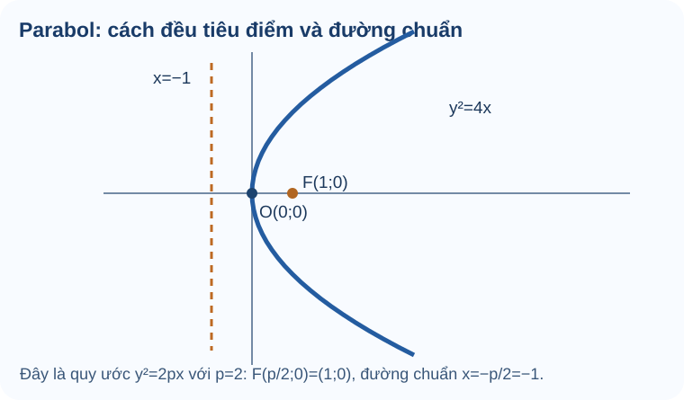
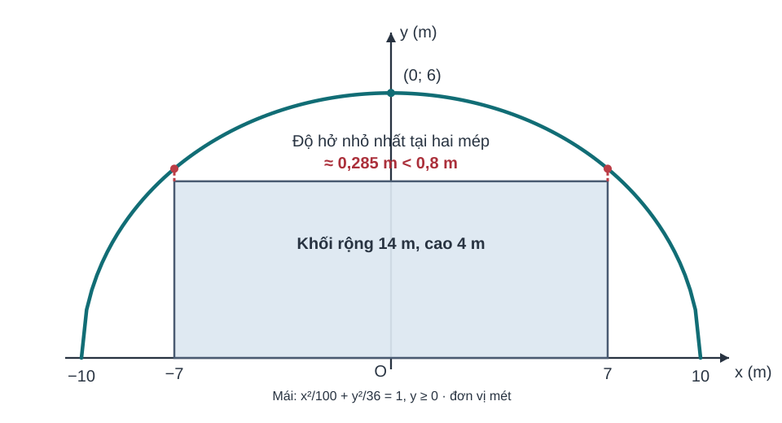
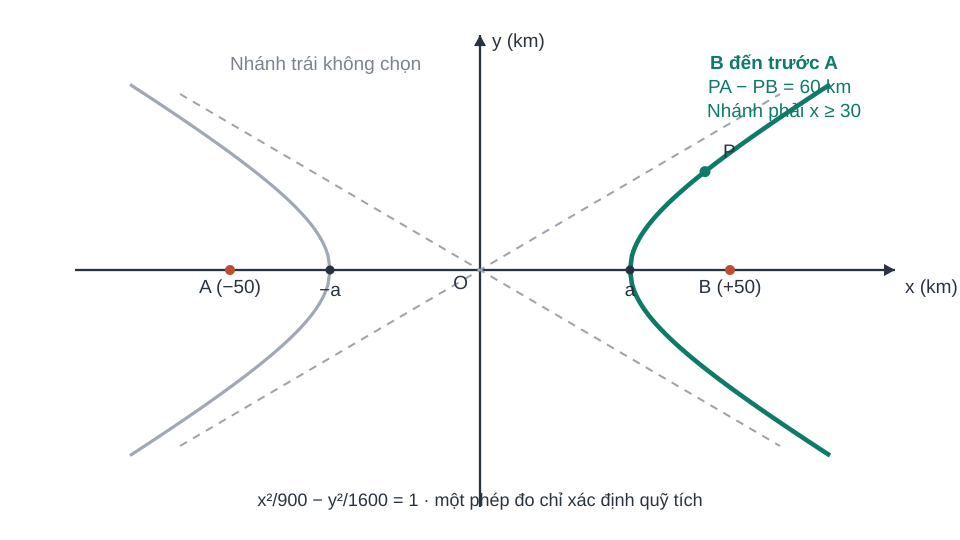

# Bài 22. Ba đường conic

TOÁN 10 · CHƯƠNG VII · KIẾN THỨC SGK KNTT

Tìm hiểu elip, hypebol và parabol; nhận biết công thức, tính chất và các điều kiện của ba đường conic.

=== "Khám phá kiến thức"

    ### Cùng tìm hiểu

    Ở những bài trước, tọa độ giúp em đo khoảng cách và xác định đường thẳng, đường tròn. Có những đường cong khác cũng bắt đầu từ **một điều kiện về khoảng cách**: elip dùng **tổng** khoảng cách đến hai tiêu điểm, hypebol dùng **giá trị tuyệt đối hiệu** hai khoảng cách ấy, còn parabol so khoảng cách đến **một điểm** với khoảng cách đến **một đường thẳng**. Từ điều kiện hình học, ta chọn hệ trục phù hợp rồi mới có phương trình chính tắc.

    Một công thức chỉ đúng với **cách đặt trục và điều kiện tham số** của nó. Vì vậy, em sẽ hiểu lý do dùng dấu cộng/trừ, biết đọc đúng tiêu điểm và áp dụng vào các bài toán đo đạc. Mỗi đoạn kiến thức có một câu **Vận dụng** kèm phần **Đối chiếu** tự mở; không cần học thuộc bảng công thức trước khi hiểu đường cong.

    ### Ví dụ trực quan

    

    #### 1.2.1. Elip: tổng khoảng cách không đổi

    Hãy tưởng tượng buộc hai đầu một sợi dây vào hai điểm cố định \(F_1,F_2\) và dùng đầu bút M kéo căng sợi dây. Khi đầu bút di chuyển, **tổng hai đoạn** từ M đến hai đầu dây không đổi. Quỹ tích đó là elip, chứ không phải một đường tròn vì có **hai tiêu điểm** khác nhau. Tổng bằng 2a phải lớn hơn khoảng cách hai tiêu điểm 2c: nếu không, sợi dây không thể kéo căng thành đường cong elip thông thường.

    Đặt gốc O ở trung điểm hai tiêu điểm và cho trục lớn trùng Ox, khi ấy tiêu điểm có tọa độ \((\pm c;0)\). Dạng chính tắc có mẫu dưới x² lớn hơn mẫu dưới y²: \(a>b>0\). Mối liên hệ là \(c^2=a^2-b^2\); vì thế \(c<a\), nghĩa là hai tiêu điểm **ở bên trong hai đỉnh** trên trục lớn. Nếu elip xoay trục hoặc trục lớn đổi hướng, phải đổi cách đọc; không áp máy móc tọa độ tiêu điểm trên Ox.

    **Vận dụng.** Elip x²/25+y²/16=1 có hai tiêu điểm nào? Trước khi tính c, hãy xác định rõ a, b và trục lớn.

    ??? question "Đối chiếu"

        **Đáp án:** a=5, b=4, c=3; F1(−3,0), F2(3,0).

        **Lý do:** a²=25>b²=16, c²=25−16=9 ⇒ c=3; elip có trục lớn Ox.

        **Nếu chưa đúng:** Mở hướng dẫn tự sửa ngay bên dưới, xem lại bước còn vướng rồi thử một câu cùng kiến thức.

    

    ??? tip "Kiểm lỗi"

        <ol>
        <li><strong>Nhận diện lỗi:</strong> Tìm đúng c nhưng đặt tiêu điểm trên Oy khi mẫu lớn hơn ở dưới x².</li>
        <li><strong>Tự chẩn đoán:</strong> Với elip x²/25+y²/16=1, trục lớn nằm trên Ox hay Oy? Hai tiêu điểm có thể nằm ở tọa độ (0;±3) không?</li>
        <li><strong>Kiến thức gốc:</strong> Với elip chính tắc trục lớn Ox, a²=25, b²=16, c²=9 và hai tiêu điểm nằm **trên Ox** trong hai đỉnh x=±5.</li>
        <li><strong>Tự sửa:</strong> Viết F₁(−3;0), F₂(3;0). Kiểm c=3<a=5; xác định trục lớn trước rồi mới dùng công thức tọa độ.</li>
        <li><strong>Luyện lại:</strong> <a href="../luyen-tap/?item=THPT-G10-B22-P01">Luyện Practice 22-P01</a></li>
        </ol>
    

    #### 1.2.2. Hypebol: độ chênh khoảng cách và hai nhánh

    Nếu với elip ta cộng hai khoảng cách thì với hypebol ta giữ **giá trị tuyệt đối của hiệu** hai khoảng cách đến các tiêu điểm bằng 2a. Điểm ở gần tiêu điểm bên trái và điểm ở gần tiêu điểm bên phải tạo thành **hai nhánh khác nhau**, không thể nối thành đường oval kín. Sự chênh lệch này phải nhỏ hơn khoảng cách giữa hai tiêu điểm, tức \(0<a<c\).

    Với hypebol chính tắc có số hạng x² dương, trục thực nằm trên Ox: \(x^2/a^2-y^2/b^2=1\), trong đó a,b đều dương. Khác elip, hai khoảng cách thỏa \(c^2=a^2+b^2\), nên \(c>a\): hai tiêu điểm nằm **xa tâm hơn** hai đỉnh (±a;0). Nhìn dấu trừ giúp phân biệt hypebol với elip; nhìn dấu số hạng dương giúp biết hai nhánh mở theo hướng nào.

    **Vận dụng.** Từ x²/16−y²/9=1, hãy tìm hai đỉnh và hai tiêu điểm. Kết quả c phải lớn hơn a hay nhỏ hơn a?

    ??? question "Đối chiếu"

        **Đáp án:** Đỉnh A1(−4,0), A2(4,0); tiêu điểm F1(−5,0), F2(5,0).

        **Lý do:** a=4, b=3, c²=a²+b²=16+9=25 ⇒ c=5; trục thực Ox.

        **Nếu chưa đúng:** Mở hướng dẫn tự sửa ngay bên dưới, xem lại bước còn vướng rồi thử một câu cùng kiến thức.

    

    ??? tip "Kiểm lỗi"

        <ol>
        <li><strong>Nhận diện lỗi:</strong> Sau khi đọc x²/16−y²/9=1 lại phác hình oval và gán hai tiêu điểm ở giữa hai đỉnh.</li>
        <li><strong>Tự chẩn đoán:</strong> Với phương trình này, x=0 có điểm nào trên đường không? Đỉnh ở x=±4 và tiêu điểm ở x=±5: cái nào xa O hơn?</li>
        <li><strong>Kiến thức gốc:</strong> Dấu trừ cho hypebol **hai nhánh**, (c^2=a^2+b^2) nên c>a; hai tiêu điểm nằm ngoài hai đỉnh.</li>
        <li><strong>Tự sửa:</strong> Tìm a=4, b=3, c=5; vẽ hai nhánh mở trái/phải, đánh dấu đỉnh (±4;0), tiêu điểm (±5;0), không nối qua Oy.</li>
        <li><strong>Luyện lại:</strong> <a href="../luyen-tap/?item=THPT-G10-B22-C02">Luyện Core 22-C02</a></li>
        </ol>
    

    #### 1.2.3. Vì sao hypebol có hai đường tiệm cận?

    Khi một điểm đi xa dọc nhánh hypebol, đường cong càng gần hai đường thẳng chéo đi qua tâm, gọi là **tiệm cận**. Chúng giúp ta phác đúng hình dạng khi không thể vẽ nhánh dài vô hạn; chúng **không phải** hai nhánh của hypebol và không được nhầm với hai trục tọa độ.

    Từ \(x^2/a^2-y^2/b^2=1\), biến đổi cho \(y^2=\frac{b^2}{a^2}(x^2-a^2)\). Khi trị tuyệt đối của x rất lớn, phần a² trở nên nhỏ so với x², nên độ dốc hai nhánh tiến gần \(\pm b/a\). Vì vậy hai tiệm cận là y=±(b/a)x **chỉ với dạng chính tắc đang xét** (tâm O, trục thực Ox). Đừng đảo thành a/b hoặc dùng nguyên công thức cho đường đã tịnh tiến.

    **Vận dụng.** Hypebol x²/25−y²/4=1 có hai tiệm cận nào? Hãy nhận a,b từ mẫu số trước khi viết hệ số góc.

    ??? question "Đối chiếu"

        **Đáp án:** y=(2/5)x và y=−(2/5)x.

        **Lý do:** a²=25 ⇒ a=5; b²=4 ⇒ b=2. Hệ số góc tiệm cận là ±b/a=±2/5.

        **Nếu chưa đúng:** Mở hướng dẫn tự sửa ngay bên dưới, xem lại bước còn vướng rồi thử một câu cùng kiến thức.

    

    ??? tip "Kiểm lỗi"

        <ol>
        <li><strong>Nhận diện lỗi:</strong> Viết y=±(5/2)x thay vì hệ số ±2/5, hoặc vẽ hẳn hai đường thẳng thay cho hypebol.</li>
        <li><strong>Tự chẩn đoán:</strong> Với x²/25−y²/4=1, mẫu dương có căn 5 và mẫu âm có căn 2; hệ số của các tiệm cận là b/a hay a/b?</li>
        <li><strong>Kiến thức gốc:</strong> Tiệm cận là những đường thẳng mà hai nhánh hypebol tiến gần khi đi xa, không phải chính đường cong. Dạng tâm O/trục thực Ox dùng **±b/a**.</li>
        <li><strong>Tự sửa:</strong> Chọn a=5,b=2, viết y=(2/5)x và y=−(2/5)x. Phác hai nhánh đi qua các đỉnh (±5;0) và tiến gần hai đường chéo.</li>
        <li><strong>Luyện lại:</strong> <a href="../luyen-tap/?item=THPT-G10-B22-C02">Luyện Core 22-C02</a></li>
        </ol>
    

    #### 1.2.4. Parabol: cách đều tiêu điểm và đường chuẩn

    Với parabol, ta không cần hai tiêu điểm. Hãy chọn **một điểm cố định F** và **một đường thẳng cố định Δ không đi qua F**. Mọi điểm M trên parabol đều cách F một khoảng bằng **khoảng cách vuông góc** từ M đến Δ. Chính điều kiện bằng nhau ấy tạo thành đường cong mở về phía tiêu điểm.

    Trong quy ước SGK tại đây, đỉnh ở O, trục đối xứng là Ox, tham số tiêu p>0 và \(y^2=2px\). Tiêu điểm ở \(F(p/2;0)\), đường chuẩn \(x=-p/2\); chúng nằm hai phía của O và cách O cùng p/2. Chú ý hệ số của x là **2p**, không phải trực tiếp tọa độ tiêu điểm. Hình dưới dùng hệ số 4 để đọc p=2; câu Vận dụng tiếp theo có hệ số 8 nên **sẽ có tiêu điểm khác hình**.

    <figure class="thpt-r4-plot thpt-r4-concept-figure"><figcaption>Với \(y^2=4x\) và quy ước \(y^2=2px\), ta có \(p=2\), tiêu điểm \(F(1,0)\) và đường chuẩn \(x=-1\). Hình chỉ minh họa phương trình này.</figcaption></figure>

    **Cách đọc hình:** Hình minh họa riêng đường (y^2=4x): tiêu điểm F(1;0), đường chuẩn x=−1 và O ở giữa. Đường chuẩn thẳng đứng nằm bên trái O; từ một điểm trên cong, khoảng cách đến F bằng khoảng cách vuông góc tới đường chuẩn. Đó là cơ sở hình học của công thức, không phải hình cho câu y²=8x.

    **Vận dụng.** Cho parabol y²=8x với x≥0. Hãy đọc p từ 2p=8, xác định tiêu điểm, đường chuẩn và kiểm M(2;4) có thuộc đường cong không.

    ??? question "Đối chiếu"

        **Đáp án:** p=4; F(2,0), đường chuẩn x=−2; M(2,4) thuộc vì 4²=8·2.

        **Lý do:** 2p=8 ⇒ p=4, F=(p/2,0)=(2,0), đường chuẩn x=−p/2=−2. M có MF=4 và khoảng cách đến x=−2 là 4.

        **Nếu chưa đúng:** Mở hướng dẫn tự sửa ngay bên dưới, xem lại bước còn vướng rồi thử một câu cùng kiến thức.

    

    ??? tip "Kiểm lỗi"

        <ol>
        <li><strong>Nhận diện lỗi:</strong> Đọc được tiêu điểm nhưng kết luận một điểm thuộc đường cong chỉ dựa trên hình phác, không kiểm hai khoảng cách.</li>
        <li><strong>Tự chẩn đoán:</strong> Với y²=8x và M(2;4), kiểm 4² có bằng 8×2 không; khoảng cách từ M đến F(2;0) có bằng khoảng cách từ M đến đường chuẩn x=−2 không?</li>
        <li><strong>Kiến thức gốc:</strong> Parabol là quỹ tích **cách đều tiêu điểm F và đường chuẩn Δ**; phương trình y²=2px chỉ là bản tọa độ của điều kiện đó. Khi tìm giao điểm, phải kiểm dữ kiện ở chính M.</li>
        <li><strong>Tự sửa:</strong> Ta có 16=16, MF=4 và khoảng cách ngang từ M(2;4) đến x=−2 cũng bằng 4; M thuộc parabol.</li>
        <li><strong>Luyện lại:</strong> <a href="../luyen-tap/?item=THPT-G10-B22-P03">Luyện Practice 22-P03</a></li>
        </ol>
    

    #### 1.2.5. Giao điểm của đường thẳng và conic phải là nghiệm chung

    Hình vẽ một đường thẳng đi qua conic có thể gợi ý có hai giao điểm, nhưng hình phác không chứng minh được tọa độ chính xác hay số điểm chung. Một điểm chỉ là giao điểm khi **thỏa đồng thời phương trình đường thẳng và phương trình conic**. Vì vậy ta thế phương trình đường vào phương trình conic, giải phương trình còn lại rồi thử lại mọi nghiệm trong dữ kiện ban đầu.

    Với elip x²/9+y²/4=1 và đường x=0, phần theo x biến mất, phương trình chỉ còn theo y. Khi giải y²=4, cần lấy **cả hai dấu**; bỏ một nghiệm âm sẽ làm mất một giao điểm. Đường ngoài elip có thể không có nghiệm thực, còn đường tiếp xúc có đúng một nghiệm phân biệt.

    **Vận dụng.** Đường x=0 cắt elip x²/9+y²/4=1 ở đâu? Tự kiểm cả hai tọa độ thu được bằng cách thế vào phương trình elip.

    ??? question "Đối chiếu"

        **Đáp án:** (0,2) và (0,−2).

        **Lý do:** Thế x=0 được y²/4=1 ⇒ y²=4 ⇒ y=±2; cả hai tọa độ thỏa phương trình gốc.

        **Nếu chưa đúng:** Mở hướng dẫn tự sửa ngay bên dưới, xem lại bước còn vướng rồi thử một câu cùng kiến thức.

    

    ??? tip "Kiểm lỗi"

        <ol>
        <li><strong>Nhận diện lỗi:</strong> Giải y²=4 rồi chỉ giữ y=2, làm mất một giao điểm trên trục Oy.</li>
        <li><strong>Tự chẩn đoán:</strong> Cho elip x²/9+y²/4=1 và đường x=0. Có mấy giao điểm và tại sao không thể bỏ y=−2?</li>
        <li><strong>Kiến thức gốc:</strong> Giao điểm phải là nghiệm chung. Phương trình bình phương bằng số dương có hai dấu; chỉ hình phác không đủ để chọn bỏ một nghiệm.</li>
        <li><strong>Tự sửa:</strong> Thế x=0, được y²=4 ⇒ y=±2, nên đủ (0;2) và (0;−2); kiểm hai điểm trong cả hai phương trình.</li>
        <li><strong>Luyện lại:</strong> <a href="../luyen-tap/?item=THPT-G10-B22-P05">Luyện Practice 22-P05</a></li>
        </ol>
    

    #### 1.2.6. Dùng parabol để tính bề rộng mặt cắt

    Trong thiết kế một máng hoặc cổng cong, phương trình parabol giúp tính **bề rộng ở một vị trí xác định**. Giả sử mặt cắt có dạng y²=2px và p>0. Ở một hoành độ x≥0, hai mép đối xứng qua trục Ox có tung độ dương và âm. Bề rộng vuông góc với trục là **hiệu hai tung độ**, không phải độ cao chỉ một nửa.

    Chẳng hạn, y²=20x là một mô hình tính bằng centimét. Tại x=5 cm, ta tính y²=100 nên hai mép là y=10 và y=−10 cm; bề rộng là 10−(−10)=20 cm. Kết quả có đơn vị **cm**; số đo là của **mặt cắt phẳng theo mô hình**, không khẳng định mọi máng ngoài thực tế đều có đúng biên dạng ấy.

    **Vận dụng.** Với mặt cắt y²=20x (x,y tính bằng cm), hãy tự tìm bề rộng tại x=5 cm và giải thích vì sao phải dùng cả hai dấu của y.

    ??? question "Đối chiếu"

        **Đáp án:** 20 cm.

        **Lý do:** Thế x=5 được y²=100 ⇒ y=±10 cm. Độ rộng là 10−(−10)=20 cm.

        **Nếu chưa đúng:** Mở hướng dẫn tự sửa ngay bên dưới, xem lại bước còn vướng rồi thử một câu cùng kiến thức.

    

    ??? tip "Kiểm lỗi"

        <ol>
        <li><strong>Nhận diện lỗi:</strong> Lấy |y|=10 cm làm độ rộng toàn phần ở x=5, quên mép còn lại có tung độ −10.</li>
        <li><strong>Tự chẩn đoán:</strong> Mặt cắt y²=20x, x=5 cm: hai mép bên trái/phải trục đối xứng có tung độ bằng bao nhiêu? Độ rộng có phải 10 cm không?</li>
        <li><strong>Kiến thức gốc:</strong> Với trục đối xứng Ox, đoạn thẳng đứng tại một x cố định nối y dương với y âm, nên độ rộng là **hiệu hai tung độ**, không chỉ |y|.</li>
        <li><strong>Tự sửa:</strong> Tại x=5, y=±10 cm, bề rộng từ −10 đến +10 bằng 20 cm; ghi đúng đơn vị cm.</li>
        <li><strong>Luyện lại:</strong> <a href="../luyen-tap/?item=THPT-G10-B22-P04">Luyện Practice 22-P04</a></li>
        </ol>
    

    #### 1.2.7. Chuyển giao: mái nửa elip và độ hở

    Một mái che có thể có **mặt cắt nửa trên elip**. Khi đó ta đặt O ở giữa nền, Ox nằm ngang, Oy thẳng đứng: bề rộng toàn phần là hai lần bán trục ngang, chiều cao tại tâm là bán trục đứng. Chỉ lấy **nửa trên y≥0** và chỉ xét các vị trí trong khoảng giữa hai chân mái.

    Với mái hình nửa elip rộng 12 m và cao 4 m ở tâm, bán trục ngang là 6 m, bán trục đứng 4 m. Để biết mái cao bao nhiêu tại một vị trí x, ta thế hoành độ vào phương trình rồi lấy **nghiệm y không âm**. Nếu kiểm một thiết bị hình chữ nhật có bề rộng, không chỉ xem độ cao tại tâm mà phải xem **hai mép trên**: mái thấp dần khi |x| tăng trong phạm vi nửa mái.

    **Vận dụng.** Mái nửa elip rộng **12 m**, cao **4 m** tại tâm. Đặt O ở giữa nền, Ox dọc nền. (a) Viết phương trình elip đầy đủ và điều kiện miền mái. (b) Tại x=3 m, mái cao bao nhiêu?
    <figure class="thpt-r4-plot thpt-r4-probability-figure"><figcaption>Hình minh họa độ hở theo phương đứng tại hai mép khối, không chỉ tại tâm.</figcaption></figure>

    **Lưu ý khi đọc hình:** Hình **minh họa độc lập** một mái nửa elip rộng 20 m và một khối rộng 14 m, yêu cầu độ hở tối thiểu 0,8 m. **Không thay** bộ số liệu ấy vào câu mái rộng 12 m và cao 4 m ở trên. Hình cho thấy phải đo khoảng cách theo phương đứng tại **hai mép vật**, không lấy riêng độ cao mái ở đỉnh.

    #### Minh họa có lời giải — Tính chiều cao tại vị trí tính từ chân mái

    Một mái nửa elip khác rộng 30 m, cao 10 m ở tâm. Người đứng ở vị trí **cách chân phải 6 m vào trong**. Chân phải có x=15, nên người đứng tại x=15−6=9 m, **không phải x=6**. Từ phương trình x²/225+y²/100=1, nửa trên y≥0, suy ra y=10√(1−81/225)=8 m. Độ cao phải nằm trong đoạn 0–10 m; đây là kết quả kiểm độc lập cho tình huống **30 m**, không phải hình minh họa **20 m**.

    ??? question "Đối chiếu"

        Bán trục ngang 6, bán trục đứng 4: `x²/36+y²/16=1`, **y≥0**, |x|≤6. Tại x=3, `y=4√(1−9/36)=2√3≈3,464 m`. Không lấy y âm hoặc dùng a=12. Nếu sai, xem `HELP-G10-CHVII-ELLIPSE-TR01`.

    

    ??? tip "Kiểm lỗi"

        <ol>
        <li><strong>Nhận diện lỗi:</strong> Kết luận khối hàng đi lọt vì mái cao ở tâm, không tính độ cao mái tại hai góc trên cùng.</li>
        <li><strong>Tự chẩn đoán:</strong> Một mái nửa elip **rộng 20 m, cao 6 m**; khối hàng giữa mái **rộng 14 m, cao 4 m**. Yêu cầu độ hở tối thiểu **0,8 m**: tại mép khối x=±7 m, mái cao bao nhiêu?</li>
        <li><strong>Kiến thức gốc:</strong> Mái nửa trên thỏa x²/100+y²/36=1, y≥0; với vật đặt giữa, độ hở nhỏ nhất xuất hiện ở **hai mép** x=±w/2 vì mái thấp khi |x| tăng.</li>
        <li><strong>Tự sửa:</strong> Thế x=7, mái cao 6√(1−49/100)≈4,285 m; độ hở chỉ ≈0,285 m < 0,8 m, **không đạt**. Bài minh họa 20 m này độc lập với mái 12 m và mái 30 m ở tab Khám phá.</li>
        <li><strong>Luyện lại:</strong> <a href="../luyen-tap/?item=THPT-G10-B22-P01">Luyện Practice 22-P01</a> · <a href="../../../thu-vien/tu-luan-chuong-vii/#thpt-g10-chvii-w22-01">Bài tự luận liên quan</a></li>
        </ol>
    

    #### 1.2.8. Chuyển giao: hai trạm tín hiệu và nhánh hypebol

    Khi hai trạm A và B phát tín hiệu **đồng thời**, cùng tốc độ v, máy thu P cách hai trạm những quãng đường khác nhau thì thời gian tín hiệu tới P cũng khác nhau. Lấy độ chênh thời gian Δt>0 nhân v sẽ được **trị tuyệt đối hiệu quãng đường**: \(|PA-PB|=v\Delta t=2a\). Điều kiện để có hypebol không suy biến là \(0<v\Delta t<AB=2c\); khi ấy \(b^2=c^2-a^2>0\).

    Chỉ biết **độ lớn** của chênh lệch thời gian thì chưa biết P ở nhánh nào. Nếu **tín hiệu B đến trước A**, P gần B hơn nên \(PA-PB>0\) và P ở nhánh phía B. Nếu A đến trước thì P ở nhánh phía A. Nếu biết cả độ lớn chênh lệch thời gian và tín hiệu nào đến trước, ta xác định được **một nhánh quỹ tích**; nếu chỉ biết độ lớn, cả hai nhánh đều có thể xảy ra. Các dữ kiện này chưa xác định duy nhất tọa độ máy thu.

    **Vận dụng.** Hai trạm cách nhau **60 km**, phát đồng thời; tốc độ truyền **100.000 km/s**, chênh thời gian nhận **0,0002 s**. Hãy tính 2a, c, b² và kiểm điều kiện có hypebol thực. Dữ kiện chưa nói trạm nào đến trước: có thể chọn nhánh không?
    <figure class="thpt-r4-plot thpt-r4-probability-figure"><figcaption>Hình minh họa quỹ tích hai nhánh; B nhận trước chọn nhánh gần B, không phải một điểm duy nhất.</figcaption></figure>

    **Lưu ý khi đọc hình:** SVG này minh họa **một bộ số liệu khác**: các trạm ở x=±50 km và **B nhận trước A**, nên nhánh phải gần B. Trong tình huống 60 km ở trên, chưa biết trạm nào trước; không được dùng màu/nhánh của hình để tự suy dấu.

    #### Minh họa có lời giải — Khi biết trạm nào đến trước

    Với **bộ số liệu thứ ba**, hai trạm A(−40;0), B(40;0) km, sóng truyền 100.000 km/s, tín hiệu **A đến trước** 0,0004 s. Hai trạm cách nhau 80 km nên c=40; độ lệch quãng đường là 40 km nên 2a=40, a=20. Ta có b²=40²−20²=1200 và phương trình **toàn hypebol** x²/400−y²/1200=1. Vì A đến trước, P gần A hơn và phải nằm trên **nhánh trái x≤−20**. Không có đủ dữ kiện để xác định một tọa độ P duy nhất; việc hai trạm phát đồng thời là điều kiện cần để biến chênh thời gian thành chênh quãng đường.

    ??? question "Đối chiếu"

        Hiệu quãng đường `vΔt=100000·0,0002=20 km`, nên `2a=20`, `a=10 km`, `2c=60`, `c=30 km`, `b²=c²−a²=900−100=800 km²`. Vì `0<20<60`, dữ kiện hình học phù hợp hypebol. **Chưa đủ thông tin trạm nào nhận trước** nên chưa thể chọn nhánh. Nếu quên điều kiện này, xem `HELP-G10-CHVII-HYPERBOLA-TR01`.

    

    ??? tip "Kiểm lỗi"

        <ol>
        <li><strong>Nhận diện lỗi:</strong> Biết |PA−PB| nhưng tự chọn nhánh phải, không dùng thông tin trạm nào gần máy thu hơn.</li>
        <li><strong>Tự chẩn đoán:</strong> A(−40;0), B(40;0) km phát đồng thời, tốc độ 100.000 km/s; tại P tín hiệu **A đến trước** 0,0004 s. Trạm nào gần P hơn? Điều kiện 0<vΔt<AB có được thỏa không?</li>
        <li><strong>Kiến thức gốc:</strong> Chênh quãng đường = 40 km ⇒ 2a=40, a=20; 2c=80, c=40, b²=1200. Phương trình toàn hypebol **có hai nhánh**, nhưng tín hiệu **A tới sớm hơn** buộc P gần A, nằm bên trái.</li>
        <li><strong>Tự sửa:</strong> Viết x²/400−y²/1200=1, chọn nhánh **x≤−20**. Chỉ biết một chênh lệch thời gian chưa xác định được tọa độ P; không sao chép nhánh phải từ SVG (B tới trước) vì dữ kiện khác.</li>
        <li><strong>Luyện lại:</strong> <a href="../luyen-tap/?item=THPT-G10-B22-P02">Luyện Practice 22-P02</a></li>
        </ol>
    ### Thuật ngữ, kiến thức và kỹ năng

    **Thuật ngữ:** Elip, hypebol, parabol, tiêu điểm, tiêu cự, bán trục, tiệm cận, đường chuẩn, tham số tiêu và phương trình chính tắc.

    **Sau bài học, em cần:** Phân biệt ba quỹ tích bằng điều kiện khoảng cách; tìm đúng tham số và tiêu điểm theo từng quy ước; nhận ra đường tiệm cận, tiêu điểm/đường chuẩn; giải giao điểm và vận dụng đúng miền, đơn vị, dấu nhánh vào mô hình mái hoặc tín hiệu.

=== "Kiến thức SGK"

    ### 2.1. Elip

    
<strong>Định nghĩa — Elip:</strong> Cho hai tiêu điểm F₁, F₂ phân biệt, cách nhau 2c. Elip là tập hợp những điểm M có <strong>tổng MF₁ + MF₂ = 2a không đổi</strong>, với <strong>a &gt; c &gt; 0</strong>. Như vậy tổng hai khoảng cách luôn lớn hơn đoạn thẳng nối hai tiêu điểm.

    #### Elip — trục lớn trùng \(Ox\)

    Ở dạng chính tắc dưới đây, chọn gốc O là trung điểm hai tiêu điểm và cho trục lớn trùng Ox. Điểm trên elip có tổng khoảng cách đến hai tiêu điểm không đổi. Hai tiêu điểm nằm trên trục lớn, giữa hai đỉnh; **bán trục b không phải khoảng cách từ tâm đến tiêu điểm**.
    Dạng chính tắc \(\dfrac{x^2}{a^2}+\dfrac{y^2}{b^2}=1\), với \(a>b>0\). Đặt \(c^2=a^2-b^2\), hai tiêu điểm là \((\pm c;0)\), các đỉnh \((\pm a;0)\) và \((0;\pm b)\).

    
<strong>Quy tắc — Tìm tiêu điểm elip trục lớn Ox:</strong> Mẫu lớn hơn dưới x² cho bình phương bán trục lớn a²; mẫu dưới y² cho b². Lấy <strong>c² = a² − b²</strong> và căn dương để tìm c, sau đó đặt hai tiêu điểm tại (−c;0), (c;0). Không áp nguyên tọa độ này cho elip quay hay đổi trục lớn.

    **Ví dụ:** \(\dfrac{x^2}{25}+\dfrac{y^2}{9}=1\) có \(a=5\), \(b=3\), \(c=4\), tiêu điểm \((\pm4;0)\); tổng khoảng cách từ một điểm trên elip đến hai tiêu điểm bằng \(2a=10\).

    ### 2.2. Hypebol

    
<strong>Định nghĩa — Hypebol:</strong> Cho hai tiêu điểm F₁, F₂ cách nhau 2c. Hypebol là tập hợp những điểm M có <strong>giá trị tuyệt đối hiệu hai khoảng cách |MF₁ − MF₂| = 2a không đổi</strong>, với <strong>0 &lt; a &lt; c</strong>. Các điểm tạo thành hai nhánh không khép kín.

    #### Hypebol — trục thực trùng \(Ox\)

    Với trục thực trùng Ox, hai nhánh mở sang trái và phải, các đỉnh ở gần tâm hơn hai tiêu điểm. Hai đường tiệm cận chéo biểu thị hướng các nhánh khi đi xa; chúng **không phải chính hai nhánh**. Hình trạm tín hiệu trong tab Khám phá là một tình huống có số liệu riêng, không phải hình chính tắc để đọc a,b của mọi ví dụ.
    Dạng chính tắc \(\dfrac{x^2}{a^2}-\dfrac{y^2}{b^2}=1\), \(a,b>0\). Khi đó \(c^2=a^2+b^2\), hai tiêu điểm \((\pm c;0)\), các đỉnh \((\pm a;0)\), các tiệm cận \(y=\pm\dfrac ba x\).

    
<strong>Quy tắc — Tiêu điểm và tiệm cận hypebol:</strong> Dấu trừ phân biệt hypebol với elip. Với số hạng x² dương, chọn a² ở mẫu dương, b² ở mẫu âm; <strong>c² = a² + b²</strong>, nên c &gt; a. Hai tiệm cận qua O có hệ số góc <strong>±b/a</strong>. Nếu đổi tâm hoặc đổi trục phải biến đổi phương trình trước.

    **Ví dụ:** \(\dfrac{x^2}{9}-\dfrac{y^2}{16}=1\): \(a=3,b=4,c=5\), hai tiệm cận \(y=\pm4x/3\).

    ### 2.3. Parabol

    
<strong>Định nghĩa — Parabol:</strong> Cho một tiêu điểm F và một đường thẳng cố định Δ <strong>không đi qua F</strong> (đường chuẩn). Parabol là tập hợp những điểm M có <strong>khoảng cách MF bằng khoảng cách vuông góc từ M đến Δ</strong>. Khoảng cách từ F tới Δ là tham số tiêu, phải dương.

    #### Parabol — quy ước \(y^2=2px,\ p>0\)

    Hình thật của đường y²=4x đã đặt cạnh phần Khám phá: O là đỉnh, F(1,0) ở bên phải, đường chuẩn x=−1 ở bên trái; điểm trên đường cách đều F và đường chuẩn. Đường cong mở về phía tiêu điểm. Không lấy hình này làm số liệu của phương trình y²=8x trong câu Vận dụng.
    Parabol có đỉnh \(O(0;0)\), tiêu điểm \(F(p/2;0)\), đường chuẩn \(x=-p/2\). Mọi điểm \(M\) trên parabol có khoảng cách đến tiêu điểm bằng khoảng cách đến đường chuẩn.

    
<strong>Quy tắc — Phương trình chính tắc parabol:</strong> Với <strong>p &gt; 0</strong> trong quy ước y² = 2px, hệ số x bằng 2p, nên <strong>tiêu điểm là (p/2;0)</strong> và <strong>đường chuẩn x = −p/2</strong>. Không dùng một quy ước hệ số 4p khác rồi giữ nguyên công thức tiêu điểm.

    **Ví dụ:** \(y^2=12x\), suy ra \(p=6\), \(F(3;0)\), đường chuẩn \(x=-3\). Điểm \(M(3;6)\) thuộc parabol vì \(36=12\cdot3\); hai khoảng cách đều bằng \(6\).

    ### 2.4. Một số ứng dụng của ba đường conic

    Các mô hình conic có thể mô tả **mái vòm elip**, **chênh lệch khoảng cách tới hai trạm tín hiệu (hypebol)** hoặc **bộ phận phản xạ parabol**. Khi vận dụng, phải chọn đúng dạng đường cong, đơn vị, miền tọa độ và điều kiện của bài toán; không suy kết quả chỉ từ hình minh họa.

    
<strong>Quy tắc — Chọn đúng mô hình trước khi tính:</strong> Mái nửa elip dùng <strong>bán trục theo phương ngang/đứng</strong>, chỉ xét nửa trên và độ cao tại mép; không tùy tiện áp điều kiện a&gt;b của elip trục lớn Ox vào một mái có thể cao hơn chiều ngang. Tín hiệu hypebol đòi hỏi trạm phát đồng thời, cùng vận tốc và độ lệch quãng đường <strong>nhỏ hơn khoảng cách hai trạm</strong>; phải biết trạm đến trước mới chọn được nhánh. Mặt cắt parabol chỉ cho số đo trong miền thực tế đã mô hình hóa.

    Tính chất quang học trong SGK cũng cho thấy **parabol** có khả năng biến các tia tới song song trục thành các tia phản xạ đi qua tiêu điểm (với bề mặt phản xạ và hình học phù hợp). Vì vậy chảo thu tín hiệu, đèn pha có dạng phản xạ parabol. Đây là <strong>ứng dụng hình học được giới thiệu</strong>, không dùng công thức tọa độ để suy ra định luật phản xạ hay tuyên bố mọi mặt cắt thực tế đều là parabol chính xác.

    #### Phân biệt công thức và điều kiện sử dụng

    
<table class="thpt-g10-knowledge-table">
    <thead><tr><th>Đường conic</th><th>Công thức liên hệ</th><th>Chú ý</th></tr></thead>
    <tbody>
    <tr><td>Elip</td><td>\(c^2=a^2-b^2\)</td><td>\(a&gt;b&gt;0\) trong dạng trục lớn \(Ox\)</td></tr>
    <tr><td>Hypebol</td><td>\(c^2=a^2+b^2\)</td><td>Tiệm cận \(y=\pm bx/a\)</td></tr>
    <tr><td>Parabol</td><td>\(y^2=2px\)</td><td>Tiêu điểm \((p/2;0)\), không phải \((p;0)\)</td></tr>
    </tbody></table>

=== "Ví dụ"

    ### 3.1. Ví dụ — Tìm tiêu điểm elip từ mẫu số

    **Đề bài.** Cho \(\frac{x^2}{9}+\frac{y^2}{4}=1\). Tìm hai tiêu điểm.

    **Phân tích:** Hai phân thức cùng dấu cộng, mẫu lớn hơn dưới \(x^2\), nên đây là elip có trục lớn theo \(Ox\). Ta đọc a² và b² từ hai mẫu, sau đó dùng **hiệu** a²−b² để tìm c² (khác với hypebol). Chỉ khi nhận đúng dạng và điều kiện a>b>0 mới đặt hai tiêu điểm trên Ox.

    

    
<strong>Lời giải.</strong> \(a^2=9,\ b^2=4\), nên \(c^2=a^2-b^2=5\); hai tiêu điểm là \(F_1(-\sqrt5,0)\), \(F_2(\sqrt5,0)\).

    

    **Kiểm lại:** Vì c=√5 nhỏ hơn a=3, cả hai tiêu điểm nằm giữa hai đỉnh trên trục Ox. Tổng khoảng cách từ mọi điểm trên elip đến hai tiêu điểm là 2a=6, phù hợp định nghĩa elip.

    ### 3.2. Ví dụ — Tiêu điểm và tiệm cận hypebol

    **Đề bài.** Cho \(\frac{x^2}{9}-\frac{y^2}{4}=1\). Tìm tiêu điểm và hai đường tiệm cận.

    **Phân tích:** Dấu trừ và số hạng x² dương cho hypebol trục thực \(Ox\), **khác elip** ở ví dụ trước. Đọc a và b từ mẫu dương/âm, tính c theo **tổng** a²+b²; muốn tìm tiệm cận qua O phải lấy hệ số góc ±b/a. Không hoán đổi hai mẫu hoặc kết luận tiệm cận là hai nhánh.

    

    
<strong>Lời giải.</strong> \(a=3,b=2,c=\sqrt{a^2+b^2}=\sqrt{13}\). Hai tiêu điểm \(F_1(-\sqrt{13},0)\), \(F_2(\sqrt{13},0)\); các tiệm cận \(y=\pm\frac23x\).

    

    **Kiểm lại:** √13>3 nên hai tiêu điểm ở ngoài hai đỉnh ±3. Hệ số góc tiệm cận có độ lớn 2/3, không phải 3/2; hai nhánh đi gần các tiệm cận ở xa mà không trùng với chúng.

    ### 3.3. Ví dụ — Đọc tiêu điểm và đường chuẩn parabol

    **Đề bài.** Với \(y^2=4x\) theo quy ước \(y^2=2px\), tìm tiêu điểm và đường chuẩn.

    **Phân tích:** Theo quy ước của bài, hệ số của \(x\) là \(2p\), **không phải \(4p\)**. Ta tìm p từ hệ số trước, rồi đặt tiêu điểm và đường chuẩn cách O cùng p/2 nhưng nằm hai phía. Cách này xuất phát từ định nghĩa các điểm cách đều tiêu điểm và đường chuẩn, không phải ghi nhớ hai tọa độ rời nhau.

    

    
<strong>Lời giải.</strong> \(2p=4\Rightarrow p=2\). Tiêu điểm \(F(\frac p2,0)=(1,0)\), đường chuẩn \(x=-\frac p2=-1\).

    

    **Kiểm lại:** Đỉnh \(O(0,0)\) cách F và đường chuẩn cùng một đơn vị; với M(1;2) trên y²=4x, khoảng cách MF=2 và khoảng cách tới x=−1 cũng bằng 2. Hai phép đo bằng nhau, đúng định nghĩa.

=== "Lỗi thường gặp"

    Hai lỗi dưới đây là những nhầm lẫn **có thể lặp lại trong nhiều bài conic**. Nếu mắc lỗi khi làm một câu Vận dụng cụ thể, hãy mở **Kiểm lỗi** ngay dưới câu đó trong tab Khám phá kiến thức.

    

    ??? tip "4.1. Đánh tráo dấu quan hệ c² giữa elip và hypebol"

        <ol>
        <li><strong>Nhận diện lỗi:</strong> Thuộc hai công thức mà không phân biệt dấu cộng/trừ trong phương trình, nên dùng c²=a²+b² cho elip hoặc c²=a²−b² cho hypebol.</li>
        <li><strong>Tự chẩn đoán:</strong> So sánh E:x²/25+y²/16=1 và H:x²/16−y²/9=1. Dấu trước số hạng y² và vị trí hai tiêu điểm khác nhau như thế nào?</li>
        <li><strong>Kiến thức gốc:</strong> Elip trục lớn Ox có <strong>c² = a² − b²</strong> và c &lt; a; hypebol trục thực Ox có <strong>c² = a² + b²</strong> và c &gt; a. Dấu trong dạng chính tắc phản ánh quỹ tích khác nhau.</li>
        <li><strong>Tự sửa:</strong> Với E: c²=25−16=9, c=3; với H: c²=16+9=25, c=5. Kiểm tiêu điểm elip nằm trong đỉnh, hypebol ngoài đỉnh.</li>
        <li><strong>Luyện lại:</strong> <a data-thpt-formative-id="THPT-G10-B22-C02" href="../luyen-tap/?item=THPT-G10-B22-C02">Luyện lại câu 22-C02</a> · <a data-thpt-formative-id="THPT-G10-B22-P01" href="../luyen-tap/?item=THPT-G10-B22-P01">Luyện lại câu 22-P01</a> · <a data-thpt-formative-id="THPT-G10-B22-P02" href="../luyen-tap/?item=THPT-G10-B22-P02">Luyện lại câu 22-P02</a> · <a data-thpt-formative-id="THPT-G10-CHVII-W22-01" href="../../../thu-vien/tu-luan-chuong-vii/#thpt-g10-chvii-w22-01">Bài tự luận liên quan</a></li>
        </ol>

    

    ??? tip "4.2. Lẫn tham số p với tọa độ tiêu điểm khi đổi quy ước"

        <ol>
        <li><strong>Nhận diện lỗi:</strong> Dùng quy ước y²=4px rồi kết luận F=(p;0) trong khi bài đang dùng **y²=2px**, làm sai cả tiêu điểm và đường chuẩn.</li>
        <li><strong>Tự chẩn đoán:</strong> Với y²=8x, ta có 2p=8 hay 4p=8? Nếu dùng p=4 theo dạng 2px, tiêu điểm ở (4;0) hay (2;0)?</li>
        <li><strong>Kiến thức gốc:</strong> Quy ước **y²=2px, p>0** của SGK cho tiêu điểm **F(p/2;0)** và đường chuẩn **x=−p/2**. Không đổi một nửa hệ quy ước rồi giữ công thức của nửa còn lại.</li>
        <li><strong>Tự sửa:</strong> Với hệ số 8, tính p=4, F(2;0), Δ:x=−2. Thử M(2;4): MF=4, khoảng cách đến Δ cũng 4; chính phép kiểm đó xác nhận kết quả.</li>
        <li><strong>Luyện lại:</strong> <a data-thpt-formative-id="THPT-G10-B22-P03" href="../luyen-tap/?item=THPT-G10-B22-P03">Luyện lại câu 22-P03</a> · <a data-thpt-formative-id="THPT-G10-B22-P04" href="../luyen-tap/?item=THPT-G10-B22-P04">Luyện lại câu 22-P04</a> · <a data-thpt-formative-id="THPT-G10-B22-P06" href="../luyen-tap/?item=THPT-G10-B22-P06">Luyện lại câu 22-P06</a></li>
        </ol>

    **Học tiếp:** [Core và Luyện tập](luyen-tap.md) · [Tự kiểm tra cuối chương](tu-kiem-tra-chuong.md).

    
Nguồn đối chiếu: SGK KNTT tập 2, trang in 48–57; SBT trang 42–46. Không dùng đạo hàm hoặc nội dung trục quay ngoài phạm vi đã kiểm chứng.

