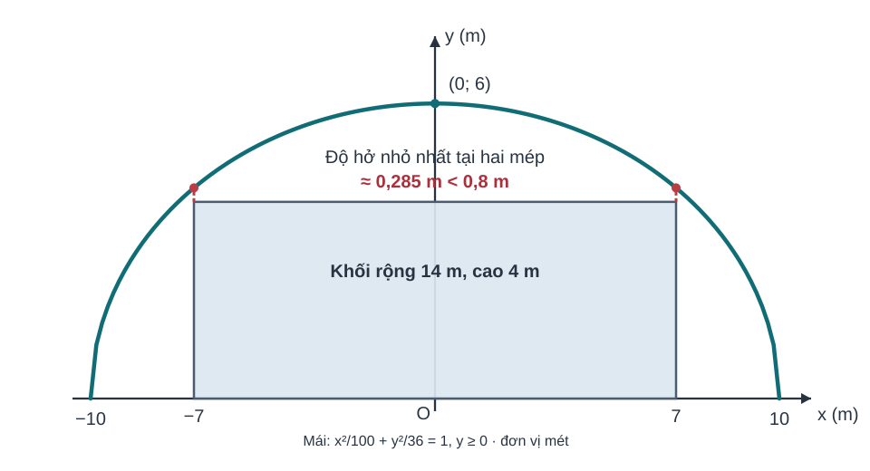
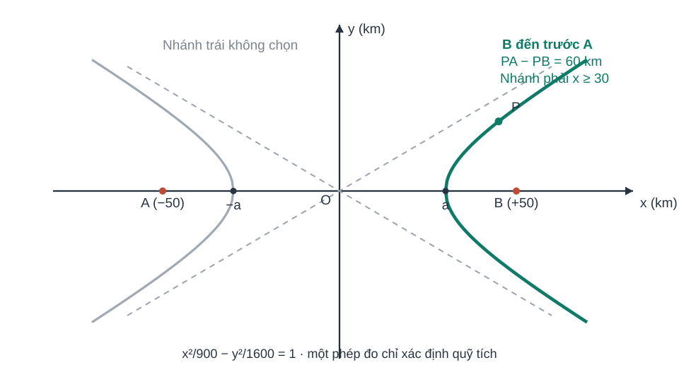
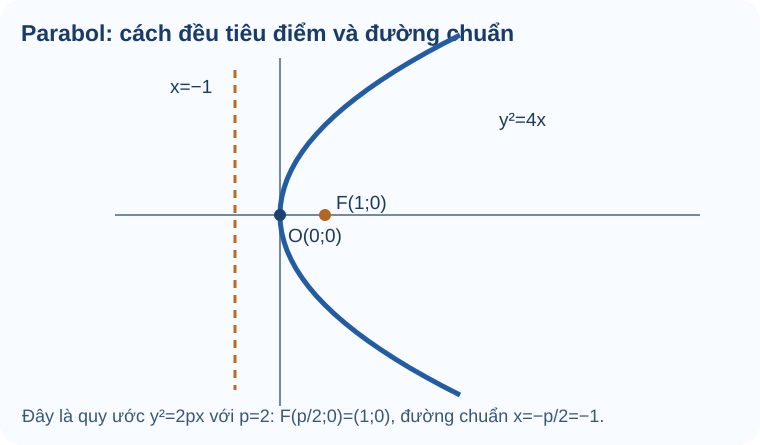

# Bài 22. Ba đường conic

TOÁN 10 · CHƯƠNG VII · KIẾN THỨC SGK KNTT

Tìm hiểu elip, hypebol và parabol; nhận biết công thức, tính chất và các điều kiện của ba đường conic.

=== "Khám phá kiến thức"

    ### Cùng tìm hiểu

    Một điểm di chuyển trên mặt phẳng có thể bị ràng buộc bởi **khoảng cách đến những điểm hoặc đường cố định**. Nếu tổng khoảng cách đến hai điểm cố định không đổi, ta có **elip**; nếu trị tuyệt đối hiệu hai khoảng cách ấy không đổi, ta gặp **hypebol**. Nếu khoảng cách đến một điểm cố định luôn bằng khoảng cách đến một đường thẳng cố định, ta có **parabol**.

    Ba đường đều có thể được mô tả bằng phương trình, nhưng **dấu và mẫu số trong phương trình không thể thay thế cho việc hiểu định nghĩa hình học**. Em cần nhận ra tiêu điểm, trục đối xứng, bán trục và điều kiện tham số trước khi tính. Khi gặp hình của một elip có trục lớn nằm ngang, ta không được tự dùng đúng công thức đó cho một elip quay hoặc đổi trục.

    Bài học sẽ đi từ đặc điểm hình học đến ba phương trình chính tắc đúng quy ước SGK. Các hình minh họa đi cạnh từng loại đường, không gom chung ở cuối để học sinh khỏi so nhầm tiêu điểm hay trục.

    ### Ví dụ trực quan

    

    Một đường elip có thể được nhận ra bằng tổng khoảng cách đến hai điểm cố định F₁,F₂: với mọi điểm M trên đường, MF₁+MF₂=2a không đổi. Nhắc lại cách tính khoảng cách hai điểm, ta thấy đây là một điều kiện hình học trước khi là một phương trình đại số. Với elip chính tắc x²/a²+y²/b²=1 và a>b>0, trục lớn nằm trên Ox, các đỉnh ở (±a,0) còn hai tiêu điểm ở (±c,0), với c²=a²−b².

    Hãy hình dung đường bao dẹt theo phương ngang; hai tiêu điểm nằm trong đường bao vì c<a. Khi đọc phương trình, mẫu lớn hơn dưới x² cho biết a², mẫu còn lại cho b²; từ đó tính c rồi xác định tiêu điểm. Tâm sai e=c/a mô tả độ dẹt của elip, nhưng trước hết cần phân biệt đúng a, b và c. Các công thức này đi cùng điều kiện trục lớn là Ox, không áp máy móc khi trục lớn theo hướng khác.

    **Em vận dụng.** Với elip x²/25+y²/16=1, tìm a, b, c và hai tiêu điểm.

    ??? question "Đối chiếu"

        **Đáp án:** a=5, b=4, c=3; F1(−3,0), F2(3,0).

        **Lý do:** a²=25>b²=16, c²=25−16=9 ⇒ c=3; elip có trục lớn Ox.

        **Nếu chưa đúng:** Mở hướng dẫn tự sửa ngay bên dưới, xem lại bước còn vướng rồi thử một câu cùng kiến thức.

    <a href="../luyen-tap/?item=THPT-G10-B22-P01">Mở câu luyện tập tương ứng để tự luyện</a>

    

    Từ elip, hãy đổi câu hỏi: thay vì giữ tổng hai khoảng cách đến hai tiêu điểm không đổi, ta xét độ lớn của hiệu hai khoảng cách không đổi. Quỹ tích thu được là hypebol gồm hai nhánh tách rời. Trong dạng chính tắc x²/a²−y²/b²=1 với a,b>0, hai nhánh mở sang trái và phải theo Ox, các đỉnh ở (±a,0).

    So với hệ thức c²=a²−b² của elip có trục lớn Ox, hypebol có c²=a²+b², nên c>a: hai tiêu điểm (±c,0) nằm xa tâm hơn các đỉnh. Khi hình dung hình vẽ, không nối hai nhánh thành một đường kín. Dấu dương trước x² xác định trục thực, còn dấu trừ trước y² giúp phân biệt phương trình hypebol với phương trình elip.

    **Em vận dụng.** Hypebol x²/16−y²/9=1 có các đỉnh và hai tiêu điểm tọa độ nào?

    ??? question "Đối chiếu"

        **Đáp án:** Đỉnh A1(−4,0), A2(4,0); tiêu điểm F1(−5,0), F2(5,0).

        **Lý do:** a=4, b=3, c²=a²+b²=16+9=25 ⇒ c=5; trục thực Ox.

        **Nếu chưa đúng:** Mở hướng dẫn tự sửa ngay bên dưới, xem lại bước còn vướng rồi thử một câu cùng kiến thức.

    <a href="../luyen-tap/?item=THPT-G10-B22-C02">Mở câu luyện tập tương ứng để tự luyện</a>

    

    Hai nhánh của một hypebol kéo dài ra vô hạn nhưng càng ra xa, chúng càng tiến sát hai đường thẳng đi qua tâm. Những đường này được gọi là tiệm cận, giúp ta phác được hướng của nhánh mà không cần vẽ đến vô tận. Từ x²/a²−y²/b²=1, suy ra y²=(b²/a²)(x²−a²). Khi |x| rất lớn so với a, tỉ số |y/x| tiến gần b/a.

    Vì vậy, với hypebol chính tắc tâm O và trục thực Ox, hai tiệm cận có phương trình y=±(b/a)x. Hãy hình dung hai đường chéo đi qua O và hai nhánh tiến sát chúng về phía xa; đường tiệm cận không phải chính nhánh hypebol. Nếu phương trình đã bị tịnh tiến hoặc đổi trục, phải đưa về dạng phù hợp trước khi dùng công thức này.

    **Em vận dụng.** Hypebol x²/25−y²/4=1 có hai đường tiệm cận nào?

    ??? question "Đối chiếu"

        **Đáp án:** y=(2/5)x và y=−(2/5)x.

        **Lý do:** a²=25 ⇒ a=5; b²=4 ⇒ b=2. Hệ số góc tiệm cận là ±b/a=±2/5.

        **Nếu chưa đúng:** Mở hướng dẫn tự sửa ngay bên dưới, xem lại bước còn vướng rồi thử một câu cùng kiến thức.

    <a href="../luyen-tap/?item=THPT-G10-B22-C02">Mở câu luyện tập tương ứng để tự luyện</a>

    

    Trong hình học, parabol không chỉ là đường cong có một phương trình quen thuộc. Mỗi điểm M trên parabol cách một điểm cố định F (tiêu điểm) đúng bằng khoảng cách vuông góc từ M đến một đường thẳng cố định (đường chuẩn). Hãy nhớ hai cách tính khoảng cách: từ điểm đến điểm và từ điểm đến đường thẳng. So sánh hai khoảng cách đó sẽ dẫn đến phương trình của parabol.

    Với quy ước y²=2px và p>0, đỉnh là O, tiêu điểm F(p/2,0) nằm bên phải đỉnh, còn đường chuẩn x=−p/2 nằm bên trái; cả hai cách đỉnh một khoảng p/2. Nếu một hình vẽ biểu diễn điểm M trên đường cong, hai đoạn khoảng cách tương ứng phải bằng nhau. Khi đọc hệ số trước x, tìm 2p rồi chia đôi để suy p; tuyệt đối không nhầm tiêu điểm thành F(p,0), vốn thuộc quy ước phương trình khác.

    **Em vận dụng.** Cho parabol y²=8x với x≥0. Xác định tiêu điểm, đường chuẩn; M(2,4) có thuộc parabol không?

    ??? question "Đối chiếu"

        **Đáp án:** p=4; F(2,0), đường chuẩn x=−2; M(2,4) thuộc vì 4²=8·2.

        **Lý do:** 2p=8 ⇒ p=4, F=(p/2,0)=(2,0), đường chuẩn x=−p/2=−2. M có MF=4 và khoảng cách đến x=−2 là 4.

        **Nếu chưa đúng:** Mở hướng dẫn tự sửa ngay bên dưới, xem lại bước còn vướng rồi thử một câu cùng kiến thức.

    <a href="../luyen-tap/?item=THPT-G10-B22-P03">Mở câu luyện tập tương ứng để tự luyện</a>

    

    Khi một đường thẳng cắt đường elip, hypebol hoặc parabol, tọa độ mỗi giao điểm phải đồng thời thỏa hai phương trình. Ý tưởng giống tìm giao điểm hai đường ở Bài 20: giải hệ chứ không đoán theo hình. Ta có thể biểu diễn một biến từ phương trình đường thẳng, thế vào phương trình conic rồi giải phương trình còn lại.

    Hình vẽ cho biết điều gì có thể xảy ra: một đường qua elip có thể gặp nó tại hai điểm, tiếp xúc ở một điểm hoặc nằm ngoài không gặp điểm nào. Vì thế, chỉ giữ nghiệm thực và thế lại vào cả hai phương trình; không được mặc định giao điểm luôn có hai nghiệm. Cách giải phụ thuộc chính những điều kiện toán học của từng vị trí.

    **Em vận dụng.** Đường x=0 cắt elip x²/9+y²/4=1 tại những điểm nào?

    ??? question "Đối chiếu"

        **Đáp án:** (0,2) và (0,−2).

        **Lý do:** Thế x=0 được y²/4=1 ⇒ y²=4 ⇒ y=±2; cả hai tọa độ thỏa phương trình gốc.

        **Nếu chưa đúng:** Mở hướng dẫn tự sửa ngay bên dưới, xem lại bước còn vướng rồi thử một câu cùng kiến thức.

    <a href="../luyen-tap/?item=THPT-G10-B22-P05">Mở câu luyện tập tương ứng để tự luyện</a>

    

    Một máng phản xạ có mặt cắt parabol thường cần được đo độ rộng tại một vị trí nhất định. Với dạng y²=2px, p>0, trục đối xứng là Ox nên tại cùng hoành độ x≥0, hai điểm trên hai nhánh có tung độ đối nhau: y=√(2px) và y=−√(2px).

    Nếu vẽ một đoạn thẳng đứng tại hoành độ đang xét, độ rộng cần tìm là khoảng cách từ nhánh dưới lên nhánh trên, tức 2√(2px), chứ không phải chỉ một tung độ dương. Khi thay x cụ thể, hãy lấy đủ hai giá trị ±y, tính hiệu và ghi đơn vị. Mô hình chỉ áp dụng khi mặt cắt thực tế phù hợp với phương trình đã chọn.

    **Em vận dụng.** Mặt cắt một máng giả sử có dạng y²=20x (x,y tính bằng cm). Bề rộng của máng tại x=5 cm là bao nhiêu?

    ??? question "Đối chiếu"

        **Đáp án:** 20 cm.

        **Lý do:** Thế x=5 được y²=100 ⇒ y=±10 cm. Độ rộng là 10−(−10)=20 cm.

        **Nếu chưa đúng:** Mở hướng dẫn tự sửa ngay bên dưới, xem lại bước còn vướng rồi thử một câu cùng kiến thức.

    <a href="../luyen-tap/?item=THPT-G10-B22-P04">Mở câu luyện tập tương ứng để tự luyện</a>

    

    Một mái vòm hình nửa elip có thể đủ cao ở chính giữa nhưng vẫn quá thấp ở hai bên để một thiết bị rộng đi qua. Vì vậy, biết chiều cao tại tâm chưa đủ; ta cần kiểm chiều cao của mái tại cả hai mép thiết bị. Đặt O ở giữa nền, Ox theo mặt nền và Oy thẳng đứng. Với mái là nửa trên của elip x²/aₓ²+y²/bᵧ²=1, aₓ,bᵧ>0, bề rộng toàn phần của mái là 2aₓ còn chiều cao giữa mái là bᵧ. Khi tính chiều cao, chỉ nhận nghiệm y≥0.

    Hãy hình dung mái đi từ hai chân (−aₓ,0), (aₓ,0) lên đỉnh (0,bᵧ); một thiết bị hình chữ nhật đặt giữa có hai mép tại x=±w/2 và chiều cao h. Vì độ cao của nửa elip giảm khi |x| tăng từ 0 đến aₓ, vị trí cần kiểm là hai góc trên của thiết bị, không chỉ tâm. Trước khi tính độ hở, phải kiểm |w/2|≤aₓ và chọn đúng nửa elip; kết luận chỉ nói về mặt cắt phẳng, thiết bị đặt cân giữa, không tự suy ra an toàn không gian ba chiều.

    **Em vận dụng.** Mái nửa elip rộng **12 m**, cao **4 m** tại tâm. Đặt O ở giữa nền, Ox dọc nền. (a) Viết phương trình elip đầy đủ và điều kiện miền mái. (b) Tại x=3 m, mái cao bao nhiêu? Tự làm rồi mở kết quả.

    ??? question "Đối chiếu"

        Bán trục ngang 6, bán trục đứng 4: `x²/36+y²/16=1`, **y≥0**, |x|≤6. Tại x=3, `y=4√(1−9/36)=2√3≈3,464 m`. Không lấy y âm hoặc dùng a=12. Nếu sai, xem `HELP-G10-CHVII-ELLIPSE-TR01`.

    Ta có thể kiểm nghiệm thêm cách đọc hoành độ qua một mái che có số đo khác.

    **Tình huống tự vận dụng:** Một mái che nửa elip có bề rộng **30 m**, cao tại tâm **10 m**. Người đứng cách chân mái bên phải **6 m về phía trong**. Tính độ cao mái ở vị trí đó.

    1. **Vì sao chọn hệ trục này:** Đặt O ở giữa hai chân, Ox dọc mặt đất; khi đó bề rộng 30 m cho bán trục ngang `a_x=15`, cao 10 m cho bán trục đứng `b_y=10`.
    2. **Dựng mô hình:** `x²/225+y²/100=1`, chỉ xét **nửa trên y≥0**. Chân phải x=15, cách chân vào trong 6m ⇒ **x=15−6=9**, **không phải x=6**.
    3. **Tìm chiều cao:** `y=10√(1−81/225)=10√(144/225)=8 m`.
    4. **Kiểm:** y=8 m nằm giữa 0 và 10m; càng đi từ chân vào giữa, chiều cao phải tăng. Nếu ra chiều cao lớn hơn 10 thì đã đọc sai trục/công thức.

    Điều quan trọng nhất ở bài toán này là đổi đúng cụm “cách chân mái” thành hoành độ tính từ tâm, đồng thời chỉ xét nửa elip phía trên. Không thể bỏ qua bước đặt trục rồi áp dụng ngay công thức tìm tiêu điểm.

    

    Giả sử hai trạm A và B phát cùng lúc một tín hiệu với vận tốc v. Nếu người nhận P nghe từ B sớm hơn A một khoảng Δt>0, tín hiệu từ B đã đi quãng đường ngắn hơn: PA−PB=vΔt>0. Nhớ rằng hypebol được định nghĩa bởi giá trị tuyệt đối của hiệu khoảng cách đến hai tiêu điểm không đổi; điều kiện thời gian vì thế cho một nhánh hypebol chứ không chỉ một con số vị trí.

    Đặt O là trung điểm AB, trạm A ở phía x<0, B ở phía x>0 và 2c=AB. Với 2a=vΔt, cần kiểm 0<2a<2c để có hypebol không suy biến; khi ấy c²=a²+b² và 0<a<c. Nhánh phía B là nhánh gần B hơn, không thể suy ra nhánh chỉ từ dấu trừ trong phương trình chính tắc vốn chứa cả hai nhánh. Hãy hình dung hai tiêu điểm xa tâm hơn các đỉnh và hai nhánh tách rời. Một cặp trạm chỉ xác định được nhánh quỹ tích vị trí; phải có dữ liệu bổ sung mới định vị được P.

    **Em vận dụng.** Hai trạm cách nhau 60 km, phát tín hiệu đồng thời; sóng truyền 100.000 km/s. Chênh thời gian tới máy thu là 0,0002 s. Tính `2a`, `c`, `b²` cho hypebol tương ứng và kiểm điều kiện có nghiệm hình học, rồi mở đối chiếu.

    ??? question "Đối chiếu"

        Hiệu quãng đường `vΔt=100000·0,0002=20 km`, nên `2a=20`, `a=10 km`, `2c=60`, `c=30 km`, `b²=c²−a²=900−100=800 km²`. Vì `0<20<60`, dữ kiện hình học phù hợp hypebol. **Chưa đủ thông tin trạm nào nhận trước** nên chưa thể chọn nhánh. Nếu quên điều kiện này, xem `HELP-G10-CHVII-HYPERBOLA-TR01`.

    Tương tự, khi đã hiểu vì sao chênh lệch thời gian dẫn đến hypebol, ta xét thêm tình huống đủ dữ kiện để xác định nhánh của quỹ tích.

    **Tình huống tự vận dụng — Hai trạm tín hiệu:** Trạm A ở `(-40;0)` km, trạm B ở `(40;0)` km, đồng phát tín hiệu tốc độ **100.000 km/s**. Máy thu P nhận từ **A sớm hơn từ B** 0,0004 s. Xác định phương trình quỹ tích và nhánh.

    1. **Đặt nguồn c:** AB=80km ⇒ c=40km; kiểm đơn vị. Chênh quãng đường `vΔt=100000·0,0004=40 km` ⇒ `2a=40km`, a=20km.
    2. **Kiểm hợp lệ:** 0<40<80, nên tồn tại hypebol thật. `b²=c²−a²=1600−400=1200` km².
    3. **Phương trình toàn hypebol:** **`x²/400−y²/1200=1`**, gồm hai nhánh. Vì **A đến trước**, P gần A hơn ⇒ P phải ở **nhánh trái, x≤−20**.
    4. **Giới hạn:** Không thể suy một tọa độ P chính xác từ một chênh thời gian; còn vô số điểm trên nhánh này. Hai trạm phải **đồng bộ thời điểm phát** để suy hiệu khoảng cách chỉ từ hiệu thời gian nhận.

    ### Thuật ngữ, kiến thức và kỹ năng

    **Thuật ngữ:** Elip, hypebol, parabol, tiêu điểm, đường chuẩn, tâm, bán trục, trục thực, tiệm cận và phương trình chính tắc.

    **Sau bài học, em cần làm được:** Nhận diện loại conic từ điều kiện khoảng cách và phương trình; tìm tiêu điểm/trục đúng tham số; phân biệt c²=a²−b² với c²=a²+b²; đọc tiêu điểm và đường chuẩn parabol theo quy ước y²=2px.

=== "Kiến thức SGK"

    ### 2.1. Elip

    #### Elip — trục lớn trùng \(Ox\)

    <figure class="thpt-r4-plot thpt-r4-probability-figure"><figcaption>Hình minh họa độ hở theo phương đứng tại hai mép khối, không chỉ tại tâm.</figcaption></figure>

    **Cách đọc hình.** Đọc hai tiêu điểm và độ dài các bán trục trong hình elip; điểm trên elip có tổng khoảng cách đến hai tiêu điểm không đổi.
    Dạng chính tắc \(\dfrac{x^2}{a^2}+\dfrac{y^2}{b^2}=1\), với \(a>b>0\). Đặt \(c^2=a^2-b^2\), hai tiêu điểm là \((\pm c;0)\), các đỉnh \((\pm a;0)\) và \((0;\pm b)\).

    **Ví dụ:** \(\dfrac{x^2}{25}+\dfrac{y^2}{9}=1\) có \(a=5\), \(b=3\), \(c=4\), tiêu điểm \((\pm4;0)\); tổng khoảng cách từ một điểm trên elip đến hai tiêu điểm bằng \(2a=10\).

    ### 2.2. Hypebol

    #### Hypebol — trục thực trùng \(Ox\)

    <figure class="thpt-r4-plot thpt-r4-probability-figure"><figcaption>Hình minh họa quỹ tích hai nhánh; B nhận trước chọn nhánh gần B, không phải một điểm duy nhất.</figcaption></figure>

    **Cách đọc hình.** Đọc hai nhánh hypebol, hai tiêu điểm và đường tiệm cận; đừng tráo công thức c²=a²+b² thành elip.
    Dạng chính tắc \(\dfrac{x^2}{a^2}-\dfrac{y^2}{b^2}=1\), \(a,b>0\). Khi đó \(c^2=a^2+b^2\), hai tiêu điểm \((\pm c;0)\), các đỉnh \((\pm a;0)\), các tiệm cận \(y=\pm\dfrac ba x\).

    **Ví dụ:** \(\dfrac{x^2}{9}-\dfrac{y^2}{16}=1\): \(a=3,b=4,c=5\), hai tiệm cận \(y=\pm4x/3\).

    ### 2.3. Parabol

    #### Parabol — quy ước \(y^2=2px,\ p>0\)

    <figure class="thpt-r4-plot thpt-r4-concept-figure"><figcaption>Với \(y^2=4x\) và quy ước \(y^2=2px\), ta có \(p=2\), tiêu điểm \(F(1,0)\) và đường chuẩn \(x=-1\). Hình chỉ minh họa phương trình này.</figcaption></figure>

    **Cách đọc hình.** Trên parabol y²=4x, đỉnh là O, F(1,0), đường chuẩn x=-1; điểm trên đường cách đều tiêu điểm và đường chuẩn.
    Parabol có đỉnh \(O(0;0)\), tiêu điểm \(F(p/2;0)\), đường chuẩn \(x=-p/2\). Mọi điểm \(M\) trên parabol có khoảng cách đến tiêu điểm bằng khoảng cách đến đường chuẩn.

    **Ví dụ:** \(y^2=12x\), suy ra \(p=6\), \(F(3;0)\), đường chuẩn \(x=-3\). Điểm \(M(3;6)\) thuộc parabol vì \(36=12\cdot3\); hai khoảng cách đều bằng \(6\).

    ### 2.4. Một số ứng dụng của ba đường conic

    Các mô hình conic có thể mô tả **mái vòm elip**, **chênh lệch khoảng cách tới hai trạm tín hiệu (hypebol)** hoặc **bộ phận phản xạ parabol**. Khi vận dụng, phải chọn đúng dạng đường cong, đơn vị, miền tọa độ và điều kiện của bài toán; không suy kết quả chỉ từ hình minh họa.

    #### Phân biệt công thức và điều kiện sử dụng

    
<table class="thpt-g10-knowledge-table">
    <thead><tr><th>Đường conic</th><th>Công thức liên hệ</th><th>Chú ý</th></tr></thead>
    <tbody>
    <tr><td>Elip</td><td>\(c^2=a^2-b^2\)</td><td>\(a&gt;b&gt;0\) trong dạng trục lớn \(Ox\)</td></tr>
    <tr><td>Hypebol</td><td>\(c^2=a^2+b^2\)</td><td>Tiệm cận \(y=\pm bx/a\)</td></tr>
    <tr><td>Parabol</td><td>\(y^2=2px\)</td><td>Tiêu điểm \((p/2;0)\), không phải \((p;0)\)</td></tr>
    </tbody></table>

=== "Ví dụ"

    Trước khi xem lời giải, hãy xác định dữ kiện, điều phải tìm và lý do chọn cách giải. Sau đó kiểm tra lại điều kiện áp dụng và kết quả, thay vì chỉ nhìn phép tính cuối cùng.

    ### Ví dụ 1 — Tính tiêu điểm của elip

    **Đề bài.** Cho \(\frac{x^2}{9}+\frac{y^2}{4}=1\). Tìm hai tiêu điểm.

    **Vì sao chọn cách này?** Hai phân thức cùng dấu cộng, mẫu số lớn hơn nằm dưới \(x^2\), phù hợp elip có trục lớn theo \(Ox\).

    **Lời giải.** \(a^2=9,\ b^2=4\), nên \(c^2=a^2-b^2=5\); hai tiêu điểm là \(F_1(-\sqrt5,0)\), \(F_2(\sqrt5,0)\).

    ### Ví dụ 2 — Tiệm cận của hypebol

    **Đề bài.** Cho \(\frac{x^2}{9}-\frac{y^2}{4}=1\). Tìm tiêu điểm và hai đường tiệm cận.

    **Vì sao chọn cách này?** Dấu trừ giữa hai bình phương cho hypebol đúng quy ước trục thực là \(Ox\), khác elip trong ví dụ trên.

    **Lời giải.** \(a=3,b=2,c=\sqrt{a^2+b^2}=\sqrt{13}\). Hai tiêu điểm \(F_1(-\sqrt{13},0)\), \(F_2(\sqrt{13},0)\); các tiệm cận \(y=\pm\frac23x\).

    ### Ví dụ 3 — Từ đường chuẩn đến phương trình parabol

    **Đề bài.** Với \(y^2=4x\) theo quy ước \(y^2=2px\), tìm tiêu điểm và đường chuẩn.

    **Vì sao chọn cách này?** Trong hệ quy ước hiện tại, hệ số \(2p\) đứng trước \(x\), không phải \(4p\). Cần đọc đúng quy ước rồi mới tìm tọa độ.

    **Lời giải.** \(2p=4\Rightarrow p=2\). Tiêu điểm \(F(\frac p2,0)=(1,0)\), đường chuẩn \(x=-\frac p2=-1\). 

    **Kiểm lại:** đỉnh \(O(0,0)\) cách F và đường chuẩn cùng một đơn vị.

=== "Lỗi thường gặp"

    

    ??? tip "Tự khắc phục theo năm bước"

        1. **Nhận diện lỗi:** Nếu dùng c²=a²+b², em đã nhầm công thức hypebol; hãy ưu tiên xác định đúng các tiêu điểm trước khi tìm hiểu tâm sai.

        2. **Quay lại bản chất:** Tổng MF1+MF2=2a tạo ra elip. Với dạng x²/a²+y²/b²=1 có a>b>0, hai tiêu điểm cách tâm c với c²=a²−b², nên c<a.

        3. **Tự sửa:** Quan sát dấu cộng giữa hai phân thức và kiểm 0<c<a; thử lại bài elip B22-P01.

        4. **Tự đối chiếu:** xem lại lời giải trên sau khi em tự làm; kiểm các điều kiện và dữ kiện của bài vừa Tự thử.

        5. **Luyện tiếp:** Dùng liên kết bên dưới để luyện câu cùng kiến thức. Nếu đã xem lời giải, hãy chọn thêm câu khác và tự làm mà không dựa vào gợi ý.

    

    ??? tip "Tự khắc phục theo năm bước"

        1. **Nhận diện lỗi:** Nếu lấy c=√7 hoặc vẽ oval kín, em đang áp dụng công thức và hình elip.

        2. **Quay lại bản chất:** Dạng x²/a²−y²/b²=1 có hai nhánh mở theo ±Ox; c²=a²+b² nên tiêu điểm xa tâm hơn các đỉnh (c>a).

        3. **Tự sửa:** Kiểm c>a và vẽ hai nhánh qua hai đỉnh ±4, không khép kín.

        4. **Tự đối chiếu:** xem lại lời giải trên sau khi em tự làm; kiểm các điều kiện và dữ kiện của bài vừa Tự thử.

        5. **Luyện tiếp:** Dùng liên kết bên dưới để luyện câu cùng kiến thức. Nếu đã xem lời giải, hãy chọn thêm câu khác và tự làm mà không dựa vào gợi ý.

    

    ??? tip "Tự khắc phục theo năm bước"

        1. **Nhận diện lỗi:** Nếu lấy hệ số ±5/2, em đã đảo tỉ số a/b; nếu vẽ thẳng là đồ thị hypebol, em nhầm tiệm cận với đường cong.

        2. **Quay lại bản chất:** Khi |x| lớn, hệ thức y²=(b²/a²)(x²−a²) cho |y/x| tiến gần b/a. Hai đường y=±(b/a)x là tiệm cận, không phải các nhánh thực của hypebol.

        3. **Tự sửa:** Đánh dấu hai giao điểm với Ox (±5,0) của hypebol và hai đường chéo có hệ số ±0,4.

        4. **Tự đối chiếu:** xem lại lời giải trên sau khi em tự làm; kiểm các điều kiện và dữ kiện của bài vừa Tự thử.

        5. **Luyện tiếp:** Dùng liên kết bên dưới để luyện câu cùng kiến thức. Nếu đã xem lời giải, hãy chọn thêm câu khác và tự làm mà không dựa vào gợi ý.

    

    ??? tip "Tự khắc phục theo năm bước"

        1. **Nhận diện lỗi:** Nếu đặt F=(4,0), em đã nhầm p với p/2; nếu không thử M, em chỉ kiểm công thức chứ chưa đọc đồ thị.

        2. **Quay lại bản chất:** Điểm M trên parabol có MF bằng khoảng cách vuông góc từ M đến đường chuẩn. Với y²=2px, p>0, tiêu điểm F(p/2,0) và đường chuẩn x=−p/2; **không** lấy F(p,0).

        3. **Tự sửa:** Thử ngay y²=8x ở M và so MF với khoảng cách ngang từ M đến x=−2.

        4. **Tự đối chiếu:** xem lại lời giải trên sau khi em tự làm; kiểm các điều kiện và dữ kiện của bài vừa Tự thử.

        5. **Luyện tiếp:** Dùng liên kết bên dưới để luyện câu cùng kiến thức. Nếu đã xem lời giải, hãy chọn thêm câu khác và tự làm mà không dựa vào gợi ý.

    

    ??? tip "Tự khắc phục theo năm bước"

        1. **Nhận diện lỗi:** Nếu chỉ ghi y=2, em bỏ mất nghiệm âm vì căn của bình phương; nếu kết luận hai điểm theo hình mà không tính, chứng cứ chưa đủ.

        2. **Quay lại bản chất:** Giao điểm là nghiệm chung; số nghiệm thực phụ thuộc vị trí, chứ không được kết luận luôn có hai giao điểm.

        3. **Tự sửa:** Giải đủ hai dấu của y rồi thay lại từng cặp tọa độ.

        4. **Tự đối chiếu:** xem lại lời giải trên sau khi em tự làm; kiểm các điều kiện và dữ kiện của bài vừa Tự thử.

        5. **Luyện tiếp:** Dùng liên kết bên dưới để luyện câu cùng kiến thức. Nếu đã xem lời giải, hãy chọn thêm câu khác và tự làm mà không dựa vào gợi ý.

    

    ??? tip "Tự khắc phục theo năm bước"

        1. **Nhận diện lỗi:** Nếu đáp 10 cm, em chỉ lấy khoảng cách từ trục đối xứng đến một bên mép mà quên cả hai nhánh.

        2. **Quay lại bản chất:** Tại một hoành độ x≥0, hai điểm biên của parabol có tung độ ±√(2px); độ rộng theo phương vuông góc trục là hiệu hai tung độ, bằng 2√(2px).

        3. **Tự sửa:** Vẽ đoạn thẳng đứng từ (5,−10) tới (5,10) và tính hiệu hai tung độ.

        4. **Tự đối chiếu:** xem lại lời giải trên sau khi em tự làm; kiểm các điều kiện và dữ kiện của bài vừa Tự thử.

        5. **Luyện tiếp:** Dùng liên kết bên dưới để luyện câu cùng kiến thức. Nếu đã xem lời giải, hãy chọn thêm câu khác và tự làm mà không dựa vào gợi ý.

    

    ??? tip "Tự khắc phục theo năm bước"

        1. **Nhận diện:** sai bán trục, sai x mép, quên nửa elip, hay quên yêu cầu an toàn?  

        2. **Chẩn đoán:** đánh dấu −10, −7, 0, 7, 10 trên Ox; khoanh hai góc trên khối và khoảng hở thẳng đứng cần kiểm.  

        3. **Lấp nền:** elip chính tắc theo **bán trục ngang/dọc**, hình đối xứng; điểm trên mái thỏa `y≥0`.  

        4. **Tự sửa:** thay x=7 vào phương trình; so `y(7)−4` với **0,8**, sau đó giải ngược điều kiện độ hở theo w.  

        5. **Luyện đúng nguồn:** bài elip cơ bản → bài vận dụng độ hở mới; nếu đã xem lời giải, hãy tự giải một câu mới mà không nhìn gợi ý.

    

    ??? tip "Tự khắc phục theo năm bước"

        1. **Nhận diện:** nhầm c với a, quên vΔt, sai nhánh hay cố lập hypebol từ chênh quãng đường quá lớn?  

        2. **Chẩn đoán:** vẽ A trái/B phải; chọn điểm P bên B, kiểm ai gần hơn, viết `PA−PB` với dấu dương.  

        3. **Lấp nền:** ôn định nghĩa giá trị tuyệt đối hiệu khoảng cách bằng `2a`, trục thực và quan hệ hypebol **`c²=a²+b²`**; nhắc bất đẳng thức tam giác `|PA−PB|≤AB`.  

        4. **Tự sửa:** ghi bảng `2c=AB`, `2a=vΔt`, `b²=c²−a²`, `0<2a<2c`; sau đó mới dùng thông tin trạm đến trước để chọn nhánh.  

        5. **Luyện đúng nguồn:** bài hypebol cơ bản → một câu Tự thử mới → bài vận dụng mới; nếu đã xem đáp án, hãy chọn bài mới để tự kiểm tra độc lập.

    

    ??? tip "Đảo dấu quan hệ c² của conic"

        
<strong>Dấu hiệu:</strong> Dùng c²=a²+b² cho elip hoặc c²=a²−b² cho hypebol.

        
<strong>Bản chất toán:</strong> Trong dạng chính tắc trục Ox: elip x²/a²+y²/b²=1, a&gt;b&gt;0: c²=a²−b²; hypebol x²/a²−y²/b²=1, a,b&gt;0: c²=a²+b².

        
<strong>Tự sửa:</strong> Ôn B22 mục 1–2: đọc dấu trước y² rồi mới xác định a²,b²,c²; elip có c&lt;a, hypebol có c&gt;a.

        
<strong>Kiến thức cần ôn:</strong> Phương trình chính tắc; B22 mục 1–2.

        
<strong>Luyện lại bài đã có:</strong> <a data-thpt-formative-id="THPT-G10-B22-C02" href="../luyen-tap/?item=THPT-G10-B22-C02">Luyện lại câu 22-C02</a> · <a data-thpt-formative-id="THPT-G10-B22-P01" href="../luyen-tap/?item=THPT-G10-B22-P01">Luyện lại câu 22-P01</a> · <a data-thpt-formative-id="THPT-G10-B22-P02" href="../luyen-tap/?item=THPT-G10-B22-P02">Luyện lại câu 22-P02</a> · <a data-thpt-formative-id="THPT-G10-CHVII-W22-01" href="../../../thu-vien/tu-luan-chuong-vii/#thpt-g10-chvii-w22-01">Bài tự luận liên quan</a>

    

    ??? tip "Nhầm p với tọa độ tiêu điểm parabol"

        
<strong>Dấu hiệu:</strong> Từ y²=2px ghi tiêu điểm F(p;0), đường chuẩn x=−p.

        
<strong>Bản chất toán:</strong> Theo quy ước B22 mục 3 (p&gt;0): F(p/2;0), đường chuẩn x=−p/2. Với y²=Kx, phải giải 2p=K.

        
<strong>Tự sửa:</strong> Ôn B22 mục 3: tính p từ hệ số 2p, xác nhận khoảng cách từ điểm thuộc parabol tới tiêu điểm và đường chuẩn bằng nhau.

        
<strong>Kiến thức cần ôn:</strong> B20 khoảng cách điểm–đường, B22 mục 3.

        
<strong>Luyện lại bài đã có:</strong> <a data-thpt-formative-id="THPT-G10-B22-P03" href="../luyen-tap/?item=THPT-G10-B22-P03">Luyện lại câu 22-P03</a> · <a data-thpt-formative-id="THPT-G10-B22-P04" href="../luyen-tap/?item=THPT-G10-B22-P04">Luyện lại câu 22-P04</a> · <a data-thpt-formative-id="THPT-G10-B22-P06" href="../luyen-tap/?item=THPT-G10-B22-P06">Luyện lại câu 22-P06</a>

    **Học tiếp:** [Core và Luyện tập](luyen-tap.md) · [Tự kiểm tra cuối chương](tu-kiem-tra-chuong.md).

    
Nguồn toán học: SGK Toán 10 Kết nối tri thức với cuộc sống và học liệu SLM hiện hành. Lời giảng được biên tập nhằm hỗ trợ tự học độc lập.

<small>Nguồn đối chiếu: SGK KNTT tập 2, trang in 48–57; SBT trang 42–46. Không dùng đạo hàm hoặc nội dung trục quay ngoài phạm vi đã kiểm chứng.</small>
