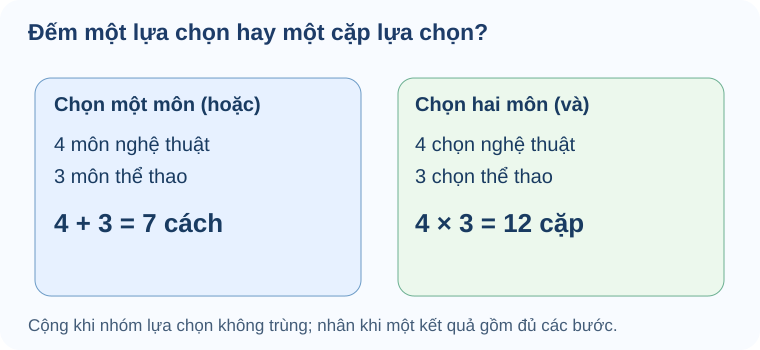

# Bài 23. Quy tắc đếm

TOÁN 10 · CHƯƠNG VIII · KIẾN THỨC SGK KNTT

Phân biệt quy tắc cộng và quy tắc nhân, đếm số trường hợp không thiếu hoặc trùng.

=== "Khám phá kiến thức"

    ### Cùng tìm hiểu

    Một học sinh muốn chọn đúng **một câu lạc bộ** trong 4 môn nghệ thuật hoặc 3 môn thể thao, mỗi lựa chọn là một môn khác nhau. Khi ấy có \(4+3=7\) cách. Nhưng nếu muốn tham gia **một môn nghệ thuật và một môn thể thao**, mỗi kế hoạch gồm đủ hai bước lựa chọn, nên có \(4\cdot3=12\) cặp.

    Vì sao cùng là lựa chọn mà lúc cộng, lúc nhân? Hãy nhìn **một kết quả hoàn chỉnh là gì**. Quy tắc cộng dùng khi các phương án thuộc **những trường hợp không trùng nhau**. Quy tắc nhân dùng khi để hoàn thành một kết quả, em phải thực hiện **nhiều bước nối tiếp**. Nếu số lựa chọn bước sau phụ thuộc lựa chọn trước, ta phải tách các trường hợp phù hợp trước khi nhân.

    Khi lập số có nhiều chữ số, số 0 ở hàng đầu và điều kiện không lặp chữ số thường quyết định toàn bộ phép đếm. Vì thế, đừng đặt công thức trước khi mô tả chính xác kết quả cần đếm.

    ### Thuật ngữ, kiến thức và kỹ năng

    **Thuật ngữ:** Quy tắc cộng, quy tắc nhân, trường hợp rời nhau, quy trình nhiều bước, chữ số đầu, điều kiện không lặp.

    **Sau bài học, em cần làm được:** Phân biệt cộng với nhân theo cấu trúc kết quả; chia trường hợp không giao nhau; đếm số có điều kiện chữ số đầu và lặp/chẵn lẻ.

=== "Kiến thức SGK"

    

    ### Quy tắc cộng cần các trường hợp không trùng

    Một học sinh có thể đi đến trường bằng 3 tuyến xe buýt hoặc 4 tuyến tàu điện; ta muốn đếm các cách chọn đúng một tuyến mà không đếm hai lần.

    **Tiền đề:** Nhắc việc đếm số phần tử của hợp hai tập và khái niệm hai trường hợp rời nhau; một phương án không thể thuộc đồng thời hai nhóm nếu muốn cộng thẳng.

    Quy tắc cộng đếm các khả năng thay thế nhau: thực hiện cách A HOẶC cách B. Chỉ cộng số cách khi hai nhánh không có phương án trùng nhau, nếu có phải loại phần giao.

    **Hướng dẫn đọc hình/sơ đồ:** Vẽ sơ đồ một nút 'Chọn phương tiện' tách thành nhánh 3 tuyến buýt và nhánh 4 tuyến tàu; mỗi lựa chọn kết thúc ở đúng một nhánh.

    **Lý do chọn phương pháp, điều kiện và giới hạn:** Kiểm xem các nhóm có giao nhau không; nếu không, lấy m+n. Nếu có, dùng m+n−phần giao hoặc chia thành nhóm rời.

    **Em vận dụng.** Một bạn được chọn đúng một phần thưởng: một trong 2 cuốn truyện hoặc một trong 6 vé xem phim khác nhau. Có mấy lựa chọn?

    ??? question "Tự mở đáp án sau khi đã tự làm"

        **Đáp án:** 8 lựa chọn.

        **Lập luận:** Một phần thưởng thuộc đúng một trong hai nhóm không trùng: 2 cuốn truyện hoặc 6 vé, nên 2+6=8.

        **Nếu chưa đúng:** xem hướng dẫn tự sửa tương ứng, sau đó luyện câu liên quan ở phần Luyện tập (không dùng câu đã xem lời giải làm chứng cứ tự kiểm tra độc lập).

        <a href="#help-g10-chviii-try01">Đến hướng dẫn tự sửa</a>

    

    ??? tip "Nếu chưa làm được — khắc phục 5 bước"

        1. **Nhận diện lỗi:** Nếu nhân 2×6, em đang đếm một cặp truyện–vé, không phải chỉ chọn một phần thưởng.
        2. **Quay lại bản chất:** Quy tắc cộng đếm các khả năng thay thế nhau: thực hiện cách A HOẶC cách B. Chỉ cộng số cách khi hai nhánh không có phương án trùng nhau, nếu có phải loại phần giao.
        3. **Tự làm lại:** Khoanh từ 'hoặc', vẽ 2 nhánh truyện và 6 nhánh vé, kiểm đủ 8 kết quả.
        4. **Đối chiếu tự nguyện:** tự mở lời giải trong fold và giải thích lại mỗi điều kiện, không tính điểm thành thạo.
        5. **Luyện tiếp:** Mở câu luyện qua liên kết bên dưới và tự làm trước khi đối chiếu. Nếu đã xem lời giải, hãy chọn một câu khác để thử không có gợi ý.

        <a href="../luyen-tap/?item=THPT-G10-B23-C01">Mở câu luyện tập đã được kiểm tra</a>

    

    ### Quy tắc nhân là hoàn tất nhiều bước

    Một suất bánh mì kèm nhân buộc phải chọn đủ cả hai phần; khác với chỉ chọn một loại món ăn.

    **Tiền đề:** Ôn cặp (loại bánh, loại nhân), mỗi bánh có thể ghép với mọi loại nhân nếu đề không cấm kết hợp.

    Quy tắc nhân đếm các đường đi hoàn chỉnh qua nhiều bước: mỗi lựa chọn của bước trước có số lựa chọn tiếp theo tương ứng; khi cùng số cách, tổng số là tích.

    **Hướng dẫn đọc hình/sơ đồ:** Vẽ cây 4 nhánh loại bánh, mỗi nhánh rẽ ra 3 loại nhân; đếm 12 lá cuối của 12 suất ăn.

    **Lý do chọn phương pháp, điều kiện và giới hạn:** Tìm các bước 'và' phải làm đủ; ghi số khả năng mỗi bước, kiểm xem chúng có phụ thuộc lựa chọn trước không, rồi nhân nếu cố định.

    **Em vận dụng.** Có 4 loại bánh mì khác nhau và 3 loại nhân; mỗi suất gồm đúng một loại bánh và một loại nhân. Có bao nhiêu suất?

    ??? question "Tự mở đáp án sau khi đã tự làm"

        **Đáp án:** 12 suất.

        **Lập luận:** Mỗi trong 4 loại bánh ghép được với 3 loại nhân: 4×3=12 cặp phân biệt; không bỏ sót hay đếm trùng.

        **Nếu chưa đúng:** xem hướng dẫn tự sửa tương ứng, sau đó luyện câu liên quan ở phần Luyện tập (không dùng câu đã xem lời giải làm chứng cứ tự kiểm tra độc lập).

        <a href="#help-g10-chviii-try02">Đến hướng dẫn tự sửa</a>

    

    ??? tip "Nếu chưa làm được — khắc phục 5 bước"

        1. **Nhận diện lỗi:** Nếu cộng 4+3, em đang đếm chọn một loại bánh HOẶC một loại nhân, chứ không phải suất gồm cả hai.
        2. **Quay lại bản chất:** Quy tắc nhân đếm các đường đi hoàn chỉnh qua nhiều bước: mỗi lựa chọn của bước trước có số lựa chọn tiếp theo tương ứng; khi cùng số cách, tổng số là tích.
        3. **Tự làm lại:** Liệt kê (A1,Q1),(A1,Q2), ... cho 3 áo và 2 quần; kiểm đủ 6 lá.
        4. **Đối chiếu tự nguyện:** tự mở lời giải trong fold và giải thích lại mỗi điều kiện, không tính điểm thành thạo.
        5. **Luyện tiếp:** Mở câu luyện qua liên kết bên dưới và tự làm trước khi đối chiếu. Nếu đã xem lời giải, hãy chọn một câu khác để thử không có gợi ý.

        <a href="../luyen-tap/?item=THPT-G10-B23-C02">Mở câu luyện tập đã được kiểm tra</a>

    

    ### Chọn chữ số phải để ý chữ số đầu và không lặp

    Một mã hai chữ số là số tự nhiên nên chữ số hàng chục không được bằng 0; điều kiện lặp chữ số cũng làm số cách từng bước thay đổi.

    **Tiền đề:** Nhắc một số có hai chữ số phải có hàng chục khác 0; số không lặp chữ số nghĩa là chữ số hàng đơn vị khác hàng chục.

    Đếm một số là hoàn tất hai bước hàng chục → hàng đơn vị; điều kiện 'không lặp' làm số lựa chọn bước thứ hai phụ thuộc chữ số đã chọn, nhưng còn đúng một số lượng bằng nhau cho mọi chọn ở bước đầu.

    **Hướng dẫn đọc hình/sơ đồ:** Vẽ cây hàng chục có nhánh 1,2,3; từ mỗi nhánh ghi những chữ số hàng đơn vị chưa dùng trong 0,1,2,3.

    **Lý do chọn phương pháp, điều kiện và giới hạn:** Chọn hàng chục trước (loại 0), rồi hàng đơn vị (loại chữ số đã chọn); nhân số cách. Nếu bài có điều kiện chẵn/lẻ, cần chia nhánh theo chữ số tận cùng trước.

    **Em vận dụng.** Từ các chữ số 0,1,2,3 tạo số tự nhiên có hai chữ số khác nhau. Có bao nhiêu số?

    ??? question "Tự mở đáp án sau khi đã tự làm"

        **Đáp án:** 9 số.

        **Lập luận:** Hàng chục có 3 cách (1,2,3); với mỗi cách, hàng đơn vị còn 3 chữ số trong tập 0..3 nên 3×3=9. Ví dụ 10,12,13,20,21,23,30,31,32.

        **Nếu chưa đúng:** xem hướng dẫn tự sửa tương ứng, sau đó luyện câu liên quan ở phần Luyện tập (không dùng câu đã xem lời giải làm chứng cứ tự kiểm tra độc lập).

        <a href="#help-g10-chviii-try03">Đến hướng dẫn tự sửa</a>

    

    ??? tip "Nếu chưa làm được — khắc phục 5 bước"

        1. **Nhận diện lỗi:** Nếu tính 4×3=12, em đã cho chữ số 0 ở đầu và đếm cả dạng '01' không phải số hai chữ số.
        2. **Quay lại bản chất:** Đếm một số là hoàn tất hai bước hàng chục → hàng đơn vị; điều kiện 'không lặp' làm số lựa chọn bước thứ hai phụ thuộc chữ số đã chọn, nhưng còn đúng một số lượng bằng nhau cho mọi chọn ở bước đầu.
        3. **Tự làm lại:** Viết ngay hàng chục 1,2,3 và đếm nhánh hàng đơn vị tương ứng, không điền 0 vào đầu.
        4. **Đối chiếu tự nguyện:** tự mở lời giải trong fold và giải thích lại mỗi điều kiện, không tính điểm thành thạo.
        5. **Luyện tiếp:** Mở câu luyện qua liên kết bên dưới và tự làm trước khi đối chiếu. Nếu đã xem lời giải, hãy chọn một câu khác để thử không có gợi ý.

        <a href="../luyen-tap/?item=THPT-G10-B23-P05">Mở câu luyện tập đã được kiểm tra</a>

    

    ### Tách trường hợp để xử lý điều kiện chẵn lẻ

    Không phải bài đếm nào cũng nhân một lần được; có lúc số cách còn lại khác nhau theo lựa chọn ở bước trước.

    **Tiền đề:** Nhắc số tự nhiên có hai chữ số không bắt đầu bằng 0, số chẵn có chữ số tận cùng 0,2,4,6,8.

    Nếu đếm số chẵn tạo từ các chữ số cho trước, chữ số hàng đơn vị quyết định các lựa chọn ở hàng chục; chia thành những trường hợp không giao nhau rồi cộng kết quả của từng nhánh.

    **Hướng dẫn đọc hình/sơ đồ:** Vẽ cây 'hàng đơn vị=0' và 'hàng đơn vị=2'; trên mỗi nhánh ghi các hàng chục hợp lệ để thấy số lựa chọn 3 và 2 khác nhau.

    **Lý do chọn phương pháp, điều kiện và giới hạn:** Chọn điều kiện khóa trước (ví dụ chữ số cuối của số chẵn), tách trường hợp rời nhau, nhân trong mỗi trường hợp rồi cộng các nhánh. Không nhân máy móc một số lượng cố định nếu phụ thuộc.

    **Em vận dụng.** Từ 0,1,2,3, lập được bao nhiêu số chẵn có hai chữ số khác nhau?

    ??? question "Tự mở đáp án sau khi đã tự làm"

        **Đáp án:** 5 số: 10,12,20,30,32.

        **Lập luận:** Tận cùng 0: hàng chục có 3 cách 1,2,3 →3 số. Tận cùng 2: hàng chục có 2 cách 1 hoặc3 →2 số. Cộng hai trường hợp rời được 5.

        **Nếu chưa đúng:** xem hướng dẫn tự sửa tương ứng, sau đó luyện câu liên quan ở phần Luyện tập (không dùng câu đã xem lời giải làm chứng cứ tự kiểm tra độc lập).

        <a href="#help-g10-chviii-try04">Đến hướng dẫn tự sửa</a>

    

    ??? tip "Nếu chưa làm được — khắc phục 5 bước"

        1. **Nhận diện lỗi:** Nếu tính 2×3=6, em đã bỏ qua điều kiện khi hàng đơn vị là 2 thì hàng chục chỉ còn 2 cách, không phải 3.
        2. **Quay lại bản chất:** Nếu đếm số chẵn tạo từ các chữ số cho trước, chữ số hàng đơn vị quyết định các lựa chọn ở hàng chục; chia thành những trường hợp không giao nhau rồi cộng kết quả của từng nhánh.
        3. **Tự làm lại:** Viết hai nhánh cuối 0 và cuối 2, kiểm lại danh sách đủ 5 số không lặp.
        4. **Đối chiếu tự nguyện:** tự mở lời giải trong fold và giải thích lại mỗi điều kiện, không tính điểm thành thạo.
        5. **Luyện tiếp:** Mở câu luyện qua liên kết bên dưới và tự làm trước khi đối chiếu. Nếu đã xem lời giải, hãy chọn một câu khác để thử không có gợi ý.

        <a href="../luyen-tap/?item=THPT-G10-B23-P05">Mở câu luyện tập đã được kiểm tra</a>

    ### Khái niệm, điều kiện và công thức

    **Cách đọc hình.** Bên trái chọn **một** môn từ hai nhóm không trùng: 4+3. Bên phải chọn **một môn mỗi nhóm**: một kết quả là một cặp, nên 4×3.

    <figure class="thpt-r4-plot thpt-r4-concept-figure"><figcaption>Quy tắc cộng \(4+3=7\) áp dụng cho hai nhóm lựa chọn rời nhau. Quy tắc nhân \(4\cdot3=12\) áp dụng khi một kết quả phải hoàn tất cả hai bước.</figcaption></figure>

    **Quy tắc cộng.** Nếu một lựa chọn được thực hiện theo đúng một trong các trường hợp A1,...,Ak **đôi một không giao nhau**, số cách là \(m_1+\cdots+m_k\). Khi các trường hợp chồng lấn, cần loại trùng hoặc chia lại thành các trường hợp rời nhau; không cộng máy móc.

    **Quy tắc nhân.** Một quy trình nhiều bước liên tiếp với m1 lựa chọn ở bước 1, m2 lựa chọn ở bước 2 cho mỗi phương án bước 1, ... thì số cách là tích \(m_1m_2\cdots m_k\) khi số cách ở mỗi bước là cố định theo lịch sử phù hợp. Nếu số khả năng ở bước sau phụ thuộc vào lựa chọn trước, chia trường hợp hoặc cộng số cách theo nhánh. Phân biệt "hoặc" loại trừ (cộng) với "và" liên tiếp (nhân).

=== "Ví dụ"

    Trước khi xem lời giải, hãy xác định dữ kiện, điều phải tìm và lý do chọn cách giải. Sau đó kiểm tra lại điều kiện áp dụng và kết quả, thay vì chỉ nhìn phép tính cuối cùng.

    ### Ví dụ — Đếm số chẵn có hai chữ số khác nhau

    **Đề bài.** Từ các chữ số \(0,1,2,3\), lập bao nhiêu số tự nhiên chẵn có **hai chữ số khác nhau**?

    **Vì sao chọn cách này?** Chữ số hàng đơn vị quyết định tính chẵn; lại có chữ số 0 bị cấm ở hàng chục. Do đó nên **tách theo chữ số hàng đơn vị**, rồi cộng hai trường hợp không trùng.

    **Giải.** Đơn vị bằng 0: hàng chục có 3 lựa chọn 1,2,3, được 3 số. Đơn vị bằng 2: hàng chục không là 0 và không là 2, có 2 lựa chọn 1,3, được 2 số. Tổng \(3+2=5\) số.

    **Kiểm lại:** Các số là 10, 20, 30, 12, 32; không có số bắt đầu bằng 0 hoặc lặp chữ số.

    **Ví dụ 1.** Một học sinh chọn đúng một môn câu lạc bộ: 4 môn nghệ thuật hoặc 3 môn thể thao, mỗi lựa chọn là một môn riêng, tổng 4+3=7 cách. Nếu chọn một môn nghệ thuật **và** một môn thể thao, có 4×3=12 cặp.

    **Ví dụ 2.** Từ các chữ số 0,1,2,3,4 lập số có hai chữ số khác nhau. Chữ số hàng chục có 4 lựa chọn (không phải 0), hàng đơn vị còn 4; có 4×4=16 số. Nếu cho phép lặp chữ số, hàng đơn vị có 5 lựa chọn, được 20 số.

    **Lỗi hay gặp.** Cộng các nhóm không rời nhau; nhân khi cần rẽ nhánh; cho phép hàng đầu bằng 0; quên điều kiện chữ số khác nhau; giả sử tất cả bước đều có cùng số lựa chọn.

=== "Lỗi thường gặp"

    

    ??? tip "Cộng hay nhân không theo cấu trúc lựa chọn"

        
<strong>Dấu hiệu:</strong> Dựa máy móc vào từ «hoặc» hay «và» mà không kiểm tra có các trường hợp rời nhau hoặc các bước liên tiếp.

        
<strong>Bản chất toán:</strong> Quy tắc cộng áp dụng cho các trường hợp loại trừ nhau; quy tắc nhân cho các bước lựa chọn. Khi nhóm giao nhau hoặc số cách mỗi bước tùy nhánh, cần chia trường hợp chính xác.

        
<strong>Tự sửa:</strong> Ôn B23 mục 1–2: mô tả một kết quả hoàn chỉnh, vẽ các nhánh loại trừ hoặc các bước nối tiếp, kiểm tra đếm trùng.

        
<strong>Kiến thức cần ôn:</strong> Tập hợp rời nhau, quy tắc nhân; B23 mục 1–2.

        
<strong>Luyện lại bài đã có:</strong> <a data-thpt-formative-id="THPT-G10-B23-C01" href="../luyen-tap/?item=THPT-G10-B23-C01">Luyện lại câu 23-C01</a> · <a data-thpt-formative-id="THPT-G10-B23-C02" href="../luyen-tap/?item=THPT-G10-B23-C02">Luyện lại câu 23-C02</a> · <a data-thpt-formative-id="THPT-G10-B23-P06" href="../luyen-tap/?item=THPT-G10-B23-P06">Luyện lại câu 23-P06</a> · <a data-thpt-formative-id="THPT-G10-CHVIII-W23-01" href="../../../thu-vien/tu-luan-chuong-viii/#thpt-g10-chviii-w23-01">Bài tự luận liên quan</a>

    

    ??? tip "Đếm sai số có chữ số 0 và phụ thuộc nhánh"

        
<strong>Dấu hiệu:</strong> Cho chữ số đầu bằng 0; nhân các lựa chọn như cố định dù có nhánh khác nhau.

        
<strong>Bản chất toán:</strong> Chữ số đầu của số tự nhiên có số chữ số xác định phải khác 0. Khi số cách bước sau phụ thuộc lựa chọn trước, tách các nhánh rời nhau rồi cộng tích; ghi rõ có lặp hay không.

        
<strong>Tự sửa:</strong> Ôn B23 mục 2: chọn trường hợp chữ số cuối bằng 0/khác 0 nếu có điều kiện chẵn, lập bảng số lựa chọn từng bước, kiểm không giao nhau.

        
<strong>Kiến thức cần ôn:</strong> Quy tắc cộng/nhân; điều kiện chữ số đầu; B23 mục 2.

        
<strong>Luyện lại bài đã có:</strong> <a data-thpt-formative-id="THPT-G10-B23-P01" href="../luyen-tap/?item=THPT-G10-B23-P01">Luyện lại câu 23-P01</a> · <a data-thpt-formative-id="THPT-G10-B23-P05" href="../luyen-tap/?item=THPT-G10-B23-P05">Luyện lại câu 23-P05</a>

    **Học tiếp:** [Core và Luyện tập](luyen-tap.md) · [Tự kiểm tra cuối chương](tu-kiem-tra-chuong.md).

    
Nguồn toán học: SGK Toán 10 Kết nối tri thức với cuộc sống và học liệu SLM hiện hành. Lời giảng được biên tập nhằm hỗ trợ tự học độc lập.

<small>Nguồn: SGK Toán 10 KNTT tập 2, trang 60–65; SBT 51–53. Các ví dụ do dự án biên soạn, không chép nguyên văn bài SGK.</small>
