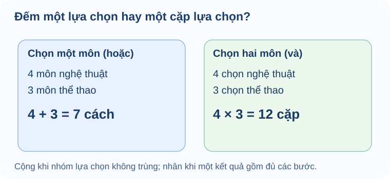

# Bài 23. Quy tắc đếm

TOÁN 10 · CHƯƠNG VIII · KIẾN THỨC SGK KNTT

=== "Khám phá kiến thức"

    Có 4 môn nghệ thuật và 3 môn thể thao. Nếu một bạn được chọn **một** môn thuộc một trong hai nhóm, kết quả hoàn chỉnh chỉ là tên một môn: có 7 lựa chọn. Nếu bạn ấy phải chọn **một môn ở mỗi nhóm**, kết quả hoàn chỉnh là một **cặp môn**, có 12 cách. Sự khác nhau không nằm ở từ “hoặc” hay “và” mà ở **đơn vị cần đếm**: một kết quả hoàn chỉnh gồm những gì?

    Trước khi chọn quy tắc, hãy tự hỏi: **các trường hợp có trùng kết quả không; cần làm đủ bao nhiêu bước; số cách của bước sau có như nhau trên mọi nhánh không?** Hình sau giúp nhìn ra hai cấu trúc khác nhau ngay từ một tình huống.

    <figure class="thpt-r4-plot thpt-r4-concept-figure"><figcaption>Quy tắc cộng \(4+3=7\) áp dụng cho hai nhóm lựa chọn rời nhau. Quy tắc nhân \(4\cdot3=12\) áp dụng khi một kết quả phải hoàn tất cả hai bước.</figcaption></figure>

    **Cách đọc hình:** Khung trái gom 4 môn nghệ thuật và 3 môn thể thao **không trùng nhau**, đếm 7 lựa chọn đơn. Khung phải ghép mỗi môn nghệ thuật với từng môn thể thao để tạo đủ 12 cặp. Hình minh họa câu lạc bộ, không phải sơ đồ cho bài lập số phía dưới.

    ### 1.1. Quy tắc cộng: chọn một trong những trường hợp rời nhau

    

    Hãy coi mỗi cách nhận phần thưởng là một **kết quả hoàn chỉnh**. Khi một bạn được chọn đúng một món truyện hoặc vé, hai nhóm phần thưởng thay thế nhau, không phải hai bước phải làm liên tiếp. Ta có thể đếm riêng từng nhóm rồi cộng vì **không món nào xuất hiện ở cả hai**.

    Nếu hai danh sách có trùng một món, cộng thẳng sẽ đếm món ấy hai lần. Vì vậy kiểm tra “không giao nhau” quan trọng hơn tìm từ khóa “hoặc”. Đây chính là ý nghĩa của quy tắc cộng và lý do phải tách các nhánh rời nhau.

    **Vận dụng.** Một bạn được chọn đúng một phần thưởng: một trong 2 cuốn truyện hoặc một trong 6 vé xem phim khác nhau. Có mấy lựa chọn?

    ??? question "Đối chiếu"

        **Đáp án:** 8 lựa chọn.

        **Lập luận:** Một phần thưởng thuộc đúng một trong hai nhóm không trùng: 2 cuốn truyện hoặc 6 vé, nên 2+6=8.

        **Nếu chưa đúng:** xem hướng dẫn tự sửa tương ứng, sau đó luyện câu liên quan ở phần Luyện tập (không dùng câu đã xem lời giải làm chứng cứ tự kiểm tra độc lập).

        **Đường khắc phục:** Mở khung *Kiểm lỗi* ngay dưới câu Vận dụng này để tự sửa từng bước.

    

    ??? tip "Kiểm lỗi"

        1. **Nhận diện lỗi:** Nếu nhân 2×6, em đang đếm một cặp truyện–vé, không phải chỉ chọn một phần thưởng.
        2. **Quay lại bản chất:** Quy tắc cộng đếm các khả năng thay thế nhau: thực hiện cách A HOẶC cách B. Chỉ cộng số cách khi hai nhánh không có phương án trùng nhau, nếu có phải loại phần giao.
        3. **Tự làm lại:** Khoanh từ 'hoặc', vẽ 2 nhánh truyện và 6 nhánh vé, kiểm đủ 8 kết quả.
        4. **Đối chiếu tự nguyện:** tự mở lời giải trong fold và giải thích lại mỗi điều kiện, không tính điểm thành thạo.
        5. **Luyện tiếp:** Mở câu luyện qua liên kết bên dưới và tự làm trước khi đối chiếu. Nếu đã xem lời giải, hãy chọn một câu khác để thử không có gợi ý.

        <a href="../luyen-tap/?item=THPT-G10-B23-C01">Mở câu luyện tập đã được kiểm tra</a>

    ### 1.2. Quy tắc nhân: một kết quả phải hoàn tất nhiều bước

    

    Một suất bánh mì không chỉ có bánh **hoặc** nhân: cần chọn đủ cả hai. Ta có 4 nhánh lựa chọn bánh; với **mỗi** nhánh bánh lại có 3 lựa chọn nhân, tức mỗi nhánh có 3 suất. Bởi thế số suất là \(4\cdot3\), tương ứng 12 lá cuối của một cây hai tầng.

    Lý do được nhân trực tiếp là **mỗi** loại bánh ghép được với đúng 3 loại nhân. Nếu loại bánh nào đó không thể dùng một số loại nhân, số lá theo các nhánh sẽ khác nhau: cần đếm từng nhánh rồi cộng, không cứ thấy nhiều bước là nhân một tích cố định.

    **Vận dụng.** Có 4 loại bánh mì khác nhau và 3 loại nhân; mỗi suất gồm đúng một loại bánh và một loại nhân. Có bao nhiêu suất?

    ??? question "Đối chiếu"

        **Đáp án:** 12 suất.

        **Lập luận:** Mỗi trong 4 loại bánh ghép được với 3 loại nhân: 4×3=12 cặp phân biệt; không bỏ sót hay đếm trùng.

        **Nếu chưa đúng:** xem hướng dẫn tự sửa tương ứng, sau đó luyện câu liên quan ở phần Luyện tập (không dùng câu đã xem lời giải làm chứng cứ tự kiểm tra độc lập).

        **Đường khắc phục:** Mở khung *Kiểm lỗi* ngay dưới câu Vận dụng này để tự sửa từng bước.

    

    ??? tip "Kiểm lỗi"

        1. **Nhận diện lỗi:** Nếu cộng 4+3, em đang đếm chọn một loại bánh HOẶC một loại nhân, chứ không phải suất gồm cả hai.
        2. **Quay lại bản chất:** Quy tắc nhân đếm các đường đi hoàn chỉnh qua nhiều bước: mỗi lựa chọn của bước trước có số lựa chọn tiếp theo tương ứng; khi cùng số cách, tổng số là tích.
        3. **Tự làm lại:** Gọi bốn loại bánh là B1–B4, ba loại nhân là N1–N3. Với mỗi bánh B1, B2, B3, B4, hãy ghép lần lượt ba nhân N1, N2, N3; kiểm đủ 12 suất.
        4. **Đối chiếu tự nguyện:** tự mở lời giải trong fold và giải thích lại mỗi điều kiện, không tính điểm thành thạo.
        5. **Luyện tiếp:** Mở câu luyện qua liên kết bên dưới và tự làm trước khi đối chiếu. Nếu đã xem lời giải, hãy chọn một câu khác để thử không có gợi ý.

        <a href="../luyen-tap/?item=THPT-G10-B23-C02">Mở câu luyện tập đã được kiểm tra</a>

    ### 1.3. Đếm số có hai chữ số: chữ số đầu và điều kiện không lặp

    

    Khi lập một số tự nhiên có **hai chữ số**, hàng chục phải khác 0; ký hiệu “01” thực chất là số 1, không phải số có hai chữ số. Từ 0,1,2,3, ta chọn hàng chục trước: có 3 cách (1,2,3). Sau mỗi cách, hàng đơn vị có 3 chữ số còn lại, kể cả 0 nếu chưa dùng. Vì mọi nhánh đầu đều có cùng 3 lựa chọn tiếp theo, số cách là \(3\cdot3=9\).

    Điều kiện “khác nhau” bắt buộc loại chữ số đã chọn ở hàng chục. Đừng áp kết quả cho mã ký tự có thể bắt đầu bằng 0: đó là **đối tượng đếm khác** và số cách cũng khác.

    **Vận dụng.** Từ các chữ số 0,1,2,3 tạo số tự nhiên có hai chữ số khác nhau. Có bao nhiêu số?

    ??? question "Đối chiếu"

        **Đáp án:** 9 số.

        **Lập luận:** Hàng chục có 3 cách (1,2,3); với mỗi cách, hàng đơn vị còn 3 chữ số trong tập 0..3 nên 3×3=9. Ví dụ 10,12,13,20,21,23,30,31,32.

        **Nếu chưa đúng:** xem hướng dẫn tự sửa tương ứng, sau đó luyện câu liên quan ở phần Luyện tập (không dùng câu đã xem lời giải làm chứng cứ tự kiểm tra độc lập).

        **Đường khắc phục:** Mở khung *Kiểm lỗi* ngay dưới câu Vận dụng này để tự sửa từng bước.

    

    ??? tip "Kiểm lỗi"

        1. **Nhận diện lỗi:** Nếu tính 4×3=12, em đã cho chữ số 0 ở đầu và đếm cả dạng '01' không phải số hai chữ số.
        2. **Quay lại bản chất:** Đếm một số là hoàn tất hai bước hàng chục → hàng đơn vị; điều kiện 'không lặp' làm số lựa chọn bước thứ hai phụ thuộc chữ số đã chọn, nhưng còn đúng một số lượng bằng nhau cho mọi chọn ở bước đầu.
        3. **Tự làm lại:** Viết ngay hàng chục 1,2,3 và đếm nhánh hàng đơn vị tương ứng, không điền 0 vào đầu.
        4. **Đối chiếu tự nguyện:** tự mở lời giải trong fold và giải thích lại mỗi điều kiện, không tính điểm thành thạo.
        5. **Luyện tiếp:** Mở câu luyện qua liên kết bên dưới và tự làm trước khi đối chiếu. Nếu đã xem lời giải, hãy chọn một câu khác để thử không có gợi ý.

        <a href="../luyen-tap/?item=THPT-G10-B23-P05">Mở câu luyện tập đã được kiểm tra</a>

    ### 1.4. Khi số nhánh thay đổi: kết hợp quy tắc cộng và quy tắc nhân

    

    Số chẵn phải có chữ số hàng đơn vị chẵn. Trong 0,1,2,3, hàng đơn vị chỉ có thể là **0 hoặc 2**. Chọn vị trí quyết định trước, ta được hai nhánh không giao nhau, nhưng **số cách chọn hàng chục không bằng nhau**:

    | Chữ số cuối | Hàng chục hợp lệ | Số cách |
    | --- | --- | ---: |
    | 0 | 1, 2, 3 | 3 |
    | 2 | 1, 3 | 2 |
    | **Cộng hai nhánh** | **Không trùng kết quả** | **5** |

    <figure class="b23-tree" aria-label="Sơ đồ hình cây số chẵn có hai chữ số khác nhau từ 0 1 2 3">
    <figcaption><strong>Sơ đồ hình cây — chọn chữ số cuối trước:</strong> Mỗi lá là một số chẵn hợp lệ, được đếm đúng một lần.</figcaption>
    <ul>
      <li><strong>Số chẵn hai chữ số, chữ số khác nhau</strong>
        <ul>
          <li><strong>Đơn vị 0</strong> → hàng chục 1 → <strong>10</strong>; hàng chục 2 → <strong>20</strong>; hàng chục 3 → <strong>30</strong> (3 lá)</li>
          <li><strong>Đơn vị 2</strong> → hàng chục 1 → <strong>12</strong>; hàng chục 3 → <strong>32</strong> (2 lá)</li>
        </ul>
      </li>
    </ul>
    </figure>

    **Cách đọc bảng nhánh:** Nếu tận cùng 0, hàng chục có 3 cách. Nếu tận cùng 2, hàng chục chỉ còn 1 hoặc 3 (vừa tránh 0 đứng đầu, vừa không lặp 2). Do đó \(3+2=5\), không phải \(2\cdot3=6\). Ta **nhân trong từng nhánh nếu có nhiều bước**, nhưng **cộng giữa những nhánh khác nhau**.

    **Vận dụng.** Từ 0,1,2,3, lập được bao nhiêu số chẵn có hai chữ số khác nhau?

    ??? question "Đối chiếu"

        **Đáp án:** 5 số: 10,12,20,30,32.

        **Lập luận:** Tận cùng 0: hàng chục có 3 cách 1,2,3 →3 số. Tận cùng 2: hàng chục có 2 cách 1 hoặc3 →2 số. Cộng hai trường hợp rời được 5.

        **Nếu chưa đúng:** xem hướng dẫn tự sửa tương ứng, sau đó luyện câu liên quan ở phần Luyện tập (không dùng câu đã xem lời giải làm chứng cứ tự kiểm tra độc lập).

        **Đường khắc phục:** Mở khung *Kiểm lỗi* ngay dưới câu Vận dụng này để tự sửa từng bước.

    

    ??? tip "Kiểm lỗi"

        1. **Nhận diện lỗi:** Nếu tính 2×3=6, em đã bỏ qua điều kiện khi hàng đơn vị là 2 thì hàng chục chỉ còn 2 cách, không phải 3.
        2. **Quay lại bản chất:** Nếu đếm số chẵn tạo từ các chữ số cho trước, chữ số hàng đơn vị quyết định các lựa chọn ở hàng chục; chia thành những trường hợp không giao nhau rồi cộng kết quả của từng nhánh.
        3. **Tự làm lại:** Viết hai nhánh cuối 0 và cuối 2, kiểm lại danh sách đủ 5 số không lặp.
        4. **Đối chiếu tự nguyện:** tự mở lời giải trong fold và giải thích lại mỗi điều kiện, không tính điểm thành thạo.
        5. **Luyện tiếp:** Mở câu luyện qua liên kết bên dưới và tự làm trước khi đối chiếu. Nếu đã xem lời giải, hãy chọn một câu khác để thử không có gợi ý.

        <a href="../luyen-tap/?item=THPT-G10-B23-P05">Mở câu luyện tập đã được kiểm tra</a>

    ### 1.5. Điều cần hiểu sau bài

    **Quy tắc cộng** đếm các kết quả thuộc một trong những trường hợp rời nhau. **Quy tắc nhân** đếm đủ các bước tạo ra một kết quả khi số nhánh con phù hợp là cố định. Với điều kiện chữ số/chẵn lẻ hoặc số lựa chọn thay đổi theo nhánh, phải chia trường hợp rồi kết hợp hai quy tắc; kiểm lại bằng liệt kê khi số lượng nhỏ.

=== "Kiến thức SGK"

    ### 2.1. Quy tắc cộng và sơ đồ hình cây

    
<strong>Khái niệm — Các phương án thay thế nhau:</strong> Một công việc được hoàn thành theo <strong>đúng một</strong> trong các trường hợp. Các kết quả thuộc những trường hợp khác nhau phải <strong>không trùng nhau</strong> thì mới được cộng số cách trực tiếp.

    
<strong>Quy tắc cộng.</strong> Nếu các trường hợp rời nhau lần lượt có \(m_1,m_2,\ldots,m_k\) cách, số cách thực hiện công việc là \(m_1+\cdots+m_k\).

    
<strong>Điều kiện cần kiểm tra — Không đếm trùng:</strong> Các trường hợp phải đôi một rời nhau. Nếu có kết quả xuất hiện trong nhiều nhóm, cần loại phần giao hoặc chia lại thành những nhóm rời nhau; với hai tập hữu hạn, lấy tổng số phần tử hai tập rồi trừ phần giao.

    Sơ đồ hình cây biểu diễn các nhánh lựa chọn; **mỗi lá cuối** phải ứng với đúng một kết quả hoàn chỉnh. Hình sau dùng hai cách đặt câu hỏi với cùng 4 môn nghệ thuật và 3 môn thể thao, giúp phân biệt khi nào cộng, khi nào nhân.

    <figure class="thpt-r4-plot thpt-r4-concept-figure"><figcaption>Quy tắc cộng \(4+3=7\) áp dụng cho hai nhóm lựa chọn rời nhau. Quy tắc nhân \(4\cdot3=12\) áp dụng khi một kết quả phải hoàn tất cả hai bước.</figcaption></figure>

    **Cách đọc hình:** Ở khung bên trái, mỗi kết quả chỉ là **một môn**: chọn từ 4 môn nghệ thuật hoặc 3 môn thể thao nên có \(4+3=7\) lựa chọn. Ở khung bên phải, mỗi kết quả là **một cặp** gồm một môn nghệ thuật và một môn thể thao; mỗi trong 4 môn nghệ thuật ghép được với 3 môn thể thao nên có \(4\cdot3=12\) cặp.

    ### 2.2. Quy tắc nhân

    
<strong>Khái niệm — Nhiều công đoạn:</strong> Một kết quả hoàn chỉnh đòi hỏi thực hiện <strong>tất cả</strong> các bước. Một đường đi từ gốc đến lá cuối của sơ đồ cây tượng trưng cho một chuỗi lựa chọn hợp lệ.

    
<strong>Quy tắc nhân.</strong> Nếu bước thứ nhất có \(m_1\) lựa chọn, ứng với <strong>mỗi</strong> lựa chọn ấy bước thứ hai đều có \(m_2\) lựa chọn, và tương tự ở các bước tiếp theo, số kết quả là tích \(m_1m_2\cdots m_k\).

    
<strong>Điều kiện cần kiểm tra — Cùng số nhánh con:</strong> Trước khi nhân trực tiếp, kiểm số cách hợp lệ tại mỗi bước có <strong>cố định trên mọi nhánh đang gộp</strong> hay không. Nếu số cách thay đổi tùy lựa chọn trước đó, phải tính riêng từng nhánh rồi cộng; không dùng phép nhân máy móc.

    Chẳng hạn, 4 loại bánh đều có thể ghép với 3 nhân thì có \(4\cdot3=12\) suất. Nếu ba loại bánh ghép được 3 nhân còn loại cuối chỉ ghép được 2 nhân, ta phải đếm \(3\cdot3+2=11\) suất.

    ### 2.3. Kết hợp quy tắc cộng và quy tắc nhân

    Một bài đếm có ràng buộc có thể vừa có **những trường hợp rời nhau** để cộng, vừa có **nhiều bước trong mỗi trường hợp** để nhân. Quy trình là: xác định một kết quả hoàn chỉnh → chọn điều kiện quyết định trước → chia trường hợp không giao nhau → tính số cách trong từng trường hợp → cộng và kiểm tra có thiếu/trùng.

    
<strong>Điều kiện cần kiểm tra khi lập số:</strong> Chữ số đầu của số có từ hai chữ số trở lên <strong>khác 0</strong>. Nếu chữ số phải phân biệt, không dùng lại chữ số đã chọn. Nếu số phải chẵn, chữ số tận cùng thuộc tập chữ số chẵn <strong>được phép</strong>. Khi điều kiện làm số lựa chọn khác nhau theo nhánh, hãy <strong>cộng các kết quả từng nhánh</strong> thay vì nhân một số lượng cố định.

    **Quan sát hai nhánh:** Khi chữ số cuối là 0, hàng chục có thể là 1,2,3; khi chữ số cuối là 2, hàng chục chỉ có thể là 1 hoặc 3. Hai nhóm rời nhau nên có \(3+2=5\) số chẵn hai chữ số khác nhau.

=== "Ví dụ"

    Mỗi lời giải bắt đầu bằng **một kết quả cần đếm**, giải thích vì sao chọn quy tắc và kiểm lại điều kiện, không chỉ nêu phép tính.

    ### 3.1. Ví dụ — Chọn một môn hay một cặp môn?

    **Đề bài.** Có 4 môn nghệ thuật và 3 môn thể thao khác nhau. Đếm (a) cách chọn đúng một môn; (b) cách chọn một môn trong mỗi nhóm.

    **Phân tích:** Ở (a) một kết quả là một môn, hai nhóm rời nhau nên cộng. Ở (b) một kết quả là cặp môn, phải đủ hai bước, mỗi môn nghệ thuật ghép được với cả ba môn thể thao nên nhân.

    

    
<strong>Lời giải.</strong> (a) \(4+3=7\) cách chọn một môn. (b) \(4\cdot3=12\) cặp môn.

    

    **Kiểm lại:** Có đúng 7 môn khác nhau; 4 môn nghệ thuật mỗi môn ghép với 3 môn thể thao thành 12 cặp phân biệt. Hai đáp án khác vì cách định nghĩa một kết quả đã đổi.

    ### 3.2. Ví dụ — Lập số có hai chữ số

    **Đề bài.** Từ các chữ số \(0,1,2,3,4\), lập số tự nhiên hai chữ số (a) khác nhau; (b) có thể lặp.

    **Phân tích:** Hàng chục phải khác 0 nên chỉ có 4 cách. Hàng đơn vị có 4 cách khi không lặp, hoặc 5 cách khi cho phép lặp. Mỗi nhánh hàng chục có cùng số lựa chọn tiếp theo nên dùng nhân.

    

    
<strong>Lời giải.</strong> (a) \(4\cdot4=16\) số; (b) \(4\cdot5=20\) số.

    

    **Kiểm lại:** Không có chữ số 0 ở đầu. Ở (a), mỗi lần chọn hàng chục phải bỏ đi chữ số đó khi chọn hàng đơn vị; ở (b) chữ số hàng đơn vị được dùng cả 5 chữ số.

    ### 3.3. Ví dụ — Số chẵn hai chữ số khác nhau

    **Đề bài.** Từ \(0,1,2,3\), có bao nhiêu số chẵn gồm hai chữ số khác nhau?

    **Phân tích:** Tận cùng chỉ có thể là 0 hoặc 2. Hai nhánh không giao nhau, nhưng số chữ số hàng chục hợp lệ lần lượt là 3 và 2; phải cộng từng trường hợp thay vì nhân \(2\cdot3\).

    

    
<strong>Lời giải.</strong> Cuối 0: hàng chục là 1,2,3 được 3 số. Cuối 2: hàng chục là 1,3 được 2 số. Tổng \(3+2=5\) số.

    

    **Kiểm lại:** Các số là \(10,12,20,30,32\); không số nào bắt đầu bằng 0, lặp chữ số hoặc lẻ.

=== "Lỗi thường gặp"

    Các lỗi dưới đây là những nhầm lẫn có thể lặp lại trong nhiều bài đếm. Nếu vướng ở một câu **Vận dụng** cụ thể, em mở khung **Kiểm lỗi** ngay dưới câu đó trong tab **Khám phá kiến thức**. Không cần đoán bài toán từ những con số đứng riêng lẻ.

    

    ??? tip "4.1. Nhầm quy tắc cộng và quy tắc nhân khi chỉ dựa vào từ khóa"

        
<strong>Dấu hiệu:</strong> Dựa máy móc vào từ «hoặc» hay «và» mà không kiểm tra có các trường hợp rời nhau hoặc các bước liên tiếp.

        
<strong>Bản chất toán:</strong> Quy tắc cộng áp dụng cho các trường hợp loại trừ nhau; quy tắc nhân cho các bước lựa chọn. Khi nhóm giao nhau hoặc số cách mỗi bước tùy nhánh, cần chia trường hợp chính xác.

        
<strong>Tự sửa:</strong> Ôn B23 mục 1–2: mô tả một kết quả hoàn chỉnh, vẽ các nhánh loại trừ hoặc các bước nối tiếp, kiểm tra đếm trùng.

        
<strong>Kiến thức cần ôn:</strong> Tập hợp rời nhau, quy tắc nhân; B23 mục 1–2.

        
<strong>Luyện lại bài đã có:</strong> <a data-thpt-formative-id="THPT-G10-B23-C01" href="../luyen-tap/?item=THPT-G10-B23-C01">Luyện lại câu 23-C01</a> · <a data-thpt-formative-id="THPT-G10-B23-C02" href="../luyen-tap/?item=THPT-G10-B23-C02">Luyện lại câu 23-C02</a> · <a data-thpt-formative-id="THPT-G10-B23-P06" href="../luyen-tap/?item=THPT-G10-B23-P06">Luyện lại câu 23-P06</a> · <a data-thpt-formative-id="THPT-G10-CHVIII-W23-01" href="../../../thu-vien/tu-luan-chuong-viii/#thpt-g10-chviii-w23-01">Bài tự luận liên quan</a>

    

    ??? tip "4.2. Bỏ qua chữ số đầu khác 0 hoặc số nhánh phụ thuộc"

        
<strong>Dấu hiệu:</strong> Cho chữ số đầu bằng 0; nhân các lựa chọn như cố định dù có nhánh khác nhau.

        
<strong>Bản chất toán:</strong> Chữ số đầu của số tự nhiên có số chữ số xác định phải khác 0. Khi số cách bước sau phụ thuộc lựa chọn trước, tách các nhánh rời nhau rồi cộng tích; ghi rõ có lặp hay không.

        
<strong>Tự sửa:</strong> Ôn B23 mục 2: chọn trường hợp chữ số cuối bằng 0/khác 0 nếu có điều kiện chẵn, lập bảng số lựa chọn từng bước, kiểm không giao nhau.

        
<strong>Kiến thức cần ôn:</strong> Quy tắc cộng/nhân; điều kiện chữ số đầu; B23 mục 2.

        
<strong>Luyện lại bài đã có:</strong> <a data-thpt-formative-id="THPT-G10-B23-P01" href="../luyen-tap/?item=THPT-G10-B23-P01">Luyện lại câu 23-P01</a> · <a data-thpt-formative-id="THPT-G10-B23-P05" href="../luyen-tap/?item=THPT-G10-B23-P05">Luyện lại câu 23-P05</a>

    **Học tiếp:** [Core và Luyện tập](luyen-tap.md) · [Tự kiểm tra cuối chương](tu-kiem-tra-chuong.md).

    
Nguồn: SGK Toán 10 KNTT tập 2, trang 60–65; SBT 51–53. Các ví dụ do dự án biên soạn, không chép nguyên văn bài SGK.

