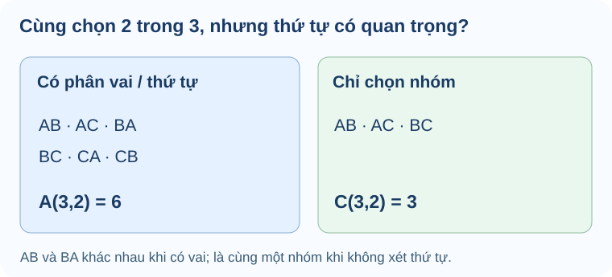

# Bài 24. Hoán vị, chỉnh hợp và tổ hợp

TOÁN 10 · CHƯƠNG VIII · SGK KẾT NỐI TRI THỨC

Từ “mỗi kết quả là gì?” đến hoán vị, chỉnh hợp, tổ hợp và kiểm tra bằng máy tính cầm tay.

=== "Khám phá kiến thức"

    **Từ tình huống đến bản chất:** Giả sử có ba bạn A, B, C. Chọn một **nhóm hai người** chỉ tạo các nhóm AB, AC, BC. Nếu chọn **trưởng nhóm và phó nhóm**, AB và BA phải được tính riêng. Nếu bắt cả ba xếp thành một hàng, thứ tự của **tất cả** ba bạn được xét. Ba câu hỏi trông giống nhau nhưng có ba kiểu kết quả khác nhau.

    **Cần nhớ trước:** Quy tắc nhân của Bài 23 (mỗi bước chọn tiếp với bao nhiêu khả năng), đối tượng **phân biệt** và việc một kết quả hoàn chỉnh được xác định bằng “ai” hay bằng “ai ở vị trí nào”.

    **Sau bài học:** Em phân biệt hoán vị, chỉnh hợp, tổ hợp; xử lý bài toán có điều kiện, giải thích vì sao công thức đúng và biết kiểm kết quả bằng máy tính cầm tay. Các nút **Đối chiếu** và **Kiểm lỗi** đều đóng khi mới vào; hãy tự thử trước.

    ### 1.1. Hoán vị: mọi vị trí đều được lấp và thứ tự quyết định

    **Vì sao cần học?** Cùng bốn quyển sách A, B, C, D, đổi chỗ A và B là một cách xếp **khác**. Khi bốn vị trí đều phải có sách và không quyển nào lặp, ta đang đếm thứ tự của **toàn bộ** vật, chứ không chọn một nhóm.

    **Thử đếm trước khi học công thức:** Vị trí thứ nhất có 4 cách; sau khi chọn, vị trí thứ hai còn 3; rồi 2 và 1. Vì mỗi lựa chọn trước ghép được với mọi lựa chọn hợp lệ sau, quy tắc nhân cho \(4\cdot3\cdot2\cdot1=24\). Đó là ý nghĩa của \(4!\), không phải một con số phải học thuộc.

    **Khi nào dùng?** Xếp hết \(n\) vật **phân biệt** theo thứ tự. Nếu A và B buộc kề nhau, hai bạn/sách có thể được xem như một khối để đếm các vị trí bên ngoài, nhưng vẫn phải đếm thứ tự AB và BA **bên trong khối**. Đừng lấy \(4!\) khi đề đã có ràng buộc.

    

    **Em vận dụng.** Có bốn sách phân biệt A,B,C,D; xếp thành một hàng sao cho A và B đứng cạnh nhau. Có mấy cách?

    ??? question "Tự mở đáp án sau khi đã tự làm"

        **Đáp án:** 12 cách.

        **Lập luận:** Gộp A,B thành một khối, cùng C,D là 3 đối tượng có 3!=6 cách xếp; A,B trong khối đổi chỗ có 2!=2 cách. Tổng 6×2=12.

        **Nếu chưa đúng:** xem hướng dẫn tự sửa tương ứng, sau đó luyện câu liên quan ở phần Luyện tập (không dùng câu đã xem lời giải làm chứng cứ tự kiểm tra độc lập).

        <a href="#help-g10-chviii-try05">Đến hướng dẫn tự sửa</a>

    

    ??? tip "Kiểm lỗi"

        1. **Nhận diện lỗi:** Nếu tính 4!=24, em chưa xử lý yêu cầu A,B kề nhau; nếu chỉ 3!=6, em quên hai trật tự AB/BA.
        2. **Quay lại bản chất:** Hoán vị của n vật phân biệt là một thứ tự của tất cả n vật; số lựa chọn giảm dần n,n−1,...,1. Khi các vật phải đứng cạnh nhau, gộp chúng thành một khối trước khi đếm.
        3. **Tự làm lại:** Vẽ [AB], C,D rồi thay [AB] bằng [BA], đếm hai lần 6.
        4. **Đối chiếu tự nguyện:** tự mở lời giải trong fold và giải thích lại mỗi điều kiện, không tính điểm thành thạo.
        5. **Luyện tiếp:** Mở câu luyện qua liên kết bên dưới và tự làm trước khi đối chiếu. Nếu đã xem lời giải, hãy chọn một câu khác để thử không có gợi ý.

        <a href="../luyen-tap/?item=THPT-G10-B24-C01">Mở câu luyện tập đã được kiểm tra</a>

    ### 1.2. Chỉnh hợp: chọn một số rồi phân vai

    **Điểm chuyển từ hoán vị sang chỉnh hợp:** Nếu chỉ có hai chức vụ *lớp trưởng* và *lớp phó* trong năm bạn, ta không xếp cả năm bạn. Ta chọn **hai người khác nhau và phân vào hai vai khác nhau**. An trưởng, Bình phó khác Bình trưởng, An phó.

    **Đếm từ thao tác:** Chọn lớp trưởng có 5 cách. Với mỗi trưởng đã chọn, phó còn 4 cách. Vậy có \(5\cdot4=20\) kết quả. Nếu có \(k\) vị trí phân biệt cho \(n\) người, số cách sẽ là \(n(n-1)\cdots(n-k+1)\), với \(1\le k\le n\).

    **Chú ý giới hạn:** Không thể chọn một người đồng thời giữ hai chức vụ trong bài này; nếu đề cho kiêm nhiệm, mô hình đã đổi. Không chia cho \(2!\) khi chức vụ khác nhau.

    

    **Em vận dụng.** Có 5 học sinh khác nhau, chọn một lớp trưởng và một lớp phó, hai chức vụ không kiêm nhiệm. Có mấy cách?

    ??? question "Tự mở đáp án sau khi đã tự làm"

        **Đáp án:** 20 cách.

        **Lập luận:** Lớp trưởng 5 cách, lớp phó còn 4, nên 5×4=20=A₅². Hai bạn hoán đổi vai trò là hai cách khác.

        **Nếu chưa đúng:** xem hướng dẫn tự sửa tương ứng, sau đó luyện câu liên quan ở phần Luyện tập (không dùng câu đã xem lời giải làm chứng cứ tự kiểm tra độc lập).

        <a href="#help-g10-chviii-try06">Đến hướng dẫn tự sửa</a>

    

    ??? tip "Kiểm lỗi"

        1. **Nhận diện lỗi:** Nếu ra 10, em đã chia 2 như tổ hợp, tức không phân biệt hai chức danh.
        2. **Quay lại bản chất:** Chỉnh hợp chập k đếm k người chọn từ n **và xếp vào k vị trí phân biệt**; đây là số cách nhân n(n−1)...(n−k+1).
        3. **Tự làm lại:** So hai phân công (An trưởng,Bình phó) và (Bình trưởng,An phó) để thấy chúng khác nhau.
        4. **Đối chiếu tự nguyện:** tự mở lời giải trong fold và giải thích lại mỗi điều kiện, không tính điểm thành thạo.
        5. **Luyện tiếp:** Mở câu luyện qua liên kết bên dưới và tự làm trước khi đối chiếu. Nếu đã xem lời giải, hãy chọn một câu khác để thử không có gợi ý.

        <a href="../luyen-tap/?item=THPT-G10-B24-C02">Mở câu luyện tập đã được kiểm tra</a>

    ### 1.3. Tổ hợp: chọn nhóm, không đếm trùng thứ tự

    **Vì sao chỉnh hợp khác tổ hợp?** Từ ba bạn A, B, C, khi chọn một cặp không phân vai, AB và BA **không** phải hai nhóm. Nhưng khi chọn trưởng và phó, chúng là hai kết quả khác nhau.

    <figure class="thpt-r4-plot thpt-r4-concept-figure"><figcaption>Đọc hình từ trái sang phải: bên trái có 6 cặp có thứ tự, gồm cả AB và BA; bên phải gom cặp trùng thứ tự nên còn 3 nhóm AB, AC, BC.</figcaption></figure>

    **Tự quan sát hình:** AB và BA ở khung trái là hai kết quả vì khác vai; trong khung phải chúng cùng một nhóm. Mỗi nhóm hai người bị đếm \(2!=2\) lần nếu dùng phép chọn có thứ tự. Vì vậy số nhóm là \(A_n^k/k!\), chứ không phải cứ thấy chữ “chọn” là chia máy móc.

    **Chọn công cụ:** Hỏi “chọn những ai”, không phân vai → tổ hợp. Hỏi “ai ở vị trí nào” → chỉnh hợp. Với nhóm có thể rỗng, tổ hợp cho phép \(k=0\), tức chọn đúng một tập rỗng.

    

    **Em vận dụng.** Từ 5 bạn phân biệt, chọn 2 bạn cùng đi trực nhật (không phân vai). Có mấy nhóm?

    ??? question "Tự mở đáp án sau khi đã tự làm"

        **Đáp án:** 10 nhóm.

        **Lập luận:** Chọn bạn đầu có 5 cách, bạn thứ hai có 4, mỗi cặp bị đếm hai thứ tự: 5×4/2=10=C₅².

        **Nếu chưa đúng:** xem hướng dẫn tự sửa tương ứng, sau đó luyện câu liên quan ở phần Luyện tập (không dùng câu đã xem lời giải làm chứng cứ tự kiểm tra độc lập).

        <a href="#help-g10-chviii-try07">Đến hướng dẫn tự sửa</a>

    

    ??? tip "Kiểm lỗi"

        1. **Nhận diện lỗi:** Nếu ra 20, em đã tính như hai chức danh khác nhau, đếm mỗi nhóm hai lần.
        2. **Quay lại bản chất:** Tổ hợp chập k đếm các tập con k phần tử, không xét thứ tự. Từ số cách xếp k người, chia cho k! trật tự bị đếm trùng.
        3. **Tự làm lại:** Viết {A,B}={B,A}; ghép các thứ tự trùng rồi đếm lại.
        4. **Đối chiếu tự nguyện:** tự mở lời giải trong fold và giải thích lại mỗi điều kiện, không tính điểm thành thạo.
        5. **Luyện tiếp:** Mở câu luyện qua liên kết bên dưới và tự làm trước khi đối chiếu. Nếu đã xem lời giải, hãy chọn một câu khác để thử không có gợi ý.

        <a href="../luyen-tap/?item=THPT-G10-B24-P01">Mở câu luyện tập đã được kiểm tra</a>

    ### 1.4. Đếm có điều kiện: chọn từng loại rồi kết hợp

    **Vì sao phải tách điều kiện trước?** Một nhóm cần đúng hai nam và một nữ. Ta không thể chọn bất kỳ ba bạn nào rồi hi vọng nhóm tự thỏa điều kiện. Trước hết chọn hai nam trong nhóm nam, sau đó chọn một nữ trong nhóm nữ. Hai lựa chọn này kết hợp thành một kết quả **hoàn chỉnh**.

    **Tự xác định phương pháp:** Trong mỗi nhóm, thứ tự kể tên không quan trọng nên dùng tổ hợp; việc phải chọn đủ cả phần nam **và** nữ nên nhân số cách theo quy tắc nhân của Bài 23. Chọn sai loại sẽ đếm những nhóm vi phạm yêu cầu; phân vai cho mọi thành viên sẽ đếm trùng.

    **Giới hạn:** Hai tập thành viên phải phân biệt đúng đối tượng và mỗi kết quả được ghép từ đúng một cặp lựa chọn thành phần. Với điều kiện “ít nhất một”, có thể chia các trường hợp rời nhau hoặc đếm tất cả rồi trừ trường hợp không thỏa.

    

    **Em vận dụng.** Có 5 học sinh nam và 4 học sinh nữ khác nhau. Có bao nhiêu cách chọn nhóm 3 bạn gồm đúng 2 nam, 1 nữ?

    ??? question "Tự mở đáp án sau khi đã tự làm"

        **Đáp án:** 40 nhóm.

        **Lập luận:** C(5,2)=10 cách chọn hai nam; C(4,1)=4 cách chọn một nữ. Mỗi cặp ghép một nữ tạo 10×4=40 nhóm phân biệt.

        **Nếu chưa đúng:** xem hướng dẫn tự sửa tương ứng, sau đó luyện câu liên quan ở phần Luyện tập (không dùng câu đã xem lời giải làm chứng cứ tự kiểm tra độc lập).

        <a href="#help-g10-chviii-try08">Đến hướng dẫn tự sửa</a>

    

    ??? tip "Kiểm lỗi"

        1. **Nhận diện lỗi:** Nếu lấy C(9,3), em đã tính cả nhóm không có đúng 2 nam 1 nữ; nếu dùng hoán vị, em đếm trùng thứ tự kể tên.
        2. **Quay lại bản chất:** Chọn đúng 2 nam và 1 nữ là hai việc phối hợp: chọn nhóm hai nam VÀ chọn một nữ. Mỗi cặp nam ghép với mỗi nữ thành một nhóm cuối cùng.
        3. **Tự làm lại:** Viết sơ đồ 2 nam +1 nữ và thử kiểm vài nhóm từ kết quả.
        4. **Đối chiếu tự nguyện:** tự mở lời giải trong fold và giải thích lại mỗi điều kiện, không tính điểm thành thạo.
        5. **Luyện tiếp:** Mở câu luyện qua liên kết bên dưới và tự làm trước khi đối chiếu. Nếu đã xem lời giải, hãy chọn một câu khác để thử không có gợi ý.

        <a href="../luyen-tap/?item=THPT-G10-B24-P04">Mở câu luyện tập đã được kiểm tra</a>

=== "Kiến thức SGK"

    ### 2.1. Hoán vị — xếp thứ tự toàn bộ \(n\) phần tử

    Trong phép xếp bốn bạn, vị trí thứ nhất có 4 cách, rồi còn 3, 2, 1 cách. Đó là quy tắc nhân, từ đó suy ra công thức tổng quát chứ không phải giả định công thức trước.

    
<strong>Khái niệm.</strong> Với \(n\ge1\) phần tử phân biệt, một hoán vị là cách sắp xếp có thứ tự <strong>tất cả \(n\) phần tử</strong>.

    
<strong>Quy tắc tính.</strong> \(P_n=n!=n(n-1)\cdots2\cdot1\). Quy ước \(0!=1\) để dùng thống nhất các công thức giai thừa.

    **Giới hạn:** Hoán vị thông thường yêu cầu mọi vật phân biệt. Nếu đề cho vật giống nhau, điều kiện đứng cạnh hay vị trí cố định, không tự dùng \(n!\) rồi dừng.

    ### 2.2. Chỉnh hợp — chọn \(k\) phần tử và sắp vào \(k\) vai

    Vị trí thứ nhất có \(n\) người, vị trí thứ hai còn \(n-1\), ...; với \(k\) vị trí có đúng \(k\) thừa số giảm dần. Chỉnh hợp chọn k phần tử, có thể chọn hết khi k=n.

    
<strong>Khái niệm.</strong> Chỉnh hợp chập \(k\) của \(n\) là cách chọn <strong>có thứ tự</strong> \(k\) phần tử trong \(n\) phần tử phân biệt. Theo phạm vi SGK: \(1\le k\le n\).

    
<strong>Công thức.</strong> \(A_n^k=n(n-1)\cdots(n-k+1)=\dfrac{n!}{(n-k)!}\), với \(1\le k\le n\). Khi \(k=n\), \(A_n^n=P_n\).

    **Phương pháp:** Có \(k\) vai/vị trí phân biệt? Đếm có thứ tự. Không phân vai? Chưa phải chỉnh hợp.

    ### 2.3. Tổ hợp — chọn nhóm không xét thứ tự

    Mỗi nhóm \(k\) người có \(k!\) cách xếp khác nhau. Khi chỉ muốn biết nhóm gồm những ai, phải bỏ sự đếm lặp đó.

    
<strong>Khái niệm.</strong> Tổ hợp chập \(k\) của \(n\) là cách chọn \(k\) phần tử từ \(n\) phần tử phân biệt, <strong>không xét thứ tự</strong>; \(0\le k\le n\).

    
<strong>Công thức.</strong> \(C_n^k=\dfrac{n!}{k!(n-k)!}\) và \(A_n^k=C_n^k\cdot k!\) khi \(1\le k\le n\); riêng \(C_n^0=1\).

    **Đọc hình ở Khám phá:** Từ ba bạn, bên “phân vai” có 6 cặp; bên “chọn nhóm” có 3 nhóm. Khi tính tổ hợp, mỗi nhóm không được đếm thành hai chỉ vì đảo thứ tự tên.

    ### 2.4. Ứng dụng hoán vị, chỉnh hợp, tổ hợp vào bài toán đếm

    Với bài nhiều điều kiện, luôn xác định <strong>một kết quả hoàn chỉnh</strong>. Trước tiên chia công việc thành những lựa chọn thành phần không chồng nhau; trong mỗi thành phần, quyết định chọn có thứ tự hay không. Sau đó mới nhân số cách khi các lựa chọn đều phải được thực hiện.

    **Mẫu tình huống SGK:** Đội bóng cần 3 hậu vệ từ 7, 4 tiền vệ từ 8, 3 tiền đạo từ 5; thủ môn đã được cố định. Nếu chỉ chọn <em>danh sách cầu thủ theo tuyến</em> chứ không gán các vị trí trong tuyến, số cách là \(C_7^3\cdot C_8^4\cdot C_5^3=35\cdot70\cdot10=24\,500\). Không tự nhân thêm hoán vị nếu đề không đòi phân vai trong từng tuyến.

    **Nếu có hai chức vụ riêng:** Chọn một trưởng và một phó từ 20 người trước rồi chọn 4 thành viên khác là \(A_{20}^2\cdot C_{18}^4\). Phép đếm này tương đương chọn 6 người rồi phân hai chức danh, vì hai cách mô tả cùng một kết quả hoàn chỉnh.

    ### 2.5. Sử dụng máy tính cầm tay

    Máy tính giúp <strong>kiểm kết quả tính toán</strong>, không quyết định thay em là hoán vị, chỉnh hợp hay tổ hợp. Trước khi bấm, xác định \(n,k\), điều kiện và tính chất thứ tự của phương án.

    - **Giai thừa:** Với dòng máy có các nhãn phím như SGK, nhập \(9\) → \`SHIFT\` → \`x!\` → \`=\`, nhận \(9!=362\,880\).
    - **Chỉnh hợp:** Nhập \(15\) → \`SHIFT\` → \`×\` (chức năng \`nPr\`) → \(2\) → \`=\`, nhận \(A_{15}^{2}=210\).
    - **Tổ hợp:** Nhập \(20\) → \`SHIFT\` → \`÷\` (chức năng \`nCr\`) → \(5\) → \`=\`, nhận \(C_{20}^{5}=15\,504\).

    **Đọc phím đúng loại máy:** Trên một số máy, \`nPr\`, \`nCr\` hoặc \`x!\` nằm ở vị trí/menu khác. Hãy chọn <strong>tên chức năng</strong> trên thiết bị của em; đừng ép máy khác bấm đúng chuỗi \`SHIFT\` này. Chỉ nhập số nguyên hợp lệ; kết quả lớn có thể vượt phạm vi máy hoặc hiện ở dạng khoa học.

    **Tự kiểm thao tác:** Hãy tính \(A_5^2=20\) và \(C_5^2=10\) bằng cả công thức lẫn máy. Nếu máy cho cùng một kết quả, kiểm lại em đã chọn \`nPr\` hay \`nCr\`; nếu chưa hiểu vì sao khác nhau, quay lại hình phân vai/chọn nhóm trước khi bấm lại.

    ### 2.6. Nhìn lại công thức và điều kiện

    **Cách đọc hình.** Cùng chọn hai từ A,B,C: nếu có vai AB khác BA nên có 6 chỉnh hợp; nếu chỉ là nhóm AB=BA thì còn 3 tổ hợp.

    <figure class="thpt-r4-plot thpt-r4-concept-figure"><figcaption>Khi phân vai, \(A_3^2=6\) vì AB và BA là hai kết quả khác nhau. Khi chỉ chọn nhóm, \(\binom32=3\) vì AB và BA là cùng một nhóm.</figcaption></figure>

    **Tổng kết nhanh.** Có \(n\) đối tượng **phân biệt**, \(n\) nguyên không âm. Lưu ý phạm vi của từng công thức:
    - Hoán vị của n đối tượng: \(P_n=n!\), với \(0!=1\).
    - Chỉnh hợp chập k (chọn k phần tử và **xếp thứ tự**, \(1\le k\le n\)): \(A_n^k=\dfrac{n!}{(n-k)!}\).
    - Tổ hợp chập k (chọn nhóm k phần tử, **không** xét thứ tự, \(0\le k\le n\)): \(C_n^k=\dfrac{n!}{k!(n-k)!}\).
    - Công thức liên hệ \(A_n^k=C_n^k\cdot k!\) vì mỗi nhóm k phần tử có k! thứ tự.

    **Hướng chọn phương pháp.** Hỏi "chọn nhóm" mà không phân vai → tổ hợp; "xếp k người vào k vị trí phân biệt" → chỉnh hợp; "xếp tất cả" → hoán vị. Chọn nhóm rồi phân vai là hai bước: số nhóm nhân số phân vai **sau** khi nhóm được chọn, nếu mỗi nhóm có cùng số cách phân vai.

=== "Ví dụ"

    Trước khi xem lời giải, hãy xác định dữ kiện, điều phải tìm và lý do chọn cách giải. Sau đó kiểm tra lại điều kiện áp dụng và kết quả, thay vì chỉ nhìn phép tính cuối cùng.

    ### 3.1. Ví dụ — Cùng chọn 2 trong 5, hai đáp án khác nhau

    **Đề bài.** Có năm học sinh. (a) Chọn một trưởng nhóm và một phó nhóm khác người. (b) Chọn nhóm hai người không phân vai.

    **Phân tích:** (a) Có hai **vai khác nhau** nên thứ tự chọn quyết định kết quả; (b) chỉ cần nhóm gồm ai, không xét vai.

    

    
<strong>Lời giải.</strong> (a) Có \(5\cdot4=20=A_5^2\) cách. (b) Mỗi nhóm đã đếm hai lần nếu phân thứ tự, nên \(\binom52=\frac{5\cdot4}{2}=10\) nhóm.

    

    **Kiểm lại:** Không dùng cùng đáp án cho hai tình huống chỉ vì đều có “chọn hai người”.

    ### 3.2. Ví dụ — Chọn nhóm rồi cử một trưởng nhóm

    

    
<strong>Ví dụ 1.</strong> Từ 7 học sinh chọn 3 bạn làm nhóm trực nhật (không phân vai): C(7,3)=35. Nếu lập nhóm 3 bạn và cử đúng một trưởng nhóm, mỗi nhóm có 3 lựa chọn, nên có 35×3=105 phương án. Không nhầm bài thứ hai với 7×6×5 vì hai bạn còn lại không được phân biệt vai trò.

    

    ### 3.3. Ví dụ — Hai quyển sách đứng cạnh nhau

    

    
<strong>Ví dụ 2.</strong> Xếp 4 quyển sách khác nhau lên một giá theo một hàng có 4!=24 cách. Nếu A và B phải kề nhau, gộp thành khối [AB], cùng 2 sách còn lại tạo 3 đối tượng có 3! thứ tự; khối có 2 hoán đổi bên trong, tổng 2×3!=12 cách. Việc gom khối chỉ dùng khi điều kiện kề nhau được mô tả chính xác.

    

    ### 3.4. Ví dụ — Chọn nhóm theo hai loại (mở rộng vận dụng)

    **Đề bài.** Có 6 học sinh nam và 5 học sinh nữ phân biệt. Chọn nhóm 3 bạn gồm đúng 2 nam và 1 nữ, không phân vai. Có bao nhiêu nhóm?

    **Phân tích:** “Đúng 2 nam, 1 nữ” là hai lựa chọn thành phần cùng cần làm; vì không phân vai trong nhóm nên dùng tổ hợp, không dùng chỉnh hợp.

    

    
<strong>Lời giải.</strong> Chọn 2 nam từ 6 có \(C_6^2=15\) nhóm; chọn 1 nữ từ 5 có \(C_5^1=5\) cách. Mỗi lựa chọn hai nam ghép với một nữ tạo đúng một nhóm 3 người. Vậy số nhóm là \(15\cdot5=75\).

    

    **Kiểm lại giới hạn:** Mọi nhóm đã đếm đều có đúng 2 nam, 1 nữ; không có nhóm nào bị đếm hai lần do đổi thứ tự kể tên. Không được lấy \(C_{11}^3\), vì công thức đó bao gồm nhóm sai cơ cấu.

    ### 3.5. Ví dụ — Chọn ban quản lí rồi phân vai

    **Đề bài.** Câu lạc bộ có 20 bạn. Chọn 6 bạn vào ban, trong đó một bạn làm trưởng, một bạn khác làm phó, bốn thành viên còn lại không phân biệt vai. Hỏi có bao nhiêu cách?

    **Phân tích:** Hai chức vụ riêng đếm có thứ tự, bốn thành viên còn lại chỉ là nhóm. Phân hai vai trước giúp không lẫn số người có thể được chọn tiếp.

    

    
<strong>Lời giải.</strong> Chọn trưởng rồi phó: \(20\cdot19=380\) cách. Từ 18 bạn còn lại chọn bốn thành viên không phân vai: \(C_{18}^{4}=3060\) cách. Mỗi cặp chức vụ ghép được với mỗi nhóm bốn bạn nên có \(380\cdot3060=1\,162\,800\) phương án.

    

    **Kiểm lại bằng cách khác:** Chọn ban sáu người trước \(C_{20}^{6}=38\,760\), rồi phân trưởng/phó trong ban bằng \(6\cdot5=30\) cách. Kết quả \(38\,760\cdot30=1\,162\,800\) khớp, cho thấy không nhân hoặc chia thừa.

=== "Lỗi thường gặp"

    **Lỗi hay gặp.** Tổ hợp và chỉnh hợp dùng lẫn nhau; gộp khối mà quên hoán vị trong khối; đếm thiếu/đếm hai lần các nhóm có ràng buộc; dùng công thức với k>n; bỏ qua việc các đối tượng có phân biệt hay không.

    

    ??? tip "Nhầm nhóm với phân vai"

        
<strong>Dấu hiệu:</strong> Đổi thứ tự các thành viên của một nhóm không phân vai nhưng lại coi là kết quả mới.

        
<strong>Bản chất toán:</strong> Tổ hợp không xét thứ tự; chỉnh hợp gán k vai trò phân biệt. Với \(1\le k\le n\), \(A_n^k=C_n^k\cdot k!\).

        
<strong>Tự sửa:</strong> Ôn B24 mục 2 (chỉnh hợp) và mục 3 (tổ hợp): hỏi đổi chỗ hai người có tạo phương án mới không để chọn A hay C. Nếu xếp toàn bộ k người đã chọn vào k vị trí phân biệt, dùng \(A_n^k=C_n^k\cdot k!\); nếu chỉ phân một số vai trò, đếm đúng số cách giao vai tương ứng.

        
<strong>Kiến thức cần ôn:</strong> B23 quy tắc nhân, giai thừa; B24 mục 1.

        
<strong>Luyện lại bài đã có:</strong> <a data-thpt-formative-id="THPT-G10-B24-C02" href="../luyen-tap/?item=THPT-G10-B24-C02">Luyện lại câu 24-C02</a> · <a data-thpt-formative-id="THPT-G10-B24-P01" href="../luyen-tap/?item=THPT-G10-B24-P01">Luyện lại câu 24-P01</a> · <a data-thpt-formative-id="THPT-G10-B24-P02" href="../luyen-tap/?item=THPT-G10-B24-P02">Luyện lại câu 24-P02</a> · <a data-thpt-formative-id="THPT-G10-CHVIII-W24-ANCHOR-01" href="../../../thu-vien/tu-luan-chuong-viii/#thpt-g10-chviii-w24-anchor-01">Bài tự luận liên quan</a>

    

    ??? tip "Gộp khối và đếm ràng buộc thiếu hoặc trùng"

        
<strong>Dấu hiệu:</strong> Gộp hai người kề nhau thành khối nhưng quên hoán vị trong khối, hoặc các nhánh không loại trừ.

        
<strong>Bản chất toán:</strong> Với hai người phân biệt A, B phải kề nhau, số thứ tự của nhóm sau khi gộp khối nhân thêm 2! cách đổi chỗ trong khối. «Ít nhất một» có thể đếm bằng phần bù khi tập tất cả xác định.

        
<strong>Tự sửa:</strong> Ôn B24 mục 1 (hoán vị) và mục 2 (chỉnh hợp): nếu A, B phải đứng cạnh nhau, gộp thành một khối, đếm thứ tự các khối và nhân thêm \(2!\) thứ tự nội bộ; khi dùng phần bù, nêu rõ tập tất cả và tập bị loại, kiểm mỗi trường hợp được đếm đúng một lần.

        
<strong>Kiến thức cần ôn:</strong> B23 chia trường hợp; B24 hoán vị/tổ hợp.

        
<strong>Luyện lại bài đã có:</strong> <a data-thpt-formative-id="THPT-G10-B24-P04" href="../luyen-tap/?item=THPT-G10-B24-P04">Luyện lại câu 24-P04</a> · <a data-thpt-formative-id="THPT-G10-B24-P05" href="../luyen-tap/?item=THPT-G10-B24-P05">Luyện lại câu 24-P05</a> · <a data-thpt-formative-id="THPT-G10-B24-P06" href="../luyen-tap/?item=THPT-G10-B24-P06">Luyện lại câu 24-P06</a>

    **Học tiếp:** [Core và Luyện tập](luyen-tap.md) · [Tự kiểm tra cuối chương](tu-kiem-tra-chuong.md).

    
Nguồn: SGK Toán 10 KNTT tập 2, trang 66–71; SBT 54–55. Các ví dụ do dự án biên soạn, không chép nguyên văn bài SGK.

