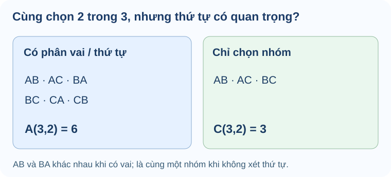

# Bài 24. Hoán vị, chỉnh hợp và tổ hợp

TOÁN 10 · CHƯƠNG VIII · KIẾN THỨC SGK KNTT

Phân biệt hoán vị, chỉnh hợp và tổ hợp, chọn công thức phù hợp với tình huống.

=== "Khám phá kiến thức"

    ### Cùng tìm hiểu

    Một nhóm ba bạn A, B, C chọn hai bạn đại diện. Nếu chỉ cần một **nhóm hai người**, hai cách viết AB và BA thực ra là cùng một nhóm. Nhưng nếu chọn **trưởng nhóm và phó nhóm**, AB nghĩa A làm trưởng, B làm phó, khác BA. Chính câu hỏi “**thứ tự hoặc vai trò có quan trọng không?**” quyết định dùng **tổ hợp** hay **chỉnh hợp**.

    Nếu xếp **tất cả** các bạn vào một hàng, đó là hoán vị. Nếu chọn một số người rồi phân vai, đó là chỉnh hợp. Nếu chỉ chọn người mà không phân vai, đó là tổ hợp. Trước công thức giai thừa, hãy nhìn các kết quả khác nhau thực sự và kiểm có đếm một nhóm nhiều lần hay không.

    Khi đề thêm điều kiện, ví dụ phải có ít nhất một bạn nữ hoặc hai người không đứng cạnh nhau, hãy chọn cách đếm theo cấu trúc và chia trường hợp trước. Một công thức đúng nhưng áp dụng nhầm đối tượng vẫn cho đáp án sai.

    ### Thuật ngữ, kiến thức và kỹ năng

    **Thuật ngữ:** Giai thừa, hoán vị, chỉnh hợp, tổ hợp, thứ tự, vai trò, chọn nhóm, điều kiện và đếm trùng.

    **Sau bài học, em cần làm được:** Nhận diện hoán vị/chỉnh hợp/tổ hợp từ câu chữ; xác định n,k; kiểm điều kiện (0le kle n); đếm theo trường hợp khi có ràng buộc.

=== "Kiến thức SGK"

    

    ### Hoán vị là xếp hết các phần tử và thứ tự quyết định

    Khi xếp nhiều quyển sách trên giá, đổi chỗ hai quyển tạo ra một cách xếp khác dù bộ sách không đổi.

    **Tiền đề:** Ôn quy tắc nhân qua các vị trí; n đối tượng phân biệt, mỗi vị trí dùng đúng một đối tượng.

    Hoán vị của n vật phân biệt là một thứ tự của tất cả n vật; số lựa chọn giảm dần n,n−1,...,1. Khi các vật phải đứng cạnh nhau, gộp chúng thành một khối trước khi đếm.

    **Hướng dẫn đọc hình/sơ đồ:** Vẽ 4 vị trí trên kệ và một khối [A B]; mỗi hoán đổi A B trong khối làm ra 2 cách khác nhau.

    **Lý do chọn phương pháp, điều kiện và giới hạn:** Nếu xếp tất cả n vật phân biệt, dùng n!. Nếu có ràng buộc đứng kề, xem nhóm như một khối để xếp ngoài rồi nhân cách sắp trong khối. Không dùng tổ hợp vì thứ tự quan trọng.

    **Em vận dụng.** Có bốn sách phân biệt A,B,C,D; xếp thành một hàng sao cho A và B đứng cạnh nhau. Có mấy cách?

    ??? question "Tự mở đáp án sau khi đã tự làm"

        **Đáp án:** 12 cách.

        **Lập luận:** Gộp A,B thành một khối, cùng C,D là 3 đối tượng có 3!=6 cách xếp; A,B trong khối đổi chỗ có 2!=2 cách. Tổng 6×2=12.

        **Nếu chưa đúng:** xem hướng dẫn tự sửa tương ứng, sau đó luyện câu liên quan ở phần Luyện tập (không dùng câu đã xem lời giải làm chứng cứ tự kiểm tra độc lập).

        <a href="#help-g10-chviii-try05">Đến hướng dẫn tự sửa</a>

    

    ??? tip "Nếu chưa làm được — khắc phục 5 bước"

        1. **Nhận diện lỗi:** Nếu tính 4!=24, em chưa xử lý yêu cầu A,B kề nhau; nếu chỉ 3!=6, em quên hai trật tự AB/BA.
        2. **Quay lại bản chất:** Hoán vị của n vật phân biệt là một thứ tự của tất cả n vật; số lựa chọn giảm dần n,n−1,...,1. Khi các vật phải đứng cạnh nhau, gộp chúng thành một khối trước khi đếm.
        3. **Tự làm lại:** Vẽ [AB], C,D rồi thay [AB] bằng [BA], đếm hai lần 6.
        4. **Đối chiếu tự nguyện:** tự mở lời giải trong fold và giải thích lại mỗi điều kiện, không tính điểm thành thạo.
        5. **Luyện tiếp:** `THPT-G10-B24-C01`, câu luyện tập cùng kỹ năng; nếu làm câu này sau khi đã xem lời giải thì chỉ tính luyện tập, không chứng nhận đánh giá độc lập.

        <a href="../luyen-tap/?item=THPT-G10-B24-C01">Mở câu luyện tập đã được kiểm tra</a>

    

    ### Chỉnh hợp chọn một số người rồi phân vai

    Chọn lớp trưởng và lớp phó khác với chọn hai bạn vào nhóm: vai trò khác nhau nên cùng hai bạn đổi vị trí tạo kết quả khác.

    **Tiền đề:** Nhắc 0≤k≤n, n người phân biệt, nhiệm vụ có k vị trí hoặc chức danh **phân biệt**.

    Chỉnh hợp chập k đếm k người chọn từ n **và xếp vào k vị trí phân biệt**; đây là số cách nhân n(n−1)...(n−k+1).

    **Hướng dẫn đọc hình/sơ đồ:** Vẽ ô lớp trưởng và lớp phó; gán An→trưởng, Bình→phó khác Bình→trưởng, An→phó.

    **Lý do chọn phương pháp, điều kiện và giới hạn:** Hỏi 'ai làm vị trí thứ nhất, ai làm vị trí thứ hai' → chỉnh hợp. Khi không phân vai mới chuyển sang tổ hợp.

    **Em vận dụng.** Có 5 học sinh khác nhau, chọn một lớp trưởng và một lớp phó, hai chức vụ không kiêm nhiệm. Có mấy cách?

    ??? question "Tự mở đáp án sau khi đã tự làm"

        **Đáp án:** 20 cách.

        **Lập luận:** Lớp trưởng 5 cách, lớp phó còn 4, nên 5×4=20=A₅². Hai bạn hoán đổi vai trò là hai cách khác.

        **Nếu chưa đúng:** xem hướng dẫn tự sửa tương ứng, sau đó luyện câu liên quan ở phần Luyện tập (không dùng câu đã xem lời giải làm chứng cứ tự kiểm tra độc lập).

        <a href="#help-g10-chviii-try06">Đến hướng dẫn tự sửa</a>

    

    ??? tip "Nếu chưa làm được — khắc phục 5 bước"

        1. **Nhận diện lỗi:** Nếu ra 10, em đã chia 2 như tổ hợp, tức không phân biệt hai chức danh.
        2. **Quay lại bản chất:** Chỉnh hợp chập k đếm k người chọn từ n **và xếp vào k vị trí phân biệt**; đây là số cách nhân n(n−1)...(n−k+1).
        3. **Tự làm lại:** So hai phân công (An trưởng,Bình phó) và (Bình trưởng,An phó) để thấy chúng khác nhau.
        4. **Đối chiếu tự nguyện:** tự mở lời giải trong fold và giải thích lại mỗi điều kiện, không tính điểm thành thạo.
        5. **Luyện tiếp:** `THPT-G10-B24-C02`, câu luyện tập cùng kỹ năng; nếu làm câu này sau khi đã xem lời giải thì chỉ tính luyện tập, không chứng nhận đánh giá độc lập.

        <a href="../luyen-tap/?item=THPT-G10-B24-C02">Mở câu luyện tập đã được kiểm tra</a>

    

    ### Tổ hợp chỉ chọn nhóm không phân vai

    Khi chọn hai đại diện cùng vai trò tham gia một cuộc họp, đổi thứ tự kể tên không tạo ra một nhóm mới.

    **Tiền đề:** Nhắc chỉnh hợp đếm thứ tự; hai người phân biệt có 2!=2 thứ tự khi cùng một nhóm.

    Tổ hợp chập k đếm các tập con k phần tử, không xét thứ tự. Từ số cách xếp k người, chia cho k! trật tự bị đếm trùng.

    **Hướng dẫn đọc hình/sơ đồ:** Vẽ hai phiếu 'An,Bình' và 'Bình,An' đặt vào cùng một ô 'nhóm {An,Bình}' vì thực chất giống nhau.

    **Lý do chọn phương pháp, điều kiện và giới hạn:** Hỏi 'chọn nhóm' với vai trò ngang nhau → C(n,k)=A(n,k)/k!, 0≤k≤n. Tránh tự chia k! nếu bài có phân vai.

    **Em vận dụng.** Từ 5 bạn phân biệt, chọn 2 bạn cùng đi trực nhật (không phân vai). Có mấy nhóm?

    ??? question "Tự mở đáp án sau khi đã tự làm"

        **Đáp án:** 10 nhóm.

        **Lập luận:** Chọn bạn đầu có 5 cách, bạn thứ hai có 4, mỗi cặp bị đếm hai thứ tự: 5×4/2=10=C₅².

        **Nếu chưa đúng:** xem hướng dẫn tự sửa tương ứng, sau đó luyện câu liên quan ở phần Luyện tập (không dùng câu đã xem lời giải làm chứng cứ tự kiểm tra độc lập).

        <a href="#help-g10-chviii-try07">Đến hướng dẫn tự sửa</a>

    

    ??? tip "Nếu chưa làm được — khắc phục 5 bước"

        1. **Nhận diện lỗi:** Nếu ra 20, em đã tính như hai chức danh khác nhau, đếm mỗi nhóm hai lần.
        2. **Quay lại bản chất:** Tổ hợp chập k đếm các tập con k phần tử, không xét thứ tự. Từ số cách xếp k người, chia cho k! trật tự bị đếm trùng.
        3. **Tự làm lại:** Viết {A,B}={B,A}; ghép các thứ tự trùng rồi đếm lại.
        4. **Đối chiếu tự nguyện:** tự mở lời giải trong fold và giải thích lại mỗi điều kiện, không tính điểm thành thạo.
        5. **Luyện tiếp:** `THPT-G10-B24-P01`, câu luyện tập cùng kỹ năng; nếu làm câu này sau khi đã xem lời giải thì chỉ tính luyện tập, không chứng nhận đánh giá độc lập.

        <a href="../luyen-tap/?item=THPT-G10-B24-P01">Mở câu luyện tập đã được kiểm tra</a>

    

    ### Chọn nhóm có điều kiện: tổ hợp rồi nhân

    Khi lập nhóm có cơ cấu bắt buộc, phải đảm bảo đủ từng loại trước khi đếm toàn nhóm.

    **Tiền đề:** Ôn tổ hợp chọn nhóm không thứ tự và quy tắc nhân khi cần thực hiện đồng thời các lựa chọn thành phần.

    Chọn đúng 2 nam và 1 nữ là hai việc phối hợp: chọn nhóm hai nam VÀ chọn một nữ. Mỗi cặp nam ghép với mỗi nữ thành một nhóm cuối cùng.

    **Hướng dẫn đọc hình/sơ đồ:** Vẽ hai ô 'chọn 2 từ 5 nam' và 'chọn 1 từ 4 nữ', nối mỗi ô sang một nhóm 3 người; không phân biệt thứ tự liệt kê trong nhóm.

    **Lý do chọn phương pháp, điều kiện và giới hạn:** Tách thành thành phần theo loại, dùng tổ hợp cho mỗi nhóm ngang vai rồi nhân các lựa chọn thành phần; kiểm điều kiện đúng 3 người và đúng số nam/nữ.

    **Em vận dụng.** Có 5 học sinh nam và 4 học sinh nữ khác nhau. Có bao nhiêu cách chọn nhóm 3 bạn gồm đúng 2 nam, 1 nữ?

    ??? question "Tự mở đáp án sau khi đã tự làm"

        **Đáp án:** 40 nhóm.

        **Lập luận:** C(5,2)=10 cách chọn hai nam; C(4,1)=4 cách chọn một nữ. Mỗi cặp ghép một nữ tạo 10×4=40 nhóm phân biệt.

        **Nếu chưa đúng:** xem hướng dẫn tự sửa tương ứng, sau đó luyện câu liên quan ở phần Luyện tập (không dùng câu đã xem lời giải làm chứng cứ tự kiểm tra độc lập).

        <a href="#help-g10-chviii-try08">Đến hướng dẫn tự sửa</a>

    

    ??? tip "Nếu chưa làm được — khắc phục 5 bước"

        1. **Nhận diện lỗi:** Nếu lấy C(9,3), em đã tính cả nhóm không có đúng 2 nam 1 nữ; nếu dùng hoán vị, em đếm trùng thứ tự kể tên.
        2. **Quay lại bản chất:** Chọn đúng 2 nam và 1 nữ là hai việc phối hợp: chọn nhóm hai nam VÀ chọn một nữ. Mỗi cặp nam ghép với mỗi nữ thành một nhóm cuối cùng.
        3. **Tự làm lại:** Viết sơ đồ 2 nam +1 nữ và thử kiểm vài nhóm từ kết quả.
        4. **Đối chiếu tự nguyện:** tự mở lời giải trong fold và giải thích lại mỗi điều kiện, không tính điểm thành thạo.
        5. **Luyện tiếp:** `THPT-G10-B24-P04`, câu luyện tập cùng kỹ năng; nếu làm câu này sau khi đã xem lời giải thì chỉ tính luyện tập, không chứng nhận đánh giá độc lập.

        <a href="../luyen-tap/?item=THPT-G10-B24-P04">Mở câu luyện tập đã được kiểm tra</a>

    ### Khái niệm, điều kiện và công thức

    **Cách đọc hình.** Cùng chọn hai từ A,B,C: nếu có vai AB khác BA nên có 6 chỉnh hợp; nếu chỉ là nhóm AB=BA thì còn 3 tổ hợp.

    <figure class="thpt-r4-plot thpt-r4-concept-figure"><figcaption>Khi phân vai, \(A_3^2=6\) vì AB và BA là hai kết quả khác nhau. Khi chỉ chọn nhóm, \(\binom32=3\) vì AB và BA là cùng một nhóm.</figcaption></figure>

    **Điều kiện chung.** Có \(n\) đối tượng **phân biệt**, \(n\) nguyên không âm. Với \(0\le k\le n\):
    - Hoán vị của n đối tượng: \(P_n=n!\), với \(0!=1\).
    - Chỉnh hợp chập k (chọn k phần tử và **xếp thứ tự**): \(A_n^k=\dfrac{n!}{(n-k)!}\).
    - Tổ hợp chập k (chọn nhóm k phần tử, **không** xét thứ tự): \(C_n^k=\dfrac{n!}{k!(n-k)!}\).
    - Công thức liên hệ \(A_n^k=C_n^k\cdot k!\) vì mỗi nhóm k phần tử có k! thứ tự.

    **Hướng chọn phương pháp.** Hỏi "chọn nhóm" mà không phân vai → tổ hợp; "xếp k người vào k vị trí phân biệt" → chỉnh hợp; "xếp tất cả" → hoán vị. Chọn nhóm rồi phân vai là hai bước: số nhóm nhân số phân vai **sau** khi nhóm được chọn, nếu mỗi nhóm có cùng số cách phân vai.

=== "Ví dụ"

    Trước khi xem lời giải, hãy xác định dữ kiện, điều phải tìm và lý do chọn cách giải. Sau đó kiểm tra lại điều kiện áp dụng và kết quả, thay vì chỉ nhìn phép tính cuối cùng.

    ### Ví dụ — Cùng chọn 2 trong 5, hai đáp án khác nhau

    **Đề bài.** Có năm học sinh. (a) Chọn một trưởng nhóm và một phó nhóm khác người. (b) Chọn nhóm hai người không phân vai.

    **Vì sao chọn cách này?** (a) Có hai **vai khác nhau** nên thứ tự chọn quyết định kết quả; (b) chỉ cần nhóm gồm ai, không xét vai.

    **Giải.** (a) Có \(5\cdot4=20=A_5^2\) cách. (b) Mỗi nhóm đã đếm hai lần nếu phân thứ tự, nên \(\binom52=\frac{5\cdot4}{2}=10\) nhóm.

    **Kiểm lại:** Không dùng cùng đáp án cho hai tình huống chỉ vì đều có “chọn hai người”.

    **Ví dụ 1.** Từ 7 học sinh chọn 3 bạn làm nhóm trực nhật (không phân vai): C(7,3)=35. Nếu lập nhóm 3 bạn và cử đúng một trưởng nhóm, mỗi nhóm có 3 lựa chọn, nên có 35×3=105 phương án. Không nhầm bài thứ hai với 7×6×5 vì hai bạn còn lại không được phân biệt vai trò.

    **Ví dụ 2.** Xếp 4 quyển sách khác nhau lên một giá theo một hàng có 4!=24 cách. Nếu A và B phải kề nhau, gộp thành khối [AB], cùng 2 sách còn lại tạo 3 đối tượng có 3! thứ tự; khối có 2 hoán đổi bên trong, tổng 2×3!=12 cách. Việc gom khối chỉ dùng khi điều kiện kề nhau được mô tả chính xác.

    **Lỗi hay gặp.** Tổ hợp và chỉnh hợp dùng lẫn nhau; gộp khối mà quên hoán vị trong khối; đếm thiếu/đếm hai lần các nhóm có ràng buộc; dùng công thức với k>n; bỏ qua việc các đối tượng có phân biệt hay không.

=== "Lỗi thường gặp"

    

    ??? tip "Nhầm nhóm với phân vai"

        
<strong>Dấu hiệu:</strong> Đổi thứ tự các thành viên của một nhóm không phân vai nhưng lại coi là kết quả mới.

        
<strong>Bản chất toán:</strong> Tổ hợp không xét thứ tự; chỉnh hợp gán k vai trò phân biệt. Với 0≤k≤n, A(n,k)=C(n,k)·k!.

        
<strong>Tự sửa:</strong> Ôn B24 mục 2 (chỉnh hợp) và mục 3 (tổ hợp): hỏi đổi chỗ hai người có tạo phương án mới không để chọn A hay C. Nếu xếp toàn bộ k người đã chọn vào k vị trí phân biệt, dùng \(A_n^k=C_n^k\cdot k!\); nếu chỉ phân một số vai trò, đếm đúng số cách giao vai tương ứng.

        
<strong>Kiến thức cần ôn:</strong> B23 quy tắc nhân, giai thừa; B24 mục 1.

        
<strong>Luyện lại bài đã có:</strong> <a data-thpt-formative-id="THPT-G10-B24-C02" href="../luyen-tap/?item=THPT-G10-B24-C02">Luyện lại câu 24-C02</a> · <a data-thpt-formative-id="THPT-G10-B24-P01" href="../luyen-tap/?item=THPT-G10-B24-P01">Luyện lại câu 24-P01</a> · <a data-thpt-formative-id="THPT-G10-B24-P02" href="../luyen-tap/?item=THPT-G10-B24-P02">Luyện lại câu 24-P02</a> · <a data-thpt-formative-id="THPT-G10-CHVIII-W24-ANCHOR-01" href="../../../thu-vien/tu-luan-chuong-viii/#thpt-g10-chviii-w24-anchor-01">Bài tự luận liên quan</a>

    

    ??? tip "Gộp khối và đếm ràng buộc thiếu hoặc trùng"

        
<strong>Dấu hiệu:</strong> Gộp hai người kề nhau thành khối nhưng quên hoán vị trong khối, hoặc các nhánh không loại trừ.

        
<strong>Bản chất toán:</strong> Với hai người phân biệt A, B phải kề nhau, số thứ tự của nhóm sau khi gộp khối nhân thêm 2! cách đổi chỗ trong khối. «Ít nhất một» có thể đếm bằng phần bù khi tập tất cả xác định.

        
<strong>Tự sửa:</strong> Ôn B24 mục 1 (hoán vị) và mục 2 (chỉnh hợp): nếu A, B phải đứng cạnh nhau, gộp thành một khối, đếm thứ tự các khối và nhân thêm \(2!\) thứ tự nội bộ; khi dùng phần bù, nêu rõ tập tất cả và tập bị loại, kiểm mỗi trường hợp được đếm đúng một lần.

        
<strong>Kiến thức cần ôn:</strong> B23 chia trường hợp; B24 hoán vị/tổ hợp.

        
<strong>Luyện lại bài đã có:</strong> <a data-thpt-formative-id="THPT-G10-B24-P04" href="../luyen-tap/?item=THPT-G10-B24-P04">Luyện lại câu 24-P04</a> · <a data-thpt-formative-id="THPT-G10-B24-P05" href="../luyen-tap/?item=THPT-G10-B24-P05">Luyện lại câu 24-P05</a> · <a data-thpt-formative-id="THPT-G10-B24-P06" href="../luyen-tap/?item=THPT-G10-B24-P06">Luyện lại câu 24-P06</a>

    **Học tiếp:** [Core và Luyện tập](luyen-tap.md) · [Tự kiểm tra cuối chương](tu-kiem-tra-chuong.md).

    
Nguồn toán học: SGK Toán 10 Kết nối tri thức với cuộc sống và học liệu SLM hiện hành. Lời giảng được biên tập nhằm hỗ trợ tự học độc lập.

<small>Nguồn: SGK Toán 10 KNTT tập 2, trang 66–71; SBT 54–55. Các ví dụ do dự án biên soạn, không chép nguyên văn bài SGK.</small>
