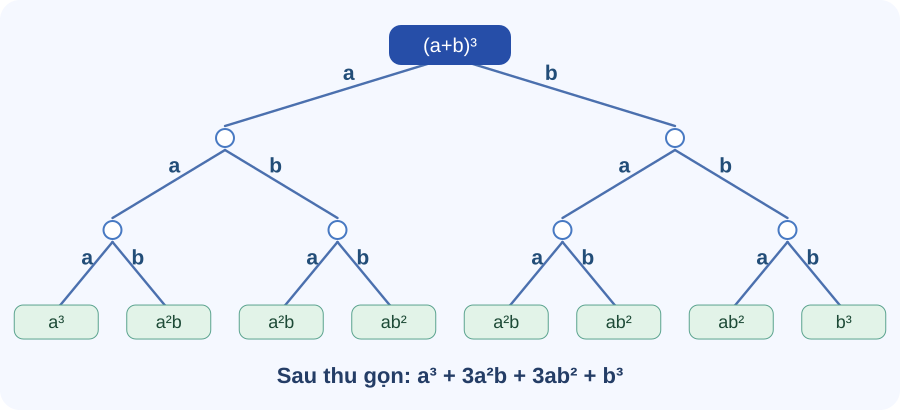
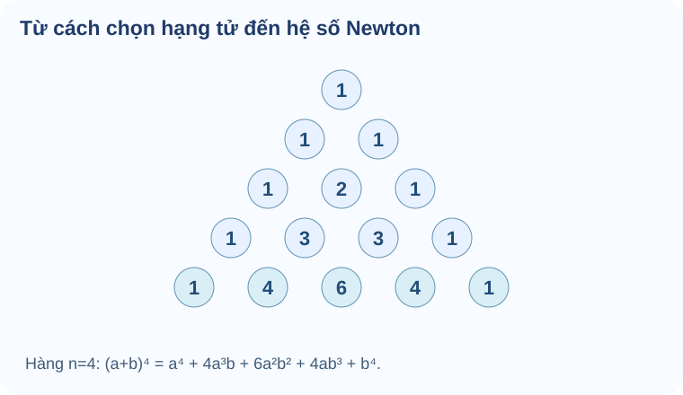

# Bài 25. Nhị thức Newton

TOÁN 10 · CHƯƠNG VIII · KIẾN THỨC SGK KNTT

Hiểu hệ số bằng sơ đồ nhánh, khai triển bậc 4–5 và ước lượng có kiểm sai số.

=== "Khám phá kiến thức"

    **Vì sao cần học?** Nhân nhiều nhị thức bằng cách phân phối từng lần dễ đếm trùng hoặc bỏ sót. Tổ hợp ở Bài 24 giúp ta đếm số lần mỗi đơn thức xuất hiện mà không cần viết mọi tích trung gian.

    **Tiền đề:** Hằng đẳng thức \((a+b)^2,\ (a+b)^3\), quy tắc nhân và số tổ hợp \(C_n^k\). **Phạm vi SGK:** khai triển bậc 4 hoặc bậc 5.

    ### 1.1. Sơ đồ nhánh giải thích nguồn gốc hệ số

    Mỗi lần đi qua một nhánh trong tích \((a+b)^3\), em chọn hạng tử \(a\) hoặc \(b\). Một đường từ gốc tới lá tạo một tích; nhiều đường có thể thu gọn về cùng một đơn thức.

    <figure class="thpt-r4-plot thpt-r4-concept-figure" style="overflow-x:auto"><figcaption>Đọc từ gốc đến lá: aab, aba, baa đều tạo a²b, nên hệ số a²b là 3. Có thể kéo ngang để đọc từng lá trên điện thoại.</figcaption></figure>

    **Đọc hình:** Có tám đường nhưng sau thu gọn còn bốn loại đơn thức. Cách tạo đường cũng áp dụng cho \((a+b)(c+d)\), với bốn lá \(ac,ad,bc,bd\). Từ đây có thể đếm số vị trí lấy \(b\) ở bậc 4–5.

    ### 1.2. Tìm hệ số bằng cách đếm vị trí

    Để có \(a^3b^2\) trong \((a+b)^5\), chọn đúng hai trong năm vị trí lấy \(b\); ba vị trí còn lại lấy \(a\). Hãy tự đếm số cách, không nhầm số mũ 2 với hệ số.

    

    **Em vận dụng.** Trong khai triển (a+b)⁵, hệ số của a³b² là bao nhiêu? Giải thích bằng cách chọn nhân tử.

    ??? question "Tự mở đáp án sau khi đã tự làm"

        **Đáp án:** 10.

        **Lập luận:** Chọn hai trong năm nhân tử cho b theo C₅²=5!/(2!3!)=10 cách; ba nhân tử còn lại cho a.

        **Nếu chưa đúng:** xem hướng dẫn tự sửa tương ứng, sau đó luyện câu liên quan ở phần Luyện tập (không dùng câu đã xem lời giải làm chứng cứ tự kiểm tra độc lập).

        <a href="#help-g10-chviii-try09">Đến hướng dẫn tự sửa</a>

    

    ??? tip "Kiểm lỗi"

        1. **Nhận diện lỗi:** Nếu đáp 5, em nhầm số mũ với số cách chọn; nếu 20, em đếm thứ tự hai vị trí b không cần thiết.
        2. **Quay lại bản chất:** Đơn thức a³b² xuất hiện khi chọn b từ đúng hai trong năm nhân tử; ba nhân tử còn lại chọn a. Có C₅²=10 cách chọn vị trí b.
        3. **Tự làm lại:** Vẽ năm vị trí, đánh dấu hai vị trí b hoặc tính C₅².
        4. **Đối chiếu tự nguyện:** tự mở lời giải trong fold và giải thích lại mỗi điều kiện, không tính điểm thành thạo.
        5. **Luyện tiếp:** Mở câu luyện qua liên kết bên dưới và tự làm trước khi đối chiếu. Nếu đã xem lời giải, hãy chọn một câu khác để thử không có gợi ý.

        <a href="../luyen-tap/?item=THPT-G10-B25-C01">Mở câu luyện tập đã được kiểm tra</a>

    ### 1.3. Dấu âm phải đi theo hạng tử

    Trong \((1-x)^3\), số lần lấy \(-x\) lẻ cho tích âm, chẵn cho tích dương. Với \((2-x)^4\), ngoài tổ hợp vị trí còn phải nhân lũy thừa của phần hệ số 2.

    

    **Em vận dụng.** Tìm hệ số của x³ trong (2−x)⁴.

    ??? question "Tự mở đáp án sau khi đã tự làm"

        **Đáp án:** −8.

        **Lập luận:** Chọn −x từ ba trong bốn nhân tử có C₄³=4 cách; mỗi tích là 2·(−x)³=−2x³. Tổng −8x³.

        **Nếu chưa đúng:** xem hướng dẫn tự sửa tương ứng, sau đó luyện câu liên quan ở phần Luyện tập (không dùng câu đã xem lời giải làm chứng cứ tự kiểm tra độc lập).

        <a href="#help-g10-chviii-try10">Đến hướng dẫn tự sửa</a>

    

    ??? tip "Kiểm lỗi"

        1. **Nhận diện lỗi:** Nếu đáp +8, em đã bỏ dấu (−1)³; nếu đáp −4, em quên nhân hệ số 2 ở nhân tử còn lại.
        2. **Quay lại bản chất:** Hệ số x^k gồm ba phần: số cách chọn k vị trí là C(n,k), phần số 2^(n−k) từ các vị trí còn lại và dấu (−1)^k. Dấu không tùy ý.
        3. **Tự làm lại:** Viết riêng C₄³, 2¹, (−1)³ rồi nhân từng phần.
        4. **Đối chiếu tự nguyện:** tự mở lời giải trong fold và giải thích lại mỗi điều kiện, không tính điểm thành thạo.
        5. **Luyện tiếp:** Mở câu luyện qua liên kết bên dưới và tự làm trước khi đối chiếu. Nếu đã xem lời giải, hãy chọn một câu khác để thử không có gợi ý.

        <a href="../luyen-tap/?item=THPT-G10-B25-P01">Mở câu luyện tập đã được kiểm tra</a>

    ### 1.4. Số hạng không chứa \(x\)

    Trong \((2x+1)^3\), chỉ khi lấy \(1\) ở cả ba nhân tử, tích mới không chứa \(x\). Không cần khai triển hết. Nếu đề chứa \(x^{-1}\), phải kiểm điều kiện \(x\ne0\) và tổng số mũ; đây là nhánh tự chọn.

    

    **Em vận dụng.** Trong khai triển (2x+3)⁴, số hạng không chứa x bằng bao nhiêu?

    ??? question "Tự mở đáp án sau khi đã tự làm"

        **Đáp án:** 81.

        **Lập luận:** Chọn 3 từ cả bốn nhân tử: C₄⁰(2x)⁰3⁴=81. Với k≥1, số hạng chứa x^k nên không là hằng số.

        **Nếu chưa đúng:** xem hướng dẫn tự sửa tương ứng, sau đó luyện câu liên quan ở phần Luyện tập (không dùng câu đã xem lời giải làm chứng cứ tự kiểm tra độc lập).

        <a href="#help-g10-chviii-try11">Đến hướng dẫn tự sửa</a>

    

    ??? tip "Kiểm lỗi"

        1. **Nhận diện lỗi:** Nếu đáp 16, em lấy hệ số bậc x⁴; nếu chỉ 3, em quên tích của cả bốn nhân tử.
        2. **Quay lại bản chất:** Số hạng không chứa x đòi số mũ x bằng 0: lấy 3 ở tất cả bốn nhân tử. Đây là phạm vi SGK Core n=4; biểu thức 1/x hoặc n lớn thuộc phần hỗ trợ/mở rộng, không bắt làm phần Vận dụng.
        3. **Tự làm lại:** Lập bảng k=0,1,2,3,4 và số mũ x là k, chọn k=0.
        4. **Đối chiếu tự nguyện:** tự mở lời giải trong fold và giải thích lại mỗi điều kiện, không tính điểm thành thạo.
        5. **Luyện tiếp:** Mở câu luyện qua liên kết bên dưới và tự làm trước khi đối chiếu. Nếu đã xem lời giải, hãy chọn một câu khác để thử không có gợi ý.

        <a href="../luyen-tap/?item=THPT-G10-B25-P07">Mở câu luyện tập đã được kiểm tra</a>

    ### 1.5. Tổng hệ số: thay \(x=1\)

    Với đa thức \(P(x)=a_0+a_1x+\cdots+a_mx^m\), ta có \(P(1)=a_0+a_1+\cdots+a_m\). Mẹo này dùng cho **tổng tất cả hệ số**, không dùng khi chỉ hỏi một hệ số.

    

    **Em vận dụng.** Tổng tất cả hệ số của đa thức (1+2x)⁴ là bao nhiêu?

    ??? question "Tự mở đáp án sau khi đã tự làm"

        **Đáp án:** 81.

        **Lập luận:** P(x)=(1+2x)⁴, tổng hệ số =P(1)=(1+2)⁴=3⁴=81.

        **Nếu chưa đúng:** xem hướng dẫn tự sửa tương ứng, sau đó luyện câu liên quan ở phần Luyện tập (không dùng câu đã xem lời giải làm chứng cứ tự kiểm tra độc lập).

        <a href="#help-g10-chviii-try12">Đến hướng dẫn tự sửa</a>

    

    ??? tip "Kiểm lỗi"

        1. **Nhận diện lỗi:** Nếu đáp 16, em nhầm (1+2x)⁴ với (1+x)⁴, bỏ hệ số 2.
        2. **Quay lại bản chất:** Thay x=1, tất cả x^k=1 nên giá trị P(1) chính là tổng hệ số. Tách tổng hệ số lẻ/chẵn bằng P(−1) là nhánh mở rộng tự chọn, không thay phần SGK bắt buộc.
        3. **Tự làm lại:** Viết rõ P(1)=(1+2·1)⁴ và tính 3⁴; không cần khai triển.
        4. **Đối chiếu tự nguyện:** tự mở lời giải trong fold và giải thích lại mỗi điều kiện, không tính điểm thành thạo.
        5. **Luyện tiếp:** Mở câu luyện qua liên kết bên dưới và tự làm trước khi đối chiếu. Nếu đã xem lời giải, hãy chọn một câu khác để thử không có gợi ý.

        <a href="../../../thu-vien/tu-luan-chuong-viii/">Mở câu luyện tập đã được kiểm tra</a>

    ### 1.6. Ứng dụng: khai triển để tính gần đúng

    Với \(t>0\) nhỏ, \((1+t)^4=1+4t+6t^2+4t^3+t^4\). Lấy hai số hạng đầu \(1+4t\) để ước lượng, nhưng nhớ rằng **phần dư tạo sai số**. Sai số tuyệt đối bằng độ lớn của hiệu giữa kết quả tính đủ và kết quả gần đúng.

    Các bài số mũ lớn, \(x^{-1}\) và tổng hệ số chẵn/lẻ là **mở rộng tự chọn**, không thay yêu cầu bậc 4–5.

=== "Kiến thức SGK"

    ### 2.1. Khai triển nhị thức bậc 4

    Trong bốn nhân tử, nếu lấy \(b\) đúng \(k\) lần sẽ tạo \(a^{4-k}b^k\). Số cách chọn những vị trí đó bằng \(C_4^k\).

    
<strong>Bản chất.</strong> Hệ số là số cách chọn hạng tử tạo ra cùng một tích trước khi thu gọn các tích đồng dạng.

    
<strong>Công thức.</strong> \((a+b)^4=a^4+4a^3b+6a^2b^2+4ab^3+b^4\).

    **Cách đọc:** Số mũ của \(a\) giảm từ 4 đến 0, số mũ \(b\) tăng từ 0 đến 4; tổng hai số mũ bằng 4.

    ### 2.2. Khai triển nhị thức bậc 5

    Khi có năm nhân tử, số cách lấy \(b\) đúng \(k\) lần là \(C_5^k\). Dãy hệ số là \(1,5,10,10,5,1\).

    
<strong>Công thức.</strong> \((a+b)^5=a^5+5a^4b+10a^3b^2+10a^2b^3+5ab^4+b^5\).

    **Cách đọc:** Trong mỗi hạng, tổng hai số mũ là 5. Khi \(b\) là biểu thức âm, phải giữ nguyên dấu của \(b^k\).

    ### 2.3. Tam giác Pascal và cách đối chiếu hệ số

    <figure class="thpt-r4-plot thpt-r4-concept-figure"><figcaption>Đọc từ trên xuống: số giữa bằng tổng hai số ngay phía trên. Hàng bậc 4 là 1,4,6,4,1; từ hàng đó, cộng hai số kề phía trên để suy ra hàng bậc 5: 1,5,10,10,5,1.</figcaption></figure>

    Tam giác Pascal giúp kiểm **dãy hệ số**, còn sơ đồ nhánh ở Khám phá giải thích **vì sao** hệ số đếm số đường chọn. Số hạng dạng \(C_n^k a^{n-k}b^k\) là liên hệ tổng quát; SGK B25 chỉ bắt buộc \(n=4\) hoặc \(n=5\).

    ### 2.4. Khi thay một hạng tử bằng biểu thức có dấu

    Với \((3x-2)^5\), đặt \(a=3x,\ b=-2\). Hạng có số lần lấy \(-2\) lẻ mang dấu âm; khi tính \((3x)^k\), phải nâng cả số 3 lên mũ \(k\).

    Trong \((a+bx)^n\) với \(a,b\) hằng số, hệ số \(x^r\) là \(C_n^r a^{n-r}b^r\) cho \(0\le r\le n\). Nếu cả hai hạng tử có \(x\), phải xét số mũ tổng quát trước.

    ### 2.5. Dùng khai triển để ước lượng và kiểm sai số

    
<strong>Xấp xỉ hai số hạng đầu.</strong> Với \(t\) nhỏ, \((1+t)^4\approx1+4t\) và \((1+t)^5\approx1+5t\). Không được coi đây là đẳng thức.

    \(1{,}05^4\approx1{,}20\), trong khi máy tính cho \(1{,}21550625\), nên sai số tuyệt đối là \(0{,}01550625\). Với mô hình tăng dân số, phải nêu rõ điều kiện tỉ lệ mỗi năm không đổi và đơn vị kết quả.

    **Tự kiểm thêm với bậc 5:** \(1{,}02^5\approx1+5(0{,}02)=1{,}10\). Máy tính cho \(1{,}1040808032\); độ lệch tuyệt đối là \(0{,}0040808032\). Ở đây số gần đúng nhỏ hơn kết quả tính đủ vì các hạng có \(t^2,t^3,\ldots\) đều dương khi \(t=0{,}02\).

=== "Ví dụ"

    Các ví dụ có **Phân tích** trước lời giải và kiểm tra lại bằng phép tính độc lập.

    ### 3.1. Ví dụ — Khai triển bậc 4

    **Đề bài.** Khai triển \((2x+1)^4\).

    **Phân tích:** Đặt \(a=2x,\ b=1\); không được quên lũy thừa hệ số 2.

    

<strong>Lời giải.</strong> \((2x+1)^4=16x^4+32x^3+24x^2+8x+1\).

    **Kiểm lại:** Với \(x=1\), tổng các hệ số 81 khớp \(3^4\).

    ### 3.2. Ví dụ — Dấu âm

    **Đề bài.** Khai triển \((x-2)^4\).

    **Phân tích:** Coi \(b=-2\); mũ lẻ cho dấu âm, mũ chẵn cho dấu dương.

    

<strong>Lời giải.</strong> \((x-2)^4=x^4-8x^3+24x^2-32x+16\).

    **Kiểm lại:** Thay \(x=2\), kết quả phải bằng 0.

    ### 3.3. Ví dụ — Khai triển bậc 5

    **Đề bài.** Khai triển \((3x-2)^5\), chỉ ra hệ số \(x^4\).

    **Phân tích:** Chọn \(-2\) một lần và \(3x\) bốn lần để tạo \(x^4\); hệ số âm.

    

<strong>Lời giải.</strong> \((3x-2)^5=243x^5-810x^4+1080x^3-720x^2+240x-32\). Hệ số \(x^4\) là \(-810\).

    **Kiểm lại:** Với \(x=0\) có \(-32\); với \(x=1\) có 1.

    ### 3.4. Ví dụ — Tìm riêng hệ số

    **Đề bài.** Tìm hệ số \(x^4\) của \((3x-1)^5\).

    **Phân tích:** Chọn bốn lần \(3x\), một lần \(-1\); số cách là \(C_5^4\).

    

<strong>Lời giải.</strong> Hệ số \(C_5^4\cdot3^4(-1)=-405\).

    **Kiểm lại:** Dấu âm do lấy \(-1\) đúng một lần.

    ### 3.5. Ví dụ — Xấp xỉ và sai số

    **Đề bài.** Dùng hai hạng đầu để ước lượng \(1{,}05^4\), so với máy tính.

    **Phân tích:** Lấy \(1+4t\), với \(t=0{,}05\), rồi tính hiệu tuyệt đối.

    

<strong>Lời giải.</strong> \(1{,}05^4\approx1{,}20\). Máy tính \(1{,}21550625\); sai số là \(\lvert1{,}21550625-1{,}20\rvert=0{,}01550625\).

    **Kiểm lại:** Các hạng \(6t^2+4t^3+t^4>0\) nên số gần đúng nhỏ hơn kết quả tính đủ.

    ### 3.6. Ví dụ — Dân số sau năm năm

    **Đề bài.** Một địa phương có 800 nghìn người, dân số tăng đều \(1{,}5\%\) hằng năm. Ước lượng sau 5 năm.

    **Phân tích:** Dùng \(800(1+0{,}015)^5\), tính gần đúng với hai hạng đầu và giữ đơn vị nghìn người.

    

<strong>Lời giải.</strong> \(800(1+5\cdot0{,}015)=860\) nghìn người. Tính đủ khoảng \(861{,}827\) nghìn, độ lệch xấp xỉ \(1{,}827\) nghìn.

    **Kiểm lại:** Đây chỉ là mô hình khi tỉ lệ tăng không đổi; 860 không phải số chính xác.

    ??? question "Luyện tập mở rộng và chuyên sâu"

        
Những câu có nhãn “hỗ trợ mở rộng” hoặc “chuyên sâu tự chọn” không thuộc Core. Hãy nắm chắc bậc 4–5 và ứng dụng xấp xỉ trước.

=== "Lỗi thường gặp"

    **Lỗi hay gặp.** Nhầm k và n-k; bỏ hệ số b^k; quên dấu âm với số mũ lẻ; đọc hệ số x^r sai khi a hoặc b còn chứa x; tự áp dụng f(1) cho tổng *một số* hệ số không thích hợp.

    

    ??? tip "Sai dấu và vị trí hệ số Newton"

        
<strong>Dấu hiệu:</strong> Nhầm k với n−k, thiếu hệ số tổ hợp hoặc quên dấu trong (−bx)^k.

        
<strong>Bản chất toán:</strong> Với a,b hằng số, n nguyên không âm, hệ số x^r trong (a+bx)^n (0≤r≤n) là C(n,r)a^(n−r)b^r; nếu b âm, dấu phụ thuộc tính chẵn/lẻ của r.

        
<strong>Tự sửa:</strong> Ôn B25 mục 1: xác định phần mang x, viết số hạng tổng quát \(C_n^r a^{n-r}b^r x^r\) rồi mới chọn r; nếu b âm, soát dấu theo tính chẵn/lẻ của r. Với \(n=4,5\), em có thể tự kiểm từng hệ số của khai triển; công thức vẫn đúng với mọi n nguyên không âm.

        
<strong>Kiến thức cần ôn:</strong> B24 tổ hợp, số mũ; B25 mục 1.

        
<strong>Luyện lại bài đã có:</strong> <a data-thpt-formative-id="THPT-G10-B25-C01" href="../luyen-tap/?item=THPT-G10-B25-C01">Luyện lại câu 25-C01</a> · <a data-thpt-formative-id="THPT-G10-B25-C02" href="../luyen-tap/?item=THPT-G10-B25-C02">Luyện lại câu 25-C02</a> · <a data-thpt-formative-id="THPT-G10-B25-P01" href="../luyen-tap/?item=THPT-G10-B25-P01">Luyện lại câu 25-P01</a> · <a data-thpt-formative-id="THPT-G10-B25-P03" href="../luyen-tap/?item=THPT-G10-B25-P03">Luyện lại câu 25-P03</a> · <a data-thpt-formative-id="THPT-G10-B25-P04" href="../luyen-tap/?item=THPT-G10-B25-P04">Luyện lại câu 25-P04</a> · <a data-thpt-formative-id="THPT-G10-CHVIII-W25-01" href="../../../thu-vien/tu-luan-chuong-viii/#thpt-g10-chviii-w25-01">Bài tự luận liên quan</a>

    

    ??? tip "Số hạng tự do và bài mở rộng chứa x⁻¹"

        
<strong>Dấu hiệu:</strong> Khai triển toàn bộ để tìm hạng không chứa x trong (a+bx)^n, hoặc tự động coi bài chứa x⁻¹ là Core bắt buộc.

        
<strong>Bản chất toán:</strong> Trong (a+bx)^n (a,b là hằng số), hạng không chứa x là a^n. Nếu chứa x⁻¹ phải giải số mũ tổng quát bằng 0 và giữ điều kiện x≠0; đây là dạng mở rộng của bài học.

        
<strong>Tự sửa:</strong> Ôn B25 mục 1–2 và P07 để củng cố Core. P02/P05 là hỗ trợ mở rộng, P06 chuyên sâu tự chọn, không dùng làm yêu cầu đánh giá Core bắt buộc.

        
<strong>Kiến thức cần ôn:</strong> Số hạng tổng quát; điều kiện x≠0; B25 mục 1–2.

        
<strong>Luyện lại bài đã có:</strong> <a data-thpt-formative-id="THPT-G10-B25-P07" href="../luyen-tap/?item=THPT-G10-B25-P07">Luyện lại câu 25-P07</a> · <a data-thpt-formative-id="THPT-G10-B25-P02" href="../luyen-tap/?item=THPT-G10-B25-P02">Luyện lại câu 25-P02</a> · <a data-thpt-formative-id="THPT-G10-B25-P05" href="../luyen-tap/?item=THPT-G10-B25-P05">Luyện lại câu 25-P05</a> · <a data-thpt-formative-id="THPT-G10-B25-P06" href="../luyen-tap/?item=THPT-G10-B25-P06">Luyện lại câu 25-P06</a>

    **Học tiếp:** [Core và Luyện tập](luyen-tap.md) · [Tự kiểm tra cuối chương](tu-kiem-tra-chuong.md).

    
Nguồn: SGK Toán 10 KNTT tập 2, trang 72–75; SBT 56–57. Các ví dụ do dự án biên soạn, không chép nguyên văn bài SGK.

