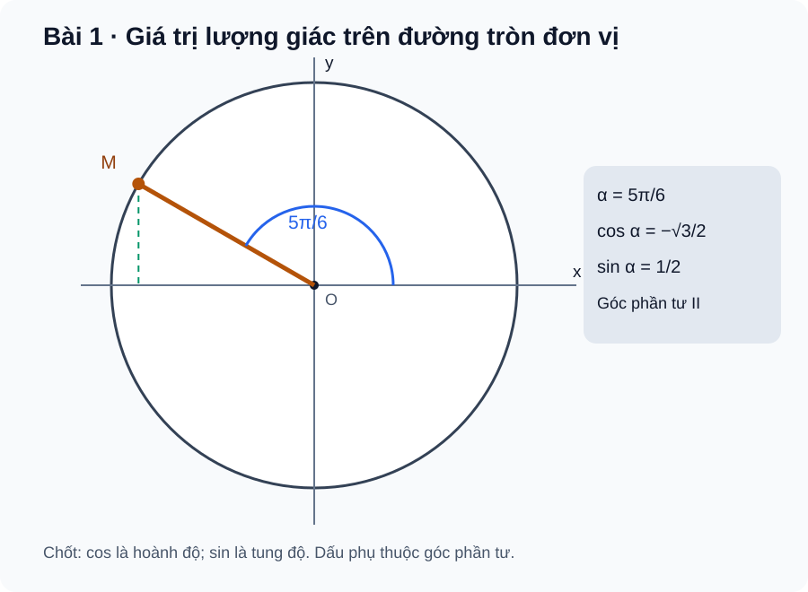

# Bài 1. Giá trị lượng giác của góc lượng giác

TOÁN 11 · CHƯƠNG I

Góc có hướng, radian, đường tròn lượng giác và các quan hệ lượng giác cơ bản.

<nav class="thpt-r4-lesson-tabs"><a href="../">Chương I</a><a href="../luyen-tap/">Core và Luyện tập</a><a href="../tu-kiem-tra-chuong/">Tự kiểm tra cuối chương</a></nav>

=== "Khám phá kiến thức"

    Một bánh xe quay thêm hai vòng rồi trở về cùng vị trí. Nếu chỉ nhìn tia cuối, ta không biết bánh xe đã quay bao nhiêu vòng hoặc theo chiều nào. Kiến thức về góc lượng giác giúp mô tả **góc quay có hướng**; radian cho phép tính **độ dài cung**; đường tròn lượng giác giúp tính sin và cos của những góc không còn là góc nhọn.

    Kiến thức tiền đề: ở lớp 10, em đã dùng \(\sin\) và \(\cos\) cho góc từ \(0^\circ\) đến \(180^\circ\), biết tỉ số lượng giác trong tam giác vuông, hệ thức Pythagore và chu vi đường tròn. Bài này mở rộng sin/cos ra mọi số đo góc, rồi hình thành những quan hệ lượng giác.

    ### 1.1. Góc quay có hướng

    Kim phút đi từ số 2 đến số 12: ngược chiều kim đồng hồ chỉ đi qua hai khoảng số, cùng chiều kim đồng hồ phải đi qua mười khoảng số. Hai phép quay có cùng tia cuối nhưng khác **chiều** và **độ lớn**. Quy ước ngược chiều kim đồng hồ là chiều dương; chiều ngược lại là âm.

    **Vận dụng.** Một bánh xe bán kính 2 cm quay trọn một vòng ngược chiều kim đồng hồ. Nêu góc quay theo radian và độ dài cung đã đi.

    

    ??? question "Đối chiếu"

        
<strong>Đáp án và lập luận:</strong> Góc quay \(+2\pi\) rad. Một vòng dài \(2\pi R\), nên với \(R=2\) cm, độ dài cung là \(4\pi\) cm. Tia cuối trùng tia đầu không có nghĩa là bánh xe đứng yên.

    

    ??? tip "Kiểm lỗi"

        
<strong>Lỗi cần kiểm:</strong> Đồng nhất tia cuối với tổng góc đã quay.

        
<strong>Bước 1:</strong> Xác định đề hỏi vị trí cuối hay tổng chuyển động.

        
<strong>Bước 2:</strong> Một vòng bằng \(2\pi\) rad và đi hết chu vi \(2\pi R\).

        
<strong>Bước 3:</strong> Giữ góc quay có dấu, nhưng quãng đường phải không âm.

        
<strong>Luyện tiếp:</strong> Chọn bài cùng kiến thức trong Core và Luyện tập; tự làm lại trước khi mở lời giải.

    ### 1.2. Góc cùng tia cuối

    Nếu từ cùng tia đầu, hai số đo chênh nhau trọn một số nguyên vòng, chúng cho cùng tia cuối. Chẳng hạn \(-150^\circ\) và \(210^\circ\) khác nhau \(360^\circ\). Điều này cho phép tìm giá trị lượng giác của góc lớn hơn một vòng mà không làm mất ý nghĩa chuyển động thực.

    **Vận dụng.** Hai góc \(-150^\circ\) và \(210^\circ\) có cùng tia đầu Ox. Chúng có cùng tia cuối không? Viết các số đo cùng tia cuối với \(210^\circ\).

    

    ??? question "Đối chiếu"

        
<strong>Đáp án và lập luận:</strong> Có, vì \(210^\circ-(-150^\circ)=360^\circ\). Các góc cùng tia cuối có số đo \(210^\circ+k\cdot360^\circ\), \(k\in\mathbb Z\).

    

    ??? tip "Kiểm lỗi"

        
<strong>Lỗi cần kiểm:</strong> Không xét số nguyên âm trong công thức các góc cùng tia cuối.

        
<strong>Bước 1:</strong> Lấy hiệu hai số đo góc cùng đơn vị.

        
<strong>Bước 2:</strong> Kiểm hiệu có bằng một bội nguyên của \(360^\circ\) không.

        
<strong>Bước 3:</strong> Viết \(k\in\mathbb Z\), không hạn chế chỉ những góc dương.

        
<strong>Luyện tiếp:</strong> Chọn bài cùng kiến thức trong Core và Luyện tập; tự làm lại trước khi mở lời giải.

    ### 1.3. Đơn vị radian và cung tròn

    Một cung có độ dài đúng bằng bán kính chắn góc ở tâm **1 radian**. Vì một vòng dài \(2\pi R\), toàn bộ một vòng ứng với \(2\pi\) rad. Công thức tính độ dài cung dùng góc tính theo radian; không được thay trực tiếp giá trị góc theo độ.

    Trạm vũ trụ ISS chuyển động trên quỹ đạo cách bề mặt Trái Đất khoảng 400 km. Với bán kính Trái Đất khoảng 6400 km, bán kính quỹ đạo là 6800 km. Khi trạm quét góc ở tâm \(45^\circ\), cần đổi đơn vị góc trước khi tìm quãng đường cung.

    **Vận dụng.** Cho quỹ đạo tròn bán kính 6800 km. Tính độ dài cung chắn góc \(45^\circ\), làm tròn đến kilômét.

    

    ??? question "Đối chiếu"

        
<strong>Đáp án và lập luận:</strong> Đổi \(45^\circ=\pi/4\) rad. Khi đó \(s=6800\cdot\pi/4=1700\pi\approx5341\) km. Đây là độ dài cung, không phải dây cung.

    

    ??? tip "Kiểm lỗi"

        
<strong>Lỗi cần kiểm:</strong> Nhân bán kính với số 45 trong công thức dành cho radian.

        
<strong>Bước 1:</strong> Đổi góc độ sang radian.

        
<strong>Bước 2:</strong> Dùng \(s=R|\alpha|\), đơn vị là km.

        
<strong>Bước 3:</strong> Kiểm cung một phần tám vòng thì dài đúng một phần tám chu vi.

        
<strong>Luyện tiếp:</strong> Chọn bài cùng kiến thức trong Core và Luyện tập; tự làm lại trước khi mở lời giải.

    ### 1.4. Đọc đường tròn lượng giác

    Trong tam giác vuông, sin và cos của góc nhọn là những tỉ số giữa độ dài các cạnh. Muốn có sin và cos cho góc âm, góc tù hoặc góc quay hơn một vòng, ta dùng điểm \(M=(x;y)\) trên **đường tròn bán kính 1**: \(\cos\alpha=x\), \(\sin\alpha=y\).

    <figure class="thpt-r4-plot thpt-r4-probability-figure"><figcaption><strong>Hướng dẫn đọc hình:</strong> tìm trục Ox dương là tia đầu, điểm cuối M tại góc phần tư II. Hoành độ M cho cos, tung độ M cho sin; góc tham chiếu π/6 giúp tìm độ lớn, góc phần tư xác định dấu.</figcaption></figure>

    Trên hình, góc \(5\pi/6\) nằm ở góc phần tư II nên cos âm và sin dương. Để tính góc khác, em dùng **góc tham chiếu** cho độ lớn, sau đó gắn đúng dấu theo góc phần tư.

    **Vận dụng.** Tính \(\sin(7\pi/6)\), \(\cos(7\pi/6)\) và \(\tan(7\pi/6)\).

    

    ??? question "Đối chiếu"

        
<strong>Đáp án và lập luận:</strong> Góc \(7\pi/6\) thuộc góc phần tư III, có góc tham chiếu \(\pi/6\). Do đó \(\sin(7\pi/6)=-1/2\), \(\cos(7\pi/6)=-\sqrt3/2\), \(\tan(7\pi/6)=\sqrt3/3\).

    

    ??? tip "Kiểm lỗi"

        
<strong>Lỗi cần kiểm:</strong> Đúng góc tham chiếu nhưng quên dấu sin/cos của góc phần tư.

        
<strong>Bước 1:</strong> Xác định góc phần tư của điểm cuối.

        
<strong>Bước 2:</strong> Lấy trị tuyệt đối sin/cos từ \(\pi/6\), sau đó gắn dấu.

        
<strong>Bước 3:</strong> Chỉ tính tan khi cos khác 0; kiểm dấu tan bằng dấu tỉ số.

        
<strong>Luyện tiếp:</strong> Chọn bài cùng kiến thức trong Core và Luyện tập; tự làm lại trước khi mở lời giải.

    ### 1.5. Miền xác định của tang và côtang

    Tang là tỉ số sin/cos; côtang là cos/sin. Khi điểm cuối nằm trên trục Oy, cos bằng 0 nên tan không xác định; khi điểm nằm trên trục Ox, sin bằng 0 nên cot không xác định. Không được coi “không xác định” là bằng 0.

    **Vận dụng.** Với \(\alpha=3\pi/2\), xác định \(\sin\alpha,\cos\alpha\); xét sự tồn tại của \(\tan\alpha,\cot\alpha\).

    

    ??? question "Đối chiếu"

        
<strong>Đáp án và lập luận:</strong> Điểm cuối \((0;-1)\) nên \(\sin\alpha=-1\), \(\cos\alpha=0\). Tang không xác định vì mẫu cos bằng 0; côtang bằng \(0/(-1)=0\).

    

    ??? tip "Kiểm lỗi"

        
<strong>Lỗi cần kiểm:</strong> Nhầm giá trị bằng 0 với phép chia không xác định.

        
<strong>Bước 1:</strong> Viết công thức của tan và cot dưới dạng phân số.

        
<strong>Bước 2:</strong> Kiểm mẫu từng phân số trước khi tính.

        
<strong>Bước 3:</strong> Đối chiếu vị trí điểm cuối trên trục Oy âm.

        
<strong>Luyện tiếp:</strong> Chọn bài cùng kiến thức trong Core và Luyện tập; tự làm lại trước khi mở lời giải.

    ### 1.6. Các góc liên quan đặc biệt

    Từ đối xứng trên đường tròn đơn vị, ta tìm nhanh sin/cos của các góc đối, bù, phụ và hơn kém \(\pi\). Cần xác định đúng loại góc trước khi sử dụng dấu.

    **Vận dụng.** Tính \(\sin(-\pi/6)\) và \(\cos(\pi-\pi/6)\) dựa vào góc chuẩn \(\pi/6\).

    

    ??? question "Đối chiếu"

        
<strong>Đáp án và lập luận:</strong> Với góc đối: \(\sin(-\pi/6)=-\sin(\pi/6)=-1/2\). Với góc bù: \(\cos(\pi-\pi/6)=-\cos(\pi/6)=-\sqrt3/2\).

    

    ??? tip "Kiểm lỗi"

        
<strong>Lỗi cần kiểm:</strong> Áp dụng quy tắc cùng dấu cho góc đối và góc bù.

        
<strong>Bước 1:</strong> Nhận diện một góc đối và một góc bù.

        
<strong>Bước 2:</strong> Tìm tọa độ điểm đối xứng để xác định đại lượng đổi dấu.

        
<strong>Bước 3:</strong> Kiểm góc cuối và dấu kết quả trên đường tròn lượng giác.

        
<strong>Luyện tiếp:</strong> Chọn bài cùng kiến thức trong Core và Luyện tập; tự làm lại trước khi mở lời giải.

=== "Kiến thức SGK"

    ### 2.1. Góc lượng giác

    Một góc hình học cho biết độ mở giữa hai tia, còn một góc lượng giác mô tả phép quay từ tia đầu đến tia cuối theo **một chiều xác định**. Hai phép quay có thể cùng tia cuối nhưng khác chiều và khác số vòng. Để hiểu đúng số đo, trước hết xác định tia đầu, tia cuối, chiều quay.

    
<strong>Khái niệm — Góc lượng giác</strong> Góc lượng giác \((Ou,Ov)\) là phép quay tia \(Ou\) quanh đỉnh \(O\) tới tia \(Ov\). Chiều ngược kim đồng hồ lấy dương, chiều cùng kim đồng hồ lấy âm; số đo không bị giới hạn trong \([0;360^\circ]\).

    
<strong>Các góc cùng tia cuối</strong> Khi tia đầu cố định, các góc cùng tia cuối có số đo \(\alpha+k\cdot360^\circ\), hoặc \(\alpha+2k\pi\) rad, với \(k\in\mathbb Z\). Chỉ dùng quy góc này khi cần tia cuối hay giá trị lượng giác, không thay tổng góc quay trong bài toán quãng đường.

    **Cộng các góc lượng giác.** Với ba tia \(Ou,Ov,Ow\), số đo quay liên tiếp từ \(Ou\) tới \(Ov\), rồi từ \(Ov\) tới \(Ow\), bằng số đo từ \(Ou\) tới \(Ow\) cộng một bội nguyên của \(360^\circ\) nếu đang xét các đại diện góc. Phải giữ cùng đơn vị và chiều quay khi cộng.

    ### 2.2. Đơn vị đo góc và độ dài cung tròn

    Đường tròn bán kính \(R\) có chu vi \(2\pi R\). Góc ở tâm chắn cung dài bằng bán kính được chọn có độ lớn **1 radian**. Vì cả vòng dài \(2\pi R\), cả vòng ứng với \(2\pi\) rad và \(360^\circ\).

    
<strong>Rađian</strong> Với bán kính \(R>0\), một cung dài \(R\) chắn góc ở tâm \(1\) rad. Hệ thức \(180^\circ=\pi\) rad cho phép đổi \(x^\circ=\dfrac{x\pi}{180}\) rad và \(a\) rad \(=\dfrac{180a}{\pi}^\circ\).

    
<strong>Độ dài cung tròn</strong> Với bán kính \(R>0\) và góc quét \(\alpha\) **tính bằng radian**, độ dài cung đã đi là \(s=R|\alpha|\). Dấu góc cho chiều quay, không làm độ dài âm. Khi góc cho bằng độ phải đổi đơn vị trước.

    **Ứng dụng quỹ đạo.** Trạm vũ trụ ISS cách mặt đất khoảng 400 km; bán kính Trái Đất lấy khoảng 6400 km. Bán kính quỹ đạo xấp xỉ 6800 km; góc ở tâm \(45^\circ=\pi/4\) rad. Độ dài cung khác với đoạn thẳng nối hai vị trí trạm.

    ### 2.3. Giá trị lượng giác của góc lượng giác

    Trên đường tròn lượng giác tâm \(O\), bán kính bằng 1, chọn tia đầu là trục \(Ox\) dương. Mỗi góc \(\alpha\) cho một điểm cuối \(M=(x;y)\). Lấy hoành độ làm cos và tung độ làm sin là cách mở rộng lượng giác từ góc nhọn sang mọi góc lượng giác.

    <figure class="thpt-r4-plot thpt-r4-probability-figure" data-g11-b01-knowledge-figure="shared-unit-circle"><figcaption><strong>Hướng dẫn đọc hình:</strong> từ trục Ox dương đến điểm M ở góc phần tư II. Hoành độ M cho cos, tung độ M cho sin. Góc tham chiếu π/6 cho độ lớn còn góc phần tư quyết định dấu.</figcaption></figure>

    
<strong>Giá trị lượng giác trên đường tròn đơn vị</strong> Nếu \(M=(x;y)\) biểu diễn góc \(\alpha\) thì \(\cos\alpha=x\), \(\sin\alpha=y\). Khi \(\cos\alpha\ne0\): \(\tan\alpha=\dfrac{\sin\alpha}{\cos\alpha}\). Khi \(\sin\alpha\ne0\): \(\cot\alpha=\dfrac{\cos\alpha}{\sin\alpha}\).

    **Miền xác định và dấu.** Sin/cos có nghĩa với mọi \(\alpha\), với \(-1\le\sin\alpha\le1\) và \(-1\le\cos\alpha\le1\). Tang không xác định khi \(\alpha=\pi/2+k\pi\); côtang không xác định khi \(\alpha=k\pi\), \(k\in\mathbb Z\). Dấu theo vị trí điểm cuối:

    | Giá trị | I | II | III | IV |
    | :--- | :---: | :---: | :---: | :---: |
    | \(\sin\alpha\) | + | + | − | − |
    | \(\cos\alpha\) | + | − | − | + |
    | \(\tan\alpha,\ \cot\alpha\) | + | − | + | − |

    **Bảng góc thường gặp.** Các giá trị của tang/côtang không xác định ở vị trí mẫu bằng 0.

    | Giá trị | \(0\) | \(\pi/6\) | \(\pi/4\) | \(\pi/3\) | \(\pi/2\) |
    | :--- | :---: | :---: | :---: | :---: | :---: |
    | \(\sin\alpha\) | \(0\) | \(1/2\) | \(\sqrt2/2\) | \(\sqrt3/2\) | \(1\) |
    | \(\cos\alpha\) | \(1\) | \(\sqrt3/2\) | \(\sqrt2/2\) | \(1/2\) | \(0\) |
    | \(\tan\alpha\) | \(0\) | \(\sqrt3/3\) | \(1\) | \(\sqrt3\) | Không xác định |
    | \(\cot\alpha\) | Không xác định | \(\sqrt3\) | \(1\) | \(\sqrt3/3\) | \(0\) |

    **Máy tính cầm tay.** Chọn DEG khi nhập số đo bằng độ, RAD khi nhập radian; chẳng hạn \(\sin30^\circ=\sin(\pi/6)=1/2\). Giá trị từ máy có thể gần đúng; kết quả chứa căn và \(\pi\) trong bảng là chính xác.

    ### 2.4. Quan hệ giữa các giá trị lượng giác

    Điểm \(M=(\cos\alpha;\sin\alpha)\) nằm trên đường tròn đơn vị nên thỏa phương trình \(x^2+y^2=1\). Thay tọa độ vào cho hệ thức cơ bản; chỉ chia cho \(\sin^2\alpha\) hoặc \(\cos^2\alpha\) sau khi kiểm mẫu khác 0.

    
<strong>Hệ thức lượng giác cơ bản</strong> Với mọi \(\alpha\), \(\sin^2\alpha+\cos^2\alpha=1\). Khi \(\cos\alpha\ne0\): \(1+\tan^2\alpha=\dfrac1{\cos^2\alpha}\). Khi \(\sin\alpha\ne0\): \(1+\cot^2\alpha=\dfrac1{\sin^2\alpha}\). Nếu cả sin và cos đều khác 0 thì \(\tan\alpha\cot\alpha=1\).

    **Các góc liên quan đặc biệt.** Đối xứng các điểm trên đường tròn qua các trục hoặc tâm làm các tọa độ giữ nguyên, đổi dấu hay hoán đổi. Nhờ vậy có thể liên hệ sin, cos của góc đối, góc bù, góc phụ và góc hơn kém \(\pi\).

    
<strong>Góc đối và góc bù</strong> \(\sin(-\alpha)=-\sin\alpha,\ \cos(-\alpha)=\cos\alpha;\quad \sin(\pi-\alpha)=\sin\alpha,\ \cos(\pi-\alpha)=-\cos\alpha\).

    
<strong>Góc phụ và góc hơn kém (pi)</strong> \(\sin(\pi/2-\alpha)=\cos\alpha,\ \cos(\pi/2-\alpha)=\sin\alpha;\quad \sin(\pi+\alpha)=-\sin\alpha,\ \cos(\pi+\alpha)=-\cos\alpha\).

    **Tang và côtang của góc liên quan.** Suy ra từ các tỉ số sin/cos: góc đối và góc bù làm tan/cot đổi dấu; góc phụ hoán đổi tan với cot; góc hơn kém \(\pi\) giữ nguyên hai giá trị. Mỗi đẳng thức chỉ áp dụng khi hai vế xác định.

    **Chu kì.** Với \(k\in\mathbb Z\), \(\sin(\alpha+2k\pi)=\sin\alpha\), \(\cos(\alpha+2k\pi)=\cos\alpha\); \(\tan(\alpha+k\pi)=\tan\alpha\), \(\cot(\alpha+k\pi)=\cot\alpha\), khi xác định. Quy góc theo chu kì giúp tìm giá trị lượng giác, không thay tổng góc quay thực tế.

=== "Ví dụ"

    ### 3.1. Ví dụ — Đổi đơn vị và tìm góc cùng tia cuối

    **Đề bài.** Đổi \(-150^\circ\) sang radian và tìm góc trong \([0;2\pi)\) cùng tia cuối.

    **Phân tích.** Đổi đơn vị cho số đo có dấu; chỉ sau đó cộng trọn một vòng để tìm đại diện cùng tia cuối.

    

<strong>Lời giải.</strong> \(-150^\circ=-150\pi/180=-5\pi/6\) rad. Cộng \(2\pi\) được \(-5\pi/6+2\pi=7\pi/6\), thuộc \([0;2\pi)\).

    **Kiểm lại.** Giá trị \(7\pi/6\) là đại diện của tia cuối, không thay chiều quay âm ban đầu.

    ### 3.2. Ví dụ — Tính độ dài cung trên quỹ đạo

    **Đề bài.** Trạm vũ trụ chuyển động trên cung tròn bán kính 6800 km, quét góc ở tâm \(45^\circ\). Tính độ dài cung, làm tròn đến kilômét.

    **Phân tích.** Do công thức độ dài cung dùng radian, đổi \(45^\circ\) trước; bán kính không bị trừ khỏi chiều dài cung.

    

<strong>Lời giải.</strong> \(45^\circ=\pi/4\) rad, nên \(s=6800\cdot\pi/4=1700\pi\approx5341\) km.

    **Kiểm lại.** Cung một phần tám vòng bằng một phần tám chu vi \(2\pi\cdot6800\), đúng kết quả.

    ### 3.3. Ví dụ — Tính giá trị lượng giác trên đường tròn

    **Đề bài.** Cho \(\alpha=5\pi/6\). Tìm \(\sin\alpha,\cos\alpha,\tan\alpha,\cot\alpha\).

    **Phân tích.** Điểm cuối ở góc phần tư II; góc tham chiếu \(\pi/6\) cho độ lớn, góc phần tư cho dấu.

    

<strong>Lời giải.</strong> \(\sin\alpha=1/2,\ \cos\alpha=-\sqrt3/2\). Tang là \((1/2)/(-\sqrt3/2)=-\sqrt3/3\); côtang \((-\sqrt3/2)/(1/2)=-\sqrt3\).

    **Kiểm lại.** Kiểm \(\sin^2\alpha+\cos^2\alpha=1\) và \(\tan\alpha\cot\alpha=1\).

    ### 3.4. Ví dụ — Dùng hệ thức cơ bản và dấu góc phần tư

    **Đề bài.** Biết \(\cos\alpha=-2/3\), \(\pi<\alpha<3\pi/2\). Tính \(\sin\alpha,\tan\alpha,\cot\alpha\).

    **Phân tích.** Góc ở phần tư III nên sin âm. Hệ thức cơ bản cho bình phương sin, chưa tự quyết định được dấu.

    

<strong>Lời giải.</strong> \(\sin^2\alpha=1-4/9=5/9\), vì vậy \(\sin\alpha=-\sqrt5/3\). Do sin và cos khác 0, \(\tan\alpha=\sqrt5/2\), \(\cot\alpha=2/\sqrt5=2\sqrt5/5\).

    **Kiểm lại.** Phần tư III có sin, cos đều âm nhưng tan, cot dương; tích hai tỉ số bằng 1.

    ### 3.5. Ví dụ — Quy góc lớn về góc thường gặp

    **Đề bài.** Tính \(\sin(-675^\circ)\) và \(\cot(-675^\circ)\).

    **Phân tích.** Giá trị lượng giác phụ thuộc tia cuối, nên cộng hai vòng để đưa góc đã cho về \(45^\circ\).

    

<strong>Lời giải.</strong> \(-675^\circ+720^\circ=45^\circ\). Suy ra \(\sin(-675^\circ)=\sin45^\circ=\sqrt2/2\) và \(\cot(-675^\circ)=\cot45^\circ=1\).

    **Kiểm lại.** Độ lớn số đo góc không quyết định dấu sin; vị trí tia cuối mới quyết định.

    ### 3.6. Ví dụ — Phân biệt chiều quay và độ dài

    **Đề bài.** Bánh xe bán kính 30 cm quay góc \(-2\pi/3\) rad. Xác định chiều quay và độ dài cung đã đi.

    **Phân tích.** Góc âm biểu thị chiều thuận kim đồng hồ; độ dài cung là đại lượng không âm.

    

<strong>Lời giải.</strong> Góc quay âm nên chuyển động theo chiều kim đồng hồ. Độ dài cung \(s=30\cdot|-2\pi/3|=20\pi\) cm.

    **Kiểm lại.** Cung dài bằng một phần ba chu vi \(60\pi\) cm, phù hợp với độ lớn góc \(2\pi/3\).

=== "Lỗi thường gặp"

    Hai nhóm lỗi dưới đây có thể xuất hiện **trong nhiều dạng bài** của cả chương: chuyển đổi số đo, xét tia cuối, độ dài cung, giá trị lượng giác và hệ thức lượng giác. Những lỗi gắn với **một Vận dụng cụ thể** đã có khung Kiểm lỗi ngay dưới câu hỏi trong tab Khám phá kiến thức.

    

    ??? tip "4.1. Nhầm số vòng quay, tia cuối và độ dài cung"

        
<strong>Nhóm lỗi tổng quát:</strong> Không phân biệt số đo góc quay, vị trí tia cuối và độ dài quãng đường chuyển động.

        
<strong>Biểu hiện ở nhiều dạng bài:</strong> Quy \(765^\circ\) về \(45^\circ\) để tính sin/cos là hợp lí, nhưng lấy góc \(45^\circ\) thay tổng góc quay để tính quãng đường thì sai; hoặc dùng độ thay radian trong công thức cung.

        
<strong>Nguyên nhân:</strong> Cùng một góc được sử dụng cho những đại lượng khác nhau: vị trí tia cuối, số vòng quay và độ dài cung. Quy góc làm mất số vòng đã quay.

        
<strong>Cách tự kiểm:</strong> Với vị trí tia cuối và lượng giác, có thể dùng góc hơn kém \(2k\pi\). Với độ dài chuyển động, phải lấy tổng góc quay thật ở radian và tính \(s=R|\alpha|\). Kiểm đơn vị kết quả trước khi kết luận.

        
<strong>Ôn và luyện:</strong> Kiểm qua bài đổi đơn vị, góc cùng tia cuối và độ dài cung; luyện B01-P02, B01-P03 và tự luận CHI-W01.

    

    ??? tip "4.2. Bỏ qua điều kiện xác định và dấu lượng giác"

        
<strong>Nhóm lỗi tổng quát:</strong> Suy giá trị lượng giác mà chưa kiểm điều kiện, dấu và phép đối xứng trên đường tròn.

        
<strong>Biểu hiện ở nhiều dạng bài:</strong> Coi \(\tan(\pi/2)\) là hữu hạn; gán cos dương ở góc phần tư II; hoặc lấy căn bậc hai mà không chọn dấu theo góc phần tư và loại góc không thuộc miền xác định.

        
<strong>Nguyên nhân:</strong> Hệ thức cho bình phương của sin/cos không tự quyết định dấu; tan/cot là tỉ số và có thể không xác định.

        
<strong>Cách tự kiểm:</strong> Xác định tia cuối, góc phần tư và phép đối xứng trước. Viết \(\tan=\sin/\cos\), \(\cot=\cos/\sin\), loại mẫu bằng 0; sau đó đối chiếu \(\sin^2+\cos^2=1\) và \(\tan\cot=1\) **chỉ trên miền các biểu thức xác định**.

        
<strong>Ôn và luyện:</strong> Kiểm qua bảng góc chuẩn, giá trị ở góc phần tư, góc đối/bù/phụ; luyện B01-C02, B01-P01, B01-P04 và B01-P05.

    **Học tiếp:** [Core và Luyện tập](luyen-tap.md) · [Tự kiểm tra cuối chương](tu-kiem-tra-chuong.md) · [Tự luận Chương I](../../../thu-vien/tu-luan-g11-chuong-i-b01-b02.md).

    
Nguồn toán học: SGK Toán 11 Kết nối tri thức, tập 1, Bài 1 (trang in 5–16); SBT Toán 11 Bài 1 dùng tham khảo dạng bài. Ví dụ và lời giảng bổ trợ do SLM biên soạn.

