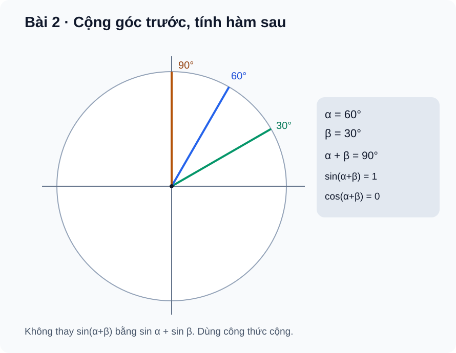

# Bài 2. Công thức lượng giác

TOÁN 11 · CHƯƠNG I

Công thức cộng, góc nhân đôi và hai phép biến đổi tích–tổng để tính toán, giải thích hiện tượng có tính chu kì.

<nav class="thpt-r4-lesson-tabs"><a href="../">Chương I</a><a href="../luyen-tap/">Core và Luyện tập</a><a href="../tu-kiem-tra-chuong/">Tự kiểm tra cuối chương</a></nav>

=== "Khám phá kiến thức"

    Khi hai tín hiệu âm có dạng \(5\sin t\) và \(5\cos t\) phát đồng thời, ta nghe âm tổng hợp. Làm thế nào mô tả tổng này bằng **một sóng sin** để biết biên độ và pha? Câu hỏi mở đầu SGK cho thấy: phải có những công thức biến đổi lượng giác, chứ không chỉ tính sin và cos riêng lẻ.

    Em đã biết đường tròn lượng giác, \(\sin\), \(\cos\), \(\tan\), các góc đặc biệt và hệ thức \(\sin^2u+\cos^2u=1\) ở Bài 1. Bài 2 xây dựng bốn nhóm công cụ liên hệ với nhau: **công thức cộng → góc nhân đôi → tích thành tổng → tổng thành tích**. Trước khi dùng một công thức, hãy nhận ra cấu trúc biểu thức và kiểm điều kiện xác định.

    ### 1.1. Vì sao không cộng hai giá trị sin?

    Hai góc \(60^\circ\) và \(30^\circ\) ghép thành \(90^\circ\), nhưng \(\sin60^\circ+\sin30^\circ\) không phải \(\sin90^\circ\): bên trái là **tổng hai tung độ**, bên phải là **tung độ của tia ở góc tổng**. Công thức cộng phải có các tích chéo của sin và cos để mô tả sự quay.

    <figure class="thpt-r4-plot"><figcaption>Đọc tia 60° rồi tia 90°: ghép thêm 30° tạo góc 90°. Hình minh họa phép ghép góc, không biểu diễn phép cộng các tung độ sin.</figcaption></figure>

    **Vận dụng.** Tính \(\cos(60^\circ+30^\circ)\). Kết quả có bằng \(\cos60^\circ+\cos30^\circ\) không? Hãy dự đoán trước khi tính.

    

    ??? question "Đối chiếu"

        **Kết quả:** \(\cos90^\circ=0\), còn \(\cos60^\circ+\cos30^\circ=\frac{1+\sqrt3}{2}>0\), nên không bằng nhau.

        **Vì sao:** \(\cos(u+v)=\cos u\cos v-\sin u\sin v\). Thay hai giá trị góc vào cho \(0\); không được phân phối hàm cos qua dấu cộng.

    

    ??? tip "Kiểm lỗi"

        **Dấu hiệu:** Em cộng \(\cos60^\circ+\cos30^\circ\) để tìm cos của góc tổng.

        **Tự sửa:** Chỉ góc tổng trên hình rồi áp dụng công thức cộng với hai tích \(\cos u\cos v\) và \(\sin u\sin v\). Dùng ngay \(\cos90^\circ=0\) làm phép kiểm lại. Luyện lại công thức cộng ở Core của Bài 2.

    ### 1.2. Vì sao có công thức góc nhân đôi?

    Nếu trong công thức cộng đặt hai góc bằng nhau, \(u+u=2u\), các tích xuất hiện thành bình phương hoặc tích đôi. Ta **suy ra** công thức nhân đôi, không cần học như một bảng không liên hệ. Nếu chỉ biết một giá trị sin/cos của \(u\), hãy xác định dấu giá trị còn lại từ góc phần tư trước khi thay.

    **Vận dụng.** Cho \(\sin u=\frac35\), \(\cos u=\frac45\). Tính \(\sin2u\) và \(\cos2u\).

    

    ??? question "Đối chiếu"

        **Kết quả:** \(\sin2u=2\cdot\frac35\cdot\frac45=\frac{24}{25}\); \(\cos2u=(\frac45)^2-(\frac35)^2=\frac7{25}\).

        **Kiểm lại:** \((24/25)^2+(7/25)^2=1\). Hai kết quả có cùng góc \(2u\), nên phải thỏa hệ thức lượng giác cơ bản.

    

    ??? tip "Kiểm lỗi"

        **Dấu hiệu:** Em dùng \(\sin2u=2\sin u\) hoặc \(\cos2u=2\cos u\).

        **Tự sửa:** Quay lại \(\sin(u+u)\) và \(\cos(u+u)\), thay đủ cả sin và cos, rồi kiểm \(\sin^22u+\cos^22u=1\). Tập tiếp ở mục công thức nhân đôi và Core Bài 2.

    ### 1.3. Khi biểu thức là tích, vì sao nên đổi thành tổng?

    Với \(2\cos u\cos v\), cộng hai công thức \(\cos(u-v)\) và \(\cos(u+v)\) sẽ triệt tiêu tích sin. Vì vậy **tích hai cos** có thể đổi thành **tổng hai cos**, rất hữu ích khi \(u+v\) hay \(u-v\) là góc đặc biệt.

    **Vận dụng.** Tính \(2\sin75^\circ\sin15^\circ\) mà không dùng máy tính.

    

    ??? question "Đối chiếu"

        **Kết quả:** \(2\sin75^\circ\sin15^\circ=\cos60^\circ-\cos90^\circ=\frac12\).

        **Lý do chọn cách:** Nhìn đầu vào là tích sin·sin; hiệu hai góc \(75^\circ-15^\circ\) và tổng \(75^\circ+15^\circ\) đều có giá trị lượng giác biết ngay.

    

    ??? tip "Kiểm lỗi"

        **Dấu hiệu:** Em viết \(\cos(u+v)-\cos(u-v)\), khiến kết quả bị đổi dấu.

        **Tự sửa:** Viết lại theo thứ tự **cos hiệu trừ cos tổng**, rồi thử \(u=v\) để thấy kết quả không được âm vì \(2\sin^2u\ge0\). Trở lại mục 2.3 và luyện một tích cos·cos khác.

    ### 1.4. Khi biểu thức là tổng, vì sao xuất hiện nửa tổng và nửa hiệu?

    Muốn đổi \(\sin u+\sin v\) thành tích, hãy đặt \(a=(u+v)/2\), \(b=(u-v)/2\). Khi đó \(a+b=u\), \(a-b=v\), nên có thể áp dụng công thức cộng và rút gọn. **Nửa tổng / nửa hiệu** là cách tìm hai góc phụ trợ phù hợp, không phải mẹo nhớ máy móc.

    **Vận dụng.** Tính \(\sin75^\circ-\sin15^\circ\) bằng công thức tổng thành tích.

    

    ??? question "Đối chiếu"

        **Kết quả:** \(2\cos45^\circ\sin30^\circ=\frac{\sqrt2}{2}\).

        **Vì sao:** Nửa tổng của \(75^\circ,15^\circ\) là \(45^\circ\), nửa hiệu là \(30^\circ\); công thức hiệu hai sin có thứ tự \(\cos\) rồi \(\sin\).

    

    ??? tip "Kiểm lỗi"

        **Dấu hiệu:** Em thay \(75^\circ+15^\circ=90^\circ\) và \(75^\circ-15^\circ=60^\circ\) trực tiếp, quên chia hai.

        **Tự sửa:** Lập hai ô \((u+v)/2\), \((u-v)/2\), tự nhân trở lại để kiểm góc ban đầu. Ôn lại mục 2.4 và luyện một cặp cos.

    **Ứng dụng thực tế: từ tổng hai âm đến tín hiệu của một phím điện thoại.**

    Một phím trên bàn phím điện thoại có thể được nhận diện qua **hai tần số âm** phát cùng lúc. Đây là lúc phép biến đổi tổng thành tích có ý nghĩa: thay vì hai sóng riêng, ta mô tả tín hiệu tổng bằng tích của một dao động nhanh và một hệ số biến thiên theo thời gian.

    Với **phím 4**, dữ kiện cần đọc là:

    | Âm thứ nhất | Âm thứ hai |
    | --- | --- |
    | Tần số thấp: **770 Hz** | Tần số cao: **1209 Hz** |

    Nếu mỗi thành phần có dạng \(\sin(2\pi ft)\) (với \(t\) tính bằng giây), hãy thử **tự lập hàm tín hiệu** rồi mới biến đổi. Khi tìm nửa hiệu, em sẽ gặp một góc âm; hãy nhớ cos là hàm chẵn.

    **Vận dụng.** Lập \(y(t)\) là tổng hai tín hiệu ứng với phím 4, sau đó viết \(y(t)\) thành tích của một hàm sin và một hàm cos. Vì sao biểu thức mới không làm thay đổi âm tổng hợp?

    

    ??? question "Đối chiếu"

        **Lập tín hiệu:** \(y(t)=\sin(1540\pi t)+\sin(2418\pi t)\). Hai hệ số \(1540\pi\) và \(2418\pi\) đến từ \(2\pi f\), không phải các tần số tính bằng Hz.

        **Đổi tổng thành tích:** Đặt \(u=1540\pi t\), \(v=2418\pi t\). Khi đó \((u+v)/2=1979\pi t\), \((u-v)/2=-439\pi t\), nên
        \[
        y(t)=2\sin(1979\pi t)\cos(-439\pi t)
            =2\sin(1979\pi t)\cos(439\pi t).
        \]

        **Kiểm lại:** Đây là một đồng nhất thức lượng giác đúng với mọi \(t\), nên hai cách viết mô tả **cùng tín hiệu**, chứ không tạo ra một âm mới.

    

    ??? tip "Kiểm lỗi"

        **Dấu hiệu:** Em đổi tổng hai sin thành sin nhân sin, hoặc lấy \(770+1209=1979\) làm tần số mới mà bỏ qua hệ số \(2\pi\).

        **Tự sửa:** Viết đúng \(\sin u+\sin v=2\sin\frac{u+v}{2}\cos\frac{u-v}{2}\), ghi cả hai góc \(u,v\) rồi mới chia hai. Kiểm \(\cos(-z)=\cos z\), sau đó trở về mục 2.4 và luyện lại dạng tổng hai sin trong Core/Luyện tập.

=== "Kiến thức SGK"

    Bốn nhóm công thức cho phép chuyển qua lại giữa góc tổng, góc nhân đôi, tích và tổng các giá trị lượng giác. Việc chọn chiều biến đổi phụ thuộc cấu trúc biểu thức và điều kiện xác định.

    ### 2.1. Công thức cộng và trừ

    Công thức nền có thể được nhìn từ tích vô hướng hai vectơ đơn vị: \(\cos(u-v)=\cos u\cos v+\sin u\sin v\). Đổi \(v\) thành \(-v\), dùng tính chẵn/lẻ của cos và sin, rồi suy ra các công thức còn lại. Hình phía dưới giúp đọc vị trí tia cuối, **không thay thế phép chứng minh**.

    <figure class="thpt-r4-plot"><figcaption>Góc tạo thành đo được bằng phép cộng số đo có hướng; tọa độ sin/cos của tia mới phải theo công thức cộng.</figcaption></figure>

    
<strong>Ý nghĩa:</strong> \(\sin(u+v)\) và \(\cos(u+v)\) là giá trị tại **một góc mới**, không phải tổng của hai giá trị hàm.

    
<strong>Công thức:</strong>

    \[
    \begin{aligned}
    \cos(u-v)&=\cos u\cos v+\sin u\sin v,\\
    \cos(u+v)&=\cos u\cos v-\sin u\sin v,\\
    \sin(u-v)&=\sin u\cos v-\cos u\sin v,\\
    \sin(u+v)&=\sin u\cos v+\cos u\sin v.
    \end{aligned}
    \]

    \[
    \tan(u\pm v)=\frac{\tan u\pm\tan v}{1\mp\tan u\tan v}.
    \]

    

    **Điều kiện:** Với \(u,v\in\mathbb R\), sin/cos luôn xác định. Công thức tan ở dạng tỉ số chỉ dùng khi \(\cos u\ne0\), \(\cos v\ne0\) và \(1\mp\tan u\tan v\ne0\); nếu không, phải xét sin/cos của góc tổng/hiệu trực tiếp.

    **Chọn cách:** Khi gặp \(75^\circ=45^\circ+30^\circ\), chọn công thức cộng. Nếu góc là hiệu, chọn công thức trừ và kiểm dấu hai tích trước khi thay số.

    ### 2.2. Công thức nhân đôi và hạ bậc

    Lấy \(v=u\) trong công thức cộng thì có \(\sin 2u\), \(\cos2u\). Từ hệ thức \(\sin^2u+\cos^2u=1\) có hai cách viết lại cos góc nhân đôi. Giải ngược các biểu thức bình phương theo \(\cos 2u\) cho **công thức hạ bậc**.

    
<strong>Công thức:</strong>

    \[
    \begin{aligned}
    \sin2u&=2\sin u\cos u,\\
    \cos2u&=\cos^2u-\sin^2u\\
           &=2\cos^2u-1=1-2\sin^2u,\\
    \tan2u&=\frac{2\tan u}{1-\tan^2u}.
    \end{aligned}
    \]

    \[
    \cos^2u=\frac{1+\cos2u}{2},\qquad
    \sin^2u=\frac{1-\cos2u}{2}.
    \]

    

    **Giới hạn:** Công thức tan cần \(\cos u\ne0\) và \(1-\tan^2u\ne0\) (tương đương \(\tan2u\) xác định khi \(\tan u\) đã có nghĩa). Với \(\sin u\) hoặc \(\cos u\) suy ra từ bình phương, phải chọn dấu theo góc phần tư trước khi tính.

    **Vì sao chọn:** Khi đối số là \(2u\), nhận ra ngay dạng góc nhân đôi; khi biểu thức chứa \(\sin^2u\) hoặc \(\cos^2u\), hạ bậc có thể đổi bình phương thành \(\cos2u\).

    ### 2.3. Biến đổi tích thành tổng

    Cộng hoặc trừ hai công thức cho \(\cos(u-v)\) và \(\cos(u+v)\) sẽ làm mất một loại tích; với sin, cộng hai công thức sin tổng/hiệu làm mất một loại tích còn lại.

    
<strong>Công thức:</strong>

    \[
    \begin{aligned}
    2\cos u\cos v&=\cos(u-v)+\cos(u+v),\\
    2\sin u\sin v&=\cos(u-v)-\cos(u+v),\\
    2\sin u\cos v&=\sin(u+v)+\sin(u-v).
    \end{aligned}
    \]

    

    **Dùng khi:** Đầu vào là **tích**, đặc biệt hai góc có tổng/hiệu đặc biệt. Để biến đổi \(2\cos75^\circ\cos15^\circ\), thử các góc \(90^\circ\) và \(60^\circ\). Không tráo dấu ở tích sin·sin.

    ### 2.4. Biến đổi tổng thành tích

    Đặt \(a=(u+v)/2\), \(b=(u-v)/2\) rồi thay vào công thức tích thành tổng. Vì \(a+b=u\), \(a-b=v\), các góc phụ trợ tự xuất hiện dưới dạng **nửa tổng và nửa hiệu**.

    
<strong>Công thức:</strong>

    \[
    \begin{aligned}
    \cos u+\cos v&=2\cos\frac{u+v}{2}\cos\frac{u-v}{2},\\
    \cos u-\cos v&=-2\sin\frac{u+v}{2}\sin\frac{u-v}{2},\\
    \sin u+\sin v&=2\sin\frac{u+v}{2}\cos\frac{u-v}{2},\\
    \sin u-\sin v&=2\cos\frac{u+v}{2}\sin\frac{u-v}{2}.
    \end{aligned}
    \]

    

    **Dùng khi:** Bài có **tổng hoặc hiệu** hai hàm cùng loại, hoặc cần gộp hai sóng thành một tích. Nhớ xác định đơn vị góc thống nhất trước khi lấy nửa tổng/nửa hiệu.

    
<strong>Kiến thức cần nhớ:</strong> Công thức cộng là nguồn; nhân đôi đặt hai góc bằng nhau; tích thành tổng kết hợp hai công thức cộng; tổng thành tích đổi biến bằng nửa tổng/nửa hiệu. Chọn theo cấu trúc biểu thức và kiểm điều kiện tan.

    **Thuật ngữ:** công thức cộng, công thức nhân đôi, tích thành tổng, tổng thành tích. **Kỹ năng:** nhận dạng biểu thức, chọn công thức thích hợp, tính/biến đổi, kiểm dấu và điều kiện xác định.

=== "Ví dụ"

    Các ví dụ dưới đây dùng bộ dữ kiện khác nhau, giúp nhận ra **lý do chọn công thức** và kiểm lại kết quả. Hãy thử xác định loại công thức trước khi mở Luyện tập.

    ### 3.1. Tính sin của tổng hai góc

    

<strong>Đề bài:</strong> Tính \(\sin(\pi/3+\pi/6)\) không dùng máy tính.

    
<strong>Phân tích:</strong> Có tổng hai góc đặc biệt và cần sin của góc tổng, nên dùng công thức cộng. Có thể đối chiếu ngay với \(\sin(\pi/2)\).

    
<strong>Lời giải:</strong> \(\sin(\pi/3+\pi/6)=\sin(\pi/3)\cos(\pi/6)+\cos(\pi/3)\sin(\pi/6)=\frac{\sqrt3}{2}\frac{\sqrt3}{2}+\frac12\frac12=1\).

    
<strong>Kiểm lại:</strong> \(\pi/3+\pi/6=\pi/2\), \(\sin(\pi/2)=1\); khác với phép cộng hai giá trị sin riêng lẻ.

    ### 3.2. Chọn công thức nhân đôi

    

<strong>Đề bài:</strong> Biết \(\cos u=3/5\), \(\sin u=4/5\). Tính \(\cos2u,\sin2u\).

    
<strong>Phân tích:</strong> Đề cho hai giá trị ở góc \(u\), cần ở \(2u\), nên chọn công thức nhân đôi, không cần xác định số đo góc.

    
<strong>Lời giải:</strong> \(\cos2u=(3/5)^2-(4/5)^2=-7/25\). \(\sin2u=2(4/5)(3/5)=24/25\).

    
<strong>Kiểm lại:</strong> \((-7/25)^2+(24/25)^2=1\). Phép kiểm hệ thức cơ bản giúp phát hiện sai dấu hoặc thiếu hệ số hai.

    ### 3.3. Từ tích thành tổng

    

<strong>Đề bài:</strong> Không dùng máy tính, tính \(2\cos75^\circ\cos15^\circ\).

    
<strong>Phân tích:</strong> Đầu vào là tích cos·cos; hiệu \(60^\circ\), tổng \(90^\circ\) là các góc đặc biệt.

    
<strong>Lời giải:</strong> \(2\cos75^\circ\cos15^\circ=\cos60^\circ+\cos90^\circ=\frac12+0=\frac12\).

    
<strong>Kiểm lại:</strong> Cả \(\cos75^\circ\) và \(\cos15^\circ\) dương, tích phải dương; dấu cộng trong công thức cos·cos phù hợp.

    ### 3.4. Từ tổng thành tích

    

<strong>Đề bài:</strong> Không dùng máy tính, tính \(\cos75^\circ+\cos15^\circ\).

    
<strong>Phân tích:</strong> Đầu vào là tổng hai cos; nửa tổng \(45^\circ\), nửa hiệu \(30^\circ\) đều có giá trị quen thuộc.

    
<strong>Lời giải:</strong> \(\cos75^\circ+\cos15^\circ=2\cos45^\circ\cos30^\circ=2\frac{\sqrt2}{2}\frac{\sqrt3}{2}=\frac{\sqrt6}{2}\).

    
<strong>Kiểm lại:</strong> Hai số hạng ban đầu đều dương; kết quả \(\sqrt6/2\) dương và nhỏ hơn 2, phù hợp giới hạn của tổng hai cos.

    ### 3.5. Ứng dụng: gộp hai tín hiệu hình sin

    

<strong>Đề bài:</strong> Một tín hiệu tổng có \(f(t)=5\sin t+5\cos t\). Viết \(f(t)=k\sin(t+\varphi)\), xác định \(k>0\) và \(-\pi\le\varphi\le\pi\).

    
<strong>Phân tích:</strong> Muốn biến tổng sin và cos cùng đối số thành một sin, dùng \(\sin(t+\varphi)=\sin t\cos\varphi+\cos t\sin\varphi\); chọn pha sao cho hai hệ số trước sin và cos bằng nhau.

    
<strong>Lời giải:</strong> \(\sin(t+\pi/4)=\frac{\sqrt2}{2}\sin t+\frac{\sqrt2}{2}\cos t\). Vì vậy \(f(t)=5\sqrt2\sin(t+\pi/4)\), suy ra \(k=5\sqrt2\), \(\varphi=\pi/4\).

    
<strong>Kiểm lại:</strong> Khai triển vế phải thu đúng \(5\sin t+5\cos t\). Điều này giải quyết tình huống mở đầu SGK.

=== "Lỗi thường gặp"

    Hai lỗi dưới đây là **nhầm lẫn mang tính quy tắc**, gặp ở nhiều dạng tính toán/biến đổi. Còn nếu sai ở một Vận dụng cụ thể trong tab Khám phá kiến thức, hãy mở đúng khung **Kiểm lỗi** ngay dưới Đối chiếu của câu đó.

    

    ??? tip "4.1. Phân phối sai sin, cos qua phép cộng góc"

        **Dấu hiệu:** Viết \(\sin(u+v)=\sin u+\sin v\) hoặc \(\cos(u+v)=\cos u+\cos v\).

        **Vì sao sai:** Hàm lượng giác biến **một góc** thành một số; khi cộng góc, tọa độ điểm mới thay đổi theo cả sin và cos của hai góc. Không có luật phân phối qua dấu cộng.

        **Tự sửa:** Thử \(u=60^\circ,v=30^\circ\), tính trực tiếp \(\sin90^\circ=1\) rồi so với \((\sqrt3+1)/2\); viết lại công thức có tích chéo. Khi dùng tan, kiểm từng mẫu có khác 0.

        **Ôn và luyện:** Mục 2.1, Ví dụ 3.1; Core/Luyện tập Bài 2, các dạng tính giá trị lượng giác góc tổng/hiệu.

    

    ??? tip "4.2. Nhầm dấu tích–tổng hoặc quên nửa tổng/nửa hiệu"

        **Dấu hiệu:** Đổi \(2\sin u\sin v\) thành \(\cos(u+v)-\cos(u-v)\), hoặc viết \(\sin u+\sin v=2\sin(u+v)\cos(u-v)\).

        **Vì sao sai:** Tích sin·sin phải lấy **cos hiệu trừ cos tổng**; khi đổi tổng thành tích, hai góc phụ trợ có số đo là **nửa** tổng và nửa hiệu, không phải toàn bộ tổng/hiệu.

        **Tự sửa:** Xác định đầu vào là tích hay tổng, lập bảng \(u+v,u-v,(u+v)/2,(u-v)/2\). Thử \(u=v\) trong công thức tích sin·sin, và thay \(u=75^\circ,v=15^\circ\) để tự đối chiếu kết quả.

        **Ôn và luyện:** Mục 2.3–2.4, Ví dụ 3.3–3.4, Core/Luyện tập Bài 2.

    **Học tiếp:** [Core và Luyện tập](../luyen-tap/) · [Tự kiểm tra cuối chương](../tu-kiem-tra-chuong/) · [Tự luận Chương I](../../../../thu-vien/tu-luan-g11-chuong-i-b01-b02/).

    
Nguồn tham khảo: SGK Toán 11 – Kết nối tri thức với cuộc sống, tập một, Bài 2 (trang in 17–21).

