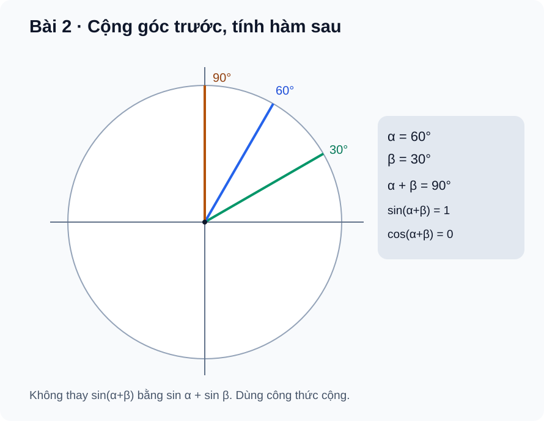

# Bài 2. Công thức lượng giác

TOÁN 11 · CHƯƠNG I · SGK KẾT NỐI TRI THỨC

Học theo SGK từng bước: kiến thức, ví dụ, luyện tập và tự khắc phục lỗi. Chương I gồm Bài 1–4; Bài tự kiểm tra cuối chương chỉ hỗ trợ tự đối chiếu sau Final Submit, không ghi điểm thành thạo.

<nav class="thpt-r4-lesson-tabs"><a href="../">Chương I</a><a href="../luyen-tap/">Core và Luyện tập</a><a href="../tu-kiem-tra-chuong/">Tự kiểm tra · tự đối chiếu</a></nav>

=== "Khám phá kiến thức"

    ### Cùng tìm hiểu

    **Vấn đề:** Em biết sin 30° và sin 45°, nhưng muốn tìm **sin 75°** mà không có bảng thì làm sao? Biểu thức sin(30°+45°) là một giá trị ứng với **một góc 75°**, không phải tổng hai độ cao sin 30° + sin 45°. Ta cần quy tắc liên hệ giá trị của góc tổng với các giá trị đã biết.

    **Gợi nhớ Bài 1:** Với điểm trên đường tròn đơn vị M(u)=(cos u,sin u), N(v)=(cos v,sin v), **tích vô hướng** hai vectơ đơn vị OM,ON tính theo tọa độ là cos u cos v + sin u sin v; tính theo góc lệch là cos(u−v). Từ đó nhìn thấy nguồn gốc **cos(u−v)=cos u cos v + sin u sin v**. Đổi v thành −v cho công thức cos(u+v), rồi dùng liên hệ sin x=cos(π/2−x) để thu được công thức sin của tổng/hiệu. Đây là lý do các **tích chéo** xuất hiện thay cho cộng trực tiếp sin/cos.

    **Từ nguyên lý đến công cụ:** Đặt v=u sẽ dẫn đến công thức góc nhân đôi. Cộng/trừ cặp công thức cos(u−v), cos(u+v) sẽ xuất hiện tích thành tổng; đảo hướng với nửa tổng/nửa hiệu suy ra tổng thành tích. Trong bài toán phải kiểm **đơn vị góc** thống nhất; với công thức tan cần từng tan xác định và mẫu cuối khác 0. Nhờ vậy học sinh phân biệt đúng lúc dùng dạng sin/cos thay vì chia cho biểu thức có thể bằng 0.

    **Tự kiểm trực giác:** sin(30°+60°)=sin90°=1, còn sin30°+sin60°>1; hai cách cho kết quả khác nhau. Hãy giải thích bằng quan hệ “giá trị của góc tổng” chứ không học thuộc quy tắc dấu một cách tách rời.

    ### Ví dụ trực quan

    Khi ghép hai góc quay liên tiếp, tọa độ điểm cuối thay đổi theo cả hai góc. Vì vậy sin của tổng không thể tính bằng cách cộng hai giá trị sin riêng rẽ.

    **Quan sát bằng số liệu:** Với hai góc 30° và 30°, sin(60°)=√3/2, trong khi sin(30°)+sin(30°)=1. Sai khác này cho thấy phải dùng công thức cộng có đủ sin và cos.

    ### Thuật ngữ và kiến thức, kỹ năng

    **Thuật ngữ:** công thức cộng, nhân đôi, tích thành tổng, tổng thành tích.

    **Sau bài học, em cần:** nhận dạng dạng biểu thức, chọn công thức phù hợp và kiểm dấu ở góc đặc biệt.

=== "Kiến thức SGK"

    

    ### 1.1. Công thức cộng và trừ

    **Công thức cos**

    \[
    cos(u±v)=cosu cosv ∓ sinu sinv
    \]

    **Công thức sin**

    \[
    sin(u±v)=sinu cosv ± cosu sinv
    \]

    Các biểu thức sin,cos luôn xác định với u,v thực.

    **Lỗi cần tránh:** Không thay \(sin(u+v)\) bằng \(sin u+sin v\).

    **Công thức tan**

    \[
    tan(u±v)=(tan u±tan v)/(1∓tan u tan v)
    \]

    **Điều kiện áp dụng:** Cần **tan u, tan v đều xác định** và mẫu số khác 0; nếu không, nên dùng sin/cos trực tiếp.

    ### 1.2. Công thức nhân đôi

    **Sin của góc nhân đôi**

    \[
    sin2u=2sin u cos u
    \]

    **Cos của góc nhân đôi**

    \[
    cos2u=cos²u−sin²u=2cos²u−1=1−2sin²u
    \]

    **Tan của góc nhân đôi**

    \[
    tan2u=2tan u/(1−tan²u)
    \]

    **Điều kiện áp dụng:** Chỉ khi mọi giá trị tan trong biểu thức xác định và \(1−tan²u≠0\).

    ### 1.3. Tích thành tổng

    **Tích sin · sin**

    \[
    2sin u sin v=cos(u−v)−cos(u+v)
    \]

    **Tích cos · cos**

    \[
    2cosu cosv=cos(u−v)+cos(u+v)
    \]

    **Tích sin · cos**

    \[
    2sin u cos v=sin(u+v)+sin(u−v)
    \]

    **Lưu ý về dấu:** Quy tắc dấu không tự hoán đổi giữa sin·sin và cos·cos.

    ### 1.4. Tổng thành tích

    **Tổng và hiệu hai sin**

    \[
    sin u+sin v=2sin((u+v)/2)cos((u−v)/2)
    \]

    \[
    sin u−sin v=2cos((u+v)/2)sin((u−v)/2)
    \]

    **Tổng và hiệu hai cos**

    \[
    cos u+cos v=2cos((u+v)/2)cos((u−v)/2)
    \]

    \[
    cos u−cos v=−2sin((u+v)/2)sin((u−v)/2)
    \]

    **Điểm cần nhớ:** Phải dùng **nửa tổng / nửa hiệu**, không phải tổng / hiệu đơn thuần.

    ### Đọc hình và đối chiếu khái niệm

    <figure class="thpt-r4-plot thpt-r4-probability-figure"><figcaption>Các tia tạo góc 30°, 60° và 90° minh họa công thức cộng.</figcaption></figure>

    ### Hướng dẫn đọc hình, đồ thị

    - **Hình minh họa:** đọc lần lượt các tia biểu diễn góc 30°, 60°, 90° trên cùng đường tròn; phép ghép góc 30°+60° cho góc 90° nhưng không phải phép cộng trực tiếp **tọa độ tung sin**. Hình giúp nhận ra điều cần giải thích bằng công thức cộng; không khẳng định hình tự biểu diễn đầy đủ chứng minh tích vô hướng.

    ### Vận dụng — tự thử rồi mở đối chiếu

    Em dự đoán sin(30°+60°) có bằng sin30°+sin60° không? Vì sao?

    

Đã thử xong? Mở hướng dẫn đối chiếu

    Không. sin90°=1, còn sin30°+sin60°=(1+√3)/2 > 1. Hãy trở lại phần lý do cần công thức cộng và Ví dụ 1, rồi làm câu Core đầu tiên của bài.

    

=== "Ví dụ"

    ### Ví dụ 1.

    Tính \(sin(π/3+π/6)=sinπ/2=1\). Theo công thức cộng: \((√3/2)(√3/2)+(1/2)(1/2)=1\). Trong khi \(sinπ/3+sinπ/6=(√3+1)/2\), khác 1: đây là hai biểu thức khác nhau. FIG02 mô tả ba tia tại 30°, 60°, 90°.

    ### Ví dụ 2.

    Nếu \(cos u=3/5\), \(sin u=4/5\), thì \(cos2u=9/25−16/25=−7/25\), \(sin2u=24/25\). Dấu phụ thuộc vị trí của 2u, không chỉ của u; tự kiểm \((−7/25)²+(24/25)²=1\).

    ### Ví dụ 3.

    \(2cos75° cos15°=cos90°+cos60°=1/2\). Không được lấy sin75°·sin15° và cho cùng công thức cộng dấu “+”.

    ### Ví dụ 4.

    \(cos75°+cos15°=2cos45°cos30°=√6/2\). Với các góc cho bằng độ, toàn bộ biểu thức phải dùng độ; tránh lẫn \(π\) rad với số đo độ trong cùng phép tính không đổi đơn vị.

    ### Vì sao chọn phương pháp?

    - **Ví dụ 01:** kiểm bằng góc cộng 60°+30° trước, sau đó dùng công thức sin(u+v), so với **sai lầm** sin u+sin v.
    - **Ví dụ 02:** chọn công thức nhân đôi vì đối số là 2u; kiểm lại sin²2u+cos²2u=1 để phát hiện lỗi dấu.
    - **Ví dụ 03:** nhìn thấy tích 2cos75°cos15° nên chọn **tích thành tổng** cos(u−v)+cos(u+v), không thay nhầm công thức sin·sin.
    - **Ví dụ 04:** muốn đổi tổng cos75°+cos15° thì dùng **nửa tổng và nửa hiệu**; kiểm các góc ban đầu đang dùng độ, không trộn độ với radian.

=== "Lỗi thường gặp"

    

Biến sin(u+v) thành sin u+sin v
<ul><li>**Dấu hiệu:** Nhầm tên hàm bên ngoài phép cộng với phép cộng hai giá trị lượng giác.  </li>
    <li>**Bản chất:** <code>sin(u+v)=sin u cos v+cos u sin v</code> chứ không phải <code>sin u+sin v</code>; tương tự cos(u+v) có dấu trừ ở tích sin.  </li>
    <li>**Tự sửa:** thử phản ví dụ u=60°, v=30°; lập bảng hai vế, viết công thức chuẩn, kiểm tính đúng bằng tính trực tiếp góc 90°.  </li>
    <li>**Ôn:** SGK Bài 2 công thức cộng; bảng sin/cos của góc đặc biệt.  </li>
    <li>**Quay lại item:** <code>THPT-G11-B02-C01</code>, <code>THPT-G11-B02-P01</code>, <code>THPT-G11-B02-P03</code>.</li></ul>
<a href="../luyen-tap/">Về Luyện tập</a>

    

Đảo dấu tích thành tổng, quên nửa tổng/nửa hiệu
<ul><li>**Dấu hiệu:** Viết <code>2sin u sin v=cos(u+v)-cos(u-v)</code> hoặc <code>sin u+sin v=2sin(u+v)cos(u-v)</code>.  </li>
    <li>**Bản chất:** Với tích sin·sin, cos hiệu trừ cos tổng; với tổng thành tích phải lấy <code>(u±v)/2</code>.  </li>
    <li>**Tự sửa:** nhận dạng đầu vào là tích hay tổng; ghi đúng công thức, thử u=75°,v=15°, so sánh kết quả số; dùng biểu thức đối xứng để tránh lẫn dấu.  </li>
    <li>**Ôn:** SGK Bài 2 mục công thức biến đổi.  </li>
    <li>**Quay lại item:** <code>THPT-G11-B02-P04</code>, <code>THPT-G11-B02-P05</code>, <code>THPT-G11-CHI-W02-ANCHOR</code>.</li></ul>
<a href="../luyen-tap/">Về Luyện tập</a>

    ### Học tiếp

    [Core và Luyện tập Bài 2](luyen-tap.md) · [Tự luận Chương I](../../../thu-vien/tu-luan-g11-chuong-i-b01-b02.md)
