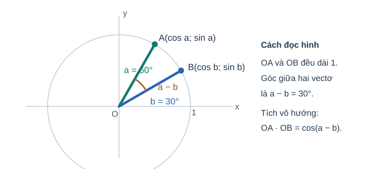

# Bài 2. Công thức lượng giác

TOÁN 11 · CHƯƠNG I · KẾT NỐI TRI THỨC

Từ hai góc đã biết đến góc tổng, góc hiệu; hiểu cách các công thức lượng giác được hình thành và dùng chúng để tính toán, biến đổi, mô tả tín hiệu tuần hoàn.

<nav class="thpt-r4-lesson-tabs"><a href="../">Chương I</a><a href="../luyen-tap/">Core và Luyện tập</a><a href="../tu-kiem-tra-chuong/">Tự kiểm tra cuối chương</a></nav>

=== "Khám phá kiến thức"

    Ở Bài 1, em đã biết cách đọc sin, cos của một góc trên đường tròn lượng giác, biết giá trị của các góc đặc biệt và hệ thức \(\sin^2x+\cos^2x=1\). Nhưng nếu cần tính \(\sin75^\circ\), ta không thể tra trực tiếp từ bảng \(30^\circ,45^\circ,60^\circ\). Điều đáng chú ý là \(75^\circ=45^\circ+30^\circ\): liệu có thể dùng những giá trị **đã biết** để tìm giá trị của một **góc mới**?

    SGK còn đặt một câu hỏi từ âm thanh: hai tín hiệu \(5\sin t\) và \(5\cos t\) kết hợp thành \(f(t)=5\sin t+5\cos t\). Chúng cùng dao động theo một biến thời gian nhưng lệch pha; làm thế nào biết biên độ và pha của âm tổng hợp? Nếu chỉ cộng riêng hai biên độ, ta sẽ không thấy được sự lệch pha ấy. Để giải bài toán, trước hết ta phải hiểu cách lượng giác của **hai góc** liên hệ với lượng giác của **tổng hoặc hiệu hai góc**.

    ### 1.1. Từ góc hiệu đến công thức cộng

    Trên đường tròn đơn vị, điểm ứng với góc \(a\) có tọa độ \(A(\cos a;\sin a)\), còn điểm ứng với góc \(b\) có tọa độ \(B(\cos b;\sin b)\). Hai vectơ \(\overrightarrow{OA}\) và \(\overrightarrow{OB}\) đều dài \(1\). Vì thế, nếu tính tích vô hướng theo **tọa độ**, ta được

    \[
    \overrightarrow{OA}\cdot\overrightarrow{OB}
      =\cos a\cos b+\sin a\sin b.
    \]

    Mặt khác, tính theo **góc giữa hai vectơ** cho \(\overrightarrow{OA}\cdot\overrightarrow{OB}=\cos(a-b)\). Hai cách tính cùng một đại lượng phải bằng nhau, nên

    \[
    \boxed{\cos(a-b)=\cos a\cos b+\sin a\sin b.}
    \]

    Đây là điểm xuất phát quan trọng: công thức của góc hiệu xuất hiện từ hình học, không phải quy tắc tùy ý cần học thuộc.

    <figure class="thpt-r4-plot"><figcaption><strong>Đọc hình:</strong> xác định hai tia \(OA,OB\), đọc góc \(a,b\) từ trục \(Ox\), rồi nhìn góc giữa hai tia là \(a-b\). Hình minh họa trường hợp \(a=60^\circ,b=30^\circ\); lập luận bằng tích vô hướng ở trên mới giải thích công thức cho mọi góc thực.</figcaption></figure>

    Vậy còn góc **tổng** thì sao? Thay \(b\) bởi \(-b\) trong công thức vừa tìm được. Vì \(\cos(-b)=\cos b\) và \(\sin(-b)=-\sin b\), ta nhận được

    \[
    \cos(a+b)=\cos a\cos b-\sin a\sin b.
    \]

    Với sin, ta dùng \(\sin x=\cos\left(\dfrac{\pi}{2}-x\right)\). Thay các góc phù hợp vào công thức cos sẽ cho

    \[
    \sin(a+b)=\sin a\cos b+\cos a\sin b,\qquad
    \sin(a-b)=\sin a\cos b-\cos a\sin b.
    \]

    Em hãy so sánh hai công thức cos: **cos hiệu mang dấu cộng**, còn **cos tổng mang dấu trừ** trước tích hai sin. Với sin thì phải giữ đúng vị trí hai tích chéo. Đặc biệt, \(\sin(a+b)\) không bằng \(\sin a+\sin b\): hàm sin của góc mới **không phân phối** qua dấu cộng.

    **Vận dụng.** Không dùng máy tính, tính \(\cos15^\circ\) bằng cách viết \(15^\circ=45^\circ-30^\circ\).

    ??? question "Đối chiếu"

        **Lời giải:** \(\cos15^\circ=\cos45^\circ\cos30^\circ+\sin45^\circ\sin30^\circ=\dfrac{\sqrt2}{2}\cdot\dfrac{\sqrt3}{2}+\dfrac{\sqrt2}{2}\cdot\dfrac12=\dfrac{\sqrt6+\sqrt2}{4}\).

        **Kiểm lại:** \(15^\circ\) thuộc góc phần tư I, nên kết quả phải dương và nhỏ hơn \(1\); \((\sqrt6+\sqrt2)/4\approx0{,}966\) thỏa điều đó.

    ??? tip "Kiểm lỗi"

        Nếu em dùng dấu trừ trong công thức \(\cos(a-b)\), hãy viết trước hai công thức \(\cos(a+b)\) và \(\cos(a-b)\) cạnh nhau. Dùng phép kiểm \(\cos(a-a)=1\): biểu thức đúng là \(\cos^2a+\sin^2a=1\), không phải hiệu hai bình phương.

    ### 1.2. Khi hai góc bằng nhau: công thức nhân đôi

    Trong công thức cộng, nếu góc thứ hai cũng bằng \(a\), thì \(a+a=2a\). Không cần xây dựng một công thức hoàn toàn mới: ta chỉ thay \(b=a\).

    \[
    \sin2a=2\sin a\cos a,\qquad
    \cos2a=\cos^2a-\sin^2a.
    \]

    Từ \(\sin^2a+\cos^2a=1\), cùng biểu thức \(\cos2a\) còn viết được thành \(2\cos^2a-1\) hoặc \(1-2\sin^2a\). Ba cách viết này **có cùng giá trị**, nhưng hữu ích trong những tình huống khác nhau: biết cos thì dùng dạng chứa cos; biết sin thì dùng dạng chứa sin.

    Chẳng hạn, nếu \(\sin a=\frac45\), muốn tính \(\cos2a\) ta có thể dùng ngay \(1-2\sin^2a\), không cần đi tìm \(\cos a\). Ngược lại, để tính \(\sin2a\), em vẫn cần cả sin và cos của \(a\); nếu phải lấy căn từ \(\sin^2a+\cos^2a=1\), hãy xác định **dấu theo góc phần tư** trước khi thay số.

    Khi cả \(\tan a\) và \(\tan2a\) xác định, chia công thức \(\sin2a\) cho \(\cos2a\) dẫn đến \(\tan2a=\dfrac{2\tan a}{1-\tan^2a}\). Điều kiện của phép chia không thể bỏ qua.

    **Vận dụng.** Biết \(\cos a=-\dfrac5{13}\) và \(\dfrac{\pi}{2}<a<\pi\). Tìm \(\sin2a\) và \(\cos2a\).

    ??? question "Đối chiếu"

        **Lời giải:** Vì \(a\) ở góc phần tư II nên \(\sin a>0\). Từ hệ thức cơ bản, \(\sin a=\sqrt{1-\frac{25}{169}}=\frac{12}{13}\). Do đó

        \[
        \sin2a=2\cdot\frac{12}{13}\cdot\left(-\frac5{13}\right)=-\frac{120}{169},
        \qquad
        \cos2a=2\left(-\frac5{13}\right)^2-1=-\frac{119}{169}.
        \]

        **Kiểm lại:** \(\dfrac{120^2+119^2}{169^2}=1\), phù hợp hệ thức \(\sin^22a+\cos^22a=1\).

    ??? tip "Kiểm lỗi"

        Nếu \(\sin2a\) ra số dương, hãy kiểm lại dấu của \(\cos a\). Bình phương làm mất dấu nên chỉ được kết luận \(\sin a=\sqrt{1-\cos^2a}\) sau khi đã biết \(a\) thuộc góc phần tư II.

    ### 1.3. Vì sao biến đổi được một tích thành tổng?

    Xét hai công thức \(\cos(a-b)\) và \(\cos(a+b)\). Khi **cộng** chúng, các tích \(\sin a\sin b\) trái dấu triệt tiêu, chỉ còn \(2\cos a\cos b\). Khi **lấy công thức hiệu trừ công thức tổng**, phần \(\cos a\cos b\) triệt tiêu, chỉ còn \(2\sin a\sin b\). Vì vậy:

    \[
    2\cos a\cos b=\cos(a-b)+\cos(a+b),
    \]

    \[
    2\sin a\sin b=\cos(a-b)-\cos(a+b).
    \]

    Tương tự, cộng và trừ hai công thức sin của tổng/hiệu sẽ cho cách biến \(\sin a\cos b\) thành tổng. Phép biến đổi này đặc biệt tiện khi hai góc \(a-b\) hoặc \(a+b\) là góc quen thuộc, dù bản thân \(a,b\) không dễ tính.

    **Vận dụng.** Không dùng máy tính, tính \(2\cos75^\circ\cos45^\circ\).

    ??? question "Đối chiếu"

        **Lời giải:** Từ công thức \(2\cos a\cos b=\cos(a-b)+\cos(a+b)\), ta có

        \[
        2\cos75^\circ\cos45^\circ
        =\cos30^\circ+\cos120^\circ
        =\frac{\sqrt3}{2}-\frac12
        =\frac{\sqrt3-1}{2}.
        \]

        **Kiểm lại:** Cả \(\cos75^\circ\) và \(\cos45^\circ\) đều dương nên tích phải dương, đúng với kết quả.

    ??? tip "Kiểm lỗi"

        Nếu viết \(\cos(a+b)-\cos(a-b)\) cho tích hai sin, em sẽ đổi dấu kết quả. Hãy trở lại **hai công thức cos cộng và trừ**, gạch những tích triệt tiêu để tự suy ra đúng thứ tự, thay vì học vẹt dấu.

    ### 1.4. Từ tổng về tích và trở lại bài toán âm thanh

    Chiều ngược lại cũng có ích. Với hai góc \(u,v\), hãy đặt \(a=\dfrac{u+v}{2}\), \(b=\dfrac{u-v}{2}\). Khi đó \(u=a+b\), \(v=a-b\). Thay vào các công thức ở phần trước rồi rút gọn, ta thu được, chẳng hạn,

    \[
    \sin u+\sin v
    =2\sin\frac{u+v}{2}\cos\frac{u-v}{2},
    \]

    \[
    \cos u+\cos v
    =2\cos\frac{u+v}{2}\cos\frac{u-v}{2}.
    \]

    Vì vậy, **nửa tổng và nửa hiệu** không phải hai con số tự xuất hiện trong công thức; đó là cách tìm hai góc \(a,b\) sao cho \(a+b=u\), \(a-b=v\). Hai công thức cho hiệu hai sin và hiệu hai cos cũng được suy ra bằng cách tương tự.

    **Vận dụng.** Không dùng máy tính, tính \(\sin75^\circ-\sin15^\circ\).

    ??? question "Đối chiếu"

        **Lời giải:** Dùng \(\sin u-\sin v=2\cos\dfrac{u+v}{2}\sin\dfrac{u-v}{2}\):

        \[
        \sin75^\circ-\sin15^\circ
        =2\cos45^\circ\sin30^\circ
        =\frac{\sqrt2}{2}.
        \]

        **Kiểm lại:** \(\sin75^\circ>\sin15^\circ\), nên hiệu phải dương. Nửa tổng bằng \(45^\circ\), nửa hiệu bằng \(30^\circ\), không phải \(90^\circ\) và \(60^\circ\).

    ??? tip "Kiểm lỗi"

        Nếu thiếu hệ số \(2\) hoặc quên chia đôi các góc, hãy đặt \(a=(u+v)/2,\ b=(u-v)/2\), rồi tự cộng/trừ để kiểm \(a+b=u,\ a-b=v\) trước khi áp dụng công thức.

    Bây giờ quay lại âm tổng hợp ở đầu bài. Hai tín hiệu \(5\sin t\) và \(5\cos t\) có cùng tần số góc và chỉ khác pha. Vì \(\cos t=\sin(t+\pi/2)\), ta có thể biến đổi tổng của chúng, hoặc trực tiếp dùng công thức \(\sin(t+\pi/4)\), để được

    \[
    5\sin t+5\cos t=5\sqrt2\sin\left(t+\frac{\pi}{4}\right).
    \]

    **Biên độ là \(5\sqrt2\), không phải \(10\)**; pha ban đầu là \(\pi/4\). Thử kiểm ở \(t=0\): cả hai vế đều bằng \(5\). Ở \(t=\pi/4\), tổng đạt \(5\sqrt2\), đúng với biên độ mới. Như vậy, công thức lượng giác giúp nhìn thấy cấu trúc của một hiện tượng chứ không chỉ rút gọn kí hiệu.

    Nếu hai âm có **tần số khác nhau**, công thức tổng thành tích vẫn đúng, nhưng nói chung không thể gọi kết quả là một sóng sin thuần với biên độ không đổi.

    **Vận dụng.** Hai tín hiệu được mô tả bởi \(y_1(t)=\sin(800\pi t)\) và \(y_2(t)=\sin(880\pi t)\), trong đó \(t\) tính bằng giây. Viết \(y(t)=y_1(t)+y_2(t)\) thành một tích, rồi cho biết vì sao chưa thể coi đó là một sóng sin duy nhất có biên độ không đổi.

    ??? question "Đối chiếu"

        **Lời giải:** Lấy \(u=800\pi t\), \(v=880\pi t\). Khi đó \((u+v)/2=840\pi t\), \((u-v)/2=-40\pi t\). Vì cos là hàm chẵn,

        \[
        y(t)=2\sin(840\pi t)\cos(40\pi t).
        \]

        Hệ số \(2\cos(40\pi t)\) **thay đổi theo thời gian**, nên không phải một biên độ cố định. Hai cách viết vẫn mô tả cùng một tín hiệu tổng hợp.

    ??? tip "Kiểm lỗi"

        Đừng lấy tổng hai tần số rồi coi đó là tần số của một sóng sin thuần. Hãy phân biệt **tích hai hàm biến thiên** với dạng \(A\sin(\omega t+\varphi)\) có các hằng số \(A,\omega,\varphi\).

=== "Kiến thức SGK"

    ### 2.1. Công thức cộng

    Cho \(a,b\) là hai góc thực. Mọi công thức dưới đây của sin và cos đều có nghĩa, không cần thêm điều kiện:

    
<strong>Công thức cộng</strong>
\(\cos(a-b)=\cos a\cos b+\sin a\sin b\)

\(\cos(a+b)=\cos a\cos b-\sin a\sin b\)

\(\sin(a-b)=\sin a\cos b-\cos a\sin b\)

\(\sin(a+b)=\sin a\cos b+\cos a\sin b\)

\(\tan(a-b)=\dfrac{\tan a-\tan b}{1+\tan a\tan b}\)

\(\tan(a+b)=\dfrac{\tan a+\tan b}{1-\tan a\tan b}\)

<strong>Điều kiện:</strong> hai công thức tan dạng phân số chỉ áp dụng khi \(\cos a\ne0\), \(\cos b\ne0\) và mẫu \(1\pm\tan a\tan b\) của từng công thức khác \(0\). Các công thức sin/cos đúng với mọi góc thực.

    Hai công thức tan là thương của các công thức sin/cos tương ứng. Chính vì có phép chia, **phải kiểm điều kiện xác định trước khi thay số**; không thể suy rằng công thức tan đúng tại mọi góc như các công thức sin/cos.

    **Ghi nhớ cách nhận diện:** Góc được viết như \(75^\circ=45^\circ+30^\circ\) hoặc \(15^\circ=45^\circ-30^\circ\) thường gợi ý công thức cộng/trừ.

    ### 2.2. Công thức nhân đôi

    
<strong>Công thức nhân đôi</strong>
\(\sin2a=2\sin a\cos a\)

\(\cos2a=\cos^2a-\sin^2a=2\cos^2a-1=1-2\sin^2a\)

\(\tan2a=\dfrac{2\tan a}{1-\tan^2a}\), khi \(\cos a\ne0\) và \(1-\tan^2a\ne0\).

    
<strong>Công thức hạ bậc (suy từ nhân đôi)</strong>
\(\cos^2a=\dfrac{1+\cos2a}{2},\qquad \sin^2a=\dfrac{1-\cos2a}{2}\).

Hai đẳng thức đúng với mọi \(a\in\mathbb R\), được suy trực tiếp từ \(\cos2a=2\cos^2a-1=1-2\sin^2a\).

    **Chọn cách:** Biết \(\sin a\) thì dạng \(1-2\sin^2a\) thuận tiện để tính \(\cos2a\); biết \(\cos a\) thì dùng \(2\cos^2a-1\). Muốn tính \(\sin2a\), phải xác định đúng dấu của cả \(\sin a\) và \(\cos a\).

    ### 2.3. Công thức biến đổi tích thành tổng

    
<strong>Công thức biến đổi tích thành tổng</strong>
\(2\cos a\cos b=\cos(a-b)+\cos(a+b)\)

\(2\sin a\sin b=\cos(a-b)-\cos(a+b)\)

\(2\sin a\cos b=\sin(a+b)+\sin(a-b)\)

Đúng với mọi góc thực \(a,b\); nếu cần dạng hệ số \(\tfrac12\), chia cả hai vế cho \(2\).

    Tương đương, \(\cos a\cos b=\dfrac{\cos(a-b)+\cos(a+b)}2\), và tương tự cho hai công thức còn lại. Các đẳng thức đúng với mọi \(a,b\in\mathbb R\).

    **Chọn cách:** Đầu bài là tích sin–sin, cos–cos hay sin–cos; góc tổng/hiệu dễ tính thì biến tích thành tổng. Đặc biệt lưu ý thứ tự **cos hiệu trừ cos tổng** ở tích hai sin.

    ### 2.4. Công thức biến đổi tổng thành tích

    
<strong>Công thức biến đổi tổng thành tích</strong>
\(\cos u+\cos v=2\cos\dfrac{u+v}{2}\cos\dfrac{u-v}{2}\)

\(\cos u-\cos v=-2\sin\dfrac{u+v}{2}\sin\dfrac{u-v}{2}\)

\(\sin u+\sin v=2\sin\dfrac{u+v}{2}\cos\dfrac{u-v}{2}\)

\(\sin u-\sin v=2\cos\dfrac{u+v}{2}\sin\dfrac{u-v}{2}\)

Đúng với mọi góc thực \(u,v\).

    Cả bốn công thức đúng với mọi \(u,v\in\mathbb R\). Hãy tính **nửa tổng và nửa hiệu** trước khi thay. Với cos, hiệu hai góc có thể âm nhưng \(\cos(-x)=\cos x\); với sin, dấu âm có thể làm đổi kết quả.

    Các công thức ở Bài 2 nối với nhau theo một mạch: **công thức cộng → nhân đôi bằng cách cho hai góc bằng nhau → tích thành tổng bằng cách cộng/trừ hai công thức → tổng thành tích bằng cách đổi biến hai góc**.

=== "Ví dụ"

    ### 3.1. Tìm giá trị lượng giác của góc chưa có trong bảng

    **Đề bài.** Không dùng máy tính, tính \(\sin105^\circ\) và \(\cos105^\circ\).

    **Phân tích:** \(105^\circ=60^\circ+45^\circ\). Hai góc thành phần đều có giá trị lượng giác đã biết nên dùng công thức cộng. Góc \(105^\circ\) ở góc phần tư II, vì vậy sin dương, cos âm; đây là cách kiểm dấu sau khi tính.

    

<strong>Lời giải.</strong> Ta có \(\sin105^\circ=\sin60^\circ\cos45^\circ+\cos60^\circ\sin45^\circ=\dfrac{\sqrt6+\sqrt2}{4}\).

Tương tự, \(\cos105^\circ=\cos60^\circ\cos45^\circ-\sin60^\circ\sin45^\circ=\dfrac{\sqrt2-\sqrt6}{4}\).

    **Kiểm lại:** Hai kết quả lần lượt dương và âm, đúng góc phần tư II. Bình phương rồi cộng chúng được \(1\), đúng hệ thức \(\sin^2x+\cos^2x=1\).

    ### 3.2. Tính góc nhân đôi khi phải xét dấu

    **Đề bài.** Biết \(\sin a=\dfrac35\) và \(\dfrac{\pi}{2}<a<\pi\). Tính \(\sin2a,\cos2a\) và \(\tan2a\).

    **Phân tích:** Để dùng công thức \(\sin2a\) cần tìm \(\cos a\). Vì \(a\) ở góc phần tư II nên \(\cos a<0\), không lấy căn dương. Sau khi tính \(\cos2a\), phải kiểm khác \(0\) mới được chia để tìm tan.

    

<strong>Lời giải.</strong> Ta có \(\cos a=-\sqrt{1-\frac9{25}}=-\frac45\). Do đó \(\sin2a=2\cdot\frac35\cdot(-\frac45)=-\frac{24}{25}\).

\(\cos2a=(-\frac45)^2-(\frac35)^2=\frac7{25}\ne0\), nên \(\tan2a=\dfrac{-24/25}{7/25}=-\dfrac{24}{7}\).

    **Kiểm lại:** \(\left(-\dfrac{24}{25}\right)^2+\left(\dfrac7{25}\right)^2=1\). Vì \(\cos2a\ne0\), giá trị tan vừa tính có nghĩa.

    ### 3.3. Hạ bậc thay vì tính góc trực tiếp

    **Đề bài.** Không dùng máy tính, tính \(\cos^215^\circ\).

    **Phân tích:** Tính riêng \(\cos15^\circ\) rồi bình phương sẽ dài. Vì \(2\cdot15^\circ=30^\circ\) là góc đặc biệt, công thức hạ bậc cho phép tính ngay \(\cos^215^\circ\).

    

<strong>Lời giải.</strong> \(\cos^215^\circ=\dfrac{1+\cos30^\circ}{2}=\dfrac{1+\frac{\sqrt3}{2}}{2}=\dfrac{2+\sqrt3}{4}\).

    **Kiểm lại:** Kết quả nằm giữa \(0\) và \(1\), đúng vì đây là bình phương của một giá trị cos. Không nhầm \(\cos^215^\circ\) với \(\cos30^\circ\).

    ### 3.4. Đổi tích thành tổng để tính nhanh

    **Đề bài.** Không dùng máy tính, tính \(2\sin75^\circ\sin15^\circ\).

    **Phân tích:** Đầu vào là tích sin–sin. Hai góc có hiệu \(60^\circ\) và tổng \(90^\circ\), đều rất dễ tính cos. Vì vậy dùng công thức **cos hiệu trừ cos tổng**.

    

<strong>Lời giải.</strong> \(2\sin75^\circ\sin15^\circ=\cos(75^\circ-15^\circ)-\cos(75^\circ+15^\circ)=\cos60^\circ-\cos90^\circ=\dfrac12\).

    **Kiểm lại:** Hai sin ban đầu đều dương, tích dương; kết quả \(\frac12\) hợp lý. Nếu đổi thứ tự phép trừ sẽ cho kết quả sai dấu.

    ### 3.5. Đổi tổng thành tích để xuất hiện góc quen thuộc

    **Đề bài.** Không dùng máy tính, tính \(\cos75^\circ+\cos15^\circ\).

    **Phân tích:** Đây là tổng hai cos, nên chọn công thức tổng thành tích. Nửa tổng bằng \(45^\circ\), nửa hiệu bằng \(30^\circ\), đều có giá trị lượng giác quen thuộc.

    

<strong>Lời giải.</strong> \(\cos75^\circ+\cos15^\circ=2\cos45^\circ\cos30^\circ=2\cdot\dfrac{\sqrt2}{2}\cdot\dfrac{\sqrt3}{2}=\dfrac{\sqrt6}{2}\).

    **Kiểm lại:** \(\cos75^\circ\approx0{,}259\), \(\cos15^\circ\approx0{,}966\), nên tổng khoảng \(1{,}225\), phù hợp \(\sqrt6/2\approx1{,}225\).

    ### 3.6. Một tổng tín hiệu trở thành một dao động cùng tần số

    **Đề bài.** Viết \(f(t)=5\sin t+5\cos t\) dưới dạng \(k\sin(t+\varphi)\), với \(k>0\) và \(-\pi\le\varphi\le\pi\). Xác định biên độ \(k\) và pha ban đầu \(\varphi\).

    **Phân tích:** Hai tín hiệu có **cùng tần số góc**, nên có thể chọn \(k,\varphi\) không đổi sao cho \(k\cos\varphi=5\) và \(k\sin\varphi=5\). Các hệ số bằng nhau gợi góc \(\varphi=\pi/4\).

    

<strong>Lời giải.</strong> Khai triển \(k\sin(t+\varphi)=k\cos\varphi\sin t+k\sin\varphi\cos t\). Để hai hệ số bằng \(5\), ta có \(k^2=(k\cos\varphi)^2+(k\sin\varphi)^2=5^2+5^2=50\).

Vì \(k>0\), suy ra \(k=5\sqrt2\). Lấy \(\cos\varphi=\sin\varphi=\sqrt2/2\) được \(\varphi=\pi/4\), đúng miền đã cho. Vậy \(f(t)=5\sqrt2\sin(t+\pi/4)\).

    **Kiểm lại:** Thay \(\varphi=\pi/4\) vào công thức cộng, hệ số của cả \(\sin t\) và \(\cos t\) đều bằng \(5\). Ở \(t=0\), hai vế đều bằng \(5\). Biên độ \(5\sqrt2\) **không phải** tổng \(5+5\).

=== "Lỗi thường gặp"

    ### 4.1. Cộng giá trị lượng giác như cộng số đo góc

    **Dấu hiệu:** Viết \(\sin(a+b)=\sin a+\sin b\), hoặc \(\cos(a+b)=\cos a+\cos b\).

    **Vì sao sai:** Sin, cos không phân phối qua dấu cộng. Chẳng hạn \(\sin(30^\circ+60^\circ)=1\), trong khi \(\sin30^\circ+\sin60^\circ=(1+\sqrt3)/2\ne1\).

    **Cách sửa:** Nhìn dấu cộng/trừ **nằm trong đối số**, rồi viết đủ hai tích theo công thức cộng. Có thể kiểm bằng cách chọn \(a=b\) trước khi dùng công thức.

    ### 4.2. Nhớ nhầm dấu, quên điều kiện của tan

    **Dấu hiệu:** Dùng dấu trừ cho \(\cos(a-b)\), hoặc tính \(\tan(a+b)\) khi \(1-\tan a\tan b=0\).

    **Vì sao sai:** Dấu của công thức cos tổng và cos hiệu đối nhau ở tích sin. Với tan, mẫu số bằng \(0\) thì tỉ số không xác định; chẳng hạn \(\tan(\pi/4+\pi/4)=\tan(\pi/2)\) không tồn tại.

    **Cách sửa:** Viết lại công thức từ \(\cos(a-b)\) rồi thay \(b\to-b\) khi cần. Với tan, kiểm \(\cos a,\cos b\) và mẫu số trước khi thay số.

    ### 4.3. Lấy căn dương dù góc nằm ở góc phần tư có cos âm

    **Dấu hiệu:** Từ \(\sin a=3/5\) và \(a\in(\pi/2,\pi)\) lại viết \(\cos a=4/5\).

    **Vì sao sai:** Hệ thức \(\sin^2a+\cos^2a=1\) chỉ cho bình phương, không tự xác định dấu. Cos ở góc phần tư II phải âm.

    **Cách sửa:** Xác định góc phần tư, ghi dấu của sin/cos, rồi mới lấy căn và dùng công thức nhân đôi.

    ### 4.4. Nhầm chiều biến đổi và quên nửa tổng, nửa hiệu

    **Dấu hiệu:** Đổi tích sin–sin thành cos tổng trừ cos hiệu, hoặc thay thẳng \(u+v,u-v\) vào công thức tổng thành tích mà không chia \(2\).

    **Vì sao sai:** Các công thức tích thành tổng được tạo bằng cộng/trừ theo đúng thứ tự; các công thức tổng thành tích được tạo qua hai góc mới \((u+v)/2\) và \((u-v)/2\).

    **Cách sửa:** Khi quên, tự viết lại hai công thức cộng, thực hiện phép cộng/trừ để suy ra công thức cần dùng. Với tổng thành tích, kiểm \((u+v)/2+(u-v)/2=u\).

    ### 4.5. Nhầm tín hiệu cùng tần số với hai tín hiệu khác tần số

    **Dấu hiệu:** Thấy tổng hai hàm sin rồi luôn kết luận đó là một hàm sin duy nhất có biên độ cố định.

    **Vì sao sai:** \(5\sin t+5\cos t\) có cùng tần số góc nên có thể gộp với \(k,\varphi\) không đổi. Nhưng \(\sin(800\pi t)+\sin(880\pi t)=2\sin(840\pi t)\cos(40\pi t)\) có thừa số biến đổi theo thời gian.

    **Cách sửa:** Kiểm hai đối số có cùng hệ số của \(t\) hay không. Nếu khác, chỉ kết luận được **đồng nhất thức tổng thành tích**, không tự gọi đó là một sóng sin thuần có biên độ không đổi.

    
Nguồn kiến thức: SGK Toán 11, <em>Kết nối tri thức với cuộc sống</em>, tập một, Bài 2 “Công thức lượng giác”, trang in 17–21.

