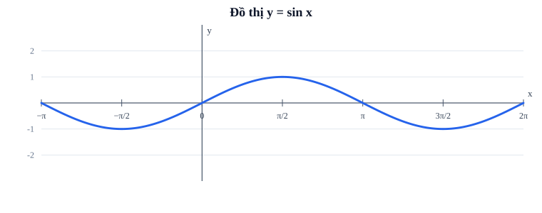

# Bài 3. Hàm số lượng giác

TOÁN 11 · CHƯƠNG I

Từ chuyển động trên đường tròn đến bốn đồ thị sin, cos, tan, cot: hiểu khái niệm, đọc hình, tự giải và tự khắc phục lỗi.

<nav class="thpt-r4-lesson-tabs"><a href="../">Chương I</a><a href="../luyen-tap/">Core và Luyện tập</a><a href="../tu-kiem-tra-chuong/">Tự kiểm tra cuối chương</a></nav>

=== "Khám phá kiến thức"

    Khi một chiếc bánh xe quay, ta có thể hỏi nó đang ở vị trí nào tại một thời điểm. Nhưng nếu muốn theo dõi **độ cao của một điểm trên vành theo suốt quá trình quay**, một giá trị sin tại một góc là chưa đủ. Ta cần một hàm số: nhận góc quay \(x\) làm đầu vào, trả về tung độ \(\sin x\) hoặc hoành độ \(\cos x\) của điểm trên đường tròn lượng giác. Cách nhìn này còn giúp mô tả thủy triều, nhịp thở và những dao động lặp lại.

    ### 1.1. Từ một góc đến bốn hàm số

    Hãy cho điểm \(M\) quay từ vị trí \(A(1;0)\) đến góc \(x\) radian. Trên đường tròn đơn vị, \(M(\cos x;\sin x)\). Bất kể \(x\) âm hay lớn hơn một vòng, ta vẫn xác định được hoành độ và tung độ ấy. Cả hai chỉ nằm từ \(-1\) đến \(1\): đây là lý do \(\sin x,\cos x\) xác định với mọi số thực nhưng không thể nhận giá trị \(2\).

    Còn \(\tan x=\sin x/\cos x\) và \(\cot x=\cos x/\sin x\) là hai **tỉ số**; chúng không tồn tại khi mẫu bằng \(0\). Phân biệt được hai kiểu hàm số này trước khi nhìn vào đồ thị sẽ giúp em tránh việc coi mọi điểm trên trục hoành đều có giá trị hàm.

    | Góc \(x\) | \(0\) | \(\pi/2\) | \(\pi\) | \(3\pi/2\) | \(2\pi\) |
    | --- | ---: | ---: | ---: | ---: | ---: |
    | \(\sin x\) | \(0\) | \(1\) | \(0\) | \(-1\) | \(0\) |
    | \(\cos x\) | \(1\) | \(0\) | \(-1\) | \(0\) | \(1\) |

    **Vận dụng.** Tại \(x=\pi/2\), hãy xác định \(\sin x\), \(\cos x\) và cho biết \(\tan x\), \(\cot x\) có xác định hay không. Giải thích bằng mẫu số, không chỉ dựa vào bảng nhớ.

    

    ??? question "Đối chiếu"

        **Lời giải:** \(\sin(\pi/2)=1\), \(\cos(\pi/2)=0\). Vì \(\tan x=\sin x/\cos x\) có mẫu bằng \(0\), \(\tan(\pi/2)\) không xác định. Trái lại, \(\cot(\pi/2)=\cos(\pi/2)/\sin(\pi/2)=0/1=0\).

    

    ??? tip "Kiểm lỗi"

        **Dấu hiệu:** Em kết luận cả tan và cot đều bằng \(0\), hoặc coi hai hàm đều không xác định tại \(\pi/2\).

        **Tự sửa:** Viết riêng hai phân số, kiểm mẫu của từng phân số trước phép chia. Ôn mục 2.1; ở [Core và Luyện tập Bài 3](../luyen-tap/), làm câu Core hỏi tập xác định của tan, rồi chuyển sang câu Practice tìm miền xác định của cot có đối số gấp đôi.

    ### 1.2. Vì sao có tính chẵn, lẻ và chu kì?

    Quay tới góc \(x\) rồi tới \(-x\), hai điểm cuối đối xứng qua trục hoành: hoành độ giữ nguyên, tung độ đổi dấu. Bởi thế \(\cos(-x)=\cos x\) và \(\sin(-x)=-\sin x\). Từ hình học nảy sinh tên gọi **hàm chẵn** và **hàm lẻ**. Tuy nhiên, cần kiểm rằng cả \(x\) và \(-x\) đều thuộc tập xác định trước khi thử các đẳng thức này.

    Sau một vòng \(2\pi\), điểm cuối lại như cũ; vì vậy sin/cos lặp giá trị. Tan và cot là các tỉ số nên sau nửa vòng \(\pi\), cả tử và mẫu cùng đổi dấu: tỉ số không đổi ở những điểm có nghĩa. Đó là nguyên nhân chu kì cơ bản của tan/cot là \(\pi\), còn sin/cos là \(2\pi\). **Chu kì** là khoảng lặp ngắn nhất nếu khoảng ấy tồn tại, không phải biên độ hoặc mức cao nhất của đồ thị.

    **Vận dụng.** Xét \(f(x)=x\cos x\) trên \(\mathbb R\). Hàm số chẵn, lẻ hay không thuộc hai loại ấy? Em hãy kiểm miền xác định và tính \(f(-x)\) trước.

    

    ??? question "Đối chiếu"

        **Lời giải:** Miền \(\mathbb R\) đối xứng qua \(0\). Vì \(\cos(-x)=\cos x\), ta có \(f(-x)=(-x)\cos(-x)=-x\cos x=-f(x)\). Vậy \(f\) là hàm **lẻ**, đồ thị đối xứng qua gốc tọa độ.

    

    ??? tip "Kiểm lỗi"

        **Dấu hiệu:** Em kết luận “chẵn” chỉ vì có \(\cos x\), hoặc quên nhân dấu âm của \(x\).

        **Tự sửa:** Tính cả \(f(-x)\), không suy từ một thừa số. Ôn mục 2.2 và luyện câu Core phân loại chẵn/lẻ của bốn hàm lượng giác trong [Core và Luyện tập Bài 3](../luyen-tap/).

    ### 1.3. Đọc hình sin và cos thay vì thuộc lòng mọi khoảng

    Mỗi góc cho một điểm \((x;\sin x)\) trên mặt phẳng; nối các điểm khi \(x\) thay đổi liên tục tạo thành đồ thị sin. Một vòng quay ứng với quãng ngang dài \(2\pi\); đồ thị đi từ \(0\) lên \(1\), trở lại \(0\), xuống \(-1\), rồi lại về \(0\). Hãy **đọc trục hoành là số đo góc theo radian, không phải số giây**, trừ khi bài cho một công thức đổi góc sang thời gian.

    <figure class="thpt-r4-plot"><figcaption>Đọc hình sin: xét phần đường cong nằm trên trục hoành trước khi suy ra nơi \(\sin x>0\). Đường cong lặp lại sau một khoảng \(2\pi\).</figcaption></figure>

    **Vận dụng.** Dựa vào đường cong đã đọc, trên đoạn \([-\pi;\pi]\) khi nào \(\sin x<0\)? Có được lấy các mốc \(x=-\pi\), \(x=0\) không?

    

    ??? question "Đối chiếu"

        **Lời giải:** Trên \((-\pi;0)\), đồ thị sin nằm **dưới** trục hoành nên \(\sin x<0\). Tại \(-\pi\) và \(0\), sin bằng \(0\), không thỏa điều kiện nghiêm ngặt. Đáp án: \((-\pi;0)\).

    

    ??? tip "Kiểm lỗi"

        **Dấu hiệu:** Em ghi cả \(-\pi\) và \(0\), hoặc nhầm phần đồ thị dưới Ox thành giá trị dương.

        **Tự sửa:** Phân biệt \(y<0\) với \(y\le0\), nhìn phần đường cong **dưới** trục hoành trên đoạn âm; đừng nhầm đọc dấu với đọc khoảng đồng biến. Ôn mục 2.3 và luyện câu Practice nhận diện khoảng đồng biến của sin trong [Core và Luyện tập Bài 3](../luyen-tap/).

    Với cos, đồ thị bắt đầu tại \((0;1)\) chứ không phải \((0;0)\). Trong nửa vòng từ \(0\) đến \(\pi\), cos đi từ \(1\) xuống \(-1\). Đối xứng qua trục tung phản ánh tính chẵn; những lần cắt trục hoành xảy ra ở góc có hoành độ điểm quay bằng \(0\).

    <figure class="thpt-r4-plot"><figcaption>Đọc hình cos: tìm hai điểm cắt trục hoành trong một vòng, rồi tô tưởng tượng phần đồ thị nằm dưới trục hoành.</figcaption></figure>

    **Vận dụng.** Trên đoạn \([0;2\pi]\), tìm tất cả các \(x\) để \(\cos x<0\). Vì sao hai điểm cắt trục hoành không được lấy?

    

    ??? question "Đối chiếu"

        **Lời giải:** Đồ thị cos nằm dưới trục hoành khi \(\frac{\pi}{2}<x<\frac{3\pi}{2}\). Hai mốc biên làm \(\cos x=0\), nên không thỏa bất đẳng thức nghiêm ngặt. Kết quả: \((\pi/2;3\pi/2)\).

    

    ??? tip "Kiểm lỗi"

        **Dấu hiệu:** Em ghi phần cos dương hoặc đưa cả \(\pi/2\), \(3\pi/2\) vào lời giải.

        **Tự sửa:** Chỉ đúng trục hoành \(y=0\) trên hình, phân biệt phần đường cong phía trên/dưới. Ôn mục 2.4 rồi luyện câu Practice xác định điểm cắt của cos với trục hoành tại [Core và Luyện tập Bài 3](../luyen-tap/).

    ### 1.4. Vì sao đồ thị tan và cot đứt thành nhiều nhánh?

    Tan là \(\sin x/\cos x\). Khi \(x\) tiến sát \(\pi/2\) từ phía trái, \(\cos x\) dương và tiến về \(0\) trong khi \(\sin x\) gần \(1\), khiến thương tăng không giới hạn. **Tại đúng \(\pi/2\), không có giá trị tan**. Đồ thị vì vậy có một đường tiệm cận đứng, không phải một điểm cao vô hạn có thể nối qua. Với cot là \(\cos x/\sin x\), những góc \(k\pi\) làm mẫu bằng \(0\), nên các nhánh bị chia ở các vị trí khác tan.

    **Vận dụng.** Tìm tập xác định của \(h(x)=\cot(3x-\pi/6)\). Không dùng đồ thị để đoán nghiệm; hãy bắt đầu từ điều kiện của mẫu.

    

    ??? question "Đối chiếu"

        **Lời giải:** Cần \(\sin(3x-\pi/6)\ne0\), tức \(3x-\pi/6\ne k\pi\) với mọi \(k\in\mathbb Z\). Suy ra \(x\ne\pi/18+k\pi/3\). Tập xác định là \(\mathbb R\setminus\{\pi/18+k\pi/3\mid k\in\mathbb Z\}\).

    

    ??? tip "Kiểm lỗi"

        **Dấu hiệu:** Em loại \(x=k\pi\) như cot cơ bản, quên đối số đã biến đổi; hoặc giải sai do không chia \(3\).

        **Tự sửa:** Đặt \(u=3x-\pi/6\), giải riêng điều kiện \(u\ne k\pi\). Ôn mục 2.6; sau đó làm câu Practice tìm tập xác định \(\cot(2x)\) trong [Core và Luyện tập Bài 3](../luyen-tap/).

    ### 1.5. Từ đồ thị đến nhịp thở

    Trong mô hình một đại lượng dao động theo thời gian, chẳng hạn tốc độ dòng khí thay đổi trong nhịp thở, biến **\(t\) có đơn vị giây**, còn đối số của sin là góc. Hệ số trước \(t\) quyết định số vòng dao động trong một giây; hệ số nhân bên ngoài sin quyết định độ lớn đỉnh. Nên học cách kiểm **đơn vị thời gian** trước khi đổi chu kì ra số chu kì mỗi phút.

    **Vận dụng.** Một mô hình tự luyện cho tốc độ biến thiên của dòng khí là \(v(t)=0{,}8\sin(2\pi t/5)\), với \(t\) tính bằng giây. Chu kì là bao nhiêu giây? Trong một phút có bao nhiêu chu kì toàn phần? Trong \(0<t<5\), lúc nào \(v(t)>0\)?

    

    ??? question "Đối chiếu"

        **Lời giải:** Hệ số góc là \(\omega=2\pi/5\) rad/s. Chu kì \(T=2\pi/\omega=5\) giây; trong \(60\) giây có \(60/5=12\) chu kì. Khi \(0<t<5\), đối số chạy từ \(0\) đến \(2\pi\); sin dương ở \(0<2\pi t/5<\pi\), tức \(0<t<2{,}5\) giây.

    

    ??? tip "Kiểm lỗi"

        **Dấu hiệu:** Em cho rằng chu kì bằng \(2\pi\cdot(2\pi/5)\), hoặc chia \(60\) cho biên độ \(0{,}8\).

        **Tự sửa:** Chu kì theo thời gian phải làm **đối số tăng đúng \(2\pi\)**, tức \(\omega T=2\pi\). Ôn mục 2.2 và Ví dụ 3.6, rồi luyện câu Practice mô hình nhiệt độ có chu kì 12 giờ tại [Core và Luyện tập Bài 3](../luyen-tap/).

=== "Kiến thức SGK"

    ### 2.1. Định nghĩa hàm số lượng giác

    
<strong>Định nghĩa:</strong> Từ đường tròn lượng giác, với mỗi số thực \(x\) ta xác định \(y=\sin x\) và \(y=\cos x\). Hai hàm số này đều có tập xác định \(\mathbb R\). Các hàm số tang và côtang lần lượt là \(y=\tan x=\frac{\sin x}{\cos x}\) và \(y=\cot x=\frac{\cos x}{\sin x}\), chỉ xác định khi mẫu khác \(0\).

    
<strong>Điều kiện xác định:</strong>
    \[
    \begin{aligned}
    D_{\sin}=D_{\cos}&=\mathbb R,\\
    D_{\tan}&=\mathbb R\setminus\{\tfrac{\pi}{2}+k\pi\mid k\in\mathbb Z\},\\
    D_{\cot}&=\mathbb R\setminus\{k\pi\mid k\in\mathbb Z\}.
    \end{aligned}
    \]
    

    **Giải thích:** Tan không xác định tại \(\cos x=0\); cot không xác định tại \(\sin x=0\). Miền xác định là tập **đầu vào được phép**, không phải tập giá trị đầu ra. Không vì \(\sin x,\cos x\) luôn xác định mà kết luận tan/cot cũng vậy.

    ### 2.2. Hàm số chẵn, hàm số lẻ, hàm số tuần hoàn

    
<strong>Định nghĩa chẵn, lẻ:</strong> Hàm \(f\) có tập xác định \(D\) là <em>chẵn</em> nếu với mọi \(x\in D\), ta có \(-x\in D\) và \(f(-x)=f(x)\); là <em>lẻ</em> nếu với mọi \(x\in D\), ta có \(-x\in D\) và \(f(-x)=-f(x)\). Đồ thị chẵn đối xứng qua trục tung, đồ thị lẻ đối xứng qua gốc tọa độ.

    
<strong>Định nghĩa tuần hoàn:</strong> Hàm \(f\) có tập xác định \(D\) là <em>tuần hoàn</em> nếu tồn tại \(T\ne0\) sao cho với mọi \(x\in D\), cả \(x+T,x-T\) thuộc \(D\) và \(f(x+T)=f(x)\). Số \(T>0\) nhỏ nhất thỏa các điều kiện ấy, nếu có, gọi là <em>chu kì</em> của hàm.

    **Lưu ý:** Một hàm hằng trên \(\mathbb R\) tuần hoàn với mọi \(T>0\), nhưng **không có chu kì dương nhỏ nhất**. Không đánh đồng “một số \(T\) là chu kì lặp” với “chu kì cơ bản”. Với \(A\ne0,\ \omega\ne0\), hai hàm \(A\sin(\omega x+\varphi)\), \(A\cos(\omega x+\varphi)\) trên \(\mathbb R\) có chu kì cơ bản \(2\pi/|\omega|\); biên độ bằng \(|A|\) nếu không thêm dịch chuyển dọc. Hệ số dịch chuyển \(c\) làm tập giá trị thành \([c-|A|;c+|A|]\) và không đổi chu kì.

    **Gợi cách đọc đồ thị:** Từ tính chẵn chỉ cần dựng phần \(x\ge0\) rồi phản chiếu qua trục tung; từ tính lẻ dùng phép đối xứng qua gốc. Từ tính tuần hoàn mở rộng đồ thị một khoảng đầy đủ bằng các phép tịnh tiến ngang bội của chu kì.

    ### 2.3. Đồ thị và tính chất của hàm số \(y=\sin x\)

    <figure class="thpt-r4-plot"><figcaption>Đọc trục: trên một vòng \(0\) đến \(2\pi\), các mốc \(0,1,0,-1,0\) là giá trị <em>tung độ</em>, không phải thời gian.</figcaption></figure>

    
<strong>Tính chất:</strong> Tập xác định \(\mathbb R\), tập giá trị \([-1;1]\), hàm lẻ, chu kì cơ bản \(2\pi\). Với mọi \(k\in\mathbb Z\), hàm đồng biến trên \((-\pi/2+2k\pi;\pi/2+2k\pi)\) và nghịch biến trên \((\pi/2+2k\pi;3\pi/2+2k\pi)\).

    **Đọc hình:** Điểm cực đại ở \((\pi/2+2k\pi;1)\), cực tiểu ở \((3\pi/2+2k\pi;-1)\), cắt trục hoành tại \(x=k\pi\). Không gộp hai khoảng tăng bị ngắt bởi một khoảng giảm.

    ### 2.4. Đồ thị và tính chất của hàm số \(y=\cos x\)

    <figure class="thpt-r4-plot"><figcaption>Đồ thị cos nhận trục tung làm trục đối xứng; theo chiều từ \(0\) tới \(\pi\), đường cong đi xuống.</figcaption></figure>

    
<strong>Tính chất:</strong> Tập xác định \(\mathbb R\), tập giá trị \([-1;1]\), hàm chẵn, chu kì cơ bản \(2\pi\). Với mọi \(k\in\mathbb Z\), hàm đồng biến trên \((-\pi+2k\pi;2k\pi)\), nghịch biến trên \((2k\pi;\pi+2k\pi)\).

    **Đọc hình:** Cos đạt \(1\) ở \(x=2k\pi\), đạt \(-1\) ở \(x=\pi+2k\pi\); các nghiệm \(\cos x=0\) có dạng \(x=\pi/2+k\pi\). Chỗ đồ thị cắt trục hoành là **giá trị hàm bằng 0**, không phải điểm không xác định.

    ### 2.5. Đồ thị và tính chất của hàm số \(y=\tan x\)

    <figure class="thpt-r4-plot"><figcaption>Đường thẳng nét đứt là vị trí \(\cos x=0\), không phải một phần đồ thị. Hãy đọc riêng từng nhánh giữa hai tiệm cận.</figcaption></figure>

    
<strong>Tính chất:</strong>
    \[
    D=\mathbb R\setminus\{\tfrac{\pi}{2}+k\pi\mid k\in\mathbb Z\},\quad
    \mathrm{TGT}=\mathbb R,\quad T=\pi.
    \]
    Hàm lẻ và đồng biến trên từng khoảng \((-\pi/2+k\pi;\pi/2+k\pi)\), với \(k\in\mathbb Z\).

    **Đọc hình:** Đồ thị qua \((k\pi;0)\), có các tiệm cận đứng \(x=\pi/2+k\pi\). Không bao giờ nối hai nhánh qua tiệm cận; không phát biểu tan đồng biến “trên toàn tập xác định” theo nghĩa một khoảng liên tục.

    ### 2.6. Đồ thị và tính chất của hàm số \(y=\cot x\)

    <figure class="thpt-r4-plot"><figcaption>Trên mỗi khoảng \((k\pi;(k+1)\pi)\), nhánh cot đi xuống; tại \(x=k\pi\) không có giá trị hàm.</figcaption></figure>

    
<strong>Tính chất:</strong>
    \[
    D=\mathbb R\setminus\{k\pi\mid k\in\mathbb Z\},\quad
    \mathrm{TGT}=\mathbb R,\quad T=\pi.
    \]
    Hàm lẻ và nghịch biến trên từng khoảng \((k\pi;(k+1)\pi)\), với \(k\in\mathbb Z\).

    **Đọc hình:** Tiệm cận đứng \(x=k\pi\), còn nghiệm \(\cot x=0\) là \(x=\pi/2+k\pi\). Đừng nhầm điểm cắt Ox với điểm bị loại khỏi tập xác định.

    **Cách tự kiểm khi đọc đồ thị:** Trước khi xét một hàm, hỏi: đầu vào nào được phép; đầu ra có thể nhận gì; đồ thị đối xứng/lặp lại thế nào; hàm tăng hay giảm trên từng khoảng nào? Với tan/cot, luôn xét mẫu và các tiệm cận trước.

=== "Ví dụ"

    Những ví dụ dưới đây có đề bài và phép kiểm độc lập, đồng thời giúp lựa chọn phương pháp phù hợp: kiểm mẫu cho miền xác định, thay \(-x\) cho chẵn/lẻ, theo dõi đối số cho chu kì, đọc trục đồ thị cho dấu và khoảng tăng giảm.

    ### 3.1. Tập xác định của hàm tang có đối số biến đổi

    

<strong>Đề bài:</strong> Tìm tập xác định của \(f(x)=\tan(2x-\pi/6)\).

    
<strong>Phân tích:</strong> Tan là một thương. Điều kiện phải áp vào **đối số \(2x-\pi/6\)**, không phải chỉ vào \(x\).

    
<strong>Lời giải:</strong> Điều kiện \(\cos(2x-\pi/6)\ne0\) tương đương \(2x-\pi/6\ne\pi/2+k\pi\). Suy ra \(x\ne\pi/3+k\pi/2\) (\(k\in\mathbb Z\)). Vậy \(D=\mathbb R\setminus\{\pi/3+k\pi/2\mid k\in\mathbb Z\}\).

    
<strong>Kiểm lại:</strong> Thay \(x=\pi/3\) được đối số \(\pi/2\), đúng là tan không xác định; còn \(x=0\) cho đối số \(-\pi/6\), tan có nghĩa.

    ### 3.2. Xét tính chẵn, lẻ từ miền xác định

    

<strong>Đề bài:</strong> Xét tính chẵn, lẻ của \(f(x)=x\sin x\) trên \(\mathbb R\).

    
<strong>Phân tích:</strong> Không nhìn đồ thị để đoán; hãy kiểm tính đối xứng của miền rồi tính \(f(-x)\).

    
<strong>Lời giải:</strong> Với mọi \(x\in\mathbb R\) thì \(-x\in\mathbb R\). Ta có \(f(-x)=(-x)\sin(-x)=(-x)(-\sin x)=x\sin x=f(x)\). Vậy \(f\) **chẵn**.

    
<strong>Kiểm lại:</strong> Với \(x=\pi/2\), \(f(\pi/2)=\pi/2\) và \(f(-\pi/2)=\pi/2\), phù hợp tính chẵn.

    ### 3.3. Tập giá trị và chu kì của hàm sin biến đổi

    

<strong>Đề bài:</strong> Tìm tập giá trị và chu kì cơ bản của \(y=2\sin(3x-\pi/4)+1\).

    
<strong>Phân tích:</strong> Dịch lên \(1\) thay đổi tập giá trị; hệ số \(3\) **trong đối số** thay đổi chu kì; hệ số \(2\) bên ngoài thay đổi biên độ.

    
<strong>Lời giải:</strong> Vì \(-1\le\sin(3x-\pi/4)\le1\), suy ra \(-1\le y\le3\). Tập giá trị là \([-1;3]\). Điều kiện lặp theo đối số là \(3T=2\pi\), nên chu kì cơ bản \(T=2\pi/3\).

    
<strong>Kiểm lại:</strong> Khi \(3x-\pi/4=\pi/2+2k\pi\), \(y=3\); khi đối số bằng \(3\pi/2+2k\pi\), \(y=-1\), nên hai biên đều đạt được.

    ### 3.4. Đọc dấu của sin trên một miền đã cho

    

<strong>Đề bài:</strong> Tìm tất cả \(x\in[\pi;3\pi]\) để \(\sin x>0\).

    
<strong>Phân tích:</strong> Xem đồ thị sin trên một chu kì, rồi dịch phải \(2\pi\). Bài hỏi dấu, **không** hỏi khoảng đồng biến.

    
<strong>Lời giải:</strong> Trên \((\pi;2\pi)\), sin âm; trên \((2\pi;3\pi)\), sin dương. Các mốc \(\pi,2\pi,3\pi\) có sin bằng \(0\). Vậy \(x\in(2\pi;3\pi)\).

    
<strong>Kiểm lại:</strong> Thử \(x=5\pi/2\) cho sin bằng \(1>0\); thử \(x=3\pi/2\) cho \(-1<0\). Đáp án khớp đồ thị.

    ### 3.5. Đọc một nhánh cot không vẽ liên tục qua tiệm cận

    

<strong>Đề bài:</strong> Trên khoảng \((0;\pi)\), xác định các \(x\) để \(\cot x<0\).

    
<strong>Phân tích:</strong> Trên khoảng này \(\sin x>0\), nên dấu của cot bằng dấu của \(\cos x\); cũng có thể đọc nửa nhánh cot dưới trục hoành.

    
<strong>Lời giải:</strong> \(\cos x<0\) khi \(\pi/2<x<\pi\). Vậy \(\cot x<0\) trên \((\pi/2;\pi)\); tại \(x=\pi/2\) cot bằng \(0\) và tại \(\pi\) không xác định.

    
<strong>Kiểm lại:</strong> Chọn \(x=3\pi/4\): \(\cot x=-1\), phù hợp. Không lấy \(x=\pi\) vì mẫu \(\sin\pi=0\).

    ### 3.6. Mô hình nhiệt độ tuần hoàn

    

<strong>Đề bài:</strong> Một mô hình nhiệt độ tự luyện là \(\theta(t)=25+3\cos(\pi t/6)\) (\(^\circ\mathrm C\), \(t\) tính bằng giờ, \(t\ge0\)). Tìm chu kì, nhiệt độ cao nhất/thấp nhất, và thời điểm đầu tiên \(t>0\) đạt nhiệt độ thấp nhất.

    
<strong>Phân tích:</strong> Số \(25\) là mức nền; biên độ \(3\) là độ lệch tối đa; hệ số \(\pi/6\) rad/giờ quyết định chu kì theo **giờ**.

    
<strong>Lời giải:</strong> Chu kì \(T=2\pi/(\pi/6)=12\) giờ. Do \(-1\le\cos(\pi t/6)\le1\), ta có \(22\le\theta(t)\le28\) độ C. Thấp nhất \(22^\circ\mathrm C\) khi \(\cos(\pi t/6)=-1\), tức \(t=6+12k\) giờ; thời điểm dương đầu tiên là \(t=6\) giờ.

    
<strong>Kiểm lại:</strong> \(\theta(0)=28^\circ\mathrm C\), \(\theta(6)=22^\circ\mathrm C\), \(\theta(12)=28^\circ\mathrm C\). Sau \(12\) giờ giá trị đầu lặp lại, đúng chu kì đã tính.

=== "Lỗi thường gặp"

    Khi em sai ở một bài **Vận dụng cụ thể**, hãy dùng Kiểm lỗi ngay dưới phần Đối chiếu của câu đó. Các lỗi dưới đây là **nhầm lẫn mang tính quy tắc**, có thể xuất hiện trong nhiều bài khác nhau.

    

    ??? tip "4.1. Nhầm tập xác định và tập giá trị"

        **Dấu hiệu:** Em viết tập xác định của tan là \(\mathbb R\) vì đồ thị “cao lên vô hạn”, hoặc cho rằng sin nhận mọi giá trị thực.

        **Vì sao sai:** Tập xác định trả lời “cho phép nhập \(x\) nào?”, còn tập giá trị trả lời “đầu ra \(y\) nào đạt được?”. Tan có những điểm không nhập được nhưng có thể nhận mọi giá trị thực; sin nhập mọi \(x\) nhưng chỉ trả về \([-1;1]\).

        **Tự sửa và luyện:** Với mỗi hàm, viết \(D\) và TGT ở **hai dòng khác nhau**. Ôn mục 2.1/2.5; luyện câu Core TXĐ tan và Practice TXĐ cot có đối số \(2x\) tại [Bài 3 – Core và Luyện tập](../luyen-tap/).

    

    ??? tip "4.2. Kết luận chẵn/lẻ mà chưa kiểm miền"

        **Dấu hiệu:** Em chỉ thay \(x\mapsto-x\) trong công thức nhưng không xem \(-x\) có nằm trong tập xác định không, hoặc cho rằng có cos trong công thức thì cả hàm chẵn.

        **Vì sao sai:** Chẵn/lẻ là tính chất của **hàm trên miền xác định**, không chỉ của biểu thức rời miền. Từng thừa số có thể đổi tính đối xứng của tích.

        **Tự sửa và luyện:** Viết \(D\), kiểm \(x\in D\Rightarrow -x\in D\), rồi tính \(f(-x)\) với toàn bộ biểu thức. Ôn mục 2.2, Ví dụ 3.2 và câu Core về tính chẵn/lẻ của bốn hàm sin/cos/tan/cot tại [Bài 3 – Core và Luyện tập](../luyen-tap/).

    

    ??? tip "4.3. Nhân nhầm chu kì hoặc gọi mọi số lặp là chu kì cơ bản"

        **Dấu hiệu:** Với \(\sin(3x)\), em ghi \(T=6\pi\); hoặc kết luận mọi hàm hằng có chu kì nhỏ nhất.

        **Vì sao sai:** Muốn đồ thị lặp theo \(x\), đối số chỉ cần tăng \(2\pi\), không tăng \(6\pi\). Hàm hằng lặp sau **mọi** số dương nên không có số nhỏ nhất.

        **Tự sửa và luyện:** Giải \(|\omega|T=2\pi\) cho sin/cos (hoặc \(|\omega|T=\pi\) cho tan/cot trên miền phù hợp) với \(\omega\ne0\). Ôn mục 2.2, Ví dụ 3.3; thử câu Practice về \(\cos(4x-\pi/3)\) tại [Bài 3 – Core và Luyện tập](../luyen-tap/).

    

    ??? tip "4.4. Nối các nhánh tan/cot qua tiệm cận"

        **Dấu hiệu:** Em đặt điểm cho tan tại \(x=\pi/2\) hoặc cho cot tại \(x=0\), hoặc kết luận tính tăng/giảm xuyên qua điểm không xác định.

        **Vì sao sai:** Tại tiệm cận đứng, mẫu bằng \(0\), nên không có tung độ của hàm số. Mỗi nhánh liên tục trên **một khoảng xác định riêng**.

        **Tự sửa và luyện:** Đánh dấu các giá trị loại khỏi \(D\) bằng đường nét đứt trước khi vẽ. Ôn mục 2.5–2.6 và Ví dụ 3.5; thử Practice hỏi hai tiệm cận gần trục tung của tan và chiều biến thiên cot trên \((0;\pi)\) ở [Bài 3 – Core và Luyện tập](../luyen-tap/).

    **Học tiếp:** [Core và Luyện tập](../luyen-tap/) · [Tự kiểm tra cuối chương](../tu-kiem-tra-chuong/) · [Tự luận Chương I](../../../../thu-vien/tu-luan-g11-chuong-i-b01-b02/).

    
Nguồn tham khảo: SGK Toán 11 – Kết nối tri thức với cuộc sống, tập một, Bài 3 (trang in 22–30).

