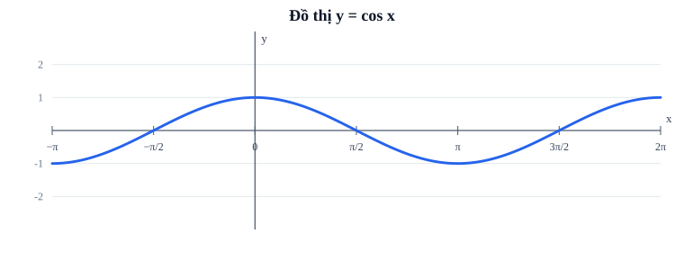
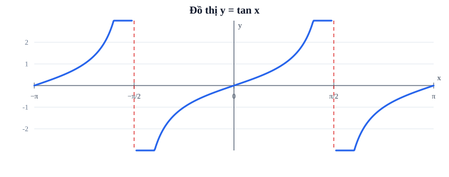
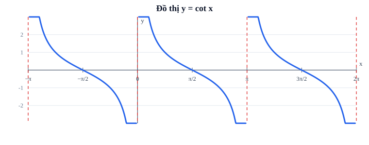

# Bài 3. Hàm số lượng giác

TOÁN 11 · CHƯƠNG I · KẾT NỐI TRI THỨC

Từ một điểm quay trên đường tròn đến bốn hàm số: hiểu định nghĩa, tính chẵn lẻ, tính tuần hoàn và đọc đúng từng đồ thị.

<nav class="thpt-r4-lesson-tabs"><a href="../">Chương I</a><a href="../luyen-tap/">Core và Luyện tập</a><a href="../tu-kiem-tra-chuong/">Tự kiểm tra cuối chương</a></nav>

=== "Khám phá kiến thức"

    Một điểm \(M\) chuyển động trên đường tròn đơn vị. Ở Bài 1, ta tìm được tọa độ của điểm theo góc quay \(x\): \(M(\cos x;\sin x)\). Nếu để \(x\) thay đổi liên tục thay vì chọn một góc cụ thể, hoành độ và tung độ của \(M\) cũng thay đổi theo. Từ đó xuất hiện một câu hỏi mới: **có thể xem mỗi tọa độ là đầu ra của một hàm số nhận góc \(x\) làm đầu vào không?** Bài 3 đi từ định nghĩa các hàm ấy đến cách đọc đồ thị của chúng. Các đồ thị còn giúp mô tả những hiện tượng lặp lại, chẳng hạn luồng khí trong quá trình hô hấp.

    ### 1.1. Định nghĩa hàm số lượng giác

    Hãy hình dung \(M\) quay từ góc \(0\) đến \(\pi/2\), rồi tới \(\pi\). Tung độ của \(M\) lần lượt là \(0,1,0\), trong khi hoành độ lần lượt là \(1,0,-1\). Với **mỗi** góc thực \(x\), ta có đúng một vị trí cuối trên đường tròn, nên có đúng một giá trị \(\sin x\) và một giá trị \(\cos x\). Đây là hai hàm số xác định cho mọi \(x\in\mathbb R\), chứ không phải hai con số cố định.

    Tang và côtang xuất hiện từ hai tỉ số \(\tan x=\sin x/\cos x\) và \(\cot x=\cos x/\sin x\). Vì là phép chia, chúng không xác định tại các góc làm mẫu số bằng \(0\). Chẳng hạn ở \(x=\pi/2\), điểm \(M=(0,1)\); \(\sin x\) vẫn bằng \(1\) nhưng \(\tan x\) **không có giá trị**. Ở \(x=0\), \(\cot x\) lại không xác định. Sự khác biệt này sẽ quyết định hình dạng hai đồ thị ở mục 1.5 (Hàm số tang) và 1.6 (Hàm số côtang).

    **Vận dụng.** Tại \(x=-\pi/2\) và \(x=\pi/4\), hãy xác định những hàm nào trong sin, cos, tan, cot có giá trị; nếu có thì giá trị bằng bao nhiêu?

    ??? question "Đối chiếu"

        **Lời giải:** Với \(x=-\pi/2\): \(\sin(-\pi/2)=-1,\ \cos(-\pi/2)=0,\ \cot(-\pi/2)=0\), còn tan không xác định vì mẫu cos bằng \(0\). Với \(x=\pi/4\): \(\sin(\pi/4)=\cos(\pi/4)=\sqrt2/2\), nên cả tan và cot bằng \(1\).

    ??? tip "Kiểm lỗi"

        Nếu viết \(\tan(-\pi/2)=0\), hãy đọc lại: \(\tan x\) dùng **cos ở mẫu**, không phải sin. Giá trị của tử số không cứu được một phân số có mẫu bằng \(0\).

    ### 1.2. Hàm số chẵn, hàm số lẻ, hàm số tuần hoàn

    Trên đồ thị \(y=x^2\), hai đầu vào \(x\) và \(-x\) có cùng đầu ra; đồ thị phản chiếu qua trục tung. Nhưng với \(y=x^3\), đổi \(x\) thành \(-x\) sẽ đổi dấu đầu ra, nên đồ thị đối xứng qua gốc \(O\). Đó là trực giác về **hàm chẵn** và **hàm lẻ**. Trước khi so \(f(-x)\), phải kiểm rằng với mọi \(x\in D\), ta đều có \(-x\in D\). Chẳng hạn, \(f(x)=x^2\) nếu chỉ xác định trên \([0;+\infty)\) thì không chẵn cũng không lẻ: \(1\) thuộc miền nhưng \(-1\) không thuộc miền. Nếu miền đối xứng qua \(0\), mới kiểm \(f(-x)=f(x)\) hoặc \(f(-x)=-f(x)\) với mọi \(x\in D\).

    Trở lại đường tròn: quay thêm \(2\pi\) thì điểm \(M\) về đúng vị trí cũ. Vì thế \(\sin(x+2\pi)=\sin x\), \(\cos(x+2\pi)=\cos x\). Tang và côtang lặp giá trị chỉ sau \(\pi\), do tử và mẫu đồng thời đổi dấu. Một hàm như thế được gọi là **tuần hoàn**. Điều quan trọng không phải chỉ tìm được một số làm hàm lặp lại, mà còn xem số dương nhỏ nhất ấy có tồn tại không: với hàm hằng trên \(\mathbb R\), mọi \(T>0\) đều làm hàm lặp lại, nhưng không có **số dương nhỏ nhất**, nên hàm **không có chu kì** theo định nghĩa SGK.

    Để biểu diễn nhịp lặp lại, ta dùng tính tuần hoàn của đối số: nếu \(y=\sin(3x)\), muốn đối số tăng thêm \(2\pi\), chỉ cần \(x\) tăng \(2\pi/3\). Đây là một số dương làm hàm lặp lại. Nếu có chu kì dương \(T\) nhỏ hơn \(2\pi/3\), thì \(\sin(u+3T)=\sin u\) với mọi \(u=3x\in\mathbb R\); khi đó \(0<3T<2\pi\) trái với kết quả về chu kì nhỏ nhất của sin (xem đồ thị và giải thích ở mục 1.3): \(2\pi\). Vậy chu kì nhỏ nhất là \(2\pi/3\). Đó là lý do hệ số trong đối số làm thay đổi chu kì theo **chiều ngược lại**. Ví dụ, nếu luồng khí hô hấp được mô hình hóa bởi \(q(t)=A\sin(\pi t/2)\), \(A>0\), với \(t\) tính bằng giây, thì mô hình có chu kì \(4\) giây; mỗi nhịp lặp đầy đủ kéo dài \(4\) giây.

    **Vận dụng.** Xét \(f(x)=x\sin x\) trên \(\mathbb R\): hàm chẵn hay lẻ? Hàm hằng \(g(x)=2\) trên \(\mathbb R\) có chu kì dương nhỏ nhất không?

    ??? question "Đối chiếu"

        **Lời giải:** \(f(-x)=(-x)\sin(-x)=x\sin x=f(x)\), nên \(f\) chẵn. Với \(g(x)=2\), mọi \(T>0\) đều thỏa \(g(x+T)=g(x)\), nên hàm tuần hoàn nhưng không có số dương nhỏ nhất thỏa điều kiện; do đó **không có chu kì** theo định nghĩa SGK.

    ??? tip "Kiểm lỗi"

        Không kết luận hàm lẻ chỉ vì biểu thức có \(\sin x\). Tích của hai hàm lẻ \(x\) và \(\sin x\) lại là hàm chẵn. Cũng không đánh đồng “tuần hoàn” với “luôn có chu kì cơ bản”.

    ### 1.3. Đồ thị và tính chất của hàm số \(y=\sin x\)

    Khi \(M\) đi quanh đường tròn, hãy theo dõi **tung độ** thay vì vị trí của cả điểm. Từ \(x=0\), tung độ tăng đến \(1\) tại \(x=\pi/2\), giảm về \(0\) tại \(\pi\), xuống \(-1\) tại \(3\pi/2\), rồi trở về \(0\) tại \(2\pi\). Đặt những giá trị ấy lên hệ trục và nối bằng đường cong liên tục, ta có một nhịp của đồ thị sin. Khi tự vẽ, đánh dấu năm điểm ứng với các góc trên, nối theo thứ tự bằng đường cong trơn (không nối bằng đoạn thẳng); có thể dựng phần bên trái bằng đối xứng qua gốc \(O\), rồi lặp các đoạn theo phương ngang sau mỗi \(2\pi\).

    <figure class="thpt-r4-plot"><figcaption><strong>Đọc hình sin:</strong> đi từ giao điểm trục hoành tại \(0\), tới đỉnh \(1\) ở \(\pi/2\), xuống đáy \(-1\) ở \(3\pi/2\), rồi lặp. Độ cao giới hạn trong \([-1;1]\); phần bên trái là ảnh đối xứng qua gốc \(O\).</figcaption></figure>

    Từ đường cong, ta đọc được khoảng **tăng** từ đáy đến đỉnh và khoảng **giảm** từ đỉnh tới đáy. Nếu chỉ nhìn đoạn \((0,\pi/2)\) mà nói “sin luôn tăng” thì sai, vì ở đoạn \((\pi/2,3\pi/2)\) nó giảm.

    **Vận dụng.** Trên một vòng \(0\le x\le2\pi\), hàm \(\sin x\) dương khi nào? Đạt giá trị lớn nhất và nhỏ nhất ở đâu?

    ??? question "Đối chiếu"

        **Lời giải:** \(\sin x>0\) khi \(x\in(0;\pi)\). Giá trị lớn nhất \(1\) tại \(x=\pi/2\), nhỏ nhất \(-1\) tại \(x=3\pi/2\).

    ??? tip "Kiểm lỗi"

        Với bất đẳng thức nghiêm \(>0\), không lấy hai đầu \(0,\pi\), vì tại đó sin bằng \(0\). Đọc dấu theo vị trí đồ thị so với trục hoành.

    ### 1.4. Đồ thị và tính chất của hàm số \(y=\cos x\)

    Lần này hãy quan sát **hoành độ** của cùng điểm \(M\). Ở góc \(0\), hoành độ là \(1\); tới \(\pi/2\) bằng \(0\), tới \(\pi\) bằng \(-1\), rồi quay lại \(1\) ở \(2\pi\). Khác với sin khởi đầu ở \(0\), cos khởi đầu tại đỉnh. Khi tự vẽ, đánh dấu các điểm \((0;1),(\pi/2;0),(\pi;-1),(3\pi/2;0),(2\pi;1)\) và nối bằng đường cong trơn. Cos dương khi hoành độ của \(M\) dương, âm khi hoành độ âm. Vì \(\cos(-x)=\cos x\), dựng phần bên trái bằng ảnh gương qua trục tung, rồi tịnh tiến theo phương ngang từng chu kì \(2\pi\).

    <figure class="thpt-r4-plot"><figcaption><strong>Đọc hình cos:</strong> tại \(x=0\) bắt đầu bằng \(1\), đạt \(-1\) ở \(\pi\), rồi trở lại \(1\) ở \(2\pi\). Đồ thị đối xứng qua trục tung và lặp sau \(2\pi\).</figcaption></figure>

    Khi \(x\) chạy từ \(0\) tới \(\pi\), cos **giảm**; từ \(\pi\) tới \(2\pi\), cos **tăng**. Các khoảng như vậy cứ tịnh tiến thêm \(2k\pi\) với \(k\in\mathbb Z\). Đó là cách đọc tính đơn điệu từ một chu kì thay vì học thuộc một danh sách dài.

    **Vận dụng.** Trên \([0;2\pi]\), tìm các \(x\) sao cho \(\cos x<0\).

    ??? question "Đối chiếu"

        **Lời giải:** Đồ thị cos nằm dưới trục hoành đúng khi \(x\in(\pi/2;3\pi/2)\).

    ??? tip "Kiểm lỗi"

        Không gồm hai mốc \(\pi/2,3\pi/2\), nơi cos bằng \(0\). Cũng không nhầm tính chẵn của cos với việc “cos luôn dương”.

    ### 1.5. Đồ thị và tính chất của hàm số \(y=\tan x\)

    Tang là tỉ số **tung độ chia hoành độ** của điểm \(M\). Khi góc tới gần \(\pi/2\) từ bên trái, hoành độ dương tiến sát \(0\), còn tung độ gần \(1\), nên tang tăng rất lớn. Nhưng **ngay tại** \(\pi/2\), phép chia không thực hiện được; đồ thị không có điểm ở đó. Qua phía bên phải, cos đổi dấu và tang mang giá trị âm rất lớn về độ lớn. Vì thế đồ thị có những nhánh bị chia tách bởi các đường thẳng đứng \(x=\pi/2+k\pi\).

    <figure class="thpt-r4-plot"><figcaption><strong>Đọc hình tan:</strong> mỗi nhánh tăng từ âm vô cùng lên dương vô cùng giữa hai đường đứt \(x=-\pi/2+k\pi\) và \(x=\pi/2+k\pi\). Đường đứt là **tiệm cận, không phải đồ thị**.</figcaption></figure>

    Khi tự vẽ, kẻ hai tiệm cận \(x=\pm\pi/2\) bằng nét đứt, đánh dấu \((-\pi/4;-1),(0;0),(\pi/4;1)\), rồi nối thành nhánh tăng tiến sát hai tiệm cận. Tan bằng \(0\) khi sin bằng \(0\) và cos khác \(0\); dấu của tan là dấu của thương sin/cos. Vì \(\tan(x+\pi)=\tan x\), tịnh tiến nhánh theo phương ngang từng bội của \(\pi\). Chú ý: tăng trên **từng khoảng xác định** không có nghĩa được so sánh xuyên qua một tiệm cận.

    **Vận dụng.** Trên \((-\pi/2;\pi/2)\), tìm tập nghiệm \(\tan x\ge0\).

    ??? question "Đối chiếu"

        **Lời giải:** Nhánh đi qua \(O\), nằm dưới trục hoành khi \(x<0\) và trên trục hoành khi \(x>0\). Vậy \(x\in[0;\pi/2)\). Không lấy \(\pi/2\) vì hàm không xác định.

    ??? tip "Kiểm lỗi"

        Nếu nối hai nhánh qua tiệm cận, ta đã tự thêm những giá trị tan không tồn tại. Luôn xác định miền trước khi nối các điểm đồ thị.

    ### 1.6. Đồ thị và tính chất của hàm số \(y=\cot x\)

    Côtang đảo chiều phép chia: \(\cot x=\cos x/\sin x\). Ở \(x=0\) và \(x=\pi\), sin bằng \(0\), vì thế cot không có giá trị; còn tại \(\pi/2\), cos bằng \(0\) và cot bằng \(0\). Trên khoảng \((0;\pi)\), cot **giảm** từ giá trị rất lớn xuống giá trị rất âm. Khi tự vẽ, kẻ nét đứt tại \(x=0,\pi\), đánh dấu \((\pi/4;1),(\pi/2;0),(3\pi/4;-1)\), rồi nối thành nhánh giảm, tiến sát hai tiệm cận. Cot bằng \(0\) khi cos bằng \(0\) và sin khác \(0\); dấu được xác định từ thương cos/sin. Tịnh tiến nhánh thêm từng bội của \(\pi\) để có toàn bộ đồ thị.

    <figure class="thpt-r4-plot"><figcaption><strong>Đọc hình cot:</strong> giữa \(x=0\) và \(x=\pi\), nhánh đi từ trên xuống dưới và cắt trục hoành ở \(\pi/2\); các đường \(x=k\pi\) chỉ vị trí không xác định.</figcaption></figure>

    Hai hàm tan và cot đều lẻ, có chu kì \(\pi\), nhưng ngược nhau ở **chiều biến thiên trên mỗi khoảng**. Chỉ cần nắm cơ chế của mẫu số và dấu tỉ số, em sẽ phân biệt được chúng mà không phải học vẹt hình.

    **Vận dụng.** Trên \((0;\pi)\), khi nào \(\cot x<0\)?

    ??? question "Đối chiếu"

        **Lời giải:** Trên \((0;\pi/2)\), \(\sin x,\cos x\) đều dương, nên cot dương. Trên \((\pi/2;\pi)\), sin dương, cos âm, nên cot âm. Tập cần tìm là \((\pi/2;\pi)\).

    ??? tip "Kiểm lỗi"

        Không viết \(\cot0=0\): tại \(0\), mẫu \(\sin0=0\). Muốn tìm điểm cắt trục hoành, giải \(\cos x=0\) **đồng thời** kiểm \(\sin x\ne0\).

=== "Kiến thức SGK"

    ### 2.1. Định nghĩa hàm số lượng giác

    Mỗi góc thực \(x\) xác định duy nhất một điểm trên đường tròn lượng giác \(M(\cos x;\sin x)\). Các giá trị tương ứng là đầu ra của bốn hàm số dưới đây.

    
<strong>Định nghĩa — Bốn hàm số lượng giác</strong>
<strong>Hàm số sin:</strong> \(y=\sin x\), xác định với mọi \(x\in\mathbb R\).

<strong>Hàm số côsin:</strong> \(y=\cos x\), xác định với mọi \(x\in\mathbb R\).

<strong>Hàm số tang:</strong> \(y=\tan x=\dfrac{\sin x}{\cos x}\), xác định khi \(x\ne\dfrac{\pi}{2}+k\pi\), \(k\in\mathbb Z\).

<strong>Hàm số côtang:</strong> \(y=\cot x=\dfrac{\cos x}{\sin x}\), xác định khi \(x\ne k\pi\), \(k\in\mathbb Z\).

    **Đọc điều kiện:** sin, cos là tọa độ điểm trên đường tròn nên luôn xác định; tan, cot là các thương nên không được thay số tại điểm mẫu bằng \(0\). Tập giá trị của sin và cos là \([-1;1]\); của tan và cot là \(\mathbb R\).

    ### 2.2. Hàm số chẵn, hàm số lẻ, hàm số tuần hoàn

    
<strong>Định nghĩa — Hàm số chẵn, hàm số lẻ</strong>
Cho hàm số \(y=f(x)\) có tập xác định \(D\). Hàm số <strong>chẵn</strong> nếu với mọi \(x\in D\), ta có \(-x\in D\) và \(f(-x)=f(x)\). Hàm số <strong>lẻ</strong> nếu với mọi \(x\in D\), ta có \(-x\in D\) và \(f(-x)=-f(x)\).

    
<strong>Tính chất — Đối xứng đồ thị</strong>
Đồ thị hàm chẵn đối xứng qua <strong>trục tung</strong>; đồ thị hàm lẻ đối xứng qua <strong>gốc tọa độ</strong>. Phải kiểm miền xác định có đối xứng qua \(0\) trước khi áp dụng các đẳng thức \(f(-x)\).

    
<strong>Định nghĩa — Hàm số tuần hoàn và chu kì</strong>
Hàm \(f\) trên tập \(D\) là <strong>tuần hoàn</strong> nếu tồn tại \(T\ne0\) sao cho với mọi \(x\in D\), cả \(x+T\) và \(x-T\) thuộc \(D\), đồng thời \(f(x+T)=f(x)\). <strong>Chu kì</strong> của hàm số tuần hoàn (theo SGK) là số \(T>0\) nhỏ nhất thỏa các điều kiện trên, <em>nếu tồn tại</em>. Không nhầm với một số dương bất kì làm giá trị hàm lặp lại.

    **Ghi nhớ:** sin và cos tuần hoàn với chu kì cơ bản \(2\pi\); tan và cot tuần hoàn với chu kì cơ bản \(\pi\). Với hàm hằng trên \(\mathbb R\), hàm vẫn tuần hoàn nhưng không có chu kì nhỏ nhất theo định nghĩa SGK.

    
<strong>Công thức chu kì đối số tuyến tính</strong>
\(y=A\sin(\omega x+\varphi)\) hoặc \(y=A\cos(\omega x+\varphi)\) có chu kì cơ bản \(T=\dfrac{2\pi}{|\omega|}\) khi \(A\ne0,\ \omega\ne0\).

Đối với \(y=\tan(\omega x+\varphi)\), \(y=\cot(\omega x+\varphi)\), chu kì cơ bản là \(T=\dfrac{\pi}{|\omega|}\) khi \(\omega\ne0\) và xét đúng miền xác định.

    ### 2.3. Đồ thị và tính chất hàm số \(y=\sin x\)

    
<strong>Tính chất — Hàm số sin</strong>
<strong>Tập xác định:</strong> \(\mathbb R\). <strong>Tập giá trị:</strong> \([-1;1]\). Hàm <strong>lẻ</strong>, chu kì cơ bản \(2\pi\), đồ thị đối xứng qua gốc tọa độ.

<strong>Đồng biến</strong> trên mỗi khoảng \(\big(-\dfrac{\pi}{2}+2k\pi;\dfrac{\pi}{2}+2k\pi\big)\); <strong>nghịch biến</strong> trên mỗi khoảng \(\big(\dfrac{\pi}{2}+2k\pi;\dfrac{3\pi}{2}+2k\pi\big)\), \(k\in\mathbb Z\).

    <figure class="thpt-r4-plot"><figcaption><strong>Cách đọc:</strong> từ \(0\) lên \(1\) tại \(\pi/2\), qua \(0\) tại \(\pi\), xuống \(-1\) tại \(3\pi/2\), rồi trở về \(0\) tại \(2\pi\); đó là một chu kì đầy đủ. Tiếp tục tịnh tiến thêm \(2k\pi\).</figcaption></figure>

    ### 2.4. Đồ thị và tính chất hàm số \(y=\cos x\)

    
<strong>Tính chất — Hàm số côsin</strong>
<strong>Tập xác định:</strong> \(\mathbb R\). <strong>Tập giá trị:</strong> \([-1;1]\). Hàm <strong>chẵn</strong>, chu kì cơ bản \(2\pi\), đồ thị đối xứng qua trục tung.

<strong>Đồng biến</strong> trên mỗi khoảng \((-\pi+2k\pi;2k\pi)\); <strong>nghịch biến</strong> trên mỗi khoảng \((2k\pi;\pi+2k\pi)\), \(k\in\mathbb Z\).

    <figure class="thpt-r4-plot"><figcaption><strong>Cách đọc:</strong> \(y=1\) ở \(x=0\), giảm đến \(-1\) tại \(\pi\), tăng lại đến \(1\) tại \(2\pi\). Nửa trái phản chiếu nửa phải qua trục tung.</figcaption></figure>

    ### 2.5. Đồ thị và tính chất hàm số \(y=\tan x\)

    
<strong>Tính chất — Hàm số tang</strong>
<strong>Tập xác định:</strong> \(\mathbb R\setminus\{\dfrac{\pi}{2}+k\pi\mid k\in\mathbb Z\}\). <strong>Tập giá trị:</strong> \(\mathbb R\). Hàm <strong>lẻ</strong>, chu kì cơ bản \(\pi\).

<strong>Đồng biến</strong> trên mỗi khoảng \(\big(-\dfrac{\pi}{2}+k\pi;\dfrac{\pi}{2}+k\pi\big)\), \(k\in\mathbb Z\). Đồ thị đối xứng qua gốc và có các tiệm cận đứng \(x=\dfrac{\pi}{2}+k\pi\).

    <figure class="thpt-r4-plot"><figcaption><strong>Cách đọc:</strong> mỗi nhánh tăng giữa hai đường thẳng đứt; tại đường đứt, cos bằng \(0\), nên tan không có giá trị và hai nhánh không nối liền.</figcaption></figure>

    ### 2.6. Đồ thị và tính chất hàm số \(y=\cot x\)

    
<strong>Tính chất — Hàm số côtang</strong>
<strong>Tập xác định:</strong> \(\mathbb R\setminus\{k\pi\mid k\in\mathbb Z\}\). <strong>Tập giá trị:</strong> \(\mathbb R\). Hàm <strong>lẻ</strong>, chu kì cơ bản \(\pi\).

<strong>Nghịch biến</strong> trên mỗi khoảng \((k\pi;(k+1)\pi)\), \(k\in\mathbb Z\). Đồ thị đối xứng qua gốc và có các tiệm cận đứng \(x=k\pi\).

    <figure class="thpt-r4-plot"><figcaption><strong>Cách đọc:</strong> từ \(0\) đến \(\pi\), nhánh giảm, đi qua \((\pi/2;0)\); không có điểm nào tại \(x=0\) hay \(x=\pi\).</figcaption></figure>

    **Tự tra cứu:** Trước một bài toán đồ thị, hãy hỏi theo thứ tự: (1) đầu vào nào có nghĩa? (2) đồ thị cắt hoặc nằm trên/dưới trục hoành ở đâu? (3) dùng tính đối xứng/chu kì nào? Không suy diễn dấu hoặc biến thiên xuyên qua tiệm cận.

=== "Ví dụ"

    ### 3.1. Kiểm miền xác định trước khi thay số

    **Đề bài.** Tìm tập xác định của \(f(x)=\tan(2x)\).

    **Phân tích:** Tang có nghĩa nếu cos của **toàn bộ đối số** khác \(0\); loại những \(x\) làm \(2x=\pi/2+k\pi\), không áp thẳng tập loại của \(\tan x\).

    

<strong>Lời giải.</strong> \(f(x)\) có nghĩa khi \(\cos(2x)\ne0\), tức \(2x\ne\dfrac{\pi}{2}+k\pi\), hay \(x\ne\dfrac{\pi}{4}+\dfrac{k\pi}{2}\), \(k\in\mathbb Z\). Do đó \(D=\mathbb R\setminus\{\dfrac{\pi}{4}+\dfrac{k\pi}{2}\mid k\in\mathbb Z\}\).

    **Kiểm lại:** Thay \(x=\pi/4\) vào đối số cho \(\tan(\pi/2)\), không xác định; còn \(x=0\) cho \(0\), có nghĩa.

    ### 3.2. Phân biệt chẵn và lẻ bằng phép thế

    **Đề bài.** Xét tính chẵn, lẻ của \(f(x)=x\cos x\).

    **Phân tích:** Miền xác định là \(\mathbb R\), đối xứng qua \(0\). Khi thay \(x\) bằng \(-x\), cos giữ nguyên còn thừa số \(x\) đổi dấu.

    

<strong>Lời giải.</strong> Với mọi \(x\in\mathbb R\), \(f(-x)=(-x)\cos(-x)=-x\cos x=-f(x)\). Vậy \(f\) là hàm lẻ.

    **Kiểm lại:** \(f(1)=\cos1\), \(f(-1)=-\cos1\). Một cặp giá trị chỉ để đối chiếu; phép biến đổi với mọi \(x\) mới là chứng minh.

    ### 3.3. Đọc chu kì từ hệ số đối số

    **Đề bài.** Tìm chu kì cơ bản và tập giá trị của \(g(x)=2\sin(3x-\pi/4)\).

    **Phân tích:** Nhân biên độ \(2\) thay đổi độ cao nhưng không đổi thời gian lặp; đối số tăng \(2\pi\) khi \(x\) tăng \(2\pi/3\).

    

<strong>Lời giải.</strong> \(T=\dfrac{2\pi}{|3|}=\dfrac{2\pi}{3}\). Vì \(-1\le\sin u\le1\) và đối số \(3x-\pi/4\) chạy qua mọi số thực, \(-2\le g(x)\le2\). Tập giá trị là \([-2;2]\).

    **Kiểm lại:** \(g(x+2\pi/3)=2\sin(3x-\pi/4+2\pi)=g(x)\); hệ số đối số là \(3\), không phải hệ số biên độ.

    ### 3.4. Đọc nghiệm sin trên một chu kì

    **Đề bài.** Trên \([0;2\pi]\), tìm mọi \(x\) sao cho \(\sin x=\dfrac12\).

    **Phân tích:** Mức \(y=1/2\) cắt phần dương của đường sin tại hai điểm, một trước đỉnh \(\pi/2\) và một sau đỉnh.

    

<strong>Lời giải.</strong> Trên \([0;2\pi]\), \(\sin x=\dfrac12\) khi \(x=\dfrac{\pi}{6}\) hoặc \(x=\dfrac{5\pi}{6}\).

    **Kiểm lại:** Hai góc đều thuộc \((0;\pi)\), nơi sin dương, và \(\sin(\pi-\pi/6)=\sin(\pi/6)\). Không thêm \(2k\pi\) vì bài chỉ hỏi một đoạn.

    ### 3.5. Tìm lúc nhiệt độ nhỏ nhất trong một mô hình cos

    **Đề bài.** Giả sử \(H(t)=24+3\cos(\pi t/6)\) là nhiệt độ (°C), \(t\) tính theo giờ và \(0\le t\le24\). Xác định khoảng giá trị, các thời điểm thấp nhất và chu kì của mô hình.

    **Phân tích:** Đường trung bình là \(24\); biên độ \(3\); cos đạt \(-1\) khi đối số bằng \(\pi+2k\pi\). Cần lọc nghiệm theo miền thời gian được cho.

    

<strong>Lời giải.</strong> Vì \(-1\le\cos u\le1\), nhiệt độ nằm trong \([21;27]\) °C. Thấp nhất khi \(\pi t/6=\pi+2k\pi\), suy ra \(t=6+12k\); trên \([0;24]\), các thời điểm là \(t=6\) giờ và \(t=18\) giờ. Chu kì là \(T=2\pi/(\pi/6)=12\) giờ.

    **Kiểm lại:** \(H(6)=H(18)=21\) °C, \(H(0)=H(12)=27\) °C. Đây là mô hình giả định; không suy ra nhiệt độ thực tế luôn dao động như vậy.

    ### 3.6. Đọc dấu từ hai đồ thị có tiệm cận

    **Đề bài.** Tìm các \(x\) thỏa \(\tan x<0\) trên \((-\pi/2;\pi/2)\) và \(\cot x>0\) trên \((0;\pi)\).

    **Phân tích:** Trên mỗi khoảng, đọc đồ thị nằm trên hay dưới trục hoành. Dùng tỉ số sin/cos để kiểm dấu và loại điểm làm mẫu số bằng \(0\).

    

<strong>Lời giải.</strong> Trên \((-\pi/2;\pi/2)\), tang âm khi \(x\in(-\pi/2;0)\). Trên \((0;\pi)\), cot dương khi \(x\in(0;\pi/2)\).

    **Kiểm lại:** Tại \(x=-\pi/4\), tang bằng \(-1\); tại \(x=\pi/4\), cot bằng \(1\). Hai điểm làm hàm bằng \(0\) không thỏa bất đẳng thức nghiêm ngặt.

=== "Lỗi thường gặp"

    ### 4.1. Lấy nhầm giá trị của hàm tại điểm không xác định

    **Dấu hiệu:** Viết \(\tan(\pi/2)=0\) hoặc \(\cot0=0\) vì “trên hình gần trục tung”.

    **Vì sao sai:** Tang là thương có mẫu \(\cos x\); cot là thương có mẫu \(\sin x\). Tại các điểm ấy, mẫu bằng \(0\), nên không có giá trị.

    **Cách sửa:** Trước mọi bài tập hoặc hình, xác định tập xác định. Kiểm điểm nghi ngờ bằng cách thay vào mẫu của tỉ số.

    ### 4.2. Xét chẵn lẻ mà không kiểm miền xác định

    **Dấu hiệu:** Chỉ tính \(f(-x)\) tại vài giá trị rồi gọi hàm chẵn/lẻ, hoặc bỏ qua việc \(-x\) phải thuộc \(D\).

    **Vì sao sai:** Định nghĩa chẵn/lẻ đòi điều kiện **mọi** \(x\in D\) thì \(-x\in D\) và đồng nhất thức đúng trên toàn miền.

    **Cách sửa:** Kiểm miền \(D\) đối xứng trước; sau đó biến đổi \(f(-x)\) cho mọi \(x\in D\) để so với \(f(x),-f(x)\).

    ### 4.3. Nhầm khoảng lặp với chu kì nhỏ nhất

    **Dấu hiệu:** Nói hàm hằng có chu kì bằng \(1\), hoặc cho \(T=3\cdot2\pi\) là chu kì nhỏ nhất của sin.

    **Vì sao sai:** Một số dương làm hàm lặp lại chưa chắc là số dương **nhỏ nhất**; hàm hằng trên \(\mathbb R\) không có chu kì theo định nghĩa SGK.

    **Cách sửa:** Phân biệt **khoảng lặp** bất kì với **chu kì nhỏ nhất nếu có**; kiểm đối số và miền xác định, không chỉ thử một giá trị của \(T\).

    ### 4.4. Nhầm khoảng đồng biến và nghịch biến trên hình sin/cos

    **Dấu hiệu:** Thấy sin tăng từ \(0\) tới \(\pi/2\) rồi suy ra luôn tăng, hoặc gọi cos là hàm lẻ vì có điểm cắt trục hoành.

    **Vì sao sai:** Mỗi đồ thị đổi chiều sau đỉnh/đáy; sin lẻ, cos chẵn theo quan hệ đối xứng của toàn đồ thị.

    **Cách sửa:** Đọc một chu kì đủ các mốc \(0,\pi/2,\pi,3\pi/2,2\pi\); đối chiếu tính chẵn/lẻ bằng \(f(-x)\).

    ### 4.5. Nối các nhánh của tan/cot qua tiệm cận

    **Dấu hiệu:** Vẽ đường nối xuyên qua \(x=\pi/2+k\pi\) của tan hoặc \(x=k\pi\) của cot.

    **Vì sao sai:** Các đường đó nằm ngoài miền xác định. Mỗi nhánh chỉ liên tục trên một khoảng giữa hai đường cấm.

    **Cách sửa:** Đánh dấu tiệm cận **trước khi** đặt điểm, vẽ các nhánh tách biệt; kiểm chiều tăng (tan) hoặc giảm (cot) trên từng khoảng.

    ### 4.6. Quên đơn vị và miền thời gian trong ứng dụng

    **Dấu hiệu:** Mô hình có \(t\) tính bằng giây nhưng kết luận chu kì bằng số giờ, hoặc liệt kê cả thời điểm âm dù bài chỉ cho \(t\ge0\).

    **Vì sao sai:** Chu kì của công thức tính theo đúng đơn vị của đầu vào; nghiệm toán học ngoài miền mô hình không là thời điểm được chấp nhận.

    **Cách sửa:** Ghi rõ đơn vị biến, giải công thức chu kì, sau đó giao với miền thời gian yêu cầu và kiểm lại trong ngữ cảnh.

    
Nguồn đối chiếu: SGK Toán 11, Kết nối tri thức với cuộc sống, tập một, Bài 3 “Hàm số lượng giác”, trang in 22–30. Bốn hình SVG đồ thị tái sử dụng canonical assets hiện hữu; không tạo nguồn hình song song.

