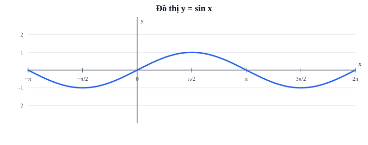
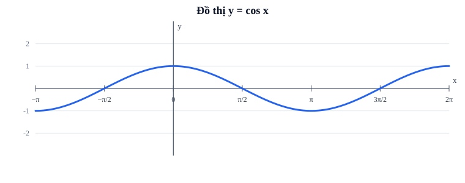
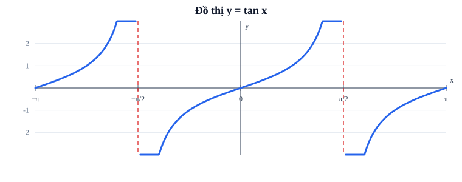
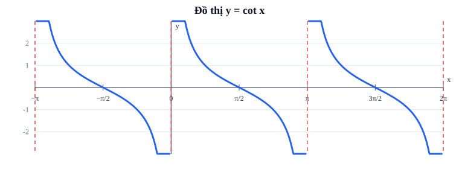

# Bài 3. Hàm số lượng giác

TOÁN 11 · CHƯƠNG I · SGK KẾT NỐI TRI THỨC

Học kiến thức, xem ví dụ suy luận, đọc đồ thị và tự khắc phục lỗi. Luyện tập theo đúng bài ở phần tiếp theo.

<nav class="thpt-r4-lesson-tabs"><a href="../">Chương I</a><a href="../luyen-tap/">Core và Luyện tập</a><a href="../tu-kiem-tra-chuong/">Tự kiểm tra cuối chương</a></nav>

=== "Khám phá kiến thức"

    ### Cùng tìm hiểu

    **Tình huống:** Ở Bài 1, điểm M quay quanh đường tròn đơn vị theo một góc x (radian); tọa độ của M là `(cos x, sin x)`. Bài 2 đã cho công cụ biến đổi các giá trị lượng giác khi cộng hoặc trừ góc. Khi M tiếp tục quay, làm thế nào mô tả sự thay đổi của **tung độ và hoành độ** theo x thay vì chỉ tính một vị trí? Ta xem x như đầu vào biến thiên, nhận `sin x` và `cos x` làm đầu ra — đó chính là các hàm số lượng giác.

    **Hãy quan sát một vòng quay** trước khi học quy tắc:

    | Góc x (radian) | 0 | π/2 | π | 3π/2 | 2π |
    |---|---:|---:|---:|---:|---:|
    | Tung độ M = sin x | 0 | 1 | 0 | −1 | 0 |
    | Hoành độ M = cos x | 1 | 0 | −1 | 0 | 1 |

    Sau đúng một vòng `2π`, M trở lại vị trí cũ nên cả sin và cos lặp giá trị: vì thế mới cần khái niệm **chu kỳ** (chu kỳ dương nhỏ nhất của sin/cos là `2π`). Góc x có thể âm hoặc lớn hơn một vòng; sin/cos vẫn nhận được mọi x thực, còn tọa độ của điểm trên đường tròn đơn vị luôn thuộc `[-1,1]`. `tan x = sin x/cos x` đòi `cos x ≠ 0`, `cot x = cos x/sin x` đòi `sin x ≠ 0`: phải hiểu vì sao có các chỗ không xác định trước khi học thuộc tiệm cận. Chu kỳ là sự **lặp lại giá trị hàm**, không phải biên độ; trong bài toán thực tế phải kiểm tra đơn vị của biến và miền áp dụng.

    ### Ví dụ trực quan

    Nhiệt độ theo ngày hay độ cao con lắc có tính lặp lại. Đồ thị lượng giác giúp diễn tả một chu kì hoàn chỉnh và dự đoán thời điểm lặp, nhưng mỗi hàm lại có miền và giá trị khác nhau.

    **Quan sát bằng số liệu:** Hàm y=sin x nhận giá trị 0 tại x=0 và x=π, đạt 1 tại π/2 và lặp lại sau 2π. Hai điểm cùng độ cao chưa chắc là cùng pha của chuyển động.

    ### Thuật ngữ và kiến thức, kỹ năng

    **Thuật ngữ:** hàm sin, cos, tan, cot, chu kì, miền xác định, tập giá trị.

    **Sau bài học, em cần:** đọc đồ thị theo trục và đơn vị radian, kiểm tiệm cận của tan/cot trước khi kết luận.

=== "Kiến thức SGK"

    ### 1.1. Hàm sin và cos

    `y=sin x`, `y=cos x` xác định với mọi `x∈ℝ`, giá trị trong `[-1,1]`. `sin(-x)=-sin x` (lẻ), `cos(-x)=cos x` (chẵn). Chu kỳ dương nhỏ nhất `2π`.
    ### 1.2. Đồ thị sin

    qua `(0,0)`, `(π/2,1)`, `(π,0)`, `(3π/2,-1)`, `(2π,0)`; tăng trên `[-π/2+2kπ,π/2+2kπ]`, giảm trên `[π/2+2kπ,3π/2+2kπ]`. Không nói sin tăng trên toàn ℝ.
    ### 1.3. Đồ thị cos

    qua `(0,1)`, `(π/2,0)`, `(π,-1)`, `(3π/2,0)`, `(2π,1)`; giảm trên `[2kπ,(2k+1)π]`, tăng trên `[(2k-1)π,2kπ]` với `k∈ℤ`.
    ### 1.4. Hàm tan

    `tan x=sin x/cos x`; TXĐ `ℝ\{π/2+kπ:k∈ℤ}`, TGT ℝ, hàm lẻ, chu kỳ cơ bản π, đồng biến trên mỗi khoảng `(-π/2+kπ,π/2+kπ)`. Tiệm cận đứng tại `x=π/2+kπ`. Không nối đồ thị qua tiệm cận.
    ### 1.5. Hàm cot

    `cot x=cos x/sin x`; TXĐ `ℝ\{kπ:k∈ℤ}`, TGT ℝ, hàm lẻ, chu kỳ π, nghịch biến trên mỗi `(kπ,(k+1)π)`, tiệm cận đứng tại `x=kπ`. Không tính `cot 0`.
    ### 1.6. Hàm biến đổi và mô hình

    `f(x)=A sin(ωx+φ)+c` (`Aω≠0`) có biên độ `|A|`, TGT `[c-|A|,c+|A|]`, chu kỳ `2π/|ω|` (nếu miền thời gian đủ để thể hiện chu kỳ); với tan/cot `tan(ωx+φ)` có chu kỳ `π/|ω|`. `y=A sin(ωx+φ)+c` khi `A=0` là hằng, không được tuyên bố có chu kỳ *cơ bản*.
    ### 1.7. Sử dụng đồ thị

    Hoành độ là radian; xét miền xác định trước, đọc điểm, cực trị và tiệm cận từ hình. Cần phân biệt tập giá trị và tập xác định, chu kỳ biểu thức và thời gian thực tế; trả lời số chu kỳ trong một phút phải đổi đơn vị nhất quán.

    ### Đọc hình và đối chiếu khái niệm

    <figure class="thpt-r4-plot thpt-r4-probability-figure"><figcaption>Hình 1. Đọc trục, miền xác định, điểm mốc và nhánh đồ thị theo phần kiến thức.</figcaption></figure>

    <figure class="thpt-r4-plot thpt-r4-probability-figure"><figcaption>Hình 2. Đọc trục, miền xác định, điểm mốc và nhánh đồ thị theo phần kiến thức.</figcaption></figure>

    <figure class="thpt-r4-plot thpt-r4-probability-figure"><figcaption>Hình 3. Đọc trục, miền xác định, điểm mốc và nhánh đồ thị theo phần kiến thức.</figcaption></figure>

    <figure class="thpt-r4-plot thpt-r4-probability-figure"><figcaption>Hình 4. Đọc trục, miền xác định, điểm mốc và nhánh đồ thị theo phần kiến thức.</figcaption></figure>

    ### Hướng dẫn đọc hình, đồ thị

    - **Hình 1** (sin): đọc dãy `(0,0)`, `(π/2,1)`, `(π,0)`, `(3π/2,−1)`, `(2π,0)`; đồ thị đi lên rồi xuống, không phải sin luôn tăng.
    - **Hình 2** (cos): bắt đầu ở 1 tại x=0, đạt −1 tại x=π, trở lại 1 tại `2π`; cùng chu kỳ với sin nhưng điểm xuất phát trên trục tung khác.
    - **Hình 3** (tan): nét đứt tại `x=±π/2` là các vị trí `cos x=0` không thuộc miền xác định; các nhánh không thể nối qua đường nét đứt.
    - **Hình 4** (cot): đường nét đứt tại các bội nguyên của π là nơi `sin x=0`; trên từng khoảng xác định, đồ thị giảm, không đánh dấu `cot 0=0`.

    ### Vận dụng — tự thử rồi mở đối chiếu

    Khi M quay thêm 2π quanh đường tròn đơn vị, sin(x+2π) thay đổi hay giữ nguyên? Hãy giải thích bằng tung độ của M.

    

Đã thử xong? Mở hướng dẫn đối chiếu

    Cùng điểm cuối ⇒ cùng tung độ ⇒ sin(x+2π)=sin x. Nếu chưa giải thích được, quay lại bảng mốc góc và đồ thị sin, rồi làm câu Core đầu tiên của bài.

    

=== "Ví dụ"

    - **EX-G11-B03-01 (TXĐ/TGT).** `f(x)=tan(2x)` yêu cầu `cos(2x)≠0`, nên `x≠π/4+kπ/2` với `k∈ℤ`; giá trị vẫn là ℝ. Không viết x≠π/2+kπ vì quên hệ số 2.
    - **EX-G11-B03-02 (chẵn/lẻ).** `f(x)=sin x+cos x` không chẵn, không lẻ vì `f(-x)=-sin x+cos x` khác cả `f(x)` lẫn `-f(x)`; trái lại `sin x` lẻ và `cos x` chẵn.
    - **EX-G11-B03-03 (chu kỳ).** `y=2 sin(3x-π/4)` có chu kỳ cơ bản `T=2π/3`, TGT `[-2,2]`; `3x` khiến chu kỳ *ngắn hơn*, không dài hơn 3 lần.
    - **EX-G11-B03-04 (đọc đồ thị).** `y=cos x` trên `[0,2π]` cắt Ox tại `π/2` và `3π/2`; vì vậy không kết luận đồ thị luôn dương.
    - **EX-G11-B03-05 (ứng dụng).** Nhiệt độ `T(t)=24+3cos(πt/6)` (t tính giờ) có đường trung bình 24°C, biên độ 3°C, chu kỳ 12 giờ; T lớn nhất 27°C tại `t=12k`, nhỏ nhất 21°C tại `t=6+12k`.

    ### Vì sao chọn phương pháp?

    - **Ví dụ 01:** **Vì sao phải kiểm miền xác định trước?** `tan(2x)` là thương có mẫu `cos(2x)`; giải `cos(2x)=0` để loại x, rồi mới kết luận về tập giá trị.
    - **Ví dụ 02:** **Vì sao thay −x?** Trên miền đối xứng, so `f(-x)` với cả `f(x)` và `-f(x)`; tổng một phần chẵn và một phần lẻ không tự động là chẵn hay lẻ.
    - **Ví dụ 03:** **Vì sao chu kỳ bị chia 3?** Đối số `3x−π/4` cần tăng `2π`, do đó x chỉ tăng `2π/3`; biên độ 2 không làm đổi chu kỳ.
    - **Ví dụ 04:** **Vì sao đọc mốc đồ thị thay vì đoán?** `cos x=0` tại hai mốc `π/2`, `3π/2` trong một vòng; chú ý miền được yêu cầu trước khi liệt kê điểm cắt.
    - **Ví dụ 05:** **Vì sao đọc đường giữa trước?** Với `24+3cos(πt/6)`, 24 là mức trung bình, 3 là độ lệch cực đại, chu kỳ theo giờ là 12; mọi kết luận thời gian chỉ xét trên miền mô hình đang sử dụng.

=== "Lỗi thường gặp"

    

Miền xác định và tập giá trị của tan/cot
<ol><li>Nhận diện lỗi: cố tính tan ở nơi cos=0 hoặc cot nơi sin=0.</li><li>Kiểm tra đầu vào: xác định đối số u(x) của tan/cot.</li><li>Sửa nguyên tắc: tan u cần cosu≠0; cot u cần sinu≠0.</li><li>Tự giải ví dụ nhỏ: tan(2x) loại x=π/4+kπ/2; cot(2x) loại x=kπ/2.</li><li>Học lại: làm lại câu Core xác định miền, rồi Practice với hệ số trong đối số.</li></ol>
<a href="../luyen-tap/?item=THPT-G11-B03-C01">Quay lại câu luyện tập phù hợp</a>

    

Chu kỳ khi đối số có hệ số
<ol><li>Nhận diện lỗi: nhân chu kỳ với hệ số của x.</li><li>Gợi nhớ: sin/cos có chu kỳ 2π theo đối số, tan/cot có chu kỳ π.</li><li>Sửa: đặt ωT bằng chu kỳ đối số, T=2π/|ω| hoặc π/|ω|, ω≠0.</li><li>Thử ngay: cos(4x-π/3) có T=π/2.</li><li>Trở về luyện tập: B03-P03, phân biệt chu kỳ cơ bản và chu kỳ bất kỳ.</li></ol>
<a href="../luyen-tap/?item=THPT-G11-B03-P01">Quay lại câu luyện tập phù hợp</a>

    ### Học tiếp

    [Core và Luyện tập](luyen-tap.md) · [Tự luận chung Chương I](../../../thu-vien/tu-luan-g11-chuong-i-b01-b02.md)
