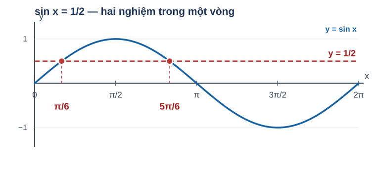
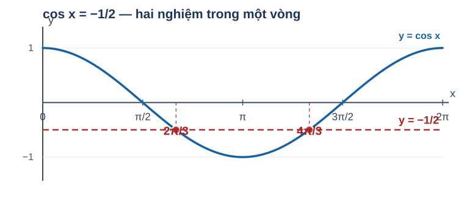

# Bài 4. Phương trình lượng giác cơ bản

TOÁN 11 · CHƯƠNG I · KẾT NỐI TRI THỨC

Từ một giá trị sin, cos, tan hoặc cot đã biết, tìm tất cả các góc thỏa mãn — không bỏ sót họ nghiệm hay quên điều kiện.

<nav class="thpt-r4-lesson-tabs"><a href="../">Chương I</a><a href="../luyen-tap/">Core và Luyện tập</a><a href="../tu-kiem-tra-chuong/">Tự kiểm tra cuối chương</a></nav>

=== "Khám phá kiến thức"

    Ở Bài 3, khi cho một góc \(x\), ta đọc được giá trị của \(\sin x,\cos x,\tan x,\cot x\) và hình dạng các đồ thị. Bây giờ ta làm việc **ngược lại**: biết trước một giá trị, có thể tìm mọi góc sinh ra giá trị ấy hay không? Trên đồ thị hàm sin, một đường ngang \(y=\frac12\) thường cắt đường cong ở hai chỗ trong một vòng; sang vòng tiếp theo, hai giao điểm lại xuất hiện. Vì thế một phương trình lượng giác không chỉ đòi tìm **một góc đúng**, mà phải tìm **tất cả các họ góc đúng**.

    ### 1.1. Khái niệm phương trình tương đương

    Bốn dạng \(\sin x=m\), \(\cos x=m\), \(\tan x=m\), \(\cot x=m\) được gọi là những **phương trình lượng giác cơ bản**, vì ẩn nằm trong biểu thức sin, cos, tan hoặc cot. Tìm nghiệm nghĩa là tìm **mọi giá trị làm hai vế cùng có nghĩa và bằng nhau**. Trước khi tìm nghiệm lượng giác, ta cần biết khi nào được thay một phương trình bằng phương trình khác. Chẳng hạn \(2x-4=0\) có nghiệm duy nhất \(x=2\). Phương trình \((x-2)(x^2+1)=0\) cũng chỉ có nghiệm thực \(x=2\), bởi \(x^2+1>0\) với mọi \(x\). Hai phương trình có hình thức khác nhau nhưng cùng tập nghiệm, nên được gọi là **tương đương**.

    Không phải phép biến đổi nào nhìn có vẻ hợp lí cũng giữ nguyên tập nghiệm. Nhân hai vế của \(x=1\) với \(x-2\) cho \(x(x-2)=x-2\), tương đương \((x-1)(x-2)=0\): bất ngờ xuất hiện nghiệm \(x=2\) không có ở bài ban đầu. Nguyên nhân là ta nhân với biểu thức có thể bằng \(0\). Đối với phương trình lượng giác, kiểm tra miền xác định và điều kiện phép biến đổi chính là hàng rào chống **thêm hoặc bỏ nghiệm**.

    **Vận dụng.** Hai phương trình \(x-3=0\) và \((x-3)^2=0\) có tương đương không? Còn hai phương trình \(\dfrac{x-1}{x+1}=0\) và \(x^2-1=0\)?

    ??? question "Đối chiếu"

        **Lời giải:** Hai phương trình thứ nhất đều có tập nghiệm \(\{3\}\), nên tương đương. Phương trình phân thức có điều kiện \(x\ne-1\) và nghiệm \(x=1\), còn \(x^2-1=0\) có nghiệm \(x=\pm1\); hai phương trình sau không tương đương.

    ??? tip "Kiểm lỗi"

        Nếu chỉ nhìn thấy cùng nhân tử \(x-1\), hãy liệt kê **toàn bộ tập nghiệm** và điều kiện xác định. Mất một điều kiện có thể biến một bước giải thành phép đổi bài toán.

    ### 1.2. Phương trình \(\sin x=m\)

    Ta bắt đầu với \(\sin x=\frac12\). Trên đường tròn lượng giác, sin là **tung độ**, nên đường ngang ở độ cao \(\frac12\) cắt đường tròn tại hai điểm: một góc \(\frac{\pi}{6}\), một góc \(\frac{5\pi}{6}\). Trên đồ thị hàm sin, đó cũng là hai giao điểm của đường \(y=\frac12\) với một chu kì đồ thị.

    <figure class="thpt-r4-plot"><figcaption><strong>Đọc hình:</strong> đường ngang \(y=\frac12\) cắt đồ thị \(y=\sin x\) tại \(x=\pi/6\) và \(x=5\pi/6\) trong một vòng \([0;2\pi)\). Sau mỗi \(2\pi\), hai giao điểm lặp lại, nên cần hai họ nghiệm.</figcaption></figure>

    Vì sin lặp sau \(2\pi\), ta phải cộng \(2k\pi\) vào **cả hai họ nghiệm**. Với một \(m\) bất kì, việc đầu tiên là kiểm \(|m|\le1\), vì tung độ của điểm trên đường tròn đơn vị không thể vượt ngoài \([-1;1]\). Chọn góc chuẩn \(\alpha\in[-\pi/2;\pi/2]\) sao cho \(\sin\alpha=m\); hai góc cùng tung độ là \(\alpha\) và \(\pi-\alpha\), sau đó cộng \(2k\pi\), \(k\in\mathbb Z\). Nếu \(m=1\) hoặc \(m=-1\), hai góc này ứng với cùng một điểm trên đường tròn, nên hai họ nghiệm trùng nhau.

    **Vận dụng.** Tìm tất cả \(x\in\mathbb R\) sao cho \(\sin x=-\frac12\), rồi tìm các nghiệm trong \([0;2\pi)\).

    ??? question "Đối chiếu"

        **Lời giải:** Chọn \(\alpha=-\pi/6\). Hai họ là \(x=-\pi/6+2k\pi\) hoặc \(x=7\pi/6+2k\pi\), \(k\in\mathbb Z\). Trong \([0;2\pi)\), hai nghiệm là \(7\pi/6\) và \(11\pi/6\) (từ họ thứ nhất với \(k=1\)).

    ??? tip "Kiểm lỗi"

        Nếu chỉ có \(x=-\pi/6+2k\pi\), em đã bỏ mất góc còn lại cùng tung độ. Nếu \(m=1\) hoặc \(-1\), hai họ có thể trùng nhau sau khi đổi \(k\), nên chỉ ghi các nghiệm **khác nhau**.

    ### 1.3. Phương trình \(\cos x=m\)

    Với cos, vị trí được đọc theo **hoành độ** của điểm trên đường tròn. Ví dụ \(\cos x=-\frac12\) là hai vị trí có cùng hoành độ âm, đối xứng qua trục hoành: \(x=2\pi/3\) và \(x=-2\pi/3\), rồi lặp sau mỗi \(2\pi\). Vì vậy dạng nghiệm của cos dùng cặp góc \(\alpha\) và \(-\alpha\), khác với cặp \(\alpha\) và \(\pi-\alpha\) của sin.

    <figure class="thpt-r4-plot"><figcaption><strong>Đọc hình:</strong> trong \([0;2\pi)\), đường ngang \(y=-\frac12\) cắt đồ thị \(y=\cos x\) tại \(x=2\pi/3\) và \(x=4\pi/3\). Hai góc \(\alpha\) và \(-\alpha\) có cùng cos; cộng các bội nguyên của \(2\pi\) để liệt kê mọi nghiệm: đó là lý do nghiệm cos có dạng \(x=\pm\alpha+2k\pi\).</figcaption></figure>

    Cũng như sin, nếu \(|m|>1\) thì không có nghiệm. Nếu \(|m|\le1\), chọn \(\alpha\in[0;\pi]\) sao cho \(\cos\alpha=m\), rồi lấy \(x=\pm\alpha+2k\pi\). Khi \(m=1\) hoặc \(m=-1\), các biểu thức có thể chỉ hai cách viết của cùng một họ nghiệm.

    **Vận dụng.** Giải \(\cos x=0\) trên \(\mathbb R\), rồi nêu nghiệm thuộc \([0;2\pi)\).

    ??? question "Đối chiếu"

        **Lời giải:** \(\cos x=0\) khi \(x=\pi/2+k\pi\), \(k\in\mathbb Z\). Trong \([0;2\pi)\) có \(x=\pi/2\) và \(x=3\pi/2\).

    ??? tip "Kiểm lỗi"

        Đừng ghi riêng \(x=\pi/2+2k\pi\): còn họ \(x=-\pi/2+2k\pi\). Có thể gộp hai họ thành \(x=\pi/2+k\pi\).

    ### 1.4. Phương trình \(\tan x=m\)

    Với tan, trên mỗi khoảng \((-\pi/2+k\pi;\pi/2+k\pi)\), đồ thị liên tục và **tăng** từ âm vô cùng đến dương vô cùng. Vì vậy bất kì đường ngang \(y=m\) nào cũng cắt **mỗi nhánh đúng một lần**. Khác sin và cos, \(m\) được phép là mọi số thực; và do tan lặp sau \(\pi\), chỉ cần **một họ nghiệm**.

    <figure class="thpt-r4-plot"><figcaption><strong>Đọc hình:</strong> hãy hình dung một đường ngang \(y=m\); đường này cắt mỗi nhánh tăng một lần. Các đường thẳng đứng đứt nét là nơi tan không xác định, không phải nghiệm.</figcaption></figure>

    Chọn \(\alpha\in(-\pi/2;\pi/2)\) thỏa \(\tan\alpha=m\); khi đó mọi nghiệm là \(x=\alpha+k\pi\). Nếu đối số là \(2x+\pi/6\), ta giải cho **toàn bộ đối số** trước, rồi mới chuyển về \(x\).

    **Vận dụng.** Giải \(\tan(2x)=1\) trên \(\mathbb R\).

    ??? question "Đối chiếu"

        **Lời giải:** \(\tan(2x)=\tan(\pi/4)\), nên \(2x=\pi/4+k\pi\). Suy ra \(x=\pi/8+k\pi/2\), \(k\in\mathbb Z\).

    ??? tip "Kiểm lỗi"

        Chu kì của **đối số** tan là \(\pi\), nhưng nghiệm theo \(x\) cách nhau \(\pi/2\) vì đối số là \(2x\). Đừng chỉ chia góc đại diện mà quên chia cả \(k\pi\).

    ### 1.5. Phương trình \(\cot x=m\)

    Cot là tỉ số \(\cos x/\sin x\), không có giá trị ở \(x=k\pi\). Trên \((0;\pi)\), đồ thị cot **giảm** từ dương vô cùng xuống âm vô cùng; mọi đường ngang \(y=m\) vẫn cắt nhánh một lần. Vì cot cũng lặp sau \(\pi\), nghiệm tổng quát có một họ.

    <figure class="thpt-r4-plot"><figcaption><strong>Đọc hình:</strong> trên \((0;\pi)\), tìm giao với một đường ngang \(y=m\). Hai đầu \(0,\pi\) là tiệm cận, không phải nghiệm; nhánh lặp theo phương ngang sau \(\pi\).</figcaption></figure>

    Ta chọn góc \(\alpha\in(0;\pi)\) có \(\cot\alpha=m\), rồi lấy \(x=\alpha+k\pi\). Phải hiểu rằng chọn góc chuẩn cho cot **khác** chọn góc chuẩn cho tan: nếu \(m<0\), góc \(\alpha\) của cot nằm ở góc phần tư II, không nằm trong \((-\pi/2;0)\).

    **Vận dụng.** Giải \(\cot x=-1\).

    ??? question "Đối chiếu"

        **Lời giải:** Vì \(\cot(3\pi/4)=-1\), nghiệm là \(x=3\pi/4+k\pi\), \(k\in\mathbb Z\).

    ??? tip "Kiểm lỗi"

        Đừng lấy \(x=\pi/4+k\pi\) vì cot của \(\pi/4\) bằng \(+1\). Có thể thay nghiệm đại diện vào \(\cos x/\sin x\) để kiểm dấu.

    ### 1.6. Sử dụng máy tính cầm tay tìm một góc từ giá trị lượng giác

    Không phải lúc nào \(m\) cũng là số quen thuộc như \(\frac12\) hay \(\frac{\sqrt2}{2}\). Khi \(\sin\alpha=0{,}58\), ta dùng chức năng \(\sin^{-1}\) trên máy tính để tìm **một góc đại diện**. Trước khi bấm, phải chọn đơn vị DEG (độ) hoặc RAD (radian). Máy tính trả về một góc, **không tự liệt kê tất cả các nghiệm của phương trình**.

    Với cos và tan, dùng \(\cos^{-1}\) hoặc \(\tan^{-1}\). Đừng nhầm kí hiệu \(\sin^{-1}\) trên phím với \(1/\sin x\): đây là thao tác **tìm góc** từ sin, không phải lấy nghịch đảo số học. Nếu biết \(\cot\alpha=m\), máy thông dụng không có phím cot riêng; nếu \(m=0\), lấy \(\alpha=\pi/2\). Nếu \(m\ne0\), tính \(\beta=\tan^{-1}(1/m)\). Khi \(\beta>0\) lấy \(\alpha=\beta\); khi \(\beta<0\) lấy \(\alpha=\beta+\pi\). Trong chế độ DEG, thay \(\pi/2,\pi\) lần lượt bằng \(90^\circ,180^\circ\).

    **Vận dụng.** Dùng chức năng \(\sin^{-1}\) (thường là SHIFT rồi sin), chọn RAD để tìm góc \(\alpha\in[-\pi/2;\pi/2]\) thỏa \(\sin\alpha=0{,}58\). Làm tròn đến bốn chữ số thập phân; đổi sang DEG và làm tròn đến hai chữ số thập phân.

    ??? question "Đối chiếu"

        **Lời giải:** \(\alpha=\sin^{-1}(0{,}58)\approx0{,}6187\) rad. Ở chế độ DEG, \(\alpha\approx35{,}45^\circ\). Hai kết quả gần đúng mô tả cùng một góc; giữ thêm chữ số trong phép tính trung gian và chỉ làm tròn ở cuối.

    ??? tip "Kiểm lỗi"

        Nếu máy báo gần \(35{,}45\) nhưng em lại viết rad, nguyên nhân là quên chế độ đo. Nếu bài hỏi **mọi** nghiệm \(\sin x=0{,}58\), vẫn phải viết hai họ \(\alpha+2k\pi\) và \(\pi-\alpha+2k\pi\), \(k\in\mathbb Z\), với \(\alpha=\sin^{-1}(0{,}58)\) trong RAD.

=== "Kiến thức SGK"

    ### 2.1. Khái niệm phương trình tương đương

    
<strong>Khái niệm — Phương trình lượng giác cơ bản</strong>
<strong>Phương trình lượng giác</strong> là phương trình có ẩn nằm trong biểu thức của một hàm số lượng giác. Các dạng <strong>cơ bản</strong> của bài là \(\sin x=m\), \(\cos x=m\), \(\tan x=m\), \(\cot x=m\), với \(m\in\mathbb R\). Giải phương trình nghĩa là tìm <strong>tất cả các giá trị thực của ẩn</strong> để hai vế xác định và bằng nhau.

    
<strong>Khái niệm — Hai phương trình tương đương</strong>
Hai phương trình (trên cùng tập số đang xét) được gọi là <strong>tương đương</strong> khi chúng có <strong>cùng tập nghiệm</strong>. Kí hiệu \(f(x)=0\ \Leftrightarrow\ g(x)=0\) khi hai phương trình tương đương. Hai phương trình cùng vô nghiệm cũng tương đương.

    
<strong>Quy tắc — Phép biến đổi tương đương</strong>
Cộng/trừ hai vế với cùng một biểu thức, hoặc nhân/chia hai vế với cùng một biểu thức <strong>luôn khác \(0\)</strong> trên miền đang xét, sẽ giữ nguyên tập nghiệm <strong>khi không thay đổi điều kiện xác định</strong>.

Không nhân với một biểu thức có thể bằng \(0\) rồi tùy ý giữ các nghiệm mới; không chia cho biểu thức có thể bằng \(0\) để đánh mất nghiệm.

    **Cách dùng:** Trước mỗi phép chia hoặc khử mẫu, ghi miền xác định và điều kiện của biểu thức tham gia. Chỉ dùng dấu \(\Leftrightarrow\) khi hai chiều thật sự đúng.

    ### 2.2. Phương trình \(\sin x=m\)

    
<strong>Công thức nghiệm — Phương trình sin</strong>
<strong>Điều kiện có nghiệm:</strong> \(|m|\le1\). Nếu \(|m|>1\), phương trình vô nghiệm.

Khi \(|m|\le1\), lấy duy nhất \(\alpha\in[-\pi/2;\pi/2]\) sao cho \(\sin\alpha=m\). Khi đó

\(\sin x=m\) khi và chỉ khi \(x=\alpha+2k\pi\) hoặc \(x=\pi-\alpha+2k\pi\), với \(k\in\mathbb Z\).

<strong>Dạng so hai sin:</strong> \(\sin u=\sin v\iff u=v+2k\pi\) hoặc \(u=\pi-v+2k\pi\), \(k\in\mathbb Z\).

    <figure class="thpt-r4-plot"><figcaption><strong>Tra hình khi đọc công thức:</strong> hai giao điểm trong một vòng minh họa hai họ \(\alpha+2k\pi\) và \(\pi-\alpha+2k\pi\). Hình dùng chung với tab Khám phá; điều kiện \(|m|\le1\) vẫn phải tự kiểm cho giá trị \(m\) khác.</figcaption></figure>

    **Chú ý:** \(\sin x=0\iff x=k\pi\); \(\sin x=1\iff x=\pi/2+2k\pi\); \(\sin x=-1\iff x=-\pi/2+2k\pi\). Với đơn vị độ, dùng \(360^\circ\) thay \(2\pi\) và \(180^\circ\) thay \(\pi\). Khi hai họ trùng nhau, không tính hai lần.

    ### 2.3. Phương trình \(\cos x=m\)

    
<strong>Công thức nghiệm — Phương trình cos</strong>
<strong>Điều kiện có nghiệm:</strong> \(|m|\le1\). Nếu \(|m|>1\), phương trình vô nghiệm.

Khi \(|m|\le1\), lấy duy nhất \(\alpha\in[0;\pi]\) sao cho \(\cos\alpha=m\). Khi đó

\(\cos x=m\iff x=\pm\alpha+2k\pi,\quad k\in\mathbb Z.\)

<strong>Dạng so hai cos:</strong> \(\cos u=\cos v\iff u=\pm v+2k\pi,\ k\in\mathbb Z\).

    <figure class="thpt-r4-plot"><figcaption><strong>Tra hình khi đọc công thức:</strong> hai giao điểm trong một vòng minh họa hai góc đối nhau \(\alpha,-\alpha\) sau khi cộng bội nguyên của \(2\pi\), tương ứng \(x=\pm\alpha+2k\pi\). Hình dùng chung với tab Khám phá.</figcaption></figure>

    **Chú ý:** \(\cos x=0\iff x=\pi/2+k\pi\); \(\cos x=1\iff x=2k\pi\); \(\cos x=-1\iff x=\pi+2k\pi\). Với đơn vị độ, dùng \(360^\circ\) thay \(2\pi\).

    ### 2.4. Phương trình \(\tan x=m\)

    
<strong>Công thức nghiệm — Phương trình tan</strong>
<strong>Với mọi \(m\in\mathbb R\)</strong>, có đúng một \(\alpha\in(-\pi/2;\pi/2)\) thỏa \(\tan\alpha=m\).

\(\tan x=m\iff x=\alpha+k\pi,\quad k\in\mathbb Z.\)

<strong>Dạng so hai tan:</strong> \(\tan u=\tan v\iff u=v+k\pi,\ k\in\mathbb Z\), <strong>chỉ khi cả hai vế xác định</strong>.

    **Điều kiện:** \(\tan x\) chỉ xác định khi \(\cos x\ne0\). Với đơn vị độ, một vòng lặp của tan là \(180^\circ\).

    ### 2.5. Phương trình \(\cot x=m\)

    
<strong>Công thức nghiệm — Phương trình cot</strong>
<strong>Với mọi \(m\in\mathbb R\)</strong>, có đúng một \(\alpha\in(0;\pi)\) thỏa \(\cot\alpha=m\).

\(\cot x=m\iff x=\alpha+k\pi,\quad k\in\mathbb Z.\)

<strong>Dạng so hai cot:</strong> \(\cot u=\cot v\iff u=v+k\pi,\ k\in\mathbb Z\), <strong>chỉ khi hai vế xác định</strong>.

    **Điều kiện:** \(\cot x\) chỉ xác định khi \(\sin x\ne0\). Với đơn vị độ, một vòng lặp của cot là \(180^\circ\).

    ### 2.6. Sử dụng máy tính cầm tay tìm một góc khi biết giá trị lượng giác

    
<strong>Quy tắc — Sử dụng máy tính cầm tay</strong>
<strong>Bước 1:</strong> chọn đúng DEG hoặc RAD theo yêu cầu.

<strong>Bước 2:</strong> với \(m\in[-1;1]\) chọn \(\sin^{-1}(m)\) hoặc \(\cos^{-1}(m)\); với \(m\in\mathbb R\) chọn \(\tan^{-1}(m)\). Chỉ lấy kết quả trong nhánh giá trị góc đại diện của từng phím.

<strong>Bước 3:</strong> nếu cần nghiệm phương trình, dùng công thức nghiệm của mục 2.2–2.5 để viết <strong>đầy đủ các họ nghiệm</strong>, rồi lọc theo đoạn nếu có.

    **Miền góc đại diện:** \(\sin^{-1}(m)\in[-\pi/2;\pi/2]\), \(\cos^{-1}(m)\in[0;\pi]\), \(\tan^{-1}(m)\in(-\pi/2;\pi/2)\) trong chế độ RAD. Với cot, khi \(m=0\) lấy \(\alpha=\pi/2\); khi \(m\ne0\) bấm \(\beta=\tan^{-1}(1/m)\), lấy \(\alpha=\beta\) nếu \(\beta>0\), hoặc \(\alpha=\beta+\pi\) nếu \(\beta<0\). Trong DEG, dùng \(90^\circ\) và \(180^\circ\) thay cho \(\pi/2\) và \(\pi\).

    **Ghi nhớ khi tự học:** Một số trên màn hình là <strong>một góc đại diện</strong>, không phải toàn bộ tập nghiệm. Phải kiểm miền giá trị của sin/cos, điều kiện tan/cot, chế độ DEG/RAD và số nguyên \(k\).

=== "Ví dụ"

    ### 3.1. So tập nghiệm trước khi gọi tương đương

    **Đề bài.** Hai phương trình \(\dfrac{x-2}{x+2}=0\) và \(x^2-4=0\) có tương đương không?

    **Phân tích:** Phải giữ điều kiện mẫu khác \(0\), giải từng phương trình rồi so hai tập nghiệm thực.

    

<strong>Lời giải.</strong> Phương trình phân thức có điều kiện \(x\ne-2\), tử bằng \(0\) khi \(x=2\), nên \(S_1=\{2\}\). Phương trình \(x^2-4=0\) có \(S_2=\{-2,2\}\). Vì \(S_1\ne S_2\), hai phương trình không tương đương.

    **Kiểm lại:** \(x=-2\) bị loại khỏi miền xác định của phương trình thứ nhất nhưng là nghiệm của phương trình thứ hai.

    ### 3.2. Hai họ nghiệm của sin khi đối số có hệ số

    **Đề bài.** Giải \(\sin(2x)=\dfrac{\sqrt3}{2}\) trên \(\mathbb R\).

    **Phân tích:** Đặt toàn bộ đối số \(u=2x\). Vì \(\sin u=\sin(\pi/3)\), phải viết **hai họ** của \(u\) rồi chia cả hai họ cho \(2\).

    

<strong>Lời giải.</strong> \(2x=\pi/3+2k\pi\) hoặc \(2x=2\pi/3+2k\pi\), \(k\in\mathbb Z\). Vậy \(x=\pi/6+k\pi\) hoặc \(x=\pi/3+k\pi\), \(k\in\mathbb Z\).

    **Kiểm lại:** Với \(x=\pi/6\), \(2x=\pi/3\) cho sin bằng \(\sqrt3/2\). Với \(x=\pi/3\), \(2x=2\pi/3\) cho cùng giá trị. Nếu chỉ có một họ thì thiếu nghiệm.

    ### 3.3. Lọc nghiệm cos theo đoạn

    **Đề bài.** Tìm các nghiệm của \(\cos x=-\dfrac12\) trong \([0;2\pi)\).

    **Phân tích:** Cos bằng \(-1/2\) tại hai góc của một vòng thuộc góc phần tư II và III. Viết nghiệm trên \(\mathbb R\), sau đó chọn các \(k\) để nằm trong nửa khoảng.

    

<strong>Lời giải.</strong> \(x=\pm2\pi/3+2k\pi\), \(k\in\mathbb Z\). Trong \([0;2\pi)\), họ \(x=2\pi/3+2k\pi\) nhận \(k=0\); họ \(x=-2\pi/3+2k\pi\) nhận \(k=1\). Vậy nghiệm là \(x=2\pi/3\) và \(x=4\pi/3\).

    **Kiểm lại:** Cả hai cos bằng \(-1/2\); \(2\pi\) không thuộc khoảng đã cho, và không có nghiệm nào khác trong một chu kì.

    ### 3.4. Tìm họ nghiệm của tan với đối số ghép

    **Đề bài.** Giải \(\tan(2x+\pi/6)=1/\sqrt3\).

    **Phân tích:** \(\tan(\pi/6)=1/\sqrt3\), nên toàn bộ đối số phải bằng \(\pi/6+k\pi\). Không viết hai họ như phương trình sin.

    

<strong>Lời giải.</strong> \(2x+\pi/6=\pi/6+k\pi\), suy ra \(2x=k\pi\), nên \(x=k\pi/2,\ k\in\mathbb Z\).

    **Kiểm lại:** Với \(x=k\pi/2\), đối số là \(k\pi+\pi/6\), tan luôn bằng \(1/\sqrt3\) và có nghĩa.

    ### 3.5. Nghiệm cot và góc đại diện

    **Đề bài.** Giải \(\cot(3x)=-1\) trên \(\mathbb R\).

    **Phân tích:** Chọn góc \(\alpha=3\pi/4\in(0;\pi)\) vì \(\cot\alpha=-1\); cot có một họ nghiệm, lặp sau \(\pi\).

    

<strong>Lời giải.</strong> \(3x=3\pi/4+k\pi\), do đó \(x=\pi/4+k\pi/3,\ k\in\mathbb Z\).

    **Kiểm lại:** Với \(k=0\), \(3x=3\pi/4\), có cos âm, sin dương nên cot bằng \(-1\); thêm \(k\pi\) không làm đổi cot.

    ### 3.6. Một giá trị máy tính không phải tập nghiệm

    **Đề bài.** Trong chế độ RAD, tính gần đúng góc \(\alpha\in[-\pi/2;\pi/2]\) với \(\sin\alpha=0{,}58\). Từ đó viết nghiệm tổng quát của \(\sin x=0{,}58\).

    **Phân tích:** \(0{,}58\in[-1;1]\) nên có nghiệm. Phím \(\sin^{-1}\) trả một góc \(\alpha\); phương trình sin còn có góc \(\pi-\alpha\), rồi lặp sau \(2\pi\).

    

<strong>Lời giải.</strong> Máy ở chế độ RAD cho \(\alpha=\sin^{-1}(0{,}58)\approx0{,}61873\) rad. Vậy \(x=\alpha+2k\pi\) hoặc \(x=\pi-\alpha+2k\pi\), \(k\in\mathbb Z\); nếu làm tròn, họ thứ hai có góc đại diện khoảng \(2{,}52286\) rad.

    **Kiểm lại:** \(\sin(0{,}61873)\approx0{,}58\) và \(\sin(\pi-0{,}61873)\approx0{,}58\). Không dùng giá trị làm tròn thay cho \(\alpha\) khi cần nghiệm chính xác.

    ### 3.7. Từ mô hình pha Mặt Trăng tới phương trình cos

    **Đề bài.** Trong mô hình \(F=\dfrac{1-\cos\alpha}{2}\), với \(0^\circ\le\alpha\le360^\circ\), xác định các góc \(\alpha\) khiến tỉ lệ được chiếu sáng \(F=\dfrac14\).

    **Phân tích:** Biết \(F\), ta giải ngược lại để tìm cos. Hai góc có cùng cos nằm đối xứng qua trục hoành, rồi phải lọc theo khoảng góc thực tế mà mô hình cho phép.

    

<strong>Lời giải.</strong> \((1-\cos\alpha)/2=1/4\iff1-\cos\alpha=1/2\iff\cos\alpha=1/2\). Do đó \(\alpha=\pm60^\circ+k360^\circ\). Trên \([0^\circ;360^\circ]\), có \(\alpha=60^\circ\) và \(\alpha=300^\circ\).

    **Kiểm lại:** \(\cos60^\circ=\cos300^\circ=1/2\), nên \(F=(1-1/2)/2=1/4\). Hai góc tương ứng hai vị trí hình học, không phải hai phép đo khác đơn vị.

=== "Lỗi thường gặp"

    ### 4.1. Nhân hoặc chia với biểu thức có thể bằng không

    **Dấu hiệu:** Nhân cả hai vế với \(x-2\) rồi coi nghiệm mới \(x=2\) là nghiệm cũ; hoặc chia cho \(\sin x\) khi chưa biết \(\sin x\ne0\).

    **Vì sao sai:** Phép biến đổi không bảo đảm hai chiều tương đương; có thể thêm nghiệm hoặc bỏ nghiệm.

    **Cách sửa:** Ghi miền xác định và điều kiện nhân/chia; dùng dấu \(\Leftrightarrow\) chỉ khi chứng minh được hai tập nghiệm giữ nguyên. Nếu chỉ có phép suy ra một chiều, kiểm thế nghiệm vào phương trình gốc.

    ### 4.2. Bỏ họ nghiệm còn lại của sin hoặc cos

    **Dấu hiệu:** \(\sin x=1/2\) chỉ ghi \(x=\pi/6+2k\pi\), hoặc \(\cos x=-1/2\) chỉ ghi \(x=2\pi/3+2k\pi\).

    **Vì sao sai:** Trong một vòng thường có **hai** vị trí cùng tung độ hoặc hoành độ.

    **Cách sửa:** Trở lại đối xứng trên đường tròn/đồ thị; viết đủ hai họ cho sin/cos, rồi gộp khi chúng thực sự trùng nhau ở các giá trị biên.

    ### 4.3. Nhầm góc độ và góc radian

    **Dấu hiệu:** Viết \(x=30+2k\pi\), hoặc bấm DEG rồi coi màn hình \(30\) là \(30\) rad.

    **Vì sao sai:** \(180^\circ=\pi\) rad; trộn \(360^\circ\) với \(2\pi\) trong cùng công thức làm sai đơn vị góc.

    **Cách sửa:** Chọn một đơn vị xuyên suốt trước khi giải; nếu đề đổi sang độ, thay toàn bộ \(\pi,2\pi\) bằng \(180^\circ,360^\circ\).

    ### 4.4. Quên chia cả họ nghiệm khi đối số chứa hệ số

    **Dấu hiệu:** Giải \(\tan(2x)=1\) thành \(x=\pi/8+k\pi\).

    **Vì sao sai:** Từ \(2x=\pi/4+k\pi\), phải chia **mọi hạng tử** cho \(2\).

    **Cách sửa:** Giải cho đối số \(u\) trước; khi đổi về \(x\), thao tác đại số phải áp dụng cả hằng số và \(k\pi\).

    ### 4.5. Nhầm miền giá trị sin/cos với tan/cot

    **Dấu hiệu:** Coi \(\sin x=2\) có nghiệm, hoặc coi \(\tan x=2\) vô nghiệm chỉ vì \(2>1\).

    **Vì sao sai:** Sin/cos chỉ nhận giá trị trong \([-1;1]\), còn tan/cot có tập giá trị là \(\mathbb R\).

    **Cách sửa:** Phân loại bốn phương trình trước khi áp dụng công thức; với sin/cos kiểm \(|m|\le1\), còn tan/cot kiểm miền xác định đối số.

    ### 4.6. Để máy tính thay công thức nghiệm và bỏ lọc khoảng

    **Dấu hiệu:** Bấm \(\sin^{-1}(0{,}58)\), thấy \(0{,}61873\) rồi viết đó là nghiệm duy nhất; hoặc liệt kê cả góc ngoài đoạn cho phép.

    **Vì sao sai:** Máy chỉ trả góc đại diện; nghiệm thực còn lặp theo chu kì và phải lọc theo miền bài toán.

    **Cách sửa:** Dùng giá trị máy để xác định \(\alpha\), viết đủ họ tổng quát, rồi xét \(k\in\mathbb Z\) và điều kiện biên trước khi kết luận.

    
Nguồn biên soạn: SGK Toán 11, <em>Kết nối tri thức với cuộc sống</em>, tập một, Bài 4 “Phương trình lượng giác cơ bản”, trang in 31–39. Sáu mục chính đối ứng giữa hai tab; hai hình giao điểm sin/cos là đồ thị authoring của Bài 4 được dùng chung ở cả hai tab, còn hình tan/cot dùng lại SVG canonical từ Bài 3. Việc đọc trực tiếp hình in của toàn bộ trang 31–39 chưa được xác nhận ở phiên này.

