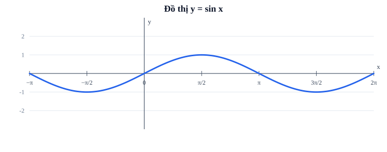
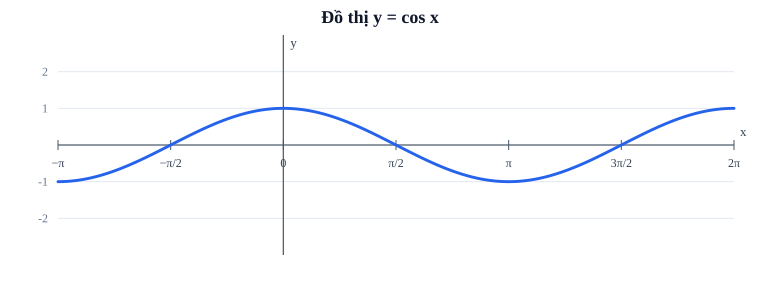
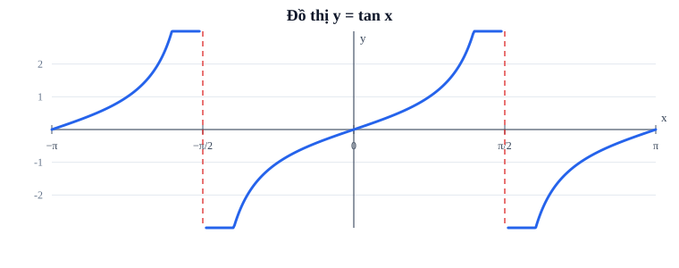
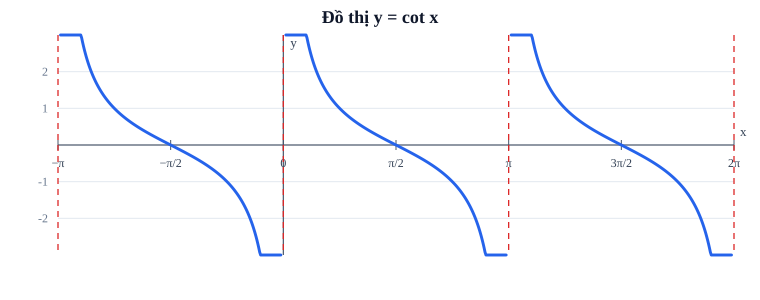

# Bài 4. Phương trình lượng giác cơ bản

TOÁN 11 · CHƯƠNG I

Từ một giá trị sin, cos, tan hay cot tìm lại toàn bộ góc: hiểu vì sao có các họ nghiệm, giải đúng điều kiện, tự kiểm kết quả và ứng dụng.

<nav class="thpt-r4-lesson-tabs"><a href="../">Chương I</a><a href="../luyen-tap/">Core và Luyện tập</a><a href="../tu-kiem-tra-chuong/">Tự kiểm tra cuối chương</a></nav>

=== "Khám phá kiến thức"

    Ở Bài 3, biết góc \(x\) ta đọc được \(\sin x\), \(\cos x\) và các giá trị lượng giác khác. Nhưng trong một tình huống dao động, đôi khi ta chỉ biết **độ cao cần đạt**, rồi phải tìm **mọi thời điểm** đạt độ cao ấy. Ta cần giải phương trình lượng giác: đi ngược từ giá trị hàm đến những góc tương ứng. Một đường ngang có thể cắt đồ thị sin tại nhiều điểm; khi đồ thị lặp lại, các nghiệm cũng lặp lại thành **họ nghiệm**.

    Bài 1 cho ta các góc cùng tia cuối; Bài 2 cho các công thức biến đổi; Bài 3 cho tính tuần hoàn và đồ thị. Khi kết hợp chúng, em cần phân biệt ba công việc: **bảo toàn tập nghiệm khi biến đổi**, **liệt kê đủ các họ nghiệm**, và **lọc nghiệm theo miền đề bài**.

    ### 1.1. Vì sao hai phương trình có thể tương đương hoặc không?

    Hai phương trình được gọi là tương đương nếu chúng có **cùng một tập nghiệm**. Điều này mạnh hơn việc hai vế trông giống nhau sau khi rút gọn. Chẳng hạn, nhân hai vế với một biểu thức có thể bằng \(0\) đôi khi tạo thêm nghiệm; chia cho biểu thức có thể bằng \(0\) đôi khi làm mất nghiệm. Vì thế, trước khi dùng kí hiệu \(\Leftrightarrow\), hãy xem phép biến đổi có giữ nguyên điều kiện hay không.

    **Vận dụng.** So sánh tập nghiệm thực của \(\dfrac{x-3}{x+2}=0\) và \((x-3)(x+2)=0\). Hai phương trình có tương đương không? Tại sao?

    

    ??? question "Đối chiếu"

        **Lời giải:** Phương trình phân thức có điều kiện \(x\ne-2\); nó bằng \(0\) khi \(x=3\), nên tập nghiệm \(S_1=\{3\}\). Phương trình tích có \(x=3\) hoặc \(x=-2\), nên \(S_2=\{-2,3\}\). Hai tập nghiệm khác nhau, do đó **không tương đương**.

        **Vì sao:** Không được nhân phương trình phân thức với \((x+2)^2\) rồi bỏ luôn điều kiện \(x\ne-2\). Nghiệm vừa xuất hiện \(-2\) không được phép ở phương trình đầu.

    

    ??? tip "Kiểm lỗi"

        **Dấu hiệu:** Em nhận cả \(x=-2\) là nghiệm phương trình phân thức.

        **Tự sửa:** Ghi điều kiện trước, tìm nghiệm, rồi thử lại từng nghiệm vào **phương trình gốc**. Ôn mục 2.1 và luyện bài Practice về kiểm miền xác định khi phương trình chứa \(\tan x,\tan2x\) trong [Core và Luyện tập Bài 4](../luyen-tap/).

    ### 1.2. Từ đường ngang đến hai họ nghiệm của sin

    Trên một vòng tròn lượng giác, hai điểm khác nhau thường có cùng tung độ. Bởi vậy khi \(-1<m<1\), phương trình \(\sin x=m\) thường có **hai góc cơ bản** trong một vòng, rồi lặp lại sau mỗi \(2\pi\). Không phải mọi \(m\) đều hợp lệ: sin không thể vượt ra ngoài \([-1,1]\). Ở các mức \(m=\pm1\), hai mô tả có thể rơi vào **cùng một họ** nên không được đếm đôi.

    **Vận dụng.** Tìm tất cả nghiệm của \(\sin x=-\dfrac{\sqrt2}{2}\) trên \([0;2\pi)\). Từ hình dung đường tròn, giải thích vì sao có hai nghiệm.

    

    ??? question "Đối chiếu"

        **Lời giải:** Sin âm ở góc phần tư III và IV. Góc tham chiếu là \(\pi/4\), vì vậy \(x=5\pi/4\) hoặc \(x=7\pi/4\) trên \([0;2\pi)\). Trên \(\mathbb R\), mỗi nghiệm còn cộng được \(2k\pi\), \(k\in\mathbb Z\).

        **Kiểm lại:** \(\sin(5\pi/4)=\sin(7\pi/4)=-\sqrt2/2\); hai góc đều nằm trong nửa khoảng đã hỏi.

    

    ??? tip "Kiểm lỗi"

        **Dấu hiệu:** Em chỉ viết \(7\pi/4\) hoặc chỉ viết \(5\pi/4\), hay thêm \(2\pi\) vào nửa khoảng.

        **Tự sửa:** Xác định dấu sin theo góc phần tư rồi viết **đủ hai góc trong một vòng**; nếu đề hỏi toàn \(\mathbb R\), mới thêm \(2k\pi\). Ôn mục 2.2 và thử câu Core \(\sin x=-1/2\) của [Bài 4](../luyen-tap/) với hai họ nghiệm.

    ### 1.3. Cùng một hoành độ có thể đến từ hai phía trên cos

    Trên đường tròn lượng giác, hai điểm đối xứng qua trục hoành có cùng **hoành độ**. Vì thế, nghiệm của \(\cos x=m\) thường lấy từ **một góc \(\alpha\)** và góc đối \(-\alpha\), chứ không dùng góc bù \(\pi-\alpha\) như sin. Trên đồ thị, hãy tưởng tượng một đường ngang cắt đường cos tại các hoành độ; khi dịch sang phải \(2\pi\), các nghiệm lặp lại.

    **Vận dụng.** Tìm các \(x\in[0;2\pi)\) sao cho \(\cos x=\dfrac{\sqrt2}{2}\). Tại sao không dùng \(\pi-\pi/4\) làm nghiệm thứ hai?

    

    ??? question "Đối chiếu"

        **Lời giải:** \(\cos x=\sqrt2/2\) tại \(x=\pi/4\) và \(x=7\pi/4\) trong một vòng. Góc \(7\pi/4\) đồng vị trí với \(-\pi/4\). Không lấy \(3\pi/4=\pi-\pi/4\) vì \(\cos(3\pi/4)=-\sqrt2/2\).

    

    ??? tip "Kiểm lỗi"

        **Dấu hiệu:** Em dùng nhầm công thức sin cho cos, hoặc quên nghiệm góc phần tư IV.

        **Tự sửa:** Dùng tính chẵn \(\cos(-\alpha)=\cos\alpha\), thử lại cả hai góc. Ôn mục 2.3 và giải câu Core \(\cos x=1/2\) trong [Core và Luyện tập Bài 4](../luyen-tap/).

    ### 1.4. Vì sao tan có một họ nghiệm cách nhau \(\pi\)?

    Tan là tỉ số \(\sin x/\cos x\). Khi quay thêm nửa vòng \(\pi\), cả tử và mẫu đều đổi dấu, tỉ số giữ nguyên ở nơi mẫu khác \(0\). Trên một nhánh giữa hai tiệm cận, đường ngang \(y=m\) cắt đồ thị tan tại một điểm; toàn bộ nghiệm lặp lại cách nhau \(\pi\). Nhưng nếu đối số là \(2x-\pi/4\), ta phải giải cho **đối số trước** rồi mới tìm \(x\).

    **Vận dụng.** Giải \(\tan(2x-\pi/4)=1\) trên \(\mathbb R\). Các nghiệm có cách nhau \(\pi\) theo \(x\) không?

    

    ??? question "Đối chiếu"

        **Lời giải:** Vì \(\tan(\pi/4)=1\), ta có \(2x-\pi/4=\pi/4+k\pi\) với \(k\in\mathbb Z\). Suy ra \(x=\pi/4+k\pi/2\). Khoảng lặp theo \(x\) là \(\pi/2\), không phải \(\pi\), vì hệ số của \(x\) là \(2\).

        **Kiểm lại:** Với \(x=\pi/4\), đối số bằng \(\pi/4\), tan bằng \(1\); các nghiệm trên không rơi vào tiệm cận của tan.

    

    ??? tip "Kiểm lỗi"

        **Dấu hiệu:** Em ghi \(x=\pi/4+k\pi\) hoặc quên cộng \(\pi/4\) trước khi chia hai.

        **Tự sửa:** Đặt \(u=2x-\pi/4\), giải \(\tan u=1\), sau đó giải phương trình bậc nhất cho \(x\). Ôn mục 2.4; luyện câu Practice \(\tan(3x)=\sqrt3\) trong [Bài 4 – Luyện tập](../luyen-tap/).

    ### 1.5. Cot cũng có chu kì \(\pi\), nhưng điều kiện khác tan

    Với \(\cot x=\cos x/\sin x\), mẫu bằng \(0\) khi \(x=k\pi\), chứ không phải ở \(x=\pi/2+k\pi\). Trong một khoảng \((0;\pi)\), hàm cot giảm từ rất lớn xuống rất nhỏ, nên mỗi giá trị \(m\in\mathbb R\) ứng với đúng một góc đại diện. Đặc biệt, \(\cot x=0\) **có nghiệm**; không được tìm bằng cách chia \(1/0\).

    **Vận dụng.** Giải \(\cot(2x+\pi/3)=0\) trên \(\mathbb R\). Ghi rõ điều kiện xác định trước khi kết luận.

    

    ??? question "Đối chiếu"

        **Lời giải:** Với \(u=2x+\pi/3\), phương trình \(\cot u=0\) tương đương \(\cos u=0\) **và** \(\sin u\ne0\). Do đó \(u=\pi/2+k\pi\); tại đó sin bằng \(\pm1\), thỏa điều kiện. Suy ra \(2x=\pi/6+k\pi\), nên \(x=\pi/12+k\pi/2\), \(k\in\mathbb Z\).

    

    ??? tip "Kiểm lỗi"

        **Dấu hiệu:** Em nói phương trình vô nghiệm vì \(\tan u=1/0\) không xác định, hoặc loại \(u=\pi/2\).

        **Tự sửa:** Trở về \(\cot u=\cos u/\sin u\): để thương bằng \(0\), tử phải bằng \(0\) và mẫu phải khác \(0\). Ôn mục 2.5; giải lại câu Core \(\cot x=1\) tại [Core và Luyện tập Bài 4](../luyen-tap/).

    ### 1.6. Máy tính chỉ tìm một góc đại diện

    Khi biết \(\sin x=0{,}3\), máy tính có thể trả về một giá trị \(\arcsin(0{,}3)\). Nhưng đó **không phải mọi nghiệm**: từ góc đại diện còn phải dùng đối xứng và chu kì. Quan trọng hơn, cùng một góc có số đo độ và radian khác nhau. Trước khi bấm máy, hãy xem đề dùng đơn vị gì, rồi ghi lại công thức nghiệm đủ họ trước khi làm tròn.

    **Vận dụng.** Dùng chế độ **RAD** để tìm gần đúng hai nghiệm của \(\sin x=0{,}3\) trên \([0;2\pi)\), làm tròn đến ba chữ số thập phân.

    

    ??? question "Đối chiếu"

        **Lời giải:** Máy cho \(\alpha=\arcsin(0{,}3)\approx0{,}304693\) rad. Vì sin dương, hai góc trong một vòng là \(\alpha\) và \(\pi-\alpha\approx2{,}836900\) rad. Làm tròn: \(x\approx0{,}305\) hoặc \(x\approx2{,}837\).

        **Kiểm lại:** Thay hai giá trị chưa làm tròn vào sin đều được \(0{,}3\). Máy tìm một **góc chính**, còn công thức lượng giác cung cấp đủ nghiệm.

    

    ??? tip "Kiểm lỗi"

        **Dấu hiệu:** Em chỉ có một đáp số, hoặc ghi \(17{,}458^\circ\) nhưng tưởng là radian.

        **Tự sửa:** Chọn đúng DEG/RAD, giữ đủ chữ số trung gian, rồi tìm nghiệm thứ hai \(\pi-\alpha\). Ôn mục 2.6 và luyện câu Practice về \(\cos(x-\pi/6)\) tại [Core và Luyện tập Bài 4](../luyen-tap/) để viết đủ hai họ.

    ### 1.7. Kết nối thực tiễn: một tỉ lệ, nhiều vị trí

    Trong mô hình đơn giản về pha Mặt Trăng, tỉ lệ bề mặt sáng có thể viết \(F=\frac12(1-\cos\alpha)\), với \(0\le\alpha\le2\pi\). Nếu chỉ biết tỉ lệ sáng, ta phải **giải phương trình cos rồi lọc góc trong miền**. Hai vị trí khác nhau có thể cho cùng tỉ lệ; biết một con số \(F\) chưa đủ để suy ra duy nhất vị trí.

    **Vận dụng.** Theo mô hình trên, khi \(F=\dfrac34\), tìm tất cả các góc \(\alpha\in[0;2\pi]\). Cho biết có bao nhiêu vị trí thỏa mãn.

    

    ??? question "Đối chiếu"

        **Lời giải:** \(\frac12(1-\cos\alpha)=\frac34\) dẫn đến \(1-\cos\alpha=\frac32\), hay \(\cos\alpha=-\frac12\). Hai góc trong miền là \(\alpha=2\pi/3\) và \(\alpha=4\pi/3\); có **hai vị trí**.

        **Kiểm lại:** Cả hai góc có cos bằng \(-1/2\), nên \(F=(1+1/2)/2=3/4\). Hai biên \(0,2\pi\) cho \(F=0\), không phải đáp án.

    

    ??? tip "Kiểm lỗi"

        **Dấu hiệu:** Em giữ một nghiệm \(2\pi/3\) hoặc giải nhầm thành \(\cos\alpha=1/2\).

        **Tự sửa:** Rút gọn phương trình về \(\cos\alpha=m\) trước; vẽ/nhớ hai vị trí đối xứng qua Ox có cùng hoành độ rồi kiểm miền \([0;2\pi]\). Ôn mục 2.3 và Ví dụ 3.3; trong [Luyện tập Bài 4](../luyen-tap/), thực hành tiếp một bài ứng dụng có giới hạn thời gian.

=== "Kiến thức SGK"

    ### 2.1. Khái niệm phương trình tương đương

    
<strong>Định nghĩa:</strong> Hai phương trình được gọi là <em>tương đương</em> nếu chúng có cùng tập nghiệm. Kí hiệu \(P(x)\Leftrightarrow Q(x)\) ở bước giải chỉ hợp lệ khi hai điều kiện xác định và tập nghiệm được bảo toàn.

    
<strong>Phép biến đổi tương đương:</strong> Trên cùng miền đang xét, có thể cộng/trừ hai vế với một biểu thức xác định; chỉ được nhân/chia hai vế cho biểu thức <em>chắc chắn khác \(0\)</em> trên miền đó mà không sinh/mất nghiệm.

    **Vì sao cần kiểm điều kiện:** Nếu nhân với một biểu thức có thể bằng \(0\), nghiệm mới có thể xuất hiện. Nếu chia cho biểu thức có thể bằng \(0\), nghiệm cũ có thể mất. Hai phương trình cùng vô nghiệm cũng được xem là tương đương. Khi giải có mẫu chứa ẩn, ghi điều kiện trước; với phép biến đổi chỉ suy ra nghiệm ứng viên, phải thử lại đề gốc.

    ### 2.2. Phương trình \(\sin x=m\)

    Vì \(-1\le\sin x\le1\), phương trình \(\sin x=m\) **vô nghiệm** khi \(|m|>1\). Khi \(|m|\le1\), lấy góc đại diện \(\alpha\in[-\pi/2;\pi/2]\) sao cho \(\sin\alpha=m\). Hai góc có cùng sin là \(\alpha\) và \(\pi-\alpha\); cả hai lặp lại sau từng vòng \(2\pi\).

    
<strong>Công thức nghiệm:</strong>
    \[
    \sin x=m\quad(|m|\le1)
    \quad\Longleftrightarrow\quad
    \begin{cases}
      x=\alpha+2k\pi,\\
      x=\pi-\alpha+2k\pi
    \end{cases}\qquad(k\in\mathbb Z,\;\sin\alpha=m).
    \]
    

    **Trường hợp đặc biệt:** \(\sin x=0\Leftrightarrow x=k\pi\); \(\sin x=1\Leftrightarrow x=\pi/2+2k\pi\); \(\sin x=-1\Leftrightarrow x=-\pi/2+2k\pi\). Khi hai họ trùng, chỉ liệt kê **một tập nghiệm**. Nếu dùng độ, thay \(2\pi\) bằng \(360^\circ\), \(\pi-\alpha\) bằng \(180^\circ-\alpha\).

    **Khi đối số biến đổi:** Với \(\sin u=\sin v\), lần lượt giải \(u=v+2k\pi\) hoặc \(u=\pi-v+2k\pi\); giải **cả hai** cho ẩn \(x\). Không tự chia cho \(\sin x\) khi có thể bằng \(0\).

    <figure class="thpt-r4-plot"><figcaption>Đọc đồ thị sin đã học: đường ngang \(y=m\) có thể cắt đường sin tại hai điểm trong một chu kì. Hình không vẽ sẵn một đường ngang \(y=m\) cụ thể; em tự đối chiếu mức cần tìm.</figcaption></figure>

    ### 2.3. Phương trình \(\cos x=m\)

    Với \(|m|>1\), phương trình không có nghiệm. Khi \(|m|\le1\), chọn \(\alpha\in[0;\pi]\) sao cho \(\cos\alpha=m\). Vì cos chẵn, hai góc có cùng cos là \(\alpha\) và \(-\alpha\), rồi cộng các bội nguyên của \(2\pi\).

    
<strong>Công thức nghiệm:</strong>
    \[
    \cos x=m\quad(|m|\le1)
    \quad\Longleftrightarrow\quad
    x=\pm\alpha+2k\pi,\qquad
    (k\in\mathbb Z,\;\cos\alpha=m).
    \]
    

    **Trường hợp đặc biệt:** \(\cos x=0\Leftrightarrow x=\pi/2+k\pi\); \(\cos x=1\Leftrightarrow x=2k\pi\); \(\cos x=-1\Leftrightarrow x=\pi+2k\pi\). Hai nhánh của công thức tổng quát có thể trùng. Dùng độ thì \(x=\pm\alpha^\circ+360^\circ k\).

    **Khi đối số biến đổi:** \(\cos u=\cos v\Leftrightarrow u=\pm v+2k\pi\). Với bài hỏi nghiệm trên đoạn, trước hết tìm họ nghiệm trên \(\mathbb R\), rồi lọc từng \(k\in\mathbb Z\) theo dấu ngoặc ở hai đầu mút.

    <figure class="thpt-r4-plot"><figcaption>Đọc đồ thị cos: hai phía của trục tung có giá trị bằng nhau; sau mỗi \(2\pi\), nghiệm lặp lại. Hình không vẽ sẵn đường ngang nghiệm.</figcaption></figure>

    ### 2.4. Phương trình \(\tan x=m\)

    Trên mỗi khoảng giữa hai tiệm cận liên tiếp, hàm tan nhận **mọi giá trị thực đúng một lần**. Với mọi \(m\in\mathbb R\), lấy \(\alpha\in(-\pi/2;\pi/2)\) là góc đại diện có \(\tan\alpha=m\). Do chu kì \(\pi\), ta có:

    
<strong>Công thức nghiệm:</strong>
    \[
    \tan x=m
    \quad\Longleftrightarrow\quad
    x=\alpha+k\pi\quad(k\in\mathbb Z,\;\tan\alpha=m).
    \]
    

    **Điều kiện:** \(\tan u\) chỉ xác định khi \(\cos u\ne0\). Công thức \(\tan u=\tan v\Leftrightarrow u=v+k\pi\) dùng khi **hai vế xác định**; các nghiệm thu được phải thỏa điều kiện gốc. Với số đo độ, chu kì là \(180^\circ\), không phải \(360^\circ\).

    <figure class="thpt-r4-plot"><figcaption>Đọc từng nhánh của tan: đường thẳng ngang \(y=m\) có một giao điểm trên mỗi nhánh; các đường tiệm cận nét đứt là vị trí bị loại khỏi miền xác định.</figcaption></figure>

    ### 2.5. Phương trình \(\cot x=m\)

    Trên khoảng \((0;\pi)\), hàm cot cũng nhận mọi giá trị thực đúng một lần, nhưng đồ thị **giảm** thay vì tăng. Với mọi \(m\in\mathbb R\), chọn \(\alpha\in(0;\pi)\) sao cho \(\cot\alpha=m\).

    
<strong>Công thức nghiệm:</strong>
    \[
    \cot x=m
    \quad\Longleftrightarrow\quad
    x=\alpha+k\pi\quad(k\in\mathbb Z,\;\cot\alpha=m).
    \]
    

    **Điều kiện:** \(\cot u\) chỉ xác định nếu \(\sin u\ne0\). Đặc biệt \(\cot x=0\Leftrightarrow x=\pi/2+k\pi\), vì tại những góc ấy \(\cos x=0\) và \(\sin x\ne0\). Không thay \(\cot x=0\) bằng \(\tan x=1/0\). Dùng độ thì chu kì là \(180^\circ\).

    <figure class="thpt-r4-plot"><figcaption>Đọc một nhánh cot: mỗi giá trị \(m\) cho một giao điểm, rồi lặp sau \(\pi\). Tiệm cận đứng \(x=k\pi\) không phải nghiệm.</figcaption></figure>

    ### 2.6. Sử dụng máy tính cầm tay tìm một góc khi biết giá trị lượng giác của nó

    Để tìm một **góc đại diện** của phương trình \(\sin x=m\), \(\cos x=m\), \(\tan x=m\), có thể dùng chức năng nghịch đảo \(\sin^{-1}\), \(\cos^{-1}\), \(\tan^{-1}\) trên máy tính cầm tay. Trước khi bấm, chọn **DEG** nếu đề dùng độ hoặc **RAD** nếu đề dùng radian, rồi nhập giá trị \(m\). Kí hiệu mũ \(-1\) ở đây chỉ **hàm lượng giác ngược**, không có nghĩa là phép lấy nghịch đảo \(1/\sin x\).

    | Phím/chức năng | Góc chính trả về (radian) | Dùng để tìm đủ nghiệm |
    | --- | --- | --- |
    | \(\sin^{-1}(m)\), \(|m|\le1\) | \([-\pi/2;\pi/2]\) | \(\alpha+2k\pi\) hoặc \(\pi-\alpha+2k\pi\) |
    | \(\cos^{-1}(m)\), \(|m|\le1\) | \([0;\pi]\) | \(\pm\alpha+2k\pi\) |
    | \(\tan^{-1}(m)\), \(m\in\mathbb R\) | \((-\pi/2;\pi/2)\) | \(\alpha+k\pi\) |

    **Ghi nhớ thao tác:** Cách mở chức năng và phím đổi DEG/RAD tùy từng dòng máy; máy minh họa trong sách có một cách bấm cụ thể. Kết quả máy hiển thị chỉ là **một góc chính**, thường ở dạng gần đúng. Với cot, hãy dùng góc có cot bằng \(m\) trên \((0;\pi)\); nếu chuyển sang \(\tan x=1/m\), phải kiểm \(m\ne0\) và miền xác định. Khi \(|m|>1\), sin/cos vô nghiệm, không cố lấy \(\arcsin m\) hoặc \(\arccos m\).

    **Kiến thức tự kiểm:** Nghiệm tổng quát trên \(\mathbb R\) và nghiệm trên đoạn là hai kết quả khác nhau; với mỗi bài, kiểm loại hàm, đơn vị góc, điều kiện, số họ nghiệm, rồi mới lọc miền và thử lại.

=== "Ví dụ"

    Mỗi ví dụ sau là một đề bài độc lập. Hãy đọc đề, tự dự đoán **cần dùng quy tắc nào**, rồi xem cách giải và phép kiểm lại.

    ### 3.1. Kiểm tra sự tương đương khi rút gọn phân thức

    

<strong>Đề bài:</strong> Hai phương trình \(\dfrac{x^2-9}{x-3}=0\) và \(x+3=0\) có tương đương trên \(\mathbb R\) không?

    
<strong>Phân tích:</strong> Phân thức có mẫu \(x-3\). Phải giữ điều kiện \(x\ne3\) khi rút gọn; sau đó so tập nghiệm của hai phương trình.

    
<strong>Lời giải:</strong> Với \(x\ne3\), \(\dfrac{x^2-9}{x-3}=\dfrac{(x-3)(x+3)}{x-3}=x+3\). Phương trình đầu có nghiệm duy nhất \(x=-3\); phương trình sau cũng có nghiệm \(-3\). Vì tập nghiệm cùng bằng \(\{-3\}\), hai phương trình tương đương.

    
<strong>Kiểm lại:</strong> Thay \(x=-3\) vào phương trình gốc, mẫu \(-6\ne0\), tử \(0\); đúng. Việc rút gọn biểu thức chỉ hợp lệ trên miền \(x\ne3\).

    ### 3.2. Hai họ nghiệm của sin khi đối số đã biến đổi

    

<strong>Đề bài:</strong> Giải trên \(\mathbb R\) phương trình \(\sin(2x+\pi/3)=-1/2\).

    
<strong>Phân tích:</strong> Trước hết đặt \(u=2x+\pi/3\), tìm đủ hai họ của \(\sin u=-1/2\), sau đó giải lần lượt cho \(x\).

    
<strong>Lời giải:</strong> \(u=-\pi/6+2k\pi\) hoặc \(u=7\pi/6+2k\pi\). Từ \(2x+\pi/3=u\) suy ra \(x=-\pi/4+k\pi\) hoặc \(x=5\pi/12+k\pi\), với \(k\in\mathbb Z\).

    
<strong>Kiểm lại:</strong> Nhánh thứ nhất cho \(u=-\pi/6+2k\pi\), nhánh thứ hai cho \(u=7\pi/6+2k\pi\); cả hai đều có sin bằng \(-1/2\).

    ### 3.3. Từ phương trình cos đến hai họ đối xứng

    

<strong>Đề bài:</strong> Giải \(\cos(3x-\pi/6)=1/2\) trên \(\mathbb R\).

    
<strong>Phân tích:</strong> Vì cos chẵn và có chu kì \(2\pi\), đối số \(u=3x-\pi/6\) phải bằng \(\pm\pi/3+2k\pi\).

    
<strong>Lời giải:</strong> Từ \(3x-\pi/6=\pi/3+2k\pi\) được \(x=\pi/6+2k\pi/3\). Từ \(3x-\pi/6=-\pi/3+2k\pi\) được \(x=-\pi/18+2k\pi/3\), \(k\in\mathbb Z\).

    
<strong>Kiểm lại:</strong> Thay mỗi họ vào đối số cho \(\pm\pi/3+2k\pi\), đều có cos bằng \(1/2\); không bỏ nhánh dấu trừ.

    ### 3.4. Tan và cot: cùng chu kì, khác điều kiện mẫu

    

<strong>Đề bài:</strong> Giải trên \(\mathbb R\): (a) \(\tan(2x+\pi/4)=-1\); (b) \(\cot(3x)=\sqrt3\).

    
<strong>Phân tích:</strong> Dùng một góc đại diện cho mỗi phương trình và cộng \(k\pi\) theo **đối số**. Với cot phải giữ điều kiện \(\sin(3x)\ne0\).

    
<strong>Lời giải:</strong> (a) \(2x+\pi/4=-\pi/4+k\pi\), nên \(x=-\pi/4+k\pi/2\). (b) \(\cot(\pi/6)=\sqrt3\), nên \(3x=\pi/6+k\pi\), từ đó \(x=\pi/18+k\pi/3\), \(k\in\mathbb Z\).

    
<strong>Kiểm lại:</strong> Đối số ở (a) bằng \(-\pi/4+k\pi\), tan bằng \(-1\); ở (b) bằng \(\pi/6+k\pi\), sin khác \(0\) và cot bằng \(\sqrt3\).

    ### 3.5. Tránh chia làm mất nghiệm khi quy về phương trình cơ bản

    

<strong>Đề bài:</strong> Giải \(\sin2x=\sin x\) trên \(\mathbb R\).

    
<strong>Phân tích:</strong> Viết \(\sin2x=2\sin x\cos x\), đưa về tích bằng \(0\). **Không chia ngay cho \(\sin x\)** vì có thể làm mất các nghiệm \(\sin x=0\).

    
<strong>Lời giải:</strong> \(\sin x(2\cos x-1)=0\). Do đó \(\sin x=0\) cho \(x=k\pi\), hoặc \(\cos x=1/2\) cho \(x=\pm\pi/3+2k\pi\), \(k\in\mathbb Z\). Hợp cả ba họ này là tập nghiệm.

    
<strong>Kiểm lại:</strong> Nếu \(x=k\pi\), hai vế đều bằng \(0\); nếu \(\cos x=1/2\), \(\sin2x=2\sin x\cdot(1/2)=\sin x\). Mỗi nghiệm đều hợp lệ.

    ### 3.6. Chọn nghiệm trên nửa khoảng

    

<strong>Đề bài:</strong> Giải \(\cos2x=-\sqrt2/2\) với \(x\in[0;\pi)\).

    
<strong>Phân tích:</strong> Đối số \(2x\) chạy trên \([0;2\pi)\). Trước tiên tìm hai góc có cos bằng \(-\sqrt2/2\), sau đó chia hai và kiểm dấu ngoặc.

    
<strong>Lời giải:</strong> \(2x=3\pi/4\) hoặc \(2x=5\pi/4\) trong \([0;2\pi)\). Vì thế \(x=3\pi/8\) hoặc \(x=5\pi/8\). Hai giá trị đều thuộc \([0;\pi)\).

    
<strong>Kiểm lại:</strong> \(\cos(3\pi/4)=\cos(5\pi/4)=-\sqrt2/2\). Hai mốc \(x=0,\pi\) không là nghiệm, nên không có tranh chấp biên.

    ### 3.7. Một nghiệm máy tính không đủ để kết luận

    

<strong>Đề bài:</strong> Giải gần đúng \(\cos x=-0{,}3\) trên \([0;2\pi)\), làm tròn radian đến \(0{,}001\).

    
<strong>Phân tích:</strong> Vì giá trị cos âm, góc đại diện \(\alpha=\arccos(-0{,}3)\) nằm ở góc phần tư II. Nghiệm thứ hai trong một vòng là \(2\pi-\alpha\).

    
<strong>Lời giải:</strong> Đặt máy ở RAD, được \(\alpha\approx1{,}875489\) rad. Hai nghiệm trong miền là \(x=\alpha\) và \(x=2\pi-\alpha\approx4{,}407696\) rad. Đáp số: \(x\approx1{,}875\) hoặc \(x\approx4{,}408\).

    
<strong>Kiểm lại:</strong> Cos của hai góc chưa làm tròn đều bằng \(-0{,}3\), vì \(\cos(2\pi-\alpha)=\cos\alpha\). Không coi một giá trị từ máy là toàn bộ tập nghiệm.

    ### 3.8. Ứng dụng góc phóng của một vật trong mô hình lí tưởng

    

<strong>Đề bài:</strong> Một vật chuyển động trong mô hình ném xiên lí tưởng có tầm xa \(R(\alpha)=K\sin2\alpha\), với \(K>0\) là hằng số và \(0\le\alpha\le\pi/2\). Tìm góc để tầm xa lớn nhất.

    
<strong>Phân tích:</strong> \(K\) không đổi, nên tầm xa lớn nhất khi \(\sin2\alpha\) đạt giá trị lớn nhất là \(1\). Cần giải phương trình sin **rồi lọc theo miền** của góc phóng.

    
<strong>Lời giải:</strong> \(\sin2\alpha=1\) cho \(2\alpha=\pi/2+2k\pi\), hay \(\alpha=\pi/4+k\pi\). Trong \(0\le\alpha\le\pi/2\), chỉ có \(\alpha=\pi/4=45^\circ\). Giá trị cực đại \(R_{\max}=K\).

    
<strong>Kiểm lại:</strong> Với \(\alpha=\pi/4\), \(\sin2\alpha=1\). Với mọi góc được phép, \(\sin2\alpha\le1\), nên đây thực sự là giá trị lớn nhất trong mô hình.

    ### 3.9. Đếm thời điểm vật đi qua vị trí cân bằng

    

<strong>Đề bài:</strong> Một vật dao động theo \(s(t)=3\cos(3\pi t-\pi/6)\) (cm), \(t\) tính bằng giây. Trong khoảng \(0\le t\le2\), vật đi qua vị trí cân bằng \(s=0\) bao nhiêu lần?

    
<strong>Phân tích:</strong> Vị trí cân bằng tương ứng \(\cos u=0\), nên \(u=\pi/2+k\pi\). Sau khi tìm họ thời điểm \(t\), phải lọc **số nguyên \(k\)** theo cả hai cận thời gian.

    
<strong>Lời giải:</strong> \(3\pi t-\pi/6=\pi/2+k\pi\), suy ra \(t=\frac29+\frac{k}{3}\). Điều kiện \(0\le t\le2\) tương đương \(0\le2+3k\le18\), nên \(k=0,1,2,3,4,5\). Có **6 lần** đi qua vị trí cân bằng.

    
<strong>Kiểm lại:</strong> Thời điểm đầu \(t=2/9>0\), thời điểm cuối \(t=17/9<2\); thời điểm ứng với \(k=-1\) âm và \(k=6\) vượt 2 giây. Không đếm trùng hai biên.

=== "Lỗi thường gặp"

    Nếu sai một Vận dụng cụ thể, hãy mở **Kiểm lỗi** ngay dưới Đối chiếu của câu đó. Các lỗi dưới đây là quy tắc sai có thể lặp lại ở nhiều dạng bài.

    

    ??? tip "4.1. Chỉ ghi một nghiệm hoặc thiếu họ nghiệm của sin"

        **Dấu hiệu:** Giải \(\sin x=m\) bằng một góc máy tính rồi dừng, hoặc viết họ \(\alpha\) và \(-\alpha\) như của cos.

        **Vì sao sai:** Hai góc có cùng sin là \(\alpha\) và \(\pi-\alpha\), trong khi sin/cos lặp lại sau \(2\pi\). Thiếu một nhánh sẽ bỏ nghiệm.

        **Tự sửa và luyện:** Đọc mục 2.2, đánh dấu hai vị trí có cùng tung độ, rồi giải câu Core \(\sin x=-1/2\) và câu Practice \(\sin2x=1/2\) tại [Core và Luyện tập Bài 4](../luyen-tap/).

    

    ??? tip "4.2. Biến đổi phương trình mà làm mất hoặc thêm nghiệm"

        **Dấu hiệu:** Chia ngay cho \(\sin x\) hoặc nhân với mẫu chứa \(x\) mà không ghi điều kiện.

        **Vì sao sai:** Một biểu thức có thể bằng \(0\) không cho phép chia tương đương; nhân với \(0\) có thể làm xuất hiện nghiệm ứng viên không thỏa phương trình gốc.

        **Tự sửa và luyện:** Ôn mục 2.1 và Ví dụ 3.5; ưu tiên phân tích nhân tử và xét từng trường hợp, cuối cùng thay nghiệm vào đề gốc. Thử câu Practice \(\sin x=\sin3x\) ở [Bài 4 – Luyện tập](../luyen-tap/).

    

    ??? tip "4.3. Nhầm chu kì theo đối số và đơn vị góc"

        **Dấu hiệu:** Viết \(\tan(3x)=\sqrt3\) với khoảng lặp \(x\) là \(\pi\), hoặc dùng \(360^\circ\) cùng các số đo radian.

        **Vì sao sai:** Chu kì \(\pi\) hay \(2\pi\) thuộc **đối số** của tan hoặc sin/cos. Khi đối số chứa \(3x\), phải chia hệ số cho cả góc đại diện và bước chu kì.

        **Tự sửa và luyện:** Đặt \(u=ax+b\), giải theo \(u\), rồi mới suy ra \(x\). Kiểm DEG/RAD trước khi tính; luyện \(\tan3x=\sqrt3\) ở [Core và Luyện tập Bài 4](../luyen-tap/).

    

    ??? tip "4.4. Lọc sai nghiệm trên khoảng và điểm biên"

        **Dấu hiệu:** Quên \(k\in\mathbb Z\), giữ nghiệm ngoài đoạn, hoặc đếm cả đầu phải của \([a;b)\).

        **Vì sao sai:** Công thức tổng quát cho mọi \(x\), còn đề bài chỉ cho một miền. Hai đầu \([a;b)\) có quyền nhận nghiệm khác nhau.

        **Tự sửa và luyện:** Từ mỗi họ nghiệm, giải bất đẳng thức theo \(k\) và kiểm riêng hai đầu mút. Ôn Ví dụ 3.6 rồi luyện \(\cos2x=0\) trên \([0;\pi]\) tại [Bài 4 – Luyện tập](../luyen-tap/).

    

    ??? tip "4.5. Nhầm phím lượng giác ngược với tất cả nghiệm"

        **Dấu hiệu:** Máy tính trả \(\arccos(-0{,}3)\) nên em coi đó là nghiệm duy nhất, hoặc quên kiểm chế độ DEG/RAD.

        **Vì sao sai:** Phím \(\sin^{-1},\cos^{-1},\tan^{-1}\) trả một góc chính trong khoảng quy ước, không trả toàn bộ họ; kết quả gần đúng còn phụ thuộc đơn vị góc.

        **Tự sửa và luyện:** Ôn mục 2.6 và Ví dụ 3.7, ghi rõ \(\alpha\) trong khoảng góc chính, sau đó lập các nhánh và lọc theo miền; kiểm giá trị trên máy trước khi làm tròn.

    **Học tiếp:** [Core và Luyện tập](../luyen-tap/) · [Tự kiểm tra cuối chương](../tu-kiem-tra-chuong/) · [Tự luận Chương I](../../../../thu-vien/tu-luan-g11-chuong-i-b01-b02/).

    
Nguồn tham khảo: SGK Toán 11 – Kết nối tri thức với cuộc sống, tập một, Bài 4 (trang in 31–39).

