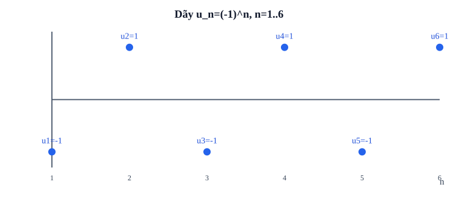

# Bài 5. Dãy số

TOÁN 11 · CHƯƠNG II

Từ những số liệu theo ngày, theo năm đến dãy số: hiểu vai trò của chỉ số, bốn cách biểu diễn và cách chứng minh tăng, giảm, bị chặn.

<nav class="thpt-r4-lesson-tabs"><a href="../">Chương II</a><a href="../luyen-tap/">Core và Luyện tập</a><a href="../tu-kiem-tra-chuong/">Tự kiểm tra cuối chương</a></nav>

=== "Khám phá kiến thức"

    Một cây non được đo chiều cao sau tuần thứ nhất, thứ hai, thứ ba,… Mỗi lần đo chỉ cho một số, nhưng khi **đặt các số theo đúng thứ tự thời gian**, ta nhận ra quy luật. Nếu hỏi “tuần thứ mấy cây cao 20 cm?” thì không chỉ cần giá trị; ta còn phải biết **chỉ số tuần**. Dãy số ra đời khi ta coi chỉ số nguyên dương \(n\) là đầu vào của một hàm, và số hạng \(u_n\) là kết quả. Khác một hàm vẽ trên cả khoảng số thực, các điểm của dãy thường **rời rạc**, chỉ nằm ở các chỉ số được phép.

    ### 1.1. Dãy số là một hàm số có chỉ số đặc biệt

    Với \((u_n)\), cách viết \(u_1,u_2,\ldots\) diễn tả thứ tự. Một dãy có thể kéo dài mãi hoặc **dừng tại số hạng cuối** nếu tập chỉ số chỉ gồm \(1,2,\ldots,N\). Đừng lẫn \(u_4\) (số hạng thứ tư) với “giá trị bằng 4”. Chẳng hạn dãy \(4,7,10,13\) có \(u_1=4\), \(u_4=13\), dù số \(4\) vẫn xuất hiện ở đầu.

    **Vận dụng.** Xét dãy hữu hạn \(u_n=3n+1\) với \(n\in\{1,2,3,4\}\). Hãy viết đủ các số hạng, xác định số hạng cuối và giải thích vì sao không có \(u_5\) trong dãy này.

    

    ??? question "Đối chiếu"

        **Lời giải:** \(u_1=4,u_2=7,u_3=10,u_4=13\); số hạng cuối là \(13\). Tập chỉ số chỉ có bốn giá trị nên \(u_5\) **không thuộc dãy hữu hạn được cho**, dù biểu thức \(3n+1\) có thể tính được ở \(n=5\). Đây là lý do điều kiện của \(n\) không được bỏ qua.

    

    ??? tip "Kiểm lỗi"

        **Dấu hiệu:** Em tính thêm \(u_5=16\) và coi đó là số hạng trong dãy, hoặc nhầm \(u_4=4\).

        **Tự sửa:** Đọc **miền chỉ số trước công thức**. Ôn mục 2.1, sau đó giải câu Core về dãy hữu hạn năm số chính phương và câu Practice về chỉ số thỏa \(u_n=87\) tại [Core và Luyện tập Bài 5](../luyen-tap/).

    ### 1.2. Có bốn cách cho một dãy số

    Khi chỉ có ít số hạng, **liệt kê** giúp nhìn quy luật nhưng không cho biết chắc số hạng rất xa. **Công thức tổng quát** tính trực tiếp \(u_n\) từ \(n\); **hệ thức truy hồi** bắt đầu từ các số hạng đầu rồi tính tiếp; **mô tả bằng lời** có thể xác định dãy mà chưa viết công thức. Ví dụ, “các số chính phương dương theo thứ tự tăng dần” là mô tả, còn \(u_n=n^2\) với \(n\ge1\) là công thức tương ứng. Khi chuyển giữa các cách, luôn kiểm **điểm bắt đầu và phạm vi chỉ số**.

    Truy hồi cần đủ **giá trị khởi tạo**; riêng quy tắc \(u_{n+1}=u_n+2\) cho vô số dãy khác nhau nếu chưa cho \(u_1\). Với truy hồi phụ thuộc hai số trước, còn phải cung cấp đủ hai số đầu.

    **Vận dụng.** Cho \(u_1=2\) và \(u_{n+1}=u_n+n+1\) với \(n\ge1\). Tìm \(u_2,u_3,u_4\). Vì sao không được thay \(n=4\) vào công thức rồi khẳng định ngay \(u_4\)?

    

    ??? question "Đối chiếu"

        **Lời giải:** Với \(n=1\), \(u_2=u_1+2=4\); với \(n=2\), \(u_3=u_2+3=7\); với \(n=3\), \(u_4=u_3+4=11\). Vế phải có **\(u_n\)** nên cần biết số hạng trước. Thay \(n=4\) chỉ cho quan hệ \(u_5=u_4+5\), không tự tính được \(u_4\).

    

    ??? tip "Kiểm lỗi"

        **Dấu hiệu:** Em ghi \(u_4=u_1+4+1\), hoặc dùng quy tắc truy hồi như thể là công thức \(u_n=f(n)\).

        **Tự sửa:** Viết một bảng hai cột \(n\) và \(u_n\), tính từng bước \(u_1\to u_2\to u_3\). Ôn mục 2.2; rồi luyện câu Core \(u_1=2,u_{n+1}=u_n+5\) và câu Practice \(u_1=1,u_{n+1}=2u_n+1\) tại [Bài 5 – Luyện tập](../luyen-tap/).

    ### 1.3. Trên hình của dãy số, không được nối các điểm tùy ý

    Với dãy số, đồ thị gồm những điểm \((n;u_n)\) có chỉ số \(n\) hợp lệ. Chẳng hạn ở các chỉ số nguyên dương, \(u_n=(-1)^n\) luân phiên \(-1,1\). Dãy ấy không tăng hoặc giảm liên tục, nhưng vẫn **bị chặn**. Không được nối các điểm rồi suy ra rằng dãy có thêm các giá trị giữa \(-1\) và \(1\): điều đó đã thay đổi miền chỉ số.

    **Vận dụng.** Dãy \(v_n=2+(-1)^n\) với \(n\ge1\) có bốn số hạng đầu là gì? Nó có tăng nghiêm ngặt, giảm nghiêm ngặt hay bị chặn không? Hãy dùng đúng định nghĩa cho **mọi chỉ số**.

    

    ??? question "Đối chiếu"

        **Lời giải:** \(v_1=1,v_2=3,v_3=1,v_4=3\); các số hạng lần lượt là \(1\) hoặc \(3\). Do \(v_1<v_2\) nhưng \(v_2>v_3\), dãy **không tăng cũng không giảm nghiêm ngặt**. Mọi \(n\) đều thỏa \(1\le v_n\le3\), nên bị chặn trên bởi \(3\), dưới bởi \(1\).

    

    ??? tip "Kiểm lỗi"

        **Dấu hiệu:** Em cho rằng dãy không đơn điệu thì không bị chặn, hoặc vẽ đường liên tục và chọn một số \(v_{1,5}\).

        **Tự sửa:** Đơn điệu và bị chặn là **hai tính chất độc lập**. Ôn các mục 2.1, 2.3; luyện câu Practice về \(u_n=(-1)^n\) tại [Bài 5 – Luyện tập](../luyen-tap/).

    ### 1.4. Vì sao phải xét hiệu của hai số hạng liên tiếp?

    Nhìn ba số đầu tăng không đủ chứng minh **toàn bộ** dãy tăng. Với \(u_n=f(n)\), ta có thể xét \(u_{n+1}-u_n\) cho một \(n\) bất kỳ rồi tìm dấu **đúng với mọi \(n\ge1\)**. Hiệu luôn dương nghĩa là mỗi số hạng lớn hơn số hạng trước; hiệu luôn âm thì ngược lại. Nếu hiệu có thể bằng \(0\), phải phân biệt “tăng nghiêm ngặt” với “không giảm”.

    **Vận dụng.** Xét \(u_n=\dfrac{3n+2}{n+1}\), \(n\ge1\). Dãy tăng hay giảm? Hãy biến đổi trước để thấy rõ dấu hiệu.

    

    ??? question "Đối chiếu"

        **Lời giải:** \(u_n=3-\dfrac1{n+1}\). Vì
        \[
        u_{n+1}-u_n=\frac1{n+1}-\frac1{n+2}
        =\frac1{(n+1)(n+2)}>0
        \]
        với mọi \(n\ge1\), dãy **tăng nghiêm ngặt**. Từ cùng biểu thức còn thấy \(u_n<3\), dù các số hạng tăng dần.

    

    ??? tip "Kiểm lỗi"

        **Dấu hiệu:** Em thấy mẫu tăng nên vội nói toàn bộ phân thức giảm; hoặc thử ba số đầu rồi kết luận tăng với mọi \(n\).

        **Tự sửa:** Rút gọn hoặc quy đồng \(u_{n+1}-u_n\), ghi \(n\ge1\) để chốt dấu. Ôn mục 2.3; luyện câu Core \(u_n=5-2n\) và câu Practice chứng minh \(u_n=3/(n+2)\) giảm ở [Core và Luyện tập Bài 5](../luyen-tap/).

    ### 1.5. Một dãy tăng vẫn có thể có giới hạn trên

    Để chứng minh **bị chặn**, ta phải tìm những hằng số \(m,M\) sao cho \(m\le u_n\le M\) với **mọi** \(n\) trong miền. Không cần \(m,M\) là số hạng có thật: chẳng hạn một dãy có thể tiến gần \(2\) mà không bao giờ đạt \(2\). Ngược lại, một dãy tăng như \(u_n=n\) không bị chặn trên; tăng không đồng nghĩa bị chặn.

    **Vận dụng.** Cho \(u_n=2+\dfrac1n\), \(n\ge1\). Chứng minh một cận dưới và một cận trên của dãy. Dãy có đạt cận dưới đó không?

    

    ??? question "Đối chiếu"

        **Lời giải:** Từ \(n\ge1\) suy ra \(0<1/n\le1\). Cộng \(2\) được \(2<u_n\le3\). Vì vậy \(2\) là một **cận dưới** (không đạt), \(3\) là một **cận trên** (đạt khi \(n=1\)). Dãy bị chặn; dãy còn giảm vì \(1/(n+1)<1/n\).

    

    ??? tip "Kiểm lỗi"

        **Dấu hiệu:** Em ghi \(u_n=2\) tại “\(n=\infty\)” hoặc chỉ dùng kết quả tính ở \(n=1,2,3\).

        **Tự sửa:** Bắt đầu từ bất đẳng thức \(0<1/n\le1\) cho **mọi số nguyên dương**. Ôn mục 2.3; luyện câu Practice chứng minh cận của \(u_n=2-1/n\) rồi \(u_n=n/(n+1)\) tại [Bài 5 – Luyện tập](../luyen-tap/).

    ### 1.6. Ứng dụng: số liệu tăng trưởng và mốc năm

    Một mô hình lượng bán ra theo từng năm có thể dùng dãy \(Q_n=80(1{,}05)^{n-1}\), với \(n=1\) là **năm đầu tiên** và đơn vị là nghìn sản phẩm. Cùng một quy luật sẽ có chỉ số khác nếu người ta gọi “năm ban đầu” là \(n=0\). Không nên thay nhầm \(n=4\) cho “sau bốn lần tăng” khi dãy bắt đầu ở \(n=1\).

    **Vận dụng.** Theo mô hình \(Q_n=80(1{,}05)^{n-1}\), dự báo năm thứ tư bán bao nhiêu nghìn sản phẩm? Đã có mấy lần tăng 5% kể từ năm đầu? Làm tròn đến \(0{,}01\) nghìn.

    

    ??? question "Đối chiếu"

        **Lời giải:** \(Q_4=80(1{,}05)^3=80\cdot1{,}157625=92{,}61\) nghìn (làm tròn). Từ năm thứ nhất đến năm thứ tư chỉ có **ba lần** tăng: \(1\to2\), \(2\to3\), \(3\to4\). Đây là kết quả của mô hình, không khẳng định số bán thực tế.

    

    ??? tip "Kiểm lỗi"

        **Dấu hiệu:** Em tính \(80(1{,}05)^4\) dù đề nói “năm thứ tư”, hoặc bỏ qua đơn vị nghìn.

        **Tự sửa:** Vẽ trục các năm đánh dấu từ \(1\) và đếm số **bước tăng**, rồi mới thay số mũ \(n-1\). Ôn mục 2.2, luyện bài Practice về số ghế ở **hàng thứ 12** tại [Core và Luyện tập Bài 5](../luyen-tap/); Bài 7 sẽ giải thích sâu hơn tăng trưởng theo tỉ lệ.

=== "Kiến thức SGK"

    ### 2.1. Định nghĩa dãy số hữu hạn và vô hạn

    
<strong>Định nghĩa — Dãy số vô hạn:</strong> Một hàm số \(u\) xác định trên tập \(\mathbb N^*=\{1,2,3,\ldots\}\) được gọi là <em>dãy số vô hạn</em>. Giá trị \(u(n)\) thường viết \(u_n\); dãy được ký hiệu \((u_n)\) hoặc \(u_1,u_2,\ldots,u_n,\ldots\).

    
<strong>Định nghĩa — Dãy số hữu hạn:</strong> Một hàm số \(u\) xác định trên \(\{1,2,\ldots,N\}\), \(N\in\mathbb N^*\), được gọi là <em>dãy số hữu hạn</em> gồm \(N\) số hạng, viết \(u_1,u_2,\ldots,u_N\). Số \(u_1\) là số hạng đầu; \(u_N\) là số hạng cuối.

    **Cách đọc và phạm vi:** Hai dãy khác nhau có thể có cùng một tập giá trị nhưng **khác thứ tự**; số hạng không bắt buộc khác nhau. Chỉ số \(n\) trong SGK bắt đầu từ \(1\), trừ khi bài toán thực tế **ghi rõ một quy ước khác**. Với dãy hữu hạn, không tự kéo dài công thức ra ngoài \(n\le N\).

    <figure class="thpt-r4-plot"><figcaption>Đọc hình: trục ngang là chỉ số \(n=1,\ldots,6\); các điểm có tung độ \(-1\) và \(1\) luân phiên, **không có đoạn nối**. Hình biểu diễn sáu điểm của dãy vô hạn, không phải một dãy chỉ có sáu số hạng.</figcaption></figure>

    ### 2.2. Các cách cho một dãy số

    **Bốn cách thường gặp trong SGK:**

    | Cách cho | Ví dụ minh họa | Cần chú ý |
    | --- | --- | --- |
    | Liệt kê số hạng | \(2;4;6;8\) (bốn số hạng) | Chỉ đủ để xác định dãy hữu hạn đã nêu, không tự suy được một dãy vô hạn duy nhất |
    | Công thức số hạng tổng quát | \(u_n=3n-1\), \(n\ge1\) | Thay trực tiếp chỉ số \(n\) hợp lệ |
    | Hệ thức truy hồi | \(u_1=2,\ u_{n+1}=u_n+3\) | Phải có số hạng khởi tạo và quy tắc cho \(n\ge1\) |
    | Mô tả bằng lời | Các số lẻ dương theo thứ tự tăng dần | Cần nói rõ thứ tự và điều kiện để quy tắc xác định duy nhất dãy |

    
<strong>Điều kiện để dãy xác định rõ:</strong> Phải xác định **miền chỉ số** và **một số hạng cho mỗi chỉ số hợp lệ**. Với truy hồi, cho đủ số hạng ban đầu để tiếp tục tính; nếu quy tắc dựa trên hai số hạng trước thì thường phải biết hai số đầu.

    **So sánh phương pháp:** Công thức tổng quát có lợi khi cần \(u_{100}\) mà không muốn tính \(99\) bước; truy hồi thuận lợi khi mô tả quá trình tiến từ trạng thái trước sang trạng thái sau. Liệt kê vài số đầu chỉ giúp **dự đoán**, không đủ chứng minh quy luật vô hạn: nhiều công thức khác nhau có thể trùng cùng vài giá trị đầu.

    ### 2.3. Dãy số tăng, dãy số giảm và dãy số bị chặn

    
<strong>Dãy tăng/giảm:</strong> Dãy \((u_n)\) <em>tăng</em> nếu \(u_{n+1}>u_n\) với mọi \(n\) mà hai số hạng liên tiếp có nghĩa; <em>giảm</em> nếu \(u_{n+1}<u_n\) với mọi \(n\) tương ứng. Với dãy vô hạn lấy mọi \(n\ge1\); với dãy hữu hạn lấy \(n=1,\ldots,N-1\).

    **Phương pháp:** Khi có công thức tổng quát \(u_n=f(n)\), xét dấu \(u_{n+1}-u_n\); kết luận phải đúng **với mọi \(n\)** trong phạm vi chứ không chỉ ba số đầu. Nếu hiệu bằng \(0\) ở một số nơi, không được gọi dãy tăng hoặc giảm **nghiêm ngặt** theo định nghĩa trên. Dãy có dấu hiệu xen kẽ có thể không tăng, không giảm nhưng vẫn bị chặn.

    
<strong>Định nghĩa bị chặn:</strong> Dãy \((u_n)\) <em>bị chặn trên</em> nếu có số \(M\) sao cho \(u_n\le M\) với mọi \(n\); <em>bị chặn dưới</em> nếu có số \(m\) sao cho \(u_n\ge m\) với mọi \(n\). Dãy <em>bị chặn</em> nếu có cả hai, tức tồn tại \(m,M\) sao cho \(m\le u_n\le M\) với mọi chỉ số hợp lệ.

    **Lưu ý:** Cận trên/dưới **không bắt buộc là giá trị lớn nhất/nhỏ nhất của dãy**. Cận trên \(2\) của \(u_n=2-1/n\) đúng với mọi \(n\), nhưng không có số hạng nào bằng \(2\). Chỉ cần tìm *một* cặp cận đúng, không bắt buộc là cận tốt nhất. Với dãy hữu hạn mọi giá trị thực đều hữu hạn, nên một dãy số hữu hạn luôn bị chặn.

=== "Ví dụ"

    Mỗi Ví dụ có đề riêng, giải thích vì sao chọn cách, kết quả và một phép kiểm lại. Hãy tự dự đoán hướng giải trước khi đọc.

    ### 3.1. Tính số hạng và xác định miền chỉ số

    

<strong>Đề bài:</strong> Cho dãy hữu hạn \(u_n=n^2+1\), \(n=1,2,3,4,5\). Viết các số hạng và tìm số hạng bằng \(17\).

    
<strong>Phân tích:</strong> Bài cho **công thức tổng quát** và miền hữu hạn, nên ta thay từng chỉ số. Nếu hỏi \(u_n=17\), phải kiểm nghiệm của phương trình theo miền \(1\le n\le5\).

    
<strong>Lời giải:</strong> \(u_1=2,u_2=5,u_3=10,u_4=17,u_5=26\). Giải \(n^2+1=17\) được \(n^2=16\), tức \(n=\pm4\); chỉ \(n=4\) hợp lệ. Vậy \(17\) là số hạng thứ tư.

    
<strong>Kiểm lại:</strong> \(u_4=4^2+1=17\), và không có chỉ số \(n=-4\) trong dãy.

    ### 3.2. Từ mô tả bằng lời đến hai cách cho

    

<strong>Đề bài:</strong> Liệt kê bốn số nguyên dương chia hết cho \(3\) đầu tiên; viết dãy hữu hạn ấy bằng công thức tổng quát và hệ thức truy hồi.

    
<strong>Phân tích:</strong> Mô tả cho phép liệt kê đúng **bốn số**, sau đó tìm hai quy tắc tương đương trên miền chỉ số \(1,\ldots,4\).

    
<strong>Lời giải:</strong> Dãy là \(3,6,9,12\). Công thức \(u_n=3n\), \(n=1,2,3,4\). Có thể cho bằng \(u_1=3,\ u_{n+1}=u_n+3\) với \(n=1,2,3\).

    
<strong>Kiểm lại:</strong> Tính bằng hai cách đều cho \(u_4=12\). Nếu đặt \(n\ge1\) không giới hạn, ta sẽ có **dãy vô hạn khác** với dãy hữu hạn đang xét.

    ### 3.3. Truy hồi khi công thức chứa chính số hạng trước

    

<strong>Đề bài:</strong> Cho \(u_1=1\) và \(u_{n+1}=2u_n+2\) với \(n\ge1\). Tính \(u_4\).

    
<strong>Phân tích:</strong> Không thay \(n=4\) để có ngay \(u_4\); phải tính \(u_2\), rồi \(u_3\), sau đó mới đến \(u_4\).

    
<strong>Lời giải:</strong> \(u_2=2\cdot1+2=4\), \(u_3=2\cdot4+2=10\), \(u_4=2\cdot10+2=22\).

    
<strong>Kiểm lại:</strong> \(2u_3+2=2\cdot10+2=22\), phù hợp số hạng vừa tìm; quy tắc được áp dụng đúng ba bước.

    ### 3.4. Chứng minh tăng bằng hiệu hai số hạng

    

<strong>Đề bài:</strong> Xét tính tăng, giảm của dãy \(u_n=\dfrac{n+2}{n+3}\), \(n\ge1\), đồng thời xác định một cận trên.

    
<strong>Phân tích:</strong> Viết \(u_n=1-\dfrac1{n+3}\), rồi xét dấu hiệu với **mọi** chỉ số thay vì chỉ tính ba giá trị.

    
<strong>Lời giải:</strong> \(u_{n+1}-u_n=\dfrac1{n+3}-\dfrac1{n+4}=\dfrac1{(n+3)(n+4)}>0\) với mọi \(n\ge1\), nên dãy tăng nghiêm ngặt. Vì \(1/(n+3)>0\), ta còn có \(u_n<1\), do đó \(1\) là cận trên.

    
<strong>Kiểm lại:</strong> \(u_1=3/4\), \(u_2=4/5\), \(u_3=5/6\): đúng chiều tăng. Kiểm ba số là để đối chiếu, không thay chứng minh tổng quát.

    ### 3.5. Không đơn điệu nhưng bị chặn

    

<strong>Đề bài:</strong> Cho dãy \(u_n=\dfrac{(-1)^n}{n}\) với \(n\ge1\). Dãy tăng, giảm hay bị chặn?

    
<strong>Phân tích:</strong> Dấu của \(u_n\) luân phiên, nên trước tiên thử ba số hạng để bác bỏ tính đơn điệu. Sau đó dùng \(1/n\le1\) để tìm cận **cho mọi n**.

    
<strong>Lời giải:</strong> \(u_1=-1,\ u_2=1/2,\ u_3=-1/3\). Do \(u_1<u_2\) nhưng \(u_2>u_3\), dãy không tăng cũng không giảm nghiêm ngặt. Với mọi \(n\), \(-1\le (-1)^n/n\le1\), nên dãy bị chặn. Thậm chí \(-1\le u_n\le1/2\), vì \(u_n>0\) chỉ khi \(n\) chẵn và giá trị dương lớn nhất ở \(n=2\).

    
<strong>Kiểm lại:</strong> Các số lẻ âm không nhỏ hơn \(-1\); các số chẵn dương không vượt quá \(1/2\). Đây là chứng minh hai cận trên toàn bộ miền, không phải quan sát hữu hạn.

    ### 3.6. Ứng dụng mô hình tăng trưởng có chỉ số năm

    

<strong>Đề bài:</strong> Trong một mô hình giả định, một kho vật tư có \(u_n=200(1{,}03)^{n-1}\) đơn vị ở **năm thứ n**, \(n\ge1\). Tính \(u_1,u_5\) và giải thích số mũ của \(u_5\).

    
<strong>Phân tích:</strong> Từ năm thứ nhất đến thứ năm chỉ có **bốn lần** tăng \(3\%\). Vì thế không được thay mũ \(5\) cho “năm thứ năm”.

    
<strong>Lời giải:</strong> \(u_1=200\). \(u_5=200(1{,}03)^4=200\cdot1{,}12550881\approx225{,}10\) đơn vị. Số mũ bằng \(5-1=4\) là số khoảng thời gian tăng kể từ năm đầu.

    
<strong>Kiểm lại:</strong> \(u_2=206\), rồi \(u_3=212{,}18\), đều lớn dần; đơn vị và mốc năm phù hợp. Đây chỉ là mô hình toán học, không khẳng định số liệu của một kho thực tế.

=== "Lỗi thường gặp"

    Khi một câu Vận dụng chưa đúng, hãy mở **Kiểm lỗi** ngay dưới Đối chiếu của chính câu ấy. Bốn lỗi dưới đây là những quy tắc nhầm lẫn thường lặp lại ở nhiều dạng bài.

    

    ??? tip "4.1. Đọc sai chỉ số và miền xác định"

        **Dấu hiệu:** Gọi \(u_4\) là giá trị \(4\), hoặc thêm \(u_5\) vào dãy chỉ có bốn số hạng.

        **Vì sao sai:** \(n\) là nhãn vị trí và phải thuộc miền đã công bố. Hàm có thể có công thức tính ngoài miền nhưng những giá trị ấy **không thuộc dãy được cho**.

        **Tự sửa:** Gạch dưới miền \(n\in\mathbb N^*\) hoặc \(n=1,\ldots,N\), lập bảng n/u_n rồi mới thay số. Ôn mục 2.1, Ví dụ 3.1; thử lại câu Core tìm dãy hữu hạn và câu Practice \(u_n=5n+2\) tại [Luyện tập Bài 5](../luyen-tap/).

    

    ??? tip "4.2. Xem truy hồi như công thức tổng quát"

        **Dấu hiệu:** Với \(u_{n+1}=2u_n+1\), em thay \(n=3\) rồi cho ngay \(u_3=7\) mà không tính từ \(u_1\).

        **Vì sao sai:** Hệ thức chỉ nói cách tạo số **kế tiếp từ số trước**; chưa biết đủ số khởi tạo thì không thể xác định mọi giá trị.

        **Tự sửa:** Viết cột \(u_1,u_2,u_3,\ldots\), tính từng bước và dùng kết quả để kiểm bước sau. Ôn mục 2.2, Ví dụ 3.3; luyện câu Core \(u_1=2,u_{n+1}=u_n+5\) và Practice \(u_1=4,u_{n+1}=3u_n-2\) tại [Luyện tập Bài 5](../luyen-tap/).

    

    ??? tip "4.3. Thử vài số hạng rồi kết luận đơn điệu"

        **Dấu hiệu:** Thấy ba số đầu tăng liền nói dãy tăng, hoặc thấy hai số bằng nhau vẫn gọi tăng **nghiêm ngặt**.

        **Vì sao sai:** Tăng/giảm là một mệnh đề \(\forall n\) trong miền, không phải quan sát vài mẫu. Dãy có thể đổi chiều ở các chỉ số xa hơn.

        **Tự sửa:** Viết hiệu \(u_{n+1}-u_n\), tìm dấu trên **mọi chỉ số** rồi kết luận. Ôn mục 2.3 và Ví dụ 3.4; luyện Core \(u_n=5-2n\), Practice chứng minh \(3/(n+2)\) giảm ở [Luyện tập Bài 5](../luyen-tap/).

    

    ??? tip "4.4. Nhầm tính bị chặn với việc có giá trị biên"

        **Dấu hiệu:** Em cho rằng cận \(2\) của dãy \(2-1/n\) phải xuất hiện ở một số hạng, hoặc chỉ biết dãy tăng thì kết luận bị chặn trên.

        **Vì sao sai:** Một cận chỉ cần là số thỏa bất đẳng thức cho **mọi** số hạng, không cần đạt. Dãy tăng \(u_n=n\) không bị chặn trên.

        **Tự sửa:** Tìm hai bất đẳng thức \(m\le u_n\le M\) đúng với mọi \(n\); không dùng “\(n=\infty\)” như một chỉ số. Ôn mục 2.3, Ví dụ 3.5; thử lại hai câu Practice xác định cận của \(2-1/n\) và \(n/(n+1)\) ở [Luyện tập Bài 5](../luyen-tap/).

    **Học tiếp:** [Core và Luyện tập](../luyen-tap/) · [Tự kiểm tra cuối chương](../tu-kiem-tra-chuong/) · [Tự luận Chương II](../../../../thu-vien/tu-luan-g11-chuong-ii/).

    
Nguồn tham khảo: SGK Toán 11 – Kết nối tri thức với cuộc sống, tập một, Bài 5 (trang in 42–47).

