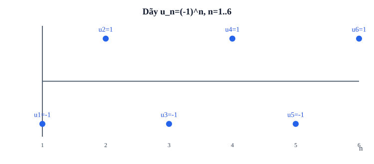

# Bài 5. Dãy số

TOÁN 11 · CHƯƠNG II · SGK KẾT NỐI TRI THỨC

Học kiến thức, tự thử, đọc ví dụ và hình minh họa rồi luyện Core/Practice. Tự kiểm tra cuối chương có chế độ tự đối chiếu, không cấp Readiness độc lập hay Skill Mastery.

<nav class="thpt-r4-lesson-tabs"><a href="../">Chương II</a><a href="../luyen-tap/">Core và Luyện tập</a><a href="../tu-kiem-tra-chuong/">Tự kiểm tra · tự đối chiếu</a></nav>

=== "Khám phá kiến thức"

    ### Cùng tìm hiểu

    Em hãy ghi số cây được trồng trong ngày 1, ngày 2, ngày 3: 2, 4, 6. Một **con số đơn lẻ** không cho biết biến đổi theo từng ngày; một **hàm số thông thường** có thể nhận đầu vào bất kỳ, nhưng ở đây ta chỉ cần các chỉ số ngày 1,2,3,… . Gắn từng số tự nhiên n với lượng tương ứng u_n: đó là cách hình thành dãy số. Quy ước n bắt đầu từ 1 hay 0 phải được công bố; không tự thay u_1 bằng u_0.

    Hai cách cung cấp thông tin đều hữu ích: u_n=2n cho biết ngay số hạng thứ n (công thức tổng quát), còn u_1=2, u_{n+1}=u_n+2 cho biết **cách tạo số tiếp theo** (truy hồi); truy hồi thiếu số khởi đầu chưa xác định duy nhất dãy. Khi mỗi ngày nhiều hơn ngày trước, cần so sánh u_{n+1}-u_n; khi hỏi “có vượt 10 không?”, ta xét cận đúng **với mọi n**, không chỉ vài số đầu. Dãy số là dữ liệu rời rạc: trên đồ thị không nối liên tục các điểm có chỉ số n nguyên.

    ### Ví dụ trực quan

    Dãy số mô tả một đại lượng biến đổi theo thứ tự lượt hoặc thời điểm. Biết công thức của dãy cho phép tìm giá trị ở vị trí rất xa mà không phải liệt kê toàn bộ.

    **Quan sát bằng số liệu:** Nếu uₙ=2n+1 với n≥1, ba số hạng đầu là 3,5,7; u₁₀=21. Chỉ số n là vị trí, không phải giá trị cần cộng thêm vào dãy.

    ### Thuật ngữ và kiến thức, kỹ năng

    **Thuật ngữ:** số hạng, chỉ số, công thức tổng quát, truy hồi, đơn điệu, bị chặn.

    **Sau bài học, em cần:** đọc điều kiện chỉ số, phân biệt công thức trực tiếp với truy hồi và tự kiểm vài số hạng.

=== "Kiến thức SGK"

    

    **Định nghĩa:** Dãy số vô hạn là hàm số xác định trên tập số nguyên dương N* (hoặc từ một chỉ số khởi đầu được nêu), giá trị ở n là u_n. Dãy hữu hạn có các chỉ số từ 1 đến N. Các số hạng không nhất thiết phân biệt nhau và không mặc định tăng.

    **Công thức tổng quát:** u_n=f(n) với mỗi n được phép. Ví dụ u_n=2n−1, n≥1 thì 1,3,5,7,...; phải thay đúng n=1 để tìm số hạng đầu, không nhầm u_0.

    **Hệ thức truy hồi:** Cho số hạng đầu và quy tắc tính số hạng sau từ số trước, ví dụ u_1=3, u_{n+1}=2u_n thì 3,6,12,24,...; thiếu u_1 thì quy tắc chưa xác định một dãy duy nhất.

    **Đơn điệu:** Dãy tăng khi u_{n+1}>u_n với mọi n liên quan, giảm khi u_{n+1}<u_n. Nếu chỉ chứng minh ≥ hoặc ≤ thì gọi không giảm hoặc không tăng; dãy hằng không tăng nghiêm ngặt cũng không giảm nghiêm ngặt. Có thể xét u_{n+1}−u_n, không dùng tỉ số nếu mẫu có thể bằng 0.

    **Bị chặn:** Bị chặn trên nếu tồn tại M sao cho u_n≤M mọi n; chặn dưới nếu tồn tại m sao cho u_n≥m mọi n; bị chặn nếu có cả hai. Chỉ thử vài n đầu không chứng minh được một cận cho toàn bộ dãy.

    ### Đọc hình và đối chiếu khái niệm

    <figure class="thpt-r4-plot thpt-r4-probability-figure"><figcaption>Đồ thị rời rạc minh họa dãy số; chỉ số n là số nguyên dương.</figcaption></figure>

    ### Hướng dẫn đọc hình

    - chỉ số n=1..6 là các **giá trị rời rạc**; u_n=(-1)^n cho dãy −1,1,−1,1,−1,1; không nối chúng thành đồ thị một hàm liên tục theo n thực. Từ hình, dãy **không tăng/giảm nghiêm ngặt** nhưng bị chặn giữa −1 và 1.

    ### Vận dụng — tự thử rồi mở đối chiếu

    Dãy u_n=2n−1 bắt đầu từ n=1: em dự đoán u_4 và giải thích vì sao n=4, không phải n=0.

    

Đã thử xong? Mở hướng dẫn đối chiếu

    u_4=7; trở về mục chỉ số và VD-G11-B05-01 nếu chưa chắc, sau đó làm `THPT-G11-B05-C01`.

    

=== "Ví dụ"

    ### Ví dụ 01 — Tính số hạng và xác định chỉ số

    Cho u_n=3n−2 (n≥1): u_1=1, u_2=4, u_5=13. Nếu u_n=28 thì 3n−2=28, n=10, hợp lệ nguyên dương. Không dùng n âm hoặc phân số làm chỉ số.

    ### Ví dụ 02 — Truy hồi

    u_1=2, u_{n+1}=u_n+3. Từ u_1=2 suy ra u_2=5,u_3=8,u_4=11; quy luật này là cấp số cộng có d=3, nhưng ở B05 chỉ cần hiểu cách tạo số hạng theo truy hồi.

    ### Ví dụ 03 — Đơn điệu và bị chặn

    u_n=1/n (n≥1) có u_{n+1}−u_n=−1/[n(n+1)]<0, nên giảm nghiêm ngặt, đồng thời 0<u_n≤1 nên vừa bị chặn trên bởi 1, vừa bị chặn dưới bởi 0. Không kết luận dãy có số hạng bằng 0.

    ### Vì sao chọn cách giải?

    - VD-G11-B05-01: thay chỉ số vào u_n trước, sau đó giải u_n=28 và **kiểm n nguyên dương**; giải đại số mà bỏ điều kiện chỉ số là chưa xong.
    - VD-G11-B05-02: tính từ u_1 theo truy hồi trước, chưa cần gọi tên cấp số cộng; vì thiếu u_1 sẽ có vô số dãy thỏa cùng quy luật.
    - VD-G11-B05-03: xét u_{n+1}−u_n để chứng minh giảm **mọi n** và bất đẳng thức 0<u_n≤1 để chứng minh bị chặn.

=== "Lỗi thường gặp"

    

Truy hồi: số hạng đầu và quy tắc

    1. Nhận lỗi: nhầm hệ thức u_(n+1) với công thức u_n.
    2. Đọc đúng số hạng đầu u_1 và quy tắc truy hồi.
    3. Tính từng n, không thay cả n và u_n vào cùng vị trí.
    4. Thử u_1=1, u_(n+1)=2u_n+1 cho u_2=3,u_3=7.
    5. Trở về C03 rồi luyện P02; không dùng xem lời giải làm bằng chứng Mastery.

    
<a href="../luyen-tap/?item=THPT-G11-B05-C03">Quay lại câu C03 trong Core/Luyện tập</a>

    

    

Bị chặn: chứng minh cho mọi số hạng

    1. Nhận lỗi: thấy vài số hạng rồi kết luận bị chặn.
    2. Chọn bất đẳng thức đúng với mọi n≥1.
    3. Đổi u_n=1−1/(n+1) để nhận ra 1/2≤u_n<1.
    4. Nhớ cận trên không nhất thiết là số hạng đạt được.
    5. Trở về P04/P08, tự chứng minh với mọi n.

    
<a href="../luyen-tap/?item=THPT-G11-B05-P04">Quay lại câu P04 trong Core/Luyện tập</a>

    

    ### Học tiếp

    [Core và Luyện tập Bài 5](luyen-tap.md) · [Tự luận Chương II](../../../thu-vien/tu-luan-g11-chuong-ii.md)
