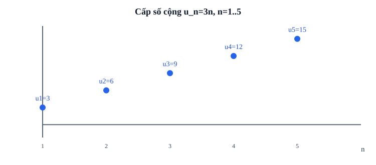

# Bài 6. Cấp số cộng

TOÁN 11 · CHƯƠNG II · SGK KẾT NỐI TRI THỨC

Học kiến thức, tự thử, đọc ví dụ và hình minh họa rồi luyện Core/Practice. Tự kiểm tra cuối chương có chế độ tự đối chiếu, không cấp Readiness độc lập hay Skill Mastery.

<nav class="thpt-r4-lesson-tabs"><a href="../">Chương II</a><a href="../luyen-tap/">Core và Luyện tập</a><a href="../tu-kiem-tra-chuong/">Tự kiểm tra · tự đối chiếu</a></nav>

=== "Khám phá kiến thức"

    ### Cùng tìm hiểu

    Một hàng ghế có 12 chỗ, hàng kế tiếp 15, tiếp theo 18. Để dự đoán hàng thứ 20, không nên cộng 3 tới 19 lần bằng tay. Hãy nhìn **hiệu** giữa hai hàng kề: 15−12=3 và 18−15=3. Chính đại lượng được cộng **không đổi** d=3 tạo nên **cấp số cộng**. Nếu d=0 thì dãy hằng; d âm tương ứng giảm đều.

    Vì từ hàng 1 đến hàng n có **n−1 bước**, nên u_n=u_1+(n−1)d. Nếu xếp ngược hai dãy của n số đầu, từng cặp đều bằng u_1+u_n; tổng hai dãy bằng n(u_1+u_n), vì vậy S_n=n(u_1+u_n)/2. Đây là lý do của công thức, không phải mẹo cần thuộc vô điều kiện. Khi mô hình hàng ghế hoặc sản lượng, nhớ rằng n phải là nguyên dương và số chỗ/người không thể âm.

    ### Ví dụ trực quan

    Mỗi tháng tiết kiệm tăng thêm một khoản cố định là phép cộng đều, không phải phép nhân. Cấp số cộng giúp tìm số tiền ở tháng xa và tổng cả quá trình.

    **Quan sát bằng số liệu:** Bắt đầu bằng 4 và mỗi lượt tăng 3: 4,7,10,13. Số hạng thứ tư là 13, tổng bốn số hạng là 34. Hai bài toán cần hai công thức khác nhau.

    ### Thuật ngữ và kiến thức, kỹ năng

    **Thuật ngữ:** cấp số cộng, công sai, số hạng thứ n, tổng n số hạng.

    **Sau bài học, em cần:** kiểm hiệu hai số liên tiếp, tìm công sai rồi chọn công thức số hạng hay tổng.

=== "Kiến thức SGK"

    

    **Định nghĩa:** (u_n) là cấp số cộng (CSC) nếu tồn tại d cố định với u_{n+1}=u_n+d. Dãy hằng cũng là CSC (d=0); CSC có thể giảm khi d<0. Điều kiện nhận biết là hiệu u_{n+1}−u_n **không đổi**.

    **Số hạng tổng quát:** u_n=u_1+(n−1)d, n≥1. Nếu biết u_p và u_q ở hai vị trí p≠q thì d=(u_q−u_p)/(q−p); từ đó tìm u_1. Khi giải bài toán tìm n, phải xét n nguyên dương.

    **Tính chất ba số hạng:** 2u_n=u_{n−1}+u_{n+1}, n≥2. Đây là quan hệ trung bình cộng; không phải trung bình nhân.

    **Tổng:** S_n=u_1+...+u_n = n(u_1+u_n)/2 = n[2u_1+(n−1)d]/2, n≥1. Không dùng công thức cấp số nhân cho CSC.

    ### Đọc hình và đối chiếu khái niệm

    <figure class="thpt-r4-plot thpt-r4-probability-figure"><figcaption>Đồ thị rời rạc minh họa cấp số cộng; chỉ số n là số nguyên dương.</figcaption></figure>

    ### Hướng dẫn đọc hình

    - điểm (1,3),(2,6),(3,9),(4,12),(5,15) có tung độ tăng mỗi lần 3 khi chỉ số tăng 1; ý nghĩa là công sai d=3 chứ không phải một đường liên tục trên mọi n thực.

    ### Vận dụng — tự thử rồi mở đối chiếu

    Hàng đầu có 12 ghế, mỗi hàng sau thêm 3 ghế. Hàng thứ 4 có mấy ghế?

    

Đã thử xong? Mở hướng dẫn đối chiếu

    12+3·3=21, vì có ba bước; làm `THPT-G11-B06-C01` sau khi giải thích.

    

=== "Ví dụ"

    ### Ví dụ 01 — Xác định cấp số cộng

    Dãy u_n=7−2n có u_{n+1}−u_n=−2 nên là CSC với u_1=5, d=−2. Dãy u_n=n² có hiệu 2n+1 phụ thuộc n, nên không phải CSC.

    ### Ví dụ 02 — Suy ngược từ hai số hạng

    Cho u_4=7 và u_9=22; 5d=15, d=3, u_1=7−3·3=−2; u_{20}=−2+19·3=55.

    ### Ví dụ 03 — Tổng hữu hạn

    CSC 2,5,8,... có d=3, u_{20}=59. S_{20}=20(2+59)/2=610. Thử bằng n[2u1+(n−1)d]/2=10(4+57)=610.

    ### Vì sao chọn cách giải?

    - VD-G11-B06-01: đo hiệu u_{n+1}−u_n, vì định nghĩa CSC nói về **hiệu cố định**, không chỉ hình thức u_n.
    - VD-G11-B06-02: từ hai số hạng u_4,u_9 suy ra 5d=15, vì có năm bước giữa hai chỉ số; sau đó mới tìm u_1.
    - VD-G11-B06-03: dùng hai cách tính S_20 để tự kiểm; ghép cặp đầu–cuối giải thích vì sao có hệ số 1/2.

=== "Lỗi thường gặp"

    

Số hạng tổng quát: n−1 bước

    1. Nhận lỗi: dùng n thay n−1 trong công thức CSC.
    2. Viết lại u_n=u_1+(n−1)d.
    3. Từ hai chỉ số p,q tính d=(u_q−u_p)/(q−p).
    4. Thử u1=6,d=3 được u9=30.
    5. Trở về C02/P01, kiểm tra n nguyên dương.

    
<a href="../luyen-tap/?item=THPT-G11-B06-C02">Quay lại câu C02 trong Core/Luyện tập</a>

    

    

Tổng cấp số cộng: n/2 và điều kiện

    1. Nhận lỗi: thiếu hệ số n/2 hoặc nhầm tổng CSC với CSN.
    2. Xác định u1,u_n và số hạng n của đoạn.
    3. Dùng S_n=n(u1+u_n)/2, kể cả d âm.
    4. Kiểm tra trực tiếp tổng 2+4+6+8+10=30.
    5. Làm C03/P03 và đối chiếu hai cách tính.

    
<a href="../luyen-tap/?item=THPT-G11-B06-C03">Quay lại câu C03 trong Core/Luyện tập</a>

    

    ### Học tiếp

    [Core và Luyện tập Bài 6](luyen-tap.md) · [Tự luận Chương II](../../../thu-vien/tu-luan-g11-chuong-ii.md)
