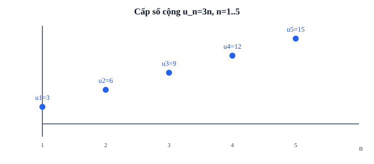

# Bài 6. Cấp số cộng

TOÁN 11 · CHƯƠNG II · KẾT NỐI TRI THỨC

Tìm quy luật cộng đều, dự đoán một số hạng ở xa và tính tổng nhiều số hạng mà không cần cộng từng số.

<nav class="thpt-r4-lesson-tabs"><a href="../">Chương II</a><a href="../luyen-tap/">Core và Luyện tập</a><a href="../tu-kiem-tra-chuong/">Tự kiểm tra cuối chương</a></nav>

=== "Khám phá kiến thức"

    Một nhà hát có \(25\) hàng ghế. Hàng thứ nhất có \(16\) ghế; hàng thứ hai \(18\), hàng thứ ba \(20\), và hàng sau luôn nhiều hơn hàng liền trước \(2\) ghế. Muốn biết cả nhà hát có bao nhiêu ghế, ta có thể cộng đủ \(25\) số, nhưng sẽ dễ nhầm và rất mất công. Ta cần trả lời lần lượt ba câu: **quy luật nào nối các hàng**, **hàng thứ \(25\) có mấy ghế**, rồi **tổng số ghế của \(25\) hàng là bao nhiêu**. Đó cũng chính là ba mục kiến thức của bài học.

    ### 1.1. Định nghĩa cấp số cộng

    Thử quan sát dãy \(16,18,20,22,\ldots\). Hai số đầu hơn kém nhau \(2\); số thứ ba hơn số thứ hai cũng \(2\). Nếu quy luật tiếp tục ở *mọi* cặp số hạng liên tiếp, ta có một **cấp số cộng**. Số luôn được cộng thêm gọi là **công sai**, kí hiệu \(d\). Biết một số hạng và \(d\), ta đi được đến số tiếp theo: \(u_2=u_1+d\), \(u_3=u_2+d\), ...

    Điểm quan trọng là cấp số cộng không nhất thiết tăng. Nếu \(d=-3\), từ \(8\) ta có \(8,5,2,-1,\ldots\), một cấp số cộng **giảm**. Nếu \(d=0\), ta có \(8,8,8,\ldots\), cũng là cấp số cộng. Cách nhận biết đáng tin cậy nhất là kiểm **hiệu hai số hạng liên tiếp có không đổi với mọi chỉ số hợp lệ** hay không.

    <figure class="thpt-r4-plot"><figcaption><strong>Đọc hình:</strong> minh họa dãy \(u_n=3n\), không phải số ghế nhà hát. Khi \(n\) tăng thêm \(1\), tung độ tăng đúng \(3\). Các điểm rời rạc vì \(n\) là số nguyên dương; không nối thành đường liên tục.</figcaption></figure>

    **Vận dụng.** Cho \(u_n=7-2n\) với \(n\ge1\). Dãy có phải cấp số cộng không? Nếu có, tìm số hạng đầu, công sai và ba số hạng đầu.

    ??? question "Đối chiếu"

        **Lời giải:** \(u_{n+1}-u_n=[7-2(n+1)]-(7-2n)=-2\) với mọi \(n\ge1\). Dãy là cấp số cộng có \(u_1=5,\ d=-2\), ba số hạng đầu là \(5,3,1\).

    ??? tip "Kiểm lỗi"

        Nếu chỉ xét ba số hạng rồi kết luận với dãy vô hạn, ta chưa chứng minh quy luật đúng ở mọi chỉ số. Hãy tính hiệu \(u_{n+1}-u_n\) theo \(n\), sau đó mới kết luận.

    ### 1.2. Số hạng tổng quát

    Quay lại nhà hát. Từ hàng \(1\) đến hàng \(2\), ta cộng \(2\) đúng **một** lần; đến hàng \(3\), cộng **hai** lần. Vậy để từ \(u_1\) đến \(u_n\), ta chỉ có **\(n-1\) bước**. Bởi thế số ghế hàng thứ \(n\) được tính trực tiếp bằng \(16+(n-1)\cdot2\), không cần viết ra mọi hàng trước đó.

    Lập luận ấy đúng với bất kỳ cấp số cộng: \(u_2=u_1+d\), \(u_3=u_1+2d\), \(u_4=u_1+3d\); do vậy \(u_n=u_1+(n-1)d\), với \(n\) là chỉ số của một số hạng trong dãy. Ở hàng thứ \(25\), ta có \(16+24\cdot2=64\) ghế. Công thức này cũng giúp **đi ngược**: nếu biết hai số hạng ở vị trí \(p\) và \(q\), lấy hiệu \(u_q-u_p=(q-p)d\) để tìm công sai trước, rồi tìm số hạng đầu.

    Một cách nhìn thú vị: với ba số hạng liên tiếp, số ở giữa bằng trung bình cộng của hai số hai bên, vì nếu số giữa là \(u_k\), hai số bên lần lượt là \(u_k-d\) và \(u_k+d\); trung bình của chúng bằng \(u_k\), kể cả khi \(d<0\).

    **Vận dụng.** Một cấp số cộng có \(u_4=7\) và \(u_9=22\). Hãy tìm \(d,u_1,u_{20}\), và giải thích vì sao hiệu hai chỉ số là \(5\), không phải \(9\).

    ??? question "Đối chiếu"

        **Lời giải:** Từ vị trí \(4\) đến vị trí \(9\) có \(5\) bước, nên \(u_9-u_4=5d=22-7=15\), suy ra \(d=3\). Vì \(u_4=u_1+3d=7\), nên \(u_1=-2\). Do đó \(u_{20}=-2+19\cdot3=55\).

    ??? tip "Kiểm lỗi"

        Nếu lấy \(d=15/9\), em đã chia theo số thứ tự thay vì **số bước giữa hai vị trí**. Thử ngược: từ \(u_4=7\), cộng \(3\) năm lần phải được \(u_9=22\).

    ### 1.3. Tổng \(n\) số hạng đầu của một cấp số cộng

    Đã biết hàng đầu \(16\) ghế và hàng cuối \(64\) ghế, nhưng tổng của \(25\) hàng bằng bao nhiêu? Ta viết tổng theo chiều xuôi \(S_{25}=16+18+\cdots+64\), rồi viết lại theo chiều ngược \(S_{25}=64+62+\cdots+16\). Ghép từng cột: \(16+64=80\), \(18+62=80\), ..., có đúng \(25\) cặp bằng \(80\). Hai dòng tổng cộng bằng \(25\cdot80\), mà mỗi dòng chỉ là cùng một \(S_{25}\). Bởi vậy \(S_{25}=25\cdot80/2=1000\) ghế. Hệ số \(\frac12\) xuất hiện vì ta đã **đếm tổng hai lần**.

    Với cấp số cộng bất kỳ, số đầu cộng số cuối luôn bằng số thứ hai cộng số kế cuối, do mỗi bên cùng bằng \(2u_1+(n-1)d\). Từ đó \(S_n=\frac n2(u_1+u_n)\). Nếu chưa biết \(u_n\), thay \(u_n=u_1+(n-1)d\) sẽ được \(S_n=\frac n2[2u_1+(n-1)d]\). Cả hai dạng là **một công thức tổng**, viết theo dữ kiện khác nhau.

    Khi cần tổng của nhiều số hạng, ta có thể ghi gọn bằng dấu \(\Sigma\) (đọc “xích ma”): \(\sum_{k=1}^{n}u_k=u_1+\cdots+u_n\). Đây là một cách viết **tổng có chỉ số**, không phải phép nhân với chữ \(\Sigma\). Trên máy tính hỗ trợ kí hiệu tổng, nhập công thức số hạng, cận đầu \(1\) và cận cuối \(n\), nhưng kết quả máy phải được đối chiếu với công thức toán.

    **Vận dụng.** Một nhân viên nhận lương năm đầu là \(100\) triệu đồng; mỗi năm sau tăng thêm đúng \(20\) triệu đồng mỗi năm. Theo mô hình này, tổng lương \(10\) năm bằng bao nhiêu? Không coi lương từng năm là tiền lương tăng \(20\%\).

    ??? question "Đối chiếu"

        **Lời giải:** Dãy lương là cấp số cộng \(u_1=100,\ d=20\) (triệu đồng/năm). Năm thứ \(10\) có \(u_{10}=100+9\cdot20=280\). Tổng \(10\) năm là \(S_{10}=\frac{10(100+280)}2=1900\) triệu đồng, tức \(1{,}9\) tỉ đồng.

    ??? tip "Kiểm lỗi"

        Nếu tính \(100\cdot(1{,}2)^9\), em đã dùng **tăng theo tỉ lệ** của cấp số nhân, không phải mỗi năm **cộng đúng \(20\) triệu**. Phải nhận diện đơn vị và phép biến đổi theo năm trước khi chọn công thức.

=== "Kiến thức SGK"

    ### 2.1. Định nghĩa cấp số cộng

    
<strong>Định nghĩa — Cấp số cộng</strong>
Một dãy số, hữu hạn hoặc vô hạn, được gọi là <strong>cấp số cộng</strong> nếu từ số hạng thứ hai, mỗi số hạng bằng số đứng ngay trước cộng với cùng một số không đổi \(d\). Số \(d\) là <strong>công sai</strong> của dãy. Nếu viết các số hạng là \((u_n)\), ta có hệ thức \(u_n=u_{n-1}+d\) tại mọi \(n\ge2\) có hai số hạng liên tiếp.

    **Nhận biết:** Hiệu \(u_n-u_{n-1}=d\) phải là **một số không đổi** với mọi \(n\) hợp lệ. Nếu \(d>0\), cấp số cộng tăng; \(d<0\), cấp số cộng giảm; \(d=0\), dãy không đổi vẫn là cấp số cộng. Dãy hữu hạn chỉ kiểm các cặp số hạng thực sự tồn tại.

    <figure class="thpt-r4-plot"><figcaption><strong>Tra hình:</strong> \(u_1=3,u_2=6,u_3=9,u_4=12,u_5=15\) có hiệu \(d=3\). Hình minh họa **định nghĩa và hiệu không đổi**; không nối các điểm vì tập chỉ số rời rạc.</figcaption></figure>

    ### 2.2. Số hạng tổng quát

    
<strong>Công thức — Số hạng tổng quát của cấp số cộng</strong>
Với cấp số cộng có số hạng đầu \(u_1\), công sai \(d\), số hạng thứ \(n\) là

\(u_n=u_1+(n-1)d,\qquad n\ge1.\)

Nếu dãy hữu hạn, \(n\) không vượt quá số số hạng của dãy.

Sở dĩ là \(n-1\) vì có đúng \(n-1\) khoảng từ vị trí \(1\) đến \(n\).

    **Tìm ngược khi biết hai vị trí:** Nếu \(p\ne q\) và hai số hạng \(u_p,u_q\) đều tồn tại, suy ra \(d=(u_q-u_p)/(q-p)\); tiếp theo \(u_1=u_p-(p-1)d\).

    **Nhận xét:** Khi ba số hạng liên tiếp tồn tại, \(2u_n=u_{n-1}+u_{n+1}\) vì hai số hạng kề lần lượt bằng \(u_n-d\) và \(u_n+d\). Hệ thức này **suy ra** từ định nghĩa cấp số cộng; không thay thế điều kiện hiệu liên tiếp không đổi của **toàn dãy**.

    ### 2.3. Tổng \(n\) số hạng đầu của một cấp số cộng

    
<strong>Công thức — Tổng \(n\) số hạng đầu của cấp số cộng</strong>
Với \(n\in\mathbb N^*\) không vượt quá số số hạng của dãy (nếu dãy hữu hạn), đặt \(S_n=u_1+u_2+\cdots+u_n\). Khi đó

\(S_n=\dfrac n2[2u_1+(n-1)d]=\dfrac{n(u_1+u_n)}2.\)

Dùng dạng có \(u_n\) khi biết số cuối, dùng dạng có \(d\) khi chỉ biết số đầu và công sai. Hai công thức tương đương vì \(u_n=u_1+(n-1)d\).

    **Giải thích ngắn:** Viết tổng xuôi và ngược rồi cộng từng cặp cho \(2S_n=n(u_1+u_n)\); cách này đúng cả khi \(d=0\) hoặc \(d<0\).

    **Góc công nghệ — Kí hiệu tổng và máy tính cầm tay:** \(\displaystyle\sum_{k=1}^n u_k\) đọc là “tổng các \(u_k\) từ \(k=1\) đến \(k=n\)”, chính là \(S_n\). Nếu nhập \(u_k=3k+1\) và cận \(1\) đến \(35\), máy cho \(\sum_{k=1}^{35}(3k+1)=1925\). Kiểm lại bằng công thức \(u_1=4,\ d=3,\ u_{35}=106\): \(S_{35}=35(4+106)/2=1925\). Tùy dòng máy, vị trí phím \(\Sigma\) khác nhau; phải chọn đúng biểu thức và cận.

    **Chọn công thức:** Tính **một số hạng** → dùng mục 2.2. Tính **tổng \(n\) số hạng** → dùng công thức ở mục 2.3. Tính **số lượng số hạng \(n\)** khi đã cho tổng → lập phương trình từ \(S_n\), sau đó chỉ nhận \(n\) nguyên dương.

=== "Ví dụ"

    ### 3.1. Nhận biết cấp số cộng từ công thức theo \(n\)

    **Đề bài.** Trong hai dãy \(u_n=4+3n\) và \(v_n=n^2\), với \(n\ge1\), dãy nào là cấp số cộng?

    **Phân tích:** Định nghĩa yêu cầu hiệu liên tiếp không đổi; phải tính hiệu theo \(n\), thay vì chỉ nhìn vài số hạng.

    

<strong>Lời giải.</strong> \(u_{n+1}-u_n=[4+3(n+1)]-(4+3n)=3\) với mọi \(n\ge1\), nên \((u_n)\) là cấp số cộng, \(u_1=7,d=3\). Còn \(v_{n+1}-v_n=(n+1)^2-n^2=2n+1\) phụ thuộc \(n\); \((v_n)\) không là cấp số cộng.

    **Kiểm lại:** \(u_1,u_2,u_3=7,10,13\), hiệu \(3\); \(v_1,v_2,v_3=1,4,9\), hiệu \(3\) rồi \(5\).

    ### 3.2. Tìm số hạng thứ 100 khi công sai âm

    **Đề bài.** Cho cấp số cộng \(10,5,0,\ldots\). Tìm \(u_{100}\).

    **Phân tích:** Có \(d=-5\). Từ số hạng thứ nhất đến số hạng thứ \(100\) là \(99\) bước; dấu âm của \(d\) phải được giữ trong phép tính.

    

<strong>Lời giải.</strong> \(u_{100}=10+(100-1)(-5)=10-495=-485\).

    **Kiểm lại:** \(u_2=10-5=5,\ u_3=10-10=0\). Số hạng càng về sau càng giảm; kết quả âm là hợp lý, không phải lỗi dấu.

    ### 3.3. Suy ngược từ hai số hạng xa nhau

    **Đề bài.** Biết \(u_{10}=48,\ u_{18}=88\) trong cùng một cấp số cộng. Tìm \(u_{100}\).

    **Phân tích:** Hai vị trí cách nhau \(18-10=8\) bước, nên hiệu số hạng \(88-48=40\) tương ứng \(8d\). Sau khi tìm \(d\) và \(u_1\), thay \(n=100\).

    

<strong>Lời giải.</strong> \(d=\dfrac{88-48}{18-10}=5\). Từ \(u_{10}=u_1+9d=48\), suy ra \(u_1=3\). Vậy \(u_{100}=3+99\cdot5=498\).

    **Kiểm lại:** \(u_{18}=3+17\cdot5=88\), trùng dữ kiện. Nếu nhầm \(18-10\) thành \(18\), không thể kiểm lại cả hai số hạng.

    ### 3.4. Tổng số ghế của nhà hát

    **Đề bài.** Nhà hát có \(25\) hàng, hàng đầu \(16\) ghế, mỗi hàng sau thêm đúng \(2\) ghế. Tính tổng số ghế.

    **Phân tích:** Số ghế từng hàng là cấp số cộng hữu hạn \(u_1=16,d=2,n=25\). Có thể tìm hàng cuối rồi ghép đầu–cuối hoặc dùng công thức có \(d\) trực tiếp.

    

<strong>Lời giải.</strong> Hàng cuối có \(u_{25}=16+24\cdot2=64\) ghế. Tổng \(S_{25}=\dfrac{25(16+64)}2=1000\) ghế.

    **Kiểm lại:** Dùng dạng thứ hai: \(S_{25}=\frac{25}{2}[2\cdot16+(25-1)\cdot2]=\frac{25}{2}(32+48)=1000\).

    ### 3.5. Tìm số lượng số hạng khi biết tổng

    **Đề bài.** Cần lấy tổng của bao nhiêu số hạng đầu trong cấp số cộng \(2,5,8,\ldots\) để được \(345\)?

    **Phân tích:** Khác các bài tìm tổng, giờ tổng \(S_n\) đã biết, còn \(n\) chưa biết. Lập phương trình từ công thức tổng và **lọc nghiệm là số nguyên dương**.

    

<strong>Lời giải.</strong> \(u_1=2,d=3\), nên \(345=S_n=\frac n2[4+3(n-1)]=\frac n2(3n+1)\). Suy ra \(3n^2+n-690=0\). Vì \(\Delta=1+4\cdot3\cdot690=8281=91^2\), hai nghiệm là \(n=\frac{-1+91}{6}=15\) và \(n=\frac{-1-91}{6}=-\frac{46}{3}\) (loại). Vậy cần lấy \(15\) số hạng.

    **Kiểm lại:** \(u_{15}=2+14\cdot3=44\); \(S_{15}=15(2+44)/2=345\), đúng đề bài.

    ### 3.6. Tổng lương tăng đều qua các năm

    **Đề bài.** Lương năm đầu \(120\) triệu đồng; mỗi năm tiếp theo tăng thêm \(15\) triệu đồng so với năm trước. Tính tổng lương \(8\) năm, giả sử không có điều chỉnh khác.

    **Phân tích:** Đây là mức tăng một số tiền cố định, tức cấp số cộng có \(8\) số hạng, cần tính \(S_8\).

    

<strong>Lời giải.</strong> \(u_1=120,d=15\) (triệu đồng). \(u_8=120+7\cdot15=225\) triệu đồng. \(S_8=8(120+225)/2=1380\) triệu đồng, tức \(1{,}38\) tỉ đồng.

    **Kiểm lại:** \(\displaystyle S_8=\frac82[2\cdot120+7\cdot15]=4\cdot345=1380\), đúng.

    ### 3.7. Kí hiệu \(\Sigma\) và kiểm tổng bằng hai cách

    **Đề bài.** Tính \(\displaystyle\sum_{k=1}^{35}(3k+1)\).

    **Phân tích:** Số hạng \(u_k=3k+1\) tạo cấp số cộng, nên dấu \(\Sigma\) có thể đọc thành tổng \(35\) số hạng đầu. Ta kiểm bằng công thức, không cần cộng thủ công \(35\) số.

    

<strong>Lời giải.</strong> \(u_1=4,u_{35}=3\cdot35+1=106\). Do đó \(\sum_{k=1}^{35}(3k+1)=S_{35}=35(4+106)/2=1925\).

    **Kiểm lại:** \(\sum_{k=1}^{35}(3k+1)=3\sum_{k=1}^{35}k+\sum_{k=1}^{35}1=3\cdot35\cdot36/2+35=1925\).

=== "Lỗi thường gặp"

    ### 4.1. Kết luận cấp số cộng chỉ từ ba số đầu

    **Dấu hiệu:** Thấy ba số đầu \(2,4,6\) rồi nói chắc chắn cả dãy vô hạn là cấp số cộng.

    **Vì sao sai:** Dãy có thể thay đổi quy luật về sau; định nghĩa đòi hiệu không đổi ở **mọi cặp kề nhau** trong miền chỉ số.

    **Cách sửa:** Nếu có công thức, tính \(u_{n+1}-u_n\) và chứng minh không phụ thuộc \(n\); nếu chỉ được cho vài số đầu, không tự khẳng định toàn dãy vô hạn.

    ### 4.2. Nhầm \(n\) bước với \(n-1\) bước

    **Dấu hiệu:** Viết \(u_n=u_1+nd\). Thay \(n=1\) vào công thức này cho \(u_1+d\) thay vì \(u_1\); nếu \(d\ne0\), hai giá trị khác nhau.

    **Vì sao sai:** Từ vị trí đầu tới vị trí \(n\) chỉ có \(n-1\) khoảng.

    **Cách sửa:** Thay \(n=1\) để tự kiểm công thức tổng quát; bắt buộc nhận \(u_1\) đúng giá trị đầu.

    ### 4.3. Chia hiệu hai số hạng cho sai khoảng chỉ số

    **Dấu hiệu:** Dữ kiện \(u_4=7,u_9=22\) nhưng tính \(d=(22-7)/9\).

    **Vì sao sai:** Giữa hai vị trí có \(9-4=5\) bước, không phải \(9\) bước.

    **Cách sửa:** Viết \(u_q-u_p=(q-p)d\) trước khi thay số; kiểm lại hai số hạng từ \(u_1\).

    ### 4.4. Gán công thức trung bình cộng cho mọi dãy số

    **Dấu hiệu:** Từ một bộ ba có \(2u_2=u_1+u_3\) suy rằng mọi số hạng khác cũng theo công sai cố định.

    **Vì sao sai:** Điều kiện ở một bộ ba chưa bảo đảm hiệu không đổi cho **toàn dãy**; nó chỉ là hệ quả của cấp số cộng.

    **Cách sửa:** Kiểm hiệu \(u_{n+1}-u_n\) trên tất cả chỉ số hợp lệ; không biến một nhận xét suy ra thành định nghĩa thay thế.

    ### 4.5. Nhầm tổng \(S_n\) với số hạng \(u_n\)

    **Dấu hiệu:** Tính tổng số ghế của nhà hát bằng \(u_{25}=64\), hoặc bỏ hệ số \(n/2\) trong công thức tổng.

    **Vì sao sai:** \(u_{25}\) chỉ là **số ghế hàng cuối**, còn tổng là số ghế của **cả 25 hàng**.

    **Cách sửa:** Ghi rõ muốn tính một số hạng hay tổng; với tổng ghép hai đầu, nhân với số hàng \(n\), rồi chia \(2\) vì tổng được đếm hai lần.

    ### 4.6. Nhầm cấp số cộng với cấp số nhân trong thực tế

    **Dấu hiệu:** Lương tăng thêm cố định \(20\) triệu mỗi năm nhưng tính theo công thức \(100(1{,}2)^{n-1}\).

    **Vì sao sai:** “Tăng thêm \(20\) triệu” là **cộng số tiền cố định**; “tăng \(20\%\)” mới là nhân với \(1{,}2\).

    **Cách sửa:** Đọc đúng đơn vị và ngôn ngữ đề; lập hai số hạng đầu để xác định hiệu hoặc tỉ số có cố định hay không.

    **Học tiếp:** [Core và Luyện tập Bài 6](luyen-tap.md) · [Tự luận Chương II](../../../thu-vien/tu-luan-g11-chuong-ii.md).

    
Nguồn học thuật: SGK Toán 11 Kết nối tri thức với cuộc sống, tập một, Bài 6 “Cấp số cộng”, trang in 48–51; ba mục gốc là Định nghĩa, Số hạng tổng quát, Tổng n số hạng đầu. Ví dụ được tác giả viết lại/sáng tạo trên cơ sở yêu cầu toán SGK, không tái sử dụng bản thảo bị hủy. Hình đồ thị dùng chung SVG hiện có của Bài 6. Chưa xác nhận ảnh in đầy đủ trang SGK qua screenshot.

