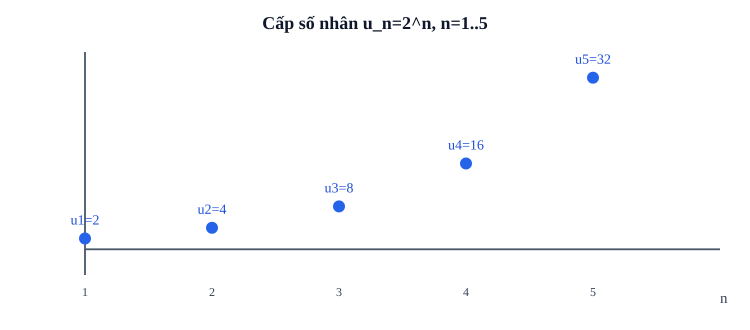

# Bài 7. Cấp số nhân

TOÁN 11 · CHƯƠNG II · SGK KẾT NỐI TRI THỨC

Học kiến thức, tự thử, đọc ví dụ và hình minh họa rồi luyện Core/Practice. Tự kiểm tra cuối chương có chế độ tự đối chiếu, không cấp Readiness độc lập hay Skill Mastery.

<nav class="thpt-r4-lesson-tabs"><a href="../">Chương II</a><a href="../luyen-tap/">Core và Luyện tập</a><a href="../tu-kiem-tra-chuong/">Tự kiểm tra · tự đối chiếu</a></nav>

=== "Khám phá kiến thức"

    ### Cùng tìm hiểu

    Một lượng ban đầu 100 được nhân 1,1 ở mỗi kỳ: 100; 110; 121; … . Nếu mỗi kỳ cộng 10 thì dãy thành 100;110;120; khác 121. Khi **tỉ số tăng trưởng** ổn định, ta cần cấp số nhân với công bội q, nghĩa là u_{n+1}=q u_n. Lý do u_n=u_1 q^{n−1}: từ số hạng đầu đến thứ n ta đã nhân q đúng n−1 lần.

    Không chia u_{n+1}/u_n khi u_n=0; dùng định nghĩa nhân để kể cả q=0. Khi q âm, dấu có thể luân phiên; không đánh đồng giá trị tuyệt đối lớn dần với dãy đồng biến. Tổng hữu hạn xuất hiện khi muốn cộng mọi kỳ: S_n=u_1+...+u_n. Lấy qS_n rồi trừ hai tổng giúp suy ra (1−q)S_n=u_1(1−q^n); chỉ chia cho 1−q khi q≠1. Trường hợp q=1 phải dùng S_n=nu_1. Lãi kép cần thống nhất “vốn trước kỳ” và chỉ số kỳ.

    ### Ví dụ trực quan

    Một quần thể tăng gấp đôi mỗi đợt là phép nhân lặp, khác hẳn tăng thêm cùng một lượng. Cấp số nhân mô tả chính quy luật nhân này.

    **Quan sát bằng số liệu:** Từ 2 cá thể, mỗi đợt gấp ba cho 2,6,18,54. Tỉ số hai số liên tiếp luôn bằng 3, còn hiệu lần lượt 4,12,36 không cố định.

    ### Thuật ngữ và kiến thức, kỹ năng

    **Thuật ngữ:** cấp số nhân, công bội, số hạng thứ n, tổng n số hạng.

    **Sau bài học, em cần:** xác định quy luật nhân, phân biệt q âm và q dương, kiểm mô hình tăng trưởng.

=== "Kiến thức SGK"

    

    **Định nghĩa:** (u_n) là cấp số nhân (CSN) nếu tồn tại công bội q cố định để u_{n+1}=q u_n. Công bội có thể âm hoặc bằng 0; khi q<0 và u1≠0 dấu các số hạng luân phiên, không mặc định dãy tăng. Nếu u_n=0, không dùng phép chia u_{n+1}/u_n để xác định q.

    **Số hạng tổng quát:** u_n=u_1 q^{n−1}, n≥1. Trường hợp q=0 được hiểu u_1 riêng và u_n=0 với n≥2; tránh gán 0^0 nếu cách biểu diễn không quy ước rõ.

    **Tính chất ba số hạng:** u_n²=u_{n−1}u_{n+1} với n≥2. Riêng chiều suy từ phương trình ba số hạng sang một CSN toàn dãy cần xét dấu và giả thiết, không suy bừa chỉ từ một bộ ba.

    **Tổng:** Nếu q≠1, S_n=u_1(1−q^n)/(1−q) = u_1(q^n−1)/(q−1). Nếu q=1, S_n=n u_1. Nếu q=0 và n≥1 thì S_n=u_1; cách này tương thích với công thức q≠1.

    **Ứng dụng:** Khi tăng r% mỗi kỳ, q=1+r/100; khi giảm r% mỗi kỳ, q=1−r/100 (0≤r≤100 theo bài toán thông thường). Phân biệt vốn đầu kỳ V_0 với u_1, và số kỳ n. Lãi kép không suy ra từ dãy cộng số tiền lãi cố định.

    ### Đọc hình và đối chiếu khái niệm

    <figure class="thpt-r4-plot thpt-r4-probability-figure"><figcaption>Đồ thị rời rạc minh họa cấp số nhân; chỉ số n là số nguyên dương.</figcaption></figure>

    ### Hướng dẫn đọc hình

    - các điểm (1,2),(2,4),(3,8),(4,16),(5,32) nhân đôi tung độ mỗi kỳ; so với hình CSC, khoảng cách tăng theo cấp số nhân. Kiểm tra trục tung và đơn vị; không suy rằng mọi CSN đều tăng vì q có thể âm hoặc nhỏ hơn 1.

    ### Vận dụng — tự thử rồi mở đối chiếu

    Từ vốn 100, nhân 1,1 mỗi kỳ. Sau 2 kỳ là 120 hay 121?

    

Đã thử xong? Mở hướng dẫn đối chiếu

    100·1,1²=121, vì tăng trên vốn mới; làm `THPT-G11-B07-C01`.

    

=== "Ví dụ"

    ### Ví dụ 01 — Công bội âm

    Dãy 5,−10,20,−40,... có q=−2, u_n=5(−2)^{n−1}; dấu luân phiên và |u_n| tăng, nhưng dãy không đơn điệu theo nghĩa thông thường.

    ### Ví dụ 02 — Số hạng và tổng

    Cho u_1=3,q=2. Khi đó u_7=3·2⁶=192, S_7=3(2⁷−1)/(2−1)=381.

    ### Ví dụ 03 — Mô hình lãi kép

    Vốn V_0=100 triệu đồng, lãi kép 2% mỗi kỳ và không nạp/rút: sau 5 kỳ V_5=100·(1,02)^5 triệu đồng. Nếu đánh số theo u1 là vốn ban đầu thì u_6=V_5; không nhầm chỉ số kỳ.

    ### Vì sao chọn cách giải?

    - VD-G11-B07-01: tìm q từ phép **nhân** liên tiếp, không gọi dãy có dấu xen kẽ là đồng biến; chú ý lũy thừa n−1.
    - VD-G11-B07-02: phân biệt u_7 (một số hạng) với S_7 (tổng nhiều số hạng), kiểm điều kiện q≠1.
    - VD-G11-B07-03: lãi mỗi kỳ tính trên vốn **mới** sau kỳ trước, nên dùng lũy thừa, không cộng 2% của vốn ban đầu năm lần.

=== "Lỗi thường gặp"

    

Công bội: chỉ số và dấu số hạng

    1. Nhận lỗi: dùng q^n thay q^(n−1).
    2. Viết u_n=u_1 q^(n−1) với n≥1.
    3. Nếu q âm, xác định dấu theo chẵn/lẻ của n−1.
    4. Thử u1=4,q=2 cho u6=128.
    5. Làm C02/P01, không suy công bội bằng cách chia cho 0.

    
<a href="../luyen-tap/?item=THPT-G11-B07-C02">Quay lại câu C02 trong Core/Luyện tập</a>

    

    

Tổng cấp số nhân: trường hợp q=1

    1. Nhận lỗi: áp S_n=u1(1−q^n)/(1−q) khi q=1.
    2. Phân nhánh: q≠1 dùng công thức hữu hạn; q=1 dùng n·u1.
    3. Chú ý dấu nếu q<0 và số mũ n.
    4. Thử dãy 8,8,... có S9=72.
    5. Trở về C03/P04; tự cộng ba số hạng để kiểm tra.

    
<a href="../luyen-tap/?item=THPT-G11-B07-C03">Quay lại câu C03 trong Core/Luyện tập</a>

    

    ### Học tiếp

    [Core và Luyện tập Bài 7](luyen-tap.md) · [Tự luận Chương II](../../../thu-vien/tu-luan-g11-chuong-ii.md)
