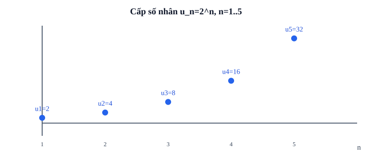

# Bài 7. Cấp số nhân

TOÁN 11 · CHƯƠNG II · KẾT NỐI TRI THỨC

Cùng học quy luật nhân lặp lại: nhận biết công bội, tìm số hạng ở xa và tính tổng của nhiều kì tăng trưởng.

<nav class="thpt-r4-lesson-tabs"><a href="../">Chương II</a><a href="../luyen-tap/">Core và Luyện tập</a><a href="../tu-kiem-tra-chuong/">Tự kiểm tra cuối chương</a></nav>

=== "Khám phá kiến thức"

    Ở Bài 6, nếu mỗi năm tiền lương tăng thêm đúng \(20\) triệu đồng thì dãy lương là **cấp số cộng**. Nhưng nếu công ty tăng lương **\(5\%\) so với năm liền trước**, số tiền tăng thêm mỗi năm không còn cố định: lương năm trước càng lớn, phần tăng \(5\%\) cũng lớn theo. Dãy số lúc đó không nối với nhau bằng cùng một phép cộng mà bằng cùng một **phép nhân**. Bài này giải thích quy luật ấy, cách tính năm thứ \(n\), rồi cách cộng lương của nhiều năm.

    ### 1.1. Định nghĩa cấp số nhân

    Một chuyên gia công nghệ có lương năm đầu \(240\) triệu đồng. Năm sau nhận thêm \(5\%\) của chính mức lương năm trước, nên năm thứ hai nhận \(240(1+0{,}05)=252\) triệu. Năm thứ ba phải lấy \(252(1{,}05)=264{,}6\), **không** lấy \(240+2\cdot12\) như kiểu cộng cố định. Sau mỗi bước, ta đã nhân với cùng một số \(q=1{,}05\). Số này gọi là **công bội**; dãy số tạo thành gọi là **cấp số nhân**.

    Công bội không bắt buộc lớn hơn \(1\). Với \(q=\frac12\), các số \(80,40,20,10,\ldots\) giảm còn một nửa sau mỗi bước. Với \(q=-2\), dãy \(5,-10,20,-40,\ldots\) đổi dấu luân phiên. Và \(q=0\) cho dãy \(7,0,0,\ldots\): dãy này **vẫn** là cấp số nhân, nhưng ta không thể tìm công bội bằng cách chia \(u_3/u_2=0/0\). Bản chất của định nghĩa là **nhân**, không phải lúc nào cũng là phép chia.

    <figure class="thpt-r4-plot"><figcaption><strong>Đọc hình:</strong> đây là dãy \(u_n=2^n\), với mỗi số hạng bằng **hai lần** số trước. Khoảng tăng theo trục tung ngày càng lớn; không nối các điểm vì chỉ số \(n\) chỉ nhận số nguyên dương. Hình này minh họa công bội \(2\), không phải dãy lương \(5\%\).</figcaption></figure>

    **Vận dụng.** Cho \(u_1=4\) và \(u_n=-3u_{n-1}\) với \(n\ge2\). Viết năm số hạng đầu và cho biết dãy có tăng hoặc giảm trên toàn bộ chỉ số hay không.

    ??? question "Đối chiếu"

        **Lời giải:** Dãy có công bội \(q=-3\), nên năm số hạng đầu là \(4,-12,36,-108,324\). Dãy **không tăng cũng không giảm** vì \(4>-12\) nhưng \(-12<36\).

    ??? tip "Kiểm lỗi"

        Khi \(q<0\), dấu của các số hạng có thể luân phiên. Đừng nhầm “giá trị tuyệt đối tăng” với định nghĩa dãy tăng \(u_{n+1}>u_n\).

    ### 1.2. Số hạng tổng quát

    Muốn biết lương năm thứ \(10\), không cần tính riêng cả chín năm trước. Từ năm đầu đến năm thứ hai có **một lần nhân** với \(1{,}05\); đến năm thứ ba có **hai lần**, v.v. Vậy đến năm thứ \(n\) ta đã nhân với công bội đúng \(n-1\) lần:
    \[
      u_n=u_1q^{\,n-1}.
    \]
    Với dãy lương, năm thứ \(10\) là \(240(1{,}05)^9\) triệu đồng; mũ là \(9\), không phải \(10\), vì năm thứ nhất là **mốc ban đầu**.

    Nếu biết hai số hạng cách xa nhau, lấy \(u_s/u_r=q^{s-r}\) **chỉ khi số hạng ở mẫu khác \(0\)**. Khi \(s-r\) chẵn, phép khai căn có thể cho **hai công bội đối nhau**. Ví dụ \(q^2=4\) chưa đủ để quyết định \(q=2\) hay \(q=-2\). Nếu bài khẳng định **mọi số hạng dương**, ta mới loại trường hợp \(q<0\). Đây là lỗi dễ gặp ở các bài suy ngược.

    Với \(q=0\), số hạng đầu có thể khác \(0\), nhưng từ số hạng thứ hai trở đi tất cả bằng \(0\). Do đó nên viết \(u_1\) riêng và dùng công thức \(u_n=u_1q^{n-1}\) từ \(n\ge2\), tránh phải sử dụng \(0^0\) cho \(n=1\) khi chưa có quy ước.

    **Vận dụng.** Một lượng ban đầu \(5000\) vi khuẩn, tăng \(8\%\) sau mỗi giờ so với số lượng ở đầu giờ đó. Theo mô hình không bị giới hạn nguồn sống, sau \(5\) giờ có khoảng bao nhiêu vi khuẩn?

    ??? question "Đối chiếu"

        **Lời giải:** Mỗi giờ nhân với \(q=1{,}08\). Đếm thời gian từ \(t=0\), sau \(5\) giờ là \(N_5=5000(1{,}08)^5\approx7346{,}64\), tức khoảng **7347 vi khuẩn** nếu làm tròn đến cá thể. Nếu đánh chỉ số dãy từ \(u_1=N_0\), thì \(N_5=u_6\).

    ??? tip "Kiểm lỗi"

        Nếu em dùng \(5000+5\cdot400\), em đang cộng cố định \(8\%\) của ban đầu thay vì nhân trên số lượng mới mỗi giờ. Cũng cần phân biệt **năm bước tăng** với chỉ số số hạng \(u_6\).

    ### 1.3. Tổng của \(n\) số hạng đầu cấp số nhân

    Biết công thức lương năm thứ \(n\) vẫn chưa đủ để tính tổng tiền lương \(10\) năm. Ta cần cộng
    \[
       S_{10}=u_1+u_1q+u_1q^2+\cdots+u_1q^9.
    \]
    Nếu nhân cả tổng với \(q\), ta được \(qS_{10}=u_1q+u_1q^2+\cdots+u_1q^{10}\). Khi lấy dòng đầu **trừ** dòng sau, toàn bộ số hạng nằm ở giữa triệt tiêu, chỉ còn \((1-q)S_{10}=u_1(1-q^{10})\). Đó là lí do xuất hiện công thức tổng, không phải phép biến đổi cần học thuộc không có căn cứ.

    Cần phân biệt trường hợp **\(q=1\)**: khi đó \(1-q=0\), không được chia. Dãy có tất cả số hạng bằng \(u_1\) và tổng đơn giản là \(nu_1\). Trường hợp \(q=0\) lại dùng được công thức với \(q\ne1\), kết quả \(S_n=u_1\) cho mọi \(n\ge1\).

    Ví dụ lương khởi điểm \(240\) triệu đồng và tăng \(5\%\) mỗi năm: tổng mười năm là
    \[
       S_{10}=240\,\frac{1-(1{,}05)^{10}}{1-1{,}05}
       \approx3018{,}694\ {\rm triệu\ đồng}.
    \]
    Làm tròn tới triệu đồng được **3019 triệu đồng**. Cộng \(240\) triệu đồng mười lần sẽ bỏ qua tăng trưởng, còn nhân mức lương năm cuối với \(10\) lại coi mọi năm được trả như năm cuối.

    **Vận dụng.** Tìm số số hạng đầu cần cộng của cấp số nhân \(2,6,18,\ldots\) để tổng bằng \(728\). Hãy thử thay lại kết quả thay vì chỉ giải phương trình lũy thừa.

    ??? question "Đối chiếu"

        **Lời giải:** \(u_1=2,q=3\), nên \(S_n=2(1-3^n)/(1-3)=3^n-1\). Từ \(S_n=728\) suy ra \(3^n=729=3^6\); do đó \(n=6\).

        **Kiểm lại:** Sáu số hạng đầu là \(2,6,18,54,162,486\); tổng \(=728\).

    ??? tip "Kiểm lỗi"

        Không nhầm \(u_n=2\cdot3^{n-1}\) với \(S_n=3^n-1\). Và \(n\) là **số lượng số hạng**, nên nghiệm phải là số nguyên dương.

=== "Kiến thức SGK"

    ### 2.1. Định nghĩa cấp số nhân

    
<strong>Định nghĩa — Cấp số nhân</strong>
Một dãy số hữu hạn hoặc vô hạn được gọi là <strong>cấp số nhân</strong> nếu từ số hạng thứ hai, mỗi số hạng bằng số ngay trước **nhân với cùng một số không đổi \(q\)**. Số \(q\) là <strong>công bội</strong>, và hệ thức truy hồi là \(u_n=u_{n-1}\,q\) với \(n\ge2\) khi các số hạng tồn tại.

    **Điều kiện cần nhớ:** Công bội có thể dương, âm hoặc bằng \(0\). Nếu \(q=0\), từ số hạng thứ hai trở đi bằng \(0\). Dãy không đổi \(a,a,\ldots\) với \(a\ne0\) có \(q=1\); dãy toàn số \(0\) thỏa hệ thức với nhiều giá trị \(q\), nên không suy ra một công bội duy nhất bằng phép chia.

    
<strong>Quy tắc — Kiểm tra công bội của dãy không có số hạng bằng \(0\)</strong>
Nếu mọi số hạng của dãy đều khác \(0\), ta có thể tính các tỉ số \(u_n/u_{n-1}\). Nếu tỉ số **không đổi với mọi \(n\ge2\)** thì dãy là một cấp số nhân, và tỉ số chung là công bội \(q\).

<strong>Không áp dụng quy tắc chia</strong> khi có số hạng \(u_{n-1}=0\); khi đó quay về hệ thức nhân của định nghĩa.

    <figure class="thpt-r4-plot"><figcaption><strong>Tra hình:</strong> dãy \(2,4,8,16,32\) có công bội \(q=2\). Hình dùng chung với tab Khám phá và minh họa **nhân cố định**, không phải cộng cố định.</figcaption></figure>

    ### 2.2. Số hạng tổng quát

    
<strong>Công thức — Số hạng tổng quát của cấp số nhân</strong>
Với \(u_1\) và công bội \(q\), từ số hạng thứ hai:

\(u_n=u_1q^{\,n-1},\quad n\ge2.\)

Số hạng thứ nhất được cho riêng bởi \(u_1\); nếu \(q\ne0\), công thức cũng viết được tại \(n=1\) nhờ \(q^0=1\). Khi \(q=0\), mọi \(u_n=0\) với \(n\ge2\), không phải xử lí \(0^0\).

    **Suy ngược số hạng:** Nếu \(u_r\ne0\) và \(s>r\), từ \(u_s=u_rq^{s-r}\) suy ra \(q^{s-r}=u_s/u_r\). Khi \(s-r\) chẵn, cần xét cả dấu của \(q\), không tự lấy căn dương khi thiếu giả thiết. Hệ thức \(u_n^2=u_{n-1}u_{n+1}\) với \(n\ge2\) là **nhận xét suy ra** từ quy luật nhân, không phải phép thử đủ để định nghĩa mọi cấp số nhân.

    **Mô hình tỉ lệ:** Tăng \(r\%\) mỗi kì tương ứng \(q=1+r/100\); giảm \(r\%\) mỗi kì tương ứng \(q=1-r/100\) khi \(0\le r\le100\) trong ngữ cảnh giảm không âm. Phải thống nhất thời điểm gốc: nếu có vốn tại \(t=0\), số tiền sau \(n\) kì là \(V_n=V_0q^n\), còn cách đánh chỉ số SGK từ \(u_1=V_0\) cho \(u_{n+1}=V_n\).

    ### 2.3. Tổng của \(n\) số hạng đầu cấp số nhân

    
<strong>Công thức — Tổng \(n\) số hạng đầu của cấp số nhân</strong>
Đặt \(S_n=u_1+u_2+\cdots+u_n\) với \(n\in\mathbb N^*\).

<strong>Nếu \(q\ne1\):</strong> \(S_n=\dfrac{u_1(1-q^n)}{1-q}=\dfrac{u_1(q^n-1)}{q-1}.\)

<strong>Nếu \(q=1\):</strong> \(S_n=nu_1.\)

<strong>Nếu \(q=0\):</strong> \(S_n=u_1\), tương thích công thức \(q\ne1\).

    **Vì sao đúng:** Nhân \(S_n\) với \(q\) rồi trừ, ta có \((1-q)S_n=u_1(1-q^n)\); chỉ chia cho \(1-q\) khi khác \(0\). Nếu \(q=1\), tất cả số hạng bằng nhau, phải nhân \(u_1\) với \(n\).

    **Cách nhận diện bài toán:** Số hạng thứ \(n\) → dùng công thức mục 2.2. Tổng nhiều số hạng → dùng mục 2.3. Số tiền tăng theo tỉ lệ phần trăm qua các kì → phải xác định **công bội** và số kì trước khi áp dụng. Trường hợp dữ kiện là tăng số tiền cố định, trở lại **cấp số cộng** của Bài 6.

=== "Ví dụ"

    ### 3.1. Công bội âm và các số hạng đầu

    **Đề bài.** Cho cấp số nhân \(u_1=5,\ q=-2\). Viết năm số hạng đầu.

    **Phân tích:** Mỗi bước phải **nhân** với \(-2\), nên độ lớn gấp đôi và dấu đổi qua từng số hạng.

    

<strong>Lời giải.</strong> \(u_1=5;\ u_2=5(-2)=-10;\ u_3=(-10)(-2)=20;\ u_4=20(-2)=-40;\ u_5=(-40)(-2)=80.\)

    **Kiểm lại:** Với mọi cặp kề, \(u_n=-2u_{n-1}\). Dãy không đồng biến dù độ lớn tăng.

    ### 3.2. Nhận biết cấp số nhân từ công thức

    **Đề bài.** Cho \(u_n=\dfrac{1}{3^{n-1}}\), \(n\ge1\). Chứng minh dãy là cấp số nhân và xác định \(u_1,q\).

    **Phân tích:** Các số hạng luôn khác \(0\), vì vậy có thể lấy tỉ số liên tiếp; số mũ lệch nhau đúng \(1\).

    

<strong>Lời giải.</strong> \(u_1=1\); với mọi \(n\ge2\), \(\dfrac{u_n}{u_{n-1}}=\dfrac{1/3^{n-1}}{1/3^{n-2}}=\dfrac13\). Vậy dãy là cấp số nhân với công bội \(q=1/3\).

    **Kiểm lại:** Ba số đầu \(1,\frac13,\frac19\) đều thỏa \(u_n=(1/3)u_{n-1}\).

    ### 3.3. Số hạng xa khi công bội âm

    **Đề bài.** Cho cấp số nhân có hai số hạng đầu \(8,-4\). Tìm \(u_{100}\).

    **Phân tích:** Vì số hạng đầu khác \(0\), \(q=-4/8=-1/2\). Số mũ \(100-1=99\) là lẻ, nên kết quả âm.

    

<strong>Lời giải.</strong> \(u_{100}=8(-1/2)^{99}=-8/2^{99}=-1/2^{96}.\)

    **Kiểm lại:** Dãy bắt đầu \(8,-4,2,-1,\frac12,\ldots\), đúng nhân với \(-1/2\) mỗi bước.

    ### 3.4. Suy công bội từ hai số hạng và điều kiện dương

    **Đề bài.** Cấp số nhân có **mọi số hạng dương**, \(u_{10}=1536,\ u_{12}=6144\). Tìm \(u_{20}\).

    **Phân tích:** \(u_{12}/u_{10}=q^2=4\), nên ban đầu có hai khả năng \(q=\pm2\). Giả thiết mọi số hạng dương buộc \(q>0\).

    

<strong>Lời giải.</strong> \(q=2\); \(u_1=1536/2^9=3\). Do đó \(u_{20}=3\cdot2^{19}=1\,572\,864\).

    **Kiểm lại:** \(u_{12}=3\cdot2^{11}=6144\). Nếu lấy \(q=-2\), các dấu sẽ luân phiên, trái giả thiết dãy gồm toàn số hạng dương.

    ### 3.5. Phân biệt hai trường hợp đặc biệt của tổng

    **Đề bài.** Cho hai cấp số nhân cùng có \(u_1=8\): dãy thứ nhất \(q=1\), dãy thứ hai \(q=0\). Tính tổng \(9\) số hạng đầu của mỗi dãy.

    **Phân tích:** Không được chia cho \(1-q\) khi \(q=1\); còn \(q=0\) làm các số hạng từ thứ hai trở đi bằng \(0\).

    

<strong>Lời giải.</strong> Với \(q=1\), dãy \(8,8,\ldots\), \(S_9=9\cdot8=72\). Với \(q=0\), dãy \(8,0,0,\ldots\), \(S_9=8\).

    **Kiểm lại:** Với \(q=0\), công thức \(u_1(1-q^9)/(1-q)=8\) vẫn đúng; \(q=1\) tạo mẫu \(0\) nên phải dùng công thức riêng.

    ### 3.6. Tính tổng mười năm tiền lương tăng theo phần trăm

    **Đề bài.** Năm đầu nhận \(240\) triệu đồng, mỗi năm sau lương tăng \(5\%\) so với năm trước. Tính tổng mười năm, làm tròn tới triệu đồng.

    **Phân tích:** Đây là **nhân theo tỉ lệ**, nên \(q=1{,}05\). Mười năm tạo \(10\) số hạng; lương năm đầu là \(u_1\), không phải lương thời điểm \(0\).

    

<strong>Lời giải.</strong> \(S_{10}=\dfrac{240[1-(1{,}05)^{10}]}{1-1{,}05}\approx3018{,}694\) triệu đồng. Làm tròn đến triệu đồng được \(3019\) triệu, tức khoảng \(3{,}019\) tỉ đồng.

    **Kiểm lại:** Số tổng lớn hơn \(10\cdot240=2400\) triệu vì từ năm thứ hai lương tăng; kết quả nhỏ hơn \(10\) lần mức lương năm thứ mười.

    ### 3.7. Tìm số lượng số hạng qua tổng cấp số nhân

    **Đề bài.** Cấp số nhân \(3,6,12,\ldots\) cần cộng bao nhiêu số hạng đầu để tổng bằng \(93\)?

    **Phân tích:** Biết \(S_n\) chứ không biết \(n\), nên lập phương trình với \(2^n\), sau đó kiểm \(n\in\mathbb N^*\).

    

<strong>Lời giải.</strong> \(S_n=3(2^n-1)=93\), suy ra \(2^n-1=31\), tức \(2^n=32=2^5\). Vậy \(n=5\).

    **Kiểm lại:** \(3+6+12+24+48=93\).

    ### 3.8. So sánh hai phương án lương theo quý

    **Đề bài.** Trong ba năm (12 quý), lương tháng quý đầu là \(5\) triệu đồng. Phương án A: đầu mỗi quý mới tăng thêm \(0{,}5\) triệu đồng mỗi tháng. Phương án B: đầu mỗi quý mới tăng \(5\%\) so với mức lương tháng của quý ngay trước. Mỗi quý có ba tháng trả cùng mức lương tháng. Phương án nào có tổng lương ba năm cao hơn?

    **Phân tích:** Dãy **mức lương tháng theo quý** của A là cấp số cộng \(5,5{,}5,6,\ldots\); của B là cấp số nhân \(5,5(1{,}05),5(1{,}05)^2,\ldots\). Mỗi mức lương ứng với **ba tháng**, nên tổng tiền phải nhân \(3\).

    

<strong>Lời giải.</strong> Với A, mức tháng quý 12 là \(5+11\cdot0{,}5=10{,}5\) triệu; tổng \(A=3\cdot\frac{12}{2}(5+10{,}5)=279\) triệu đồng. Với B, tổng \(B=3\cdot5\cdot\dfrac{1-(1{,}05)^{12}}{1-1{,}05}\approx238{,}757\) triệu đồng. Vì \(279>238{,}757\), phương án **A** cho tổng lương cao hơn trong mô hình đã cho.

    **Kiểm lại:** Với A, quý đầu nhận \(3\cdot5=15\) triệu và quý cuối \(3\cdot10{,}5=31{,}5\) triệu. Với B, quý sau luôn tăng tỉ lệ, không cộng một số tiền cố định; kiểm đơn vị trước khi so.

=== "Lỗi thường gặp"

    ### 4.1. Nhầm cộng cố định với nhân cố định

    **Dấu hiệu:** Thấy mức lương “tăng \(5\%\) mỗi năm” rồi viết \(u_n=u_1+0{,}05(n-1)u_1\).

    **Vì sao sai:** Lương mỗi năm tăng theo **lương năm trước**, không theo một khoản cố định của năm đầu.

    **Cách sửa:** Viết hai số hạng đầu. Tăng cố định một **số tiền** là cấp số cộng; tăng cố định một **tỉ lệ phần trăm trên số mới** là cấp số nhân.

    ### 4.2. Dùng phép chia khi số hạng ở mẫu bằng \(0\)

    **Dấu hiệu:** Với dãy \(7,0,0,\ldots\), cố tính \(0/0\) để tìm công bội rồi kết luận không phải cấp số nhân.

    **Vì sao sai:** Tỉ số chỉ dùng được khi mẫu khác \(0\); bản thân định nghĩa là \(u_n=q\,u_{n-1}\). Dãy trên có \(q=0\).

    **Cách sửa:** Nếu có số hạng \(0\), quay về hệ thức nhân, kiểm cho mọi vị trí; không áp dụng tỉ số \(u_n/u_{n-1}\) vô điều kiện.

    ### 4.3. Nhầm số bước nhân và số hạng thứ \(n\)

    **Dấu hiệu:** Tính số hạng thứ \(5\) bằng \(u_1q^5\) thay vì \(u_1q^4\).

    **Vì sao sai:** Từ số hạng thứ nhất tới thứ năm chỉ có bốn lần chuyển.

    **Cách sửa:** Đếm \(n-1\) bước; kiểm \(u_2=u_1q\). Với bài toán theo **thời điểm \(0\)**, sau \(n\) kì phải dùng \(V_0q^n\), khác cách đánh chỉ số \(u_1\).

    ### 4.4. Quên xét hai dấu khi suy công bội từ \(q^2\)

    **Dấu hiệu:** Từ \(u_{12}/u_{10}=4\) suy ngay \(q=2\) mà không đọc giả thiết.

    **Vì sao sai:** \(q^2=4\) cho cả \(q=2\) và \(q=-2\). Chỉ có điều kiện “mọi số hạng dương” mới giúp loại công bội âm trong tình huống này.

    **Cách sửa:** Đọc lại tính dương/âm của các số hạng rồi mới chọn công bội, sau đó thế thử dữ kiện.

    ### 4.5. Dùng công thức tổng có mẫu \(1-q\) khi \(q=1\)

    **Dấu hiệu:** Thay \(q=1\) vào \(S_n=u_1(1-q^n)/(1-q)\) dẫn đến \(0/0\).

    **Vì sao sai:** Công thức phân thức đã được suy bằng phép **chia cho \(1-q\)** nên chỉ dùng khi \(q\ne1\).

    **Cách sửa:** Khi \(q=1\), cộng \(n\) số bằng nhau: \(S_n=nu_1\). Với \(q=0\), dùng \(S_n=u_1\).

    ### 4.6. Nhầm tổng số hạng với số hạng cuối và quên đơn vị

    **Dấu hiệu:** Hỏi tổng lương mười năm nhưng chỉ tính \(u_{10}\), hoặc cộng các mức lương **theo quý** mà quên mỗi mức trả ba lần.

    **Vì sao sai:** Một số hạng chỉ đại diện một kì/một mức, còn tổng phải cộng tất cả kì theo đơn vị số tiền tương ứng.

    **Cách sửa:** Ghi rõ đơn vị của một số hạng trước khi cộng; nếu một mức theo quý được trả mỗi tháng trong ba tháng, nhân tổng các mức quý với \(3\).

    **Học tiếp:** [Core và Luyện tập Bài 7](luyen-tap.md) · [Tự luận Chương II](../../../thu-vien/tu-luan-g11-chuong-ii.md).

    
Đối chiếu học thuật: SGK Toán 11 Kết nối tri thức với cuộc sống, tập một, Bài 7 “Cấp số nhân”, trang in 52–55. Ba mục gốc: Định nghĩa, Số hạng tổng quát, Tổng n số hạng đầu. Hình minh họa dùng chung asset SVG hiện có cho Bài 7; không sử dụng bản thảo/hồ sơ nâng cấp đã bị hủy. Không tự nhận kiểm chứng screenshot trang PDF gốc khi nguồn hình chưa truy xuất được.

