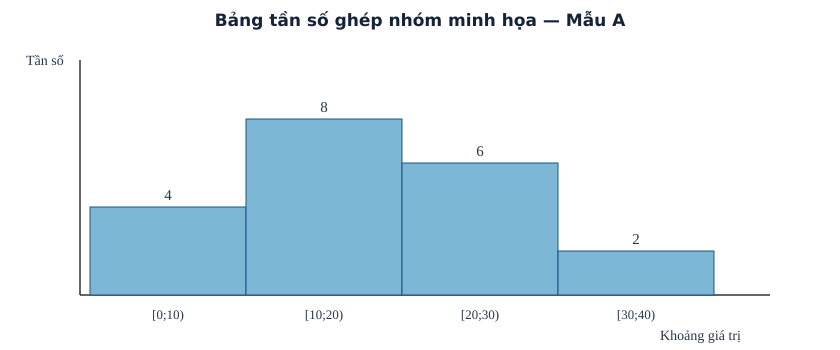

# Bài 8. Mẫu số liệu ghép nhóm

TOÁN 11 · CHƯƠNG III · SGK KẾT NỐI TRI THỨC

Tìm hiểu bản chất trước công thức → xem ví dụ có suy luận → tự thử → Core/Luyện tập. Tự kiểm tra cuối chương là tự đối chiếu công khai, không ghi Readiness độc lập hay Mastery.

<nav class="thpt-r4-lesson-tabs"><a href="../">Chương III</a><a href="../luyen-tap/">Core và Luyện tập</a><a href="../tu-kiem-tra-chuong/">Tự kiểm tra · tự đối chiếu</a></nav>

=== "Khám phá kiến thức"

    ### Cùng tìm hiểu

    Một lớp có 40 số đo thời gian đi học, mỗi số hơi khác nhau. Viết đủ 40 số rất chính xác nhưng khó trả lời **bao nhiêu bạn đi dưới 20 phút, bao nhiêu bạn đi lâu hơn?** Bài 8 giải quyết bằng cách chia trục giá trị thành các khoảng rồi đếm số quan sát mỗi khoảng. Nhờ vậy nhìn được bức tranh tổng thể, đổi lại **không còn biết chính xác từng số trong nhóm**.

    Hãy thử hai nhóm [10;20) và [20;30). Số 20 phải thuộc nhóm thứ hai vì nhóm đầu **loại đầu mút 20**; nếu cho cùng một điểm rơi vào hai nhóm thì tổng tần số sẽ lớn hơn cỡ mẫu. Tần số m_i là số quan sát thuộc nhóm i, tổng các m_i phải bằng n. Các khoảng có thể rộng khác nhau theo dữ liệu; khi đọc hoặc so sánh, phải xem độ rộng và ý nghĩa quy ước nhóm chứ không tự kết luận chỉ từ chiều cao cột.

    **Cầu nối lớp 10:** bảng tần số dữ liệu thô còn giữ từng giá trị; bảng ghép nhóm ưu tiên nhìn phân bố và đổi lấy sai số ước lượng. Đây là lý do Bài 9 không thể lấy trung bình/thống kê gốc chính xác nếu chỉ còn các khoảng.

    ### Ví dụ trực quan

    Thống kê từng con số rất chính xác nhưng khó nhìn toàn cảnh khi mẫu lớn. Ghép nhóm gom các quan sát vào khoảng để mô tả phân bố, đồng thời làm mất một phần thông tin chi tiết.

    **Quan sát bằng số liệu:** Với hai khoảng [0;10) và [10;20), số 10 chỉ thuộc khoảng thứ hai. Nhóm không được đếm biên chung hai lần, nếu không tổng tần số vượt cỡ mẫu.

    ### Thuật ngữ và kiến thức, kỹ năng

    **Thuật ngữ:** mẫu số liệu ghép nhóm, khoảng nửa kín, tần số, độ rộng nhóm.

    **Sau bài học, em cần:** quy định điểm biên, đếm đúng từng nhóm và nhận biết giới hạn của dữ liệu đã ghép.

=== "Kiến thức SGK"

    

    **1. Định nghĩa và cách đọc.** Mẫu số liệu ghép nhóm là bảng phân phối tần số theo các nhóm; mỗi nhóm thường là khoảng nửa kín `[a_i;a_{i+1})` (đôi khi nhóm cuối đóng đầu mút phải nếu bài toán quy định rõ). Tần số `m_i` là số quan sát rơi vào nhóm; cỡ mẫu `n=Σm_i`. Không suy ra các giá trị đơn lẻ hoặc số trung bình chính xác chỉ từ bảng nhóm.
    **2. Ghép số liệu thô.** Xác định phạm vi, chia thành các nhóm thích hợp, quy định cách xử lý điểm ở biên, đếm đúng từng số và đối chiếu tổng tần số bằng số quan sát. Khoảng `[10;20)` nhận 10 nhưng không nhận 20. Không đếm hai lần điểm thuộc biên chung.
    **3. Độ rộng.** Nhóm `[a;b)` có độ rộng `h=b-a>0`; các khoảng có thể có độ rộng khác nhau trong dữ liệu thực tế, nhưng khi sử dụng công thức mốt nội suy của Bài 9 phải xét điều kiện độ rộng **bằng nhau**. Không buộc mọi bảng ghép nhóm đều có độ rộng bằng nhau.
    **4. Tỉ lệ và ý nghĩa.** Tỉ lệ nhóm `m_i/n`; nhóm có tần số nhiều nhất chỉ là nhóm tập trung nhiều quan sát nhất. Số ở giữa nhóm được dùng làm đại diện trong một số phép ước lượng, không phải khẳng định mọi cá thể có cùng số đo.

    ### Đọc hình và đối chiếu khái niệm

    <figure class="thpt-r4-plot thpt-r4-probability-figure"><figcaption>Bốn khoảng [0;10), [10;20), [20;30), [30;40) có tần số 4,8,6,2. Chiều cao cột là tần số nhóm, không phải từng giá trị gốc.</figcaption></figure>

    ### Vận dụng — tự thử rồi mở đối chiếu

    Với các nhóm [0;10), [10;20), [20;30), số 10 thuộc nhóm nào? Em hãy giải thích quy ước trước khi mở đáp án.

    

Đã tự thử? Mở hướng dẫn đối chiếu

    [10;20), vì khoảng đó nhận đầu mút trái bằng 10. Nếu chưa chắc, quay lại phần định nghĩa và luyện THPT-G11-B08-C02.

    

=== "Ví dụ"

    ### Ví dụ 1 — Đếm biên

    Dữ liệu 9,10,10,19,20 với nhóm [0;10),[10;20),[20;30) cho tần số [1,3,1]; số 10 ở nhóm 2, số 20 ở nhóm 3.

    ### Ví dụ 2 — Bảng nhóm

    Mẫu 2,4,5,7,9,11,14,15 ghép [0;5),[5;10),[10;15),[15;20) cho [2,3,2,1], n=8.

    ### Ví dụ 3 — Đọc tỉ lệ

    Bảng có tần số [6,9,5], n=20: nhóm thứ hai chiếm 45%, không thể kết luận mỗi cá thể có giá trị bằng trung điểm nhóm.

    ### Ví dụ 4 — Nhóm rộng không đều

    [0;5),[5;20),[20;30) đều là các nhóm hợp lệ khi đề bài quy định, với các độ rộng 5,15,10; không tự áp công thức mốt nhóm cùng độ rộng.

    ### Vì sao chọn cách giải?

    - `VD-G11-B08-01`: kiểm điểm biên 10 và 20 theo quy ước trái đóng/phải mở **trước** khi đếm, tránh đếm hai lần.
    - `VD-G11-B08-02`: lập nhóm không giao nhau, đếm tần số rồi kiểm tổng bằng n=8 để phát hiện bỏ sót.
    - `VD-G11-B08-03`: chia 9/20 ra 45% vì “tỉ lệ nhóm” không phải giá trị trung điểm của từng người.
    - `VD-G11-B08-04`: xác nhận nhóm rộng 5,15,10 vẫn có thể là nhóm thống kê; **không** áp công thức mốt SGK dành cho nhóm đều rộng.

=== "Lỗi thường gặp"

    

Nhầm đầu mút chung.

    
(1) Viết lại hai khoảng kề nhau [0;10) và [10;20).; (2) Nhắc quy ước a≤x&lt;b cho [a;b).; (3) Thử x=10: không thuộc khoảng trước, thuộc khoảng sau.; (4) Đếm lại 5,10,10,19,20,29 được [1,3,2].; (5) Làm lại Core B08-C02, rồi Practice B08-P01.

    
<a href="../luyen-tap/?item=THPT-G11-B08-C02">Quay lại câu THPT-G11-B08-C02 trong Core/Luyện tập</a>

    

    

Cộng sai tần số.

    
(1) Đếm số phần tử của bảng gốc và ghi n.; (2) Gạch dấu từng phần tử vào đúng một nhóm.; (3) Cộng lại tổng tần số và so với n.; (4) Nếu n=20 và ba nhóm đã có 4,8,6 thì nhóm cuối phải là 2.; (5) Làm lại B08-C01, B08-P05 rồi kiểm tổng lần nữa.

    
<a href="../luyen-tap/?item=THPT-G11-B08-C01">Quay lại câu THPT-G11-B08-C01 trong Core/Luyện tập</a>

    

    

Giá trị đại diện bị coi là số thật.

    
(1) Nêu rõ bảng chỉ cho khoảng và số lượng.; (2) Giá trị đại diện là trung điểm dùng để ước lượng.; (3) Tạo hai giá trị khác nhau cùng thuộc [155;160).; (4) Nhận xét chúng có cùng nhóm mà số đo gốc khác nhau.; (5) Làm lại B08-C05, B08-P07 và giải thích bằng lời.

    
<a href="../luyen-tap/?item=THPT-G11-B08-C05">Quay lại câu THPT-G11-B08-C05 trong Core/Luyện tập</a>

    

    ### Học tiếp

    [Core và Luyện tập Bài 8](luyen-tap.md) · [Tự luận Chương III](../../../thu-vien/tu-luan-g11-chuong-iii.md) · [Tự kiểm tra cuối chương](tu-kiem-tra-chuong.md)
