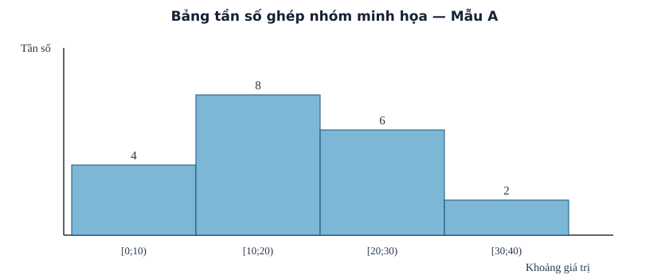

# Bài 8. Mẫu số liệu ghép nhóm

TOÁN 11 · CHƯƠNG III · KẾT NỐI TRI THỨC

Từ các số liệu riêng lẻ đến bảng nhóm: đọc chính xác các khoảng, ghép nhóm đúng đầu mút và không đánh đồng tần số với giá trị gốc.

<nav class="thpt-r4-lesson-tabs"><a href="../">Chương III</a><a href="../luyen-tap/">Core và Luyện tập</a><a href="../tu-kiem-tra-chuong/">Tự kiểm tra cuối chương</a></nav>

=== "Khám phá kiến thức"

    Hãy hình dung bảng tổng điểm thi của hàng trăm nghìn thí sinh. Nếu viết tất cả các giá trị theo từng thí sinh, ta giữ được thông tin rất chi tiết nhưng khó nhìn nhanh nhóm điểm nào đông. SGK bắt đầu từ tình huống ấy để giải thích tại sao cần **mẫu số liệu ghép nhóm**: chia miền giá trị thành các nhóm rồi đếm số quan sát trong mỗi nhóm. Ta học cách **đọc bảng nhóm** trước, sau đó mới học **tự ghép nhóm** một mẫu ban đầu.

    ### 1.1. Giới thiệu về mẫu số liệu ghép nhóm

    Giả sử thời gian đi học (phút) của 20 học sinh là

    \(2,\ 4,\ 6,\ 9,\ 10,\ 11,\ 12,\ 12,\ 15,\ 16,\ 18,\ 19,\ 20,\ 21,\ 23,\ 24,\ 25,\ 28,\ 30,\ 32.\)

    Những số này có nhiều giá trị khác nhau. Nhưng nếu câu hỏi là “có bao nhiêu bạn đi học từ 10 đến dưới 20 phút?”, ta chỉ cần đếm những giá trị trong khoảng đó: \(10,11,12,12,15,16,18,19\), được **8 bạn**. Làm tương tự cho các khoảng kế tiếp, ta có:

    | Thời gian đi học (phút) | \([0;10)\) | \([10;20)\) | \([20;30)\) | \([30;40)\) |
    |:--|--:|--:|--:|--:|
    | Số học sinh | 4 | 8 | 6 | 2 |

    **Vì sao dấu ngoặc khác nhau?** Nhóm \([10;20)\) nhận \(10\) nhưng **không nhận \(20\)**. Số \(20\) thuộc nhóm \([20;30)\), do đó không bị đếm hai lần. Các nhóm đứng cạnh nhau nhưng không chồng lấn. Cộng \(4+8+6+2=20\), đúng số học sinh ban đầu. Số quan sát trong một nhóm gọi là **tần số của nhóm**; tổng các tần số bằng cỡ mẫu khi mọi quan sát đều được phân nhóm đúng một lần.

    <figure class="thpt-r4-plot"><figcaption><strong>Đọc hình:</strong> cột \([10;20)\) cao 8 nghĩa là 8 quan sát thuộc khoảng này, không có nghĩa cả 8 quan sát đều bằng 15. Đây là bức tranh phân bố, không phải dữ liệu gốc của từng người.</figcaption></figure>

    Từ bảng, ta biết dưới \(20\) phút có \(4+8=12\) bạn, tức \(60\%\) mẫu. Nhưng **không biết chính xác** mỗi bạn trong nhóm \([10;20)\) đi bao nhiêu phút nếu chỉ còn bảng nhóm. Vì thế ghép nhóm giúp tóm tắt dữ liệu nhưng **mất bớt thông tin chi tiết**. Một số bảng còn dùng nhóm mở như “dưới 15 tuổi”, “từ 65 tuổi trở lên” hoặc cho phép **nhóm cuối lấy cả đầu mút phải** khi có quy định rõ ràng.

    **Vận dụng.** Trong bảng 20 học sinh trên, số \(20\) thuộc nhóm nào? Có bao nhiêu bạn đi từ \(20\) phút trở lên? Tỉ lệ nhóm \([10;20)\) bằng bao nhiêu?

    ??? question "Đối chiếu"

        **Lời giải:** \(20\in[20;30)\) và \(20\notin[10;20)\). Có \(6+2=8\) bạn đi từ 20 phút trở lên. Nhóm \([10;20)\) có tỉ lệ \(8/20=40\%\). Cộng mọi nhóm vẫn được 20 người.

    ??? tip "Kiểm lỗi"

        Nếu đưa \(20\) vào hai nhóm, tổng tần số có thể vượt cỡ mẫu. Nếu khẳng định cả 8 người đi đúng \(15\) phút, em đã nhầm **khoảng giá trị** với **giá trị thực của từng người**.

    ### 1.2. Ghép nhóm mẫu số liệu

    Bây giờ hãy tự lập bảng từ mẫu gồm \(12\) số: \(9,10,10,19,20,22,28,29,30,33,39,40\). Chọn các nhóm \([0;10)\), \([10;20)\), \([20;30)\), \([30;40)\), \([40;50)\). Ta có: \(9\) vào nhóm đầu; hai số \(10\) và số \(19\) vào nhóm hai; \(20,22,28,29\) vào nhóm ba; \(30,33,39\) vào nhóm bốn; \(40\) vào nhóm cuối.

    | Nhóm | \([0;10)\) | \([10;20)\) | \([20;30)\) | \([30;40)\) | \([40;50)\) |
    |:--|--:|--:|--:|--:|--:|
    | Tần số | 1 | 3 | 4 | 3 | 1 |

    Tổng \(1+3+4+3+1=12\), đúng số quan sát. Việc lập bảng có **hai bước**: (1) chia miền giá trị thành các nhóm theo tiêu chí; (2) đếm từng số đúng một lần và lập bảng tần số. Với \([a;b)\), **độ dài nhóm** là \(b-a\), khi hai đầu mút hữu hạn.

    Không phải càng nhiều nhóm càng tốt: quá ít nhóm làm thông tin bị thô, quá nhiều nhóm khiến bảng dài như dữ liệu gốc. SGK khuyên các nhóm **nên có độ dài bằng nhau** khi phù hợp, nhưng đây không phải điều kiện bắt buộc của mọi bài. Chẳng hạn cỡ áo được xác định theo những khoảng chiều cao rộng khác nhau, ta phải theo tiêu chí cỡ áo. Những nhóm mở về một phía cũng không có độ dài hữu hạn kiểu \(b-a\).

    Nếu một cuộc thi có thời gian chạy từ \(129\) đến \(145\) phút và cần chia **sáu nhóm dài 3 phút**, tổng khoảng phủ phải là \(6\cdot3=18\) phút, lớn hơn khoảng biến thiên \(145-129=16\). Có thể chọn từ \(127{,}5\) đến dưới \(145{,}5\) phút. Khi ấy giá trị lớn nhất \(145\) vẫn nằm trong nhóm cuối, không bị bỏ sót.

    Ta cũng có thể phân nhóm \(8\) giá trị BMI theo các mức “dưới \(18{,}5\)”, “từ \(18{,}5\) đến dưới \(23\)” và “từ \(23\) trở lên”. Với dãy \(16{,}8;18{,}7;19{,}1;19{,}2;20{,}6;21{,}1;23{,}5;25{,}2\), tần số là **1, 5, 2**. Đó là ví dụ *phân loại theo tiêu chí đã cho*, không phải bắt buộc chia nhóm có cùng độ dài và cũng không phải hướng dẫn đánh giá sức khỏe cá nhân.

    **Vận dụng.** Ghép \(5,8,12,12,19,20,21,29,30,34,39,40\) theo năm nhóm rộng 10 đã nêu. Có bao nhiêu số nhỏ hơn \(30\)? Nếu điểm \(30\) bị chuyển vào nhóm trước thì sai ở bước nào?

    ??? question "Đối chiếu"

        **Lời giải:** Tần số là \(2,3,3,3,1\). Các số nhỏ hơn 30 có \(2+3+3=8\) giá trị. Nhóm \([20;30)\) không nhận 30; 30 phải thuộc \([30;40)\). Tổng tần số bằng 12.

    ??? tip "Kiểm lỗi"

        Hãy dịch \([a;b)\) thành \(a\le x<b\) trước khi đếm. Nếu bảng không phủ hết điểm lớn nhất hoặc cho một điểm rơi vào hai nhóm, phải điều chỉnh nhóm/kiểm lại điểm biên chứ không tự sửa tổng tần số.

    **Kết nối ứng dụng:** Khi khảo sát 36 học sinh và có 22 bạn chọn cỡ M, ước lượng may 500 áo theo tỉ lệ khảo sát cho cỡ M là \(500\cdot22/36\approx306\) áo. Đây là **dự báo theo mẫu**, không phải khẳng định chính xác mọi trường đều có tỉ lệ như vậy.

=== "Kiến thức SGK"

    ### 2.1. Giới thiệu về mẫu số liệu ghép nhóm

    
<strong>Khái niệm — Mẫu số liệu ghép nhóm</strong>
Mẫu số liệu ghép nhóm là mẫu số liệu được cho dưới dạng <strong>bảng tần số của các nhóm số liệu</strong>. Một nhóm gồm các giá trị được ghép theo tiêu chí xác định; nhóm thường cho dưới dạng \([a;b)\), trong đó \(a\) là đầu mút trái, \(b\) là đầu mút phải và \(a\le x<b\).

    **Đọc bảng:** Tần số \(m_i\) là **số quan sát** thuộc nhóm thứ \(i\). Với các nhóm không chồng lấn, phủ hết mẫu \(n\) giá trị, \(m_1+\cdots+m_r=n\); tỉ lệ nhóm là \(m_i/n\). Chỉ biết nhóm và tần số thì **không khôi phục được chính xác từng số liệu gốc**.

    | Thời gian (phút) | \([0;10)\) | \([10;20)\) | \([20;30)\) | \([30;40)\) |
    |:--|--:|--:|--:|--:|
    | Tần số | 4 | 8 | 6 | 2 |

    <figure class="thpt-r4-plot"><figcaption><strong>Tra hình:</strong> cột thứ hai cho \(8\) quan sát trong nhóm \([10;20)\), và tổng tần số của các nhóm là \(20\). Hình dùng chung với tab Khám phá, chỉ dẫn ở đây phục vụ việc tra cứu.</figcaption></figure>

    **Nhận xét (theo SGK):** Ghép nhóm hữu ích khi không có dữ liệu chính xác hoặc muốn tổ chức, đọc, phân tích dữ liệu thuận tiện hơn. Nhóm cuối **có thể nhận đầu mút phải** nếu bảng quy định; một số bảng dùng nhóm mở như “dưới 15 tuổi” hoặc “từ 65 tuổi trở lên”. Không tự xem nhận xét này là một “Định nghĩa” hay “Tính chất” mới.

    ### 2.2. Ghép nhóm mẫu số liệu

    
<strong>Quy tắc — Hai bước ghép nhóm mẫu số liệu</strong>
<strong>Bước 1:</strong> Chia miền giá trị của mẫu số liệu thành các nhóm theo tiêu chí cho trước hoặc tiêu chí phù hợp, bảo đảm không chồng lấn và phủ hết quan sát.

<strong>Bước 2:</strong> Đếm số giá trị thuộc từng nhóm (tần số), lập bảng thống kê và so tổng tần số với cỡ mẫu để phát hiện sai sót.

    
<strong>Công thức — Độ dài nhóm</strong>
Nếu nhóm có hai đầu mút hữu hạn \([a;b)\) với \(b>a\), độ dài nhóm là \(h=b-a>0\).

Với \(r\) nhóm liên tiếp có độ dài bằng nhau \(h\), tổng độ dài là \(rh\); phải chọn đầu/cận nhóm để mọi số liệu đều nằm trong một nhóm.

    **Lưu ý khi chia nhóm:** Không nên dùng quá nhiều hoặc quá ít nhóm. Các nhóm phải không giao nhau và **nên** có độ dài bằng nhau khi điều kiện dữ liệu cho phép. Nếu đề đã cho tiêu chí cỡ áo hoặc mức phân loại khác nhau thì không tự thay đổi tiêu chí. Nhóm mở về một phía không áp dụng phép tính độ dài hữu hạn ở trên.

    **Ví dụ tra cứu:** Với \(9,10,10,19,20,22,28,29,30,33,39,40\), các nhóm \([0;10),[10;20),[20;30),[30;40),[40;50)\) có tần số \(1,3,4,3,1\), tổng \(12\). Các mốc \(10,20,30,40\) đều thuộc **nhóm bắt đầu tại chính mốc đó**.

    **Giới hạn:** Giá trị trung bình hoặc trung vị tính từ bảng nhóm ở Bài 9 chỉ là kết quả ước lượng với giả thiết phù hợp; không biến bài ghép nhóm này thành bảng công thức nội suy của bài sau.

=== "Ví dụ"

    ### 3.1. Đọc bảng thành các câu thống kê

    **Đề bài.** Bảng có bốn nhóm \([0;10),[10;20),[20;30),[30;40)\), tần số \(3,7,9,5\). Tìm số quan sát dưới \(20\) và từ \(20\) trở lên.

    **Phân tích:** Hai điều kiện chia miền dữ liệu tại mốc \(20\); dựa đúng quy ước đầu mút.

    

<strong>Lời giải.</strong> Dưới \(20\) có \(3+7=10\) quan sát; từ \(20\) trở lên có \(9+5=14\).

    **Kiểm lại:** \(10+14=24\), khớp tổng tần số của bảng.

    ### 3.2. Tính tỉ lệ nhóm đúng ý nghĩa

    **Đề bài.** Bốn nhóm \([0;10),[10;20),[20;30),[30;40)\) có tần số \(3,7,9,5\). Tỉ lệ nhóm \([20;30)\) là bao nhiêu? Có thể kết luận cả chín quan sát của nhóm có giá trị \(25\) không?

    **Phân tích:** Tỉ lệ là số quan sát của nhóm chia cỡ mẫu; trung điểm khoảng không phải dữ liệu cá nhân.

    

<strong>Lời giải.</strong> \(9/(3+7+9+5)=9/24=37{,}5\%\). Không thể khẳng định cả chín bằng \(25\); chẳng hạn \(22\) và \(28\) cùng thuộc khoảng nhưng khác nhau.

    **Kiểm lại:** \(37{,}5\%\) chỉ mô tả tần suất của nhóm.

    ### 3.3. Đếm đúng các giá trị ở đầu mút

    **Đề bài.** Ghép \(8,10,15,19,20,21,25,30,30,35,40,42\) vào các nhóm \([0;10),[10;20),[20;30),[30;40),[40;50)\).

    **Phân tích:** Các giá trị \(10,20,30,40\) là đầu mút trái của những nhóm kế tiếp, phải định vị trước khi đếm.

    

<strong>Lời giải.</strong> Tần số lần lượt là \(1,3,3,3,2\): \(8\); \(10,15,19\); \(20,21,25\); \(30,30,35\); \(40,42\).

    **Kiểm lại:** Tổng \(1+3+3+3+2=12\). Mỗi quan sát được tính đúng một lần; hai số \(30\) là hai quan sát khác nhau cùng thuộc nhóm \([30;40)\).

    ### 3.4. Chọn nhóm đều để bao phủ số đo

    **Đề bài.** Dữ liệu \(42,47,50,55,60,64\) (kg), chọn các nhóm rộng \(5\) kg có nhóm \([40;45)\). Lập bảng tần số.

    **Phân tích:** Từ mốc \(40\) đến mốc \(65\) là năm nhóm liền nhau độ dài \(5\), đủ chứa giá trị lớn nhất \(64\).

    

<strong>Lời giải.</strong> Các nhóm \([40;45),[45;50),[50;55),[55;60),[60;65)\) có tần số \(1,1,1,1,2\).

    **Kiểm lại:** \(50\) nằm ở nhóm thứ ba, \(60\) ở nhóm thứ năm, tổng sáu quan sát.

    ### 3.5. Nhóm theo tiêu chí có độ dài khác nhau

    **Đề bài.** Dãy \(16{,}8;18{,}7;19{,}1;19{,}2;20{,}6;21{,}1;23{,}5;25{,}2\) được chia theo nhóm nhỏ hơn \(18{,}5\), từ \(18{,}5\) đến dưới \(23\), và từ \(23\) trở lên. Đếm tần số.

    **Phân tích:** Các mức chia đã được quy định theo tiêu chí, không ép thành các nhóm rộng bằng nhau.

    

<strong>Lời giải.</strong> Có \(1\) giá trị dưới \(18{,}5\); \(5\) giá trị trong \([18{,}5;23)\); \(2\) giá trị từ \(23\) trở lên. Tần số là \(1,5,2\).

    **Kiểm lại:** \(1+5+2=8\). Hai nhóm ngoài mở một phía, không có độ dài hữu hạn \(b-a\).

    ### 3.6. Vì sao bảng ghép nhóm không cho trung bình gốc?

    **Đề bài.** Hai tổ có các mẫu A \(11,12,13\) và B \(17,18,19\), cùng được ghép vào nhóm \([10;20)\). Hai bảng nhóm có gì giống và khác về dữ liệu gốc?

    **Phân tích:** Đếm số quan sát trong nhóm trước, rồi so trung bình thật của mỗi tổ để thấy phần thông tin bị mất.

    

<strong>Lời giải.</strong> Cả hai bảng đều ghi tần số \(3\) trong nhóm \([10;20)\). Nhưng trung bình gốc A bằng \(12\), B bằng \(18\). Bảng nhóm không khôi phục được giá trị trung bình chính xác của từng tổ.

    **Kiểm lại:** Cả sáu giá trị đều ở đúng khoảng nhưng hai bộ số liệu không giống nhau.

    ### 3.7. Ước lượng số áo dự kiến theo mẫu khảo sát

    **Đề bài.** Một khảo sát có \(36\) bạn chọn cỡ áo S,M,L,XL,XXL với tần số \(0,22,8,6,0\). Nếu may \(500\) áo theo tỉ lệ ấy, dự kiến các cỡ bao nhiêu chiếc?

    **Phân tích:** Nhân tỉ lệ từng cỡ với \(500\), làm tròn số áo và kiểm tổng sau làm tròn vẫn là \(500\).

    

<strong>Lời giải.</strong> S và XXL dự kiến \(0\); M: \(500\cdot22/36\approx305{,}56\to306\); L: \(500\cdot8/36\approx111{,}11\to111\); XL: \(500\cdot6/36\approx83{,}33\to83\) chiếc.

    **Kiểm lại:** \(306+111+83=500\). Đó là dự báo nếu nhu cầu thực tế có cơ cấu tương tự mẫu, không phải kết quả chắc chắn cho mọi nơi.

=== "Lỗi thường gặp"

    ### 4.1. Đếm trùng ở mốc chung

    **Dấu hiệu:** Số \(20\) vừa thuộc \([10;20)\), vừa thuộc \([20;30)\).

    **Vì sao sai:** \([a;b)\) nhận \(a\) nhưng loại \(b\), nên hai nhóm liên tiếp không cùng nhận mốc chung.

    **Cách sửa:** Đổi thành bất đẳng thức \(a\le x<b\) và đưa \(20\) đúng vào \([20;30)\).

    ### 4.2. Nhóm không phủ hết quan sát

    **Dấu hiệu:** Dữ liệu có \(40\) nhưng nhóm cuối là \([30;40)\).

    **Vì sao sai:** Số \(40\) bị loại, tổng tần số nhỏ hơn cỡ mẫu.

    **Cách sửa:** Thêm nhóm chứa \(40\) hoặc áp dụng quy ước nhóm cuối đóng phải nếu đề cho, rồi kiểm lại tổng.

    ### 4.3. Chia quá nhiều hoặc quá ít nhóm

    **Dấu hiệu:** Dùng một nhóm cho toàn bộ dữ liệu hoặc mỗi số riêng một nhóm dù mục đích là tóm tắt phân bố.

    **Vì sao sai:** Một nhóm mất thông tin về phân bố; quá nhiều nhóm không giúp tổng hợp.

    **Cách sửa:** Chọn số nhóm, độ dài theo mục đích và khoảng biến thiên thực tế.

    ### 4.4. Ép nhóm rộng bằng nhau khi tiêu chí khác

    **Dấu hiệu:** Tự đổi các khoảng cỡ áo quy định thành các khoảng độ dài 5.

    **Vì sao sai:** Độ dài bằng nhau là lời khuyên khi thích hợp, không thay thế tiêu chí đã cho.

    **Cách sửa:** Theo các khoảng đề bài quy định; kiểm các khoảng không chồng lấn.

    ### 4.5. Coi giá trị giữa nhóm là số đo thật

    **Dấu hiệu:** Nói cả 8 người trong \([10;20)\) có thời gian đúng \(15\) phút.

    **Vì sao sai:** Bảng cho khoảng và số người, không cho vị trí của từng giá trị trong khoảng.

    **Cách sửa:** Diễn đạt “8 quan sát từ 10 đến dưới 20”, chỉ sử dụng trung điểm khi đang giải thích phép ước lượng có điều kiện.

    ### 4.6. Biến tỉ lệ mẫu thành khẳng định chính xác toàn bộ

    **Dấu hiệu:** Từ 22/36 mẫu cỡ M suy ra chính xác mọi trường đều có tỉ lệ ấy.

    **Vì sao sai:** Mẫu khảo sát chỉ hỗ trợ dự báo có giả định; không xác nhận toàn bộ quần thể.

    **Cách sửa:** Nói rõ số áo là dự kiến, làm tròn và kiểm tổng bằng 500.

    **Học tiếp:** [Core và Luyện tập Bài 8](luyen-tap.md) · [Tự luận Chương III](../../../thu-vien/tu-luan-g11-chuong-iii.md) · [Tự kiểm tra cuối chương](tu-kiem-tra-chuong.md).

    
Đối chiếu văn bản SGK Toán 11 Kết nối tri thức, tập một, Bài 8 trang in 58–61 qua bản PDF số hóa nội dung SGK lưu tại trang tham khảo và bản chép theo trang in trên SGKVN. Hai mục SGK: Giới thiệu về mẫu số liệu ghép nhóm; Ghép nhóm mẫu số liệu. Hình SVG tần số B08 có sẵn trên main, được dùng chung ở hai tab. Chưa nhận đã kiểm hình in từng trang của SGK gốc.

