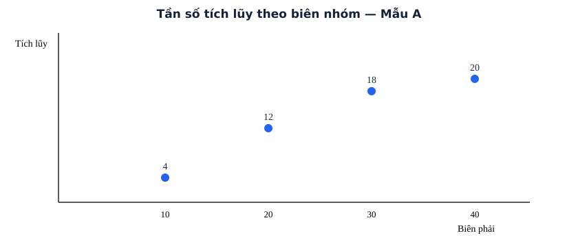

# Bài 9. Các số đặc trưng đo xu thế trung tâm

TOÁN 11 · CHƯƠNG III

Khi chỉ còn bảng ghép nhóm, ta vẫn có thể ước lượng trung bình, trung vị, tứ phân vị và mốt — nếu hiểu cách dùng tần số và giới hạn của phép nội suy.

<nav class="thpt-r4-lesson-tabs"><a href="../">Chương III</a><a href="../luyen-tap/">Core và Luyện tập</a><a href="../tu-kiem-tra-chuong/">Tự kiểm tra cuối chương</a></nav>

=== "Khám phá kiến thức"

    Ở Bài 8, ta gộp nhiều số liệu thành các khoảng để nhìn nhanh phân bố. Nhưng giờ muốn so sánh “mức điển hình” của hai lớp thì phải trả lời những câu hỏi khác nhau: **mức trung bình xấp xỉ là bao nhiêu?**, **điểm chia đôi mẫu ở đâu?**, **một phần tư đầu/cuối nằm khoảng nào?**, **khoảng nào tập trung nhất?** Đây là các mục tiêu khác nhau của trung bình, trung vị, tứ phân vị và mốt.

    Đừng quên điều đã mất ở Bài 8: bảng tần số không còn từng giá trị chính xác. Vì vậy các kết quả trong bài là **ước lượng từ nhóm**, cần ghi cách xác định và đơn vị chứ không giả vờ đó là số đo gốc tuyệt đối đúng.

    ### 1.1. Vì sao dùng trung điểm làm giá trị đại diện?

    Nếu 12 người có thời gian trong khoảng \([12;18)\) phút, chỉ riêng bảng nhóm không cho biết họ mất đúng bao nhiêu. Muốn ước lượng một số cho cả khoảng, ta có thể chọn **trung điểm** \((12+18)/2\). Nó đại diện cho nhóm trong mô hình tính toán, không phải phát biểu “cả 12 người mất đúng 15 phút”.

    **Vận dụng.** Với nhóm \([12;18)\), giá trị đại diện là bao nhiêu? Với nhóm “ít nhất 20” không cho cận trên hữu hạn, có tính được trung điểm theo cùng công thức không?

    

    ??? question "Đối chiếu"

        **Lời giải:** Nhóm \([12;18)\) có trung điểm \(x_i=(12+18)/2=15\). Nhóm không có cận trên hữu hạn **không có trung điểm xác định từ hai đầu mút**. Muốn gán đại diện phải có quy ước hay dữ liệu bổ sung; không tự chọn một số tùy ý rồi gọi là kết quả chính xác.

    

    ??? tip "Kiểm lỗi"

        **Dấu hiệu:** Em lấy \(18-12=6\) làm giá trị đại diện, hoặc coi mọi số trong nhóm bằng 15.

        **Tự sửa:** Độ rộng là **hiệu**, còn đại diện là **trung bình hai biên**. Ôn mục 2.1, luyện Core tìm trung điểm \([20;30)\) trong [Bài 9 – Core và Luyện tập](../luyen-tap/).

    ### 1.2. Số trung bình phải có trọng số tần số

    Nếu nhóm A chứa 3 người có đại diện 5 và nhóm B chứa 5 người có đại diện 15, không thể chỉ lấy \((5+15)/2\), vì hai nhóm không có **số người bằng nhau**. Hãy tưởng tượng mỗi đại diện lặp lại đúng số lần bằng tần số; tổng các tích rồi chia **tổng số quan sát**. Đó là số trung bình **xấp xỉ**, không khẳng định ai cũng có đúng giá trị đại diện.

    **Vận dụng.** Hai nhóm \([0;10)\), \([10;20)\) có tần số lần lượt \(3,5\). Hãy tính số trung bình ghép nhóm và giải thích vì sao không chia tổng hai trung điểm cho \(2\).

    

    ??? question "Đối chiếu"

        **Lời giải:** Hai trung điểm là \(5,15\), cỡ mẫu \(n=8\). Số trung bình ghép nhóm bằng \(\overline x=(3\cdot5+5\cdot15)/8=90/8=11{,}25\). Nếu chia \(5+15\) cho \(2\) thì đã coi hai nhóm có trọng số như nhau, trái với tần số \(3\) và \(5\).

    

    ??? tip "Kiểm lỗi"

        **Dấu hiệu:** Em trả lời \(10\) vì lấy trung bình không trọng số, hoặc chia tổng cho số nhóm \(2\).

        **Tự sửa:** Vẽ bảng \(x_i,m_i,m_ix_i\); lấy \(\sum m_ix_i/\sum m_i\). Ôn mục 2.1; làm Core trung bình hai nhóm rồi Practice trung bình Mẫu A ở [Bài 9 – Luyện tập](../luyen-tap/).

    ### 1.3. Tần số tích lũy cho biết vị trí nằm trong nhóm nào

    Muốn tìm giá trị ở vị trí giữa, ta cần biết bao nhiêu quan sát nằm **trước** mỗi nhóm. Cộng dồn tần số từ trái sang phải được tần số tích lũy \(C_i\). Nếu vị trí \(t\) lớn hơn tổng trước nhóm và không vượt tổng đến nhóm ấy, ta biết vị trí \(t\) thuộc khoảng đang xét. Không cần đoán bằng mắt nhóm cao nhất.

    **Vận dụng.** Bốn nhóm theo thứ tự có tần số \(2,7,4,3\). Lập tần số tích lũy. Với \(n=16\), vị trí \(n/2=8\) nằm trong nhóm thứ mấy?

    

    ??? question "Đối chiếu"

        **Lời giải:** Tần số tích lũy là \(2,9,13,16\). Vị trí \(8\) **vượt 2 và không vượt 9**, nên thuộc **nhóm thứ hai**. Đây là bước tìm đúng nhóm để nội suy trung vị, chưa phải phép tính trung vị.

    

    ??? tip "Kiểm lỗi"

        **Dấu hiệu:** Em lấy nhóm tần số lớn nhất làm nhóm chứa mọi phân vị, hoặc không cộng dồn.

        **Tự sửa:** Viết hàng \(C_i\) ngay dưới \(m_i\). Ôn mục 2.2 rồi luyện Core lập tần số tích lũy \(3,5,2,4\) tại [Core và Luyện tập Bài 9](../luyen-tap/).

    ### 1.4. Vì sao trung vị phải nội suy trong nhóm?

    Giả sử chỉ biết các khoảng và tần số. Ta tìm nhóm chứa **vị trí \(n/2\)**, nhưng không biết chính xác các giá trị gốc nằm đâu trong nhóm. Công thức nội suy giả định phân bố tương đối đều trong khoảng ấy: phần vị trí đã đi qua trong nhóm \((n/2-C)/m\) trở thành phần độ rộng \(h\) tính từ biên trái \(L\). Vì vậy \(Me\) là **ước lượng**, không phải trung vị thô được phục hồi.

    **Vận dụng.** Ba nhóm \([0;10),[10;20),[20;30)\) có tần số \(3,5,4\). Tính trung vị ghép nhóm theo nội suy SGK.

    

    ??? question "Đối chiếu"

        **Lời giải:** \(n=12\), vị trí \(n/2=6\). Tích lũy \(3,8,12\) nên nhóm trung vị là \([10;20)\); \(L=10,C=3,m=5,h=10\). Do đó
        \[
        Me=10+\frac{6-3}{5}\cdot10=16.
        \]
        Không thay 15 là trung điểm nhóm nếu đề yêu cầu nội suy.

    

    ??? tip "Kiểm lỗi"

        **Dấu hiệu:** Em lấy \(Me=15\) (trung điểm) hoặc lấy \(C=8\) (tích lũy **sau** nhóm).

        **Tự sửa:** Ghi \(L,C_{\text{trước}},m,h\) theo đúng nhóm đã chọn. Ôn mục 2.3 và giải Practice trung vị mẫu B tại [Bài 9 – Luyện tập](../luyen-tap/).

    ### 1.5. Tứ phân vị chia mẫu thành bốn phần

    Nếu trung vị ở vị trí một nửa, **tứ phân vị thứ nhất** liên quan vị trí \(n/4\), **thứ ba** liên quan \(3n/4\). Hai vị trí này có thể thuộc hai nhóm khác nhau; không được dùng cùng \(L,C,m,h\) cho cả hai. Tính bằng nội suy trong **nhóm chứa mỗi vị trí**, rồi giải thích mức độ gần đúng.

    **Vận dụng.** Bốn nhóm \([0;10),[10;20),[20;30),[30;40)\) có tần số \(4,6,6,4\). Tìm \(Q_1,Q_3\) theo nội suy; làm tròn đến hai chữ số thập phân.

    

    ??? question "Đối chiếu"

        **Lời giải:** \(n=20\), tích lũy \(4,10,16,20\). Vị trí \(n/4=5\) thuộc nhóm \([10;20)\): \(Q_1=10+(5-4)\cdot10/6=11{,}666\ldots\approx11{,}67\). Vị trí \(3n/4=15\) thuộc \([20;30)\): \(Q_3=20+(15-10)\cdot10/6=28{,}333\ldots\approx28{,}33\). Hai phân vị dùng **hai nhóm khác nhau**.

    

    ??? tip "Kiểm lỗi"

        **Dấu hiệu:** Em lấy \(C=10\) cho cả \(Q_1,Q_3\), hoặc nội suy trên một nhóm duy nhất.

        **Tự sửa:** Với mỗi \(r\), tìm lại vị trí \(rn/4\) và **nhóm chứa vị trí**, rồi mới thế công thức. Ôn mục 2.4; thử Practice tứ phân vị Mẫu A tại [Bài 9 – Luyện tập](../luyen-tap/).

    ### 1.6. Mốt nội suy phải kiểm điều kiện trước

    Trong bảng các khoảng **cùng độ rộng**, nhóm có tần số nổi bật là ứng viên **nhóm mốt**. Công thức nội suy ước lượng mốt bằng cách xét tần số của nhóm đó với **hai nhóm kề**. Nếu các nhóm rộng khác nhau, hoặc không có nhóm mốt xác định theo quy ước đề/SGK, không được thay bừa vào công thức này. Mốt ước lượng không phải số liệu thô xuất hiện nhiều nhất.

    **Vận dụng.** Ba nhóm \([0;10),[10;20),[20;30)\) có tần số \(3,7,5\). Tính mốt ghép nhóm theo công thức nội suy các nhóm đều rộng.

    

    ??? question "Đối chiếu"

        **Lời giải:** Nhóm \([10;20)\) có tần số lớn nhất \(m_j=7\); trước là \(3\), sau là \(5\), và \(h=10,L=10\). Do đó
        \[
        Mo=10+\frac{7-3}{(7-3)+(7-5)}\cdot10
          =10+\frac{40}{6}
          =\frac{50}{3}\approx16{,}67.
        \]
        Đây là **ước lượng mốt theo nhóm**, không khẳng định trong dữ liệu thô có số 16,67.

    

    ??? tip "Kiểm lỗi"

        **Dấu hiệu:** Em chọn nhóm đầu vì ở biên dễ tính, hoặc thiếu một tần số kề trong mẫu số.

        **Tự sửa:** Xác định nhóm tần số lớn nhất rồi ghi riêng \(m_j,m_{\text{trước}},m_{\text{sau}},L,h\). Ôn mục 2.5, giải Practice mốt Mẫu A tại [Bài 9 – Luyện tập](../luyen-tap/).

    ### 1.7. Có khi câu trả lời đúng là “không đủ thông tin”

    Nếu chỉ còn bảng nhóm, ta **không thể** kết luận trung bình gốc của mọi người bằng số trung bình ghép nhóm vừa tính. Cùng bảng có thể được tạo bởi nhiều bộ dữ liệu thô. Và khi nhóm không đều rộng, công thức mốt nội suy của SGK cho nhóm đều rộng **không dùng trực tiếp được**. Biết **giới hạn của phương pháp** là một phần của năng lực thống kê.

    **Vận dụng.** Ba nhóm \([0;5),[5;20),[20;30)\) có tần số \(5,8,7\). Có thể áp **trực tiếp** công thức nội suy mốt theo độ rộng chung của Bài 9 không? Hãy nêu điều kiện bị thiếu.

    

    ??? question "Đối chiếu"

        **Lời giải:** **Không.** Các nhóm có độ rộng \(5,15,10\), nên không có độ rộng chung \(h\). Công thức nội suy \(Mo\) với các chênh tần số hai phía trong bài được trình bày cho các nhóm **đều rộng**. Với bảng khác độ rộng, phải xét một phương pháp phù hợp khác và điều kiện thống kê cụ thể, không tự sử dụng công thức cũ.

    

    ??? tip "Kiểm lỗi"

        **Dấu hiệu:** Em thay \(h=10\) vì nhóm cuối rộng 10 mà quên hai nhóm đầu.

        **Tự sửa:** Tính tất cả \(h_i=b_i-a_i\) trước khi xét nhóm mốt; ôn mục 2.5 và bài kiểm điều kiện nhóm không đều rộng trong [Core và Luyện tập Bài 9](../luyen-tap/).

    **Tự thử bổ sung — giải thích giới hạn của ước lượng.** Hai nhóm \([0;10)\) và \([10;20)\) có tần số lần lượt \(3,1\). Dùng trung điểm nhóm để tính số trung bình ghép nhóm \(\overline x_g\). Xét hai bộ số liệu gốc \(A=(1,2,3,11)\) và \(B=(8,9,9,19)\): cả hai có cùng bảng ghép nhóm không, và số trung bình chính xác có bằng \(\overline x_g\) không?

    

    ??? question "Đối chiếu — trung bình ước lượng"

        **Lời giải:** Trung điểm là \(5\) và \(15\), nên \(\overline x_g=(3\cdot5+1\cdot15)/4=7{,}5\). Cả \(A\) và \(B\) đều có ba giá trị trong \([0;10)\), một giá trị trong \([10;20)\), nên **cùng bảng ghép nhóm** và cùng \(\overline x_g=7{,}5\). Tuy nhiên, \(\overline x_A=(1+2+3+11)/4=4{,}25\), còn \(\overline x_B=(8+9+9+19)/4=11{,}25\). Trung bình ghép nhóm là **ước lượng bằng trung điểm**, không phải giá trị chính xác bắt buộc của mọi mẫu số liệu gốc phù hợp bảng.

    

    ??? tip "Kiểm lỗi — giới hạn ước lượng"

        **Dấu hiệu:** Em lấy \(7{,}5\) làm trung bình chính xác của cả hai mẫu hoặc chia tổng trung điểm cho số nhóm thay vì cho cỡ mẫu. **Tự sửa:** Ghi \(n=3+1\), nhân mỗi trung điểm với **tần số**, rồi so sánh trung bình dữ liệu gốc tự tính để thấy thông tin đã mất. **Luyện lại:** Ôn mục 2.2 về trung bình có trọng số, làm Core **THPT-G11-B09-C02** và Practice **THPT-G11-B09-P10** về giới hạn suy luận từ bảng nhóm tại <a href="../luyen-tap/">Core và Luyện tập Bài 9</a>; không kết luận quá dữ kiện.

=== "Kiến thức SGK"

    ### 2.1. Giá trị đại diện của nhóm và số trung bình

    Khi khoảng nhóm \([a_i;a_{i+1})\) có hai đầu mút hữu hạn, ta lấy trung điểm \(x_i=\dfrac{a_i+a_{i+1}}2\) làm **giá trị đại diện**. Nếu chỉ biết “trên 50” mà thiếu đầu mút trên, không được tự nhận trung điểm là một con số xác định.

    
<strong>Số trung bình ghép nhóm:</strong> Với \(k\) nhóm, tần số \(m_i\ge0\), tổng cỡ mẫu \(n=\sum_{i=1}^k m_i>0\), ta có
    \[
    \overline x=\frac{\sum_{i=1}^k m_i x_i}{n}.
    \]
    Đây là **giá trị ước lượng** dựa trên các đại diện, không nhất thiết bằng trung bình gốc.

    **Đọc công thức:** Tần số là **trọng số** của mỗi trung điểm. Không chia tổng các trung điểm cho số nhóm nếu tần số khác nhau.

    ### 2.2. Tần số tích lũy và xác định nhóm chứa phân vị

    
<strong>Định nghĩa:</strong> Đặt \(C_0=0\), \(C_i=m_1+\cdots+m_i\) là tần số tích lũy đến nhóm \(i\). Để xác định nhóm chứa vị trí \(t\in(0;n]\), tìm nhóm đầu tiên thỏa \(C_i\ge t\); khi ấy \(C_{i-1}<t\le C_i\), trừ trường hợp vị trí đúng đầu biên được diễn giải thống nhất bằng nội suy.

    **Ví dụ bảng Mẫu A để tra cứu:**

    | Khoảng | \([0;10)\) | \([10;20)\) | \([20;30)\) | \([30;40)\) |
    | --- | ---: | ---: | ---: | ---: |
    | \(m_i\) | 4 | 8 | 6 | 2 |
    | \(C_i\) | 4 | 12 | 18 | 20 |
    | \(x_i\) | 5 | 15 | 25 | 35 |

    <figure class="thpt-r4-plot"><figcaption>Đọc hình: ở biên 10,20,30,40, tần số tích lũy lần lượt \(4,12,18,20\). Hình chỉ tổng đếm đến biên, không cho biết vị trí chính xác của từng quan sát.</figcaption></figure>

    ### 2.3. Trung vị của mẫu số liệu ghép nhóm

    
<strong>Trung vị nội suy:</strong> Xác định nhóm chứa \(n/2\); gọi \(L\) là biên trái, \(C\) là tần số tích lũy **trước** nhóm, \(m>0\) là tần số nhóm, \(h>0\) là độ rộng. Khi ấy
    \[
    Me=L+\frac{n/2-C}{m}\,h.
    \]
    

    **Bản chất:** Tỉ lệ \((n/2-C)/m\) thể hiện phần vị trí đi vào nhóm; nhân \(h\) để ước lượng quãng đo tính từ biên trái. Giá trị trung vị ước lượng phải nằm từ \(L\) đến \(L+h\) theo diễn giải biên. Công thức này **không khôi phục** trung vị thực của mẫu thô.

    ### 2.4. Tứ phân vị của mẫu số liệu ghép nhóm

    Tương tự trung vị, các vị trí \(n/4,n/2,3n/4\) lần lượt cho \(Q_1,Q_2,Q_3\). Cần tìm **đúng nhóm riêng** chứa mỗi vị trí \(rn/4\) trước khi nội suy.

    
<strong>Công thức nội suy:</strong> Với \(r=1,2,3\), trong nhóm chứa vị trí \(rn/4\),
    \[
    Q_r=L+\frac{rn/4-C}{m}\,h,\qquad m>0.
    \]
    Đặc biệt \(Q_2=Me\) theo cùng quy ước nội suy.

    <figure class="thpt-r4-plot"><figcaption>Đọc hình: các mốc của Mẫu A là \(Q_1\approx11{,}25\), \(Me\approx17{,}5\), \(Q_3\approx25\). Đây là **kết quả nội suy từ bảng nhóm**, không phải ba quan sát thô được đo chính xác.</figcaption></figure>

    ### 2.5. Mốt của mẫu số liệu ghép nhóm

    Với các nhóm **cùng độ rộng \(h>0\)** và một nhóm mốt có tần số lớn nhất \(m_j\) được xác định, gọi \(L\) là biên trái nhóm ấy, \(m_{j-1}\) và \(m_{j+1}\) là tần số hai nhóm kề theo quy ước cần thiết ở biên. Khi chênh lệch trong mẫu số khác \(0\), dùng nội suy:

    
<strong>Mốt nội suy (điều kiện nhóm đều rộng):</strong>
    \[
    Mo=L+\frac{m_j-m_{j-1}}{(m_j-m_{j-1})+(m_j-m_{j+1})}\,h.
    \]
    Nếu không có nhóm mốt xác định hoặc mẫu số bằng \(0\), không tự chia. Theo quy ước SGK đang áp dụng, khi **mọi nhóm có tần số bằng nhau**, mẫu ghép nhóm không có mốt.

    **Lưu ý:** Khi hai nhóm cùng tần số lớn nhất, không tùy tiện chọn một rồi tuyên bố một mốt duy nhất; xem yêu cầu và quy ước của bài. Nếu nhóm **không cùng độ rộng**, không áp trực tiếp công thức nội suy trên với tần số thuần túy.

    ### 2.6. Diễn giải kết quả và giới hạn dữ liệu

    Khi báo cáo, nêu **đơn vị**, ghi rõ giá trị nào là **xấp xỉ**. Số trung bình tính từ đại diện nhóm, các phân vị và mốt nội suy đều chỉ dựa trên một bảng đã giảm chi tiết. Các dữ liệu gốc khác nhau có thể cho **cùng bảng tần số** mà cho trung bình/trung vị/mốt chính xác khác nhau. Với nhóm không có hai đầu mút hữu hạn, cần thận trọng về giả thiết khi tính đại diện.

    **Tự kiểm trước khi luyện:** Hỏi đúng loại câu hỏi: \(\overline x\) cần trọng số; \(Me,Q_r\) cần tần số tích lũy và vị trí; \(Mo\) cần điều kiện nhóm mốt và độ rộng; mọi kết quả đều cần diễn giải như một ước lượng.

=== "Ví dụ"

    Mỗi ví dụ có bài toán, lý do chọn cách, phép giải và bước kiểm. Các ví dụ sử dụng nhiều mẫu khác nhau để tránh chỉ thuộc một bảng.

    ### 3.1. Trung bình có trọng số của một bảng bốn nhóm

    

<strong>Đề bài:</strong> Mẫu D có các nhóm \([0;10),[10;20),[20;30),[30;40)\) với tần số \(2,6,8,4\). Tính số trung bình ghép nhóm.

    
<strong>Phân tích:</strong> Nhóm có số quan sát khác nhau, vì vậy không lấy trung bình đơn của bốn trung điểm; dùng \(m_ix_i\).

    
<strong>Lời giải:</strong> \(n=20\), các trung điểm \(5,15,25,35\). Tổng trọng số \(2\cdot5+6\cdot15+8\cdot25+4\cdot35=440\). Vì vậy \(\overline x=440/20=22\).

    
<strong>Kiểm lại:</strong> \(22\) nằm trong khoảng giá trị các đại diện từ \(5\) đến \(35\), hợp lý; không khẳng định trung bình thô chính xác bằng \(22\).

    ### 3.2. Tìm nhóm trung vị bằng cộng dồn

    

<strong>Đề bài:</strong> Với Mẫu D của Ví dụ 3.1, tìm tần số tích lũy và nhóm chứa vị trí trung vị.

    
<strong>Phân tích:</strong> Đề chỉ yêu cầu **nhóm** trước khi tính số gần đúng, nên chưa cần công thức nội suy.

    
<strong>Lời giải:</strong> Tần số tích lũy lần lượt là \(2,8,16,20\). Vị trí \(n/2=10\) vượt 8 và không vượt 16, nên nhóm trung vị là \([20;30)\).

    
<strong>Kiểm lại:</strong> Hai nhóm đầu có \(2+6=8\) quan sát, chưa đến vị trí 10; tính cả nhóm thứ ba được 16, đã qua vị trí ấy.

    ### 3.3. Nội suy trung vị trong đúng khoảng

    

<strong>Đề bài:</strong> Tính \(Me\) nội suy của Mẫu D có tần số \(2,6,8,4\) trên bốn nhóm rộng 10.

    
<strong>Phân tích:</strong> Nhóm trung vị \([20;30)\) có biên trái \(L=20\), tích lũy **trước** nhóm \(C=8\), tần số nhóm \(m=8\).

    
<strong>Lời giải:</strong> \(Me=20+\frac{10-8}{8}\cdot10=22{,}5\).

    
<strong>Kiểm lại:</strong> Giá trị \(22{,}5\) thuộc khoảng \([20;30)\), không nằm ngoài nhóm nội suy.

    ### 3.4. Hai tứ phân vị dùng hai nhóm khác nhau

    

<strong>Đề bài:</strong> Tính \(Q_1,Q_3\) cho Mẫu D, dùng cách nội suy với \(n=20\).

    
<strong>Phân tích:</strong> Vị trí \(5\) thuộc nhóm hai, vị trí \(15\) thuộc nhóm ba; hai nhóm có tích lũy trước và tần số khác nhau.

    
<strong>Lời giải:</strong> \(Q_1=10+\frac{5-2}{6}\cdot10=15\). \(Q_3=20+\frac{15-8}{8}\cdot10=28{,}75\).

    
<strong>Kiểm lại:</strong> \(Q_1\in[10;20)\), \(Q_3\in[20;30)\), và \(Q_1<Me=22{,}5<Q_3\).

    ### 3.5. Mốt nội suy khi có nhóm mốt rõ ràng

    

<strong>Đề bài:</strong> Tìm \(Mo\) ước lượng cho Mẫu D với tần số \(2,6,8,4\) và bốn nhóm đều rộng 10.

    
<strong>Phân tích:</strong> Nhóm \([20;30)\) lớn nhất, \(m_j=8\); hai nhóm kề có tần số \(6\) và \(4\). Mọi nhóm cùng độ rộng nên áp dụng được nội suy.

    
<strong>Lời giải:</strong> \(Mo=20+\frac{8-6}{(8-6)+(8-4)}\cdot10=20+\frac{20}{6}=\frac{70}{3}\approx23{,}33\).

    
<strong>Kiểm lại:</strong> Mốt ước lượng nằm trong nhóm \([20;30)\), không bị lấy ở nhóm trước hay sau.

    ### 3.6. Phân vị nằm đúng ranh giới

    

<strong>Đề bài:</strong> Bốn nhóm \([0;5),[5;10),[10;15),[15;20)\) có tần số \(3,2,10,5\). Tính \(Q_3\) nội suy.

    
<strong>Phân tích:</strong> \(n=20\), vị trí \(3n/4=15\) nằm **đúng cuối nhóm thứ ba** theo tích lũy. Cần xử lý ranh giới thống nhất, không tự cộng thêm một đơn vị.

    
<strong>Lời giải:</strong> Tích lũy \(3,5,15,20\). Nhóm thứ ba có \(L=10,C=5,m=10,h=5\), nên \(Q_3=10+\frac{15-5}{10}\cdot5=15\).

    
<strong>Kiểm lại:</strong> Nếu xét từ nhóm bốn với \(L=15,C=15\), nội suy ở ngay biên trái cũng được \(15\). Hai cách cho một giá trị biên thống nhất.

    ### 3.7. Cùng bảng nhóm không đồng nghĩa cùng trung bình gốc

    

<strong>Đề bài:</strong> Hai mẫu \(A=(1,3,12,14)\), \(B=(6,9,17,19)\) được ghép vào \([0;10),[10;20)\). So sánh bảng nhóm và số trung bình gốc.

    
<strong>Phân tích:</strong> Lập bảng tần số trước rồi tính từ số gốc chỉ để kiểm **mức độ mất thông tin**.

    
<strong>Lời giải:</strong> Hai mẫu đều cho tần số \((2,2)\). Nhưng \(\overline x_A=(1+3+12+14)/4=7{,}5\), còn \(\overline x_B=(6+9+17+19)/4=12{,}75\). Số trung bình ghép nhóm chung là \(10\), chỉ là **ước lượng**.

    
<strong>Kiểm lại:</strong> Hai mẫu có cùng số quan sát ở mỗi khoảng nhưng các giá trị riêng khác nhau, nên không thể phục hồi trung bình chính xác.

    ### 3.8. Không áp công thức mốt khi độ rộng khác nhau

    

<strong>Đề bài:</strong> Bảng có các nhóm \([0;5),[5;20),[20;30)\), tần số \(6,9,5\). Có áp trực tiếp công thức \(Mo\) theo nhóm đều rộng ở mục 2.5 được không?

    
<strong>Phân tích:</strong> Phải kiểm **độ rộng trước khi nhận dạng nhóm mốt**; tần số lớn nhất chưa đủ để hợp thức hóa mọi phép nội suy.

    
<strong>Lời giải:</strong> Các độ rộng \(5,15,10\) khác nhau, nên **không áp trực tiếp** công thức mốt của mục 2.5. Muốn phân tích mốt theo cách khác cần thêm quy ước/mô hình thống kê phù hợp.

    
<strong>Kiểm lại:</strong> Không có một số \(h\) chung để thay vào công thức; chọn \(h=15\) chỉ vì nhóm hai lớn nhất là thiếu điều kiện.

=== "Lỗi thường gặp"

    Nếu sai một câu Vận dụng, xem Kiểm lỗi của câu đó. Năm nhóm lỗi dưới đây là những phương pháp sai cần tránh ở nhiều bảng số liệu khác nhau.

    

    ??? tip "4.1. Lấy trung bình các trung điểm mà quên tần số"

        **Dấu hiệu:** Em lấy \((5+15)/2=10\) cho bảng có tần số \(3,5\).

        **Vì sao sai:** Mỗi đại diện được dùng **lặp theo tần số**, không phải mỗi nhóm đều một lần.

        **Tự sửa:** Ôn mục 2.1; ghi \(x_i,m_i,m_ix_i\), rồi luyện Core trung bình hai nhóm và Practice Mẫu B có nhóm khác nhau ở [Core và Luyện tập Bài 9](../luyen-tap/).

    

    ??? tip "4.2. Dùng sai tích lũy trước nhóm và chọn nhầm nhóm chứa phân vị"

        **Dấu hiệu:** Với Mẫu D, em dùng \(C=16\) thay vì \(C=8\) khi tính trung vị.

        **Vì sao sai:** Công thức cần số quan sát **trước nhóm nội suy**, không phải đến hết nhóm ấy.

        **Tự sửa:** Ôn mục 2.2–2.4 và Ví dụ 3.2–3.4; luyện Core tìm nhóm trung vị Mẫu A rồi Practice trung vị Mẫu B ở [Bài 9 – Luyện tập](../luyen-tap/).

    

    ??? tip "4.3. Coi mọi phân vị là số đo gốc chính xác"

        **Dấu hiệu:** Em nói mọi người thuộc nhóm trung vị đều có giá trị \(Me\), hoặc xem \(Q_1,Q_3\) là những số đo thô chắc chắn xuất hiện.

        **Vì sao sai:** Nội suy sử dụng giả định phân bố trong khoảng nhóm đã mất chi tiết.

        **Tự sửa:** Nêu chữ “ước lượng”, giữ đơn vị, ôn Ví dụ 3.7; luyện Practice tìm \(Q_1,Q_3\) của Mẫu A và giải thích sai số ở [Bài 9 – Luyện tập](../luyen-tap/).

    

    ??? tip "4.4. Áp công thức mốt ngoài điều kiện nhóm đều rộng"

        **Dấu hiệu:** Em lấy \(h\) của một nhóm bất kỳ trong bảng các khoảng rộng 5,15,10.

        **Vì sao sai:** Công thức nội suy mốt đang học được xây dựng cho các nhóm **cùng độ rộng**. Điều kiện không đúng thì phép thế không có cơ sở.

        **Tự sửa:** Ôn mục 2.5 và Ví dụ 3.8, kiểm mọi \(h_i\); luyện Core điều kiện mốt và Practice bảng có các tần số bằng nhau ở [Bài 9 – Luyện tập](../luyen-tap/).

    

    ??? tip "4.5. Nhầm mốt, trung vị và trung bình thành một số"

        **Dấu hiệu:** Với một mẫu ghép nhóm, em trả lời cùng một giá trị cho cả \(Mo,Me,\overline x\) chỉ vì chúng cùng mô tả “ở giữa”.

        **Vì sao sai:** Trung bình cân trọng số, trung vị chia đôi vị trí tích lũy, mốt dựa vào nhóm tập trung và các tần số kề. Chúng đo các ý nghĩa **khác nhau** và không nhất thiết bằng nhau.

        **Tự sửa:** Đặt ba cột câu hỏi “mức cân bằng / chia đôi / tập trung” rồi chọn phương pháp; ôn các mục 2.1,2.3,2.5 và luyện cả ba loại ở [Core và Luyện tập Bài 9](../luyen-tap/).

    **Học tiếp:** [Core và Luyện tập](../luyen-tap/) · [Tự kiểm tra cuối chương](../tu-kiem-tra-chuong/) · [Tự luận Chương III](../../../../thu-vien/tu-luan-g11-chuong-iii/).

    
Nguồn tham khảo: SGK Toán 11 – Kết nối tri thức với cuộc sống, tập một, Bài 9 (trang in 62–68).

