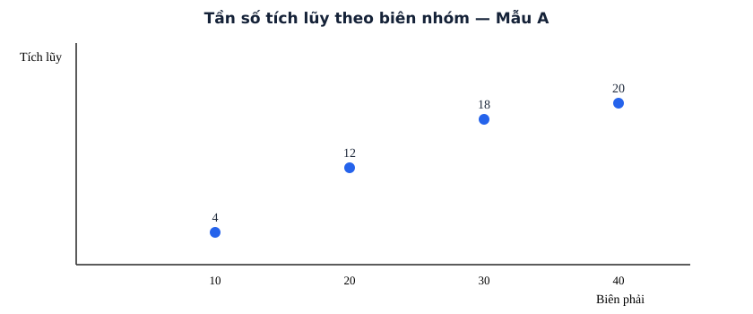
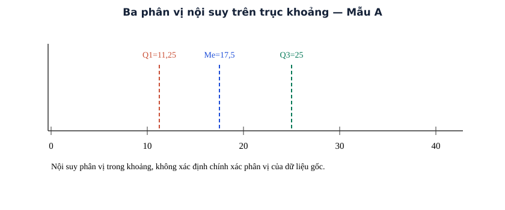

# Bài 9. Các số đặc trưng đo xu thế trung tâm

TOÁN 11 · CHƯƠNG III · SGK KẾT NỐI TRI THỨC

Tìm hiểu bản chất trước công thức → xem ví dụ có suy luận → tự thử → Core/Luyện tập. Tự kiểm tra cuối chương là tự đối chiếu công khai, không ghi Readiness độc lập hay Mastery.

<nav class="thpt-r4-lesson-tabs"><a href="../">Chương III</a><a href="../luyen-tap/">Core và Luyện tập</a><a href="../tu-kiem-tra-chuong/">Tự kiểm tra · tự đối chiếu</a></nav>

=== "Khám phá kiến thức"

    ### Cùng tìm hiểu

    Giả sử chỉ còn bốn nhóm [0;10), [10;20), [20;30), [30;40) với tần số 4,8,6,2. Ta không còn biết các số đo riêng lẻ, nhưng muốn có một **con số mô tả trung tâm** để so sánh các lớp. Chọn trung điểm 5,15,25,35 làm **đại diện** cho nhóm; tổng có trọng số (4·5+8·15+6·25+2·35)/20=18. Đây là **số trung bình xấp xỉ**, không khẳng định mỗi bạn trong nhóm đúng bằng trung điểm.

    Nếu muốn biết “một nửa dữ liệu ở phía trước đâu?”, hãy cộng tần số tích lũy: 4,12,18,20. Vị trí n/2=10 thuộc nhóm [10;20). **Nội suy** giả thiết phân bố đều tương đối trong nhóm để ước lượng Me=10+(10−4)·10/8=17,5; giá trị gốc có thể khác. Tương tự Q1, Q3 theo các vị trí n/4,3n/4. **Mốt** là vùng tập trung nhiều nhất, nhưng công thức nội suy đã học yêu cầu điều kiện về độ rộng các nhóm và tần số kề; không sử dụng bất chấp nhóm rộng khác nhau.

    Bảng ghép nhóm cho hình dung và **ước lượng có điều kiện**, chứ không phục hồi đầy đủ dữ liệu thô. Mỗi kết luận phải ghi đơn vị và mức độ gần đúng.

    ### Ví dụ trực quan

    Bảng nhóm chỉ lưu khoảng và số lượng, nên số trung bình, trung vị hay mốt chỉ còn có thể được ước lượng qua giá trị đại diện và nội suy.

    **Quan sát bằng số liệu:** Hai nhóm [0;10), [10;20) mỗi nhóm có tần số 2. Dùng trung điểm 5 và 15 cho trung bình ước lượng 10, nhưng không thể khẳng định trung bình số đo gốc chính xác bằng 10.

    ### Thuật ngữ và kiến thức, kỹ năng

    **Thuật ngữ:** trung bình nhóm, trung vị, tứ phân vị, mốt, tần số tích lũy.

    **Sau bài học, em cần:** xác định lớp chứa vị trí cần tìm, kiểm độ rộng nhóm trước công thức mốt và diễn giải sai số.

=== "Kiến thức SGK"

    

    ### 1.1. Giá trị đại diện và trung bình

    Nhóm có hai đầu mút hữu hạn `a_i,a_{i+1}` có giá trị đại diện `x_i=(a_i+a_{i+1})/2`. Số trung bình ghép nhóm `x̄ = (Σ m_i x_i)/n`. Nếu chỉ biết nhóm mở một phía thì không tự động tính trung điểm. Các số trên là **ước lượng**, không nhất thiết bằng giá trị gốc.
    ### 1.2. Tần số tích lũy

    Đặt `C_0=0`, `C_i=Σ_{j≤i}m_j`. Nhóm chứa vị trí `t` được xác định bởi tích lũy trước `<t` và tích lũy đến nhóm `≥t`. Khi vị trí đúng ở biên hai nhóm, nội suy cho cùng một đầu mút nếu áp dụng nhất quán.
    ### 1.3. Trung vị (nội suy)

    Nhóm `[L;U)` có tần số `m>0`, độ rộng `h=U-L`, tích lũy trước nhóm `C`. Chọn nhóm chứa vị trí `n/2`; `Me = L + ((n/2-C)/m)h`. Đừng thay bằng giá trị đại diện của nhóm nếu chưa có căn cứ.
    ### 1.4. Tứ phân vị

    Tương tự, vị trí `n/4, n/2, 3n/4`; `Q_r=L+((rn/4-C)/m)h`, `r∈{1,2,3}`, trên đúng nhóm. `Q_2=Me`; các phân vị là xấp xỉ cho mẫu gốc. Không áp máy móc quy tắc chia đôi mẫu thô lớp 10 vào bảng nhóm.
    ### 1.5. Mốt (nội suy, điều kiện SGK)

    Chỉ áp dụng trực tiếp công thức SGK khi các nhóm có độ rộng chung `h` và xác định được nhóm có tần số lớn nhất `m_j` với hai tần số kề `m_{j-1},m_{j+1}` (đầu biên quy ước tần số ngoài bằng 0). `Mo = L + [(m_j-m_{j-1})/((m_j-m_{j-1})+(m_j-m_{j+1}))]h`. Nếu mọi tần số bằng nhau, SGK quy ước **không có mốt**. Với nhóm rộng khác nhau, không dùng công thức này bừa bãi.
    ### 1.6. Kiểm tra ngữ cảnh

    Ghi đơn vị, nêu gần đúng và mức độ hợp lý của kết quả. Cùng bảng ghép nhóm có thể ứng với nhiều bộ số liệu gốc, nên không khẳng định các đặc trưng vừa tính bằng đặc trưng gốc chính xác.

    ### Đọc hình và đối chiếu khái niệm

    <figure class="thpt-r4-plot thpt-r4-probability-figure"><figcaption>Tích lũy tại biên phải 10,20,30,40 là 4,12,18,20. Điểm tại 20 không cho biết có quan sát nào bằng đúng 20.</figcaption></figure>

    <figure class="thpt-r4-plot thpt-r4-probability-figure"><figcaption>Các giá trị nội suy Q1≈11,25, Me≈17,5, Q3≈25 là ước lượng từ bảng nhóm, không nhất thiết trùng giá trị phân vị gốc.</figcaption></figure>

    ### Vận dụng — tự thử rồi mở đối chiếu

    Với các nhóm [0;10),[10;20),[20;30),[30;40) có tần số [4,8,6,2], tổng có bao nhiêu quan sát? Vị trí thứ 10 thuộc nhóm nào?

    

Đã tự thử? Mở hướng dẫn đối chiếu

    Có 20 quan sát; tích lũy [4,12,18,20], vị trí thứ 10 thuộc [10;20). Nếu chưa chắc, xem lại phần tích lũy và luyện THPT-G11-B09-C03.

    

=== "Ví dụ"

    ### Ví dụ 1 — Trung bình

    Mẫu A: [0;10)→4 | [10;20)→8 | [20;30)→6 | [30;40)→2. Trung điểm 5,15,25,35, n=20; x̄=18.

    ### Ví dụ 2 — Trung vị

    Mẫu A tích lũy [4,12,18,20], n/2=10 thuộc [10;20), Me=10+(10−4)×10/8=17,5.

    ### Ví dụ 3 — Tứ phân vị

    Mẫu A, Q1=11,25 tại [10;20), Q3=25 tại [20;30); phân vị nhóm là ước lượng.

    ### Ví dụ 4 — Mốt

    Mẫu A: nhóm tần số 8 là [10;20), m trước 4, sau 6; Mo=10+4/(4+2)×10≈16,67.

    ### Ví dụ 5 — Giới hạn

    Hai mẫu gốc có thể có cùng bảng nhóm nhưng trung bình gốc khác nhau; giá trị đại diện không phải phép đo chính xác.

    ### Ví dụ 6 — Biên phân vị

    Mẫu C tích lũy [2,7,15,20], Q3 tại vị trí 15 bằng 70 là biên chung; không thêm bớt tùy tiện một đơn vị.

    ### Vì sao chọn cách giải?

    - `VD-G11-B09-01`: nhân trung điểm với tần số vì mỗi đại diện “đứng thay” m_i quan sát, không lấy trung bình đơn của bốn trung điểm.
    - `VD-G11-B09-02`: tìm nhóm chứa vị trí n/2 bằng tích lũy trước, rồi dùng nội suy; chỉ từ bảng không biết trung vị gốc chính xác.
    - `VD-G11-B09-03`: chọn đúng nhóm cho n/4,3n/4 bằng tích lũy, nội suy từng phân vị thay vì chia đôi mẫu thô.
    - `VD-G11-B09-04`: nhóm [10;20) có tần số lớn nhất 8; công thức mốt nội suy dùng chênh với hai nhóm kề và h=10, trả ra ước lượng.
    - `VD-G11-B09-05`: dựng hai mẫu thô khác nhau cùng bảng nhóm cho thấy vì sao đặc trưng tính từ nhóm chỉ xấp xỉ.
    - `VD-G11-B09-06`: khi vị trí phân vị rơi đúng biên, nội suy phải cho cùng đầu mút theo quy ước, không cộng hoặc trừ tùy tiện.

=== "Lỗi thường gặp"

    

Quên trọng số.

    
(1) Viết giá trị đại diện x_i cho từng nhóm.; (2) Nhân từng x_i với tần số m_i tương ứng.; (3) Lấy tổng các tích chia n=Σm_i, không chia số nhóm.; (4) Kiểm bảng [0;10):2,[10;20):6 có x̄=12,5.; (5) Làm lại B09-C02, B09-P01 và ghi đơn vị.

    
<a href="../luyen-tap/?item=THPT-G11-B09-C02">Quay lại câu THPT-G11-B09-C02 trong Core/Luyện tập</a>

    

    

Nhầm nhóm chứa Me/Q1/Q3.

    
(1) Cộng tích lũy từ nhóm trái sang nhóm phải.; (2) Xác định vị trí mục tiêu n/4, n/2 hoặc 3n/4.; (3) Chọn nhóm có tích lũy lần đầu đạt/vượt vị trí.; (4) Thay L,C,m,h vào L+[(vị trí-C)/m]h, kiểm kết quả thuộc nhóm.; (5) Làm lại B09-C04, B09-P02 và kiểm khi vị trí trùng biên.

    
<a href="../luyen-tap/?item=THPT-G11-B09-C04">Quay lại câu THPT-G11-B09-C04 trong Core/Luyện tập</a>

    

    

Lạm dụng công thức Mo.

    
(1) Kiểm tất cả độ rộng nhóm có giống nhau không.; (2) Nếu không đều, dừng: không áp công thức mốt SGK.; (3) Nếu đều, chọn nhóm có tần số lớn nhất, ghi hai tần số kề.; (4) Dùng Mo=L+[(m_j-m_trước)/(2m_j-m_trước-m_sau)]h; khi tất cả bằng nhau, theo SGK không có mốt.; (5) Làm lại B09-C05, B09-P04 và diễn giải đây là ước lượng.

    
<a href="../luyen-tap/?item=THPT-G11-B09-C05">Quay lại câu THPT-G11-B09-C05 trong Core/Luyện tập</a>

    

    ### Học tiếp

    [Core và Luyện tập Bài 9](luyen-tap.md) · [Tự luận Chương III](../../../thu-vien/tu-luan-g11-chuong-iii.md) · [Tự kiểm tra cuối chương](tu-kiem-tra-chuong.md)
