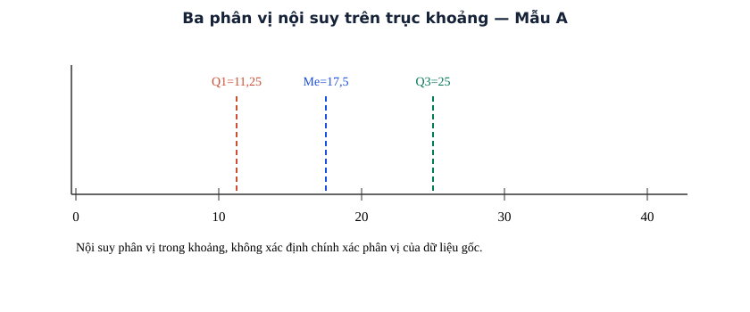

# Bài 9. Các số đặc trưng đo xu thế trung tâm

TOÁN 11 · CHƯƠNG III · KẾT NỐI TRI THỨC

Từ bảng nhóm không còn số đo gốc, tìm các giá trị trung tâm ước lượng và hiểu điều kiện, giới hạn của mỗi công thức.

<nav class="thpt-r4-lesson-tabs"><a href="../">Chương III</a><a href="../luyen-tap/">Core và Luyện tập</a><a href="../tu-kiem-tra-chuong/">Tự kiểm tra cuối chương</a></nav>

=== "Khám phá kiến thức"

    Ở Bài 8, một bảng có thể cho biết 20 bạn thuộc bốn khoảng thời gian, nhưng không còn cho biết từng người đã dùng chính xác bao nhiêu phút. SGK Bài 9 đặt câu hỏi tương tự với số tiền bán xăng của 35 khách hàng: nếu chỉ còn **nhóm và số lượng khách trong nhóm**, làm thế nào ước lượng **giá trị trung bình**, vị trí **chia đôi**, các mốc **chia tư**, hoặc giá trị **tập trung nhất**? Ta sẽ lần lượt khám phá đúng bốn mục của SGK. Những con số tính được là **đặc trưng từ bảng ghép nhóm**, không tự động là đặc trưng chính xác của mẫu gốc.

    Để dễ so sánh bốn cách tính, ta dùng xuyên suốt một bảng minh họa A của 20 số đo (đơn vị tính là phút):

    | Nhóm giá trị | \([0;10)\) | \([10;20)\) | \([20;30)\) | \([30;40)\) |
    |:--|--:|--:|--:|--:|
    | Tần số | 4 | 8 | 6 | 2 |

    ### 1.1. Số trung bình của mẫu số liệu ghép nhóm

    Nếu còn dữ liệu gốc, ta cộng tất cả 20 số đo rồi chia cho 20. Nhưng bảng A chỉ nói **bốn bạn ở khoảng 0–dưới 10**, chứ không nói bốn bạn ấy là ai và chính xác bao nhiêu. Để có một kết quả đại diện hợp lí, ta dùng **trung điểm mỗi khoảng**: \(5,15,25,35\). Hình dung tạm thời bốn giá trị trong nhóm đầu được thay bằng \(5\), tám giá trị nhóm thứ hai được thay bằng \(15\), v.v. Đây là phép **xấp xỉ**, không phải khẳng định về từng người.

    Khi ấy tổng ước lượng là \(4\cdot5+8\cdot15+6\cdot25+2\cdot35=360\), nên số trung bình ghép nhóm là \(\bar x=360/20=18\) phút. Ta phải nhân **mỗi trung điểm với tần số nhóm** rồi chia tổng tần số \(20\), chứ không lấy \((5+15+25+35)/4\), vì các nhóm chứa số người khác nhau.

    SGK còn lưu ý một trường hợp đặc biệt: khi nhóm các số nguyên ghi là “1–3”, đó là **ba giá trị** \(1,2,3\). Để tính bằng công thức khoảng liên tục, ta hiệu chỉnh thành \([0{,}5;3{,}5)\) để trung điểm vẫn bằng \(2\) và hai nhóm liên tiếp không bị hở hay chồng tại các giá trị nguyên. Nếu nhóm chỉ có một đầu mút, không tự tạo trung điểm hữu hạn khi không có căn cứ.

    **Vận dụng.** Bảng A có \(\bar x=18\) phút. Nếu bạn chỉ tính trung bình của bốn trung điểm thì được bao nhiêu? Vì sao kết quả đó không đúng với công thức số trung bình ghép nhóm?

    ??? question "Đối chiếu"

        **Lời giải:** Trung bình đơn của bốn trung điểm là \((5+15+25+35)/4=20\) phút. Kết quả đó coi bốn nhóm **có cùng tần số**, trái bảng \(4,8,6,2\). Phải dùng trung bình có trọng số và nhận \(18\) phút.

    ??? tip "Kiểm lỗi"

        Nếu tính được 20, hãy ghi tần số ngay dưới từng trung điểm và tự hỏi: “một người hay tám người đang được đại diện bởi số 15?” Số trung bình là kết quả xấp xỉ, không nhận là trung bình gốc chính xác.

    ### 1.2. Trung vị của mẫu số liệu ghép nhóm

    Số trung bình dùng **mọi** nhóm, nhưng có khi ta chỉ muốn biết ranh giới để khoảng một nửa dữ liệu ở phía trước, nửa kia ở phía sau. Đó là ý nghĩa của **trung vị**. Trong 20 quan sát đã xếp thứ tự, vị trí giữa nằm quanh \(n/2=10\). Từ bảng A, cộng tần số lần lượt được \(4,\ 12,\ 18,\ 20\). Vậy vị trí thứ 10 nằm ở **nhóm thứ hai \([10;20)\)**.

    <figure class="thpt-r4-plot"><figcaption><strong>Đọc hình:</strong> tới biên \(10\) có 4 quan sát, tới biên \(20\) có 12 quan sát. Mốc giữa \(n/2=10\) nằm **sau 4 nhưng trước 12**, nên thuộc nhóm \([10;20)\). Đây là tần số tích lũy, không phải đường biểu diễn từng số đo.</figcaption></figure>

    Ta chưa biết chính xác số đo thứ 10; vì thế **nội suy** trong nhóm. Trước nhóm có 4 người, nhóm chứa 8 người, cần đi thêm \(10-4=6\) “vị trí quan sát” trong 8 người của nhóm. Nếu coi phân bố trong khoảng dài 10 phút là tương đối đều, khoảng từ đầu nhóm đến trung vị được ước lượng bằng \(6/8\) độ dài nhóm. Vậy \(M_e=10+(10-4)\cdot10/8=17{,}5\) phút. Đây là **trung vị ghép nhóm**, không là giá trị thứ 10 thực sự trong danh sách gốc.

    **Vận dụng.** Với bảng A, nếu ai đó lấy ngay trung điểm nhóm chứa vị trí 10 là \(15\) làm trung vị thì đã bỏ bước nào?

    ??? question "Đối chiếu"

        **Lời giải:** Họ bỏ bước nội suy theo **tần số tích lũy trước nhóm**. Dùng \(L=10,\ C=4,\ m=8,\ h=10,\ n=20\), ta được \(M_e=10+[(10-4)/8]\cdot10=17{,}5\), khác trung điểm \(15\).

    ??? tip "Kiểm lỗi"

        Trước khi thay công thức, kiểm ba điều: vị trí \(n/2\), tổng tần số **trước nhóm** và độ rộng nhóm. Không mặc định trung vị chính là trung điểm của khoảng.

    ### 1.3. Tứ phân vị của mẫu số liệu ghép nhóm

    Trung vị chia mẫu thành hai nửa. Nếu muốn chia tiếp thành **bốn phần** có tỉ lệ xấp xỉ bằng nhau, ta cần \(Q_1,Q_2,Q_3\), ứng với các vị trí \(n/4,\ n/2,\ 3n/4\) trong mẫu đã sắp xếp. \(Q_2\) chính là trung vị vừa tính. Với bảng A có \(n=20\), ba vị trí mục tiêu là \(5,\ 10,\ 15\).

    Quan sát dãy tích lũy \(4,12,18,20\): vị trí \(5\) nằm trong nhóm hai, vị trí \(15\) nằm trong nhóm ba. Vì vậy \(Q_1=10+[(5-4)/8]\cdot10=11{,}25\), còn \(Q_3=20+[(15-12)/6]\cdot10=25\). Các mốc ước lượng của bảng A là \(11{,}25;\ 17{,}5;\ 25\) phút.

    <figure class="thpt-r4-plot"><figcaption><strong>Đọc hình:</strong> \(Q_1\approx11{,}25\), \(Q_2=M_e\approx17{,}5\), \(Q_3\approx25\) là các vị trí **nội suy** theo bảng nhóm; không phải ba giá trị cụ thể chắc chắn đã được đo.</figcaption></figure>

    Nếu vị trí \(n/4\) hoặc \(3n/4\) rơi đúng vào tần số tích lũy ở ranh giới hai nhóm, việc nội suy đúng theo cả hai phía sẽ cho **cùng mốc biên**. Không tự cộng thêm 1 hay trừ đi 1 đơn vị: điểm chia nhóm là biên giá trị, không phải một số thứ tự học sinh.

    **Vận dụng.** Với bảng A, giải thích vì sao \(Q_3\) thuộc nhóm \([20;30)\) và tính \(Q_1,Q_3\).

    ??? question "Đối chiếu"

        **Lời giải:** \(3n/4=15\). Tích lũy trước nhóm ba là 12 và hết nhóm ba là 18, nên vị trí 15 ở \([20;30)\); \(Q_3=20+(15-12)10/6=25\). Với \(n/4=5\) thuộc \([10;20)\), \(Q_1=10+(5-4)10/8=11{,}25\).

    ??? tip "Kiểm lỗi"

        Nếu lấy \(Q_1\) bằng 5 hoặc \(Q_3\) bằng 15, em đã nhầm **vị trí thứ tự** với **giá trị tứ phân vị**. Phải tìm nhóm chứa vị trí rồi mới nội suy ra giá trị đo.

    ### 1.4. Mốt của mẫu số liệu ghép nhóm

    Còn một câu hỏi khác: quan sát có xu hướng **tập trung dày nhất ở vùng nào**? Nhìn bảng A, nhóm \([10;20)\) có 8 người, nhiều nhất trong bốn nhóm, nên là **nhóm chứa mốt**. Nhưng mốt của mẫu số liệu ghép nhóm không đơn giản là trung điểm 15 của nhóm ấy. SGK dùng hai chênh lệch tần số với nhóm lân cận để ước lượng một vị trí bên trong nhóm.

    Ở đây nhóm trước có 4, nhóm sau có 6. Chênh với nhóm trước là \(8-4=4\), chênh với nhóm sau là \(8-6=2\). Nội suy cho \(M_o=10+\frac4{4+2}\cdot10\approx16{,}67\) phút. Đây là **mốt ước lượng từ bảng**, không có nghĩa đã có người thực sự đo đúng \(16{,}67\) phút.

    Điểm cực kì quan trọng là **công thức mốt này được SGK định nghĩa cho các nhóm có độ dài bằng nhau**. Nếu chia các nhóm rộng 5, 15 và 10 rồi áp trực tiếp công thức trên, ta đã bỏ mất điều kiện nguồn. Nếu mọi tần số bằng nhau, theo SGK mẫu ghép nhóm **không có mốt**; với các đỉnh tần số bằng nhau ở nhiều nhóm, có thể có nhiều hơn một mốt, không được ép một giá trị duy nhất.

    **Vận dụng.** Với bảng A có các nhóm cùng rộng 10, hãy xác định nhóm chứa mốt và ước lượng \(M_o\). Có thể dùng nguyên công thức nếu độ rộng các nhóm khác nhau không?

    ??? question "Đối chiếu"

        **Lời giải:** Nhóm chứa mốt là \([10;20)\), vì tần số \(8\) lớn nhất. \(M_o=10+\frac{8-4}{(8-4)+(8-6)}\cdot10=10+\frac{20}3\approx16{,}67\) phút. Nếu nhóm khác độ rộng, **không dùng trực tiếp công thức này** theo điều kiện SGK.

    ??? tip "Kiểm lỗi"

        Đừng so sánh mốt với số đo gốc khi chỉ có bảng nhóm. Kiểm nhóm rộng bằng nhau, tần số nhóm trước/sau và mẫu số của phép nội suy trước khi kết luận.

=== "Kiến thức SGK"

    ### 2.1. Số trung bình của mẫu số liệu ghép nhóm

    
<strong>Khái niệm — Giá trị đại diện của nhóm</strong>
Với nhóm \([a_i;a_{i+1})\) có hai đầu mút hữu hạn, <strong>giá trị đại diện</strong> là trung điểm \(x_i=(a_i+a_{i+1})/2\). Đây là số thay thế để ước lượng, không khẳng định mọi quan sát trong nhóm có giá trị \(x_i\).

    
<strong>Công thức — Số trung bình ghép nhóm</strong>
Với các nhóm có tần số \(m_1,\ldots,m_k\), cỡ mẫu \(n=m_1+\cdots+m_k>0\) và giá trị đại diện \(x_i\), số trung bình ghép nhóm là \(\displaystyle\bar x=\frac{m_1x_1+\cdots+m_kx_k}{n}\).

Đơn vị của \(\bar x\) giống đơn vị số liệu gốc; đây là **ước lượng** cho số trung bình mẫu gốc.

    **Chú ý SGK về dữ liệu rời rạc:** Nhóm gồm các số nguyên từ \(k_1\) đến \(k_2\) được hiệu chỉnh thành \([k_1-0{,}5;k_2+0{,}5)\) trước khi dùng công thức khoảng; chẳng hạn nhóm số nguyên “1–3” thành \([0{,}5;3{,}5)\). Không tự tính trung điểm hữu hạn cho nhóm mở một phía.

    **Tra bảng A:** Các trung điểm \(5,15,25,35\), tần số \(4,8,6,2\) cho \(\bar x=18\) phút; không dùng trung bình đơn của bốn trung điểm.

    ### 2.2. Trung vị của mẫu số liệu ghép nhóm

    
<strong>Quy tắc — Xác định nhóm chứa trung vị</strong>
<strong>Bước 1:</strong> tính cỡ mẫu \(n\), tần số tích lũy và xác định nhóm \(p\) chứa vị trí \(n/2\) của mẫu xếp tăng dần.

<strong>Bước 2:</strong> nội suy trong nhóm đã chọn từ đầu mút trái, tần số tích lũy trước nhóm, tần số nhóm và độ dài nhóm; không thay ngay bằng trung điểm nhóm.

    
<strong>Công thức — Trung vị ghép nhóm</strong>
Gọi nhóm chứa trung vị là \([L;U)\), tần số nhóm \(m>0\), tổng tần số các nhóm trước là \(C\) (nhóm đầu có \(C=0\)), độ dài \(h=U-L>0\). Khi đó \(M_e=L+\dfrac{n/2-C}{m}\,h\).

Phải chọn nhóm sao cho vị trí \(n/2\) nằm trong khoảng tích lũy tương ứng. Kết quả **xấp xỉ** trung vị mẫu gốc và phụ thuộc giả thiết nội suy.

    <figure class="thpt-r4-plot"><figcaption><strong>Tra hình:</strong> với \(n/2=10\), tổng trước nhóm hai là \(C=4\), tổng đến hết nhóm hai là 12; đọc \(L=10,m=8,h=10\) để được \(M_e=17{,}5\).</figcaption></figure>

    **Ý nghĩa SGK:** Trung vị ghép nhóm xấp xỉ vị trí chia đôi mẫu; không tự thay bằng một giá trị đo thực tế.

    ### 2.3. Tứ phân vị của mẫu số liệu ghép nhóm

    
<strong>Công thức — Tứ phân vị thứ nhất và thứ ba</strong>
Với vị trí mục tiêu \(v=n/4\) hoặc \(v=3n/4\), hãy xác định nhóm chứa vị trí ấy; gọi đầu mút trái \(L\), tần số trước nhóm \(C\), tần số nhóm \(m>0\), độ dài \(h>0\). Khi đó \(Q_1=L+\dfrac{n/4-C}{m}h\) và \(Q_3=L+\dfrac{3n/4-C}{m}h\), **mỗi công thức dùng \(L,C,m,h\) của đúng nhóm chứa phân vị tương ứng**.

\(Q_2=M_e\) là trung vị ghép nhóm.

    <figure class="thpt-r4-plot"><figcaption><strong>Tra hình:</strong> bảng A có \(Q_1\approx11{,}25\), \(Q_2=M_e\approx17{,}5\), \(Q_3\approx25\); các điểm nội suy **không phục hồi** dữ liệu gốc.</figcaption></figure>

    **Ý nghĩa SGK:** Ba tứ phân vị chia mẫu được ước lượng thành bốn phần, mỗi phần khoảng \(25\%\). Trước khi nội suy, phải tìm nhóm cho từng vị trí \(n/4,\,n/2,\,3n/4\) bằng tần số tích lũy. Với vị trí rơi đúng biên, hai cách chọn nhóm kề liên tục cho cùng một giá trị biên khi áp dụng thống nhất.

    ### 2.4. Mốt của mẫu số liệu ghép nhóm

    
<strong>Quy tắc — Tìm mốt ghép nhóm theo SGK</strong>
<strong>Điều kiện:</strong> các nhóm có **độ dài bằng nhau**. <strong>Bước 1:</strong> chọn nhóm có tần số lớn nhất (nhóm chứa mốt). <strong>Bước 2:</strong> dùng chênh lệch tần số của nhóm ấy so với hai nhóm kề để nội suy mốt; tần số ngoài hai biên được quy ước bằng \(0\).

    
<strong>Công thức — Mốt ghép nhóm</strong>
Nếu nhóm chứa mốt thứ \(j\) có đầu mút trái \(L\), độ dài chung \(h>0\), tần số \(m_j\) và hai nhóm kề tần số \(m_{j-1},m_{j+1}\), thì \(M_o=L+\dfrac{m_j-m_{j-1}}{(m_j-m_{j-1})+(m_j-m_{j+1})}\,h\), với mẫu khác \(0\).

Quy ước \(m_0=m_{k+1}=0\). Nếu các nhóm có độ dài không bằng nhau, **không áp trực tiếp** công thức này. Khi các nhóm có tần số đều bằng nhau, SGK quy định bảng **không có mốt**; có thể có nhiều hơn một mốt trong các tình huống nhiều đỉnh.

    **Tra bảng A:** Nhóm modal \([10;20)\) có \(m_j=8\), các nhóm kề là \(4\) và \(6\), \(h=10\), nên \(M_o\approx16{,}67\) phút. Đó là ước lượng mốt từ nhóm, không là điểm đo cá nhân được xác nhận.

=== "Ví dụ"

    ### 3.1. Tính số trung bình có trọng số

    **Đề bài.** Bốn nhóm \([0;10),[10;20),[20;30),[30;40)\) có tần số \(4,10,5,1\). Tìm số trung bình ghép nhóm.

    **Phân tích:** Dùng trung điểm nhóm làm giá trị đại diện và nhân tần số tương ứng.

    

<strong>Lời giải.</strong> Các giá trị đại diện là \(5,15,25,35\), cỡ mẫu \(20\). \(\bar x=(4\cdot5+10\cdot15+5\cdot25+1\cdot35)/20=330/20=16{,}5\).

    **Kiểm lại:** Trung bình có trọng số \(16{,}5\) nằm trong khoảng chung từ \(0\) đến dưới \(40\), khác trung bình đơn \(20\).

    ### 3.2. Tìm trung vị từ tần số tích lũy

    **Đề bài.** Bốn nhóm \([0;10),[10;20),[20;30),[30;40)\) có tần số \(4,10,5,1\). Ước lượng trung vị.

    **Phân tích:** Tìm nhóm chứa vị trí \(n/2\) bằng tần số tích lũy, rồi nội suy.

    

<strong>Lời giải.</strong> \(n=20,\ n/2=10\), tích lũy \(4,14,19,20\). Nhóm chứa trung vị là \([10;20)\), \(L=10,C=4,m=10,h=10\). \(M_e=10+(10-4)\cdot10/10=16\).

    **Kiểm lại:** \(16\in[10;20)\), đúng nhóm chứa trung vị.

    ### 3.3. Hai tứ phân vị ở hai nhóm khác nhau

    **Đề bài.** Bốn nhóm \([0;10),[10;20),[20;30),[30;40)\) có tần số \(4,10,5,1\). Tìm \(Q_1,Q_3\).

    **Phân tích:** Tính hai vị trí \(n/4=5\) và \(3n/4=15\). Tần số tích lũy là \(4,14,19,20\); xác định nhóm riêng cho từng vị trí.

    

<strong>Lời giải.</strong> Vị trí \(5\) thuộc \([10;20)\): \(Q_1=10+(5-4)\cdot10/10=11\). Vị trí \(15\) thuộc \([20;30)\): \(Q_3=20+(15-14)\cdot10/5=22\).

    **Kiểm lại:** \(Q_1\le M_e\le Q_3\), tức \(11\le16\le22\).

    ### 3.4. Mốt khác trung điểm nhóm có tần số lớn nhất

    **Đề bài.** Bốn nhóm \([0;10),[10;20),[20;30),[30;40)\) có tần số \(4,10,5,1\). Tìm mốt ghép nhóm.

    **Phân tích:** Các nhóm cùng rộng \(10\), nhóm tần số lớn nhất là \([10;20)\) có \(m_j=10\). Dùng chênh lệch với hai tần số kề.

    

<strong>Lời giải.</strong> \(M_o=10+\dfrac{10-4}{(10-4)+(10-5)}\cdot10=10+\dfrac{60}{11}\approx15{,}45\).

    **Kiểm lại:** Mốt ước lượng thuộc \([10;20)\). Không dùng trực tiếp công thức này khi các nhóm có độ rộng khác nhau.

    ### 3.5. Hiệu chỉnh nhóm số liệu rời rạc

    **Đề bài.** Hai nhóm số nguyên “1–3” và “4–6” có tần số lần lượt \(2\) và \(4\). Tính số trung bình ghép nhóm sau khi hiệu chỉnh khoảng.

    **Phân tích:** Mỗi nhóm ghi các số nguyên ở cả hai đầu mút, nên phải hiệu chỉnh thành khoảng liên tục không chồng lấn theo chú ý SGK.

    

<strong>Lời giải.</strong> “1–3” thành \([0{,}5;3{,}5)\), đại diện \(2\); “4–6” thành \([3{,}5;6{,}5)\), đại diện \(5\). \(\bar x=(2\cdot2+4\cdot5)/(2+4)=24/6=4\).

    **Kiểm lại:** Các nhóm hiệu chỉnh không bỏ các số nguyên 1 đến 6 và trung điểm vẫn bằng giữa các mốc nguyên gốc.

    ### 3.6. Phân vị rơi đúng ranh giới hai nhóm

    **Đề bài.** Bốn nhóm \([40;50),[50;60),[60;70),[70;80)\) có tần số \(2,5,8,5\). Tìm \(Q_3\).

    **Phân tích:** \(n=20\), vị trí \(3n/4=15\) trùng đúng tần số tích lũy ở cuối nhóm thứ ba, nên kết quả phải là biên chung \(70\), không cộng thêm một đơn vị.

    

<strong>Lời giải.</strong> Tích lũy \(2,7,15,20\). Từ nhóm thứ ba \(L=60,C=7,m=8,h=10\): \(Q_3=60+(15-7)\cdot10/8=70\). Từ nhóm thứ tư \(L=70,C=15,m=5,h=10\): \(Q_3=70+(15-15)\cdot10/5=70\).

    **Kiểm lại:** Hai phép nội suy thống nhất cùng một biên \(70\); không thêm/bớt vị trí.

    ### 3.7. Không suy ra đặc trưng gốc chính xác từ bảng nhóm

    **Đề bài.** Hai tổ có các mẫu A \(11,12,13\) và B \(17,18,19\); nếu cùng ghép tất cả vào \([10;20)\), có thể nói hai trung bình gốc bằng nhau không?

    **Phân tích:** Hai bảng nhóm giống nhau nhưng các giá trị trong nhóm khác nhau; dùng ví dụ để tự kiểm giới hạn suy luận.

    

<strong>Lời giải.</strong> Hai bảng đều có một nhóm \([10;20)\) tần số \(3\), giá trị đại diện \(15\), số trung bình ghép nhóm bằng \(15\). Nhưng trung bình gốc của A là \(12\), B là \(18\), nên không thể khẳng định các đặc trưng gốc bằng nhau.

    **Kiểm lại:** Cả sáu giá trị đều nằm trong nhóm, còn hai trung bình thực khác nhau.

=== "Lỗi thường gặp"

    ### 4.1. Lấy trung bình các trung điểm mà quên tần số

    **Dấu hiệu:** Với bảng A, tính \((5+15+25+35)/4=20\).

    **Vì sao sai:** Các nhóm không có cùng tần số; trung điểm phải được **nhân số quan sát** tương ứng.

    **Cách sửa:** Ghi một hàng tần số ngay dưới một hàng đại diện, tính \(\sum m_ix_i/\sum m_i=18\).

    ### 4.2. Xác định sai nhóm chứa trung vị hoặc tứ phân vị

    **Dấu hiệu:** Lấy trung vị bằng trung điểm 15 của nhóm thứ hai, hoặc nói \(Q_3=15\) vì \(3n/4=15\).

    **Vì sao sai:** \(n/2,n/4,3n/4\) là **vị trí trong thứ tự**, không phải giá trị đo.

    **Cách sửa:** Lập tích lũy, xác định đúng nhóm, rồi nội suy bằng \(L,C,m,h\) của từng phân vị.

    ### 4.3. Nhầm nội suy là kết quả chính xác của dữ liệu thô

    **Dấu hiệu:** Khẳng định mọi bộ dữ liệu có bảng A đều có trung vị chính xác \(17{,}5\).

    **Vì sao sai:** Nhiều bộ dữ liệu khác nhau có cùng bảng nhóm; nội suy chỉ dùng thông tin khoảng/tần số.

    **Cách sửa:** Dùng từ “xấp xỉ”, “ước lượng”; nếu có số liệu gốc thì mới tính đặc trưng gốc đúng quy tắc của mẫu thô.

    ### 4.4. Lạm dụng công thức mốt với nhóm không đều rộng

    **Dấu hiệu:** Dùng công thức \(M_o\) ở mục 2.4 cho các khoảng dài 5, 15, 10.

    **Vì sao sai:** SGK chỉ định nghĩa công thức mốt ghép nhóm **trong trường hợp các nhóm có độ dài bằng nhau**.

    **Cách sửa:** Kiểm độ dài từng nhóm trước; nếu không đều, không dùng trực tiếp công thức mốt SGK. Nếu tất cả tần số bằng nhau, theo SGK không có mốt.

    ### 4.5. Bỏ bước hiệu chỉnh nhóm giá trị nguyên

    **Dấu hiệu:** Với nhóm “1–3” và “4–6”, dùng khoảng \([1;3)\), \([4;6)\) rồi làm mất số nguyên 3 và 6.

    **Vì sao sai:** Kí hiệu nhóm 1–3 của dữ liệu rời rạc nhận cả \(1,2,3\), không giống nửa khoảng thực.

    **Cách sửa:** Hiệu chỉnh thành \([0{,}5;3{,}5)\), \([3{,}5;6{,}5)\) rồi tính đại diện/đặc trưng.

    ### 4.6. Mất đơn vị và bỏ điều kiện đầu mút

    **Dấu hiệu:** Kết luận “trung vị là \(17{,}5\) học sinh” khi bảng đang đo **phút**, hoặc chọn \(Q_3\) bằng \(71\) khi đúng ranh giới \(70\).

    **Vì sao sai:** Đặc trưng có cùng **đơn vị với giá trị đo**, và biên nội suy là giá trị trên trục số chứ không phải chỉ số đếm.

    **Cách sửa:** Ghi đơn vị sau kết quả, tự kiểm mốc nhóm và vị trí tích lũy; không tự dịch điểm biên.

    **Học tiếp:** [Core và Luyện tập Bài 9](luyen-tap.md) · [Tự luận Chương III](../../../thu-vien/tu-luan-g11-chuong-iii.md) · [Tự kiểm tra cuối chương](tu-kiem-tra-chuong.md).

    
Nguồn SGK Kết nối tri thức Toán 11 tập một, Bài 9 trang in 62–67, đối chiếu văn bản bản PDF số hóa nội dung SGK theo mục: Số trung bình; Trung vị; Tứ phân vị; Mốt. Hình tích lũy và phân vị SVG dùng chung ở hai tab. Chưa xác nhận đã kiểm trực quan đủ mọi trang in do screenshot web không tải được.

