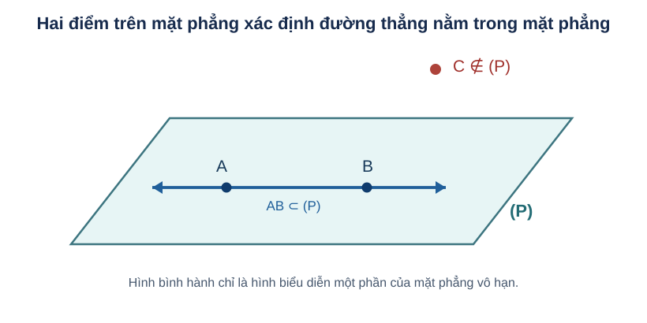
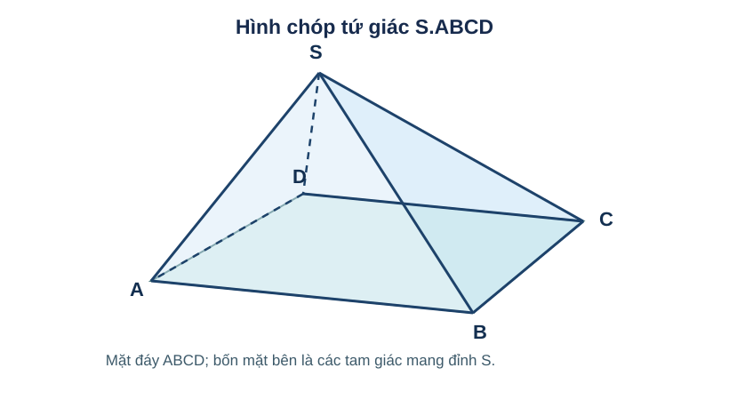

# Bài 10. Đường thẳng và mặt phẳng trong không gian

TOÁN 11 · CHƯƠNG IV · KẾT NỐI TRI THỨC

Đọc hình không gian, nhận biết quan hệ điểm–đường–mặt, xác định mặt phẳng và phân biệt hình chóp với tứ diện.

<nav class="thpt-r4-lesson-tabs"><a href="../">Chương IV</a><a href="../luyen-tap/">Core và Luyện tập</a><a href="../tu-kiem-tra-chuong/">Tự kiểm tra cuối chương</a></nav>

=== "Khám phá kiến thức"

    Nhìn bản vẽ ngôi nhà trên giấy, em thấy mặt tường, mép cửa, các cạnh khuất. Nhưng hình vẽ chỉ là **hình biểu diễn**: hình bình hành dùng để vẽ mặt phẳng không phải toàn bộ mặt phẳng vô hạn; hai nét có vẻ gặp nhau chưa chứng minh hai đường không gian cắt nhau. Để giải bài, ta cần biết chính xác điểm nào thuộc đường, đường nào nằm trong mặt, rồi dựa vào tính chất toán học thay vì cảm giác trên hình.

    ### 1.1. Khái niệm mở đầu

    Mặt bảng, màn hình, mặt nước phẳng lặng gợi hình ảnh **một phần của mặt phẳng**. Mặt phẳng toán học không có bề dày và không có giới hạn. Ta thường vẽ một hình bình hành và ghi kí hiệu \((P)\), \((\alpha)\); một điểm \(A\) nằm trên mặt phẳng được viết \(A\in(P)\), điểm \(C\) ở ngoài được viết \(C\notin(P)\).

    <figure class="thpt-r4-plot"><figcaption><strong>Hướng dẫn đọc:</strong> \(A,B\) thuộc \((P)\), \(AB\subset(P)\), còn \(C\notin(P)\). Hình bình hành chỉ biểu diễn một phần mặt phẳng; điểm ở ngoài vùng vẽ không đồng nghĩa ở ngoài mặt phẳng.</figcaption></figure>

    Một đường thẳng nằm trong mặt phẳng khi **mọi điểm của nó** thuộc mặt phẳng; kí hiệu \(d\subset(P)\). Khi biểu diễn không gian, đường nhìn thấy dùng nét liền, đường bị che khuất dùng nét đứt. Nét đứt không chứng minh hai đường giao nhau hay chéo nhau. Các kí hiệu thuộc và chứa nói về **đối tượng thực**, không nói về vị trí nét vẽ.

    **Vận dụng.** Nếu \(A,B\in(P)\), \(A\ne B\), điểm \(M\in AB\) và \(C\notin(P)\), hãy dự đoán \(M\) có thuộc \((P)\) không. Có thể có \(C\in AB\) không?

    ??? question "Đối chiếu"

        **Lời giải:** Theo tính chất hai điểm của một đường thẳng cùng thuộc mặt phẳng, toàn bộ \(AB\subset(P)\); vậy \(M\in(P)\). Nếu \(C\in AB\) thì \(C\in(P)\), mâu thuẫn với giả thiết. Do đó \(C\notin AB\).

    ??? tip "Kiểm lỗi"

        Đừng suy từ việc \(M\) được vẽ bên trong hay bên ngoài hình bình hành. Hãy tìm **quan hệ thuộc** đã cho và tính chất cần dùng.

    ### 1.2. Các tính chất thừa nhận

    Qua hai điểm phân biệt chỉ có một đường thẳng; qua ba điểm **không thẳng hàng** chỉ có một mặt phẳng. Chẳng hạn, ba điểm tiếp xúc không thẳng hàng của một giá ba chân xác định một mặt phẳng; độ ổn định của giá còn phụ thuộc trọng tâm và cách đặt. Ngược lại, một đường thẳng đi qua ba điểm thẳng hàng vẫn nằm trong vô số mặt phẳng khác nhau. SGK còn thừa nhận có thể chọn bốn điểm không đồng phẳng: không gian không chỉ là một mặt phẳng duy nhất.

    Ta cần ghi nhớ **sáu tính chất thừa nhận**, với đúng điều kiện của chúng: (1) duy nhất đường thẳng qua hai điểm phân biệt; (2) duy nhất mặt phẳng qua ba điểm không thẳng hàng; (3) tồn tại bốn điểm không đồng phẳng; (4) nếu một đường có hai điểm phân biệt thuộc mặt thì cả đường thuộc mặt; (5) hai mặt phẳng phân biệt có điểm chung thì giao nhau theo đường thẳng đi qua điểm chung; (6) trong mỗi mặt phẳng, những kết quả của hình học phẳng vẫn đúng.

    <figure class="thpt-r4-plot"><figcaption><strong>Hướng dẫn đọc:</strong> \((SAB)\) và \((SAC)\) có hai điểm chung phân biệt \(S,A\), nên giao tuyến là **đường thẳng \(SA\)**. Nét đứt trong hình chỉ cạnh khuất.</figcaption></figure>

    Đặc biệt, chỉ biết hai mặt phẳng **phân biệt** cùng qua điểm \(S\) mới biết chúng có một đường giao đi qua \(S\), chứ **chưa biết chính xác đường nào**. Để xác định giao tuyến, ta tìm **hai điểm chung phân biệt**. Ví dụ trong tứ diện \(S.ABC\), trung điểm \(M\in AB\), \(N\in AC\), hai trung tuyến \(BN,CM\) của tam giác \(ABC\) cắt tại trọng tâm \(G\). Vì các kết quả hình học phẳng đúng trong mặt \((ABC)\), \(G\) nằm trong cả \((SBN)\) và \((SCM)\). Hai mặt phân biệt: nếu trùng nhau thì mặt chung chứa hai trung tuyến cắt nhau \(BN,CM\), tức là \((ABC)\), trái với \(S\notin(ABC)\). Do đó giao tuyến là \(SG\).

    **Vận dụng.** Cho \(S\notin(ABC)\), \(M,N\) lần lượt là trung điểm \(AB,AC\), \(G=BN\cap CM\). Hãy chứng minh \((SBN)\cap(SCM)=SG\).

    ??? question "Đối chiếu"

        **Lời giải:** \(G\in BN\subset(SBN)\), \(G\in CM\subset(SCM)\), trong khi \(S\) thuộc cả hai. Vì \(S\notin(ABC)\), \(G\in(ABC)\), hai điểm phân biệt. Hai mặt phẳng cũng phân biệt, nên giao tuyến là \(SG\).

    ??? tip "Kiểm lỗi"

        Phải nêu **vì sao \(G\) là điểm chung thứ hai**; không được nhìn hai trung tuyến vẽ cắt nhau rồi bỏ qua lập luận thuộc mặt phẳng.

    ### 1.3. Cách xác định một mặt phẳng

    Ta đã biết cách thứ nhất: **ba điểm không thẳng hàng** \(A,B,C\) xác định \((ABC)\). Cách thứ hai: biết một đường \(d\) và điểm \(A\notin d\). Lấy hai điểm phân biệt \(B,C\in d\), ba điểm \(A,B,C\) không thẳng hàng nên có một mặt phẳng duy nhất chứa cả \(A\) và \(d\), kí hiệu \(\operatorname{mp}(A,d)\).

    Cách thứ ba là biết **hai đường cắt nhau** \(a,b\). Gọi \(M=a\cap b\), lấy \(A\in a\setminus\{M\}\), \(B\in b\setminus\{M\}\), ba điểm \(A,M,B\) không thẳng hàng; do đó xác định được \(\operatorname{mp}(a,b)\). Nếu \(A\in d\), mặt phẳng qua \(A\) và \(d\) **không còn duy nhất**; hai đường chéo nhau **không cùng mặt phẳng**. Đây là các điều kiện không thể bỏ.

    Để tìm giao tuyến hai mặt, ta thường đi tìm **hai điểm chung**. Cho \(a,b\) cắt nhau tại \(M\), và \(S\notin\operatorname{mp}(a,b)\). Mặt phẳng \(\operatorname{mp}(S,a)\) và \(\operatorname{mp}(S,b)\) đều chứa \(M,S\). Chúng phân biệt nên giao tuyến là \(SM\). Không được kết luận như vậy nếu điểm \(S\) nằm trên một trong hai đường, vì khi ấy chính mặt phẳng \(\operatorname{mp}(S,a)\) hoặc \(\operatorname{mp}(S,b)\) không còn xác định duy nhất theo điểm–đường.

    **Vận dụng.** Xét ba dữ kiện: \(A,B,C\) không thẳng hàng; điểm \(A\notin d\) cùng đường \(d\); hai đường \(a,b\) cắt nhau. Vì sao cả ba đều xác định duy nhất một mặt phẳng?

    ??? question "Đối chiếu"

        **Lời giải:** Trường hợp đầu dùng tính chất thừa nhận số 2. Với \(A\notin d\), chọn \(B,C\in d\) phân biệt thì \(A,B,C\) không thẳng hàng. Với \(a,b\) cắt tại \(M\), chọn \(A\in a\setminus\{M\}, B\in b\setminus\{M\}\); ba điểm \(A,M,B\) không thẳng hàng. Hai trường hợp sau quy về trường hợp đầu.

    ??? tip "Kiểm lỗi"

        Không ghi “điểm và đường xác định mặt phẳng” mà quên **điểm nằm ngoài đường**; không ghi “hai đường xác định mặt phẳng” mà quên **hai đường cắt nhau**.

    ### 1.4. Hình chóp và hình tứ diện

    Đặt một điểm \(S\) **ở ngoài mặt phẳng** của đa giác lồi \(A_1A_2\ldots A_n\), nối \(S\) với từng đỉnh đáy. Ta được hình chóp gồm mặt đáy và các mặt bên tam giác. Hình chóp tứ giác \(S.ABCD\) có đỉnh \(S\), đáy \(ABCD\), các mặt bên \(SAB,SBC,SCD,SDA\), bốn cạnh bên \(SA,SB,SC,SD\) và bốn cạnh đáy.

    <figure class="thpt-r4-plot"><figcaption><strong>Hướng dẫn đọc:</strong> \(S\) là đỉnh chóp, \(ABCD\) là đáy. Chóp có 5 đỉnh, 8 cạnh, 5 mặt; các cạnh khuất vẽ nét đứt vẫn được đếm.</figcaption></figure>

    Nếu đáy là **tam giác**, hình chóp là một **tứ diện**. Cho bốn điểm \(A,B,C,D\) không đồng phẳng, tứ diện \(ABCD\) gồm bốn mặt tam giác \(ABC,ABD,ACD,BCD\). Nó có 4 đỉnh, 6 cạnh, 4 mặt; cạnh \(AB\) và \(CD\) là một cặp cạnh **đối diện** vì không chung đỉnh. Tứ diện có cả bốn mặt đều là **tam giác đều** gọi là tứ diện đều. Một tứ diện bất kì không nhất thiết đều. Mỗi đỉnh còn có **mặt đối diện** là mặt tam giác không chứa đỉnh ấy: chẳng hạn đỉnh \(A\) đối diện mặt \(BCD\).

    <figure class="thpt-r4-plot"><figcaption><strong>Hướng dẫn đọc:</strong> tứ diện \(S.ABC\) có thể chọn \(ABC\) làm đáy hoặc chọn bất kì mặt tam giác khác làm đáy. Đây là nhận xét của SGK, không phải phép đổi số đỉnh hay số mặt.</figcaption></figure>

    Một bài quan trọng của mục này là **tìm giao điểm đường thẳng với mặt phẳng**. Cho tứ diện \(ABCD\), \(E\) nằm trong tam giác \(BCD\), \(F\) nằm giữa \(A,E\). Tia \(BE\) cắt cạnh \(CD\) tại \(M\). Do \(E\in BM\), hai đường \(AE,BF\) cùng thuộc \((ABM)\). Mặt phẳng \((ABM)\) và \((ACD)\) cùng chứa \(A,M\), nên giao tuyến là \(AM\). Vì \(E\) nằm giữa \(B,M\) và \(F\) nằm giữa \(A,E\), \(F\) nằm trong tam giác \(ABM\). Tia \(BF\) gặp cạnh \(AM\) tại một điểm \(N\) nằm giữa \(A,M\). Khi đó ta được \(N=BF\cap(ACD)\). Cách làm đúng dựa trên **mặt phẳng phụ chứa đường thẳng cần tìm giao**, không đoán từ hình.

    **Vận dụng.** Đếm số đỉnh, số cạnh, số mặt của hình chóp \(S.ABCD\) và tứ diện \(ABCD\). Cạnh nào đối diện với \(AB\) trong tứ diện?

    ??? question "Đối chiếu"

        **Lời giải:** Hình chóp tứ giác có 5 đỉnh, 8 cạnh, 5 mặt. Tứ diện có 4 đỉnh, 6 cạnh, 4 mặt. Cạnh đối diện \(AB\) là \(CD\), vì không chung điểm đầu mút với \(AB\).

    ??? tip "Kiểm lỗi"

        Hãy đếm các **mặt thực**, không đếm riêng số tam giác nhìn thấy. Tứ diện đều phải có đủ **bốn mặt đều là tam giác đều**, không chỉ một mặt.

=== "Kiến thức SGK"

    ### 2.1. Khái niệm mở đầu

    
<strong>Khái niệm — Mặt phẳng, điểm thuộc mặt phẳng</strong>
Mặt phẳng là đối tượng hình học <strong>không có bề dày và không có giới hạn</strong>. Kí hiệu \((P)\), \((\alpha)\). Khi \(A\) thuộc \((P)\) viết \(A\in(P)\); khi \(B\) không thuộc viết \(B\notin(P)\). Khi mọi điểm trên đường \(d\) đều thuộc mặt phẳng, viết \(d\subset(P)\).

    **Chú ý — Hình biểu diễn:** Mặt phẳng được biểu diễn bằng một hình bình hành hoặc một góc, không phải mặt phẳng chỉ có chừng ấy diện tích. Với phép chiếu song song, đường thẳng hoặc đoạn thẳng không cùng phương chiếu được biểu diễn bằng đường hoặc đoạn tương ứng; đường cùng phương chiếu có thể thu thành một điểm. Quan hệ liên thuộc được bảo toàn; hai đường song song có hình chiếu song song hoặc trùng nhau nếu không suy biến. Không suy ngược rằng hai đường cắt nhau trên hình biểu diễn thì cắt nhau trong không gian; cạnh khuất vẽ nét đứt, cạnh nhìn thấy vẽ nét liền. Không suy ra kích thước/góc thật từ một hình chiếu.

    <figure class="thpt-r4-plot"><figcaption><strong>Tra hình:</strong> \(A,B\in(P)\), đường \(AB\subset(P)\) và \(C\notin(P)\); chú ý phân biệt kí hiệu **điểm thuộc** với **đường nằm trong**.</figcaption></figure>

    ### 2.2. Các tính chất thừa nhận

    
<strong>Tính chất thừa nhận — Đủ sáu phát biểu của SGK</strong>
<strong>1.</strong> Có một và chỉ một đường thẳng đi qua hai điểm phân biệt.

<strong>2.</strong> Có một và chỉ một mặt phẳng đi qua ba điểm không thẳng hàng.

<strong>3.</strong> Tồn tại bốn điểm không cùng thuộc một mặt phẳng.

<strong>4.</strong> Nếu một đường thẳng có hai điểm phân biệt thuộc một mặt phẳng thì tất cả điểm của đường thẳng đều thuộc mặt phẳng đó.

<strong>5.</strong> Nếu hai mặt phẳng phân biệt có điểm chung thì các điểm chung của hai mặt phẳng là một đường thẳng đi qua điểm chung đó.

<strong>6.</strong> Trên mỗi mặt phẳng, tất cả các kết quả đã biết trong hình học phẳng đều đúng.

    **Điều kiện cần đọc kỹ:** 2 điểm phải **phân biệt** khi xác định một đường; 3 điểm **không thẳng hàng** khi xác định một mặt; 2 mặt phẳng phải **phân biệt** để nói giao tuyến của chúng. Với hai mặt phân biệt, một điểm chung cho biết có giao tuyến; muốn **xác định** đường đó, cần thêm một điểm chung phân biệt.

    **Nhận xét SGK:** Các điểm cùng thuộc một mặt phẳng gọi là **đồng phẳng**; những điểm không cùng nằm trong mặt phẳng nào là **không đồng phẳng**. Giao tuyến của hai mặt phẳng phân biệt \((P),(Q)\), nếu có, kí hiệu \(d=(P)\cap(Q)\).

    <figure class="thpt-r4-plot"><figcaption><strong>Tra hình:</strong> \(S,A\) là hai điểm chung phân biệt của \((SAB)\), \((SAC)\), nên giao tuyến là **đường thẳng \(SA\)**.</figcaption></figure>

    **Cách xác định giao tuyến:** Tìm hai điểm chung phân biệt của hai mặt phẳng phân biệt; kết luận đường thẳng đi qua chúng. Ví dụ trung tuyến \(BN,CM\) trong tam giác \(ABC\) cắt tại trọng tâm \(G\), nên \((SBN)\cap(SCM)=SG\) khi \(S\notin(ABC)\).

    ### 2.3. Cách xác định một mặt phẳng

    
<strong>Cách xác định — Ba cách của SGK</strong>
<strong>1.</strong> Ba điểm \(A,B,C\) <strong>không thẳng hàng</strong> xác định mặt phẳng \((ABC)\).

<strong>2.</strong> Điểm \(A\) <strong>không nằm trên</strong> đường \(d\) xác định duy nhất mặt phẳng chứa \(A,d\), kí hiệu \(\operatorname{mp}(A,d)\).

<strong>3.</strong> Hai đường thẳng <strong>cắt nhau</strong> \(a,b\) xác định duy nhất mặt phẳng chứa chúng, kí hiệu \(\operatorname{mp}(a,b)\).

    **Lập luận:** Với một điểm ngoài đường, lấy hai điểm khác nhau trên đường để được ba điểm không thẳng hàng. Với hai đường cắt nhau tại \(M\), lấy \(A,B\) lần lượt trên hai đường và khác \(M\), thì \(A,M,B\) không thẳng hàng.

    **Giới hạn áp dụng:** Điểm \(A\notin d\) cùng với đường \(d\) xác định duy nhất một mặt phẳng; nếu \(A\in d\) thì không xác định được duy nhất mặt phẳng; hai đường trùng nhau hoặc chéo nhau không thỏa điều kiện **cắt nhau** của cách thứ ba. Không lẫn hình chiếu với quan hệ thật trong không gian.

    **Tìm giao điểm đường thẳng–mặt phẳng:** Chọn mặt phẳng phụ chứa đường cần tìm; dựng giao tuyến với mặt phẳng đích, sau đó tìm giao điểm hai đường **nếu tồn tại**. Trong tứ diện \(ABCD\), \(E\) nằm trong \(BCD\), \(F\) trong \(AE\), lấy \(M=BE\cap CD\), \(N=BF\cap AM\); từ \((ABM)\cap(ACD)=AM\) suy ra \(N=BF\cap(ACD)\).

    ### 2.4. Hình chóp và hình tứ diện

    
<strong>Định nghĩa — Hình chóp</strong>
Cho đa giác lồi \(A_1A_2\ldots A_n\) và điểm \(S\) <strong>ngoài mặt phẳng đáy</strong>. Hình gồm đa giác ấy và các tam giác \(SA_1A_2,\ldots,SA_nA_1\) gọi là <strong>hình chóp</strong> \(S.A_1A_2\ldots A_n\). \(S\) là đỉnh, đa giác là mặt đáy, các tam giác là mặt bên; \(SA_i\) là cạnh bên, các cạnh đa giác là cạnh đáy.

    <figure class="thpt-r4-plot"><figcaption><strong>Tra hình:</strong> \(S.ABCD\) có 5 đỉnh, 8 cạnh, 5 mặt. Mặt bên \(SAB,SBC,SCD,SDA\); đáy \(ABCD\).</figcaption></figure>

    
<strong>Định nghĩa — Hình tứ diện và tứ diện đều</strong>
Với bốn điểm \(A,B,C,D\) <strong>không đồng phẳng</strong>, hình gồm bốn tam giác \(ABC,ABD,ACD,BCD\) gọi là <strong>tứ diện</strong> \(ABCD\): 4 đỉnh, 6 cạnh, 4 mặt. Hai cạnh không chung đỉnh gọi là <strong>cạnh đối diện</strong>; đỉnh không nằm trên một mặt tam giác được gọi là <strong>đỉnh đối diện với mặt đó</strong>. Tứ diện có <strong>bốn mặt đều là tam giác đều</strong> gọi là <strong>tứ diện đều</strong>.

    <figure class="thpt-r4-plot"><figcaption><strong>Tra hình:</strong> tứ diện \(S.ABC\) có thể coi bất kì mặt tam giác nào làm đáy. Cặp cạnh đối diện trong \(ABCD\): \(AB,CD\); \(AC,BD\); \(AD,BC\).</figcaption></figure>

    **Nhận xét SGK:** Tứ diện là hình chóp tam giác, có thể lấy bất kì mặt nào làm mặt đáy; không có nghĩa mọi tứ diện đều là **tứ diện đều**.

=== "Ví dụ"

    ### 3.1. Phân biệt quan hệ thuộc và nằm trong

    **Đề bài.** \(A,B\in(P)\), \(A\ne B\), \(M\in AB\), \(C\notin(P)\). Chứng minh \(M\in(P)\) và \(C\notin AB\).

    **Phân tích:** Dùng tính chất thừa nhận số 4 thay vì suy từ vị trí điểm trên hình vẽ.

    

<strong>Lời giải.</strong> Hai điểm \(A,B\) phân biệt thuộc \((P)\) nên \(AB\subset(P)\); suy ra \(M\in(P)\). Nếu \(C\in AB\) thì \(C\in(P)\), trái giả thiết, nên \(C\notin AB\).

    **Kiểm lại:** Điểm \(M\) không cần được vẽ bên trong hình bình hành biểu diễn mặt phẳng.

    ### 3.2. Vì sao ba điểm thẳng hàng không xác định mặt phẳng?

    **Đề bài.** Ba điểm phân biệt \(A,B,C\) cùng thuộc đường \(d\). Có duy nhất mặt phẳng \((ABC)\) không?

    **Phân tích:** Điều kiện trong tính chất thứ 2 là ba điểm **không thẳng hàng**.

    

<strong>Lời giải.</strong> Không. Mọi mặt phẳng chứa \(d\) đều chứa \(A,B,C\); có vô số mặt phẳng như vậy. Muốn xác định duy nhất cần một điểm ngoài đường \(d\).

    **Kiểm lại:** Với \(D\notin d\), \(A,B,D\) không thẳng hàng nên xác định duy nhất \((ABD)\).

    ### 3.3. Giao tuyến hai mặt phẳng của tứ diện

    **Đề bài.** Cho tứ diện \(S.ABC\), tìm \((SAB)\cap(SAC)\).

    **Phân tích:** Hai mặt có hai điểm chung \(S,A\), và chúng phân biệt vì bốn đỉnh không đồng phẳng.

    

<strong>Lời giải.</strong> \(S,A\in(SAB)\cap(SAC)\), \(S\ne A\), \((SAB)\ne(SAC)\). Vậy giao tuyến là đường thẳng \(SA\).

    **Kiểm lại:** Giao tuyến là **đường**, không chỉ đoạn \(SA\) thấy trong hình.

    ### 3.4. Tìm giao tuyến bằng trọng tâm

    **Đề bài.** Cho \(S\notin(ABC)\), \(M,N\) là trung điểm \(AB,AC\), \(G\) là trọng tâm tam giác \(ABC\). Tìm \((SBN)\cap(SCM)\).

    **Phân tích:** Trong mặt phẳng \(ABC\), hai trung tuyến \(BN,CM\) cắt ở \(G\).

    

<strong>Lời giải.</strong> \(G\in BN\subset(SBN)\) và \(G\in CM\subset(SCM)\), nên \(G\) là điểm chung thứ hai ngoài \(S\). Vì \(S\notin(ABC)\), \(G\in(ABC)\), ta có \(G\ne S\); giao tuyến là \(SG\).

    **Kiểm lại:** Nếu chưa chứng minh \(G\) thuộc **cả hai mặt**, bài giải chưa đủ.

    ### 3.5. Ba cách xác định mặt phẳng

    **Đề bài.** Những dữ kiện nào đủ: (a) ba điểm không thẳng hàng; (b) một điểm ngoài đường và đường đó; (c) hai đường cắt nhau; (d) một điểm trên đường và đường ấy?

    **Phân tích:** Đọc đúng ba cách được SGK xác nhận, không bỏ điều kiện.

    

<strong>Lời giải.</strong> (a), (b), (c) đều đủ. (d) chỉ cho một đường nên không đủ: nhiều mặt phẳng cùng chứa đường ấy.

    **Kiểm lại:** (b), (c) đều có thể quy về ba điểm không thẳng hàng.

    ### 3.6. Giao tuyến khi hai đường cắt nhau

    **Đề bài.** Hai đường \(a,b\) cắt nhau ở \(M\), điểm \(S\notin\operatorname{mp}(a,b)\). Tìm \(\operatorname{mp}(S,a)\cap\operatorname{mp}(S,b)\).

    **Phân tích:** \(M,S\) là hai điểm chung, và điều kiện \(S\) ngoài mặt gốc bảo đảm hai mặt phân biệt.

    

<strong>Lời giải.</strong> \(M\in a,b\) nên \(M\) thuộc hai mặt; \(S\) cũng thuộc cả hai. Hai mặt phân biệt và \(M\ne S\), nên giao tuyến là \(SM\).

    **Kiểm lại:** Nếu \(S\) nằm trên \(a\) hoặc \(b\), cách gọi mặt qua điểm–đường có thể không xác định duy nhất.

    ### 3.7. Đếm đỉnh, cạnh, mặt và cạnh đối diện

    **Đề bài.** Hình chóp \(S.ABCD\) có bao nhiêu đỉnh, cạnh, mặt? Trong tứ diện \(ABCD\), cạnh đối diện với \(AB\) là cạnh nào?

    **Phân tích:** Đếm cạnh bên và cạnh đáy, không bỏ cạnh khuất; với tứ diện tìm cạnh **không chung đỉnh**.

    

<strong>Lời giải.</strong> Hình chóp tứ giác có 5 đỉnh, 8 cạnh, 5 mặt; cạnh đối diện với \(AB\) trong tứ diện là \(CD\).

    **Kiểm lại:** Tứ diện có 4 đỉnh, 6 cạnh, 4 mặt tam giác.

    ### 3.8. Giao điểm đường thẳng với mặt phẳng phụ

    **Đề bài.** Cho tứ diện \(ABCD\), \(E\) nằm trong tam giác \(BCD\), \(F\) nằm giữa \(A,E\). Hãy tìm giao của \(BF\) với mặt phẳng \((ACD)\).

    **Phân tích:** Cần mặt phẳng phụ **chứa \(BF\)**. Dùng đường \(BE\) cắt \(CD\) để dựng giao tuyến với \((ACD)\).

    

<strong>Lời giải.</strong> Lấy \(M=BE\cap CD\). Do \(E\in BM\) và \(F\in AE\), bốn điểm \(A,B,E,F\) thuộc \((ABM)\); suy ra \(BF\subset(ABM)\). Hai mặt \((ABM),(ACD)\) giao nhau theo \(AM\). Gọi \(N=BF\cap AM\), suy ra \(N\in BF\) và \(N\in(ACD)\); vậy \(N=BF\cap(ACD)\).

    **Kiểm lại:** Điểm \(N\) có thể cần dựng trên **đường thẳng kéo dài**, không giới hạn ở đoạn nhìn thấy; mỗi bước phải có chứng cứ điểm thuộc mặt.

=== "Lỗi thường gặp"

    ### 4.1. Nhầm hình bình hành biểu diễn với toàn bộ mặt phẳng

    **Dấu hiệu:** Một điểm vẽ ngoài hình bình hành bị coi chắc chắn không thuộc mặt phẳng.

    **Vì sao sai:** Mặt phẳng vô hạn; hình bình hành là cách vẽ tượng trưng.

    **Cách sửa:** Dùng giả thiết và kí hiệu \(A\in(P)\), \(d\subset(P)\), không dựa vào vùng giấy đã tô.

    ### 4.2. Thiếu điều kiện phân biệt, không thẳng hàng

    **Dấu hiệu:** Ba điểm thẳng hàng được viết là xác định duy nhất \((ABC)\).

    **Vì sao sai:** Tính chất thừa nhận số 2 cần ba điểm không thẳng hàng.

    **Cách sửa:** Kiểm điều kiện trước khi gọi hoặc xác định mặt phẳng.

    ### 4.3. Chỉ có một điểm chung đã gọi tên giao tuyến

    **Dấu hiệu:** Hai mặt qua \(S\) nên tự đặt giao tuyến \(SG\), chưa chứng minh \(G\) thuộc cả hai.

    **Vì sao sai:** Một điểm chung chỉ cho biết giao tuyến **tồn tại** với hai mặt phân biệt.

    **Cách sửa:** Tìm điểm chung thứ hai phân biệt và chứng minh thuộc cả hai mặt.

    ### 4.4. Bỏ điều kiện điểm ngoài đường hoặc hai đường cắt nhau

    **Dấu hiệu:** Dùng \(\operatorname{mp}(A,d)\) khi \(A\in d\).

    **Vì sao sai:** Dữ kiện chỉ tương đương một đường, có vô số mặt phẳng chứa nó.

    **Cách sửa:** Kiểm \(A\notin d\), hoặc hai đường thật sự cắt nhau trước khi kết luận.

    ### 4.5. Đếm thiếu cạnh khuất và nhầm hình chóp tứ giác với tứ diện

    **Dấu hiệu:** Hình chóp tứ giác đếm ba mặt bên vì một mặt khuất.

    **Vì sao sai:** Cạnh/mặt khuất vẫn tồn tại; tứ diện có bốn mặt tam giác.

    **Cách sửa:** Liệt kê đầy đủ theo đỉnh, mặt đáy và mặt bên.

    ### 4.6. Đoán giao điểm chỉ từ hình phối cảnh

    **Dấu hiệu:** Thấy nét \(BF\) xuyên qua mặt tam giác rồi coi điểm xuyên nét vẽ là giao.

    **Vì sao sai:** Phép chiếu hình không đảm bảo chứng cứ thuộc mặt phẳng.

    **Cách sửa:** Dựng mặt phụ chứa \(BF\), tìm giao tuyến với mặt đích rồi giải giao của hai đường.

    **Học tiếp:** [Core và Luyện tập Bài 10](luyen-tap.md) · [Tự luận Chương IV](../../../thu-vien/tu-luan-g11-chuong-iv.md) · [Tự kiểm tra cuối chương](tu-kiem-tra-chuong.md).

    
Nguồn: SGK Toán 11 KNTT tập một, Bài 10 trang in 70–77, đã đối chiếu văn bản bản PDF số hóa và bản chép SGKVN. Bốn mục gốc và đủ sáu tính chất thừa nhận, ba cách xác định mặt, định nghĩa hình chóp/tứ diện. Hình có một SVG tứ diện trên main và hai SVG AUTHORING mới, dùng chung giữa hai tab. Bản screenshot trực tiếp PDF chưa truy xuất được.

