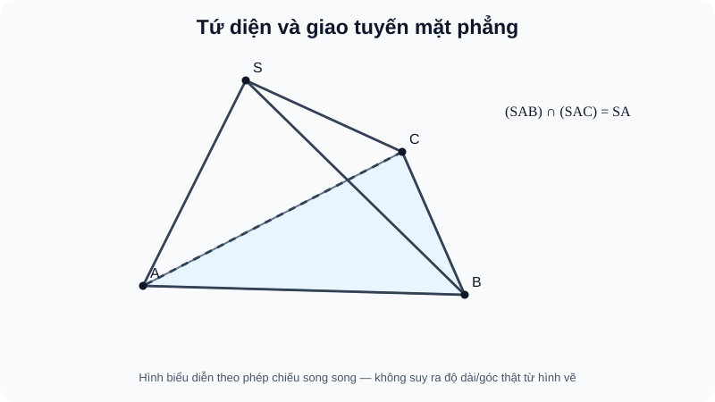

# Bài 10. Đường thẳng và mặt phẳng trong không gian

TOÁN 11 · CHƯƠNG IV

Từ một hình vẽ phẳng suy luận chính xác về không gian: nhận biết điểm–đường–mặt, xác định mặt phẳng, tìm giao tuyến và đọc hình chóp, tứ diện.

<nav class="thpt-r4-lesson-tabs"><a href="../">Chương IV</a><a href="../luyen-tap/">Core và Luyện tập</a><a href="../tu-kiem-tra-chuong/">Tự kiểm tra cuối chương</a></nav>

=== "Khám phá kiến thức"

    Một chiếc bàn có thể được vẽ như hình bình hành trên giấy, nhưng mặt bàn thực tế trải rộng trong **không gian ba chiều**. Hình biểu diễn chỉ giúp ta nhìn, còn kết luận toán phải dựa vào quan hệ **điểm thuộc đường**, **điểm thuộc mặt**, hoặc một **tính chất thừa nhận**. Chẳng hạn một nét đứt thường biểu diễn cạnh bị che khuất; nó không phải dấu hiệu đoạn đó ngắn hơn hay hai đường đã cắt nhau.

    Nhớ từ Hình học phẳng: qua hai điểm phân biệt có một đường thẳng. Trong không gian, muốn cố định một **mặt phẳng**, chỉ hai điểm là chưa đủ: có thể quay rất nhiều mặt phẳng quanh đường đi qua hai điểm đó.

    ### 1.1. Vì sao biểu diễn mặt phẳng bằng một hình bình hành không có nghĩa mặt phẳng hữu hạn?

    Mặt bảng, mặt nước yên tĩnh hoặc mặt bàn là **mô hình của một phần mặt phẳng**. Mặt phẳng toán học không có bề dày và kéo dài không giới hạn. Khi viết \(A\in(P)\) ta nói **điểm A thuộc mặt phẳng**; \(B\notin(P)\) có nghĩa B ở ngoài mặt. Đường \(a\subset(P)\) nghĩa là **mọi điểm** của \(a\) nằm trong mặt ấy.

    **Vận dụng.** Nếu \(A,B\) là hai điểm phân biệt thuộc \((P)\), và \(T\) là một điểm **bất kỳ trên đường thẳng AB**, em có thể kết luận \(T\in(P)\) không? Giải thích bằng tính chất nào.

    

    ??? question "Đối chiếu"

        **Lời giải:** Có. Tính chất thừa nhận: nếu hai điểm phân biệt của một đường thẳng nằm trong mặt phẳng thì **cả đường thẳng nằm trong mặt phẳng**. Vì \(A,B\in(P)\), \(A\ne B\), suy ra \(AB\subset(P)\). Mọi \(T\in AB\) vì thế đều thuộc \((P)\).

        **Vì sao phải có A khác B:** Một điểm riêng lẻ chưa xác định đường thẳng duy nhất.

    

    ??? tip "Kiểm lỗi"

        **Dấu hiệu:** Em suy “chỉ A thuộc \((P)\), vậy đường qua A cũng nằm trong \((P)\)” hoặc quên hai điểm phân biệt.

        **Tự sửa:** Gạch dưới **hai điểm phân biệt cùng thuộc mặt** rồi dùng tính chất đường chứa cả hai. Ôn mục 2.2 và luyện Core B10-C01 trong <a href="../luyen-tap/">Core và Luyện tập Bài 10</a>.

    ### 1.2. Ba điểm không thẳng hàng mới xác định một mặt phẳng duy nhất

    Ba chân kiềng không nằm thẳng hàng xác định một **mặt phẳng đi qua ba điểm tiếp xúc**. Còn nếu ba điểm thẳng hàng, có thể dựng vô số mặt phẳng khác nhau cùng chứa đường đó. Đây là lý do phải hỏi **điều kiện không thẳng hàng** trước khi viết \((ABC)\).

    **Vận dụng.** Cho \(A,B,C\) không thẳng hàng và \(D\in AB\), \(D\ne A,B\). Các bộ ba \(A,B,C\) và \(A,B,D\) có cùng khả năng xác định duy nhất một mặt phẳng không? Vì sao?

    

    ??? question "Đối chiếu"

        **Lời giải:** \(A,B,C\) không thẳng hàng nên xác định **duy nhất** \((ABC)\). Bộ \(A,B,D\) thẳng hàng vì \(D\in AB\); có vô số mặt phẳng chứa đường \(AB\), nên ba điểm ấy **không xác định duy nhất** một mặt phẳng. Tuy nhiên D vẫn thuộc \((ABC)\) vì \(AB\subset(ABC)\).

    

    ??? tip "Kiểm lỗi"

        **Dấu hiệu:** Em kết luận cứ ba điểm là xác định mặt phẳng duy nhất, dù tất cả cùng một đường.

        **Tự sửa:** Luôn kiểm **không thẳng hàng**; ôn mục 2.2–2.3 và làm Core B10-C02, Practice B10-P03 tại <a href="../luyen-tap/">Luyện tập Bài 10</a>.

    ### 1.3. Giao tuyến cần hai điểm chung phân biệt và hai mặt phẳng khác nhau

    Hai mặt phẳng phân biệt **nếu giao nhau** thì các điểm chung tạo thành một **đường thẳng**, gọi là giao tuyến. Muốn tìm đường đó bằng cách dựng, hãy tìm **hai điểm phân biệt** đều thuộc cả hai mặt phẳng; rồi chứng minh đường qua chúng là giao tuyến. Một điểm chung chưa cho biết hướng của đường giao; hình vẽ chỉ là gợi ý.

    **Vận dụng.** Trong tứ diện \(S.ABC\), gọi \(M\) là trung điểm của \(AB\). Tìm giao tuyến của \((SAM)\) và \((SBC)\). Nêu hai điểm chung thực sự.

    

    ??? question "Đối chiếu"

        **Lời giải:** Vì \(M\in AB\), \((SAM)=(SAB)\), nên mặt thứ nhất chứa cả \(S,B\). Mặt \((SBC)\) cũng chứa \(S,B\). Hai mặt phẳng phân biệt (vì \(A\notin(SBC)\) trong tứ diện), nên giao tuyến là đường **\(SB\)**. Hai điểm chung phân biệt là \(S,B\), không phải \(S,M\) vì M thường không thuộc \((SBC)\).

    

    ??? tip "Kiểm lỗi"

        **Dấu hiệu:** Em tự cho \(M\in(SBC)\) vì M có vẻ gần cạnh BC trong hình.

        **Tự sửa:** Liệt kê điểm thuộc từng mặt theo **các đường đã biết chứa nó**. Ôn mục 2.2–2.3; luyện Practice B10-P01 về hai mặt bên tứ diện trong <a href="../luyen-tap/">Bài 10 – Luyện tập</a>.

    ### 1.4. Tìm giao điểm đường–mặt bằng mặt phẳng phụ

    Với một đường \(a\) và mặt \((P)\), đừng mặc định sẽ có giao điểm. Cách dựng là chọn mặt phẳng phụ \((Q)\) **chứa \(a\)**; nếu tìm được giao tuyến \(d=(P)\cap(Q)\), giao điểm của \(a\) với \((P)\) (nếu tồn tại) chính là giao của \(a\) với **đường \(d\)**. Như vậy ta đã chuyển bài toán không gian về giao hai đường trong một mặt phẳng.

    **Vận dụng.** Trong tứ diện \(S.ABC\), lấy \(U\) là trung điểm \(SC\) và \(V\) là trung điểm \(BC\). Đường thẳng \(UV\) có cắt mặt phẳng \((SAB)\) không? Hãy xét mặt \((SBC)\) chứa UV trước.

    

    ??? question "Đối chiếu"

        **Lời giải:** \(U,V\in(SBC)\), nên \(UV\subset(SBC)\). Mặt \((SBC)\) cắt \((SAB)\) theo \(SB\). Trong tam giác \(SBC\), \(UV\) là đường trung bình nên **\(UV\parallel SB\)** và hai đường không cắt. Vì mọi điểm chung của hai mặt \((SBC),(SAB)\) nằm trên \(SB\), đường \(UV\) **không cắt \((SAB)\)**. Bài toán cho thấy dựng mặt phụ có thể kết luận không giao.

    

    ??? tip "Kiểm lỗi"

        **Dấu hiệu:** Em tìm một giao điểm tùy ý vì nghĩ đường nào kéo dài cũng phải gặp mặt phẳng.

        **Tự sửa:** Dựng \(d=(P)\cap(Q)\) trước, xét đường \(a\) có cắt d không. Ôn mục 2.2, làm Practice B10-P02 về một trường hợp **có** giao điểm tại <a href="../luyen-tap/">Core và Luyện tập</a>.

    ### 1.5. Thiết diện phải được dựng từ các đoạn giao thuộc khối

    Một mặt phẳng cắt hình chóp hoặc tứ diện có thể tạo thành đa giác. Để xác định **thiết diện**, không nối những điểm bất kỳ theo vẻ ngoài của hình vẽ: phải xem từng cặp điểm có chung một **mặt của khối** hay không, rồi xác định đoạn giao hợp lệ. Khi các điểm nằm trong cạnh, thiết diện chỉ gồm các đoạn thực sự thuộc khối.

    **Vận dụng.** Trong tứ diện \(S.ABC\), lấy \(M\in SA\), \(N\in SB\), \(K\in SC\), đều là điểm trong cạnh và không trùng đỉnh. Mặt \((MNK)\) cắt các mặt bên theo những đoạn nào, và thiết diện là hình gì?

    

    ??? question "Đối chiếu"

        **Lời giải:** Trên mặt \((SAB)\), hai điểm \(M,N\) cùng thuộc mặt cắt, nên đoạn giao là \(MN\). Tương tự trên \((SBC)\) được \(NK\); trên \((SCA)\) được \(KM\). Ba đoạn tạo thành **tam giác \(MNK\)**. Vì cả M,N,K đều là điểm trong ba cạnh từ đỉnh S và mặt cắt không đi qua S, thiết diện là tam giác ấy.

    

    ??? tip "Kiểm lỗi"

        **Dấu hiệu:** Em nối M với C hoặc N với A dù chưa chứng minh các điểm đó đều thuộc mặt cắt.

        **Tự sửa:** Xét từng **mặt chứa hai điểm chung**, rồi nối bằng đoạn giao của mặt cắt với mặt khối. Ôn mục 2.4 và luyện Practice B10-P04 tại <a href="../luyen-tap/">Bài 10 – Luyện tập</a>.

    ### 1.6. Dựng hình trong thực tế: ba chân đỡ và bốn chân đỡ

    Một thiết kế chân đỡ ba điểm tiếp xúc không thẳng hàng xác định mặt phẳng đặt chân duy nhất. Nếu thêm chân thứ tư ở vị trí tùy ý, bốn điểm tiếp xúc **không nhất thiết đồng phẳng**: không thể đòi cả bốn đồng thời nằm trên một nền phẳng nếu vị trí chân bị cố định khác mặt. Đây là một ứng dụng hình học về **tính đồng phẳng**, không phải kết luận máy móc rằng mọi chân đỡ ba chân luôn ổn định hơn mọi chân đỡ bốn chân.

    **Vận dụng.** Nếu bốn điểm \(A,B,C,D\) không đồng phẳng và \(A,B,C\) không thẳng hàng, có tồn tại một mặt phẳng chứa **cả bốn điểm** không? Chỉ rõ điều kiện làm câu trả lời khác đi.

    

    ??? question "Đối chiếu"

        **Lời giải:** **Không.** Mặt phẳng duy nhất đi qua \(A,B,C\) là \((ABC)\). Nếu D không thuộc mặt ấy thì không thể có mặt phẳng thứ hai đi qua cả A,B,C,D. Nếu D được đặt **thuộc (ABC)**, bốn điểm đồng phẳng và cùng thuộc một mặt.

    

    ??? tip "Kiểm lỗi"

        **Dấu hiệu:** Em nghĩ cứ bốn điểm là có một mặt chung giống như ba điểm không thẳng hàng.

        **Tự sửa:** Dùng ba điểm đầu để xác định một mặt, sau đó **kiểm điểm thứ tư có nằm trong đó**. Ôn mục 2.2 và Ví dụ 3.1; giải lại Core B10-C02 trong <a href="../luyen-tap/">Luyện tập Bài 10</a>.

=== "Kiến thức SGK"

    ### 2.1. Khái niệm mở đầu: điểm, đường thẳng, mặt phẳng và hình biểu diễn

    
<strong>Mặt phẳng:</strong> Không có bề dày và không có giới hạn. Điểm \(A\) thuộc mặt \((P)\) viết \(A\in(P)\); \(A\notin(P)\) nghĩa là không thuộc. Đường \(d\subset(P)\) khi **mọi điểm của \(d\)** đều thuộc \((P)\). Các điểm cùng nằm trên một mặt phẳng gọi là <em>đồng phẳng</em>.

    **Đọc hình:** Một hình bình hành hay miền góc trên giấy chỉ biểu diễn **một phần** mặt phẳng. Nét liền cho cạnh nhìn thấy, nét đứt cho cạnh khuất; hình biểu diễn giữ quan hệ điểm thuộc đường và những quan hệ đã được giả thiết, không phải chứng cứ mới về độ dài hay góc.

    ### 2.2. Các tính chất thừa nhận cơ bản trong không gian

    
<strong>Tính chất:</strong> (1) Qua hai điểm phân biệt có đúng một đường thẳng. (2) Qua ba điểm **không thẳng hàng** có đúng một mặt phẳng. (3) Có bốn điểm **không đồng phẳng** trong không gian. (4) Nếu hai điểm phân biệt của đường \(d\) thuộc mặt \((P)\), thì **\(d\subset(P)\)**. (5) Hai mặt phẳng phân biệt nếu có điểm chung thì giao nhau theo một đường thẳng. (6) Trong mỗi mặt phẳng, các kết quả Hình học phẳng đã học đều đúng.

    **Giao tuyến:** Nếu \((P)\ne(Q)\) và hai điểm chung phân biệt \(X,Y\) đã chứng minh cùng thuộc hai mặt, thì \((P)\cap(Q)=XY\). Nếu không có điểm chung, hai mặt không có giao tuyến. Không lấy hướng của nét vẽ thay cho chứng cứ điểm thuộc.

    ### 2.3. Ba cách SGK xác định một mặt phẳng duy nhất

    
<strong>Ba cách:</strong> (1) Ba điểm không thẳng hàng \(A,B,C\): mặt \((ABC)\). (2) Một đường thẳng \(d\) và một điểm \(A\notin d\): mặt \(\operatorname{mp}(A,d)\). (3) Hai đường thẳng **cắt nhau** \(a,b\): mặt \(\operatorname{mp}(a,b)\).

    **Vì sao đủ:** Ở cách (2), lấy hai điểm phân biệt B,C trên d; A không thuộc d nên ba điểm A,B,C không thẳng hàng, xác định duy nhất một mặt. Ở cách (3), chọn giao điểm I của a,b và mỗi đường thêm một điểm khác I; ba điểm ấy không thẳng hàng.

    **Mở rộng để suy luận:** Hai đường **phân biệt song song** cũng cùng nằm trong một mặt phẳng và cùng xác định một mặt. Đây là hệ quả của quan hệ song song sẽ học kỹ ở Bài 11, **không ghi thành mục thứ tư trong danh sách ba cách được SGK Bài 10 giới thiệu**.

    **Đọc hình tứ diện đã học:** 

    <figure class="thpt-r4-plot"><figcaption>Đọc hình theo chứng cứ: đáy \(ABC\) là một mặt phẳng, S nằm ngoài đáy. Hai mặt \((SAB),(SAC)\) chứa chung S và A nên giao tuyến \(SA\); nét đứt chỉ cạnh khuất, không tạo thêm giao điểm.</figcaption></figure>

    ### 2.4. Hình chóp, hình tứ diện và giao tuyến/giao điểm

    
<strong>Hình chóp:</strong> Cho đa giác \(A_1\ldots A_n\) nằm trong một mặt phẳng và đỉnh \(S\) không thuộc mặt ấy. Hình chóp \(S.A_1\ldots A_n\) có đáy là đa giác, các mặt bên là tam giác \(SA_iA_{i+1}\). <em>Hình tứ diện</em> là hình chóp tam giác, có bốn đỉnh không đồng phẳng và bốn mặt tam giác.

    **Cách tìm giao điểm đường–mặt:** Muốn tìm \(a\cap(P)\), chọn một mặt phẳng phụ \((Q)\supset a\), xác định giao tuyến \(d=(Q)\cap(P)\) nếu tồn tại; rồi tìm \(a\cap d\). Nếu \(a\parallel d\) thì không có giao điểm; nếu \(a=d\) thì **đường nằm trong mặt**, không phải chỉ có một giao điểm.

    **Cách dựng thiết diện:** Kiểm các điểm được cho thực sự thuộc mặt cắt, tìm đoạn giao của mặt cắt với **từng mặt** của khối, rồi nối các đoạn thành đa giác nằm trong khối. Hình vẽ phối cảnh không tự chứng minh độ dài, góc hay điểm chung.

=== "Ví dụ"

    Mỗi ví dụ có đề đầy đủ, giải thích lựa chọn phương pháp, lập luận và kiểm lại trên giả thiết.

    ### 3.1. Phân biệt ba điểm xác định mặt phẳng và ba điểm cùng hàng

    

<strong>Đề bài:</strong> Cho \(A,B,C\) không thẳng hàng, \(D\in BC\), \(D\ne B,C\). Xác định mặt phẳng chứa \(A,B,D\), và kiểm điều kiện ba điểm ấy.

    
<strong>Phân tích:</strong> D thuộc đường BC, còn A nằm ngoài BC; vì vậy A,B,D không thẳng hàng. Dùng cách ba điểm của SGK.

    
<strong>Lời giải:</strong> \(A\notin BC\), còn \(B,D\in BC\) với B khác D, nên \(A,B,D\) không thẳng hàng và xác định duy nhất \((ABD)\). Vì B,D thuộc \((ABC)\), đường BD chính là BC nằm trong \((ABC)\), và A cũng thuộc \((ABC)\), suy ra \((ABD)=(ABC)\).

    
<strong>Kiểm lại:</strong> Điều kiện A không thuộc BC đảm bảo mặt phẳng duy nhất, không dùng sai trường hợp ba điểm thẳng hàng.

    ### 3.2. Giao tuyến bằng hai điểm chung qua trọng tâm đáy

    

<strong>Đề bài:</strong> Trong tứ diện \(S.ABC\), M,N lần lượt là trung điểm \(BC,AC\); G là giao điểm hai trung tuyến \(AM,BN\). Tìm giao tuyến của hai mặt \((SAM)\) và \((SBN)\).

    
<strong>Phân tích:</strong> Mỗi mặt chứa một đường trung tuyến của tam giác ABC: \(AM\) hoặc \(BN\). Tìm điểm chung của hai trung tuyến trong mặt đáy, rồi kết hợp với S.

    
<strong>Lời giải:</strong> Vì \(G=AM\cap BN\), ta có \(G\in(SAM)\) và \(G\in(SBN)\). Điểm S cũng thuộc cả hai mặt; S khác G vì S ngoài đáy. Hai mặt phẳng phân biệt (AM và BN khác nhau và S ngoài đáy), nên \((SAM)\cap(SBN)=SG\).

    
<strong>Kiểm lại:</strong> SG đi qua hai điểm chung phân biệt S,G; không lấy cạnh SA hay SB vì chúng không thuộc đồng thời hai mặt.

    ### 3.3. Mặt phẳng phụ có thể cho kết luận không giao

    

<strong>Đề bài:</strong> Trong tứ diện \(S.ABC\), U và V lần lượt là trung điểm \(SC,BC\). Xác định giao của đường \(UV\) với mặt \((SAB)\) nếu có.

    
<strong>Phân tích:</strong> \(UV\subset(SBC)\); giao của \((SBC)\) và \((SAB)\) là \(SB\). Vậy chỉ cần kiểm \(UV\) có cắt \(SB\) không.

    
<strong>Lời giải:</strong> Trong tam giác \(SBC\), \(UV\parallel SB\) vì là đường trung bình, nên \(UV\cap SB=\varnothing\). Suy ra \(UV\cap(SAB)=\varnothing\).

    
<strong>Kiểm lại:</strong> Không có điểm chung với giao tuyến của hai mặt, nên đường nằm trong mặt phụ không thể gặp mặt đích.

    ### 3.4. Dựng giao điểm thực sự của đường và mặt

    

<strong>Đề bài:</strong> Trong tứ diện \(S.ABC\), lấy P trong cạnh \(SC\), Q trong cạnh \(BC\), sao cho \(SP/SC=1/2\), \(BQ/BC=1/3\). Đường thẳng \(PQ\) có cắt mặt \((SAB)\) không? Nếu có, chỉ cách xác định giao điểm.

    
<strong>Phân tích:</strong> PQ nằm trong mặt \((SBC)\), còn \((SAB)\cap(SBC)=SB\). Ta cần tìm \(T=PQ\cap SB\), trong đó có thể phải kéo dài các đường.

    
<strong>Lời giải:</strong> Trong tam giác SBC, đặt \(B=(0,0),S=(0,1),C=(1,0)\) để kiểm quan hệ thẳng hàng trong mặt tam giác. Khi ấy \(P=(1/2,1/2)\), \(Q=(1/3,0)\). Đường \(PQ\) có tham số \(P+t(Q-P)\); hoành độ bằng \(0\) tại \(t=3\), khi đó tung độ \(1/2+3(-1/2)=-1\). Vậy \(T=(0,-1)\) thuộc **tia SB kéo dài quá B**, và \(T=PQ\cap SB\) là giao điểm cần tìm.

    
<strong>Kiểm lại:</strong> T nằm trên SB nên thuộc \((SAB)\), và được dựng từ PQ nên thuộc PQ. Điểm T ở ngoài đoạn SB vẫn hợp lệ vì bài hỏi **đường thẳng**, không hỏi đoạn.

    ### 3.5. Thiết diện qua ba cạnh bên của một tứ diện

    

<strong>Đề bài:</strong> Trong tứ diện \(S.ABC\), M,N,K lần lượt nằm **trong** SA,SB,SC. Xác định thiết diện của mặt \((MNK)\).

    
<strong>Phân tích:</strong> Mỗi cặp điểm nằm trên hai cạnh cùng thuộc một mặt bên; tìm giao đoạn trên từng mặt.

    
<strong>Lời giải:</strong> Trên mặt SAB có đoạn MN; trên SBC có NK; trên SCA có KM. Ba đoạn ghép kín thành tam giác MNK, là thiết diện.

    
<strong>Kiểm lại:</strong> Cả ba điểm thuộc cạnh của tứ diện và ba đoạn nằm trong các mặt tương ứng; không kéo dài ra ngoài khối.

    ### 3.6. Ứng dụng điều kiện đồng phẳng trong thiết kế giá đỡ

    

<strong>Đề bài:</strong> Một giá đỡ có bốn điểm chân cố định A,B,C,D; biết A,B,C không thẳng hàng và D không thuộc \((ABC)\). Có thể đặt cả bốn chân tiếp xúc **một mặt phẳng lý tưởng** mà không thay đổi vị trí các chân không?

    
<strong>Phân tích:</strong> Phần toán không hỏi độ bền hay độ ổn định cơ học, chỉ hỏi khả năng cùng nằm trong một mặt phẳng.

    
<strong>Lời giải:</strong> Qua A,B,C chỉ có mặt \((ABC)\). Vì \(D\notin(ABC)\), không mặt phẳng nào chứa cả A,B,C,D. Do đó không thể có đồng thời bốn điểm chân trên cùng một mặt phẳng lý tưởng khi giữ nguyên tương quan vị trí.

    
<strong>Kiểm lại:</strong> Nếu chuyển D về \((ABC)\), điều kiện thay đổi thì bốn chân đồng phẳng, nên kết luận phụ thuộc trực tiếp giả thiết.

=== "Lỗi thường gặp"

    Nếu sai một câu Tự thử, hãy dùng Kiểm lỗi ngay dưới Đối chiếu; các nhóm sau nói về lỗi quy tắc thường gặp.

    

    ??? tip "4.1. Dùng một điểm để kết luận cả đường thuộc mặt"

        **Dấu hiệu:** Em cho A thuộc \((P)\) rồi nói mọi đường qua A cũng nằm trong \((P)\).

        **Vì sao sai:** Phải có **hai điểm phân biệt** của đường cùng thuộc mặt, hoặc một giả thiết khác xác định đường nằm trong mặt.

        **Tự sửa:** Ôn mục 2.2 và Ví dụ 3.1, luyện Core B10-C01 tại <a href="../luyen-tap/">Bài 10 – Luyện tập</a>.

    

    ??? tip "4.2. Xác định mặt bằng ba điểm thẳng hàng"

        **Dấu hiệu:** Em viết \((ABD)\) với D thuộc AB và cho rằng đó là duy nhất.

        **Vì sao sai:** Vô số mặt đi qua đường AB; cần ba điểm không thẳng hàng, hoặc điểm ngoài đường.

        **Tự sửa:** Ôn mục 2.3, tự giải thích vì sao A,B,C không thẳng hàng là điều kiện bắt buộc, sau đó luyện Core B10-C02/Practice B10-P03.

    

    ??? tip "4.3. Dựa vào nét vẽ thay chứng minh giao tuyến"

        **Dấu hiệu:** Em chọn một đường vì nhìn hình thấy hai mặt có vẻ tiếp xúc.

        **Vì sao sai:** Giao tuyến hai mặt phân biệt cần **hai điểm chung phân biệt**; điểm nhìn gần trên giấy chưa chắc thuộc cả hai mặt.

        **Tự sửa:** Lập bảng thuộc mặt cho các điểm; ôn mục 2.2, Ví dụ 3.2 và luyện Practice B10-P01 ở <a href="../luyen-tap/">Luyện tập Bài 10</a>.

    

    ??? tip "4.4. Nối các điểm thiết diện không cùng mặt cắt"

        **Dấu hiệu:** Em nối các điểm theo ý thích hoặc lấy cả đoạn ngoài khối làm cạnh thiết diện.

        **Vì sao sai:** Cạnh thiết diện phải là phần giao thực sự giữa mặt cắt và từng mặt của khối.

        **Tự sửa:** Xét từng mặt của tứ diện, xác định hai điểm thuộc **cả mặt đó lẫn mặt cắt**. Ôn mục 2.4 và Ví dụ 3.5, luyện Practice B10-P04 trong <a href="../luyen-tap/">Core và Luyện tập</a>.

    **Học tiếp:** <a href="../luyen-tap/">Core và Luyện tập</a> · <a href="../tu-kiem-tra-chuong/">Tự kiểm tra cuối chương</a> · <a href="../../../../thu-vien/tu-luan-g11-chuong-iv/">Tự luận Chương IV</a>.

    
Nguồn tham khảo: SGK Toán 11 – Kết nối tri thức với cuộc sống, tập một, Bài 10 (trang in 70–77).

