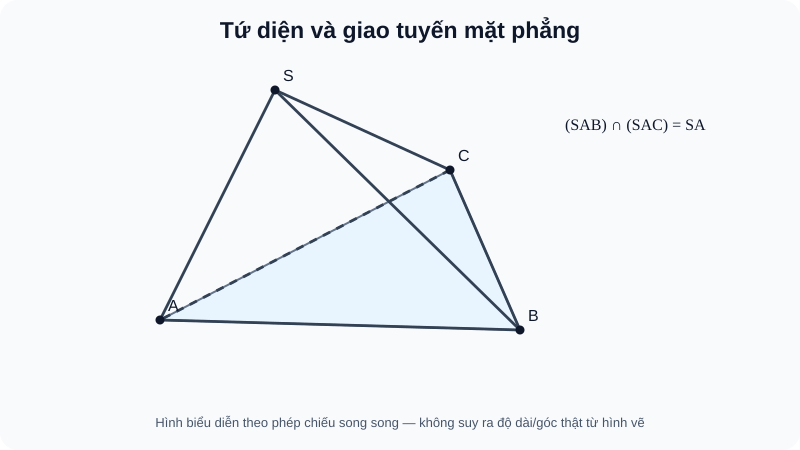

# Bài 10. Đường thẳng và mặt phẳng trong không gian

TOÁN 11 · CHƯƠNG IV · SGK KNTT

Vì sao cần học → kiến thức/điều kiện → ví dụ → Tự thử trước Core → hình đọc đúng → luyện tập và khắc phục. Tự kiểm tra tự đối chiếu không ghi Mastery.
<nav class="thpt-r4-lesson-tabs"><a href="../">Chương IV</a><a href="../luyen-tap/">Core & Luyện tập</a><a href="../tu-kiem-tra-chuong/">Tự kiểm tra · tự đối chiếu</a></nav>

=== "Khám phá kiến thức"

    ### Cùng tìm hiểu

    Một bản vẽ trên giấy có thể cho cảm giác hai đường cắt nhau, nhưng trong không gian chúng có thể ở các mặt khác nhau. Để xác định **mặt phẳng**, cần đủ dữ kiện (ba điểm không thẳng hàng, hoặc một đường và một điểm ngoài đường). Khi dựng **giao tuyến**, ta cần hai điểm chung phân biệt; không thể suy giao chỉ từ nét vẽ. Vì vậy học quan hệ điểm–đường–mặt trước khi tìm thiết diện. Trong tứ diện, nét đứt là cách biểu diễn cạnh khuất, không phải chứng cứ hai đường chéo nhau.

    ### Ví dụ trực quan

    Hai đường thẳng trong không gian có thể không cắt mà cũng không song song, vì chúng nằm ở các mặt khác nhau. Nhìn hình phối cảnh đôi khi khiến ta kết luận nhầm.

    **Quan sát bằng số liệu:** Hai cạnh ở hai độ cao khác nhau của một chiếc hộp có thể nhìn như cắt nhau trên giấy nhưng không chung điểm trong không gian. Cần xét vị trí mặt phẳng chứa chúng trước khi kết luận.

    ### Thuật ngữ và kiến thức, kỹ năng

    **Thuật ngữ:** đường thẳng chéo nhau, song song, giao nhau, quan hệ đường–mặt.

    **Sau bài học, em cần:** đọc hình không gian, tìm giả thiết đồng phẳng và chứng minh quan hệ thay vì tin nét vẽ.

=== "Kiến thức SGK"

    

    **Khái niệm.** Mặt phẳng là đối tượng không giới hạn được ký hiệu $(P)$, $(ABC)$; đường thẳng $a$ được gọi là nằm trong $(P)$ khi mọi điểm của $a$ thuộc $(P)$. Nếu hai điểm phân biệt $A,B$ thuộc $(P)$ thì cả đường $AB$ nằm trong $(P)$. Ba điểm không thẳng hàng xác định duy nhất một mặt phẳng. Một mặt phẳng cũng được xác định bởi một đường thẳng và một điểm không nằm trên đường; hai đường thẳng cắt nhau; hoặc hai đường thẳng phân biệt song song.

    **Các nguyên tắc giao.** Hai mặt phẳng *phân biệt* có hai điểm chung phân biệt thì giao nhau theo đường thẳng qua hai điểm đó. Đường thẳng không nằm trong mặt phẳng có nhiều nhất một điểm chung với mặt phẳng. Nếu $d\subset(P)$ và $d\subset(Q)$, $P\ne Q$, thì $d=(P)\cap(Q)$. Muốn tìm $M=a\cap(P)$: chọn mặt phẳng phụ $(Q)$ chứa $a$, dựng $d=(P)\cap(Q)$, lấy $M=a\cap d$ khi có giao điểm. Phải kiểm tra cả hai phép giao có tồn tại, không mặc định luôn giao.

    **Thiết diện.** Thiết diện của hình chóp/lăng trụ với một mặt phẳng là đa giác thực sự tạo bởi các đoạn giao trong các mặt của hình; chọn điểm chung hợp lệ, nối chỉ những điểm thuộc cùng một mặt, xác định đoạn thuộc khối. Đường nét đứt trong hình phối cảnh là cạnh khuất **chứ không** tự chứng minh chéo nhau/không giao.

    ### Đọc hình và đối chiếu khái niệm

    <figure class="thpt-r4-plot thpt-r4-probability-figure"><figcaption>Tứ diện S.ABC, ba đỉnh A B C ở đáy, S trên cao; các mặt (SAB) và (SAC) cùng chứa đường SA. Nét đứt chỉ cạnh khuất trong hình biểu diễn.</figcaption></figure>

    theo dõi hai mặt (SAB), (SAC) và hai điểm chung phân biệt S,A; nét khuất không chứng minh góc hay giao tuyến.

    ### Vận dụng — tự thử rồi mở đối chiếu

    A,B là hai điểm phân biệt của mặt (P). Nếu C nằm trên AB thì C có thuộc (P) không?

    

Em đã tự thử? Mở đối chiếu

    Có, vì AB nằm trọn trong (P). Trở về D1 B10 và câu Core THPT-G11-CHIV-B10-C01.

    

=== "Ví dụ"

    **EX-G11-B10-EX01: Xác định mặt phẳng.** Với $A,B,C$ không thẳng hàng, chỉ có một $(ABC)$. Nếu $D$ thuộc $AB$, thì $(ABD)$ **không xác định duy nhất** theo ba điểm vì $A,B,D$ thẳng hàng; thay $D$ bằng $C$ để được mặt phẳng.

    **EX-G11-B10-EX02: Hai mặt phẳng giao nhau.** Trong tứ diện $S.ABC$, hai mặt phẳng $(SAB)$ và $(SAC)$ có $S,A$ chung và phân biệt (vì $B,C$ không cùng mặt $(SA)$), do đó giao tuyến là $SA$.

    **EX-G11-B10-EX03: Giao điểm đường mặt.** Trong tứ diện $S.ABC$, $M$ thuộc đoạn $SB$, $M\ne S,B$. Giao điểm của $CM$ với $(SAB)$ là $M$ vì $M\in SB\subset(SAB)$, $CM$ đi qua $M$, và $C\notin(SAB)$.

    **EX-G11-B10-EX04: Thiết diện qua ba điểm trên ba cạnh.** Trong tứ diện $S.ABC$, $M\in SA$, $N\in SB$, $K\in SC$ đều nằm bên trong các cạnh. Mặt $(MNK)$ cắt ba mặt bên theo $MN,NK,KM$, nên thiết diện với tứ diện là tam giác $MNK$.

    ### Lý do chọn phương pháp và giới hạn

    - `EX-G11-B10-EX01`: Kiểm ba điểm không thẳng hàng để định một mặt; kiểm rõ điều kiện áp dụng trước kết luận.
    - `EX-G11-B10-EX02`: Dùng hai điểm chung S,A thuộc hai mặt phẳng phân biệt; kiểm rõ điều kiện áp dụng trước kết luận.
    - `EX-G11-B10-EX03`: Xác nhận M nằm SB⊂(SAB) rồi xem giao của CM; kiểm rõ điều kiện áp dụng trước kết luận.
    - `EX-G11-B10-EX04`: Xét từng mặt bên và đoạn giao hợp lệ để tìm thiết diện; kiểm rõ điều kiện áp dụng trước kết luận.

=== "Lỗi thường gặp"

    

Nhầm điểm nằm trên hình vẽ với điểm thuộc mặt phẳng.
<ol><li><strong>Nhận diện:</strong> Nhầm điểm nằm trên hình vẽ với điểm thuộc mặt phẳng.</li><li><strong>Nhắc đúng điều kiện:</strong> kiểm tra giả thiết về quan hệ đường–mặt và điểm đang xét.</li><li><strong>Sửa sai:</strong> Hai điểm thuộc mặt xác định toàn bộ đường.</li><li><strong>Tự thử:</strong> Giả sử A,B∈(P), A≠B. Hỏi điểm C∈AB có nằm (P) không? <strong>Tự đối chiếu:</strong> Có, vì AB⊂(P).</li><li><strong>Quay lại câu gốc:</strong> giải lại <code>THPT-G11-CHIV-B10-C01</code> và tự nêu lí do mỗi giả thiết cần thiết.</li></ol>
<a href="../luyen-tap/?item=THPT-G11-CHIV-B10-C01">Quay lại THPT-G11-CHIV-B10-C01 để tự làm</a>

    

Nối tùy ý các điểm không cùng mặt của hình khối.
<ol><li><strong>Nhận diện:</strong> Nối tùy ý các điểm không cùng mặt của hình khối.</li><li><strong>Nhắc đúng điều kiện:</strong> kiểm tra giả thiết về quan hệ đường–mặt và điểm đang xét.</li><li><strong>Sửa sai:</strong> Xác định từng giao tuyến của mặt cắt với từng mặt.</li><li><strong>Tự thử:</strong> Tứ diện S.ABC, P∈AB. Vì sao SP là đoạn giao trên mặt SAB của thiết diện qua S,C,P? <strong>Tự đối chiếu:</strong> Vì S,P đều thuộc (SAB) và thuộc mặt cắt.</li><li><strong>Quay lại câu gốc:</strong> giải lại <code>THPT-G11-CHIV-B10-P04</code> và tự nêu lí do mỗi giả thiết cần thiết.</li></ol>
<a href="../luyen-tap/?item=THPT-G11-CHIV-B10-P04">Quay lại THPT-G11-CHIV-B10-P04 để tự làm</a>

    ### Học tiếp

    [Core và Luyện tập Bài 10](luyen-tap.md) · [Tự luận Chương IV](../../../thu-vien/tu-luan-g11-chuong-iv.md) · [Tự kiểm tra cuối chương](tu-kiem-tra-chuong.md)
