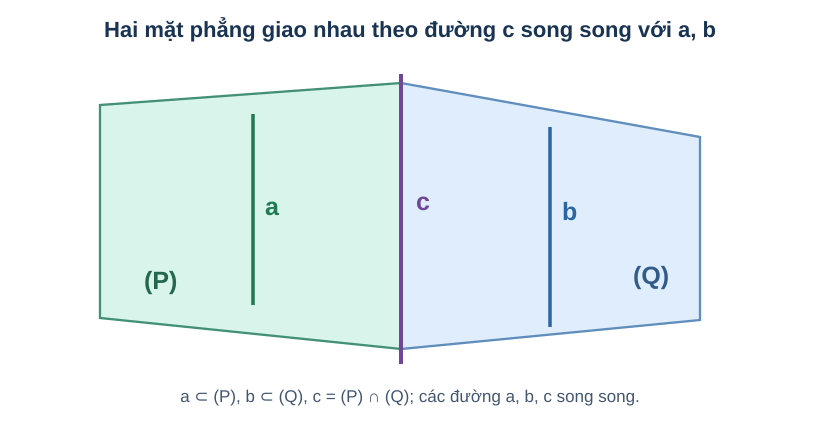

# Bài 11. Hai đường thẳng song song

TOÁN 11 · CHƯƠNG IV · KẾT NỐI TRI THỨC

Không cắt nhau chưa chắc song song: phân biệt đường chéo nhau, dùng tính chất song song và xác định hướng giao tuyến của hai mặt phẳng.

<nav class="thpt-r4-lesson-tabs"><a href="../">Chương IV</a><a href="../luyen-tap/">Core và Luyện tập</a><a href="../tu-kiem-tra-chuong/">Tự kiểm tra cuối chương</a></nav>

=== "Khám phá kiến thức"

    Trên một trang giấy, hai đường thẳng phân biệt không cắt nhau sẽ song song. Trong không gian, cầu vượt đi qua phía trên một con đường có thể **không cắt đường phía dưới** nhưng cũng **không cùng mặt phẳng**. Vậy từ “không giao nhau” không đủ để nói song song. Bài học có hai mục: trước tiên xác định các **vị trí tương đối**, rồi dùng những **tính chất/định lí** để chứng minh song song thật sự.

    ### 1.1. Vị trí tương đối của hai đường thẳng

    Hãy tưởng tượng hai chiếc thước cùng nằm trên một bàn phẳng: chúng có thể **trùng**, **cắt** hoặc **song song**. Nếu đặt thước thứ hai nằm ngang ở độ cao khác, hướng không song song với thước thứ nhất, thì hai đường chứa hai thước không gặp nhau và không song song. Đó là khả năng thứ tư: hai đường thẳng **chéo nhau**, nghĩa là không có mặt phẳng nào chứa cả hai. Đó là sự khác biệt căn bản giữa hình học phẳng và hình học không gian.

    Hai đường thẳng \(a,b\) gọi là **đồng phẳng** nếu có một mặt phẳng chứa cả hai. Hai đường **phân biệt và đồng phẳng, không có điểm chung** thì song song, viết \(a\parallel b\). Hai đường **không đồng phẳng** thì chéo nhau. Vì vậy, để khẳng định \(a\parallel b\) từ việc chúng không cắt nhau, ta còn phải có căn cứ chúng **cùng nằm trong một mặt phẳng**. Nếu chúng **trùng nhau**, không được gọi là song song theo định nghĩa hai đường phân biệt.

    <figure class="thpt-r4-plot"><figcaption><strong>Đọc hình:</strong> trong lăng trụ \(ABC.A'B'C'\), đường \(AB\parallel A'B'\) cùng nằm trên mặt bên \(ABB'A'\). Ngược lại \(AA'\) và \(BC\) **chéo nhau** dù hai nét trên hình chiếu có thể gây nhầm: không có mặt phẳng nào chứa cả hai đường.</figcaption></figure>

    Một cách chứng minh chéo nhau rất chắc chắn là dùng **tứ diện**. Với bốn điểm \(A,B,C,D\) không đồng phẳng, giả sử \(AB\) và \(CD\) cùng thuộc một mặt phẳng; mặt đó sẽ chứa cả \(A,B,C,D\), mâu thuẫn. Vậy \(AB\) và \(CD\) chéo nhau. Tương tự các cặp cạnh đối diện \(AC\) với \(BD\), \(AD\) với \(BC\) cũng chéo nhau.

    **Nhận xét SGK:** Hai đường song song xác định **duy nhất một mặt phẳng** chứa cả hai. Chú ý rằng đây không phải điều kiện của hai đường chéo nhau: chúng không cùng nằm trong mặt phẳng nào.

    **Vận dụng.** Trong tứ diện \(ABCD\), hãy phân loại ba cặp đường \(AB\) và \(BC\); \(AB\) và \(CD\); \(AC\) và \(BD\). Giải thích bằng quan hệ điểm chung hoặc tính không đồng phẳng.

    ??? question "Đối chiếu"

        **Lời giải:** \(AB\) và \(BC\) **cắt nhau tại \(B\)**. \(AB\) và \(CD\) **chéo nhau**; \(AC\) và \(BD\) cũng **chéo nhau** vì nếu một cặp đồng phẳng, cả bốn đỉnh tứ diện phải đồng phẳng, trái định nghĩa tứ diện.

    ??? tip "Kiểm lỗi"

        Nếu chỉ nhìn thấy hai cạnh không gặp nhau rồi gọi là song song, em đã bỏ điều kiện **đồng phẳng**. Tìm điểm chung trước, sau đó xét có mặt phẳng chứa cả hai đường hay không.

    ### 1.2. Tính chất của hai đường thẳng song song

    Từ Bài 10, một đường thẳng \(d\) và điểm \(M\notin d\) xác định duy nhất mặt phẳng \((P)\). Trong **mặt phẳng ấy**, qua \(M\) chỉ có một đường song song với \(d\). Đường đó cũng là đường duy nhất trong cả không gian: mọi đường song song với \(d\) và qua \(M\) đều phải đồng phẳng với \(d\), nên phải nằm trong \((P)\). Đây là tính chất thứ nhất: **qua một điểm ngoài một đường, có đúng một đường song song với đường đã cho**.

    Nếu \(a\parallel c\) và \(b\parallel c\), với \(a,b\) **phân biệt**, chúng có cùng hướng và theo tính chất SGK thì \(a\parallel b\). Không được bỏ chữ “phân biệt”: hai đường \(a,b\) có thể trùng nhau và cùng song song với \(c\); khi đó \(a=b\), không phải \(a\parallel b\).

    Tiếp tục nhìn vào **ba mặt phẳng** \((P),(Q),(R)\) đôi một cắt nhau theo ba đường **phân biệt** \(a,b,c\). Nếu hai trong ba giao tuyến gặp tại \(M\), thì \(M\) thuộc cả ba mặt, nên cũng thuộc giao tuyến thứ ba; ba đường **đồng quy**. Mỗi cặp giao tuyến cùng nằm trong một trong ba mặt phẳng đã cho. Nếu không có điểm chung như vậy, từng cặp đường phân biệt không cắt nhau trong cùng mặt phẳng, nên cả ba đường phải **đôi một song song**. Kết luận đó được SGK gọi rõ là **Định lí về ba đường giao tuyến**.

    <figure class="thpt-r4-plot"><figcaption><strong>Đọc hình:</strong> hình riêng minh họa **hệ quả** của định lí: \((P)\cap(Q)=c\), đường \(a\subset(P)\) song song với \(b\subset(Q)\), thì giao tuyến \(c\) khi có sẽ song song với cả hai hoặc trùng một trong hai đường. Trong hình minh họa này, ba đường phân biệt và song song.</figcaption></figure>

    Đây là lí do ta có thể xác định giao tuyến trong hình chóp mà không phải tìm ngay hai điểm chung. Giả sử \(S.ABCD\) có đáy hình bình hành, \(AB\parallel CD\). Mặt \((SAB)\) chứa \(AB\), mặt \((SCD)\) chứa \(CD\), hai mặt có điểm chung \(S\). Giao tuyến của chúng phải **qua \(S\) và song song với \(AB,CD\)**. Ta đã tìm được **hướng** đường giao từ hai đường song song ở hai mặt.

    **Vận dụng.** Cho hình chóp \(S.ABCD\) có \(ABCD\) là hình bình hành. Xác định giao tuyến của \((SAB)\) và \((SCD)\), rồi của \((SAD)\) và \((SBC)\). Không chỉ viết “qua \(S\)” mà phải mô tả hướng.

    ??? question "Đối chiếu"

        **Lời giải:** Hai mặt \((SAB),(SCD)\) có điểm chung \(S\), lần lượt chứa \(AB\parallel CD\), nên giao tuyến là **đường qua \(S\) và song song với \(AB,CD\)**. Tương tự, \((SAD)\cap(SBC)\) là **đường qua \(S\) và song song với \(AD,BC\)**.

    ??? tip "Kiểm lỗi"

        Chỉ biết một điểm chung \(S\) chưa đủ xác định giao tuyến, nhưng có thể dùng **hướng song song** đã chứng minh để xác định đường đi qua \(S\). Đừng mặc định hai mặt không giao nhau: cả hai đều chứa \(S\).

=== "Kiến thức SGK"

    ### 2.1. Vị trí tương đối của hai đường thẳng

    
<strong>Khái niệm — Đồng phẳng, chéo nhau và song song</strong>
Hai đường thẳng \(a,b\) gọi là <strong>đồng phẳng</strong> nếu có một mặt phẳng chứa cả hai. Khi đồng phẳng, chúng có thể <strong>trùng nhau</strong>, <strong>cắt nhau</strong> hoặc <strong>song song</strong>. Hai đường <strong>không đồng phẳng</strong> gọi là <strong>chéo nhau</strong>. Hai đường phân biệt <strong>song song</strong> khi chúng đồng phẳng và không có điểm chung, kí hiệu \(a\parallel b\).

    **Phân biệt đủ bốn vị trí:** Trùng nhau \(a=b\); cắt nhau \(a\cap b=\{M\}\); song song \(a\ne b\), đồng phẳng, không điểm chung; chéo nhau không đồng phẳng (do đó cũng không có điểm chung). **Không giao nhau** có thể là song song **hoặc chéo nhau**, không đủ kết luận song song.

    **Nhận xét SGK:** Có đúng một mặt phẳng chứa hai đường thẳng song song. Không suy ra mặt phẳng ấy khi hai đường chéo nhau. Trong tứ diện \(ABCD\), ba cặp cạnh đối diện \(AB,CD\), \(AC,BD\), \(AD,BC\) đều chéo nhau.

    <figure class="thpt-r4-plot"><figcaption><strong>Tra hình:</strong> \(AB\parallel A'B'\), còn \(AA'\) chéo với \(BC\); đường chéo nhau không có mặt phẳng chung. Chú giải đọc **quan hệ thật** thay vì độ dài/giao cắt trong hình chiếu.</figcaption></figure>

    ### 2.2. Tính chất của hai đường thẳng song song

    
<strong>Tính chất — Đường thẳng song song qua điểm</strong>
Trong không gian, qua một điểm \(M\) <strong>không nằm trên</strong> đường thẳng \(d\) cho trước, có <strong>đúng một đường thẳng</strong> đi qua \(M\) và song song với \(d\).

    
<strong>Tính chất — Hai đường song song với đường thứ ba</strong>
Trong không gian, <strong>hai đường thẳng phân biệt</strong> cùng song song với một đường thẳng thứ ba thì chúng song song với nhau.

    **Chú ý điều kiện:** Nếu không nói hai đường **phân biệt**, chúng có thể trùng nhau. Khi \(M\in d\), không thể có một đường **phân biệt** qua \(M\) và song song với \(d\) theo định nghĩa.

    
<strong>Định lí — Ba đường giao tuyến</strong>
Nếu <strong>ba mặt phẳng đôi một cắt nhau theo ba giao tuyến phân biệt</strong>, thì ba giao tuyến ấy <strong>đồng quy</strong> hoặc <strong>đôi một song song</strong> với nhau.

    **Chú ý SGK — Hệ quả về giao tuyến:** Nếu hai mặt phẳng phân biệt lần lượt chứa hai đường thẳng **song song** với nhau, thì giao tuyến của hai mặt phẳng ấy (**nếu có**) song song với hai đường thẳng đó **hoặc trùng với một trong hai đường**. Không xóa điều kiện “nếu có”, không ép mọi trường hợp phải có ba đường phân biệt.

    <figure class="thpt-r4-plot"><figcaption><strong>Tra hình:</strong> \(a\subset(P)\), \(b\subset(Q)\), \(a\parallel b\), \((P)\cap(Q)=c\). Trong hình cả ba đường khác nhau và \(c\parallel a\parallel b\), minh họa nhánh “song song” của hệ quả.</figcaption></figure>

    **Cách dùng trong hình chóp:** Nếu \(ABCD\) là hình bình hành, \((SAB)\cap(SCD)\) qua \(S\), song song với \(AB,CD\); \((SAD)\cap(SBC)\) qua \(S\), song song với \(AD,BC\). Đây là **đường thẳng giao tuyến**, không chỉ một đoạn trên hình vẽ.

=== "Ví dụ"

    ### 3.1. Cắt nhau hay chéo nhau?

    **Đề bài.** Trong tứ diện \(ABCD\), phân loại các cặp \(AB,BC\) và \(AB,CD\).

    **Phân tích:** Cặp đầu có điểm chung \(B\). Với cặp sau, dùng giả thiết bốn đỉnh không đồng phẳng để xét không gian.

    

<strong>Lời giải.</strong> \(AB\) và \(BC\) cắt nhau tại \(B\). Nếu \(AB,CD\) đồng phẳng thì bốn điểm \(A,B,C,D\) đồng phẳng, trái định nghĩa tứ diện; vậy \(AB\) và \(CD\) chéo nhau.

    **Kiểm lại:** Cặp \(AC,BD\) và \(AD,BC\) cũng chéo nhau bởi lập luận tương tự.

    ### 3.2. Hai đường cùng nằm trên một mặt phẳng

    **Đề bài.** Hình chóp \(S.ABCD\) có đáy \(ABCD\) là hình bình hành. Xác định vị trí tương đối của \(AB\) và \(CD\), \(AB\) và \(AC\).

    **Phân tích:** Cả bốn đỉnh \(A,B,C,D\) thuộc mặt phẳng đáy, nên áp dụng tính chất của hình bình hành trong **chính mặt ấy**.

    

<strong>Lời giải.</strong> \(AB\parallel CD\) vì là hai cạnh đối diện hình bình hành, đồng phẳng và phân biệt. \(AB\) cắt \(AC\) tại \(A\).

    **Kiểm lại:** Không có cặp nào ở đây chéo nhau vì cả hai đường thuộc mặt đáy.

    ### 3.3. Đường trung bình của tam giác trong không gian

    **Đề bài.** Trong hình chóp \(S.ABC\), \(M,N\) là trung điểm của \(SA,SB\). Chứng minh \(MN\parallel AB\).

    **Phân tích:** Dù tam giác \(SAB\) ở không gian, bản thân nó nằm trong **mặt phẳng \((SAB)\)**, nên dùng định lí đường trung bình của tam giác.

    

<strong>Lời giải.</strong> \(M,N\) là trung điểm của \(SA,SB\), nên \(MN\) là đường trung bình tam giác \(SAB\). Vậy \(MN\parallel AB\) và \(MN=AB/2\).

    **Kiểm lại:** Phải chỉ ra mặt phẳng tam giác \(SAB\), không dùng một định lí phẳng cho những điểm không đồng phẳng.

    ### 3.4. Đường song song duy nhất qua điểm ngoài đường

    **Đề bài.** Cho đường thẳng \(d\) và \(M\notin d\). Hai đường \(a,b\) cùng qua \(M\) và đều song song \(d\). Kết luận gì?

    **Phân tích:** Dùng **tính duy nhất** của đường song song qua điểm ngoài đường, không chỉ kết luận hai đường có cùng hướng.

    

<strong>Lời giải.</strong> Qua \(M\notin d\) chỉ có duy nhất một đường song song \(d\), do đó \(a=b\).

    **Kiểm lại:** Không gọi \(a\parallel b\) vì chúng **trùng nhau**.

    ### 3.5. Hai đường cùng song song với đường thứ ba

    **Đề bài.** Cho \(a\parallel c,\ b\parallel c,\ a\ne b\). Chứng minh \(a\parallel b\).

    **Phân tích:** SGK có tính chất đúng với điều kiện hai đường **phân biệt**.

    

<strong>Lời giải.</strong> Vì \(a,b\) phân biệt và cùng song song với \(c\), theo tính chất song song với đường thứ ba suy ra \(a\parallel b\).

    **Kiểm lại:** Nếu bỏ \(a\ne b\), ví dụ \(a=b\) cho thấy không kết luận song song theo định nghĩa.

    ### 3.6. Định lí ba đường giao tuyến khi có hai đường cắt nhau

    **Đề bài.** Ba mặt phẳng \((P),(Q),(R)\) đôi một cắt nhau theo các giao tuyến phân biệt \(a=(P)\cap(R)\), \(b=(Q)\cap(R)\), \(c=(P)\cap(Q)\). Nếu \(a\) cắt \(b\) ở \(M\), chứng minh \(M\in c\).

    **Phân tích:** Điểm \(M\) thuộc \(a\) và \(b\), nên thuộc cả ba mặt phẳng.

    

<strong>Lời giải.</strong> \(M\in a\subset(P),(R)\) và \(M\in b\subset(Q),(R)\), nên \(M\in(P)\cap(Q)=c\). Vậy cả ba giao tuyến cùng đi qua \(M\).

    **Kiểm lại:** Nếu không có điểm gặp nhau thì theo định lí ba giao tuyến phân biệt phải **đôi một song song**, không thể chỉ một cặp cắt.

    ### 3.7. Giao tuyến qua điểm chung, song song cạnh đáy

    **Đề bài.** Hình chóp \(S.ABCD\) có đáy hình bình hành. Tìm \((SAB)\cap(SCD)\).

    **Phân tích:** Hai mặt có điểm chung \(S\) và lần lượt chứa hai đường đáy \(AB\parallel CD\).

    

<strong>Lời giải.</strong> Giao tuyến là đường thẳng đi qua \(S\) và song song với \(AB,CD\), theo hệ quả SGK về giao tuyến của hai mặt chứa hai đường song song.

    **Kiểm lại:** Hai mặt không trùng nhau vì \(S\notin(ABCD)\) và \(AB,CD\) phân biệt; giao tuyến thật sự tồn tại vì cùng chứa \(S\).

    ### 3.8. Không cắt nhau chưa đủ để song song

    **Đề bài.** Trong tứ diện \(ABCD\), một bạn nói \(AB\parallel CD\) vì hai đường không có điểm chung. Hãy bác bỏ.

    **Phân tích:** Tách hai điều kiện của song song: **không chung điểm** và **đồng phẳng**.

    

<strong>Lời giải.</strong> Nếu \(AB\parallel CD\), hai đường phải đồng phẳng. Khi ấy \(A,B,C,D\) đồng phẳng, mâu thuẫn với tứ diện. Vì không đồng phẳng, \(AB,CD\) là **hai đường chéo nhau**, không song song.

    **Kiểm lại:** Hai đường không cắt nhau có thể thuộc một trong hai trường hợp **song song hoặc chéo nhau**.

=== "Lỗi thường gặp"

    ### 4.1. Gọi hai đường không cắt nhau là song song

    **Dấu hiệu:** Trong tứ diện, kết luận \(AB\parallel CD\) vì không có điểm chung.

    **Vì sao sai:** Hai đường chéo nhau cũng không cắt nhau, nhưng **không đồng phẳng**.

    **Cách sửa:** Chứng minh hai đường cùng nằm trong một mặt phẳng trước khi dùng định nghĩa song song.

    ### 4.2. Nhầm hai đường trùng nhau với song song

    **Dấu hiệu:** Từ \(a\parallel c,b\parallel c\), viết \(a\parallel b\) mà không xét \(a=b\).

    **Vì sao sai:** Định nghĩa song song yêu cầu **hai đường phân biệt**.

    **Cách sửa:** Nếu \(a=b\), kết luận trùng; nếu \(a\ne b\), mới dùng tính chất SGK.

    ### 4.3. Bỏ điều kiện điểm ngoài đường ở tính duy nhất

    **Dấu hiệu:** Khẳng định qua điểm \(M\in d\) có một đường qua \(M\) song song với \(d\).

    **Vì sao sai:** Đường qua \(M\) và không cắt \(d\) không tồn tại nếu nó phân biệt và đồng phẳng; đường trùng \(d\) cũng không được gọi song song.

    **Cách sửa:** Kiểm \(M\notin d\) trước khi dùng tính chất.

    ### 4.4. Lạm dụng định lí ba giao tuyến khi hai đường giao trùng nhau

    **Dấu hiệu:** Không kiểm các giao tuyến phân biệt mà kết luận đồng quy hoặc đôi một song song.

    **Vì sao sai:** Định lí SGK yêu cầu ba mặt phẳng đôi một cắt nhau theo **ba giao tuyến phân biệt**.

    **Cách sửa:** Ghi rõ ba mặt và ba giao tuyến trước; kiểm từng cặp có giao tuyến nào và có trùng nhau không.

    ### 4.5. Chỉ biết một điểm chung đã tự chọn hướng giao tuyến

    **Dấu hiệu:** Hai mặt cùng chứa \(S\) nên ghi đại một đường qua \(S\) là giao tuyến.

    **Vì sao sai:** Phải có thêm điểm chung hoặc chứng cứ **hướng song song** từ các đường trong mặt.

    **Cách sửa:** Với đáy hình bình hành, dùng \(AB\parallel CD\) để suy giao tuyến qua \(S\) song song hai cạnh ấy.

    ### 4.6. Dùng định lí tam giác ngoài mặt phẳng chứa tam giác

    **Dấu hiệu:** Tự nối hai trung điểm ở hai cạnh không cùng một tam giác rồi nói là đường trung bình.

    **Vì sao sai:** Định lí đường trung bình chỉ áp dụng cho **hai cạnh của cùng một tam giác** trong một mặt phẳng.

    **Cách sửa:** Chỉ rõ tam giác và hai cạnh chứa hai trung điểm rồi mới kết luận song song.

    **Học tiếp:** [Core và Luyện tập Bài 11](luyen-tap.md) · [Tự luận Chương IV](../../../thu-vien/tu-luan-g11-chuong-iv.md) · [Tự kiểm tra cuối chương](tu-kiem-tra-chuong.md).

    
Nguồn nội dung: SGK Toán 11 Kết nối tri thức với cuộc sống, tập một, Bài 11 trang in 78–83. Hai mục chính: Vị trí tương đối của hai đường thẳng; Tính chất của hai đường thẳng song song. Đủ hai tính chất và Định lí về ba đường giao tuyến, giữ điều kiện đường phân biệt. Một SVG lăng trụ từ main và một SVG minh họa hệ quả do AUTHORING tạo, dùng chung trong hai tab. Ảnh screenshot từng trang SGK PDF chưa truy xuất được.

