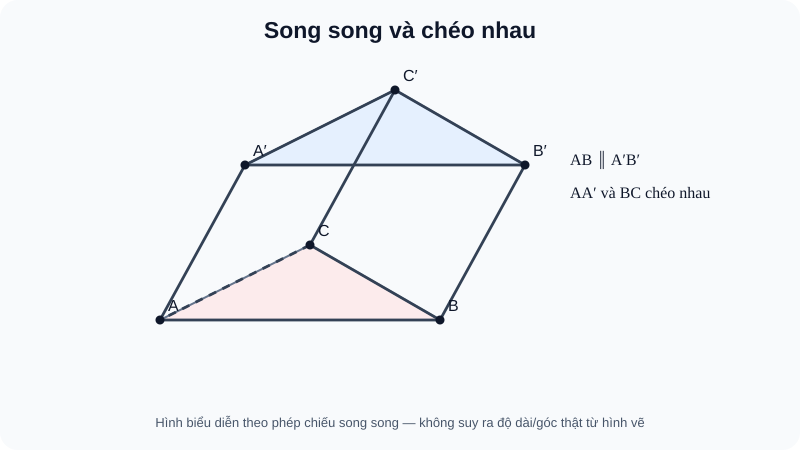

# Bài 11. Hai đường thẳng song song

TOÁN 11 · CHƯƠNG IV

Trong không gian, không cắt nhau chưa đủ để song song: kiểm đồng phẳng, nhận ra đường chéo nhau và dùng đúng dấu hiệu đường trung bình, cùng phương.

<nav class="thpt-r4-lesson-tabs"><a href="../">Chương IV</a><a href="../luyen-tap/">Core và Luyện tập</a><a href="../tu-kiem-tra-chuong/">Tự kiểm tra cuối chương</a></nav>

=== "Khám phá kiến thức"

    Ở Bài 10, một mặt phẳng có thể chứa rất nhiều đường thẳng. Trong **một mặt**, hai đường phân biệt không cắt nhau thì song song. Nhưng ở **không gian**, hai đường có thể nằm trong những mặt khác nhau, không giao nhau mà cũng không song song: đó là **chéo nhau**. Đây là khác biệt cần nắm trước khi áp dụng các kết quả hình học phẳng đã học.

    ### 1.1. Tại sao hai đường không cắt vẫn có thể không song song?

    Trong tứ diện \(S.ABC\), cạnh \(SB\) nối đỉnh S với B, còn cạnh \(AC\) nằm trên đáy. Chúng không có điểm chung; hơn nữa, nếu có một mặt chứa cả hai đường thì mặt ấy phải chứa bốn đỉnh S,A,B,C, trái giả thiết tứ diện. Vì vậy chúng **chéo nhau**. Một đường nét đứt hay hình chiếu làm chúng trông “gần nhau” không thay thế lập luận đồng phẳng.

    **Vận dụng.** Trong tứ diện \(S.ABC\), hai đường \(SC\) và \(AB\) có song song không? Nêu **hai lý do** để phân loại.

    

    ??? question "Đối chiếu"

        **Lời giải:** \(SC\) và \(AB\) không có đỉnh chung nên không cắt. Nếu chúng cùng thuộc một mặt phẳng, mặt đó chứa S,C,A,B, nghĩa là cả bốn đỉnh tứ diện đồng phẳng, vô lý. Vậy hai đường **không đồng phẳng**, nên **chéo nhau**, không phải song song.

    

    ??? tip "Kiểm lỗi"

        **Dấu hiệu:** Em nói “không cắt nên song song” mà chưa kiểm cả hai có cùng mặt không.

        **Tự sửa:** Trong không gian, tách hai câu hỏi **cắt?**, **đồng phẳng?**. Ôn mục 2.1 rồi luyện Core B11-C01, Practice B11-P01 ở <a href="../luyen-tap/">Bài 11 – Luyện tập</a>.

    ### 1.2. Dùng đường trung bình phải chỉ ra tam giác chứa nó

    Nếu \(M,N\) là trung điểm của \(SA,SB\), chúng thuộc cùng tam giác \(SAB\), nên \(MN\parallel AB\) theo định lý đường trung bình. Kết luận ấy có giá trị trong không gian **vì** ta áp dụng một định lý phẳng ở **đúng mặt phẳng** của tam giác. Không thể nhìn hai đoạn “cùng chiều” rồi bỏ qua giả thiết trung điểm.

    **Vận dụng.** Trong tứ diện \(S.ABC\), \(M,N\) là trung điểm của \(SA,SC\). Chứng minh \(MN\parallel AC\) và nêu mặt phẳng dùng để chứng minh.

    

    ??? question "Đối chiếu"

        **Lời giải:** M,N lần lượt là trung điểm của hai cạnh \(SA,SC\) trong tam giác \(SAC\). Vì vậy \(MN\) là đường trung bình tam giác \(SAC\), suy ra \(MN\parallel AC\). Cả hai đường thuộc mặt \((SAC)\), và chúng phân biệt.

    

    ??? tip "Kiểm lỗi"

        **Dấu hiệu:** Em dùng ngay “trung điểm” mà không nêu tam giác hoặc suy \(MN\parallel BC\) sai cặp cạnh.

        **Tự sửa:** Viết rõ tam giác \(SAC\), chọn cạnh thứ ba **AC**. Ôn mục 2.2; luyện Practice B11-P02 ở <a href="../luyen-tap/">Core và Luyện tập</a>.

    ### 1.3. Tính chất cùng phương cần kiểm hai đường phân biệt

    Hai đường phân biệt cùng song song một đường thứ ba có cùng hướng và do đó song song nhau. Nếu thật ra chúng **trùng nhau**, không gọi là hai đường thẳng song song theo định nghĩa “phân biệt, đồng phẳng, không giao”. Vì vậy khi dùng tính chất bắc cầu trong bài chứng minh, phải kiểm trường hợp trùng trước.

    **Vận dụng.** Cho \(a\parallel b\), đường \(c\) cũng song song \(b\). Nếu đề nói thêm \(a\ne c\), kết luận quan hệ \(a,c\) là gì? Nếu bỏ điều kiện \(a\ne c\), còn khả năng nào?

    

    ??? question "Đối chiếu"

        **Lời giải:** Hai đường \(a,c\) cùng phương vì đều song song b. Nếu \(a\ne c\), chúng **song song**. Nếu không biết \(a\ne c\), có thể \(a=c\) (trùng nhau) hoặc \(a\parallel c\). Việc đường nằm trong các mặt phẳng khác nhau không tự biến hai đường cùng phương phân biệt thành chéo nhau: chúng vẫn xác định một mặt phẳng.

    

    ??? tip "Kiểm lỗi"

        **Dấu hiệu:** Em ghi \(a\parallel c\) dù có thể \(a=c\).

        **Tự sửa:** Ôn mục 2.2; luôn thêm câu “nếu hai đường phân biệt”. Thử Practice B11-P04 tại <a href="../luyen-tap/">Bài 11 – Luyện tập</a>.

    ### 1.4. Giao tuyến có thể cùng phương với hai đường song song

    Trong hình chóp \(S.ABCD\) với đáy \(ABCD\) là hình bình hành, \(AB\parallel CD\). Hai mặt \((SAB)\) và \((SCD)\) cùng qua S. Vì mỗi mặt chứa một đường có cùng phương AB,CD, đường qua S song song AB được dựng trong mỗi mặt và phải là **một đường duy nhất**. Đường ấy chính là giao tuyến hai mặt phẳng; không phải AB hay CD, vì AB thuộc đáy còn CD thuộc đáy khác mặt bên.

    **Vận dụng.** Hình chóp \(S.ABCD\) có đáy hình bình hành. Gọi \(d=(SAB)\cap(SCD)\). Chứng minh \(d\parallel AB\) và \(d\parallel CD\), nêu lý do hai mặt phân biệt.

    

    ??? question "Đối chiếu"

        **Lời giải:** \((SAB)\) và \((SCD)\) đều qua S, và phân biệt vì giao với đáy \((ABCD)\) lần lượt theo hai đường **phân biệt song song** AB,CD. Trong mặt \((SAB)\) có duy nhất đường qua S song song AB; trong mặt \((SCD)\) có duy nhất đường qua S song song CD. Do AB∥CD, hai đường qua S cùng hướng là **một đường**, nằm trong cả hai mặt, tức giao tuyến d. Vì d qua S ngoài đáy nên khác AB và CD; suy ra \(d\parallel AB\parallel CD\).

    

    ??? tip "Kiểm lỗi"

        **Dấu hiệu:** Em cho rằng hai mặt giao theo AB dù AB không thuộc mặt \((SCD)\).

        **Tự sửa:** Chỉ rõ S là điểm chung, rồi xây dựng **đường qua S cùng phương** hai cạnh. Ôn mục 2.3, rồi làm câu <a href="../../../../thu-vien/tu-luan-g11-chuong-iv/#thpt-g11-chiv-b11-w03">Written B11-W03 về giao tuyến hai mặt qua điểm chung</a> (đề khác nhưng đúng outcome `G11-B11-INTERSECT_PLANES`). Sau khi tự giải mới mở rubric; có thể quay về <a href="../luyen-tap/">Core và Luyện tập Chương IV</a> để củng cố đường trung bình.

    ### 1.5. Đọc hình lăng trụ: song song khác chéo

    Trong một lăng trụ \(ABC.A'B'C'\), hai mặt đáy song song và những cạnh tương ứng có cùng phương; chẳng hạn \(AB\parallel A'B'\). Nhưng \(AA'\) và \(BC\) có thể **chéo nhau**. Không được lấy sự giao nhau của nét vẽ 2D làm chứng cứ hai đường trong 3D cắt thật.

    **Vận dụng.** Trong lăng trụ tam giác \(ABC.A'B'C'\) không suy biến, phân loại \(AB\) với \(A'B'\), và \(AA'\) với \(BC\).

    

    ??? question "Đối chiếu"

        **Lời giải:** Hai cạnh \(AB\) và \(A'B'\) cùng nằm trên mặt bên \(ABB'A'\), phân biệt, không cắt và cùng phương, nên song song. Hai cạnh \(AA'\) và \(BC\) không cắt; nếu đồng phẳng thì mặt chứa \(BC\) và A sẽ là đáy \((ABC)\) nhưng \(A'\) nằm ngoài đáy, vô lý. Vì vậy chúng chéo nhau.

    

    ??? tip "Kiểm lỗi"

        **Dấu hiệu:** Em nói \(AA'\) với \(BC\) song song chỉ vì không giao trên hình.

        **Tự sửa:** Xác định mặt phẳng chứa từng cặp: \(AB,A'B'\) có chung mặt bên, \(AA',BC\) thì không. Ôn mục 2.1 và hình ở mục 2.3; luyện Core B11-C02 tại <a href="../luyen-tap/">Luyện tập Bài 11</a>.

=== "Kiến thức SGK"

    ### 2.1. Các vị trí tương đối của hai đường thẳng trong không gian

    
<strong>Phân loại:</strong> Hai đường thẳng có thể (1) trùng nhau; (2) cắt nhau tại một điểm; (3) song song nếu **phân biệt, đồng phẳng và không có điểm chung**; hoặc (4) chéo nhau nếu **không đồng phẳng**.

    **Quy trình chọn loại:** Trước tiên xem có đồng phẳng không; nếu đồng phẳng thì xét trùng/cắt/song song, nếu không đồng phẳng thì chéo nhau. Hai đường **không cắt nhau** có thể song song hoặc chéo nhau; không thể kết luận chỉ bằng vẻ ngoài hình vẽ.

    ### 2.2. Tính chất của hai đường thẳng song song

    
<strong>Tính chất:</strong> Qua một điểm M ở ngoài đường thẳng a có **một và chỉ một** đường thẳng đi qua M song song với a. Nếu hai đường phân biệt đều song song một đường thứ ba, chúng song song nhau. Hai đường thẳng phân biệt song song xác định một mặt phẳng duy nhất.

    **Chứng minh bằng tam giác:** Có thể dùng đường trung bình: nếu M,N là trung điểm hai cạnh SA,SB trong mặt \((SAB)\), thì \(MN\parallel AB\). Không cần bất cứ dấu hiệu “nhìn như song song” nào ngoài tính chất phẳng đã biết.

    ### 2.3. Giao tuyến của hai mặt chứa các đường cùng phương

    Khi hai mặt phẳng **phân biệt** cùng chứa một điểm S, và mỗi mặt chứa một đường song song với đường còn lại, giao tuyến (nếu xác định) có thể tìm bằng cách dựng **đường qua S song song với phương chung**. Phải kiểm nó nằm trong cả hai mặt; không nói cứ có một đường trong mỗi mặt là giao tuyến đã song song.

    <figure class="thpt-r4-plot"><figcaption>Đọc hình: \(AB\parallel A'B'\) vì chúng cùng nằm trên mặt bên \(ABB'A'\). \(AA'\) và \(BC\) không đồng phẳng nên chéo nhau; đừng dùng nét chiếu 2D làm điều kiện đồng phẳng.</figcaption></figure>

    **Hướng làm bài:** Để tìm giao tuyến hai mặt trong hình chóp, tìm điểm chung; nếu có hai cạnh song song tương ứng trong hai mặt thì dựng đường qua điểm chung theo phương ấy, kiểm lại hai mặt phân biệt. Đây là kỹ thuật đã hình thành từ các tính chất SGK, không phải phép đo góc trực tiếp trên hình.

=== "Ví dụ"

    ### 3.1. Hai cạnh đối diện tứ diện không đồng phẳng

    

<strong>Đề bài:</strong> Trong tứ diện \(S.ABC\), xét \(SB\) và \(AC\). Chúng song song hay chéo nhau?

    
<strong>Phân tích:</strong> Không cắt là chưa đủ; xét liệu một mặt có chứa cả bốn điểm S,B,A,C không.

    
<strong>Lời giải:</strong> Nếu SB và AC đồng phẳng, mặt chung chứa S,B,A,C, trái tứ diện. Hai đường không có đỉnh chung và không đồng phẳng nên chéo nhau.

    
<strong>Kiểm lại:</strong> Không có định lý phẳng nào cho phép gọi hai cạnh không chung đỉnh của tứ diện song song.

    ### 3.2. Định lý trung bình trong một mặt tam giác

    

<strong>Đề bài:</strong> Với tứ diện \(S.ABC\), M,N lần lượt là trung điểm \(SB,SC\). Chứng minh \(MN\parallel BC\).

    
<strong>Phân tích:</strong> M,N cùng thuộc mặt tam giác SBC, nên dùng đúng định lý đường trung bình của tam giác SBC.

    
<strong>Lời giải:</strong> M,N là trung điểm của SB,SC nên MN là đường trung bình tam giác SBC; do đó \(MN\parallel BC\). Hai đường này thuộc \((SBC)\) và phân biệt.

    
<strong>Kiểm lại:</strong> MN nối hai cạnh từ S và song song cạnh thứ ba BC, không lẫn với AB hay AC.

    ### 3.3. Hình chóp đáy hình bình hành

    

<strong>Đề bài:</strong> Hình chóp \(S.ABCD\) có đáy ABCD là hình bình hành. Phân loại \(AD\) với \(BC\) và \(SB\) với \(CD\).

    
<strong>Phân tích:</strong> AD,BC thuộc cùng mặt đáy; SB chứa điểm S ngoài đáy và CD là cạnh đáy.

    
<strong>Lời giải:</strong> Hai cạnh đối AD và BC của hình bình hành phân biệt song song. SB và CD không cắt (B không thuộc CD), và nếu đồng phẳng thì mặt chứa CD và B là đáy (ABCD), phải chứa S, vô lý. Vì vậy SB với CD **chéo nhau**.

    
<strong>Kiểm lại:</strong> Mỗi cặp được phân loại bằng đồng phẳng/không đồng phẳng trước khi xét giao.

    ### 3.4. Khi hai đường cùng phương nhưng có thể trùng

    

<strong>Đề bài:</strong> Cho \(a\parallel b\) và \(c\parallel b\). Vì sao cần thêm \(a\ne c\) nếu muốn nói \(a\parallel c\)?

    
<strong>Phân tích:</strong> Theo tính chất cùng phương, a và c hoặc cùng một đường hoặc là hai đường khác nhau song song.

    
<strong>Lời giải:</strong> Nếu a=c, chúng trùng nhau nên không gọi song song theo định nghĩa hai đường phân biệt. Nếu a khác c, chúng cùng phương, đồng phẳng và không giao nên song song.

    
<strong>Kiểm lại:</strong> Thử trường hợp c=a là phản ví dụ cho kết luận “luôn \(a\parallel c\)” không thêm điều kiện.

    ### 3.5. Xác định giao tuyến qua một phương song song

    

<strong>Đề bài:</strong> Hình chóp \(S.ABCD\), đáy ABCD hình bình hành. Tìm giao tuyến \((SAD)\cap(SBC)\).

    
<strong>Phân tích:</strong> Hai mặt có S chung. Đáy có AD∥BC, nên xây dựng đường qua S có cùng phương hai cạnh.

    
<strong>Lời giải:</strong> Trong \((SAD)\) có đường qua S song song AD; trong \((SBC)\) có đường qua S song song BC. Vì AD∥BC, hai đường qua S trùng nhau, cùng thuộc cả hai mặt. Hai mặt phân biệt nên giao tuyến là **đường qua S song song AD và BC**.

    
<strong>Kiểm lại:</strong> Đường qua S không nằm đáy, khác AD/BC; việc dùng AB∥CD ở đây sẽ sai cặp mặt.

=== "Lỗi thường gặp"

    Nếu sai Vận dụng, mở Kiểm lỗi ngay dưới Đối chiếu. Những lỗi tổng quát thường lặp lại:

    

    ??? tip "4.1. Không cắt nghĩa là song song"

        **Dấu hiệu:** Đường SB và AC trong tứ diện không giao nhau nên em gọi là song song.

        **Vì sao sai:** Hai đường có thể chéo nếu không đồng phẳng.

        **Tự sửa:** Ôn mục 2.1 và Ví dụ 3.1; luyện Core B11-C01, Practice B11-P01 tại <a href="../luyen-tap/">Luyện tập Bài 11</a>.

    

    ??? tip "4.2. Dùng đường trung bình ngoài tam giác"

        **Dấu hiệu:** Em nối hai trung điểm nhưng không chỉ ra hai cạnh thuộc **cùng một tam giác**.

        **Vì sao sai:** Định lý đường trung bình được chứng minh cho một tam giác trong mặt phẳng.

        **Tự sửa:** Đánh dấu tam giác SAB/SBC/SAC phù hợp, dùng đúng cạnh thứ ba; ôn mục 2.2 và luyện Practice B11-P02 tại <a href="../luyen-tap/">Core và Luyện tập</a>.

    

    ??? tip "4.3. Quên phân biệt hai đường cùng phương"

        **Dấu hiệu:** Em viết a∥c dù có thể a=c.

        **Vì sao sai:** Hai đường trùng không phải hai đường song song **phân biệt**.

        **Tự sửa:** Ghi rõ \(a\ne c\), thử phản ví dụ c=a, ôn mục 2.2; luyện Practice B11-P04.

    

    ??? tip "4.4. Chọn sai phương giao tuyến của hai mặt"

        **Dấu hiệu:** Em lấy AB hoặc CD làm giao tuyến của hai mặt bên đi qua S.

        **Vì sao sai:** Giao tuyến phải thuộc cả hai mặt và chứa S; còn AB/CD nằm trên đáy.

        **Tự sửa:** Qua S dựng đường cùng phương những cạnh đáy **thuộc từng mặt cần giao**; ôn mục 2.3 và Ví dụ 3.5.

    **Học tiếp:** <a href="../luyen-tap/">Core và Luyện tập</a> · <a href="../tu-kiem-tra-chuong/">Tự kiểm tra cuối chương</a> · <a href="../../../../thu-vien/tu-luan-g11-chuong-iv/">Tự luận Chương IV</a>.

    
Nguồn tham khảo: SGK Toán 11 – Kết nối tri thức với cuộc sống, tập một, Bài 11 (trang in 78–83).

