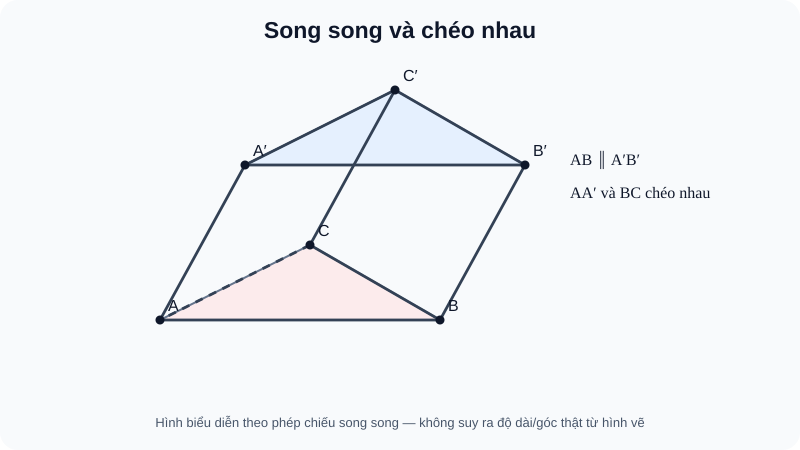

# Bài 11. Hai đường thẳng song song

TOÁN 11 · CHƯƠNG IV · SGK KNTT

Vì sao cần học → kiến thức/điều kiện → ví dụ → Tự thử trước Core → hình đọc đúng → luyện tập và khắc phục. Tự kiểm tra tự đối chiếu không ghi Mastery.
<nav class="thpt-r4-lesson-tabs"><a href="../">Chương IV</a><a href="../luyen-tap/">Core & Luyện tập</a><a href="../tu-kiem-tra-chuong/">Tự kiểm tra · tự đối chiếu</a></nav>

=== "Khám phá kiến thức"

    ### Cùng tìm hiểu

    Trong mặt phẳng, hai đường thẳng phân biệt không cắt nhau sẽ song song. Trong không gian, còn khả năng **chéo nhau**. Hai cạnh ở hai mặt khác nhau của một chiếc hộp có thể không cắt và không đồng phẳng. Muốn kết luận song song phải chứng minh cùng mặt phẳng hoặc dùng dấu hiệu hợp lệ; qua đó hiểu vì sao định lý đường trung bình của tam giác chỉ dùng trong mặt của tam giác.

    ### Ví dụ trực quan

    Một mặt bàn song song với mặt sàn tạo thành hai mặt phẳng không cắt nhau. Trong hình học, phải chứng minh quan hệ ấy từ các đường thẳng có đủ điều kiện.

    **Quan sát bằng số liệu:** Chỉ tìm một đường thẳng của mặt bàn song song sàn chưa đủ để kết luận cả hai mặt phẳng song song; cần sử dụng định lí với các giả thiết đường cắt nhau phù hợp.

    ### Thuật ngữ và kiến thức, kỹ năng

    **Thuật ngữ:** hai mặt phẳng song song, đường song song mặt phẳng, mặt phẳng cắt nhau.

    **Sau bài học, em cần:** chỉ đúng các đường chứng minh và kiểm đầy đủ điều kiện của định lí song song.

=== "Kiến thức SGK"

    

    Hai đường thẳng trong không gian có thể **trùng, cắt nhau, song song (phân biệt và cùng nằm một mặt phẳng), chéo nhau (không đồng phẳng)**. Không giao nhau **chưa đủ** để nói song song: hai đường chéo nhau cũng không cắt. Nếu $a\parallel b$ và $b\parallel c$ (từng cặp là đường thẳng phân biệt), $a,c$ có cùng phương; nếu $a\ne c$ thì $a\parallel c$, còn nếu $a=c$ là trùng nhau. Không gọi hai đường thẳng trùng nhau là song song khi định nghĩa cần phân biệt.

    Qua điểm $M$ ngoài đường $a$ có duy nhất một đường qua $M$ song song với $a$. Nếu $M,N$ lần lượt là trung điểm của hai cạnh $SA,SB$ của tam giác $SAB$ thì $MN\parallel AB$ (định lý đường trung bình trong **mặt phẳng** $(SAB)$). Trong một hình bình hành $ABCD$, $AB\parallel CD$ và $AD\parallel BC$.

    **Giao tuyến cùng phương.** Nếu hai mặt phẳng phân biệt $(P),(Q)$ cắt theo $d$, đồng thời mỗi mặt phẳng chứa một đường thẳng song song với cùng hướng $a$ và hai đường đó khác $d$, thì giao tuyến $d$ có hướng song song $a$. Không suy giao tuyến chỉ từ một đường không kiểm tra mặt phẳng.

    ### Đọc hình và đối chiếu khái niệm

    <figure class="thpt-r4-plot thpt-r4-probability-figure"><figcaption>Lăng trụ tam giác ABC.A phẩy B phẩy C phẩy. AB song song A phẩy B phẩy; AA phẩy và BC chéo nhau dù hình biểu diễn có thể gây nhầm.</figcaption></figure>

    kiểm vị trí các cạnh để phân biệt hai đường cùng mặt song song và hai đường chéo nhau khác mặt; không dựa riêng vào hình phối cảnh.

    ### Vận dụng — tự thử rồi mở đối chiếu

    Hai đường SA và BC trong tứ diện S.ABC có cắt nhau không? Có đồng phẳng không?

    

Em đã tự thử? Mở đối chiếu

    Không cắt, không đồng phẳng nên chéo nhau, không song song. Trở về D1 B11 và THPT-G11-CHIV-B11-C01.

    

=== "Ví dụ"

    **EX-G11-B11-EX01: Song song và chéo nhau.** Trong tứ diện $S.ABC$, hai đường $SA$ và $BC$ là **chéo nhau**: nếu đồng phẳng, mặt đó chứa $S,A,B,C$, trái tứ diện; do đó dù không cắt cũng không được gọi là song song.

    **EX-G11-B11-EX02: Định lý trung bình tam giác.** Trong hình chóp $S.ABC$, $M,N$ là trung điểm $SA,SB$ thì $MN\parallel AB$ vì cùng thuộc mặt $(SAB)$ và là đường trung bình tam giác $SAB$.

    **EX-G11-B11-EX03: Hình bình hành không gian.** Trong hình chóp $S.ABCD$ với đáy $ABCD$ hình bình hành, $AB\parallel CD$. Tuy nhiên $SA$ và $CD$ nhìn trên hình có thể không cắt, nhưng hai đường đó **chéo nhau**, không phải song song.

    **EX-G11-B11-EX04: Cùng phương, cần phân biệt.** Nếu $a\parallel b$ và $c\parallel b$ thì $a,c$ cùng hướng; nếu $a\ne c$ là song song, nếu $a=c$ là trùng nhau. Kết luận “$a\parallel c$” không đúng khi $a=c$ theo định nghĩa đường song song phân biệt.

    ### Lý do chọn phương pháp và giới hạn

    - `EX-G11-B11-EX01`: Không cắt nhưng không đồng phẳng dẫn đến chéo; kiểm rõ điều kiện áp dụng trước kết luận.
    - `EX-G11-B11-EX02`: Cần cùng mặt tam giác SAB trước khi áp dụng đường trung bình; kiểm rõ điều kiện áp dụng trước kết luận.
    - `EX-G11-B11-EX03`: Nhìn hình không đủ để kết luận song song; kiểm đồng phẳng; kiểm rõ điều kiện áp dụng trước kết luận.
    - `EX-G11-B11-EX04`: Kiểm trường hợp hai đường trùng nhau trước khi gọi song song; kiểm rõ điều kiện áp dụng trước kết luận.

=== "Lỗi thường gặp"

    

Coi hai đường không cắt là song song.
<ol><li><strong>Nhận diện:</strong> Coi hai đường không cắt là song song.</li><li><strong>Nhắc đúng điều kiện:</strong> kiểm tra giả thiết về quan hệ đường–mặt và điểm đang xét.</li><li><strong>Sửa sai:</strong> Muốn song song phải kiểm tra đồng phẳng và phân biệt.</li><li><strong>Tự thử:</strong> Hai cạnh đối SA và BC trong tứ diện: có đồng phẳng không? <strong>Tự đối chiếu:</strong> Không; đó là hai cạnh chéo nhau.</li><li><strong>Quay lại câu gốc:</strong> giải lại <code>THPT-G11-CHIV-B11-C01</code> và tự nêu lí do mỗi giả thiết cần thiết.</li></ol>
<a href="../luyen-tap/?item=THPT-G11-CHIV-B11-C01">Quay lại THPT-G11-CHIV-B11-C01 để tự làm</a>

    

Quên xác định mặt phẳng chứa hai đường.
<ol><li><strong>Nhận diện:</strong> Quên xác định mặt phẳng chứa hai đường.</li><li><strong>Nhắc đúng điều kiện:</strong> kiểm tra giả thiết về quan hệ đường–mặt và điểm đang xét.</li><li><strong>Sửa sai:</strong> Dùng tam giác chung hoặc đáy hình bình hành.</li><li><strong>Tự thử:</strong> M,N trung điểm SA,SB: đường MN thuộc mặt nào trước khi kết luận song song? <strong>Tự đối chiếu:</strong> Cùng mặt (SAB); dùng đường trung bình tam giác SAB.</li><li><strong>Quay lại câu gốc:</strong> giải lại <code>THPT-G11-CHIV-B11-P02</code> và tự nêu lí do mỗi giả thiết cần thiết.</li></ol>
<a href="../luyen-tap/?item=THPT-G11-CHIV-B11-P02">Quay lại THPT-G11-CHIV-B11-P02 để tự làm</a>

    ### Học tiếp

    [Core và Luyện tập Bài 11](luyen-tap.md) · [Tự luận Chương IV](../../../thu-vien/tu-luan-g11-chuong-iv.md) · [Tự kiểm tra cuối chương](tu-kiem-tra-chuong.md)
