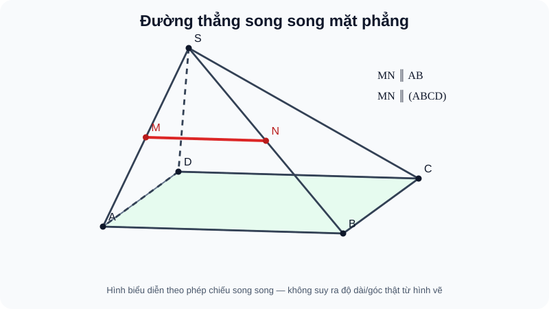

# Bài 12. Đường thẳng và mặt phẳng song song

TOÁN 11 · CHƯƠNG IV

Một đường có thể nằm trong, cắt hoặc hoàn toàn không gặp mặt phẳng; chứng minh song song bằng đúng hai điều kiện và kiểm giao tuyến của mặt phụ.

<nav class="thpt-r4-lesson-tabs"><a href="../">Chương IV</a><a href="../luyen-tap/">Core và Luyện tập</a><a href="../tu-kiem-tra-chuong/">Tự kiểm tra cuối chương</a></nav>

=== "Khám phá kiến thức"

    Hãy hình dung một thanh thẳng và mặt bàn: thanh có thể **nằm trên mặt bàn**, **xuyên qua mặt bàn** ở một điểm, hoặc nằm **hoàn toàn phía trên và không chạm bàn**. Ba tình huống có bản chất khác nhau. Ở Bài 11, biết hai đường cùng phương; ở Bài 12, ta phải kiểm thêm xem đường đang xét **có nằm trong mặt hay không**.

    ### 1.1. Khi có điểm chung, chưa chắc đường nằm trong mặt

    Hai điểm phân biệt của một đường thuộc \((P)\) thì cả đường nằm trong \((P)\). Nhưng chỉ **một điểm chung** có thể là trường hợp đường cắt mặt. Nếu một đường song song với mặt theo định nghĩa SGK, nó có **không điểm chung**, chứ không phải vô số điểm chung.

    **Vận dụng.** Trong tứ diện \(S.ABC\), phân loại \(BC\) và \(SA\) đối với mặt \((ABC)\). Vì sao không gọi cả hai đường song song mặt đáy?

    

    ??? question "Đối chiếu"

        **Lời giải:** \(BC\subset(ABC)\) vì B,C đều thuộc đáy. Đường \(SA\) có đúng một điểm chung A với \((ABC)\) vì S ngoài đáy nên **cắt** tại A. Cả hai đều có điểm chung với đáy nên **không song song** với đáy.

    

    ??? tip "Kiểm lỗi"

        **Dấu hiệu:** Em gọi đường nằm trong mặt là đường song song mặt.

        **Tự sửa:** Đếm **số điểm chung**: vô số → nằm trong; một → cắt; không → song song. Ôn mục 2.1, luyện Core B12-C01 và Practice B12-P02 tại [Bài 12 – Luyện tập](../luyen-tap/).

    ### 1.2. Song song một đường trong mặt chưa đủ để song song cả mặt

    Nếu \(a\parallel b\) và \(b\subset(P)\), thì \(a\) có cùng phương với một đường trong P. Tuy nhiên a **vẫn có thể nằm trong P**. Chỉ khi thêm \(a\not\subset(P)\), ta mới kết luận \(a\parallel(P)\). Đây là bước kiểm quan trọng nhất của dấu hiệu.

    **Vận dụng.** Trong một hình bình hành \(ABCD\), hai cạnh đối \(AD\parallel BC\). Có được suy \(AD\parallel(ABCD)\) vì \(BC\subset(ABCD)\) không?

    

    ??? question "Đối chiếu"

        **Lời giải:** **Không.** AD chính nó nằm trong \((ABCD)\); mọi điểm của AD thuộc mặt đáy. Điều kiện còn thiếu trong dấu hiệu là \(AD\not\subset(ABCD)\). Có \(AD\parallel BC\) nhưng **không** có \(AD\parallel(ABCD)\) theo định nghĩa không giao.

    

    ??? tip "Kiểm lỗi"

        **Dấu hiệu:** Em chỉ nêu một cặp đường song song rồi kết luận ngay song song mặt.

        **Tự sửa:** Viết cùng lúc **đường b trong mặt, a∥b, a không nằm trong mặt**. Ôn mục 2.2 và luyện Core B12-C02, Practice B12-P01 tại [Core và Luyện tập](../luyen-tap/).

    ### 1.3. Đường trung bình tạo được chứng minh đường song song mặt

    Trong tứ diện \(S.ABC\), nếu \(M,N\) lần lượt là trung điểm \(SB,SC\), thì trong tam giác \(SBC\), \(MN\parallel BC\). Vì BC nằm trong đáy và MN đi qua điểm M bên trong SB **ở ngoài mặt đáy**, MN không nằm trong đáy. Cả hai điều kiện đã đủ để kết luận.

    **Vận dụng.** Với M,N là trung điểm SB,SC của tứ diện \(S.ABC\), chứng minh \(MN\parallel(ABC)\) theo hai bước cụ thể.

    

    ??? question "Đối chiếu"

        **Lời giải:** Trong tam giác SBC, \(MN\parallel BC\) và \(BC\subset(ABC)\). Đồng thời M thuộc cạnh SB nhưng khác B,S, do S ngoài đáy nên \(M\notin(ABC)\); vì M∈MN, suy ra \(MN\not\subset(ABC)\). Theo dấu hiệu, \(MN\parallel(ABC)\).

    

    ??? tip "Kiểm lỗi"

        **Dấu hiệu:** Em chỉ viết MN∥BC, BC⊂đáy rồi ngừng.

        **Tự sửa:** Chỉ rõ **ít nhất một điểm của MN ngoài đáy**. Ôn mục 2.2 và giải Practice B12-P01 ở [Luyện tập Bài 12](../luyen-tap/).

    ### 1.4. Mặt phẳng phụ biến bài toán đường–mặt thành bài toán hai đường

    Giả sử \(d\parallel(P)\) và mặt \((Q)\) chứa d cắt \((P)\) theo đường e. Khi ấy \(d\) và e cùng thuộc \((Q)\), nhưng không có điểm chung vì d không gặp P, nên \(d\parallel e\). Vì vậy khi dựng thiết diện chứa một đường song song mặt, giao tuyến có thể tìm bằng **đường cùng phương**.

    **Vận dụng.** Trong tứ diện \(S.ABC\), M,N là trung điểm SA,SC. Gọi \((Q)=(SAC)\) và \((P)=(ABC)\). Tìm \(e=(Q)\cap(P)\), rồi xác định quan hệ MN với e.

    

    ??? question "Đối chiếu"

        **Lời giải:** Hai mặt \((SAC),(ABC)\) có hai điểm chung A,C nên \(e=AC\). Trong tam giác SAC, MN là đường trung bình nên \(MN\parallel AC=e\). Đồng thời MN không nằm trong đáy nên \(MN\parallel(ABC)\), đúng định lý giao tuyến.

    

    ??? tip "Kiểm lỗi"

        **Dấu hiệu:** Em nêu e=SA do SA vẽ gần đường MN, hoặc quên kiểm mặt phụ Q có chứa MN.

        **Tự sửa:** Trước hết tìm **hai điểm chung của Q và P**, rồi mới dùng định lý song song. Ôn mục 2.3 và luyện Practice B12-P03 trong [Core và Luyện tập](../luyen-tap/).

    ### 1.5. Ứng dụng mặt cắt hình chóp: chọn đúng mặt chứa đoạn

    Nếu một đoạn nằm trong một mặt bên của hình chóp và song song một đường đáy, ta có thể chứng minh đoạn song song với **toàn bộ mặt đáy**, miễn đoạn không nằm trong mặt đó. Khi xét hai mặt cắt, việc chỉ ra mặt phụ và các đường giao giúp tránh suy luận theo cảm giác từ hình chiếu.

    **Vận dụng.** Trong hình chóp \(S.ABCD\) có đáy hình bình hành, U,V lần lượt là trung điểm \(SC,SD\). Chứng minh \(UV\parallel(ABCD)\). Nêu cả hai điều kiện.

    

    ??? question "Đối chiếu"

        **Lời giải:** Trong tam giác \(SCD\), UV là đường trung bình nên \(UV\parallel CD\), mà \(CD\subset(ABCD)\). U ở trong cạnh SC, khác C,S, nên U nằm ngoài đáy; UV vì thế không nằm trong \((ABCD)\). Vậy \(UV\parallel(ABCD)\).

    

    ??? tip "Kiểm lỗi"

        **Dấu hiệu:** Em nói UV nằm trong mặt đáy vì UV cùng phương CD.

        **Tự sửa:** Phân biệt **cùng phương với một đường trong đáy** và **thuộc đáy**. Ôn mục 2.2, hình ở mục 2.3 và làm Practice B12-P04 ở [Bài 12 – Luyện tập](../luyen-tap/).

=== "Kiến thức SGK"

    ### 2.1. Ba vị trí của một đường thẳng đối với một mặt phẳng

    
<strong>Phân loại:</strong> Một đường thẳng a so với mặt \((P)\) có thể: (1) \(a\subset(P)\), khi đó có vô số điểm chung; (2) \(a\cap(P)=\{M\}\), khi đó cắt tại một điểm; (3) \(a\parallel(P)\), khi đó **không có điểm chung**.

    Không dùng kí hiệu \(a\parallel(P)\) cho trường hợp \(a\subset(P)\). Các quan hệ này là **loại trừ nhau**.

    ### 2.2. Điều kiện đủ để đường thẳng song song mặt phẳng

    
<strong>Dấu hiệu:</strong> Cho \(b\subset(P)\), \(a\parallel b\), và \(a\not\subset(P)\). Khi đó
    \[
    a\parallel(P).
    \]
    

    **Giải thích:** Nếu a có điểm chung M với P, qua M trong mặt P có một đường cùng phương b; do a song song b thì a chính là đường cùng phương ấy, vì vậy a nằm P, trái giả thiết. Nên a không có điểm chung P. **Không bỏ điều kiện a không thuộc P**.

    <figure class="thpt-r4-plot"><figcaption>Đọc hình: \(MN\parallel AB\) do đường trung bình của tam giác SAB; \(AB\subset(ABCD)\). M nằm trên SA ngoài đáy nên **MN không thuộc đáy**; kết hợp đủ ba điều kiện để kết luận MN song song mặt đáy.</figcaption></figure>

    ### 2.3. Tính chất giao tuyến khi mặt phụ chứa đường song song

    
<strong>Tính chất:</strong> Nếu \(d\parallel(P)\), \(d\subset(Q)\), \((P)\cap(Q)=e\) với hai mặt phân biệt và e là giao tuyến, thì **\(d\parallel e\)**.

    **Lý do:** d và e cùng thuộc Q; vì e nằm P mà d không cắt P, hai đường phân biệt không giao, nên song song theo tính chất **trong mặt phẳng Q**. Muốn sử dụng phải biết có giao tuyến e, không tự vẽ một đường rồi gọi e.

    **Hướng dựng hình:** Khi đã có một điểm chung của mặt cắt phụ với đáy, dùng một đường song song đã biết để xác định phương của giao tuyến. Kiểm các điểm và đường thật sự thuộc các mặt.

=== "Ví dụ"

    ### 3.1. Một đường cắt mặt, một đường thuộc mặt

    

<strong>Đề bài:</strong> Cho tứ diện \(S.ABC\). Phân loại AC và SC so với mặt \((ABC)\).

    
<strong>Phân tích:</strong> AC có cả hai đầu A,C thuộc đáy; còn SC chỉ có C ở đáy vì S ngoài đáy.

    
<strong>Lời giải:</strong> \(AC\subset(ABC)\). Đường \(SC\) cắt \((ABC)\) tại C và không nằm trong đáy.

    
<strong>Kiểm lại:</strong> Hai đường đều có điểm chung với đáy nên không thuộc trường hợp song song mặt.

    ### 3.2. Chứng minh đường trung bình song song mặt đáy

    

<strong>Đề bài:</strong> Trong tứ diện \(S.ABC\), P,Q lần lượt là trung điểm SA,SB. Chứng minh PQ∥(ABC).

    
<strong>Phân tích:</strong> Dùng đường trung bình tam giác SAB, rồi kiểm P nằm ngoài đáy.

    
<strong>Lời giải:</strong> PQ∥AB theo đường trung bình, AB⊂(ABC), P ở trong SA với S ngoài đáy nên P∉(ABC). Vì PQ không nằm trong đáy, PQ∥(ABC).

    
<strong>Kiểm lại:</strong> Nếu bỏ điều kiện P ngoài đáy, lập luận sẽ không phân biệt được PQ thuộc mặt hay song song mặt.

    ### 3.3. Khi đường song song một đường trong mặt nhưng chính nó thuộc mặt

    

<strong>Đề bài:</strong> Hình bình hành ABCD có \(AD\parallel BC\). Có được kết luận \(BC\parallel(ABCD)\)?

    
<strong>Phân tích:</strong> Kiểm trực tiếp điều kiện giao mặt trước khi áp dụng dấu hiệu.

    
<strong>Lời giải:</strong> Không. BC là cạnh đáy nên \(BC\subset(ABCD)\) và có vô số điểm chung. \(BC\parallel AD\) chỉ chứng minh cùng phương trong đáy.

    
<strong>Kiểm lại:</strong> Điều kiện “đường không thuộc mặt” trong dấu hiệu đã bị vi phạm.

    ### 3.4. Giao tuyến có phương của đường song song mặt

    

<strong>Đề bài:</strong> Trong tứ diện \(S.ABC\), M,N là trung điểm SB,SC. Biết MN∥(ABC), xác định giao tuyến \((SBC)\cap(ABC)\) và quan hệ với MN.

    
<strong>Phân tích:</strong> Hai mặt cùng chứa B,C nên giao là BC; đường trung bình tam giác SBC tạo quan hệ song song.

    
<strong>Lời giải:</strong> Giao tuyến là BC; vì MN là đường trung bình tam giác SBC nên \(MN\parallel BC\), phù hợp tính chất giao tuyến.

    
<strong>Kiểm lại:</strong> BC có hai điểm chung B,C với cả hai mặt; MN không có điểm nào thuộc đáy.

    ### 3.5. Mặt bên và đoạn song song mặt đáy trong hình chóp

    

<strong>Đề bài:</strong> Hình chóp \(S.ABCD\) có đáy là hình bình hành, U,V là trung điểm SB,SC. Đường UV có song song với \((ABCD)\) không?

    
<strong>Phân tích:</strong> Xét tam giác SBC, sau đó đối chiếu vị trí UV với mặt đáy.

    
<strong>Lời giải:</strong> \(UV\parallel BC\) là đường trung bình trong tam giác SBC; BC⊂(ABCD). U trên SB và khác B,S nên U ngoài đáy, UV không thuộc đáy. Vậy \(UV\parallel(ABCD)\).

    
<strong>Kiểm lại:</strong> Mặt phẳng qua U,V và song song đáy cần thêm điều kiện khác; ở đây mới chứng minh **đường UV song song mặt**.

=== "Lỗi thường gặp"

    

    ??? tip "4.1. Nhầm đường nằm trong mặt với song song mặt"

        **Dấu hiệu:** AD nằm trong đáy nhưng em gọi AD song song đáy.

        **Vì sao sai:** Song song mặt theo SGK đòi **không có điểm chung**, còn đường nằm trong mặt có vô số điểm chung.

        **Tự sửa:** Ôn mục 2.1 và Ví dụ 3.3; luyện Core B12-C01 và Practice B12-P02 tại [Luyện tập Bài 12](../luyen-tap/).

    

    ??? tip "4.2. Thiếu điều kiện đường ngoài mặt"

        **Dấu hiệu:** Em nêu a∥b, b⊂(P) rồi kết luận a∥(P) mà không xét a nằm trong P không.

        **Vì sao sai:** Nếu a cũng nằm trong P, kết luận sai.

        **Tự sửa:** Ôn mục 2.2, nêu điểm ngoài mặt, rồi luyện Core B12-C02, Practice B12-P01 ở [Core và Luyện tập](../luyen-tap/).

    

    ??? tip "4.3. Dựng giao tuyến mà không chứng minh điểm thuộc cả hai mặt"

        **Dấu hiệu:** Em vẽ e cạnh MN rồi gọi là giao tuyến với đáy.

        **Vì sao sai:** Giao tuyến phải chứa các điểm thật sự cùng thuộc hai mặt.

        **Tự sửa:** Tìm B,C chung của mặt SBC và đáy, xác định BC rồi xét MN∥BC. Ôn mục 2.3/ Ví dụ 3.4 và làm Practice B12-P03.

    

    ??? tip "4.4. Suy đường song song mặt là mặt phẳng song song"

        **Dấu hiệu:** Chứng minh UV∥đáy rồi cho luôn mặt chứa UV song song đáy.

        **Vì sao sai:** Một mặt có thể chứa một đường song song với đáy nhưng vẫn cắt đáy theo phương khác.

        **Tự sửa:** Bài 13 sẽ có dấu hiệu **hai đường cắt nhau**; hiện hãy ghi đúng kết luận về đường UV. Ôn Ví dụ 3.5, luyện Practice B12-P04.

    **Học tiếp:** [Core và Luyện tập](../luyen-tap/) · [Tự kiểm tra cuối chương](../tu-kiem-tra-chuong/) · [Tự luận Chương IV](../../../../thu-vien/tu-luan-g11-chuong-iv/).

    
Nguồn tham khảo: SGK Toán 11 – Kết nối tri thức với cuộc sống, tập một, Bài 12 (trang in 84–87).

