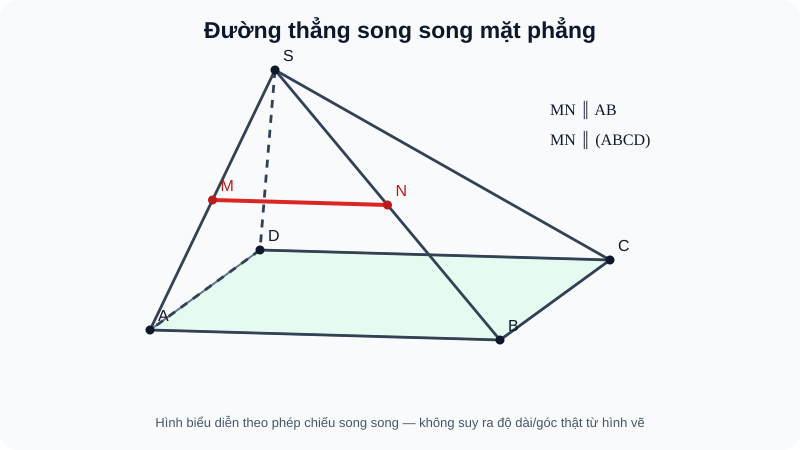

# Bài 12. Đường thẳng và mặt phẳng song song

TOÁN 11 · CHƯƠNG IV · SGK KNTT

Vì sao cần học → kiến thức/điều kiện → ví dụ → Tự thử trước Core → hình đọc đúng → luyện tập và khắc phục. Tự kiểm tra tự đối chiếu không ghi Mastery.
<nav class="thpt-r4-lesson-tabs"><a href="../">Chương IV</a><a href="../luyen-tap/">Core & Luyện tập</a><a href="../tu-kiem-tra-chuong/">Tự kiểm tra · tự đối chiếu</a></nav>

=== "Khám phá kiến thức"

    ### Cùng tìm hiểu

    Hãy nhìn một bút chì đặt phía trên mặt bàn: nó có thể nằm trên bàn, chọc qua bàn hoặc nằm tách biệt và không cắt mặt bàn. Ba trường hợp là ba quan hệ khác nhau; đừng nhầm đường song song một đường trong mặt với đường song song mặt. Cần xác nhận đường xét **không nằm trong mặt**, rồi mới dùng dấu hiệu có đường trong mặt song song nó. Cạnh trung bình MN của tam giác bên trên đáy minh họa điều kiện ấy.

    ### Ví dụ trực quan

    Cắt một hình khối bằng một mặt phẳng giúp thấy phần giao tuyến vốn khó hình dung qua hình vẽ phẳng. Mỗi đoạn của thiết diện phải nằm trên một mặt của khối.

    **Quan sát bằng số liệu:** Khi mặt phẳng cắt ba cạnh của một tứ diện tại ba điểm, không phải cứ nối tùy ý là thiết diện: từng đoạn nối phải thuộc đúng mặt tam giác chứa hai giao điểm.

    ### Thuật ngữ và kiến thức, kỹ năng

    **Thuật ngữ:** giao tuyến, mặt phẳng cắt khối, thiết diện, điểm chung.

    **Sau bài học, em cần:** xác định cặp mặt phẳng có điểm chung, dựng đúng thứ tự các giao điểm và kiểm nằm trong mặt.

=== "Kiến thức SGK"

    

    Có đúng ba vị trí của đường $d$ so với mặt $(P)$: (i) $d\subset(P)$; (ii) $d$ cắt $(P)$ tại một điểm; (iii) $d\parallel(P)$, nghĩa là **không có điểm chung**. Do đó ký hiệu $d\parallel(P)$ không bao hàm trường hợp $d\subset(P)$.

    **Dấu hiệu.** Cho $b\subset(P)$ và $a\parallel b$. Nếu **thêm $a\not\subset(P)$** thì $a\parallel(P)$. Nếu bỏ điều kiện cuối, $a$ có thể nằm ngay trong $(P)$ (ví dụ hai cạnh đối của hình bình hành cùng nằm trong mặt phẳng). Với $a\parallel(P)$ và $(Q)$ chứa $a$, nếu $(Q)\cap(P)=b$ thì $a\parallel b$; phải có giả thiết giao tuyến tồn tại.

    **Dựng trong hình chóp.** Trong $S.ABCD$ có $ABCD$ là hình bình hành, lấy $M,N$ là trung điểm $SA,SB$. Trong tam giác $SAB$, $MN\parallel AB$, $AB\subset(ABCD)$, $MN$ không nằm trong mặt đáy nên $MN\parallel(ABCD)$. Không nói $MN\subset(ABCD)$ hoặc $MN\cap(ABCD)$ là một điểm.

    ### Đọc hình và đối chiếu khái niệm

    <figure class="thpt-r4-plot thpt-r4-probability-figure"><figcaption>Hình chóp S.ABCD với đáy ABCD là hình bình hành; M N là trung điểm SA SB; MN màu đỏ nằm phía trên mặt đáy tô xanh và song song AB trong đáy.</figcaption></figure>

    xác định đường nằm ở mặt nào và đường nào không nằm trong đáy trước khi gọi song song mặt.

    ### Vận dụng — tự thử rồi mở đối chiếu

    Trong hình bình hành ABCD, AB∥CD và CD nằm trong đáy. AB có song song mặt đáy không?

    

Em đã tự thử? Mở đối chiếu

    Không; AB chính nó nằm trong mặt đáy. Trở lại D1 B12 và THPT-G11-CHIV-B12-C01.

    

=== "Ví dụ"

    **EX-G11-B12-EX01: Ba vị trí đường–mặt.** Trong tứ diện $S.ABC$, $AB\subset(ABC)$, $SA$ cắt $(ABC)$ tại $A$. Chọn $M,N$ là trung điểm $SA,SB$ thì $MN\parallel(ABC)$.

    **EX-G11-B12-EX02: Điều kiện không thuộc mặt.** Trong hình bình hành $ABCD$, $AB\parallel CD$ và $CD\subset(ABCD)$, nhưng $AB\subset(ABCD)$, nên KHÔNG suy được $AB\parallel(ABCD)$.

    **EX-G11-B12-EX03: Giao tuyến chứa đường song song.** Nếu $d\parallel(P)$, $d\subset(Q)$ và $(P)\cap(Q)=e$, thì $d\parallel e$. Chẳng hạn trong chóp $S.ABC$ với $M,N$ là trung điểm $SA,SB$, mặt $(SAB)$ chứa $MN$ và giao với mặt đáy $(ABC)$ theo $AB$; do $MN\parallel(ABC)$, giao tuyến $AB\parallel MN$.

    **EX-G11-B12-EX04: Thiết diện hình chóp.** Hình chóp $S.ABCD$ đáy hình bình hành. $M\in SA,N\in SB$ có $SM/SA=SN/SB=1/2$. Đường $MN\parallel AB\subset(ABCD)$; do $MN$ nằm trên mặt bên phía trên đáy, $MN\parallel(ABCD)$.

    ### Lý do chọn phương pháp và giới hạn

    - `EX-G11-B12-EX01`: Phân loại thuộc mặt/cắt mặt/song song mặt trước khi chọn định lý; kiểm rõ điều kiện áp dụng trước kết luận.
    - `EX-G11-B12-EX02`: Bổ sung điều kiện đường không nằm trong mặt; kiểm rõ điều kiện áp dụng trước kết luận.
    - `EX-G11-B12-EX03`: Kiểm giao tuyến (P)∩(Q) tồn tại rồi mới suy song song; kiểm rõ điều kiện áp dụng trước kết luận.
    - `EX-G11-B12-EX04`: Đường trung bình tạo phương song song nhưng phải chứng minh không nằm đáy; kiểm rõ điều kiện áp dụng trước kết luận.

=== "Lỗi thường gặp"

    

Đồng nhất đường nằm trong mặt với song song mặt.
<ol><li><strong>Nhận diện:</strong> Đồng nhất đường nằm trong mặt với song song mặt.</li><li><strong>Nhắc đúng điều kiện:</strong> kiểm tra giả thiết về quan hệ đường–mặt và điểm đang xét.</li><li><strong>Sửa sai:</strong> Song song theo định nghĩa SGK là không có điểm chung.</li><li><strong>Tự thử:</strong> Nếu AB⊂(ABCD), AB có song song chính mặt (ABCD) không? <strong>Tự đối chiếu:</strong> Không; AB nằm trong mặt, có vô số điểm chung.</li><li><strong>Quay lại câu gốc:</strong> giải lại <code>THPT-G11-CHIV-B12-C01</code> và tự nêu lí do mỗi giả thiết cần thiết.</li></ol>
<a href="../luyen-tap/?item=THPT-G11-CHIV-B12-C01">Quay lại THPT-G11-CHIV-B12-C01 để tự làm</a>

    

Quên điều kiện đường không thuộc mặt.
<ol><li><strong>Nhận diện:</strong> Quên điều kiện đường không thuộc mặt.</li><li><strong>Nhắc đúng điều kiện:</strong> kiểm tra giả thiết về quan hệ đường–mặt và điểm đang xét.</li><li><strong>Sửa sai:</strong> Bổ sung giả thiết a không nằm trong (P).</li><li><strong>Tự thử:</strong> MN∥AB với AB⊂đáy; cần kiểm thêm gì trước khi suy MN∥đáy? <strong>Tự đối chiếu:</strong> Chứng minh MN không nằm trong mặt đáy.</li><li><strong>Quay lại câu gốc:</strong> giải lại <code>THPT-G11-CHIV-B12-P01</code> và tự nêu lí do mỗi giả thiết cần thiết.</li></ol>
<a href="../luyen-tap/?item=THPT-G11-CHIV-B12-P01">Quay lại THPT-G11-CHIV-B12-P01 để tự làm</a>

    ### Học tiếp

    [Core và Luyện tập Bài 12](luyen-tap.md) · [Tự luận Chương IV](../../../thu-vien/tu-luan-g11-chuong-iv.md) · [Tự kiểm tra cuối chương](tu-kiem-tra-chuong.md)
