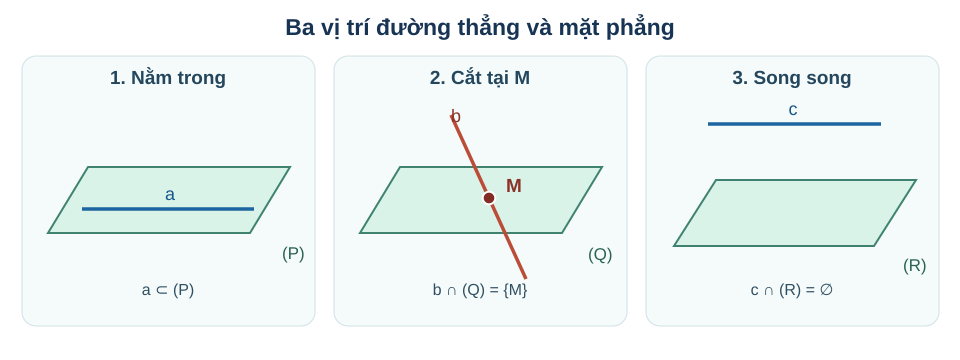

# Bài 12. Đường thẳng và mặt phẳng song song

TOÁN 11 · CHƯƠNG IV · KẾT NỐI TRI THỨC

Nhìn đúng vị trí đường–mặt, chứng minh song song bằng đường nằm trong mặt và xác định hướng giao tuyến khi một mặt phẳng phụ cắt mặt phẳng đã cho.

<nav class="thpt-r4-lesson-tabs"><a href="../">Chương IV</a><a href="../luyen-tap/">Core và Luyện tập</a><a href="../tu-kiem-tra-chuong/">Tự kiểm tra cuối chương</a></nav>

=== "Khám phá kiến thức"

    Người thợ xây có thể căng dây theo phương của các hàng gạch, phía trên mặt đất. Dây không chạm đất và hướng theo một đường nằm trên mặt đất, nên gợi lên quan hệ **đường thẳng song song với mặt phẳng**. Nhưng một thanh cột dọc khung thành lại chạm mặt đất, còn cạnh khung nằm sát đất thuộc luôn mặt phẳng đất. Bằng cách phân biệt ba tình huống đó, ta biết khi nào được nói song song và khi nào phải kiểm thêm điều kiện.

    ### 1.1. Đường thẳng song song với mặt phẳng

    Trong hình học phẳng, hai đường thẳng phân biệt có thể cắt nhau hoặc song song. Với **một đường thẳng \(d\) và một mặt phẳng \((P)\)**, có ba khả năng về số điểm chung:

    - **Nằm trong:** mọi điểm của \(d\) đều nằm trong \((P)\), tức \(d\subset(P)\); có vô số điểm chung.
    - **Cắt nhau:** có đúng một điểm chung \(M\), tức \(d\cap(P)=\{M\}\).
    - **Song song:** **không có điểm chung nào**, viết \(d\parallel(P)\).

    <figure class="thpt-r4-plot"><figcaption><strong>Hướng dẫn đọc:</strong> khung trái có đường nằm ngay trên mặt phẳng (vô số điểm chung); khung giữa đường đi qua mặt ở đúng \(M\); khung phải đường được vẽ tách khỏi mặt phẳng (không có điểm chung). Hình không dùng độ dài/khoảng cách của bản vẽ để chứng minh.</figcaption></figure>

    Điều cần ghi nhớ là từ **“không nằm trong”** chỉ loại được trường hợp đầu; đường vẫn có thể **cắt** mặt. Ngược lại, nếu \(d\parallel(P)\), đường \(d\) không thể đi qua bất kỳ điểm nào thuộc \((P)\). Một đoạn dây được vẽ không chạm vùng mặt phẳng trên giấy cũng chưa đủ chứng minh *đường thẳng kéo dài* không cắt mặt phẳng: phải có chứng cứ hình học.

    Hãy xét tứ diện \(S.ABC\). Đường \(AB\) nằm trong mặt đáy \((ABC)\). Đường \(SA\) cắt \((ABC)\) tại đúng \(A\), vì \(S\notin(ABC)\). Còn nếu \(M,N\) là trung điểm của \(SA,SB\), đoạn nối hai điểm này nằm trong mặt \((SAB)\), và sau khi chứng minh \(MN\parallel AB\), ta sẽ có một ví dụ thực sự của \(MN\parallel(ABC)\). Chứng minh điều cuối thuộc mục 1.2; chưa nên kết luận chỉ bằng hình.

    **Vận dụng.** Trong tứ diện \(S.ABC\), hãy phân loại quan hệ của \(AB\) và \((ABC)\), \(SA\) và \((ABC)\). Nếu một đường \(m\) có điểm \(A\in(ABC)\), có thể khẳng định \(m\parallel(ABC)\) không?

    ??? question "Đối chiếu"

        **Lời giải:** \(AB\subset(ABC)\). Vì \(S\notin(ABC)\) và \(A\in(ABC)\), \(SA\cap(ABC)=\{A\}\). Đường \(m\) đi qua \(A\in(ABC)\) có **ít nhất một điểm chung** với mặt nên không thể song song mặt; nó hoặc nằm trong, hoặc cắt mặt.

    ??? tip "Kiểm lỗi"

        “Không thấy đường chạm mặt” chưa phải chứng minh. Hãy xác định **số điểm chung** từ giả thiết, và nhớ đường trong hình học được kéo dài vô hạn chứ không dừng ở mép đoạn vẽ.

    ### 1.2. Điều kiện và tính chất của đường thẳng song song với mặt phẳng

    **Từ một đường song song sang cả mặt phẳng.** Trong tam giác \(SAB\), nối trung điểm \(M\in SA\), \(N\in SB\). Theo định lí đường trung bình **trong mặt \((SAB)\)**, \(MN\parallel AB\). Mà \(AB\subset(ABC)\). Vì \(M\) nằm trong cạnh \(SA\) nhưng không phải \(A\), nên \(M\notin(ABC)\); do đó \(MN\) **không nằm trong** \((ABC)\). Ta kết luận được \(MN\parallel(ABC)\). Hai bước quan trọng là: **tìm một đường nằm trong mặt và song song đường xét**, rồi **chứng minh đường xét không nằm trong mặt**.

    <figure class="thpt-r4-plot"><figcaption><strong>Hướng dẫn đọc:</strong> đoạn \(MN\) màu đỏ là đường trung bình tam giác \(SAB\), nên song song \(AB\) ở đáy. Do \(M,N\) không thuộc mặt đáy, đường \(MN\) không nằm trong đáy; kết hợp hai dữ kiện mới suy ra \(MN\parallel(ABCD)\).</figcaption></figure>

    **Vì sao điều kiện ngoài mặt không được bỏ?** Trong hình bình hành \(ABCD\), \(AB\parallel CD\), cả hai đều thuộc \((ABCD)\). Nếu chỉ dùng \(AB\parallel CD\), \(CD\subset(ABCD)\), rồi kết luận \(AB\parallel(ABCD)\) là sai vì thực ra \(AB\subset(ABCD)\). Đây là ví dụ phản chứng cho việc quên điều kiện.

    **Tính chất về giao tuyến.** Giả sử \(a\parallel(P)\) và có mặt phẳng \((Q)\) chứa \(a\), cắt \((P)\) theo đường \(b\). Trong \((Q)\), hai đường \(a,b\) **đồng phẳng**. Chúng không thể có điểm chung vì \(b\subset(P)\), còn \(a\) không có điểm chung với \((P)\). Do vậy \(a\parallel b\). Tính chất này cho ta **hướng của giao tuyến** ngay cả khi chưa biết hai điểm chung.

    Từ đó, với hình chóp \(S.ABCD\) có đáy là hình bình hành, \(M,N\) là trung điểm \(SA,SB\), đặt \((Q)=(MNC)\). Vì \(MN\parallel(ABCD)\), \((Q)\) chứa \(MN\) và \(C\in(Q)\cap(ABCD)\), giao tuyến \((Q)\cap(ABCD)\) phải qua \(C\) và song song \(MN\). Trong đáy có \(CD\parallel AB\parallel MN\), nên giao tuyến chính là **\(CD\)**. Ta đã tìm giao tuyến theo *một điểm chung và một hướng xác định*, thay vì đoán nét cắt trên hình.

    **Vận dụng.** Cho tứ diện \(S.ABC\), \(M,N\) lần lượt là trung điểm \(SA,SB\). Chứng minh \(MN\parallel(ABC)\) và nói rõ hai điều kiện của dấu hiệu song song.

    ??? question "Đối chiếu"

        **Lời giải:** \(MN\parallel AB\) vì là đường trung bình tam giác \(SAB\). \(AB\subset(ABC)\). Do \(M\in SA\), \(M\ne A\) và \(S\notin(ABC)\), suy ra \(M\notin(ABC)\), nên \(MN\not\subset(ABC)\). Theo điều kiện SGK, \(MN\parallel(ABC)\).

    ??? tip "Kiểm lỗi"

        Không được chỉ ghi \(MN\parallel AB\) và \(AB\subset(ABC)\). Cần thêm **\(MN\not\subset(ABC)\)**; nếu không, hình bình hành phẳng là một phản ví dụ.

    **Vận dụng.** Cho hình chóp \(S.ABCD\) có đáy hình bình hành, \(M,N\) là trung điểm \(SA,SB\). Mặt \((MNC)\) giao với đáy theo đường thẳng nào? Giải thích bằng tính chất về giao tuyến, không dựa vào hình chiếu.

    ??? question "Đối chiếu"

        **Lời giải:** Ta có \(MN\parallel AB\subset(ABCD)\), và \(MN\not\subset(ABCD)\), nên \(MN\parallel(ABCD)\). Mặt \((MNC)\) chứa \(MN\), giao mặt đáy theo đường đi qua \(C\) và song song với \(MN\). Vì \(CD\parallel AB\parallel MN\) và \(CD\subset(ABCD)\), giao tuyến là \(CD\).

    ??? tip "Kiểm lỗi"

        Nếu chỉ nói giao tuyến qua \(C\) thì chưa đủ xác định một đường. Hãy tìm **hướng song song** và kiểm đường đề nghị thật sự nằm trong cả hai mặt phẳng.

=== "Kiến thức SGK"

    ### 2.1. Đường thẳng song song với mặt phẳng

    
<strong>Khái niệm — Ba vị trí của đường thẳng và mặt phẳng</strong>
Với đường \(d\) và mặt phẳng \((P)\), có đúng ba trường hợp: <strong>(1)</strong> \(d\subset(P)\): đường nằm trong mặt phẳng, có vô số điểm chung; <strong>(2)</strong> \(d\cap(P)=\{M\}\): đường cắt mặt phẳng tại đúng một điểm \(M\); <strong>(3)</strong> \(d\cap(P)=\varnothing\): đường song song với mặt phẳng.

    
<strong>Định nghĩa — Đường thẳng song song với mặt phẳng</strong>
Đường thẳng \(d\) được gọi là <strong>song song với mặt phẳng \((P)\)</strong> nếu \(d\) <strong>không có điểm chung</strong> với \((P)\). Kí hiệu \(d\parallel(P)\) hoặc \((P)\parallel d\). Đường \(d\subset(P)\) <strong>không phải</strong> trường hợp \(d\parallel(P)\) theo định nghĩa này.

    <figure class="thpt-r4-plot"><figcaption><strong>Tra hình:</strong> \(a\subset(P)\); \(b\cap(Q)=\{M\}\); \(c\cap(R)=\varnothing\). Hãy đọc theo **điểm chung** thay vì hình bình hành được vẽ hữu hạn.</figcaption></figure>

    **Lưu ý phân loại:** \(d\not\subset(P)\) **không tương đương** \(d\parallel(P)\) vì còn khả năng \(d\) cắt \((P)\). Mặt phẳng có thể chứa đoạn được vẽ nhưng phải xét **đường thẳng vô hạn** khi viết quan hệ.

    ### 2.2. Điều kiện và tính chất của đường thẳng song song với mặt phẳng

    
<strong>Điều kiện — Dấu hiệu đường thẳng song song với mặt phẳng</strong>
Nếu \(a\not\subset(P)\), \(b\subset(P)\) và \(a\parallel b\), thì \(a\parallel(P)\). <strong>Bắt buộc kiểm</strong> \(a\not\subset(P)\): bỏ điều kiện này có thể nhầm đường nằm ngay trong mặt với đường song song mặt.

    **Vì sao đủ:** Hai đường \(a\parallel b\) xác định mặt phẳng \((Q)\). Vì \(a\not\subset(P)\), \((Q)\ne(P)\), nhưng cả hai cùng chứa \(b\), nên giao tuyến của chúng là \(b\). Nếu \(a\) gặp \((P)\) tại \(M\), thì \(M\in(Q)\cap(P)=b\), mâu thuẫn \(a\parallel b\). Vậy \(a\) không có điểm chung với \((P)\).

    
<strong>Tính chất — Giao tuyến của mặt phẳng chứa đường song song mặt phẳng khác</strong>
Nếu \(a\parallel(P)\), \(a\subset(Q)\) và hai mặt phẳng \((P),(Q)\) <strong>cắt nhau</strong> theo đường \(b\), thì \(a\parallel b\).

    **Vì sao đúng:** \(a\) và \(b\) cùng nằm trong \((Q)\), còn \(b\subset(P)\). Do \(a\parallel(P)\), hai đường không có điểm chung nên đồng phẳng và song song. Không bỏ điều kiện hai mặt phẳng **có giao tuyến**.

    <figure class="thpt-r4-plot"><figcaption><strong>Tra hình:</strong> \(MN\parallel AB\), \(AB\subset(ABCD)\) và \(MN\not\subset(ABCD)\), do đó \(MN\parallel(ABCD)\). Mặt \((SAB)\) chứa \(MN\) và cắt đáy theo \(AB\), phù hợp tính chất \(MN\parallel AB\).</figcaption></figure>

    **Cách giải bài:** Chứng minh đường–mặt song song → tìm \(b\subset(P)\) song song \(a\), rồi kiểm \(a\not\subset(P)\). Xác định giao tuyến của mặt \((Q)\) chứa \(a\parallel(P)\) → tìm một điểm chung \(M\in(Q)\cap(P)\) và lấy đường qua \(M\) song song \(a\). Nếu chưa biết hai mặt có cắt nhau, phải xác nhận có điểm chung và phân biệt trước.

    **Không suy diễn quá mức:** \(a\parallel(P)\) không có nghĩa \(a\) song song **mọi** đường \(b\subset(P)\): có những đường \(b\) trong \((P)\) không đồng phẳng với \(a\), nên \(a,b\) chéo nhau. Trường hợp xét hình chóp cần chứng minh cặp đường cụ thể được dùng thực sự song song.

=== "Ví dụ"

    ### 3.1. Phân biệt ba vị trí đường–mặt trong tứ diện

    **Đề bài.** Tứ diện \(S.ABC\), \(M,N\) là trung điểm \(SA,SB\). Xác định quan hệ \(AB,SA,MN\) với \((ABC)\).

    **Phân tích:** Hai quan hệ đầu theo định nghĩa. Với \(MN\), dùng đường trung bình và điều kiện \(MN\) không nằm trong đáy.

    

<strong>Lời giải.</strong> \(AB\subset(ABC)\). \(SA\cap(ABC)=\{A\}\). Trong tam giác \(SAB\), \(MN\parallel AB\), \(AB\subset(ABC)\), và \(MN\not\subset(ABC)\) vì \(M\in SA\setminus\{A\}\). Suy ra \(MN\parallel(ABC)\).

    **Kiểm lại:** Ba đường tương ứng ba trường hợp: nằm trong, cắt tại một điểm, song song.

    ### 3.2. Phản ví dụ khi quên điều kiện không nằm trong mặt

    **Đề bài.** Cho hình bình hành \(ABCD\) trong \((P)=(ABCD)\). Biết \(AB\parallel CD\) và \(CD\subset(P)\). Có được kết luận \(AB\parallel(P)\) không?

    **Phân tích:** Kiểm đủ điều kiện của dấu hiệu, đặc biệt \(AB\not\subset(P)\).

    

<strong>Lời giải.</strong> Không. Bởi \(AB\subset(P)\), đường \(AB\) có vô số điểm chung với \((P)\), nên không thể song song \((P)\) theo định nghĩa.

    **Kiểm lại:** Chính việc thiếu \(AB\not\subset(P)\) làm dấu hiệu không áp dụng được.

    ### 3.3. Chứng minh đường trung bình song song mặt đáy

    **Đề bài.** Trong chóp \(S.ABCD\) có đáy hình bình hành, \(M,N\) là trung điểm \(SA,SB\). Chứng minh \(MN\parallel(ABCD)\).

    **Phân tích:** Dùng tam giác phẳng \(SAB\) để có một đường song song trong mặt đáy, rồi xác nhận \(MN\) không nằm trong đáy.

    

<strong>Lời giải.</strong> \(MN\parallel AB\) theo định lí đường trung bình tam giác \(SAB\). Do \(AB\subset(ABCD)\), \(M\in SA\setminus\{A\}\) và \(S\notin(ABCD)\), suy ra \(M\notin(ABCD)\), nên \(MN\not\subset(ABCD)\). Kết luận \(MN\parallel(ABCD)\).

    **Kiểm lại:** Không nhầm \(MN\) nằm trong **mặt bên** \((SAB)\) với nằm trong **mặt đáy** \((ABCD)\).

    ### 3.4. Cùng một tỉ số trên hai cạnh bên

    **Đề bài.** Trong tứ diện \(S.ABC\), \(M\in SA\), \(N\in SB\) với \(SM/SA=SN/SB=1/3\). Chứng minh \(MN\parallel(ABC)\).

    **Phân tích:** Từ tỉ số trên hai cạnh của tam giác \(SAB\), dùng định lí Thalès đảo để suy \(MN\parallel AB\).

    

<strong>Lời giải.</strong> Vì \(M\in SA\), \(N\in SB\), \(\dfrac{SM}{SA}=\dfrac{SN}{SB}=\frac13\), nên \(MN\parallel AB\). Mặt khác \(AB\subset(ABC)\), \(M\ne A\), \(M\in SA\) và \(S\notin(ABC)\), vậy \(MN\not\subset(ABC)\). Suy ra \(MN\parallel(ABC)\).

    **Kiểm lại:** Hai tỉ số đều đo từ **cùng đỉnh \(S\)**; \(M,N\) ở bên trong cạnh, không trùng đỉnh đáy.

    ### 3.5. Tính chất giao tuyến trong mặt phẳng chứa đường song song

    **Đề bài.** Cho \(a\parallel(P)\), \(a\subset(Q)\), \((Q)\cap(P)=b\). Hãy chứng minh \(a\parallel b\).

    **Phân tích:** Dùng hai sự kiện: \(a,b\subset(Q)\) nên đồng phẳng; \(a\) không gặp bất kì đường nào trong \((P)\), nên không gặp \(b\).

    

<strong>Lời giải.</strong> \(b\subset(P)\) và \(a\cap(P)=\varnothing\), suy ra \(a\cap b=\varnothing\). Vì \(a,b\subset(Q)\), chúng đồng phẳng, phân biệt và không cắt nhau, nên \(a\parallel b\).

    **Kiểm lại:** Phải có giao tuyến \(b=(P)\cap(Q)\) tồn tại; nếu hai mặt song song nhau, không có \(b\) để xét.

    ### 3.6. Tìm giao tuyến từ một điểm và một hướng

    **Đề bài.** Chóp \(S.ABCD\) đáy hình bình hành, \(M,N\) là trung điểm \(SA,SB\), \((Q)=(MNC)\). Xác định \((Q)\cap(ABCD)\).

    **Phân tích:** Mặt \((Q)\) chứa \(MN\parallel(ABCD)\), lại có điểm chung \(C\); tính chất giao tuyến cho hướng qua \(C\).

    

<strong>Lời giải.</strong> \(MN\parallel AB\subset(ABCD)\) và \(MN\not\subset(ABCD)\), nên \(MN\parallel(ABCD)\). Mặt \((Q)\) chứa \(MN\) và \(C\); vì \(C\) thuộc đáy nhưng không thuộc \(MN\), \((Q)\) phân biệt với đáy và giao tuyến qua \(C\) song song \(MN\). Trong đáy, \(CD\parallel AB\parallel MN\). Vậy \((Q)\cap(ABCD)=CD\).

    **Kiểm lại:** \(D\in(Q)\) là kết quả suy từ việc giao tuyến qua \(C\) có hướng \(CD\); không phải tự mặc định mọi cạnh đáy thuộc \((Q)\).

    ### 3.7. Một đường song song mặt phẳng không song song mọi đường trong mặt

    **Đề bài.** Trong hệ tọa độ không gian, cho \((P):z=0\), \(a\) gồm các điểm \((t,0,1)\) với \(t\in\mathbb R\), và \(b\) gồm các điểm \((0,t,0)\) với \(t\in\mathbb R\). Chứng minh \(a\parallel(P)\) nhưng \(a\) không song song \(b\).

    **Phân tích:** Có thể dùng mô hình tọa độ để minh họa chính xác lỗi tổng quát hóa: đường \(a\) có độ cao không đổi \(1\), \(b\) nằm trên mặt \(z=0\), hai đường có phương khác nhau.

    

<strong>Lời giải.</strong> Mọi điểm của \(a\) có \(z=1\ne0\), nên \(a\cap(P)=\varnothing\), tức \(a\parallel(P)\). Mọi điểm của \(b\) có \(z=0\), nên \(b\subset(P)\). Nhưng \(a\) có phương theo trục \(x\), \(b\) có phương theo trục \(y\); chúng không đồng phẳng và không song song với nhau. Vì vậy \(a\parallel(P)\) không suy ra \(a\parallel b\) với mọi \(b\subset(P)\).

    **Kiểm lại:** Nếu \(a,b\) đồng phẳng và không cắt nhau thì mới song song; ở đây hai hướng khác nhau, không có mặt phẳng nào chứa cả hai.

    ### 3.8. Mô hình dây căng trên hàng gạch

    **Đề bài.** Người thợ căng một sợi dây thẳng theo hướng của hàng gạch chuẩn, ở phía trên mặt đất. Giả sử đường chứa dây không có điểm nào nằm trên mặt đất. Giải thích quan hệ với mặt phẳng mặt đất, và cho biết vì sao chỉ quan sát một đoạn dây không chạm đất là chưa đủ.

    **Phân tích:** Phân biệt mô hình lí tưởng của đường thẳng vô hạn với đoạn dây thật có hai đầu mút; dựa vào giả thiết không có điểm chung, không dựa vào hình chụp.

    

<strong>Lời giải.</strong> Theo giả thiết, đường thẳng chứa dây và mặt phẳng đất không có điểm chung, nên song song nhau. Nếu chỉ biết một đoạn dây thực tế không chạm đất mà không biết hướng của đường thẳng kéo dài, đường đó vẫn có thể gặp mặt đất ở ngoài đoạn dây; phải có căn cứ về phương song song hoặc điều kiện không có điểm chung.

    **Kiểm lại:** Trong mô hình vật lí, dây có bề dày và chiều dài hữu hạn; quan hệ \(a\parallel(P)\) là quan hệ của **đường thẳng toán học** với mặt phẳng.

=== "Lỗi thường gặp"

    ### 4.1. Gộp đường nằm trong mặt với đường song song mặt

    **Dấu hiệu:** Nói \(AB\parallel(ABCD)\) vì \(AB\parallel CD\subset(ABCD)\).

    **Vì sao sai:** \(AB\) nằm luôn trong \((ABCD)\), có vô số điểm chung với mặt, trái định nghĩa song song.

    **Cách sửa:** Kiểm rõ \(a\not\subset(P)\) trước khi dùng dấu hiệu đường song song một đường trong mặt.

    ### 4.2. Coi “không nằm trong” là “song song”

    **Dấu hiệu:** Thấy \(SA\not\subset(ABC)\) rồi kết luận \(SA\parallel(ABC)\).

    **Vì sao sai:** \(SA\) cắt \((ABC)\) tại \(A\). Không nằm trong mặt còn khả năng **cắt tại một điểm**.

    **Cách sửa:** Phân loại bằng số điểm chung; chỉ khi không có điểm chung mới gọi song song.

    ### 4.3. Chỉ nhìn một đoạn không chạm mặt mà kết luận cả đường song song

    **Dấu hiệu:** Đoạn thẳng phía trên mặt vẽ không chạm nên cho cả đường vô hạn song song mặt.

    **Vì sao sai:** Kéo dài đoạn thẳng có thể cắt mặt ngoài vùng hình vẽ.

    **Cách sửa:** Tìm đường nằm trong mặt cùng phương với đường xét và kiểm đường xét không thuộc mặt, hoặc xác nhận không có điểm chung theo giả thiết.

    ### 4.4. Quên điều kiện tồn tại giao tuyến

    **Dấu hiệu:** Với \(a\parallel(P)\), \((Q)\) chứa \(a\), tự đặt \(b=(P)\cap(Q)\) dù chưa biết hai mặt cắt nhau.

    **Vì sao sai:** Nếu \((Q)\parallel(P)\), hai mặt không có giao tuyến.

    **Cách sửa:** Kiểm một điểm chung và hai mặt phân biệt trước khi dùng \(a\parallel b\).

    ### 4.5. Gọi song song với mọi đường nằm trong mặt phẳng

    **Dấu hiệu:** Từ \(a\parallel(P)\), suy \(a\parallel b\) với mọi \(b\subset(P)\).

    **Vì sao sai:** Một đường \(b\) trong mặt có thể khác hướng, chéo nhau với \(a\).

    **Cách sửa:** Muốn kết luận \(a\parallel b\), chứng minh cả hai **đồng phẳng và không có điểm chung** hoặc dùng tính chất giao tuyến khi \(b=(P)\cap(Q)\) và \(a\subset(Q)\).

    ### 4.6. Đoán giao tuyến chỉ từ một điểm chung

    **Dấu hiệu:** Chỉ biết \(C\in(Q)\cap(P)\) rồi vẽ bất kì đường nào qua \(C\) là giao tuyến.

    **Vì sao sai:** Một điểm chung chưa xác định duy nhất một đường giao.

    **Cách sửa:** Khi \((Q)\) chứa \(a\parallel(P)\), giao tuyến **phải song song \(a\)**; dựng đường qua \(C\) theo hướng ấy, rồi kiểm nó nằm trong cả hai mặt.

    **Học tiếp:** [Core và Luyện tập Bài 12](luyen-tap.md) · [Tự luận Chương IV](../../../thu-vien/tu-luan-g11-chuong-iv.md) · [Tự kiểm tra cuối chương](tu-kiem-tra-chuong.md).

    
Đối chiếu văn bản SGK Toán 11 Kết nối tri thức với cuộc sống, tập một, Bài 12 trang in 84–87: (1) Đường thẳng song song với mặt phẳng; (2) Điều kiện và tính chất của đường thẳng song song với mặt phẳng. Dựa trên trang đọc nội dung SGK số hóa và tham khảo bài tập SGK; chưa xem trực quan được đầy đủ từng trang sách in. Một hình B12 có trên main được dùng chung hai tab; một SVG mới so sánh ba vị trí đường–mặt được tạo ở nhánh AUTHORING. Không sao chép lời giải của các Draft PR đã hủy.

