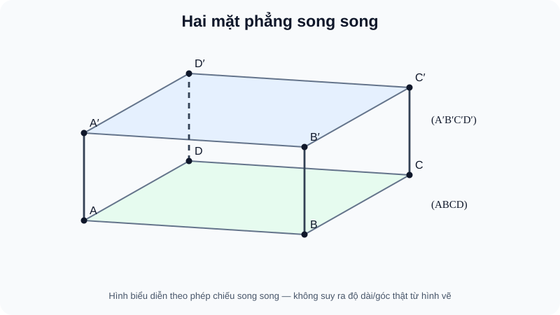
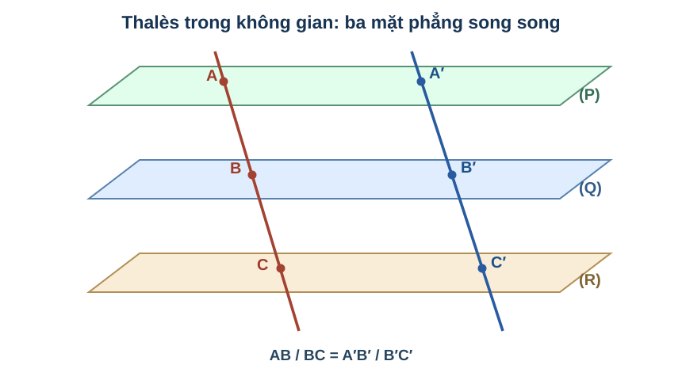

# Bài 13. Hai mặt phẳng song song

TOÁN 11 · CHƯƠNG IV · KẾT NỐI TRI THỨC

Hai mặt phẳng không giao nhau, điều kiện và tính chất song song, Thalès trong không gian, cấu tạo của hình lăng trụ và hình hộp.

<nav class="thpt-r4-lesson-tabs"><a href="../">Chương IV</a><a href="../luyen-tap/">Core và Luyện tập</a><a href="../tu-kiem-tra-chuong/">Tự kiểm tra cuối chương</a></nav>

=== "Khám phá kiến thức"

    Khi một người đầu bếp thái củ quả thành những lát phẳng, những mặt cắt lý tưởng có thể song song với nhau. Trong hình học, điều quan trọng không phải hai **miếng hữu hạn** có chạm nhau không mà là hai **mặt phẳng kéo dài vô hạn** có điểm chung hay không. Từ đây ta học bốn mục: cách nhận biết hai mặt song song, điều kiện/tính chất để chứng minh, các tỉ số Thalès và cách những quan hệ đó tạo nên lăng trụ–hình hộp.

    ### 1.1. Hai mặt phẳng song song

    Hãy xem hai mặt đáy của một chiếc hộp: một mặt ở trên, một mặt ở dưới. Hai mặt nằm trong hai mặt phẳng khác nhau nhưng không có điểm chung, nên **song song**. Nếu xoay nghiêng một mặt phẳng, hai mặt dù được vẽ tách nhau vẫn có thể **giao nhau theo một đường** ở xa phần đã vẽ. Nếu cả hai tên cùng chỉ một mặt phẳng, chúng **trùng nhau** chứ không song song.

    <figure class="thpt-r4-plot"><figcaption><strong>Hướng dẫn đọc:</strong> hai đáy màu khác nhau nằm trên hai mặt phẳng **không có điểm chung**. Hình bình hành biểu diễn chỉ là phần hữu hạn của mặt phẳng vô hạn.</figcaption></figure>

    Nhớ ba vị trí của **hai mặt phẳng**: **trùng nhau**; **phân biệt và cắt nhau theo một đường**; hoặc **phân biệt và song song**. Một giao điểm chung đã đủ loại quan hệ song song, nhưng chưa cho biết đường giao cụ thể nếu không có điểm chung thứ hai.

    **Vận dụng.** Hai mặt phẳng \((P),(Q)\) phân biệt cùng chứa điểm \(M\). Chúng có thể song song không? Giao của chúng là gì?

    ??? question "Đối chiếu"

        **Lời giải:** Không. Vì có điểm chung \(M\), chúng không song song; hai mặt phân biệt cắt nhau theo **một đường thẳng đi qua \(M\)**.

    ??? tip "Kiểm lỗi"

        Đừng nhầm hai hình bình hành trên trang giấy với hai mặt phẳng vô hạn. Hai mặt phẳng phân biệt không thể chỉ có một điểm chung.

    ### 1.2. Điều kiện và tính chất của hai mặt phẳng song song

    **Một đường chưa đủ.** Giả sử \((P)\) cắt \((Q)\) theo đường \(c\). Ngay trong \((P)\) có thể chọn một đường \(a\ne c\) song song \(c\). Vì \(a\) không cắt \(c\) và mọi điểm chung của \((P),(Q)\) đều nằm trên \(c\), nên \(a\parallel(Q)\). Như vậy \((P)\) có một đường song song \((Q)\), nhưng **chính hai mặt vẫn cắt nhau**!

    **Vì sao hai đường cắt nhau thì đủ?** Nếu \((P)\) chứa hai đường **cắt nhau** \(a,b\), và cả \(a,b\) đều song song \((Q)\), thì giả sử \((P)\) cắt \((Q)\) theo \(c\). Theo tính chất giao tuyến Bài 12, cả \(a\parallel c\) và \(b\parallel c\), điều ấy trái với \(a\) và \(b\) cắt nhau. Vậy \((P)\parallel(Q)\). Điều kiện **hai đường cắt nhau** bảo đảm ta không chỉ kiểm một hướng.

    **Tính duy nhất.** Qua một điểm \(A\notin(P)\) có đúng **một mặt phẳng song song** với \((P)\). Vì vậy hai mặt phẳng **phân biệt** cùng song song một mặt phẳng thứ ba phải song song nhau: nếu chúng có điểm chung, tính duy nhất sẽ buộc chúng trùng nhau.

    **Giao tuyến qua mặt thứ ba.** Nếu \((P)\parallel(Q)\) và \((R)\) cắt \((P)\) theo \(a\), thì \((R)\) cũng cắt \((Q)\) theo \(b\), với \(a\parallel b\). Trên hình hộp, một mặt bên cắt hai đáy theo hai cạnh đối **song song**. Kết quả giúp định hướng giao tuyến và thiết diện khi dựng hình.

    <figure class="thpt-r4-plot"><figcaption><strong>Hướng dẫn đọc:</strong> cùng một mặt bên cắt hai đáy theo \(AB\) và \(A'B'\), là hai đường song song. Điều này không dựa vào việc các nét trên giấy trông có cùng độ dốc.</figcaption></figure>

    **Vận dụng.** Chóp \(S.ABCD\): \(M,N,P,Q\) là trung điểm \(SA,SB,SC,SD\). Chứng minh \(M,N,P,Q\) đồng phẳng và mặt qua chúng song song đáy.

    ??? question "Đối chiếu"

        **Lời giải:** \(MN\parallel AB\) và \(NP\parallel BC\) do là đường trung bình các tam giác \(SAB,SBC\). Hai đường \(MN,NP\) cắt tại \(N\), đều ở ngoài đáy và song song mặt đáy; do đó \((MNP)\parallel(ABCD)\). Tương tự \((NPQ)\parallel(ABCD)\). Hai mặt ấy có điểm chung \(N\) và cùng song song đáy, theo tính duy nhất **trùng nhau**; suy ra bốn điểm \(M,N,P,Q\) đồng phẳng.

    ??? tip "Kiểm lỗi"

        Một đường song song mặt đáy chưa đủ chứng minh **cả mặt** song song. Phải tìm **hai đường cắt nhau trong chính mặt cần xét**, mỗi đường song song đáy.

    ### 1.3. Định lí Thalès trong không gian

    Trong tam giác, những đường thẳng song song cắt hai cạnh tạo các đoạn tương ứng tỉ lệ. Tương tự, **ba mặt phẳng đôi một song song** cắt hai đường thẳng bất kì lần lượt theo \(A,B,C\) và \(A',B',C'\) sẽ tạo những cặp đoạn tỉ lệ. Nếu mặt phẳng thứ hai nằm giữa hai mặt còn lại, ta so **đoạn từ mặt thứ nhất tới mặt thứ hai** với **đoạn từ mặt thứ hai tới mặt thứ ba**, theo cùng thứ tự trên cả hai cát tuyến.

    <figure class="thpt-r4-plot"><figcaption><strong>Hướng dẫn đọc:</strong> \(AB\) và \(A'B'\) cùng nằm giữa hai mặt đầu; \(BC\) và \(B'C'\) cùng nằm giữa hai mặt sau. Vì vậy \(AB/BC=A'B'/B'C'\). Không đổi cặp theo cảm giác trên hình.</figcaption></figure>

    **Ví dụ cụ thể.** Nếu \(AB=4\) cm, \(BC=6\) cm và \(A'B'=10\) cm, tỉ số \(4/6=10/B'C'\) cho \(B'C'=15\) cm. Trên hai cát tuyến, các **độ dài tuyệt đối** có thể khác, nhưng tỉ số hai đoạn theo cùng cặp mặt luôn bằng nhau.

    Trong tứ diện \(S.ABC\), một mặt phẳng \((MNK)\parallel(ABC)\) cắt \(SA,SB,SC\) lần lượt tại \(M,N,K\). Khi đó \(SM/SA=SN/SB=SK/SC\): mặt song song đáy cắt các cạnh bên theo **cùng tỉ phần từ đỉnh \(S\)**. Cần giữ cùng điểm gốc \(S\), không nhầm \(SM/MA\) với \(SM/SA\).

    **Vận dụng.** Ba mặt phẳng song song cắt hai cát tuyến tạo \(AB=4\) cm, \(BC=6\) cm, \(A'B'=10\) cm. Tìm \(B'C'\) và nêu lí do lập tỉ số như vậy.

    ??? question "Đối chiếu"

        **Lời giải:** \(\dfrac{AB}{BC}=\dfrac{A'B'}{B'C'}\Rightarrow4/6=10/x\Rightarrow x=15\) cm. Hai đoạn ở tử đều nằm giữa **cùng hai mặt đầu**, hai đoạn mẫu giữa **cùng hai mặt sau**.

    ??? tip "Kiểm lỗi"

        Phải ghép **đúng đoạn tương ứng** và dùng ba mặt phẳng thực sự song song; không tự đặt tỉ số nếu chỉ có hai mặt song song.

    ### 1.4. Hình lăng trụ và hình hộp

    Lấy hai đa giác bằng nhau nằm trên **hai mặt phẳng song song** sao cho các đoạn nối các đỉnh tương ứng **song song nhau**. Hình gồm hai đa giác đáy và các hình bình hành nối cạnh tương ứng gọi là **hình lăng trụ**. Hai đa giác là mặt đáy, các hình bình hành là mặt bên, còn các đoạn nối đỉnh tương ứng là cạnh bên. Các cạnh bên **đôi một song song và bằng nhau**.

    Nếu đáy là **hình bình hành**, lăng trụ đó gọi là **hình hộp**. Hình hộp có **sáu mặt hình bình hành**, các mặt đối diện song song. Hình hộp **không bắt buộc là hình hộp chữ nhật**, vì hình hộp tổng quát không yêu cầu các cạnh bên vuông góc với đáy.

    <figure class="thpt-r4-plot"><figcaption><strong>Hướng dẫn đọc:</strong> \(ABCD\), \(A'B'C'D'\) là hai đáy song song, \(AA',BB',CC',DD'\) là cạnh bên. Hình hộp có 8 đỉnh, 12 cạnh và 6 mặt; nét khuất vẫn là cạnh thật.</figcaption></figure>

    **Vận dụng.** Lăng trụ tam giác có bao nhiêu đỉnh, cạnh, mặt? Đáy của một lăng trụ tứ giác là hình bình hành thì tên hình là gì?

    ??? question "Đối chiếu"

        **Lời giải:** Lăng trụ tam giác có \(6\) đỉnh, \(9\) cạnh và \(5\) mặt (2 tam giác đáy, 3 hình bình hành bên). Lăng trụ có đáy hình bình hành là **hình hộp**: 8 đỉnh, 12 cạnh, 6 mặt.

    ??? tip "Kiểm lỗi"

        Đếm cả cạnh khuất; đừng gọi hình lăng trụ nào cũng là lăng trụ **đứng**, và đừng xem hình hộp tổng quát đương nhiên là hình hộp chữ nhật.

=== "Kiến thức SGK"

    ### 2.1. Hai mặt phẳng song song

    
<strong>Định nghĩa — Hai mặt phẳng song song</strong>
Hai mặt phẳng \((P),(Q)\) gọi là <strong>song song</strong> nếu chúng **không có điểm chung**. Viết \((P)\parallel(Q)\). Hai mặt phẳng phân biệt có điểm chung thì cắt nhau theo **một đường thẳng**; hai mặt trùng nhau không gọi song song.

    **Nhận biết:** Ba vị trí là **trùng nhau**, **cắt nhau**, **song song**. Không dùng hình bình hành hữu hạn được vẽ để đoán quan hệ của hai mặt phẳng vô hạn.

    <figure class="thpt-r4-plot"><figcaption><strong>Tra hình:</strong> \((ABCD)\parallel(A'B'C'D')\) khi hình là hình hộp; các mặt đáy được tô khác màu và không có điểm chung.</figcaption></figure>

    ### 2.2. Điều kiện và tính chất của hai mặt phẳng song song

    
<strong>Điều kiện — Dấu hiệu hai mặt phẳng song song</strong>
Nếu mặt phẳng \((P)\) chứa **hai đường thẳng cắt nhau** \(a,b\) và \(a\parallel(Q)\), \(b\parallel(Q)\), thì \((P)\parallel(Q)\). Một đường song song \((Q)\), hoặc hai đường song song nhau, **không đủ** thay cho hai đường cắt nhau.

    
<strong>Tính chất — Mặt phẳng song song duy nhất qua điểm ngoài mặt</strong>
Qua điểm \(A\notin(P)\), có **một và chỉ một** mặt phẳng đi qua \(A\) và song song với \((P)\).

    
<strong>Tính chất — Song song với mặt phẳng thứ ba</strong>
Hai mặt phẳng **phân biệt** cùng song song với mặt phẳng thứ ba thì **song song với nhau**. Nếu chúng có điểm chung, theo tính duy nhất chúng sẽ **trùng nhau**, trái giả thiết phân biệt.

    
<strong>Tính chất — Giao tuyến với mặt phẳng thứ ba</strong>
Nếu \((P)\parallel(Q)\) và mặt \((R)\) cắt \((P)\) theo \(a\), thì \((R)\) cũng cắt \((Q)\) theo \(b\), với \(a\parallel b\). Các đường \(a,b\) nằm trong cùng mặt \((R)\).

    **Cách dùng:** Muốn chứng minh hai mặt song song → chọn **hai đường cắt nhau** trong mặt thứ nhất và chứng minh từng đường song song với mặt thứ hai. Muốn dựng thiết diện qua hai mặt song song → xác định một giao tuyến rồi dựng giao tuyến tương ứng **song song** với nó trong mặt cắt.

    ### 2.3. Định lí Thalès trong không gian

    
<strong>Định lí — Thalès trong không gian</strong>
Ba mặt phẳng **đôi một song song** chắn trên hai cát tuyến những đoạn thẳng tương ứng **tỉ lệ**. Nếu chúng cắt hai đường lần lượt tại \(A,B,C\) và \(A',B',C'\), với \(B,B'\) nằm trên mặt phẳng ở giữa, thì \(AB/BC=A'B'/B'C'\).

    
<strong>Công thức — Tỉ số các đoạn tương ứng</strong>
Với các điểm cắt phân biệt và \(B\) nằm giữa \(A,C\), \(B'\) nằm giữa \(A',C'\): \(\displaystyle\frac{AB}{BC}=\frac{A'B'}{B'C'}\) và \(\displaystyle\frac{AB}{AC}=\frac{A'B'}{A'C'}\).

Phải giữ **đúng cặp mặt phẳng** của từng đoạn; không tráo vị trí mốc trung gian.

    <figure class="thpt-r4-plot"><figcaption><strong>Tra hình:</strong> \(AB\) ứng với \(A'B'\), \(BC\) ứng với \(B'C'\). Định lí không yêu cầu hai cát tuyến song song nhau.</figcaption></figure>

    **Áp dụng vào hình chóp:** Nếu \((MNK)\parallel(ABC)\) cắt \(SA,SB,SC\) theo \(M,N,K\), thì \(SM/SA=SN/SB=SK/SC\) (các điểm trong cạnh), suy ra độ dài theo cùng tỉ phần từ đỉnh.

    ### 2.4. Hình lăng trụ và hình hộp

    
<strong>Định nghĩa — Hình lăng trụ</strong>
Hình lăng trụ có hai đa giác đáy tương ứng nằm trên **hai mặt phẳng song song**, các cạnh bên nối đỉnh tương ứng **đôi một song song**, các mặt bên là **hình bình hành**. Hai đa giác là mặt đáy; các đoạn nối đỉnh tương ứng là cạnh bên.

    
<strong>Tính chất — Hình lăng trụ</strong>
Các cạnh bên **song song và bằng nhau**; các mặt bên là hình bình hành; hai đa giác đáy **song song và bằng nhau**. Không bắt buộc các cạnh bên vuông góc đáy.

    
<strong>Định nghĩa — Hình hộp</strong>
Hình lăng trụ có đáy là **hình bình hành** gọi là **hình hộp**. Hình hộp có 6 mặt hình bình hành, 8 đỉnh, 12 cạnh; các cặp mặt đối diện **song song**.

    <figure class="thpt-r4-plot"><figcaption><strong>Tra hình:</strong> \(ABCD\) và \(A'B'C'D'\) là hai đáy; \(AA',BB',CC',DD'\) là cạnh bên, các mặt bên là hình bình hành. Không suy góc vuông từ hình vẽ.</figcaption></figure>

    **Số lượng:** Lăng trụ đáy \(n\)-giác có \(2n\) đỉnh, \(3n\) cạnh, \(n+2\) mặt. Lăng trụ tam giác: 6 đỉnh, 9 cạnh, 5 mặt; hình hộp: 8 đỉnh, 12 cạnh, 6 mặt.
