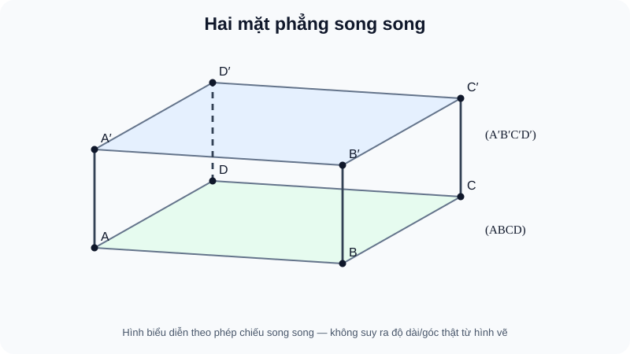

# Bài 13. Hai mặt phẳng song song

TOÁN 11 · CHƯƠNG IV · SGK KNTT

Vì sao cần học → kiến thức/điều kiện → ví dụ → Tự thử trước Core → hình đọc đúng → luyện tập và khắc phục. Tự kiểm tra tự đối chiếu không ghi Mastery.
<nav class="thpt-r4-lesson-tabs"><a href="../">Chương IV</a><a href="../luyen-tap/">Core & Luyện tập</a><a href="../tu-kiem-tra-chuong/">Tự kiểm tra · tự đối chiếu</a></nav>

=== "Khám phá kiến thức"

    ### Cùng tìm hiểu

    Hai mặt phẳng có thể trùng, cắt theo một đường hoặc song song. Muốn chứng minh **cả mặt** không cắt mặt kia, một đường song song chưa đủ: mặt ấy vẫn có thể nghiêng và cắt theo hướng khác. Hai đường **cắt nhau** trong mặt thứ nhất, mỗi đường song song mặt thứ hai, tạo dấu hiệu. Thiết diện song song đáy của tứ diện cho phép quan sát hai đường cắt nhau trong thiết diện và tỉ lệ đồng dạng.

    ### Ví dụ trực quan

    Một phương hướng có thể được giữ nguyên khi chuyển từ đường này sang đường song song. Trong không gian, phép chuyển như vậy cần căn cứ vào định lí, không phải cảm giác hình vẽ.

    **Quan sát bằng số liệu:** Hai đường thẳng cùng song song với một đường thẳng thứ ba thì cùng phương. Nhưng một đường song song một đường nằm trong mặt phẳng không tự động đủ điều kiện loại trừ đường ấy nằm ngay trong mặt phẳng.

    ### Thuật ngữ và kiến thức, kỹ năng

    **Thuật ngữ:** quan hệ song song trong không gian, điều kiện đường–mặt, giao tuyến.

    **Sau bài học, em cần:** nêu giả thiết đầy đủ và kiểm các trường hợp đường thuộc mặt trước khi suy ra song song.

=== "Kiến thức SGK"

    

    Hai mặt phẳng **phân biệt** song song nếu chúng không có điểm chung. Hai mặt phẳng phân biệt không song song cắt nhau theo một đường thẳng; hai mặt phẳng còn có thể trùng nhau (không gọi song song nếu yêu cầu phân biệt).

    **Dấu hiệu song song hai mặt phẳng.** Nếu $(P)$ chứa hai đường thẳng *cắt nhau* $a,b$ và $a\parallel(Q), b\parallel(Q)$ thì $(P)\parallel(Q)$. Không thể thay hai đường *cắt nhau* bằng một đường đơn lẻ hoặc bằng hai đường song song trong $(P)$. Nếu $(P)\parallel(Q)$, mọi mặt phẳng $(R)$ giao với cả hai theo hai đường $d,e$ thì $d\parallel e$.

    **Ứng dụng trong hình chóp.** Trong $S.ABC$, lấy $M\in SA$, $N\in SB$, $K\in SC$ sao cho $SM/SA=SN/SB=SK/SC=t$, với $0<t<1$. Khi đó $MN\parallel AB$, $MK\parallel AC$ trong các tam giác $SAB$ và $SAC$, nên $(MNK)\parallel(ABC)$; thiết diện là tam giác $MNK$ đồng dạng tam giác $ABC$ tỉ số $t$. Nếu chỉ biết $SM/SA=SN/SB$, chưa thể khẳng định toàn bộ mặt $(MNK)$ song song đáy khi $K$ không thỏa tỉ số.

    ### Đọc hình và đối chiếu khái niệm

    <figure class="thpt-r4-plot thpt-r4-probability-figure"><figcaption>Hình hộp có hai mặt đáy ABCD và A phẩy B phẩy C phẩy D phẩy song song, tô xanh lá và xanh lam; các cạnh bên nối tương ứng.</figcaption></figure>

    hai đường cắt nhau trong thiết diện cùng song song hai đường đáy, qua đó nhận diện hai mặt song song.

    ### Vận dụng — tự thử rồi mở đối chiếu

    Trong tứ diện S.ABC, M,N,K là trung điểm SA,SB,SC. Vì sao (MNK) song song (ABC)?

    

Em đã tự thử? Mở đối chiếu

    MN∥AB và MK∥AC là hai đường cắt tại M, lần lượt song song mặt (ABC). Trở về D1 B13 và THPT-G11-CHIV-B13-C01.

    

=== "Ví dụ"

    **EX-G11-B13-EX01: Hình lăng trụ.** Với lăng trụ tam giác $ABC.A'B'C'$, hai mặt đáy $(ABC)$ và $(A'B'C')$ song song. Các cạnh bên $AA',BB',CC'$ song song nhau.

    **EX-G11-B13-EX02: Dấu hiệu hai đường cắt nhau.** Trong hình hộp $ABCD.A'B'C'D'$, $A'B'\parallel(ABCD)$ và $A'D'\parallel(ABCD)$. Hai đường cắt tại $A'$, suy ra $(A'B'C'D')\parallel(ABCD)$.

    **EX-G11-B13-EX03: Mặt cắt trung điểm.** Trong tứ diện $S.ABC$, $M,N,K$ là trung điểm $SA,SB,SC$. $MN\parallel AB$, $MK\parallel AC$ (hai đường cắt nhau tại $M$), nên $(MNK)\parallel(ABC)$. Tỉ số chu vi thiết diện/đáy là $1/2$.

    **EX-G11-B13-EX04: Chứng minh bằng tỉ số.** Trong tứ diện $S.ABC$, nếu $SM/SA=SN/SB=SK/SC=2/3$, thiết diện $MNK\parallel ABC$ và $[MNK]/[ABC]=(2/3)^2=4/9$ vì tam giác đồng dạng; không nhầm tỉ số diện tích với tỉ số cạnh.

    ### Lý do chọn phương pháp và giới hạn

    - `EX-G11-B13-EX01`: Dùng đặc trưng hai đáy của lăng trụ; kiểm rõ điều kiện áp dụng trước kết luận.
    - `EX-G11-B13-EX02`: Cần hai đường cắt nhau cùng thuộc mặt thứ nhất; kiểm rõ điều kiện áp dụng trước kết luận.
    - `EX-G11-B13-EX03`: Hai đoạn trung bình song song hai cạnh đáy, cùng cắt tại M; kiểm rõ điều kiện áp dụng trước kết luận.
    - `EX-G11-B13-EX04`: Tỉ số diện tích bằng bình phương tỉ số cạnh, không giữ nguyên; kiểm rõ điều kiện áp dụng trước kết luận.

=== "Lỗi thường gặp"

    

Lấy một cặp đường song song để kết luận hai mặt song song.
<ol><li><strong>Nhận diện:</strong> Lấy một cặp đường song song để kết luận hai mặt song song.</li><li><strong>Nhắc đúng điều kiện:</strong> kiểm tra giả thiết về quan hệ đường–mặt và điểm đang xét.</li><li><strong>Sửa sai:</strong> Cần hai đường cắt nhau trong một mặt cùng song song mặt kia.</li><li><strong>Tự thử:</strong> Một đường a⊂(P) song song (Q) đã chứng minh (P)∥(Q) chưa? <strong>Tự đối chiếu:</strong> Chưa; cần thêm b⊂(P) cắt a và b∥(Q).</li><li><strong>Quay lại câu gốc:</strong> giải lại <code>THPT-G11-CHIV-B13-C02</code> và tự nêu lí do mỗi giả thiết cần thiết.</li></ol>
<a href="../luyen-tap/?item=THPT-G11-CHIV-B13-C02">Quay lại THPT-G11-CHIV-B13-C02 để tự làm</a>

    

Nhầm tỉ số diện tích với tỉ số cạnh.
<ol><li><strong>Nhận diện:</strong> Nhầm tỉ số diện tích với tỉ số cạnh.</li><li><strong>Nhắc đúng điều kiện:</strong> kiểm tra giả thiết về quan hệ đường–mặt và điểm đang xét.</li><li><strong>Sửa sai:</strong> Tỉ số diện tích là bình phương tỉ số đồng dạng.</li><li><strong>Tự thử:</strong> Nếu cạnh thiết diện/đáy = 2/5 thì diện tích thiết diện/đáy bằng bao nhiêu? <strong>Tự đối chiếu:</strong> (2/5)²=4/25.</li><li><strong>Quay lại câu gốc:</strong> giải lại <code>THPT-G11-CHIV-B13-P04</code> và tự nêu lí do mỗi giả thiết cần thiết.</li></ol>
<a href="../luyen-tap/?item=THPT-G11-CHIV-B13-P04">Quay lại THPT-G11-CHIV-B13-P04 để tự làm</a>

    ### Học tiếp

    [Core và Luyện tập Bài 13](luyen-tap.md) · [Tự luận Chương IV](../../../thu-vien/tu-luan-g11-chuong-iv.md) · [Tự kiểm tra cuối chương](tu-kiem-tra-chuong.md)
