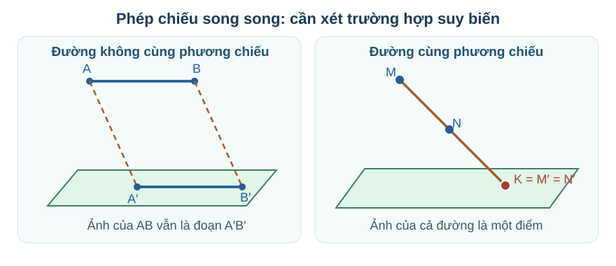

# Bài 14. Phép chiếu song song

TOÁN 11 · CHƯƠNG IV · KẾT NỐI TRI THỨC

Từ bóng cửa sổ tới phép chiếu song song: ảnh được dựng thế nào, giữ quan hệ gì và vì sao hình biểu diễn không cho phép đo góc, đo độ dài thật.

<nav class="thpt-r4-lesson-tabs"><a href="../">Chương IV</a><a href="../luyen-tap/">Core và Luyện tập</a><a href="../tu-kiem-tra-chuong/">Tự kiểm tra cuối chương</a></nav>

=== "Khám phá kiến thức"

    Khi ánh nắng chiếu qua khung cửa sổ, bóng của mỗi điểm trên khung rơi xuống một vị trí ở sàn nhà. Trong mô hình toán học, các tia nắng được coi là **cùng phương**. Thay vì đo bóng theo cảm giác, ta dùng **phép chiếu song song** để dựng ảnh của từng điểm, rồi từ các ảnh ấy vẽ hình biểu diễn cả vật thể. Bài học có ba mục theo SGK: phép chiếu, các tính chất, hình biểu diễn.

    ### 1.1. Phép chiếu song song

    Giả sử sàn nhà là mặt phẳng \((P)\), còn phương nắng được xác định bởi đường thẳng \(\Delta\) **không song song với \((P)\)**. Qua điểm \(M\) trên khung cửa, vẽ một đường thẳng cùng phương \(\Delta\). Đường này cắt \((P)\) tại duy nhất một điểm \(M'\): đó là **hình chiếu song song** của \(M\). Nếu \(M\) đã nằm trên \((P)\), điểm ảnh chính là \(M\). Vì mọi điểm đều được chiếu theo **một phương cố định**, ta nhận được hình chiếu của cả khung cửa bằng tập hợp các hình chiếu từng điểm.

    <figure class="thpt-r4-plot"><figcaption><strong>Đọc hình:</strong> đường \(AA'\), \(BB'\), \(CC'\), \(DD'\) đều có cùng phương chiếu. Hình dưới là **ảnh** của hình trên, không phải hình giống hệt theo mọi độ dài/góc. Chọn một điểm \(M\) bất kì, ảnh \(M'\) được dựng bằng đường qua \(M\) cùng phương ấy tới mặt chiếu.</figcaption></figure>

    **Vì sao phải hạn chế phương chiếu?** Nếu \(\Delta\) song song với \((P)\), đường chiếu qua một điểm ngoài \((P)\) có thể không gặp mặt chiếu, nên không xác định được ảnh như mong muốn. Vì thế trong phần học này SGK chọn phương chiếu **không song song với mặt phẳng chiếu**. Đây là điều kiện để ảnh của **mỗi điểm** có thể xác định.

    **Vận dụng.** Mặt chiếu là \((P)\), phương chiếu \(\Delta\) cắt \((P)\). Điểm \(A\in(P)\); điểm \(B\notin(P)\). Ảnh của \(A\) là gì, và cần dựng thế nào để được ảnh \(B'\) của \(B\)?

    ??? question "Đối chiếu"

        **Lời giải:** Vì \(A\) nằm sẵn trên mặt chiếu, \(A'=A\). Qua \(B\), vẽ đường thẳng song song với phương \(\Delta\) (hoặc trùng \(\Delta\) nếu \(B\in\Delta\)); giao duy nhất với \((P)\) là \(B'\). Không chọn đường chiếu khác phương nắng.

    ??? tip "Kiểm lỗi"

        Nếu chọn mỗi điểm một hướng riêng, đó không còn là **cùng một phép chiếu song song**. Nếu phương \(\Delta\parallel(P)\), từ điểm ngoài mặt không dựng được giao điểm; phải kiểm điều kiện trước.

    ### 1.2. Tính chất của phép chiếu song song

    Hãy xét một thanh thẳng \(AB\) có trung điểm \(M\). Dựng các ảnh \(A',M',B'\). Trong trường hợp thanh **không cùng phương chiếu**, ba ảnh vẫn **thẳng hàng theo thứ tự ấy**; vì \(AM=MB\), ảnh cũng có \(A'M'=M'B'\). Vậy **trung điểm được giữ lại**, mặc dù độ dài \(A'M'\) chưa chắc bằng độ dài \(AM\). Phép chiếu giữ **tỉ lệ** trên cùng một đường, không nhất thiết giữ từng độ dài.

    Nếu hai thanh **song song** \(a,b\), hình chiếu của chúng có thể là hai đường **song song hoặc trùng nhau**. Vì sao trùng? Có thể hai thanh nằm trên hai vị trí khác nhau nhưng trên cùng một mặt phẳng song song với phương chiếu; các tia chiếu đưa chúng về đúng một đường trên mặt chiếu. Trường hợp này hoàn toàn khác với **hai đường giao nhau**.

    Tuy nhiên có một ngoại lệ dễ bị bỏ qua khi nêu tính chất: **một đường thẳng cùng phương với phương chiếu có thể bị co thành một điểm**. Khi ấy không thể nói ảnh của nó vẫn là đường thẳng, hoặc lấy tỉ số hai đoạn ảnh có độ dài dương. Để áp dụng các phát biểu SGK về đường, tia, đoạn và tỉ số, ta phải xét các **hình chiếu không suy biến**.

    <figure class="thpt-r4-plot"><figcaption><strong>Đọc hình:</strong> trái: ảnh của hai điểm phân biệt \(A,B\) vẫn phân biệt nên có đoạn \(A'B'\). Phải: \(M,N\) khác nhau nhưng đường \(MN\) cùng phương chiếu, nên \(M'=N'=K\). Đây là ngoại lệ cần kiểm trước khi dùng tỉ số hình chiếu.</figcaption></figure>

    Ví dụ nếu \(A,M,B\) thẳng hàng theo thứ tự và \(AM:MB=2:3\), ảnh không suy biến sẽ có \(A'M':M'B'=2:3\). Nếu \(AB=10\) cm, \(AM=4\) cm, \(MB=6\) cm; nhưng nếu ảnh \(A'B'=15\) cm thì \(A'M'=6\) cm, \(M'B'=9\) cm — các độ dài đã đổi, còn **tỉ số vẫn 2:3**. Không được tự ghi \(A'M'=4\) cm.

    **Vận dụng.** Cho \(A,M,B\) thẳng hàng theo thứ tự, \(AM:MB=2:3\). Phép chiếu song song cho \(A'\ne B'\) và \(A'B'=20\) cm. Tính \(A'M'\) và \(M'B'\). Nếu phương chiếu trùng phương \(AB\), em có được thực hiện phép chia tỉ số ấy không?

    ??? question "Đối chiếu"

        **Lời giải:** Các ảnh giữ tỉ số \(A'M'/M'B'=2/3\) và \(A'M'+M'B'=20\), nên \(A'M'=8\) cm, \(M'B'=12\) cm. Nếu \(AB\) cùng phương chiếu, \(A'=M'=B'\), các đoạn ảnh đều dài \(0\), tỉ số \(0/0\) **không xác định**; không áp dụng công thức.

    ??? tip "Kiểm lỗi"

        Phép chiếu không bảo toàn **độ dài**, nên không đặt \(A'M'=AM\). Khi ảnh bị co thành điểm, không dùng tỉ số đoạn ảnh: cần kiểm \(A'\ne B'\) trước.

    ### 1.3. Hình biểu diễn của một hình không gian

    Bài 10 đã dùng các hình vẽ trên giấy để thể hiện khối trong không gian. Nay ta hiểu cách tạo chúng: **hình biểu diễn** là hình chiếu song song trên một mặt phẳng, hoặc một hình **đồng dạng** với hình chiếu đó. Mục đích không phải làm cho tất cả kích thước đúng như vật thật, mà giúp nhìn được cấu trúc, quan hệ điểm–đường–mặt và các cạnh bị che khuất.

    Khi một hình phẳng nằm trong mặt phẳng **không song song với phương chiếu**, ảnh của các tam giác vẫn là tam giác; hình vuông, hình chữ nhật, hình thoi và hình bình hành cho ảnh là **hình bình hành**; hình thang có cặp cạnh đáy song song vẫn biểu diễn bằng hình thang với hai đáy tương ứng song song, và **tỉ số hai đáy được giữ**; hình tròn có hình biểu diễn là **hình elip** (hình tròn có thể là trường hợp đặc biệt). Không được nhìn hình bình hành rồi khẳng định vật thật không phải hình vuông.

    Để vẽ hình chóp \(S.ABCD\) có đáy là hình bình hành, ta vẽ một hình bình hành \(ABCD\) thể hiện đáy, chọn điểm \(S\) ngoài mặt biểu diễn đáy, rồi nối \(S\) với bốn đỉnh. Nét liền thể hiện cạnh nhìn thấy, nét đứt thể hiện cạnh khuất theo góc quan sát đã chọn. Khi hình biểu diễn là kết quả phép chiếu hợp lệ, sự thẳng hàng và tỉ số trên một đường vẫn được giữ; nhưng **góc vuông và độ dài nhìn trên giấy không phải góc và độ dài thực**.

    <figure class="thpt-r4-plot"><figcaption><strong>Đọc hình:</strong> các cạnh đối diện của hình bình hành nguồn tiếp tục có ảnh song song; các góc và độ dài có thể thay đổi. Dùng hình để minh họa **bảo toàn cấu trúc**, không dùng thước đo ảnh để khẳng định số đo vật gốc.</figcaption></figure>

    **Vận dụng.** Một hình vuông \(ABCD\) có hai đường chéo cắt nhau tại \(O\). Hình biểu diễn không suy biến của nó là hình bình hành \(A'B'C'D'\), hai đường chéo cắt nhau tại \(O'\). Hãy giải thích vì sao \(O'\) vẫn là trung điểm của \(A'C'\) và \(B'D'\), dù các góc có thể không còn vuông.

    ??? question "Đối chiếu"

        **Lời giải:** \(O\) là trung điểm của \(AC\) và \(BD\), nên \(AO:OC=1:1\), \(BO:OD=1:1\). Phép chiếu không suy biến giữ sự thẳng hàng và các tỉ số ấy, suy ra \(A'O'=O'C'\) và \(B'O'=O'D'\). Do đó \(O'\) là giao điểm hai đường chéo và trung điểm của cả hai. Không cần giả định hình chiếu còn là hình vuông.

    ??? tip "Kiểm lỗi"

        Nếu lấy hai cạnh ảnh đo bằng thước rồi cho bằng cạnh thật, hoặc dựa vào hình ảnh để khẳng định góc \(90^\circ\), em đã dùng một tính chất phép chiếu **không bảo toàn**. Hãy ưu tiên quan hệ thuộc, song song và tỉ số đúng điều kiện.

=== "Kiến thức SGK"

    ### 2.1. Phép chiếu song song

    
<strong>Định nghĩa — Phép chiếu song song</strong>
Cho mặt phẳng \((P)\) và một đường thẳng \(\Delta\) **không song song với \((P)\)** xác định phương chiếu. Với mỗi điểm \(M\), gọi \(M'\) là giao điểm của \((P)\) với đường đi qua \(M\) song song \(\Delta\) (nếu \(M\in\Delta\), lấy chính \(\Delta\)). Ánh xạ \(M\mapsto M'\) là **phép chiếu song song** lên \((P)\) theo phương \(\Delta\); \(M'\) là **hình chiếu song song** của \(M\), \((P)\) là **mặt phẳng chiếu**.

    
<strong>Khái niệm — Hình chiếu của một hình</strong>
Hình chiếu của hình \(H\) qua phép chiếu song song là tập hợp tất cả hình chiếu \(M'\) của các điểm \(M\in H\). Nếu \(M\in(P)\) thì \(M'=M\). Mỗi điểm được chiếu theo **cùng một phương** cố định.

    **Điều kiện bắt buộc:** SGK xét phương chiếu \(\Delta\not\parallel(P)\) để đường qua điểm bất kì theo phương chiếu có giao điểm **duy nhất** với mặt chiếu. Nếu phương chiếu song song với mặt chiếu, phép dựng ảnh điểm ngoài mặt có thể không thực hiện được.

    <figure class="thpt-r4-plot"><figcaption><strong>Tra hình:</strong> mỗi đường nối \(A\) với \(A'\), \(B\) với \(B'\), ... có cùng phương; ảnh của cả hình lấy từ ảnh của từng điểm. Không kết luận bảo toàn chiều dài cạnh.</figcaption></figure>

    ### 2.2. Tính chất của phép chiếu song song

    
<strong>Tính chất — Ba nhóm tính chất SGK của phép chiếu song song</strong>
<strong>1. Thẳng hàng, thứ tự:</strong> ảnh của ba điểm thẳng hàng vẫn thẳng hàng và giữ thứ tự; ảnh của đường, tia, đoạn là đường, tia, đoạn <strong>khi đường chứa chúng không cùng phương chiếu</strong>.

<strong>2. Song song:</strong> ảnh của hai đường thẳng song song là hai đường song song hoặc trùng nhau <strong>khi ảnh không suy biến thành điểm</strong>.

<strong>3. Tỉ số:</strong> giữ tỉ số độ dài của hai đoạn cùng nằm trên một đường hoặc hai đường song song <strong>khi các đoạn ảnh có độ dài khác 0</strong>.

    **Cảnh báo suy biến:** Nếu một đường **cùng phương chiếu**, toàn bộ đường có thể chiếu thành **một điểm**. Trong trường hợp đó, các câu “ảnh là một đường” và “tỉ số độ dài được giữ” không áp dụng theo nghĩa không suy biến. Cần phân biệt điều kiện để **phép chiếu điểm tồn tại** với điều kiện để **ảnh của đường không co lại**.

    
<strong>Công thức — Tỉ số đoạn thẳng tương ứng</strong>
Với \(A,M,B\) thẳng hàng theo thứ tự, \(M\) nằm giữa \(A,B\), và hình chiếu \(A',M',B'\) **không suy biến**, ta có \(\dfrac{A'M'}{M'B'}=\dfrac{AM}{MB}\). Nếu \(AM=MB\), thì \(A'M'=M'B'\): ảnh của trung điểm là trung điểm đoạn ảnh.

    <figure class="thpt-r4-plot"><figcaption><strong>Tra hình:</strong> trái ảnh \(A'B'\) vẫn là một đoạn; phải \(M'=N'=K\), không còn đoạn ảnh có độ dài dương để tính tỉ số. Kiểm trường hợp này trước khi áp dụng công thức.</figcaption></figure>

    **Không được suy ra:** Phép chiếu song song nhìn chung **không bảo toàn độ dài, góc, tính vuông góc hoặc dạng hình tròn thành đường tròn**. Học sinh chỉ được dùng những quan hệ thật sự được tính chất bảo đảm.

    ### 2.3. Hình biểu diễn của một hình không gian

    
<strong>Khái niệm — Hình biểu diễn của hình không gian</strong>
Hình biểu diễn của một hình trong không gian là **hình chiếu song song của hình đó trên một mặt phẳng theo một phương nào đó hoặc hình đồng dạng với hình chiếu ấy**. Hình biểu diễn phục vụ việc đọc cấu trúc, không phải bản vẽ bảo toàn mọi góc và độ dài.

    
<strong>Tính chất — Hình biểu diễn của các hình phẳng không suy biến</strong>
Khi mặt phẳng chứa hình **không song song với phương chiếu**, hình biểu diễn của <strong>tam giác</strong> là tam giác; của <strong>hình vuông, chữ nhật, thoi, bình hành</strong> là hình bình hành; của <strong>hình thang</strong> là hình thang với hai đáy tương ứng song song, giữ **tỉ số hai đáy**; của <strong>hình tròn</strong> là hình elip (có thể là hình tròn ở trường hợp đặc biệt).

    **Cách đọc:** Dùng cạnh và đỉnh tương ứng, quan hệ thẳng hàng, song song và tỉ số hợp lệ để dựng/kiểm hình. Với khối chóp/lăng trụ, các cạnh thấy được thường vẽ nét liền, cạnh khuất nét đứt. Một hình bình hành trên giấy **có thể biểu diễn hình vuông**, nên không suy luận góc thật bằng góc đo của bản vẽ.

    **Ví dụ tra cứu:** Hình vuông \(ABCD\) với tâm \(O\) cho hình biểu diễn \(A'B'C'D'\) là hình bình hành. Vì hai đường chéo của hình vuông có trung điểm chung \(O\), hình chiếu \(O'\) vẫn là trung điểm của cả \(A'C'\), \(B'D'\), theo tính chất giữ tỉ số (khi không suy biến).

    <figure class="thpt-r4-plot"><figcaption><strong>Tra hình:</strong> bảo toàn quan hệ các cạnh song song khi ảnh không suy biến; chú ý phân biệt hình **biểu diễn** với mặt phẳng chiếu và với kích thước thật của vật thể.</figcaption></figure>
