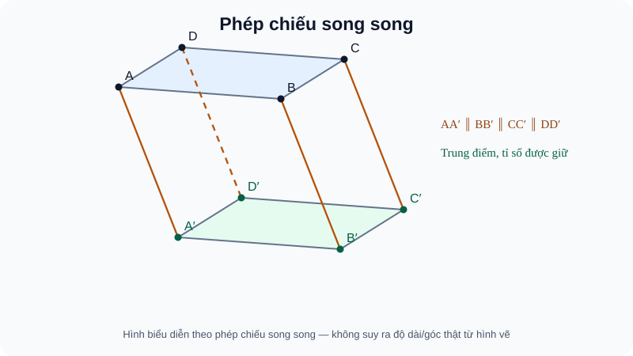

# Bài 14. Phép chiếu song song

TOÁN 11 · CHƯƠNG IV · SGK KNTT

Vì sao cần học → kiến thức/điều kiện → ví dụ → Tự thử trước Core → hình đọc đúng → luyện tập và khắc phục. Tự kiểm tra tự đối chiếu không ghi Mastery.
<nav class="thpt-r4-lesson-tabs"><a href="../">Chương IV</a><a href="../luyen-tap/">Core & Luyện tập</a><a href="../tu-kiem-tra-chuong/">Tự kiểm tra · tự đối chiếu</a></nav>

=== "Khám phá kiến thức"

    ### Cùng tìm hiểu

    Hình vuông được vẽ lên giấy dưới dạng hình bình hành: hình biểu diễn không giữ góc dù vẫn giữ tính song song. Hãy chiếu mọi điểm theo **cùng một hướng** lên mặt đích. Khi hướng cắt mặt đích, mỗi điểm có một ảnh; một đường trùng hướng chiếu có thể co thành một điểm. Vì vậy phép chiếu giữ một số quan hệ thẳng hàng và tỉ số trong trường hợp không suy biến nhưng không giữ góc hoặc độ dài nói chung.

    ### Ví dụ trực quan

    Chiếu hình từ không gian xuống một mặt phẳng giúp vẽ sơ đồ và truyền hình, nhưng độ dài và góc không nhất thiết được giữ nguyên.

    **Quan sát bằng số liệu:** Chiếu xiên một hình chữ nhật có thể tạo hình bình hành. Vì vậy hình chiếu giữ những quan hệ đã có điều kiện, không cho phép khẳng định mọi góc vuông vẫn là 90°.

    ### Thuật ngữ và kiến thức, kỹ năng

    **Thuật ngữ:** phép chiếu song song, hình biểu diễn, quan hệ bảo toàn.

    **Sau bài học, em cần:** xác định phương chiếu và phân biệt cấu trúc bảo toàn với số đo không bảo toàn.

=== "Kiến thức SGK"

    

    Cho mặt chiếu $(P)$ và một **phương** $\Delta$ không song song mặt chiếu (đường chỉ phương cắt $(P)$). Ảnh của $M$ là giao điểm duy nhất của $(P)$ với đường qua $M$ song song $\Delta$ (hoặc chính $\Delta$ khi $M$ nằm trên đường đó). Điểm nằm sẵn trên $(P)$ bất biến.

    **Tính chất trong trường hợp không suy biến.** Một đường thẳng không song song phương chiếu cho ảnh là đường thẳng; đường thẳng song song phương chiếu cho ảnh **là một điểm**, không phải đường. Ba điểm thẳng hàng cho ba ảnh thẳng hàng và giữ thứ tự khi ảnh đường không suy biến. Hai đường song song không theo phương chiếu có ảnh là hai đường song song **hoặc trùng nhau**; tỉ số hai đoạn thuộc cùng đường hoặc hai đường song song được giữ khi đoạn ảnh không co lại thành điểm. Từ đó trung điểm, trọng tâm tam giác, đường trung bình được bảo toàn khi hình tam giác không bị suy biến.

    **Không bảo toàn tổng quát:** số đo độ dài, góc, vuông góc, đường tròn thành đường tròn. Hình vuông có thể được biểu diễn bằng hình bình hành; đường tròn trong mặt phẳng xiên có thể biểu diễn thành elip. Khi vẽ hình chiếu song song cần phân biệt hình biểu diễn và hình thật, đánh dấu đúng đường khuất. Phép chiếu trong chùm tia hội tụ (phối cảnh) không phải phép chiếu song song.

    ### Đọc hình và đối chiếu khái niệm

    <figure class="thpt-r4-plot thpt-r4-probability-figure"><figcaption>Hai hình bình hành ABCD và A phẩy B phẩy C phẩy D phẩy ở hai mặt phẳng, các đường chiếu AA phẩy BB phẩy CC phẩy DD phẩy có cùng phương xiên; hình chiếu giữ song song, không nhất thiết giữ góc và độ dài.</figcaption></figure>

    phân biệt hình thật và hình biểu diễn; những đoạn theo hướng chiếu có thể suy biến, không mặc nhiên giữ độ dài/góc.

    ### Vận dụng — tự thử rồi mở đối chiếu

    Chiếu cạnh AA' của lăng trụ lên mặt đáy (ABC) theo phương AA': ảnh là đoạn hay điểm?

    

Em đã tự thử? Mở đối chiếu

    Chỉ là điểm A. Trở về D1 B14 và THPT-G11-CHIV-B14-C01.

    

=== "Ví dụ"

    **EX-G11-B14-EX01: Chiếu hình lăng trụ.** Trong lăng trụ tam giác ABC.A′B′C′, chiếu song song lên (ABC) theo phương AA′. Khi đó A′,B′,C′ lần lượt có ảnh A,B,C vì AA′∥BB′∥CC′, còn các điểm A,B,C của mặt đáy bất biến.

    **EX-G11-B14-EX02: Ảnh trung điểm.** Lấy M′ trung điểm A′B′ ở mặt trên lăng trụ. Hình chiếu theo phương AA′ lên (ABC) là M trung điểm AB. Lí do: ảnh A′B′ là AB không suy biến và bảo toàn tỉ số A′M′/M′B′=1.

    **EX-G11-B14-EX03: Ảnh suy biến một mặt.** Chiếu hình lăng trụ lên (ABC) theo phương AA′. Cạnh AA′ có ảnh là duy nhất A; toàn bộ mặt bên (ABB′A′) có ảnh là đoạn AB chứ không phải một mặt hai chiều.

    **EX-G11-B14-EX04: Giới hạn của hình biểu diễn.** Hình vuông trong không gian có thể được biểu diễn thành hình bình hành có góc không vuông. Phép chiếu song song bảo toàn các cặp cạnh song song khi không suy biến nhưng nói chung không bảo toàn góc hoặc độ dài.

    ### Lý do chọn phương pháp và giới hạn

    - `EX-G11-B14-EX01`: Theo dõi ảnh các cặp đỉnh theo phương chung; kiểm rõ điều kiện áp dụng trước kết luận.
    - `EX-G11-B14-EX02`: Tỉ số trung điểm chỉ bảo toàn khi ảnh đoạn không suy biến; kiểm rõ điều kiện áp dụng trước kết luận.
    - `EX-G11-B14-EX03`: Đường theo phương chiếu co lại thành điểm, mặt có thể co thành đoạn; kiểm rõ điều kiện áp dụng trước kết luận.
    - `EX-G11-B14-EX04`: Không coi số đo góc/độ dài trên hình biểu diễn là thật; kiểm rõ điều kiện áp dụng trước kết luận.

=== "Lỗi thường gặp"

    

Quên đường theo hướng chiếu có ảnh một điểm.
<ol><li><strong>Nhận diện:</strong> Quên đường theo hướng chiếu có ảnh một điểm.</li><li><strong>Nhắc đúng điều kiện:</strong> kiểm tra giả thiết về quan hệ đường–mặt và điểm đang xét.</li><li><strong>Sửa sai:</strong> Tách trường hợp suy biến trước khi dùng định lý ảnh đường.</li><li><strong>Tự thử:</strong> Chiếu lăng trụ theo AA′ lên đáy: ảnh của đoạn AA′ là gì? <strong>Tự đối chiếu:</strong> Một điểm A, vì AA′ theo phương chiếu.</li><li><strong>Quay lại câu gốc:</strong> giải lại <code>THPT-G11-CHIV-B14-P03</code> và tự nêu lí do mỗi giả thiết cần thiết.</li></ol>
<a href="../luyen-tap/?item=THPT-G11-CHIV-B14-P03">Quay lại THPT-G11-CHIV-B14-P03 để tự làm</a>

    

Cho rằng phép chiếu giữ độ dài và góc.
<ol><li><strong>Nhận diện:</strong> Cho rằng phép chiếu giữ độ dài và góc.</li><li><strong>Nhắc đúng điều kiện:</strong> kiểm tra giả thiết về quan hệ đường–mặt và điểm đang xét.</li><li><strong>Sửa sai:</strong> Chỉ kết luận các bất biến affine đủ điều kiện.</li><li><strong>Tự thử:</strong> Ảnh một đoạn có độ dài 2 cm; có suy ra đoạn gốc cũng 2 cm không? <strong>Tự đối chiếu:</strong> Không; phép chiếu song song không bảo toàn độ dài tổng quát.</li><li><strong>Quay lại câu gốc:</strong> giải lại <code>THPT-G11-CHIV-B14-P02</code> và tự nêu lí do mỗi giả thiết cần thiết.</li></ol>
<a href="../luyen-tap/?item=THPT-G11-CHIV-B14-P02">Quay lại THPT-G11-CHIV-B14-P02 để tự làm</a>

    ### Học tiếp

    [Core và Luyện tập Bài 14](luyen-tap.md) · [Tự luận Chương IV](../../../thu-vien/tu-luan-g11-chuong-iv.md) · [Tự kiểm tra cuối chương](tu-kiem-tra-chuong.md)
