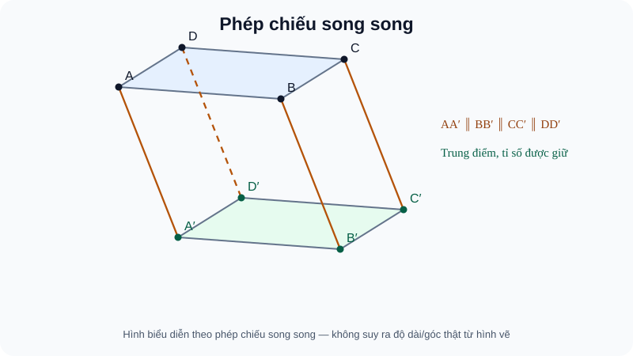

# Bài 14. Phép chiếu song song

TOÁN 11 · CHƯƠNG IV

Từ bóng nắng và hình vẽ 3D đến phép chiếu cùng phương: xác định ảnh, đọc tính chất giữ thẳng hàng/tỉ số, và nhận ra hình suy biến.

<nav class="thpt-r4-lesson-tabs"><a href="../">Chương IV</a><a href="../luyen-tap/">Core và Luyện tập</a><a href="../tu-kiem-tra-chuong/">Tự kiểm tra cuối chương</a></nav>

=== "Khám phá kiến thức"

    Khi ánh sáng Mặt Trời chiếu gần như **cùng một hướng**, bóng của nhiều điểm lên mặt đất được tạo bởi những đường **song song** đi qua từng điểm. Nhờ đó một hình không gian có thể được biểu diễn trên giấy. Nhưng hình vẽ có thể thay đổi **góc, độ dài**: một hình vuông nhìn xiên như hình bình hành. Bài này giải thích chính xác **điều gì được giữ và điều gì không được giữ**.

    ### 1.1. Mỗi điểm có một ảnh khi phương chiếu cắt mặt chiếu

    Chọn mặt phẳng \((P)\) và đường chỉ phương \(\Delta\) **cắt \((P)\) tại đúng một điểm** (không nằm trong hay song song với mặt). Qua mỗi điểm \(M\) dựng đường thẳng cùng phương \(\Delta\); vì phương này không nằm trong phương của mặt phẳng nên đường đó cắt \((P)\) tại đúng một điểm \(M'\), gọi là **hình chiếu song song** của \(M\). Nếu \(M\in(P)\) thì \(M'=M\). Nếu phương chiếu song song với mặt, một đường chiếu qua điểm ngoài mặt không gặp mặt; nếu đường chỉ phương nằm ngay trong mặt, các đường chiếu của điểm ở mặt nằm trọn trong mặt nên không có giao điểm duy nhất. **Vì thế cần điều kiện cắt tại một điểm**, không chỉ nhìn hình mà đoán.

    **Vận dụng.** Nếu điểm A đã thuộc mặt chiếu \((P)\), khi chiếu theo phương không song song P, ảnh A' có thể khác A không? Giải thích.

    

    ??? question "Đối chiếu"

        **Lời giải:** **Không.** Vì phương chiếu có phương cắt mặt chiếu tại đúng một điểm, đường chiếu qua A chỉ gặp \((P)\) ở A. Do đó **A'=A**: điểm đã nằm trên mặt chiếu bất biến. Nếu chọn một phương **nằm trong mặt**, đường chiếu qua A sẽ nằm trọn trong mặt và không xác định được một ảnh duy nhất.

    

    ??? tip "Kiểm lỗi"

        **Dấu hiệu:** Em chuyển cả những điểm đã nằm trên P theo một khoảng tùy ý.

        **Tự sửa:** Hãy dựng **đường chiếu qua chính điểm ấy** rồi lấy giao với mặt đích. Ôn mục 2.1 và luyện Core B14-C01 trong <a href="../luyen-tap/">Bài 14 – Luyện tập</a>.

    ### 1.2. Cả một đoạn có thể co lại thành một điểm

    Trong lăng trụ tam giác \(ABC.A'B'C'\), chiếu lên đáy \((ABC)\) theo phương cạnh bên \(AA'\). Vì \(AA',BB',CC'\) song song, A' được chiếu về A, B' về B, C' về C. Riêng cả đoạn **AA'** nằm trên một đường song song phương chiếu nên **mọi điểm** trên nó cùng có ảnh A. Đó là trường hợp suy biến; không thể đòi ảnh mọi đoạn đều là đoạn dài dương.

    **Vận dụng.** Khi chiếu lăng trụ \(ABC.A'B'C'\) về \((ABC)\) theo phương \(AA'\), ảnh của cả đoạn \(CC'\) là đoạn nào?

    

    ??? question "Đối chiếu"

        **Lời giải:** Vì \(CC'\parallel AA'\) nên mọi điểm của CC' nằm trên cùng một đường chiếu qua C. Giao của đường ấy với mặt \((ABC)\) là C. Do đó **ảnh đoạn \(CC'\) là một điểm C**, không phải một đoạn có chiều dài nào khác.

    

    ??? tip "Kiểm lỗi"

        **Dấu hiệu:** Em coi ảnh CC' vẫn là một đoạn vì “ảnh đường thẳng là đường thẳng”.

        **Tự sửa:** Kiểm trước đường gốc có **song song phương chiếu** không. Ôn mục 2.2, làm Practice B14-P03 tại <a href="../luyen-tap/">Core và Luyện tập</a>.

    ### 1.3. Trung điểm được giữ nếu ảnh đoạn không suy biến

    Với A,M,B thẳng hàng, M là trung điểm AB, phép chiếu song song giữ **tỉ số trên cùng một đường** nếu ảnh AB không co lại thành một điểm. Vì \(AM/MB=1\), ảnh M' chia A'B' theo tỉ số 1, nên M' là **trung điểm** của A'B'. Không thể dùng “độ dài tuyệt đối giữ nguyên”: hai độ dài có thể cùng thay đổi, chỉ **tỉ số** được giữ.

    **Vận dụng.** Trong lăng trụ, P' là trung điểm \(B'C'\). Chiếu xuống \((ABC)\) theo phương \(AA'\). Ảnh của P' là điểm nào trên BC, và vì sao?

    

    ??? question "Đối chiếu"

        **Lời giải:** B' có ảnh B, C' có ảnh C. Ảnh của đoạn \(B'C'\) là BC **không suy biến**; phép chiếu giữ tỉ số \(B'P'/P'C'=1\). Vì thế ảnh P của P' thỏa \(BP/PC=1\), tức **P là trung điểm BC**.

    

    ??? tip "Kiểm lỗi"

        **Dấu hiệu:** Em nói ảnh P' phải chia BC thành hai đoạn bằng đúng chiều dài của B'P' và P'C'.

        **Tự sửa:** Dùng **tỉ số 1:1**, không dùng độ dài tuyệt đối; ôn mục 2.2 và luyện Core B14-C02, Practice B14-P02 ở <a href="../luyen-tap/">Luyện tập Bài 14</a>.

    ### 1.4. Hai đường song song có thể cho hai ảnh song song hoặc trùng

    Khi chiếu hai đường phân biệt cùng phương nhưng **không song song phương chiếu**, ảnh thường là hai đường cùng phương trên mặt đích. Tuy vậy chúng có thể **trùng nhau** nếu cả hai đường gốc nằm trên cùng một mặt phẳng chứa phương chiếu. Muốn gọi hai ảnh song song theo nghĩa phân biệt, phải kiểm **không trùng**.

    **Vận dụng.** Hai đường \(a,b\) phân biệt song song, không cùng phương chiếu. Có chắc ảnh \(a',b'\) là hai đường **phân biệt** song song không? Nêu các khả năng.

    

    ??? question "Đối chiếu"

        **Lời giải:** Không chắc **phân biệt**. Vì a,b cùng phương không trùng phương chiếu, ảnh là hai đường có cùng phương, nên chúng có thể **song song nếu phân biệt** hoặc **trùng nhau**. Không thể khẳng định hai đường cắt nhau tại một điểm riêng lẻ.

    

    ??? tip "Kiểm lỗi"

        **Dấu hiệu:** Em viết “hai ảnh luôn song song phân biệt” dù hình có thể chồng hai đường lên cùng nét.

        **Tự sửa:** Kiểm ảnh đường có **suy biến** không và có **trùng nhau** không trước khi nêu song song. Ôn mục 2.2, luyện Practice B14-P04 trong <a href="../luyen-tap/">Core và Luyện tập</a>.

    ### 1.5. Hình biểu diễn không bảo toàn góc hoặc độ dài

    Một hình vuông có hai cặp cạnh đối song song. Qua phép chiếu không suy biến, ta có thể thu được một **hình bình hành**, giữ quan hệ song song nhưng các góc không còn nhất thiết là \(90^\circ\). Không được suy ra độ dài cạnh, diện tích hay góc vuông của hình gốc bằng cách đặt thước đo lên hình phối cảnh.

    **Vận dụng.** Khi thấy hình biểu diễn của một mặt vuông là hình bình hành có một góc \(60^\circ\), có thể kết luận góc thật của mặt vuông đó bằng \(60^\circ\) không? Vì sao?

    

    ??? question "Đối chiếu"

        **Lời giải:** **Không.** Phép chiếu song song nhìn chung **không bảo toàn góc**; hình vuông có góc thật \(90^\circ\) có thể được biểu diễn thành hình bình hành có góc \(60^\circ\). Các cặp cạnh đối song song là quan hệ có thể giữ khi không suy biến; số đo góc trên giấy không quyết định số đo góc trong không gian.

    

    ??? tip "Kiểm lỗi"

        **Dấu hiệu:** Em lấy thước đo góc của hình vẽ rồi coi là góc thật.

        **Tự sửa:** Tách **hình gốc** và **hình biểu diễn**, nêu các bất biến đúng điều kiện. Ôn mục 2.3 và Ví dụ 3.5; luyện Practice B14-P04 trong <a href="../luyen-tap/">Luyện tập Bài 14</a>.

=== "Kiến thức SGK"

    ### 2.1. Khái niệm phép chiếu song song

    
<strong>Định nghĩa:</strong> Cho mặt chiếu \((P)\) và đường chỉ phương \(\Delta\) **cắt \((P)\) tại một điểm duy nhất**. Với mỗi M, lấy đường thẳng qua M **cùng phương** \(\Delta\); đường này cắt \((P)\) tại một điểm duy nhất M'. Đó là hình chiếu song song của M. Điều kiện loại cả phương song song mặt lẫn đường chỉ phương nằm trong mặt; hai trường hợp ấy không định nghĩa được phép chiếu duy nhất cho mọi điểm.

    **Điểm bất biến:** Nếu M đã thuộc P, M'=M. Các đường chiếu **cùng phương** nhưng không nhất thiết vuông góc mặt đích; vì vậy phép chiếu song song không đồng nghĩa phép chiếu vuông góc.

    ### 2.2. Các tính chất của phép chiếu song song

    
<strong>Tính chất (trong trường hợp ảnh không suy biến):</strong> Phép chiếu giữ quan hệ thẳng hàng và thứ tự các điểm thẳng hàng, giữ **tỉ số hai đoạn trên cùng một đường thẳng hoặc hai đường thẳng song song** khi ảnh các đoạn không co thành điểm, và giữ các đường cùng phương thành những ảnh song song **hoặc trùng nhau** nếu các đường không theo phương chiếu.

    **Giới hạn bắt buộc:** Đường thẳng **song song phương chiếu** có ảnh một điểm, không phải đường. Trong trường hợp khác, ảnh đường là đường; trung điểm chia đoạn tỉ số 1:1 nên được bảo toàn khi đoạn ảnh không suy biến. Phép chiếu không bảo toàn tổng quát **góc, vuông góc, độ dài, diện tích**, hoặc hình tròn thành hình tròn.

    ### 2.3. Hình biểu diễn của hình không gian

    Hình biểu diễn thường là hình chiếu song song của một hình, hoặc hình đồng dạng với hình chiếu đó. Để vẽ: (1) chọn mặt biểu diễn và phương chiếu; (2) xác định ảnh các đỉnh; (3) nối các ảnh của cạnh theo **quan hệ liên thuộc**; (4) đánh dấu cạnh thấy và cạnh khuất; (5) chỉ suy những quan hệ mà phép chiếu bảo toàn.

    <figure class="thpt-r4-plot"><figcaption>Đọc hình: các đường nối đỉnh tương ứng có chung phương chiếu; các cặp cạnh song song có thể có ảnh song song. Vẽ hình xiên không bảo đảm góc hoặc độ dài giữ nguyên; cần kiểm trường hợp suy biến.</figcaption></figure>

    **Ứng dụng thực tiễn:** Bóng nắng khi các tia sáng gần như song song, hình biểu diễn vật thể trên bản vẽ kỹ thuật, các cạnh tương ứng của mô hình lăng trụ. Cần phân biệt mô hình lý tưởng với bóng thực có thể bị biến dạng do nguồn sáng phân kỳ.

=== "Ví dụ"

    ### 3.1. Hình chiếu các đỉnh của lăng trụ lên mặt đáy

    

<strong>Đề bài:</strong> Lăng trụ tam giác \(ABC.A'B'C'\), chiếu lên \((ABC)\) theo phương \(AA'\). Tìm ảnh A',B',C'.

    
<strong>Phân tích:</strong> Các cạnh bên AA',BB',CC' cùng phương; đường chiếu qua mỗi đỉnh trên đỉnh chạm đúng chân đáy tương ứng.

    
<strong>Lời giải:</strong> A'→A, B'→B, C'→C; vì các đường AA',BB',CC' đều song song phương chiếu và A,B,C thuộc mặt đáy.

    
<strong>Kiểm lại:</strong> A,B,C đã nằm trên mặt chiếu nên ảnh của chúng không đổi.

    ### 3.2. Một đường theo phương chiếu suy biến thành điểm

    

<strong>Đề bài:</strong> Với cùng lăng trụ, hình chiếu của đoạn \(BB'\) và mặt \(ABB'A'\) là gì?

    
<strong>Phân tích:</strong> BB' theo đúng hướng chiếu, mọi điểm trên nó cùng một đường chiếu. Trong mặt ABB'A', mọi đường qua A,B theo hướng chiếu được đưa về đáy.

    
<strong>Lời giải:</strong> Đoạn BB' có ảnh duy nhất điểm B. Toàn bộ hình bình hành ABB'A' có ảnh là **đoạn AB** (không phải một hình bình hành có diện tích dương).

    
<strong>Kiểm lại:</strong> A,A' đều cho ảnh A; B,B' đều cho ảnh B; các điểm ở giữa cho điểm trên AB.

    ### 3.3. Ảnh trung điểm qua phép chiếu không suy biến

    

<strong>Đề bài:</strong> Trong lăng trụ, M' là trung điểm \(A'C'\). Tìm ảnh của M' trên đáy theo phương \(AA'\).

    
<strong>Phân tích:</strong> A'→A, C'→C; đoạn A'C' không theo hướng chiếu nên ảnh là AC không suy biến.

    
<strong>Lời giải:</strong> Tỉ số A'M'/M'C'=1 được bảo toàn thành AM/MC=1. Vậy M, ảnh của M', là **trung điểm AC**.

    
<strong>Kiểm lại:</strong> M nằm trên AC và chia AC thành hai phần bằng nhau; không giả định hai độ dài AM và A'M' bằng nhau.

    ### 3.4. Hai đường song song có ảnh trùng nhau

    

<strong>Đề bài:</strong> Chiếu lăng trụ \(ABC.A'B'C'\) xuống đáy theo phương cạnh bên. Ảnh của hai đường \(AB,A'B'\) có phải hai đường **phân biệt** không?

    
<strong>Phân tích:</strong> A'→A và B'→B, còn A,B bất biến, nên hai ảnh đều đi qua A,B.

    
<strong>Lời giải:</strong> Ảnh của cả AB và A'B' là **cùng đường AB**; chúng trùng nhau, không phải hai đường phân biệt song song. Đây là một khả năng của tính chất ảnh các đường cùng phương.

    
<strong>Kiểm lại:</strong> Kiểm từng cặp đầu mút, không chỉ suy hai ảnh “song song” theo khẩu hiệu.

    ### 3.5. Hình vuông thành hình bình hành

    

<strong>Đề bài:</strong> Một hình vuông trong không gian được biểu diễn thành hình bình hành trên giấy. Từ hình ấy có thể khẳng định hai đường chéo hình gốc vuông góc do góc đo trên giấy không?

    
<strong>Phân tích:</strong> Hình gốc là hình vuông nên hai đường chéo vuông góc theo tính chất hình vuông đã học, **không phải vì** đo hình chiếu.

    
<strong>Lời giải:</strong> Ta biết hai đường chéo gốc vuông góc **do định nghĩa/tính chất hình vuông**. Nếu chỉ biết ảnh là một hình bình hành mà không có giả thiết gốc vuông, thì **không thể** suy góc thật từ phép đo trên giấy. Phép chiếu song song không bảo toàn tổng quát góc.

    
<strong>Kiểm lại:</strong> Phân biệt rõ kết luận suy ra từ **giả thiết hình gốc** và kết luận suy ra từ **hình biểu diễn**.

=== "Lỗi thường gặp"

    

    ??? tip "4.1. Tưởng đường theo phương chiếu vẫn có ảnh đường"

        **Dấu hiệu:** Em nói đoạn AA' trong lăng trụ có ảnh là một đoạn dương.

        **Vì sao sai:** Mọi điểm trên đường theo phương chiếu cùng rơi vào một điểm của mặt đích.

        **Tự sửa:** Ôn mục 2.2 và Ví dụ 3.2; luyện Practice B14-P03 ở <a href="../luyen-tap/">Bài 14 – Luyện tập</a>.

    

    ??? tip "4.2. Suy ảnh song song luôn là hai đường phân biệt"

        **Dấu hiệu:** Em nói ảnh AB và A'B' là hai đường song song dù cả hai cùng ảnh AB.

        **Vì sao sai:** Hai ảnh có thể trùng; chỉ khi phân biệt mới gọi song song.

        **Tự sửa:** Ôn mục 2.2, Ví dụ 3.4; luyện Practice B14-P04 ở <a href="../luyen-tap/">Luyện tập Bài 14</a>.

    

    ??? tip "4.3. Cho rằng độ dài/góc không đổi"

        **Dấu hiệu:** Em đo góc hình chiếu rồi lấy làm góc thật.

        **Vì sao sai:** Phép chiếu song song giữ cấu trúc affine có điều kiện nhưng không bảo toàn tổng quát góc hay độ dài.

        **Tự sửa:** Ôn mục 2.2–2.3 và Ví dụ 3.5; làm Practice B14-P02 tại <a href="../luyen-tap/">Core và Luyện tập</a>.

    

    ??? tip "4.4. Dùng tính chất tỉ số khi đoạn ảnh suy biến"

        **Dấu hiệu:** Em gọi ảnh trung điểm đoạn AA' là trung điểm một đoạn ảnh khác 0.

        **Vì sao sai:** Ảnh đoạn AA' chỉ là điểm A; không có tỉ số hai độ dài dương trong ảnh để áp dụng.

        **Tự sửa:** Kiểm ảnh đoạn **không co** trước; ôn mục 2.2 và Ví dụ 3.3, luyện Core B14-C02.

    **Học tiếp:** <a href="../luyen-tap/">Core và Luyện tập</a> · <a href="../tu-kiem-tra-chuong/">Tự kiểm tra cuối chương</a> · <a href="../../../../thu-vien/tu-luan-g11-chuong-iv/">Tự luận Chương IV</a>.

    
Nguồn tham khảo: SGK Toán 11 – Kết nối tri thức với cuộc sống, tập một, Bài 14 (trang in 95–101).

