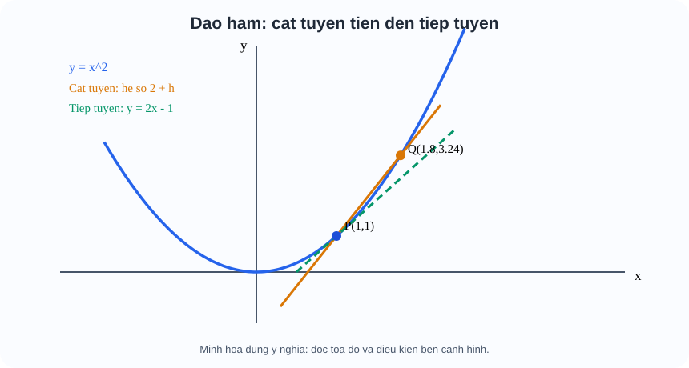
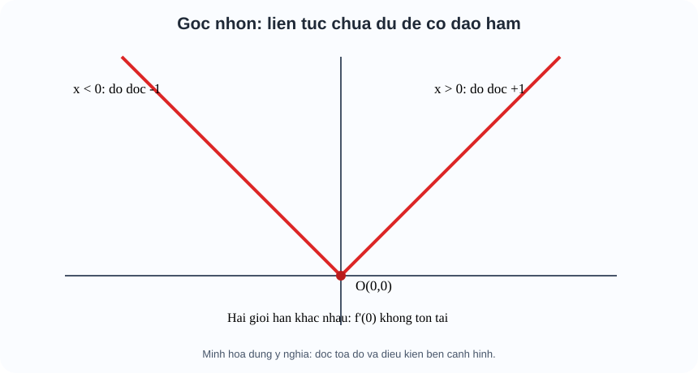

# Toán 11 · Bài 31. Định nghĩa và ý nghĩa của đạo hàm

TOÁN 11 · CHƯƠNG IX · BÀI 31 · SGK KNTT TẬP HAI

Hiểu nhu cầu → điều kiện → bản chất trước công thức → xem hình minh họa → Tự thử trước Core → ví dụ có suy luận → Core, Luyện tập và tự khắc phục. Không ghi Mastery từ hoạt động tự học.
<nav class="thpt-r4-lesson-tabs"><a href="../">Chương IX</a><a href="../luyen-tap/">Core/Luyện tập</a><a href="../tu-kiem-tra-chuong/">Tự kiểm tra tự đối chiếu</a></nav>

=== "Khám phá kiến thức"

    ### Cùng tìm hiểu

    ### 1.1. Một tốc độ trung bình có thể che giấu sự thay đổi ngay tại một thời điểm
    Giả sử quãng đường chuyển động $s(t)=t^2$ mét, thời gian $t$ giây. Trong khoảng từ $t=2$ đến $t=3$, vật đi từ 4 m đến 9 m, nên vận tốc trung bình bằng $(9-4)/(3-2)=5$ m/s. Nhưng vật có giữ vận tốc 5 m/s **đúng lúc** $t=2$ không? Không: khoảng đo 1 giây quá dài. Ta cần thu hẹp khoảng đo. Đó chính là nhu cầu hình thành đạo hàm, chứ không phải yêu cầu học thuộc ký hiệu $f'(x)$.

    ### Ví dụ trực quan

    Tốc độ trung bình trên cả chặng không nói chính xác tốc độ tại một thời điểm. Đạo hàm là giới hạn của độ dốc các dây cung khi hai thời điểm tiến sát nhau.

    **Quan sát bằng số liệu:** Nếu s(t)=t², tốc độ biến đổi tức thời tại t=3 là s'(3)=6. Kết quả khác với tốc độ trung bình trên khoảng [0,3] bằng 3.

    ### Thuật ngữ và kiến thức, kỹ năng

    **Thuật ngữ:** đạo hàm tại điểm, thương sai phân, tiếp tuyến, vận tốc tức thời.

    **Sau bài học, em cần:** lập tỉ số biến thiên, lấy giới hạn đúng điều kiện và đọc ý nghĩa đơn vị.

=== "Kiến thức SGK"

    ### 1.2. Từ vận tốc trung bình đến thương sai phân
    Với $y=f(x)$, tại $x=a$ và $x=a+h$ (đều thuộc miền xác định, $h\ne0$), độ tăng đầu vào là $h$, độ tăng đầu ra $\Delta y=f(a+h)-f(a)$. **Tốc độ biến đổi trung bình** là $\Delta y/h$. Nếu khi $h$ tiến về $0$ **từ cả hai phía** biểu thức này tiến đến một số hữu hạn $L$, ta định nghĩa đạo hàm tại $a$ là $f'(a)=L$. Viết đúng $f'(a)=\lim_{h\to0}[f(a+h)-f(a)]/h$. Không được lấy trực tiếp $h=0$ vì biểu thức ban đầu là $0/0$; phải rút gọn hay biến đổi rồi mới lấy giới hạn.

    **Thực hành trước khi xem công thức:** Với $f(x)=x^2$, hãy viết $f(2+h)-f(2)$; kết quả là $4h+h^2$, nên thương bằng $4+h$, giới hạn $4$. Đạo hàm tại 2 là 4 đơn vị đầu ra trên một đơn vị đầu vào. Nếu $f$ xác định và có đạo hàm tại mỗi điểm trên khoảng, ta nói $f$ có đạo hàm trên khoảng ấy và $f'(x)$ là một **hàm mới**.

    ### 1.3. Điều kiện toán học và các bẫy
    Đạo hàm thông thường tại điểm trong khoảng cần giới hạn sai phân **hai phía**, hữu hạn và nhất quán. Nếu chỉ có một phía hoặc thương sai phân vô hạn thì chưa có đạo hàm hữu hạn hai phía. **Có đạo hàm ⇒ liên tục** tại điểm ấy, nhưng chiều ngược lại sai: $f(x)=|x|$ liên tục tại 0 mà $[|h|-0]/h=1$ khi $h>0$, bằng $-1$ khi $h<0$ nên **không có đạo hàm ở 0**. Đừng nói mọi đồ thị nối liền đều có tiếp tuyến dốc hữu hạn. Đối với $f(x)=\sqrt{x}$, định nghĩa chỉ nhận $x\ge0$; trên $x>0$ có đạo hàm, còn tại biên 0 không có đạo hàm hai phía theo nghĩa thông thường trên khoảng.

    ### 1.4. Ý nghĩa hình học — Cát tuyến tiến tới tiếp tuyến
    Hai điểm $P(a,f(a))$, $Q(a+h,f(a+h))$ xác định đường **cát tuyến** với hệ số góc $[f(a+h)-f(a)]/h$. Khi $Q\to P$, nếu giới hạn hữu hạn, hệ số góc tiến tới $f'(a)$: đó là hệ số góc **tiếp tuyến** tại $P$. Phương trình tiếp tuyến là $y-f(a)=f'(a)(x-a)$. **Lưu ý** $f(a)$ là tung độ điểm tiếp xúc; $f'(a)$ là độ dốc; chúng không hoán đổi. **Hình FIG-G11-CHIX-B31-01:** cát tuyến trên $y=x^2$ qua $P(1,1)$ và $Q(1+h,(1+h)^2)$ tiến tới đường tiếp tuyến $y=2x-1$ khi $h\to0$; học sinh so sánh hệ số góc $2+h$ và 2.

    ### 1.5. Ý nghĩa vật lý và thực tế — dấu/đơn vị
    Với tọa độ $s(t)$ mét và $t$ giây, $v(t)=s'(t)$ có đơn vị m/s, **có dấu** (dương theo chiều quy ước, âm ngược chiều). **Tốc độ** là $|v(t)|$, không phải luôn $v(t)$. Trong mô hình nhiệt độ $T(t)$ đo bằng °C, $T'(t)$ có đơn vị °C/phút nếu $t$ là phút, diễn đạt tốc độ nhiệt độ đang thay đổi; không phải nhiệt độ $T$.

    ### Vận dụng — tự giải trước khi đối chiếu
    Tính vận tốc tức thời của $s(t)=3t^2+2t$ tại $t=1$ **bằng định nghĩa**. Vì sao phải rút gọn $h$ trước khi lấy giới hạn? Nếu $f(1)=5$ và $f'(1)=8$, phương trình tiếp tuyến là gì?

    

Em đã tự thử? Mở lời giải đối chiếu

<strong>Đối chiếu sau khi thử:</strong> thương $[s(1+h)-s(1)]/h=8+3h$, cho $v(1)=8$ m/s; chưa được đặt $h=0$ trong thương gốc; tiếp tuyến $y-5=8(x-1)$.

    **Liên kết D6:** nếu lấy $f(a)$ làm độ dốc, quay lại `HELP-G11-CHIX-B31-03`; nếu lấy $h=0$ sớm, xem `HELP-G11-CHIX-B31-01`; nếu quên trái/phải của $|x|$, xem `HELP-G11-CHIX-B31-02`.

    ### 1.7. Đọc hình để hiểu lập luận

    <figure class="thpt-r4-plot thpt-r4-calculus-figure"><figcaption>Hình minh họa 1 — đọc hình theo lời giải thích trong phần Kiến thức ở trên.</figcaption></figure>

    <figure class="thpt-r4-plot thpt-r4-calculus-figure"><figcaption>Hình minh họa 2 — đọc hình theo lời giải thích trong phần Kiến thức ở trên.</figcaption></figure>

=== "Ví dụ"

    #### EX-G11-CHIX-B31-01: Định nghĩa tại một điểm

    **Bài toán:** $f(x)=x^2+3x$, tìm $f'(1)$ từ $h$.

    **Phân tích, đáp án:** $[f(1+h)-f(1)]/h=5+h\to5$, do đó $f'(1)=5$.

    **Vì sao:** Rút gọn h rồi mới cho h→0; không thay h=0 ngay.

    #### EX-G11-CHIX-B31-02: Thương sai phân

    **Bài toán:** $f(x)=2x^2-1$, viết thương tại $a=3$.

    **Phân tích, đáp án:** $[f(3+h)-f(3)]/h=12+2h$, giới hạn 12.

    **Vì sao:** Lấy đạo hàm không phải chỉ lấy f(3)=17.

    #### EX-G11-CHIX-B31-03: Tiếp tuyến

    **Bài toán:** $f(x)=x^2-4x+1$ tại $x=3$.

    **Phân tích, đáp án:** $f(3)=-2$, $f'(3)=2$, tiếp tuyến $y+2=2(x-3)$ tức $y=2x-8$.

    **Vì sao:** Cần cả điểm (3,-2) và hệ số góc 2.

    #### EX-G11-CHIX-B31-04: Góc nhọn |x|

    **Bài toán:** Xét đạo hàm $f(x)=|x-2|$ tại $2$.

    **Phân tích, đáp án:** Thương tại 2 là $|h|/h$, hai giới hạn 1 và -1 khác nhau; không có đạo hàm tại 2.

    **Vì sao:** Hàm liên tục tại 2 chưa đảm bảo có đạo hàm.

    #### EX-G11-CHIX-B31-05: Vận tốc và dấu

    **Bài toán:** $s(t)=10-3t^2$ m, t giây. Tính $v(1)$.

    **Phân tích, đáp án:** $v=s'=-6t$ m/s, $v(1)=-6$ m/s; tốc độ 6 m/s.

    **Vì sao:** Âm là chiều ngược trục chọn, không phải tốc độ âm.

    #### EX-G11-CHIX-B31-06: Nhiệt độ biến thiên

    **Bài toán:** $T(t)=22+4t-t^2$ °C, t phút. Tính $T'(2)$.

    **Phân tích, đáp án:** $T'=4-2t$, $T'(2)=0$ °C/phút, nghĩa nhiệt độ tại thời điểm đó đang không tăng/giảm bậc nhất.

    **Vì sao:** Đơn vị đạo hàm = °C/phút, không phải °C.

    #### EX-G11-CHIX-B31-07: Đạo hàm trên khoảng

    **Bài toán:** Tính đạo hàm $f(x)=1/x$ và phát biểu khoảng khả vi.

    **Phân tích, đáp án:** $f'(x)=-1/x^2$ trên $(-\infty,0)$ và $(0,+\infty)$; không tại x=0.

    **Vì sao:** Tuy đạo hàm công thức có ở x≠0 nhưng không khẳng định trên ℝ.

    #### EX-G11-CHIX-B31-08: Cát tuyến tiến gần

    **Bài toán:** $f(x)=x^2$, P tại x=2, Q tại x=2+h. Hệ số góc? 

    **Phân tích, đáp án:** $(4h+h^2)/h=4+h$, tiến tới 4 khi h→0.

    **Vì sao:** Cát tuyến khác tiếp tuyến khi h≠0; lấy giới hạn.

=== "Lỗi thường gặp"

    

<strong>Chẩn đoán lỗi:</strong> Thế h=0 trước khi khử 0/0.
<ol><li><strong>Phát hiện lỗi:</strong> Thế h=0 trước khi khử 0/0.</li><li><strong>Truy lại bản chất + điều kiện:</strong> Tử f(a+h)-f(a) thường có nhân tử h; rút gọn chỉ với h≠0, sau đó mới lấy giới hạn.</li><li><strong>Xem lại vì sao (WHY/HOW):</strong> Mở D1 B31, so sánh mệnh đề định nghĩa với ví dụ D2; giải thích bằng lời trước khi biến đổi ký hiệu.</li><li><strong>Tự luyện câu khác có dẫn dắt:</strong> Với f(x)=4x², tại a=2 thương bao nhiêu?. <strong>Tự kiểm sau khi thử:</strong> 16+4h, giới hạn 16.</li><li><strong>Trở về câu canonical:</strong> <code>THPT-G11-CHIX-B31-C02</code> và giải lại, tự giải thích lí do từng bước; không lấy xem lời giải làm chứng cứ độc lập cho Mastery.</li></ol>
<a href="../luyen-tap/?item=THPT-G11-CHIX-B31-C02">Quay lại câu canonical THPT-G11-CHIX-B31-C02</a>

    

<strong>Chẩn đoán lỗi:</strong> Bỏ qua giới hạn một phía tại góc nhọn.
<ol><li><strong>Phát hiện lỗi:</strong> Bỏ qua giới hạn một phía tại góc nhọn.</li><li><strong>Truy lại bản chất + điều kiện:</strong> Tính hai thương khi h&gt;0 và h&lt;0; khác nhau thì không khả vi.</li><li><strong>Xem lại vì sao (WHY/HOW):</strong> Mở D1 B31, so sánh mệnh đề định nghĩa với ví dụ D2; giải thích bằng lời trước khi biến đổi ký hiệu.</li><li><strong>Tự luyện câu khác có dẫn dắt:</strong> Xét |x-5| tại x=5, độ dốc một bên?. <strong>Tự kiểm sau khi thử:</strong> Trái -1, phải +1.</li><li><strong>Trở về câu canonical:</strong> <code>THPT-G11-CHIX-B31-P06</code> và giải lại, tự giải thích lí do từng bước; không lấy xem lời giải làm chứng cứ độc lập cho Mastery.</li></ol>
<a href="../luyen-tap/?item=THPT-G11-CHIX-B31-P06">Quay lại câu canonical THPT-G11-CHIX-B31-P06</a>

    

<strong>Chẩn đoán lỗi:</strong> Nhầm tung độ với hệ số góc.
<ol><li><strong>Phát hiện lỗi:</strong> Nhầm tung độ với hệ số góc.</li><li><strong>Truy lại bản chất + điều kiện:</strong> Điểm tiếp xúc (a,f(a)) và độ dốc f'(a) là hai thông tin khác nhau.</li><li><strong>Xem lại vì sao (WHY/HOW):</strong> Mở D1 B31, so sánh mệnh đề định nghĩa với ví dụ D2; giải thích bằng lời trước khi biến đổi ký hiệu.</li><li><strong>Tự luyện câu khác có dẫn dắt:</strong> Nếu f(3)=7 và f'(3)=4, tiếp tuyến?. <strong>Tự kiểm sau khi thử:</strong> y-7=4(x-3).</li><li><strong>Trở về câu canonical:</strong> <code>THPT-G11-CHIX-B31-C08</code> và giải lại, tự giải thích lí do từng bước; không lấy xem lời giải làm chứng cứ độc lập cho Mastery.</li></ol>
<a href="../luyen-tap/?item=THPT-G11-CHIX-B31-C08">Quay lại câu canonical THPT-G11-CHIX-B31-C08</a>

    ### Học tiếp

    [Core/Luyện tập Bài 31](luyen-tap.md) · [Tự luận Chương IX](../../../thu-vien/tu-luan-g11-chuong-ix.md) · [Tự kiểm tra cuối chương](tu-kiem-tra-chuong.md)
