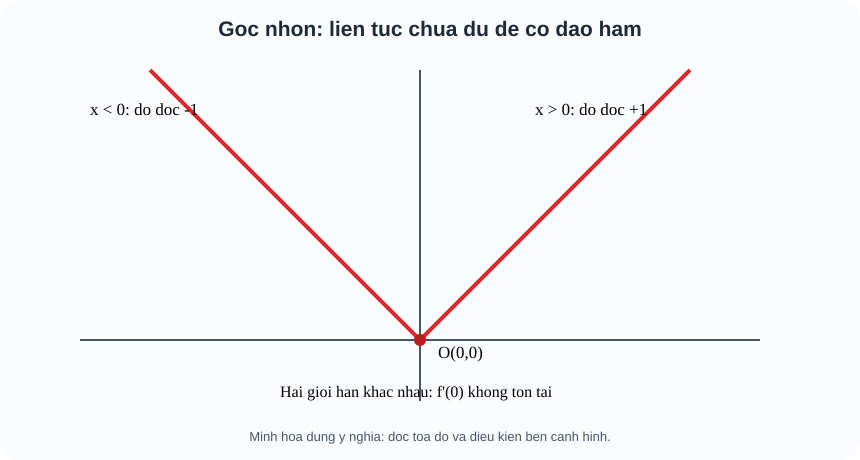

# Bài 31. Định nghĩa và ý nghĩa của đạo hàm

TOÁN 11 · CHƯƠNG IX · SGK KNTT TẬP HAI

Từ tốc độ trung bình đến tốc độ tức thời, từ cát tuyến đến tiếp tuyến; biết dùng độ dốc để giải bài toán ngược.
<nav class="thpt-r4-lesson-tabs"><a href="../">Chương IX</a><a href="../luyen-tap/">Core và Luyện tập</a><a href="../tu-kiem-tra-chuong/">Tự kiểm tra cuối chương</a></nav>

=== "Khám phá kiến thức"

    Một xe đi được 6 m trong một giây không có nghĩa ở mọi thời điểm trong giây đó xe đều chạy 6 m/s. Muốn biết nó đang thay đổi vị trí nhanh thế nào tại một thời điểm, ta thu hẹp khoảng đo quanh thời điểm ấy. Cùng ý tưởng này giúp đo độ dốc của đường cong, cường độ dòng điện và tốc độ thay đổi của một đại lượng.

    ### 1.1. Tốc độ biến đổi trung bình
    
    Nếu tọa độ tăng từ $s(t_1)$ đến $s(t_2)$, ta chia phần tăng cho thời gian đã trôi qua, không chia cho $t_2$. Tỉ số mang dấu theo chiều quy ước.
    
    **Vận dụng.** Một vật có $s(t)=t^2+2t$ (m). Tính vận tốc trung bình từ $t=1$ đến $t=4$ giây.
    
    
    
    ??? question "Đối chiếu"
    
        **Lời giải:** $s(1)=3$, $s(4)=24$, nên $v_{\rm tb}=(24-3)/(4-1)=7$ m/s.
    
    
    
    ??? tip "Kiểm lỗi"
    
        Tính riêng hai giá trị và hai hiệu, không lấy 24/4. [Luyện lại B31-C01](../luyen-tap/?item=THPT-G11-CHIX-B31-C01)

    ### 1.2. Thu hẹp khoảng đo
    
    Gọi $h$ là độ tăng đầu vào, có thể dương hoặc âm nhưng khác 0. Thương sai phân là độ tăng đầu ra chia $h$. Muốn biết tốc độ ngay tại điểm, tìm giới hạn của thương khi $h$ tiến về 0.
    
    **Vận dụng.** Với $f(x)=3x^2-1$, lập và rút gọn thương sai phân tại $a=2$ (chưa tính giới hạn).
    
    
    
    ??? question "Đối chiếu"
    
        **Lời giải:** $[3(2+h)^2-1-11]/h=(12h+3h^2)/h=12+3h$ với $h\ne0$.
    
    
    
    ??? tip "Kiểm lỗi"
    
        Không thay h=0 trong thương gốc. [Luyện lại B31-C02](../luyen-tap/?item=THPT-G11-CHIX-B31-C02)

    ### 1.3. Tìm đạo hàm tại một điểm
    
    Sau khi lập thương sai phân, nếu hai phía cùng tiến tới một số hữu hạn, số đó là đạo hàm tại điểm. Đây là tốc độ biến đổi tức thời, không phải giá trị hàm.
    
    **Vận dụng.** Dùng định nghĩa tính $f'(2)$ với $f(x)=x^2-2x+5$.
    
    
    
    ??? question "Đối chiếu"
    
        **Lời giải:** $f(2)=5$; tử sai phân $=2h+h^2$. Thương $=2+h$ với $h\ne0$; giới hạn bằng 2.
    
    
    
    ??? tip "Kiểm lỗi"
    
        Tách bước lập thương, rút gọn và lấy giới hạn. [Luyện lại B31-C03](../luyen-tap/?item=THPT-G11-CHIX-B31-C03)

    ### 1.4. Từ một số đến một hàm mới
    
    Nếu có đạo hàm tại từng điểm của khoảng thì ta có hàm đạo hàm. Phải giữ miền của hàm gốc, kể cả khi biểu thức sau biến đổi trông đơn giản hơn.
    
    **Vận dụng.** Với $f(x)=2/x$, dùng định nghĩa tại $a\ne0$ để tìm $f'(a)$; hàm khả vi trên các khoảng nào?
    
    
    
    ??? question "Đối chiếu"
    
        **Lời giải:** Thương $=-2/[a(a+h)]$ với $h\ne0,a+h\ne0$. Giới hạn $=-2/a^2$; các khoảng $(-\infty,0)$ và $(0,+\infty)$.
    
    
    
    ??? tip "Kiểm lỗi"
    
        Không đi qua điểm 0 khi nêu khoảng khả vi. [Luyện lại B31-C04](../luyen-tap/?item=THPT-G11-CHIX-B31-C04)

    ### 1.5. Liên tục là điều kiện cần
    
    Nếu thương sai phân có giới hạn hữu hạn thì $f(a+h)-f(a)$ bằng $h$ nhân thương, tiến về 0. Do đó có đạo hàm thì liên tục; chưa thể đảo chiều suy luận.
    
    **Vận dụng.** Một hàm có $f(0)=3$ nhưng giới hạn $f(x)$ khi $x\to0$ bằng 1. Có thể có đạo hàm tại 0 không?
    
    
    
    ??? question "Đối chiếu"
    
        **Lời giải:** Không. Hàm không liên tục tại 0; có đạo hàm tại 0 sẽ kéo theo liên tục tại đó.
    
    
    
    ??? tip "Kiểm lỗi"
    
        Kiểm liên tục trước khi thử tính đạo hàm. [Luyện lại B31-C05](../luyen-tap/?item=THPT-G11-CHIX-B31-C05)

    ### 1.6. Điểm gấp khúc
    
    Đồ thị chữ V có thể liền mạch, nhưng hai độ dốc khi tiến về đỉnh không trùng nhau. Cần nhìn hai phía, không chỉ vẽ một tiếp tuyến tưởng tượng.
    
    <figure class="thpt-r4-plot thpt-r4-calculus-figure"><figcaption>Đọc hình: Đồ thị \(y=|x|\) liên tục tại O. Độ dốc bên trái là −1, bên phải +1; vì vậy không có đạo hàm tại O.</figcaption></figure>
    
    **Vận dụng.** Xét đạo hàm của $f(x)=2|x-4|$ tại 4.
    
    
    
    ??? question "Đối chiếu"
    
        **Lời giải:** Thương $2|h|/h$ có giới hạn trái −2, phải 2. Không có đạo hàm tại 4, dù hàm liên tục.
    
    
    
    ??? tip "Kiểm lỗi"
    
        Tính riêng h âm và h dương. [Luyện lại B31-C06](../luyen-tap/?item=THPT-G11-CHIX-B31-C06)

    ### 1.7. Cát tuyến và độ dốc tức thời
    
    Độ dốc của đường qua hai điểm là hệ số góc cát tuyến. Khi điểm thứ hai tiến về điểm thứ nhất và hệ số góc có giới hạn hữu hạn, giới hạn cho hệ số góc tiếp tuyến.
    
    <figure class="thpt-r4-plot thpt-r4-calculus-figure"><figcaption>Đọc hình: Parabol \(y=x^2\), P(1;1), Q(1,8;3,24). Cát tuyến PQ có độ dốc 2,8; đường tiếp tuyến tại P có độ dốc 2 và phương trình \(y=2x-1\).</figcaption></figure>
    
    **Vận dụng.** Trên $y=x^2$, P có hoành độ −2; Q có hoành độ $-2+h$. Tính hệ số góc cát tuyến và giới hạn.
    
    
    
    ??? question "Đối chiếu"
    
        **Lời giải:** Thương $=(-4h+h^2)/h=-4+h$; giới hạn −4.
    
    
    
    ??? tip "Kiểm lỗi"
    
        Dấu của hệ số góc có ý nghĩa: tiếp tuyến đi xuống khi x tăng. [Luyện lại B31-C07](../luyen-tap/?item=THPT-G11-CHIX-B31-C07)

    ### 1.8. Một điểm và một độ dốc
    
    Biết tiếp điểm $(a,f(a))$ và hệ số góc $k=f'(a)$ thì dùng phương trình đường thẳng qua điểm: $y-f(a)=k(x-a)$. Tỉ số mức tăng tung độ trên mức tăng hoành độ chính là k. Khi thiết kế đường cong, có thể đi ngược từ yêu cầu độ dốc để tìm tham số.
    
    **Vận dụng.** Biết $f(-1)=6,f'(-1)=-2$. Viết phương trình tiếp tuyến.
    
    
    
    ??? question "Đối chiếu"
    
        **Lời giải:** $y-6=-2(x+1)$, hay $y=-2x+4$.
    
    
    
    ??? tip "Kiểm lỗi"
    
        Thay hoành độ −1 vào kết quả để kiểm tiếp điểm. [Luyện lại B31-C08](../luyen-tap/?item=THPT-G11-CHIX-B31-C08)

    ### 1.9. Vận tốc có dấu, tốc độ không âm
    
    Với tọa độ $s(t)$, vận tốc tức thời là $s'(t)$. Nghiệm thời điểm chạm mốc phải thuộc khoảng thời gian vật còn chuyển động theo mô hình.
    
    **Vận dụng.** $s(t)=15-2t^2$ m, $0<t<2$. Tính vận tốc và tốc độ tại t=1.
    
    
    
    ??? question "Đối chiếu"
    
        **Lời giải:** $v(t)=-4t$ m/s; $v(1)=-4$ m/s, tốc độ 4 m/s.
    
    
    
    ??? tip "Kiểm lỗi"
    
        Không gọi −4 là tốc độ. [Luyện lại B31-C09](../luyen-tap/?item=THPT-G11-CHIX-B31-C09)

    ### 1.10. Đơn vị và ý nghĩa
    
    Đạo hàm mang đơn vị đại lượng đầu ra chia đơn vị đầu vào. Điện lượng $Q(t)$ (C) biến đổi theo thời gian (s) thì cường độ tức thời là $I(t)=Q'(t)$ (A=C/s).
    
    **Vận dụng.** Điện lượng qua dây $Q(t)=2t^2+3t$ C. Tính cường độ tại t=2 s.
    
    
    
    ??? question "Đối chiếu"
    
        **Lời giải:** $I(t)=4t+3$, $I(2)=11$ C/s = 11 A.
    
    
    
    ??? tip "Kiểm lỗi"
    
        Không nhầm điện lượng tại thời điểm với cường độ. [Luyện lại B31-C10](../luyen-tap/?item=THPT-G11-CHIX-B31-C10)

    ### 1.11. Tự thiết kế độ dốc
    
    Vận dụng kiến thức vào một tình huống mới. Xác định điều kiện và phương pháp trước khi tính.
    
    **Vận dụng.** Mặt cắt $y=ax^2+bx$ (x,y tính bằng m) trên [0,10], hai độ dốc đầu–cuối là 0,3 và −0,1. Tìm a,b và $y(10)$.
    
    
    
    ??? question "Đối chiếu"
    
        **Lời giải:** $b=0,3$, $20a+b=-0,1$ nên $a=-0,02$; $y(10)=-2+3=1$ m (nếu x,y tính bằng m).
    
    
    
    ??? tip "Kiểm lỗi"
    
        Lập hai phương trình độ dốc; kiểm hai đầu bằng f′, không phải f. [Luyện lại B31-C08](../luyen-tap/?item=THPT-G11-CHIX-B31-C08)

=== "Kiến thức SGK"

    ### 2.1. Một số bài toán dẫn đến khái niệm đạo hàm
    
    
Tốc độ biến đổi trung bình của \(y=f(x)\) trên hai đầu mút \(a,b\) khác nhau là \(\dfrac{f(b)-f(a)}{b-a}\). Khi \(b\) tiến đến \(a\), giới hạn hữu hạn của tỉ số này diễn tả tốc độ tức thời. Với tọa độ \(s(t)\) (m), vận tốc tức thời \(v(t)=s'(t)\) (m/s) và tốc độ \(|v(t)|\); với điện lượng \(Q(t)\) (C), \(I(t)=Q'(t)\) (A). Dấu phụ thuộc chiều quy ước; chỉ áp dụng trong khoảng mô hình có ý nghĩa.

    ### 2.2. Đạo hàm của hàm số tại một điểm
    
    
<strong>Đạo hàm của hàm số tại một điểm.</strong>
Cho \(f\) xác định trên khoảng chứa \(a\). Nếu giới hạn sau tồn tại hữu hạn, nó là đạo hàm của \(f\) tại \(a\):
    
    \[f'(a)=\lim_{x\to a}\frac{f(x)-f(a)}{x-a}
    =\lim_{h\to0}\frac{f(a+h)-f(a)}{h}.\]
    
    

    **Cách tính:** Tính $f(a)$, lập và rút gọn thương với $h\ne0$, rồi lấy giới hạn hai phía. Nếu hai phía khác nhau hoặc giới hạn không hữu hạn thì không có đạo hàm hữu hạn thông thường tại điểm ấy. **Tính chất:** Có đạo hàm suy ra liên tục vì hiệu $f(a+h)-f(a)$ bằng $h$ nhân thương sai phân hữu hạn, nên tiến về 0. Chiều ngược lại sai: tại 0, $|x|$ có hai độ dốc −1 và 1. Ở đầu mút miền xác định không tự khẳng định đạo hàm hai phía.

    ### 2.3. Đạo hàm của hàm số trên một khoảng
    
    
<strong>Đạo hàm của hàm số trên một khoảng.</strong>
Nếu \(f\) có đạo hàm tại mọi điểm \(x\) của khoảng \(I\), ta gọi \(f\) có đạo hàm trên \(I\) và kí hiệu hàm mới là \(f'(x)\) hoặc \(y'\).

    Chẳng hạn với hằng số c, thương sai phân của c bằng 0, của x bằng 1, của $cx^2$ bằng $2cx+ch$.

    
<strong>Các công thức suy từ định nghĩa.</strong>
\((c)'=0\), \((x)'=1\), \((cx^2)'=2cx\), \((kx+c)'=k\).

    Xác định khoảng của hàm gốc trước khi phát biểu khả vi.

    ### 2.4. Ý nghĩa hình học của đạo hàm
    
    
<strong>Ý nghĩa hình học của đạo hàm.</strong>
Cát tuyến PQ với \(P(a,f(a)),Q(a+h,f(a+h))\) có hệ số góc là thương sai phân. Khi \(h\to0\), nếu hệ số góc có giới hạn hữu hạn, tiếp tuyến tại P có hệ số góc \(k=f'(a)\).

    
<strong>Phương trình tiếp tuyến.</strong>

    
    \[y-f(a)=f'(a)(x-a).\]

    Nếu tiếp tuyến tạo góc \(\alpha\) với chiều dương trục hoành (góc không phải 90°), \(k=\tan\alpha\). Với đường dốc có góc nghiêng không quá \(\theta\) so với phương ngang, yêu cầu \(|f'(x)|\le\tan\theta\) (\(0\le\theta\lt90^\circ\)). Có thể tìm tham số của mô hình parabol từ độ dốc tại các điểm; sau đó kiểm lại chiều cao, đơn vị và toàn bộ đoạn đường. Xem ví dụ cầu parabol và đường nối có độ dốc cho trước ở tab Ví dụ.

=== "Ví dụ"

    ### 3.1. Định nghĩa tại một điểm
    
    

<strong>Đề bài:</strong> \(f(x)=x^2+3x\), tìm \(f'(1)\) bằng định nghĩa.

<strong>Phân tích:</strong> Rút gọn h rồi mới cho h→0; không thay h=0 ngay.

<strong>Lời giải:</strong> \([f(1+h)-f(1)]/h=5+h\to5\), do đó \(f'(1)=5\).

<strong>Kiểm lại:</strong> Hàm đa thức có thương sai phân xác định với mọi h khác 0; tại 1, giới hạn là 5.

    ### 3.2. Thương sai phân
    
    

<strong>Đề bài:</strong> \(f(x)=2x^2-1\), viết thương tại \(a=3\).

<strong>Phân tích:</strong> Tính hiệu f(3+h)−f(3), chia h≠0 trước khi lấy giới hạn.

<strong>Lời giải:</strong> \([f(3+h)-f(3)]/h=12+2h\), giới hạn 12.

<strong>Kiểm lại:</strong> Tại h=0 không thay vào thương ban đầu, chỉ lấy giới hạn của biểu thức đã rút gọn.

    ### 3.3. Tiếp tuyến
    
    

<strong>Đề bài:</strong> Viết phương trình tiếp tuyến của \(f(x)=x^2-4x+1\) tại \(x=3\).

<strong>Phân tích:</strong> Tìm tung độ tiếp điểm và hệ số góc bằng thương sai phân; sau đó viết phương trình đường thẳng.

<strong>Lời giải:</strong> \(f(3)=-2\). Thương sai phân tại 3 là \(2+h\), nên \(f'(3)=2\). Tiếp tuyến \(y+2=2(x-3)\), tức \(y=2x-8\).

<strong>Kiểm lại:</strong> Thay x=3 vào y=2x−8 cho y=−2; hệ số góc 2.

    ### 3.4. Điểm gấp khúc của hàm trị tuyệt đối
    
    

<strong>Đề bài:</strong> Xét đạo hàm \(f(x)=|x-2|\) tại \(2\).

<strong>Phân tích:</strong> Hàm liên tục tại 2 chưa đảm bảo có đạo hàm.

<strong>Lời giải:</strong> Thương tại 2 là \(|h|/h\), hai giới hạn 1 và -1 khác nhau; không có đạo hàm tại 2.

<strong>Kiểm lại:</strong> Tại x=2, hàm có giá trị 0 nhưng hai độ dốc một phía khác nhau.

    ### 3.5. Vận tốc và dấu
    
    

<strong>Đề bài:</strong> \(s(t)=10-3t^2\) m, t giây. Tính \(v(1)\).

<strong>Phân tích:</strong> Âm là chiều ngược trục chọn, không phải tốc độ âm.

<strong>Lời giải:</strong> Theo định nghĩa của hàm bậc hai, \(v=s'=-6t\) m/s; \(v(1)=-6\) m/s; tốc độ 6 m/s.

<strong>Kiểm lại:</strong> Vận tốc hướng âm, tốc độ không âm.

    ### 3.6. Nhiệt độ biến thiên
    
    

<strong>Đề bài:</strong> \(T(t)=22+4t-t^2\) °C, t phút. Tính \(T'(2)\).

<strong>Phân tích:</strong> Đơn vị đạo hàm = °C/phút, không phải °C.

<strong>Lời giải:</strong> \(T'=4-2t\), \(T'(2)=0\) °C/phút, nghĩa nhiệt độ tại thời điểm đó đang không tăng/giảm bậc nhất.

<strong>Kiểm lại:</strong> T′(2)=0 là tốc độ biến đổi tại một thời điểm, không chứng minh nhiệt độ không đổi suốt một khoảng.

    ### 3.7. Đạo hàm trên khoảng
    
    

<strong>Đề bài:</strong> Tính đạo hàm \(f(x)=1/x\) và phát biểu khoảng khả vi.

<strong>Phân tích:</strong> Dùng định nghĩa ở B31 thay vì công thức đạo hàm thương ở bài sau.

<strong>Lời giải:</strong> Với \(x\ne0\), và \(h\ne0,x+h\ne0\), thương sai phân \([1/(x+h)-1/x]/h=-1/[x(x+h)]\), tiến tới \(-1/x^2\). Hàm khả vi trên \((-\infty,0)\) và \((0,+\infty)\); không tại 0.

<strong>Kiểm lại:</strong> Không lấy x=0 vì hàm gốc không xác định.

    ### 3.8. Cát tuyến tiến gần
    
    

<strong>Đề bài:</strong> \(f(x)=x^2\), P tại x=2, Q tại x=2+h. Hệ số góc? 

<strong>Phân tích:</strong> Cát tuyến khác tiếp tuyến khi h≠0; lấy giới hạn.

<strong>Lời giải:</strong> \((4h+h^2)/h=4+h\), tiến tới 4 khi h→0.

<strong>Kiểm lại:</strong> Khi h=0, P trùng Q, cát tuyến không còn xác định; lấy giới hạn.

    ### 3.9. Tiếp tuyến ngược từ hai độ dốc
    
    

<strong>Đề bài:</strong> Mô hình đường nối \(y=ax^2+bx\) (x,y tính bằng m) trên \(0\le x\le20\). Độ dốc đầu đoạn là 0,2, cuối đoạn là −0,2. Tìm a,b và độ cao tại trung điểm.

<strong>Phân tích:</strong> Với parabol, \(y'=2ax+b\) (từ thương sai phân). Dùng hai độ dốc để lập hệ.

<strong>Lời giải:</strong> \(b=0,2\), \(40a+0,2=-0,2\) nên \(a=-0,01\). \(y(10)=-1+2=1\) m.

<strong>Kiểm lại:</strong> \(y'(0)=0,2\), \(y'(20)=-0,2\); hai đầu có độ cao 0. Độ dốc là tỉ số m/m.

    ### 3.10. Cầu parabol với giới hạn độ nghiêng
    
    

<strong>Đề bài:</strong> Một cầu dài theo phương ngang 120 m, có mặt cắt \(y=H(1-x^2/60^2)\), \(-60\le x\le60\), H&gt;0. Yêu cầu góc nghiêng của tiếp tuyến so với phương ngang không quá 8°. Tìm giới hạn trên của H.

<strong>Phân tích:</strong> Độ dốc lớn nhất về trị tuyệt đối của parabol nằm tại hai đầu đoạn; dùng tỉ số độ dốc, không dùng trực tiếp số đo góc.

<strong>Lời giải:</strong> \(y'=-2Hx/3600=-Hx/1800\). Do \(|x|\le60\), \(|y'|\le H/30\), đạt bằng tại hai đầu. Yêu cầu \(H/30\le\tan8^\circ\), tức \(H\le30\tan8^\circ\approx4,22\) m.

<strong>Kiểm lại:</strong> Thay giới hạn vào hai đầu cho góc đúng 8°. Với H nhỏ hơn thì cả đoạn thỏa. Đây là mô hình hình học, không phải chỉ dẫn thiết kế cầu thực tế.

    ### 3.11. Mô hình chạm đất
    
    

<strong>Đề bài:</strong> Một vật thả từ độ cao 45 m, lấy \(g=10\) m/s² và bỏ qua cản không khí. Quãng rơi theo chiều xuống \(s(t)=5t^2\). Tìm thời điểm chạm đất và tốc độ ngay trước chạm đất.

<strong>Phân tích:</strong> Giải điều kiện \(s(t)=45\) với \(t\ge0\) trước, sau đó tính vận tốc tức thời theo định nghĩa của hàm bậc hai.

<strong>Lời giải:</strong> \(5t^2=45\) cho \(t=3\) s (loại −3). \(v(t)=10t\), nên tốc độ ngay trước chạm đất là 30 m/s.

<strong>Kiểm lại:</strong> Không tiếp tục dùng mô hình rơi tự do sau lúc chạm đất.

=== "Lỗi thường gặp"

    
    
    ??? tip "4.1. Thay h=0 quá sớm"
    
        Với $f(x)=4x^2$ tại 2, thương bằng $16+4h$ khi $h\ne0$; lúc ấy mới lấy giới hạn 16. [Luyện lại B31-C02](../luyen-tap/?item=THPT-G11-CHIX-B31-C02)

    
    
    ??? tip "4.2. Chỉ xét một phía ở điểm gấp"
    
        Thử $|x-5|$ tại 5: bên trái −1, bên phải 1; không khả vi. [Luyện lại B31-P06](../luyen-tap/?item=THPT-G11-CHIX-B31-P06)

    
    
    ??? tip "4.3. Nhầm tung độ với độ dốc"
    
        Nếu $f(3)=7,f'(3)=4$, hãy viết $y-7=4(x-3)$; kiểm cả điểm và độ dốc. [Luyện lại B31-C08](../luyen-tap/?item=THPT-G11-CHIX-B31-C08)

    [Core và Luyện tập Bài 31](luyen-tap.md) · [Tự luận Chương IX](../../../thu-vien/tu-luan-g11-chuong-ix.md) · [Tự kiểm tra cuối chương](tu-kiem-tra-chuong.md)

*Nguồn đối chiếu: SGK Toán 11 Kết nối tri thức với cuộc sống, Tập hai, Bài 31, trang in 81–87.*
