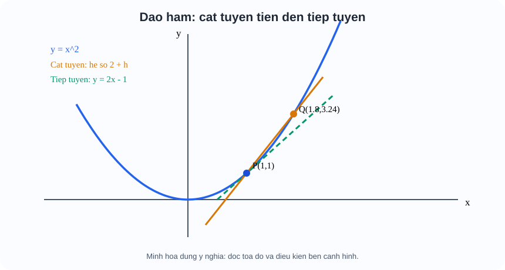

# Bài 31. Định nghĩa và ý nghĩa của đạo hàm

TOÁN 11 · CHƯƠNG IX · KẾT NỐI TRI THỨC · TẬP HAI

Từ vận tốc trung bình đến vận tốc tại một thời điểm; từ độ dốc của cát tuyến đến tiếp tuyến của đường cong. Cả hai đều dẫn đến đạo hàm.

<nav class="thpt-r4-lesson-tabs"><a href="../">Chương IX</a><a href="../luyen-tap/">Core/Luyện tập</a><a href="../tu-kiem-tra-chuong/">Tự kiểm tra cuối chương</a></nav>

=== "Khám phá kiến thức"

    ### 1.1. Một số bài toán dẫn đến khái niệm đạo hàm

    Khi nhìn đồng hồ đo tốc độ của một chiếc xe, ta muốn biết xe đang chạy nhanh đến đâu **ngay lúc đó**. Nhưng phép tính quen thuộc \(\text{quãng đường}/\text{thời gian}\) lại cho tốc độ **trung bình trong một khoảng thời gian**. Hai điều này khác nhau nếu xe đang tăng tốc hoặc giảm tốc.

    Hãy xét một vật chuyển động theo chiều dương với tọa độ \(s(t)=t^2\) mét, trong đó \(t\) tính bằng giây. Từ \(t=2\) đến \(t=3\), vận tốc trung bình là \((9-4)/(3-2)=5\) m/s. Nếu chỉ xét từ \(t=2\) đến \(t=2{,}1\), ta được \((2{,}1^2-2^2)/0{,}1=4{,}1\) m/s; còn từ \(t=2\) đến \(t=2{,}01\) thì được \(4{,}01\) m/s. Khoảng đo càng thu hẹp về \(t=2\), các giá trị càng tiến gần **\(4\) m/s**. Đó là vận tốc tức thời tại \(t=2\).

    Một tình huống khác có cùng bản chất: điện lượng \(Q(t)\), tính bằng culông (C), đã đi qua tiết diện dây dẫn từ thời điểm bắt đầu đến thời điểm \(t\). Trong một khoảng thời gian, cường độ dòng điện trung bình bằng **lượng điện tích tăng thêm chia cho thời gian**; khi khoảng đo co lại về một thời điểm, giới hạn ấy cho **cường độ dòng điện tức thời** (A = C/s).

    Vận tốc và cường độ dòng điện là hai đại lượng khác nhau nhưng chung một câu hỏi: **một đại lượng đang thay đổi nhanh đến mức nào ngay tại thời điểm đang xét?** Từ nhu cầu đó, ta đi đến một giới hạn toán học có thể dùng cho mọi hàm số thích hợp.

    ### 1.2. Đạo hàm của hàm số tại một điểm

    Giả sử \(y=f(x)\) và ta cần xem giá trị hàm biến đổi nhanh thế nào quanh \(x_0\). Khi đầu vào tăng thêm một lượng \(h\ne0\), đầu ra tăng thêm \(f(x_0+h)-f(x_0)\). Thương

    \[
    \frac{f(x_0+h)-f(x_0)}h
    \]

    là **tốc độ biến đổi trung bình** trên khoảng rất ngắn đó. Nếu thương có giới hạn **hữu hạn và giống nhau khi \(h\to0\) từ hai phía**, ta gọi giới hạn ấy là **đạo hàm tại \(x_0\)**, kí hiệu \(f'(x_0)\).

    Để hình dung phép tính, lấy \(f(x)=x^2+2x\) và \(x_0=1\). Khi ấy \(f(1)=3\), còn

    \[
    f(1+h)-f(1)=(1+h)^2+2(1+h)-3=4h+h^2.
    \]

    Với \(h\ne0\), thương bằng \(4+h\), nên \(f'(1)=\lim_{h\to0}(4+h)=4\). Ta **không hề thay \(h=0\) vào phân thức ban đầu**: lúc đó mẫu số bằng \(0\). Chỉ sau khi rút gọn ở những giá trị \(h\ne0\), ta mới lấy giới hạn.

    Không phải hàm số nào cũng có đạo hàm tại mọi điểm. Hàm \(f(x)=|x|\) liên tục tại \(0\), nhưng với \(h>0\), \(|h|/h=1\), còn với \(h<0\), \(|h|/h=-1\). Hai phía không tiến đến cùng một giá trị, vì vậy **không có đạo hàm tại \(0\)**.

    <figure class="thpt-r4-plot thpt-r4-calculus-figure"><figcaption><strong>Đọc hình:</strong> khi đi đến \(O(0;0)\) từ bên trái, đường thẳng có hệ số góc \(-1\); từ bên phải là \(1\). Đồ thị liền nét nhưng đổi dốc đột ngột tại \(O\); đó là lí do không có đạo hàm hai phía ở điểm này.</figcaption></figure>

    **Vận dụng.** Cho \(f(x)=3x^2+2x\). Dùng định nghĩa, tính \(f'(1)\). Trong quá trình giải, hãy chỉ rõ chỗ nào cần giả thiết \(h\ne0\).

    ??? question "Đối chiếu"

        **Lời giải.** Ta có \(f(1)=5\) và \(f(1+h)=3(1+h)^2+2(1+h)=5+8h+3h^2\). Do đó, với \(h\ne0\),

        \[
        \frac{f(1+h)-f(1)}h=\frac{8h+3h^2}{h}=8+3h.
        \]

        Lấy \(h\to0\), suy ra \(f'(1)=8\).

        **Kiểm lỗi:** Nếu thay \(h=0\) từ đầu, ta nhận \(0/0\), vốn không xác định. Điều cần xét là **giới hạn khi \(h\) gần \(0\)**, không phải giá trị phân thức tại \(h=0\).

    ### 1.3. Đạo hàm của hàm số trên một khoảng

    Ở ví dụ vừa rồi, ta chỉ tính đạo hàm tại một điểm. Nếu muốn biết tốc độ biến đổi **ở mọi vị trí**, ta làm tương tự với một điểm \(x\) bất kì trong khoảng đang xét. Mỗi điểm cho một giá trị đạo hàm; ghép các giá trị lại, ta được **một hàm số mới** \(f'(x)\).

    Chẳng hạn, với \(f(x)=cx^2\), trong đó \(c\) là một hằng số, tại điểm \(x\) bất kì ta có

    \[
    \frac{f(x+h)-f(x)}h
    =\frac{c(x+h)^2-cx^2}{h}
    =2cx+ch \quad (h\ne0).
    \]

    Khi \(h\to0\), kết quả là \(f'(x)=2cx\). Vì vậy, đạo hàm của \(x^2\) là \(2x\) trên toàn trục số. Còn hàm số **không đổi** \(f(x)=c\) có đạo hàm \(0\); hàm \(f(x)=x\) có đạo hàm \(1\). Các kết quả này đều có thể tự tìm bằng định nghĩa.

    Nhờ vậy, nếu một vật chuyển động có tọa độ \(s(t)\) mét theo thời gian \(t\) giây, thì \(s'(t)\) cho **vận tốc tức thời** (m/s) khi đạo hàm tồn tại. Vận tốc có thể **âm** nếu vật đi ngược chiều dương đã chọn; khi hỏi **tốc độ** (độ lớn vận tốc), lấy \(|s'(t)|\). Với điện lượng \(Q(t)\) đo bằng C, \(Q'(t)\) là cường độ dòng điện tức thời đo bằng A. Đơn vị của đạo hàm nói lên **đại lượng đầu ra thay đổi bao nhiêu trên một đơn vị đầu vào**.

    **Vận dụng.** Giả sử \(s(t)=5t^2-2t\) (m), \(t\ge0\) (s), với chiều dương đã chọn. Dùng kết quả đạo hàm của \(cx^2\) và \(x\), tìm \(v(t)\), rồi tính **vận tốc và tốc độ** tại \(t=0{,}1\) và \(t=1\) giây.

    ??? question "Đối chiếu"

        **Lời giải.** Trên khoảng \(t>0\), \(v(t)=s'(t)=10t-2\) (m/s). Tại \(t=0{,}1\), \(v(0{,}1)=10\cdot0{,}1-2=-1\) m/s, nên tốc độ là \(1\) m/s. Tại \(t=1\), \(v(1)=8\) m/s và tốc độ bằng \(8\) m/s.

        **Kiểm lại:** Cả hai thời điểm đều nằm trong khoảng \(t>0\) đang xét. Vận tốc ở thời điểm đầu âm nghĩa vật đi **ngược** chiều dương; tốc độ vẫn không âm.

    ### 1.4. Ý nghĩa hình học của đạo hàm

    Trên đồ thị \(y=f(x)\), lấy điểm \(P(x_0;f(x_0))\) cố định và điểm \(Q(x_0+h;f(x_0+h))\) ở gần đó. Đường thẳng qua \(P,Q\) gọi là **cát tuyến**. Hệ số góc của nó chính là

    \[
    k_{PQ}=\frac{f(x_0+h)-f(x_0)}h.
    \]

    Khi \(Q\) tiến dần về \(P\), nếu thương trên tiến tới giới hạn hữu hạn thì các cát tuyến tiến về **tiếp tuyến** tại \(P\). Vậy **đạo hàm \(f'(x_0)\) là hệ số góc của tiếp tuyến**. Đạo hàm dương cho độ dốc đi lên khi nhìn từ trái sang phải; đạo hàm âm cho độ dốc đi xuống; đạo hàm bằng \(0\) cho tiếp tuyến nằm ngang.

    <figure class="thpt-r4-plot thpt-r4-calculus-figure"><figcaption><strong>Đọc hình:</strong> \(P(1;1)\) nằm trên \(y=x^2\); \(Q(1{,}8;3{,}24)\) tương ứng \(h=0{,}8\). Cát tuyến qua hai điểm có dốc \(2+h=2{,}8\). Khi \(Q\) tới gần \(P\), dốc tiến đến \(2\) và tiếp tuyến tại \(P\) là \(y=2x-1\). Hình minh họa một vị trí của cát tuyến; **giới hạn** được suy từ phép tính với \(h\) biến đổi.</figcaption></figure>

    Biết **hệ số góc thôi chưa đủ** để viết một đường thẳng duy nhất: ta còn cần biết nó đi qua điểm nào. Tiếp tuyến đi qua chính \(P(x_0;f(x_0))\), nên phương trình có dạng

    \[
    y-f(x_0)=f'(x_0)(x-x_0).
    \]

    Đây là phương trình đường thẳng qua một điểm có hệ số góc cho trước. Em cần phân biệt \(f(x_0)\), tức **tung độ của tiếp điểm**, với \(f'(x_0)\), tức **độ dốc**. Hai giá trị này thường không bằng nhau.

    **Vận dụng.** Với \(f(x)=x^2\), viết phương trình tiếp tuyến của đồ thị tại điểm có hoành độ \(x_0=2\). Tự kiểm xem điểm \((2;4)\) có nằm trên tiếp tuyến không.

    ??? question "Đối chiếu"

        **Lời giải.** \(f(2)=4\), \(f'(2)=2\cdot2=4\). Phương trình tiếp tuyến là

        \[
        y-4=4(x-2)\quad\Longleftrightarrow\quad y=4x-4.
        \]

        **Kiểm lại:** Thay \(x=2\) vào \(y=4x-4\) cho \(y=4\), đúng tung độ tiếp điểm. Hệ số góc là \(4\).

        **Kiểm lỗi:** Nếu viết \(y=4x+4\), em đã thay đúng hệ số góc nhưng chưa buộc đường thẳng **đi qua tiếp điểm**. Hãy dùng dạng \(y-y_0=k(x-x_0)\) rồi mới rút gọn.

=== "Kiến thức SGK"

    ### 2.1. Một số bài toán dẫn đến khái niệm đạo hàm

    **Vận tốc tức thời:** Nếu \(s=s(t)\) mô tả tọa độ hoặc quãng đường theo thời gian, vận tốc trung bình trong khoảng từ \(t_0\) đến \(t\) là \(\dfrac{s(t)-s(t_0)}{t-t_0}\) (với \(t\ne t_0\)). Giới hạn hữu hạn khi \(t\to t_0\) cho **vận tốc tức thời** tại \(t_0\).

    **Cường độ dòng điện tức thời:** Nếu \(Q=Q(t)\) là điện lượng truyền qua một tiết diện dây dẫn, cường độ trung bình từ \(t_0\) đến \(t\) là \(\dfrac{Q(t)-Q(t_0)}{t-t_0}\). Giới hạn hữu hạn khi \(t\to t_0\) cho **cường độ dòng điện tức thời**. Hai bài toán đều dẫn đến cùng dạng giới hạn của thương sai phân.

    ### 2.2. Đạo hàm của hàm số tại một điểm

    
<strong>Định nghĩa — Đạo hàm tại một điểm</strong>
Cho hàm số \(y=f(x)\) xác định trên một khoảng chứa \(x_0\). Nếu tồn tại giới hạn <strong>hữu hạn</strong> \(\displaystyle \lim_{x\to x_0}\frac{f(x)-f(x_0)}{x-x_0}\) thì giới hạn đó là <strong>đạo hàm tại \(x_0\)</strong>, kí hiệu \(f'(x_0)\) hoặc \(y'(x_0)\).

    
<strong>Công thức tính bằng định nghĩa</strong>
\(\displaystyle f'(x_0)=\lim_{x\to x_0}\frac{f(x)-f(x_0)}{x-x_0}=\lim_{h\to0}\frac{f(x_0+h)-f(x_0)}h\) (nếu giới hạn hữu hạn tồn tại). Trong các thương ban đầu cần \(x\ne x_0\) hoặc \(h\ne0\); lấy giới hạn <strong>sau khi biến đổi hợp lệ</strong>.

    **Cách tính:** Tìm \(f(x)-f(x_0)\) hoặc \(f(x_0+h)-f(x_0)\); lập thương sai phân, rút gọn với mẫu khác \(0\); lấy giới hạn khi \(x\to x_0\) hoặc \(h\to0\). Tại điểm nằm trong khoảng, phải xét giới hạn **hai phía**. Nếu không có giới hạn hữu hạn thì đạo hàm theo định nghĩa này **không tồn tại**.

    **Ví dụ minh họa:** Với \(f(x)=x^2+2x\), \(x_0=1\), ta có \(f(1+h)-f(1)=4h+h^2\), do đó \(f'(1)=\lim_{h\to0}(4+h)=4\).

    ### 2.3. Đạo hàm của hàm số trên một khoảng

    
<strong>Khái niệm — Có đạo hàm trên một khoảng</strong>
Hàm số \(f\) được gọi là <strong>có đạo hàm trên khoảng</strong> \((a;b)\) nếu nó có đạo hàm tại <strong>mọi điểm</strong> \(x\in(a;b)\). Khi đó \(f'(x)\) là một hàm số trên khoảng ấy.

    
<strong>Các kết quả tính trực tiếp từ định nghĩa</strong>
Với \(c,k\) là các hằng số: \((c)'=0\), \((x)'=1\), \((cx^2)'=2cx\), \((kx+c)'=k\). Các công thức được hiểu trên những khoảng thuộc miền xác định thích hợp.

    **Ý nghĩa thực tế:** Nếu \(s=f(t)\) là tọa độ theo thời gian, \(v(t)=s'(t)\) là **vận tốc tức thời có dấu**, đo bằng m/s khi \(s\) đo bằng m và \(t\) bằng s. **Tốc độ** là \(|v(t)|\). Với điện lượng \(Q(t)\) (C), \(Q'(t)\) cho cường độ dòng điện tức thời (A).

    ### 2.4. Ý nghĩa hình học của đạo hàm

    
<strong>Tính chất — Hệ số góc tiếp tuyến</strong>
Nếu \(f\) có đạo hàm tại \(x_0\), tiếp tuyến của đồ thị \(y=f(x)\) tại \(P(x_0;f(x_0))\) có hệ số góc <strong>\(k=f'(x_0)\)</strong>. Đây là giới hạn của các hệ số góc cát tuyến \(PQ\) khi \(Q\) tiến về \(P\) trên đồ thị.

    <figure class="thpt-r4-plot thpt-r4-calculus-figure"><figcaption><strong>Tra hình:</strong> cát tuyến \(PQ\) có hệ số góc \(2+h\) với \(Q(1+h;(1+h)^2)\); khi \(h\to0\), đường cát tuyến tiến tới tiếp tuyến có hệ số góc \(2\) tại \(P(1;1)\).</figcaption></figure>

    
<strong>Phương trình tiếp tuyến</strong>
Nếu \(f\) có đạo hàm tại \(x_0\), tiếp tuyến của đồ thị tại \(P(x_0;y_0)\), với \(y_0=f(x_0)\), có phương trình \(\displaystyle y-y_0=f'(x_0)(x-x_0)\).

    **Cách sử dụng:** Tìm hoành độ tiếp điểm \(x_0\), tính tung độ \(y_0=f(x_0)\) và hệ số góc \(k=f'(x_0)\), rồi thay vào phương trình. Nếu bài chỉ biết **tung độ** tiếp điểm, phải tìm **mọi hoành độ thỏa mãn** \(f(x_0)=y_0\), sau đó xét từng tiếp tuyến.

=== "Ví dụ"

    ### 3.1. Tính đạo hàm tại một điểm bằng định nghĩa

    **Đề bài.** Tính \(f'(1)\) bằng định nghĩa đối với \(f(x)=x^2+2x\).

    **Phân tích:** Định nghĩa yêu cầu tỉ số biến thiên trên khoảng quanh \(1\). Dùng \(h\) để biểu thức dễ khai triển và rút gọn.

    

<strong>Lời giải.</strong> Ta có \(f(1)=3\), \(f(1+h)=(1+h)^2+2(1+h)=3+4h+h^2\). Với \(h\ne0\), \(\displaystyle \frac{f(1+h)-f(1)}h=\frac{4h+h^2}{h}=4+h\). Vậy \(\displaystyle f'(1)=\lim_{h\to0}(4+h)=4\).

    **Kiểm lại:** Nếu xét thương với \(h=0{,}1\) và \(h=-0{,}1\), ta lần lượt được \(4{,}1\) và \(3{,}9\); cả hai tiến đến \(4\) khi \(h\to0\).

    ### 3.2. Rút gọn thương sai phân có hệ số âm

    **Đề bài.** Dùng định nghĩa tính đạo hàm của \(f(x)=-x^2+2x+1\) tại \(x_0=-1\).

    **Phân tích:** Trước tiên tính \(f(-1)\), sau đó khai triển \(f(-1+h)\). Tránh nhầm dấu khi bình phương số âm.

    

<strong>Lời giải.</strong> \(f(-1)=-1-2+1=-2\). Với \(h\ne0\), \(f(-1+h)=-(-1+h)^2+2(-1+h)+1=-2+4h-h^2\). Do đó \(\displaystyle \frac{f(-1+h)-f(-1)}h=4-h\), suy ra \(f'(-1)=\lim_{h\to0}(4-h)=4\).

    **Kiểm lại:** Giá trị thương với \(h\) nhỏ dương và nhỏ âm tiến tới \(4\); kết quả cũng khớp \(f'(x)=-2x+2\) tại \(x=-1\).

    ### 3.3. Từ đạo hàm tại một điểm đến hàm đạo hàm

    **Đề bài.** Cho \(f(x)=cx^2\), với \(c\) là hằng số. Dùng định nghĩa để tìm \(f'(x)\) tại mọi \(x\in\mathbb R\). Từ đó nêu đạo hàm của \(y=-2x^2\).

    **Phân tích:** Giữ \(x\) là điểm bất kì, còn \(h\) là độ thay đổi rất nhỏ. Rút gọn trước khi lấy giới hạn; kết quả phụ thuộc \(x\) nên tạo thành một hàm số mới.

    

<strong>Lời giải.</strong> Với \(h\ne0\), \(\displaystyle \frac{f(x+h)-f(x)}h=\frac{c(x^2+2xh+h^2)-cx^2}{h}=2cx+ch\). Vì vậy \(f'(x)=2cx\) tại mọi \(x\in\mathbb R\). Khi \(c=-2\), ta được \(\bigl(-2x^2\bigr)'=-4x\).

    **Kiểm lại:** Với \(x=1\), hàm \(-2x^2\) giảm gần điểm đó và có hệ số biến thiên \(-4\); dấu âm phù hợp.

    ### 3.4. Cường độ dòng điện tức thời

    **Đề bài.** Trong một mô hình, điện lượng truyền qua một tiết diện dây sau \(t\) giây là \(Q(t)=2t^2+t\) (C), \(t\ge0\). Tính cường độ dòng điện tức thời tại \(t=2\) giây.

    **Phân tích:** Cường độ trung bình trên khoảng rất ngắn là thương sai phân của điện lượng theo thời gian. Không lấy chính \(Q(2)\) làm cường độ.

    

<strong>Lời giải.</strong> \(Q(2)=10\). Với \(h\ne0\), \(Q(2+h)=2(2+h)^2+(2+h)=10+9h+2h^2\), nên \(\displaystyle \frac{Q(2+h)-Q(2)}h=9+2h\). Lấy \(h\to0\) được \(Q'(2)=9\) C/s. Vậy cường độ tức thời là \(9\) A.

    **Kiểm lại:** \(Q(2)=10\) C là **điện lượng**, còn \(Q'(2)=9\) A là **cường độ**; các đơn vị khác nhau nên không thể tráo đổi.

    ### 3.5. Vận tốc của quả bóng rơi từ độ cao cho trước

    **Đề bài.** Bỏ qua lực cản không khí. Một quả bóng được thả rơi tự do từ độ cao \(461{,}3\) m; quãng đường rơi sau \(t\) giây là \(s(t)=4{,}9t^2\) (m), lấy chiều dương **hướng xuống**. Tính gần đúng vận tốc khi chạm đất, làm tròn đến một chữ số thập phân.

    **Phân tích:** Cần tìm **thời điểm chạm đất** từ điều kiện \(s(t)=461{,}3\), rồi mới thế vào đạo hàm \(s'(t)\). Đừng lấy đạo hàm của độ cao ban đầu là một hằng số.

    

<strong>Lời giải.</strong> Từ \(4{,}9t^2=461{,}3\) với \(t\ge0\), suy ra \(\displaystyle t_1=\sqrt{461{,}3/4{,}9}\) (s). Vì \(s'(t)=9{,}8t\), vận tốc lúc chạm đất là \(\displaystyle v(t_1)=9{,}8\sqrt{461{,}3/4{,}9}\approx95{,}1\) m/s theo chiều xuống.

    **Kiểm lại:** \(t_1\) khoảng \(9{,}70\) giây, nên \(9{,}8t_1\) khoảng \(95{,}1\) m/s. Trong mô hình không lực cản, vận tốc tăng theo thời gian; chiều dương đã chọn khiến dấu dương có nghĩa đi **xuống**, không phải đi lên.

    ### 3.6. Hệ số góc và phương trình tiếp tuyến

    **Đề bài.** (a) Tìm hệ số góc của tiếp tuyến của \(y=x^2\) tại \(x_0=-1\). (b) Viết phương trình tiếp tuyến của \(y=3x^2\) tại \(x_0=1\).

    **Phân tích:** (a) chỉ cần \(f'(x_0)\). (b) phải tìm cả điểm tiếp xúc \(P(x_0;f(x_0))\) và hệ số góc \(f'(x_0)\).

    

<strong>Lời giải.</strong> (a) Với \(f(x)=x^2\), \(f'(x)=2x\), nên hệ số góc tại \(-1\) là \(k=-2\). (b) Với \(g(x)=3x^2\), ta có \(g'(x)=6x\), \(g(1)=3\), \(g'(1)=6\). Tiếp tuyến đi qua \((1;3)\) với độ dốc \(6\) nên \(y-3=6(x-1)\), hay \(y=6x-3\).

    **Kiểm lại:** Thế \(x=1\) vào đường thẳng cho \(y=3\), đúng điểm tiếp xúc. Hệ số góc của đường thẳng \(y=6x-3\) là \(6\).

    ### 3.7. Hàm liên tục nhưng không có đạo hàm tại điểm góc

    **Đề bài.** Xét hàm số \(f(x)=|x-2|\) tại \(x_0=2\). Hàm có đạo hàm ở điểm này không?

    **Phân tích:** Đồ thị có một góc gấp khúc tại \(x=2\). Muốn kết luận theo định nghĩa, xét riêng hai phía của thương sai phân.

    

<strong>Lời giải.</strong> \(f(2)=0\). Với \(h\ne0\), \(\displaystyle \frac{f(2+h)-f(2)}h=\frac{|h|}{h}\). Nếu \(h>0\), thương bằng \(1\); nếu \(h<0\), thương bằng \(-1\). Hai giới hạn một phía khác nhau nên \(f'(2)\) <strong>không tồn tại</strong>.

    **Kiểm lại:** Hàm vẫn liên tục tại \(x=2\); liên tục không đủ để có đạo hàm. Trái và phải phải tiến đến **cùng** một độ dốc mới có đạo hàm hữu hạn hai phía.

    ### 3.8. Độ dốc và chiều cao giới hạn của cầu parabol

    **Đề bài.** Một cầu vượt có mặt cắt là cung parabol nối hai điểm trên đường nằm ngang cách nhau \(400\) m. Đỉnh cầu ở giữa, cao \(H>0\) mét so với mặt đường. Giả sử tiếp tuyến ở mọi điểm của cầu tạo góc không quá \(10^\circ\) với phương ngang. Tính **chiều cao lớn nhất cho phép** của đỉnh cầu theo mô hình này, làm tròn đến một chữ số thập phân.

    **Phân tích:** Đặt gốc tọa độ tại đỉnh, trục \(x\) nằm ngang, đỉnh cao hơn mặt đường; parabol mở xuống nên \(y=-ax^2\), \(a>0\). Hai đầu cầu có \(x=\pm200\). Độ dốc được xác định bởi **hệ số góc tiếp tuyến**, không phải độ dài cung cầu. Với góc nhỏ nhất tính theo phương ngang, ta dùng \(|y'|\le\tan10^\circ\).

    

<strong>Lời giải.</strong> Vì hai đầu cầu cách đỉnh mỗi bên \(200\) m theo phương ngang, tại \(x=\pm200\) ta có \(y=-a\cdot200^2=-40000a\). Do đó \(H=40000a\). Mặt khác \(y'=-2ax\), nên trên đoạn \([-200;200]\) độ lớn hệ số góc lớn nhất là \(400a\). Điều kiện độ dốc cho \(400a\le\tan10^\circ\), suy ra \(H=40000a\le100\tan10^\circ\approx17{,}6\) m. Vậy chiều cao giới hạn của cầu theo mô hình là khoảng \(17{,}6\) m.

    **Kiểm lại:** Khi \(a\) tăng, cả chiều cao và độ dốc ở hai đầu cầu đều tăng. Kết quả dùng \(\tan10^\circ\) (góc tính bằng độ), không lấy trực tiếp \(10\) hoặc \(\sin10^\circ\) thay cho hệ số góc.

=== "Lỗi thường gặp"

    ### 4.1. Thay \(h=0\) trước khi rút gọn

    **Sai ở đâu:** Từ \(\dfrac{f(x_0+h)-f(x_0)}h\), thay ngay \(h=0\) và nhận \(0/0\) như một kết quả.

    **Vì sao sai:** Định nghĩa dùng **giới hạn khi \(h\to0\)**. Thương chỉ được tính với \(h\ne0\); \(0/0\) không phải giá trị số.

    **Cách sửa:** Tính tử số, phân tích nhân tử \(h\) hoặc biến đổi phù hợp, rút gọn khi \(h\ne0\), rồi mới lấy giới hạn.

    ### 4.2. Nhầm vận tốc trung bình với vận tốc tức thời

    **Sai ở đâu:** Dùng \(\dfrac{s(3)-s(2)}{3-2}\) để khẳng định vận tốc của vật **ngay tại \(t=2\)**.

    **Vì sao sai:** Thương ấy đo biến đổi trong cả khoảng \([2;3]\); nếu vận tốc thay đổi, giá trị tại một thời điểm có thể khác.

    **Cách sửa:** Xét \(\dfrac{s(2+h)-s(2)}h\) rồi lấy \(h\to0\); nếu \(s(t)=t^2\), kết quả là \(4\) m/s chứ không phải \(5\) m/s.

    ### 4.3. Coi một đạo hàm tại điểm là đạo hàm trên toàn khoảng

    **Sai ở đâu:** Biết \(f'(1)=4\) rồi kết luận \(f'(x)=4\) với mọi \(x\).

    **Vì sao sai:** \(f'(1)\) chỉ là một **giá trị**; \(f'(x)\) là một **hàm** phải được xác định tại từng \(x\) trong khoảng.

    **Cách sửa:** Tính lại thương sai phân ở \(x\) bất kì. Với \(f(x)=x^2+2x\), đạo hàm trên \(\mathbb R\) là \(2x+2\), chỉ tại \(x=1\) mới bằng \(4\).

    ### 4.4. Cho rằng đồ thị liên tục thì nhất định có đạo hàm

    **Sai ở đâu:** Thấy đồ thị \(y=|x|\) không bị đứt tại \(0\), suy ra \(f'(0)\) tồn tại.

    **Vì sao sai:** Thương sai phân ở hai phía cho \(-1\) và \(1\), nên không có giới hạn hai phía hữu hạn.

    **Cách sửa:** Nếu đồ thị có góc nhọn hoặc đổi dốc đột ngột, kiểm hai giới hạn một phía thay vì chỉ nhìn sự liên tục.

    ### 4.5. Nhầm \(f(x_0)\) và \(f'(x_0)\) trong tiếp tuyến

    **Sai ở đâu:** Với \(f(x)=3x^2\) tại \(x_0=1\), dùng \(3\) làm hệ số góc và \(6\) làm tung độ tiếp điểm.

    **Vì sao sai:** \(f(1)=3\) là **tọa độ \(y\)** của điểm; \(f'(1)=6\) là **hệ số góc**.

    **Cách sửa:** Ghi riêng \(P=(1;3)\) và \(k=6\), rồi thế vào \(y-3=6(x-1)\).

    ### 4.6. Coi vận tốc âm là tốc độ âm

    **Sai ở đâu:** Tính \(s'(t)=-6\) m/s rồi kết luận vật có “tốc độ \(-6\) m/s”.

    **Vì sao sai:** Vận tốc có dấu theo chiều dương đã chọn; tốc độ là **độ lớn** của vận tốc.

    **Cách sửa:** Nói “vận tốc \(-6\) m/s, tức chuyển động ngược chiều dương; tốc độ \(6\) m/s”. Với điện lượng, đừng ghi đơn vị đạo hàm là C thay cho A.

    ### 4.7. Quên kiểm hoành độ và điều kiện của tiếp điểm

    **Sai ở đâu:** Khi bài cho tung độ tiếp điểm \(y_0=0\), giải \(f(x_0)=0\) được nhiều nghiệm nhưng chỉ viết một tiếp tuyến.

    **Vì sao sai:** Mỗi hoành độ tiếp điểm phù hợp có thể cho một tiếp tuyến khác. Cần xét tất cả nghiệm thực thuộc miền xác định.

    **Cách sửa:** Giải đủ các giá trị \(x_0\), tính \(f'(x_0)\) từng điểm và viết từng phương trình; chỉ gộp các kết quả nếu chúng trùng nhau về đường thẳng.

    ### 4.8. Nhầm góc nghiêng tiếp tuyến với hệ số góc

    **Sai ở đâu:** Mặt cầu chỉ được nghiêng tối đa \(10^\circ\), liền đặt \(|f'(x)|\le10\).

    **Vì sao sai:** Hệ số góc là **tang của góc nghiêng có dấu**, không phải số đo góc bằng độ.

    **Cách sửa:** Với giới hạn góc so với phương ngang là \(10^\circ\), dùng \(|f'(x)|\le\tan10^\circ\), rồi mới tính chiều cao cầu.
